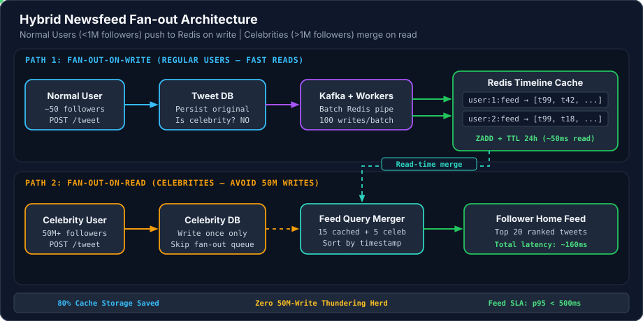
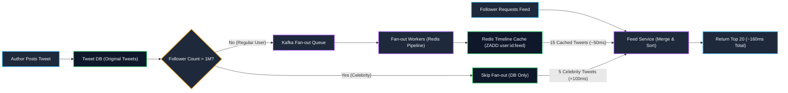
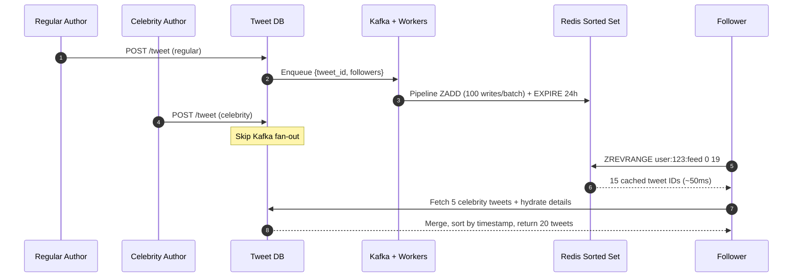
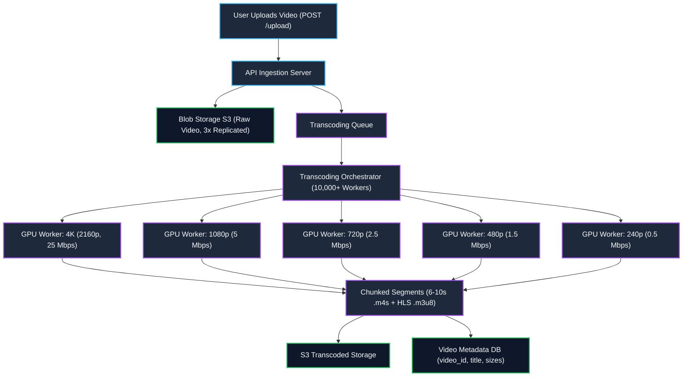
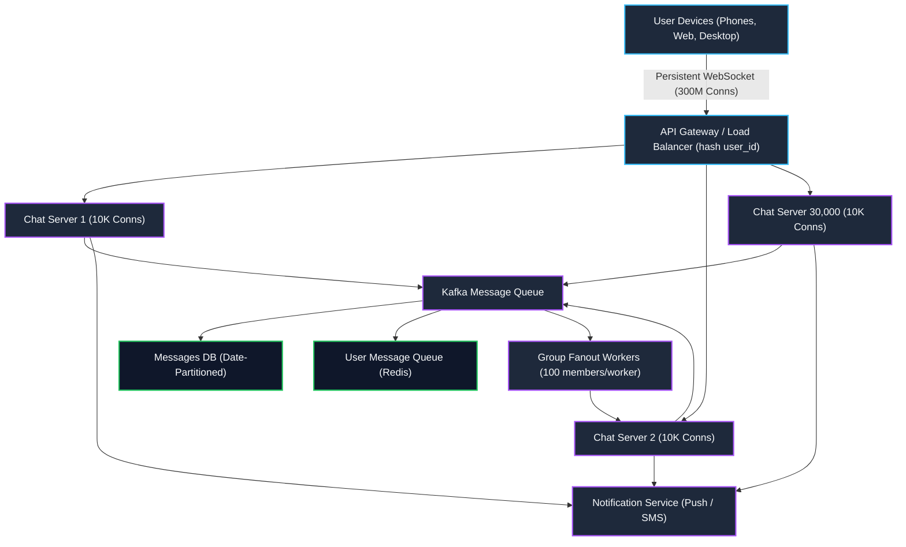
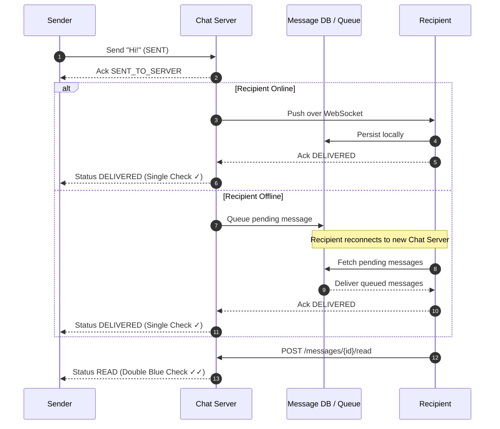
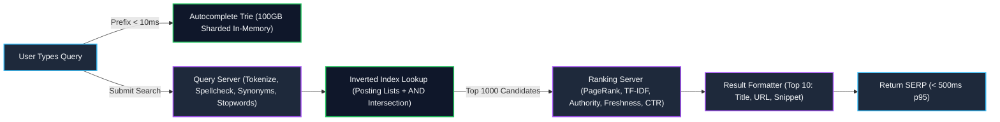
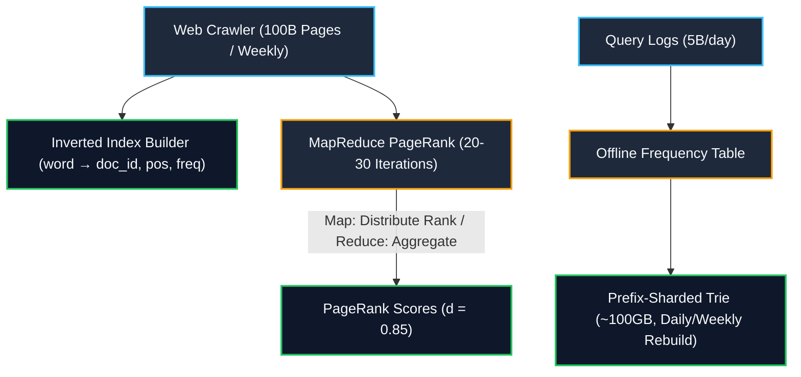
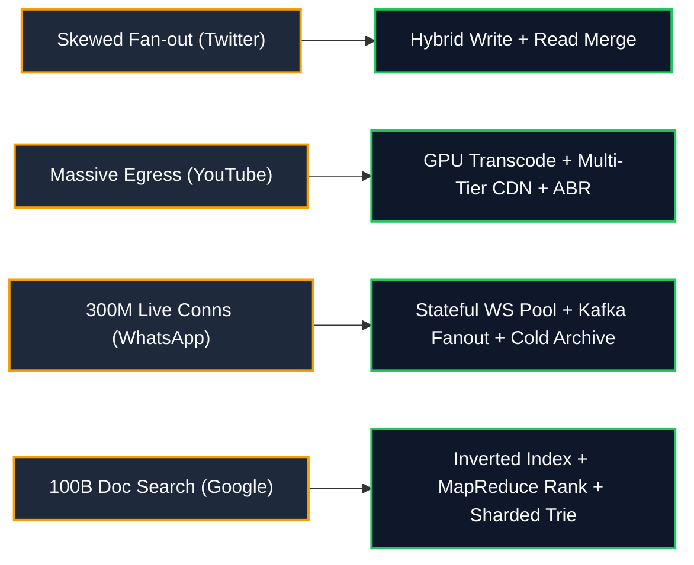

# Advanced System Designs

## Table of Contents
1. [Design Twitter Feed](#design-twitter-feed)
2. [Design YouTube](#design-youtube)
3. [Design WhatsApp/Chat System](#design-whatsappchat-system)
4. [Design Google Search](#design-google-search)
5. [Key Takeaways](#key-takeaways)

---

## Design Twitter Feed

Design a system for generating user timelines (home feed) at Twitter/X scale.

### Requirements & Scale Estimation

| Dimension | Target / Metric |
| :--- | :--- |
| **Functional** | Home feed from followed accounts (recency/relevance), tweet, retweet, like, reply, real-time updates |
| **DAU** | 300M daily active users (~50 avg followers, ~20 feeds viewed/day) |
| **Read QPS** | 1B–6B feed loads/day → 11.5K–69K avg QPS (**200K peak QPS**) |
| **Write QPS** | 500M tweets/day → **5.8K write QPS** |
| **Latency & Availability** | Feed loads in **&lt; 500ms (p95)**; **99.9%** availability; eventual consistency (seconds lag) |
| **Storage (1 Year)** | 500M × 300B = 150 GB/day → 54.7 TB/yr → **164 TB** (3× replication) → **250+ TB** with indexes |

> [!IMPORTANT]
> At **200K peak QPS** with a **500ms** budget, the system executes ~100M feed-index operations/sec. Serving reads directly from a relational `JOIN` collapses under load—precomputing timelines in memory is mandatory.

### Hybrid Fan-out Architecture





### Fan-Out Strategy Comparison

| Strategy | How It Works | Pros | Cons | Best Used When |
| :--- | :--- | :--- | :--- | :--- |
| **Fan-Out on Read** | Query DB on read (`JOIN follows`, `ORDER BY created_at DESC LIMIT 20`) | Simple; zero duplicate storage; tweets always fresh | Heavy DB joins/sorts; high p99 latency for users following many accounts | Moderate follower counts; storage-constrained; higher read latency acceptable |
| **Fan-Out on Write** | Async workers push new `tweet_id` to every follower's Redis timeline cache | Fast, constant-time reads (~100ms); low p99 latency | Heavy write amplification; duplicate cache storage; **Celebrity Problem** (50M followers = 83 min at 10K writes/s) | Most users have moderate followers; eventual consistency acceptable |
| **Hybrid (Write + Read)** | Fan-out on write for regular users; lazy fan-out on read for celebrities (&gt; 1M followers) | **80% cache storage reduction**; eliminates 50M-write storms; ~160ms total latency | Slight latency (+100ms) to merge celebrity tweets at read time | Production social feeds with skewed follower distributions |

> [!WARNING]
> **The Celebrity Problem:** If a user with 50M followers posts a tweet under pure Fan-Out on Write, 10K writes/sec takes `50M / 10K = 5,000s` (**83 minutes**)—and at 5K writes/sec takes **2.7 hours**—delaying delivery and saturating cache workers.

### Deep Dive: Redis Cache & Fan-out Workers



- **Redis Timeline Structure (`ZSET`):** Key `user:{id}:feed`, score = `timestamp`, capped at **1,000 most recent tweets** with a **24-hour TTL** (`90%+` cache hit rate).
- **Batching Optimization:** Workers accumulate **100 Redis writes** per `redis.pipeline()` call (1–2ms roundtrip) and scale to 100+ workers (500K writes/sec) or use **tiered fan-out** (Priority 1: active in last 24h → Priority 2: engaged → Priority 3: eventual).

```sql
-- Fan-Out on Read baseline query (indexed on follower_user_id, created_at)
SELECT t.* FROM tweets t
INNER JOIN follows f ON f.followed_user_id = t.user_id
WHERE f.follower_user_id = :user_id
ORDER BY t.created_at DESC
LIMIT 20;
```

```python
# Fan-Out on Write (Worker) & Feed Read (Redis Sorted Set)
def on_tweet(tweet):
    followers = get_followers(tweet.user_id)
    pipe = redis.pipeline()
    for follower_id in followers:
        key = f"user:{follower_id}:feed"
        pipe.zadd(key, {tweet.id: tweet.timestamp})
        pipe.zremrangebyrank(key, 1000, -1)  # Keep 1,000 most recent
        pipe.expire(key, 86400)              # 24h TTL
        if len(pipe.commands) >= 100:
            pipe.execute()
            pipe = redis.pipeline()
    pipe.execute()

def get_feed(user_id, offset=0, limit=20):
    tweet_ids = redis.zrevrange(f"user:{user_id}:feed", offset, offset + limit - 1)
    if not tweet_ids:
        return []
    tweets = db.get_tweets(tweet_ids)
    return sorted(tweets, key=lambda t: t.timestamp, reverse=True)
```

> [!TIP]
> In interviews, always mention **pipelining Redis writes** and **tiered fan-out** (prioritizing online/active followers first) right after introducing the Hybrid approach.

---

## Design YouTube

Design a global video hosting and streaming platform at YouTube/Netflix scale.

### Requirements & Scale Estimation

| Dimension | Target / Metric |
| :--- | :--- |
| **Functional** | Upload videos, playback controls, multi-quality streaming, search/browse, comments & likes |
| **Upload Rate** | **500+ hours/min** (720K hours/day) |
| **Raw & Transcoded Storage** | 720 TB/day raw → **1.3 Exabytes** (5 yrs) → **6.5 Exabytes** across 5 transcoded qualities |
| **Views & Egress** | **1B views/day** (11.5K QPS) × 500MB P50 = **5.75 PB/day** (**66.6 TB/sec** egress) |
| **Playback Latency & SLA** | **&lt; 1s** startup worldwide; **99.99%** availability; zero video loss durability |

### Upload & Distributed GPU Transcoding Pipeline



- **Why Distributed GPU Transcoding:** Single-machine CPU transcoding takes ~30 min per hour of video (requiring ~150K machines). Parallelizing across **10,000+ GPU workers** (3–5 min/hour, 10× faster than CPU) delivers 20K hours/min capacity with ample headroom for 500 hours/min uploads.

> [!IMPORTANT]
> Splitting videos into **6–10 second segments** (`.m4s`) indexed by an **HLS manifest** (`.m3u8`) allows players to switch bitrates seamlessly mid-playback without re-downloading the entire file.

### CDN Distribution & Adaptive Bitrate (ABR) Streaming


| Storage / Cache Tier | Capacity | Contents | Latency |
| :--- | :--- | :--- | :--- |
| **CDN Edge (50+ PoPs)** | 50 TB per PoP | Viral / hot videos (24h TTL) | **0–50ms** |
| **Regional Cache** | 500 TB | Warm regional catalog | ~50–150ms |
| **S3 Origin (3-Region)** | Unlimited (6.5 EB) | All raw + transcoded segments | ~200ms+ (origin pull) |

- **ABR Selection Factors:** Real-time bandwidth (85% safety margin on last 5 chunks), buffer occupancy (target &gt; 3 chunks = 18–30s), latency, device screen size (avoid 4K on mobile), and user preferences.

```python
# Simplified Adaptive Bitrate (ABR) Player Loop
for segment_number in range(total_segments):
    current_bandwidth = measure_bandwidth()  # Rolling average of last 5 chunks
    selected_quality = next(
        (q for q in [4K, 1080p, 720p, 480p, 240p] if q.bitrate <= current_bandwidth * 0.85),
        240p
    )
    chunk_data = download(f"chunk-{segment_number}-{selected_quality}.m4s")
    buffer.add(chunk_data)
    if buffer.size > 3:  # 18-30 seconds buffered
        player.play(buffer.get())
```

> [!TIP]
> Emphasize **egress bandwidth (66.6 TB/s)** as the primary reason CDNs are non-negotiable—origin servers alone cannot serve 1B daily views without global edge caching.

---

## Design WhatsApp/Chat System

Design a real-time 1:1 and group messaging system at WhatsApp/Slack scale.

### Requirements & Scale Estimation

| Dimension | Target / Metric |
| :--- | :--- |
| **Functional** | 1:1 text, group chat (up to 10K users), read receipts (`SENT`, `DELIVERED`, `READ`), typing indicators, presence, persistence |
| **DAU & Volume** | **1B DAU**; **100B messages/day** (**1.15M write QPS**); 200 bytes/msg |
| **Concurrent Connections** | ~30% online at peak = **300M concurrent WebSockets** (~30,000 chat servers at 10K conns/server) |
| **Latency & Durability** | Delivery **&lt; 1 second**; **99.99%** availability; zero message loss |
| **Storage (5 Years)** | 20 TB/day → **36.5 PB** (Hot &lt;3m: 1.5 PB SSD; Warm 3–12m: 2.5 PB HDD; Cold &gt;1y: 32.5 PB S3 Glacier) |

### WebSocket Connection & Group Fanout Architecture



### 1:1 Message Delivery & Read Receipt Lifecycle



> [!IMPORTANT]
> **Connection & Reconnect Handling:** Chat servers maintain an in-memory `connections[user_id] = WebSocket` map with **30s keep-alive pings**. On disconnect, the server marks the user offline; on reconnect, the load balancer may route to a different server, which immediately queries pending messages from the DB/Redis queue.

### Group Chat, Typing Indicators & Tiered Persistence

| Feature | Implementation Pattern | Key Optimization / SLA |
| :--- | :--- | :--- |
| **Group Chat (10K users)** | Persist message once → push `{msg_id, group_id, members}` to Kafka → parallel workers (100 members/batch) | API returns **&lt; 100ms**; 90% notified **&lt; 1s**; 100% **&lt; 5s** |
| **Typing Indicators** | Client throttles `TYPING` WS events to **1/sec**; stops on send, clear, or 3s idle | Server caches typing state in Redis with **5s TTL** to prevent broadcast spam |
| **Message Persistence** | Date-partitioned `messages` table (`messages_2024_01_15`); indexed on `(receiver_id, timestamp)` and `(sender_id, timestamp)` | **Hot/Warm/Cold** archival keeps 36.5 PB cost to ~$100K/month |

> [!WARNING]
> Never broadcast typing indicators on every keystroke or iterate synchronously over 10,000 group members in the API handler—both will exhaust WebSocket I/O and spike tail latency.

---

## Design Google Search

Design a web-scale search engine backend supporting billions of pages, sub-second queries, and real-time autocomplete.

### Requirements & Scale Estimation

| Dimension | Target / Metric |
| :--- | :--- |
| **Functional** | Index 100B web pages, return top 10 results in &lt; 1s, autocomplete suggestions, typo/synonym handling |
| **Query QPS** | **5B queries/day** → **57K avg QPS** (**170K–200K peak QPS**) |
| **Latency & Freshness** | **P50: 100ms**, **P95: 500ms**, **P99: 2s**; weekly crawl freshness; **99.99%** availability |
| **Storage** | 100B pages × 100KB = **10 EB raw** + **1–2 EB inverted index** (**~1 EB** with specialized compression) |

### Real-Time Query & Ranking Pipeline



### Offline Indexing, PageRank & Prefix-Sharded Trie



### Core Search Algorithms & Data Structures

| Component | Mechanism | Scale / Performance Detail |
| :--- | :--- | :--- |
| **Inverted Index** | Maps `word → {doc_id: [position, frequency]}` instead of scanning forward indexes | Multi-word queries intersect posting lists (`doc1 ∩ doc3`) and score proximity |
| **PageRank** | $PR(A) = \frac{1-d}{N} + d \sum \frac{PR(T_i)}{C(T_i)}$ with damping $d = 0.85$ | Computed via **MapReduce** (20–30 iterations); combined with **200+ ML ranking signals** |
| **Query Autocomplete** | Prefix **Trie** built from 5B/day query logs; top results pre-sorted by frequency at each node | **~100GB** total, sharded by prefix (`a*`, `m*`) in RAM for **&lt; 10ms** lookup at **200K peak QPS** |

> [!TIP]
> **Trie Sharding & Freshness:** Shard the 100GB autocomplete Trie by character prefix across memory nodes (`a*` → Server A), rebuild daily/weekly from query logs, and inject trending topics while filtering spam.

---

## Key Takeaways



| System | Primary Bottleneck | Core Architectural Pattern | Target SLA |
| :--- | :--- | :--- | :--- |
| **Twitter Feed** | Celebrity write amplification (50M followers) | Hybrid Fan-out (Redis `ZSET` write + celebrity read merge) | **&lt; 500ms** p95 |
| **YouTube** | 66.6 TB/s egress &amp; 500 hrs/min transcoding | Distributed GPU transcoding + 3-tier CDN + HLS ABR | **&lt; 1s** playback start |
| **WhatsApp** | 300M concurrent WebSockets &amp; 10K-user groups | Hashed WS server pool + Kafka group fanout + Hot/Warm/Cold DB | **&lt; 1s** delivery |
| **Google Search** | 10 EB web corpus &amp; 200K peak QPS | Inverted index + MapReduce PageRank + prefix-sharded Trie | **&lt; 500ms** p95 (**&lt; 10ms** autocomplete) |

> [!IMPORTANT]
> Across all four systems, **asynchronous queues (Kafka)** decouple high-latency fan-out/transcoding from user-facing API responses, while **multi-tier caching/storage** keeps hot reads in memory or at the network edge.
