# Infrastructure and DevOps System Designs

## Table of Contents
1. [Notification System](#notification-system)
2. [Logging and Monitoring System](#logging-and-monitoring-system)
3. [Distributed Task Scheduler](#distributed-task-scheduler)
4. [CI/CD Pipeline & Kubernetes Rollout](#cicd-pipeline--kubernetes-rollout)
5. [Multi-Region Cloud Infra & Zero-Trust Security](#multi-region-cloud-infra--zero-trust-security)
6. [Key Takeaways](#key-takeaways)

---

## Notification System

Design a multi-channel notification service that delivers **10B notifications/day** across Push, Email, and SMS with **99.9% reliability** and **&lt; 1 minute** delivery latency.

### Requirements & Capacity Estimation

| Dimension | Target / Estimate | Notes |
| :--- | :--- | :--- |
| **Scale** | 1B DAU, 10B notifications/day | 115.7K avg write QPS, **350K peak QPS (3x)** |
| **Push (50%)** | 5B/day (57.9K QPS), ~1 KB/msg | FCM (Android) & APNS (iOS) |
| **Email (30%)** | 3B/day (34.7K QPS), ~50 KB/msg | HTML + images; 150 TB/year body storage |
| **SMS (20%)** | 2B/day (23.1K QPS), ~0.1 KB/msg | Carrier-routed; strict per-user rate limits |
| **Metadata Storage** | 10B × 50 bytes = 500 GB/year | Total 1-year storage: **~150 TB** |
| **SLOs** | &lt; 1 min latency, 99.9% delivery | Idempotent deduplication + per-channel rate limits |

### Architecture

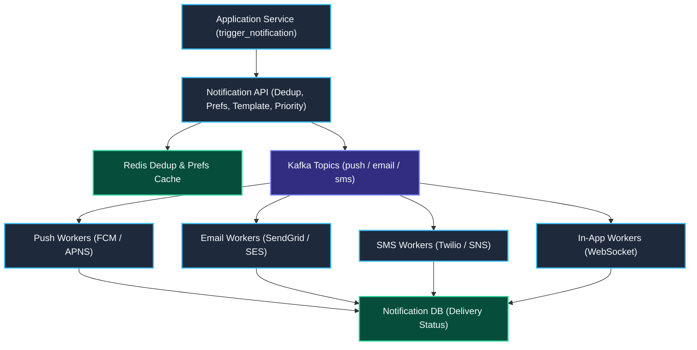

- **Notification API**: Checks user opt-in/quiet-hours preferences, validates the `request_id` deduplication cache, renders the versioned template, and classifies priority before publishing to channel-isolated Kafka topics.
- **Channel Isolation**: Separate Kafka topics (`notifications.push`, `notifications.email`, `notifications.sms`) prevent slow third-party email/SMS providers from blocking high-throughput push delivery.

> [!IMPORTANT]
> Isolating channels into separate Kafka topics and worker pools prevents head-of-line blocking: a 5-second SMTP/carrier slowdown will never starve real-time 1-second push notifications.

### Channels: Push, Email, SMS

| Channel | Providers | Latency | Cost (per 1B) | Key Constraints & Controls |
| :--- | :--- | :--- | :--- | :--- |
| **Push** | FCM, APNS | ~1s online (24h offline hold) | **~$0** (free) | App required; max **5/user/hour**; respect quiet hours (9 PM–8 AM) |
| **Email** | SendGrid, Mailgun, AWS SES | Seconds to minutes | **~$100K** ($0.03/email) | 50 KB payload; spam filters; track **hard/soft bounce lists** |
| **SMS** | Twilio, AWS SNS, Nexmo | Seconds (98% open rate) | **~$10M** ($0.05/SMS) | 160-char limit; **max 1/user/hour**; reserve for 2FA & critical alerts |

### Deduplication & Template System

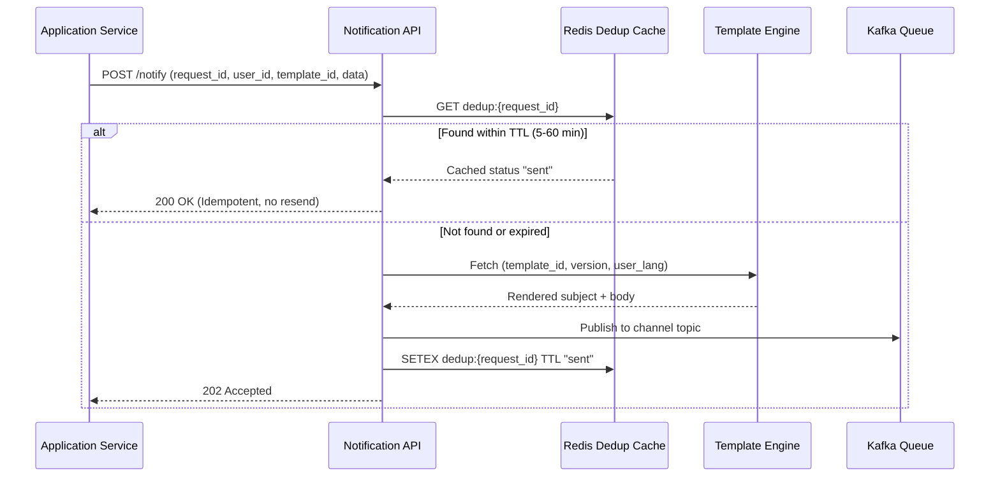

- **Deduplication**: Clients pass an idempotency key (`request_id`). Redis stores `dedup:{request_id}` with a **5–60 minute TTL**. At 350K QPS with a 5-minute window, ~1M active keys require only **~100 MB RAM**.
- **Template Engine**: Stores `(template_id, version, language)` in `templates` (`subject`, `body_text`, `body_html`). Supports **multi-language** lookup from user profile and **50/50 A/B testing** (tracking open/click rates before promoting the winner).

> [!TIP]
> Always bind sent notifications to an explicit `(template_id, version)` pair rather than `latest`. Otherwise, a template edit mid-flight can corrupt queued or retried notifications.

---

## Logging and Monitoring System

Design a centralized observability platform (ELK + Prometheus + OpenTelemetry) ingesting **1B log events/day** with **&lt; 1 second** query latency and **99.9% availability**.

### Requirements & Capacity Estimation

| Dimension | Estimate | Notes |
| :--- | :--- | :--- |
| **Log Volume** | 1,000+ services × 100K/day = **1B events/day** | 11.5K avg logs/sec, **35K peak logs/sec** |
| **Storage Size** | 500 bytes/line = **500 GB/day** | 15 TB/month, **180 TB/year** |
| **Query Latency** | &lt; 1 second (50–200ms hot) | Full-text, time-range, aggregations, `request_id` trace |
| **Retention Tiers** | 30d Hot (SSD), 90d Warm (HDD), 1yr Cold (S3) | Total annual cost: **~$672K/year (~$0.000002/event)** |

### Architecture: Logs, Metrics & Distributed Tracing

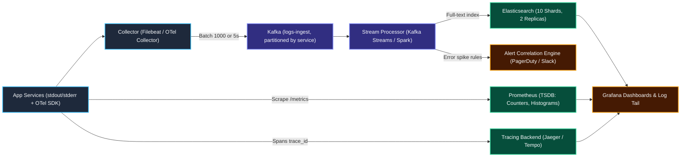

- **Three Pillars of Observability**:
  - **Logs (Elasticsearch)**: Structured JSON logs collected from `stdout`/`stderr`, buffered locally, and batched (1,000 events or 5s) into Kafka. Inverted indexes map tokens (`"authenticate"`, `level="ERROR"`, `user_id="12345"`) to posting lists for millisecond intersections across **10 parallel shards** (`hash(id) % 10`, ~3.5K logs/shard/sec).
  - **Metrics (Prometheus)**: Time-series counters, gauges, and histograms tracking **RED** (Rate, Errors, Duration — P95/P99) and **USE** (Utilization, Saturation, Errors).
  - **Distributed Tracing (OpenTelemetry)**: Propagates `trace_id` and `span_id` via HTTP/gRPC headers across microservices to pinpoint latency bottlenecks and correlate logs to a single failing request.

### Alerting & Tiered Retention

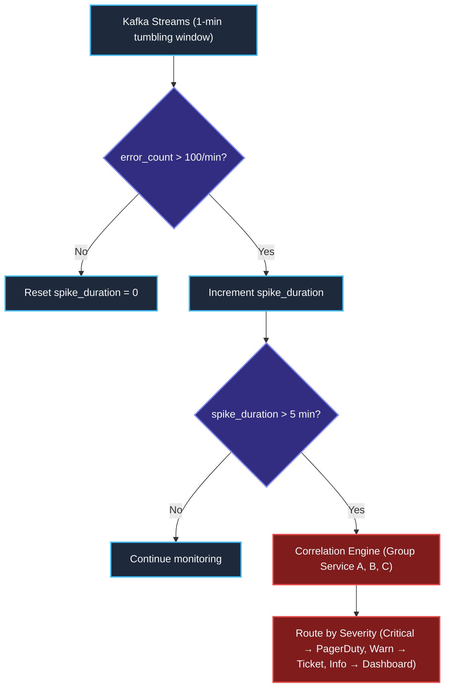

- **Alert Correlation & Fatigue Prevention**: Groups simultaneous error spikes across dependent services (e.g., Service A, B, C failing within 2 minutes → root cause `"DB connection pool exhausted"`). Tunes thresholds historically, deduplicates repeats, and enforces severity tiers:
  - **Critical**: Error rate &gt; 1% → immediate PagerDuty/SMS page.
  - **Warning**: Error rate &gt; 0.1% → create ticket / Slack notice.
  - **Info**: Error rate &gt; 0.01% → dashboard visibility only.

| Storage Tier | Medium | Retention | Volume | Query Latency | Monthly Cost |
| :--- | :--- | :--- | :--- | :--- | :--- |
| **Hot** | Elasticsearch SSD | Days 1–30 | 15 TB | 50–100 ms | **$50K/mo** (90% of queries) |
| **Warm** | HDD Archive (gzip 10:1) | Days 31–90 | 30 TB | 500–1,000 ms | **$5K/mo** (9% of queries) |
| **Cold** | S3 Glacier | Days 91–365 | 135 TB | 5–60 sec | **$1K/mo** (1% compliance) |

> [!WARNING]
> Never index raw, unbounded high-cardinality fields (like full request payloads or dynamic UUIDs) as Prometheus metric labels. High cardinality explodes TSDB memory and crashes scraping; keep high-cardinality IDs in logs and traces.

---

## Distributed Task Scheduler

Design a distributed cron/task execution platform managing **1M scheduled tasks** and **100M executions/day** with **exactly-once execution** and **&lt; 1 minute** scheduling latency.

### Requirements & Capacity Estimation

| Dimension | Estimate | Notes |
| :--- | :--- | :--- |
| **Scale** | 1M tasks × 100 runs/day = **100M runs/day** | **1.16K tasks/sec** |
| **Storage** | 1M × 1 KB = **1 GB** metadata | 100M × 10 KB logs = **1 TB/year** |
| **Worker Fleet** | 1.16K QPS × 10s avg = 11.6K concurrent | **~1.5K workers** (at 8 concurrent tasks/worker) |

### Architecture & Exactly-Once Execution

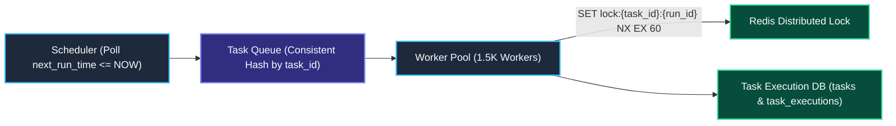

- **Consistent Hashing**: Partitioning the queue by `task_id` routes the same task to the same worker pool, improving locality and simplifying concurrency control.
- **Distributed Lock (`NX` + `EX`)**: Prevents duplicate execution when a worker crashes or a message is redelivered:

```python
def execute_task(task_id, run_id):
    lock_key = f"lock:{task_id}:{run_id}"
    lock_value = generate_unique_id()

    if redis.set(lock_key, lock_value, NX=True, EX=60):
        try:
            result = run_task_code(task_id)
            db.update_execution(run_id, status="success", result=result)
        except Exception as e:
            db.update_execution(run_id, status="failed", error=str(e))
        finally:
            redis.delete(lock_key)
```

> [!IMPORTANT]
> Distributed locks prevent *concurrent* execution, while **task idempotency** protects against *sequential* retries after a post-execution crash. Design tasks to check state first or use idempotent writes (`SET X = 100`, not `X = X + 1`).

### Retry Strategy & Exponential Backoff

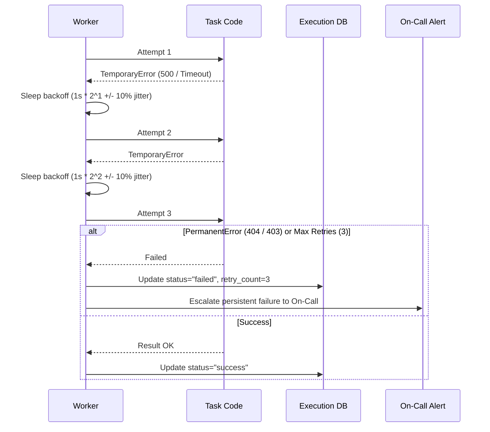

- **Backoff Formula**: `delay = min(1 * (2 ** attempt), 60) * random.uniform(0.9, 1.1)` — caps at 60s and adds **±10% jitter** to prevent thundering herds.
- **Error Classification**: Retry **temporary errors** (`500`, network timeout); fail fast on **permanent errors** (`403`, `404`); escalate to on-call after **3 consecutive failures**.
- **State Machine**: `pending` → `in_progress` → `success` | `retrying` → `failed`.

---

## CI/CD Pipeline & Kubernetes Rollout

Design an automated GitOps CI/CD pipeline delivering builds in **&lt; 5 min**, tests in **&lt; 10 min**, and zero-downtime Kubernetes deployments with **&gt; 99% success rate**.

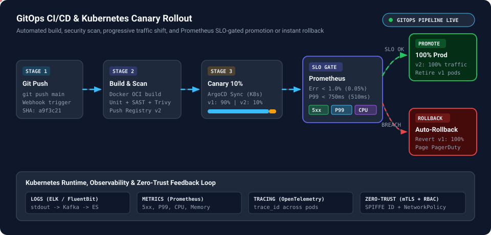

### End-to-End Pipeline Stages

```mermaid
flowchart LR
    Git["Git Push &amp; Webhook"] --> S1["1. Build (3-5m: Compile, Docker OCI, Push)"]
    S1 --> S2["2. Test (5-10m: Parallel Unit, Int, E2E)"]
    S2 --> S3["3. Security Scan (2-3m: SAST, Deps, Image)"]
    S3 --> S4["4. Staging (3-5m: Smoke &amp; Load Tests)"]
    S4 --> S5["5. Manual Approval Gate"]
    S5 --> S6["6. Prod Canary (20-30m: 5% → 50% → 100%)"]

    classDef dev fill:#1e293b,stroke:#38bdf8,stroke-width:2px,color:#f8fafc
    classDef sec fill:#312e81,stroke:#818cf8,stroke-width:2px,color:#f8fafc
    classDef prod fill:#064e3b,stroke:#34d399,stroke-width:2px,color:#f8fafc
    class Git,S1,S2 dev
    class S3,S4,S5 sec
    class S6 prod
```

- **Docker & Container Best Practices**: Use **multi-stage builds** (`golang:alpine` → `distroless`/`scratch`), pin base image digests, run as **non-root**, and scan layers (Trivy/Grype) before pushing immutable SHA-tagged images to the OCI registry.
- **Kubernetes GitOps Rollout**: ArgoCD/Flux watches the Git manifest repo and reconciles `Deployment` / `ReplicaSet` state. **HPA** (Horizontal Pod Autoscaler) scales pods on CPU/custom metrics, while **Ingress / Service Mesh** shifts weighted traffic during Canary rollouts.

### Blue-Green vs. Canary Deployment

| Strategy | Traffic Shift | Rollback Speed | Blast Radius | Resource Cost | Best For |
| :--- | :--- | :--- | :--- | :--- | :--- |
| **Blue-Green** | Instant 0% → 100% LB swap | **&lt; 1 second** (flip LB to Blue) | 100% of users on cutover | **2x compute** during deploy | Stateful/schema-coupled releases needing instant cutover |
| **Canary** | Gradual 1% → 5% → 10% → 50% → 100% | **&lt; 1 minute** (drain canary weight) | **1–5% of users** initially | **~1.05–1.1x** compute | High-traffic microservices with strong SLO monitoring |

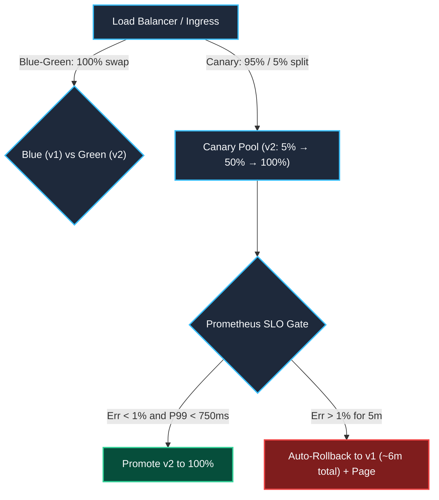

### Automated Rollback & Deployment Monitoring

| Metric | Baseline (1h prior) | Auto-Rollback / Alert Threshold | Why It Matters |
| :--- | :--- | :--- | :--- |
| **Error Rate (5xx)** | 0.05% | **&gt; baseline + 2x** (0.1%) or **&gt; 1%** for 5m | Triggers auto-rollback (~5m detection + &lt; 1m revert = **~6m total**) |
| **P95 / P99 Latency** | 200ms / 500ms | **P99 &gt; baseline + 50%** (750ms) or **&gt; 2s** | Catches tail-latency regressions &amp; slow DB queries |
| **CPU / Memory** | 60% / 70% | **CPU &gt; 90%** or **Memory &gt; 85%** | Prevents OOMKills and cascading pod evictions |
| **Business Metrics** | Baseline order/auth rate | Custom anomaly thresholds | Detects silent logic bugs (e.g., failed checkouts) |

- **Preventive Testing Pyramid**: Unit tests (catch **70%** of bugs) → Integration tests (**20%**) → E2E tests (**5%**) → Code review (**3–5%**) → Staging (**1%**) → Production monitoring (**1%** that slip through).

> [!TIP]
> Always record a 1-hour pre-deploy baseline before shifting canary traffic. Comparing canary error rates and P99 latency against a live baseline eliminates false positives during normal daily traffic spikes.

---

## Multi-Region Cloud Infra & Zero-Trust Security

Design resilient multi-region cloud infrastructure and defense-in-depth Zero-Trust security for global production workloads.

### Multi-Region Cloud Architecture

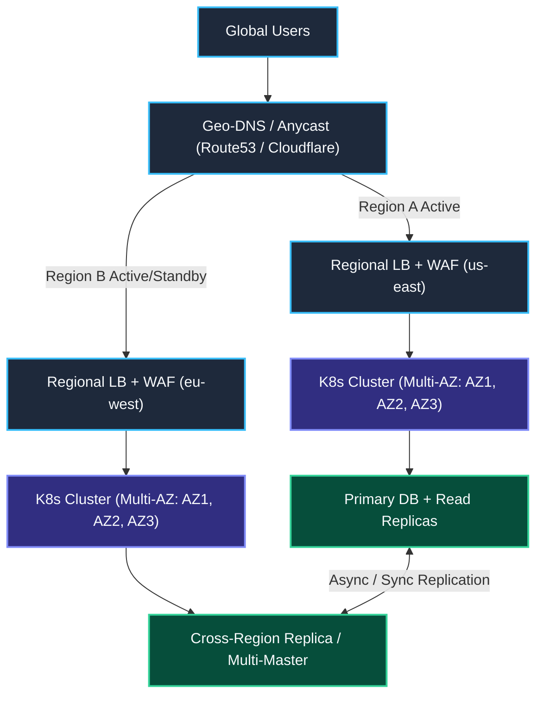

| Topology | RPO (Data Loss) | RTO (Recovery Time) | Cost & Complexity | Use Case |
| :--- | :--- | :--- | :--- | :--- |
| **Multi-AZ (Single Region)** | 0 (sync replication) | Seconds–Minutes | 1x–1.5x | Protects against rack/datacenter failure |
| **Active-Passive (Warm Standby)** | Seconds–Minutes (async) | Minutes (DNS + DB promote) | ~1.5x | Disaster recovery &amp; compliance |
| **Active-Active (Multi-Region)** | ~0–Seconds | **&lt; 1 second** (DNS failover) | 2x+ (conflict resolution) | Global low-latency apps (1B+ DAU) |

### Zero-Trust Security & Supply-Chain Controls


- **Zero-Trust Principles**: *Never trust, always verify* — replace perimeter-only firewalls with **mTLS** (Istio/Linkerd + SPIFFE/SPIRE identities) for all pod-to-pod traffic.
- **Kubernetes Hardening**: Enforce **NetworkPolicies** (default-deny ingress/egress), **RBAC** least privilege, non-root `securityContext`, and read-only root filesystems.
- **Secrets & Supply Chain**: Store secrets in **HashiCorp Vault / Cloud KMS** with dynamic short-lived leases (never in Git or plain ConfigMaps); sign container images (**Cosign**) and generate **SBOMs** during CI.

> [!WARNING]
> Relying solely on cluster perimeter firewalls leaves east-west traffic exposed: if a single public-facing pod is compromised, an attacker can pivot laterally to databases unless **mTLS** and **NetworkPolicies** enforce strict service-to-service authorization.

---

## Key Takeaways

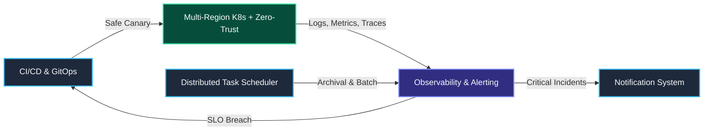

| System | Core Mechanism | Critical Interview Trade-Off |
| :--- | :--- | :--- |
| **Notification System** | Channel-isolated Kafka topics + Redis `request_id` dedup + versioned templates | Push (~$0) vs SMS (~$10M/1B); TTL window (5–60 min) balances dedup vs valid resends |
| **Logging & Monitoring** | Kafka → Stream Processing → Elasticsearch (inverted index) + Prometheus + OTel | Hot SSD ($50K/mo) vs Warm HDD ($5K/mo) vs Cold S3 ($1K/mo); avoid high-cardinality metric labels |
| **Task Scheduler** | Consistent-hashed queue + Redis `NX EX` lock + idempotent tasks + jittered backoff | Distributed lock prevents concurrent runs; idempotency prevents duplicate post-crash runs |
| **CI/CD & Kubernetes** | Multi-stage Docker + GitOps (ArgoCD) + Canary SLO gate + instant rollback (~6m) | Blue-Green (instant cutover, 2x cost) vs Canary (1–5% blast radius, 20–30m rollout) |
| **Multi-Region & Zero-Trust** | Geo-DNS + Multi-AZ K8s + mTLS (SPIFFE) + NetworkPolicies + Vault/KMS | Active-Active (&lt; 1s RTO, conflict complexity) vs Active-Passive (cheaper, minute-scale RTO) |
