# System Design Interview Cheatsheet

Quick reference guide for system design interviews. Use this visual playbook to anchor your 45-minute pacing, back-of-the-envelope math, architecture choices, and trade-off discussions.

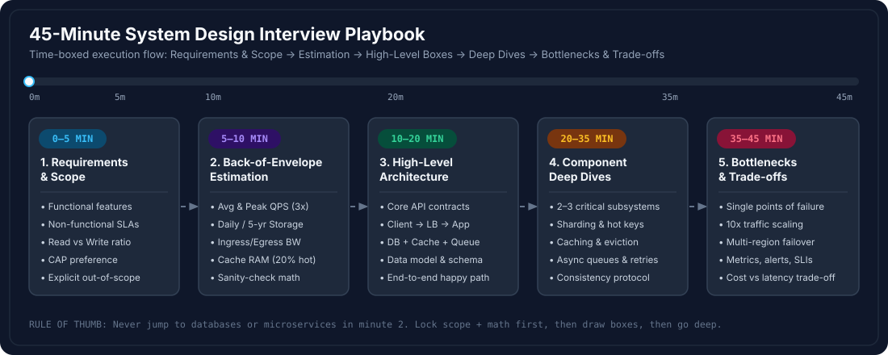

---

## Table of Contents

- [The 5-Step Framework (Memorize This!)](#the-5-step-framework-memorize-this)
- [Estimation Formulas (Commit These to Memory)](#estimation-formulas-commit-these-to-memory)
- [Numbers Every Engineer Should Know](#numbers-every-engineer-should-know)
- [One-Pager: Building Blocks](#one-pager-building-blocks)
- [Rate Limiting Comparison](#rate-limiting-comparison)
- [Sharding Strategy Decision Tree](#sharding-strategy-decision-tree)
- [Consistency vs Availability Trade-off](#consistency-vs-availability-trade-off)
- [Latency vs Storage Trade-off](#latency-vs-storage-trade-off)
- [Red Flags (What NOT to Do)](#red-flags-what-not-to-do)
- [How to Handle "What If..." Questions](#how-to-handle-what-if-questions)
- [Quick Reference: Top 20 System Design Questions](#quick-reference-top-20-system-design-questions)
- [Template: Fill-in-the-Blank Structure](#template-fill-in-the-blank-structure)
- [Interviewer Evaluation Criteria](#interviewer-evaluation-criteria)
- [Interview Day Tips](#interview-day-tips)
- [Post-Interview](#post-interview)
- [Final Reminders](#final-reminders)

---

## The 5-Step Framework (Memorize This!)

> [!IMPORTANT]
> Treat a 45-minute system design interview as a strict time-boxed pipeline. Never jump straight to databases or microservices in minute 2—lock scope and math first, draw clean boxes second, and earn your senior signal in the deep dives.

| Step | 45-Min Pacing | Flexible Buffer | Core Deliverables | Exit Question to Ask Interviewer |
| :--- | :--- | :--- | :--- | :--- |
| **1. Requirements** | `0–5 min` | `5–10 min` | Functional features (what it does) + Non-functional SLAs (how it runs: scale, latency, CAP) | *"Should we focus on X and Y, and leave Z out of scope?"* |
| **2. Estimation** | `5–10 min` | `10–15 min` | QPS (avg & peak), storage (daily & multi-year), bandwidth, concurrent users | *"Does ~X peak QPS and ~Y TB/year match your scale expectations?"* |
| **3. High-Level Design** | `10–20 min` | `10–15 min` | End-to-end architecture diagram, core APIs, data model, justified technology choices | *"Does this baseline flow look good before we dive deeper?"* |
| **4. Deep Dive** | `20–35 min` | `15–20 min` | Pick 2–3 critical components, explain algorithms, data partitioning, and trade-offs | *"Which of these 2–3 hotspots would you like me to explore first?"* |
| **5. Bottlenecks & Scale** | `35–45 min` | `5–10 min` | What breaks first, 10x growth plan, SPOFs, monitoring, and *"What if...?"* resilience | *"If we had another 10 minutes, I would also harden X."* |

> [!TIP]
> State your time plan out loud in minute 1: *"I'll spend 5 minutes aligning on requirements, 5 minutes on capacity math, 10 minutes on the high-level design, and then go deep on the hardest bottlenecks."* Interviewers immediately relax when you drive the clock.

---

## Estimation Formulas (Commit These to Memory)

> [!NOTE]
> Back-of-the-envelope math is not about 4-decimal precision—it is about **order-of-magnitude sanity** so you know whether a single PostgreSQL node (`1K–5K QPS`) suffices or sharding/caching is mandatory.

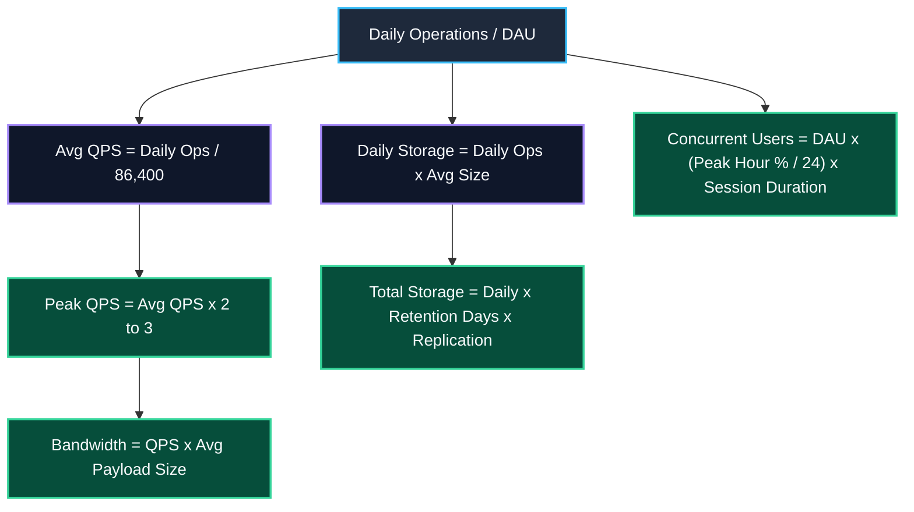

| Metric | Formula | Worked Example | Result |
| :--- | :--- | :--- | :--- |
| **Average QPS** | `Daily Operations / 86,400 seconds` | `500M ops/day / 86,400` | **5,787 QPS** |
| **Peak QPS** | `Average QPS × 2–3` (traffic spikes) | `5,787 × 3` | **17,361 Peak QPS** |
| **Daily Storage** | `Daily Operations × Average Data Size` | `500M ops × 1 KB` | **500 GB/day** |
| **Total Storage** | `Daily Storage × Retention Days × Replication Factor` | `500 GB × 365 days × 3x HA replication` | **547.5 TB/year** |
| **Egress Bandwidth** | `QPS × Average Payload Size` | `10K read QPS × 100 KB response` | **1 GB/s egress** |
| **Concurrent Users** | `DAU × (Peak Hour % / 24) × Session Duration (hrs)` | `100M DAU × 0.1 × (1/6 hr for 10m session)` | **1.67M concurrent users** |

> [!TIP]
> Use `86,400 ≈ 10^5` (`100,000`) during mental math for instant division, then note your rounding aloud (`500M / 100K = 5,000 QPS`, actual `5,787 QPS`).

---

## Numbers Every Engineer Should Know

| Category | Reference Item | Exact Value / Range |
| :--- | :--- | :--- |
| **Latency** | L1 cache reference | `~1 nanosecond` |
| **Latency** | L2 cache reference | `~4 nanoseconds` |
| **Latency** | RAM access | `~100 nanoseconds` |
| **Latency** | Disk seek | `~10 milliseconds` |
| **Latency** | Network round-trip (same DC) | `~1 millisecond` |
| **Latency** | Network round-trip (different DC) | `~100 milliseconds` |
| **Latency** | Network round-trip (across world) | `~200–300 milliseconds` |
| **Memory** | `1 MB` / `1 GB` / `1 TB` / `1 PB` | `1,024 KB` / `1,024 MB` / `1,024 GB` / `1,024 TB` |
| **Time** | `1 minute` / `1 hour` / `1 day` / `1 year` | `60 s` / `3,600 s` / `86,400 s` / `31,536,000 s` |
| **Capacity** | Single database server | `1K–5K QPS` |
| **Capacity** | Redis cache server | `10K–100K QPS` |
| **Capacity** | Message queue | `100K–1M QPS` |
| **Capacity** | CDN | `10M+ QPS` |

> [!IMPORTANT]
> Notice the **100,000x gap** between RAM (`~100 ns`) and Disk Seek (`~10 ms`), and the **100x gap** between Same-DC RTT (`~1 ms`) and Cross-DC RTT (`~100 ms`). Every caching layer and regional edge exists to avoid crossing those cliffs.

---

## One-Pager: Building Blocks

### When to Use Each Technology

| Technology | Use Case | Throughput | Trade-off |
| :--- | :--- | :--- | :--- |
| **PostgreSQL** | Structured data, ACID needed | `1–5K QPS` | Vertical scaling only (without sharding) |
| **MongoDB** | Flexible schema, document model | `5–10K QPS` | Eventual consistency (by default across replicas) |
| **Redis** | Caching, sessions, real-time data | `50–100K QPS` | In-memory, limited size |
| **Elasticsearch** | Full-text search, log indexing | `10K–100K QPS` | Not for strong ACID |
| **Kafka** | Async processing, event streaming | `100K–1M QPS` | Not a database (bounded retention, no random queries) |
| **S3 / Blob Storage** | Files, images, videos | `Unlimited GB` | Not optimized for low-latency small-record retrieval |
| **CDN** | Static content, videos | `Millions QPS` | Cache only, does not own origin state |
| **GraphDB** | Relationships, recommendations | `10K QPS` | Limited horizontal scale |
| **Cassandra** | Time-series, mega-scale writes | `100K–1M QPS` | Complex ops, eventual consistency |

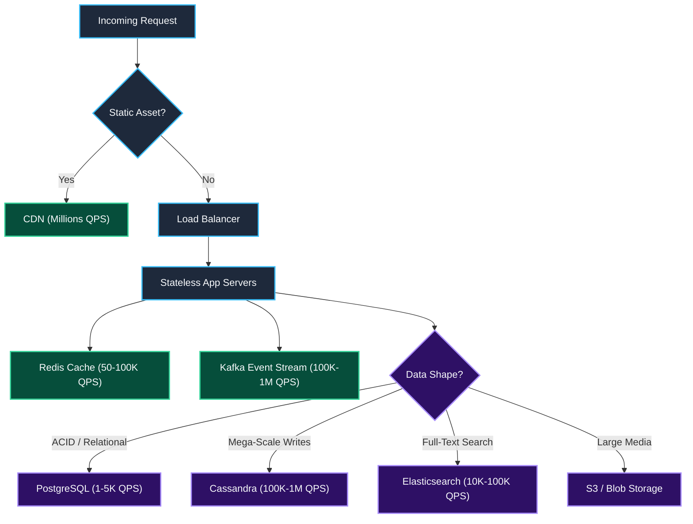

### Load Balancing Algorithms

| Algorithm | When to Use | Best Fit |
| :--- | :--- | :--- |
| **Round-Robin** | Equal capacity servers | Stateless services (web/API servers) |
| **Least Connections** | Long-lived connections (WebSockets, DB pools) | Varying request durations and load patterns |
| **Weighted Round-Robin** | Different capacity servers | Heterogeneous hardware clusters |
| **IP Hash / Consistent Hash** | Sticky sessions required | In-memory caching, state-dependent services |

### Caching Strategies (Decision Tree)

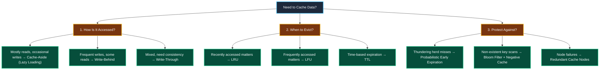

> [!WARNING]
> **Write-Behind** delivers blistering write throughput by batching writes asynchronously to the DB, but risks **data loss** if the cache node crashes before flushing. Never use it for financial ledgers without durable WAL backing.

---

## Rate Limiting Comparison

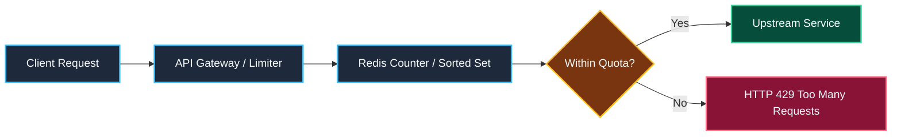

| Algorithm | Latency | Burstable | Distributed State | Notes |
| :--- | :--- | :--- | :--- | :--- |
| **Token Bucket** | `&lt; 1ms` (memory) | **Yes** (burst up to bucket size) | Redis (watch for SPOF) | **Default choice** (AWS, Google use this) |
| **Leaky Bucket** | `&lt; 1ms` (memory) | **No** (smooth constant outflow) | Redis (watch for SPOF) | Best for protecting fragile downstream DBs |
| **Fixed Window** | `&lt; 1ms` (memory) | **Yes** (2x spike at window boundary) | Redis (watch for SPOF) | Simple counter; boundary-burst flaw |
| **Sliding Window** | `2–5ms` (sorted set) | **No** (accurate across rolling window) | Redis (watch for SPOF) | Higher memory/CPU for timestamp logs |

> [!TIP]
> Default to **Token Bucket** in interviews unless the prompt demands strict traffic smoothing (**Leaky Bucket**) or exact rolling-window enforcement (**Sliding Window Log / Counter**). Mitigate the Redis SPOF with Redis Cluster + fail-open/fail-closed policy.

---

## Sharding Strategy Decision Tree

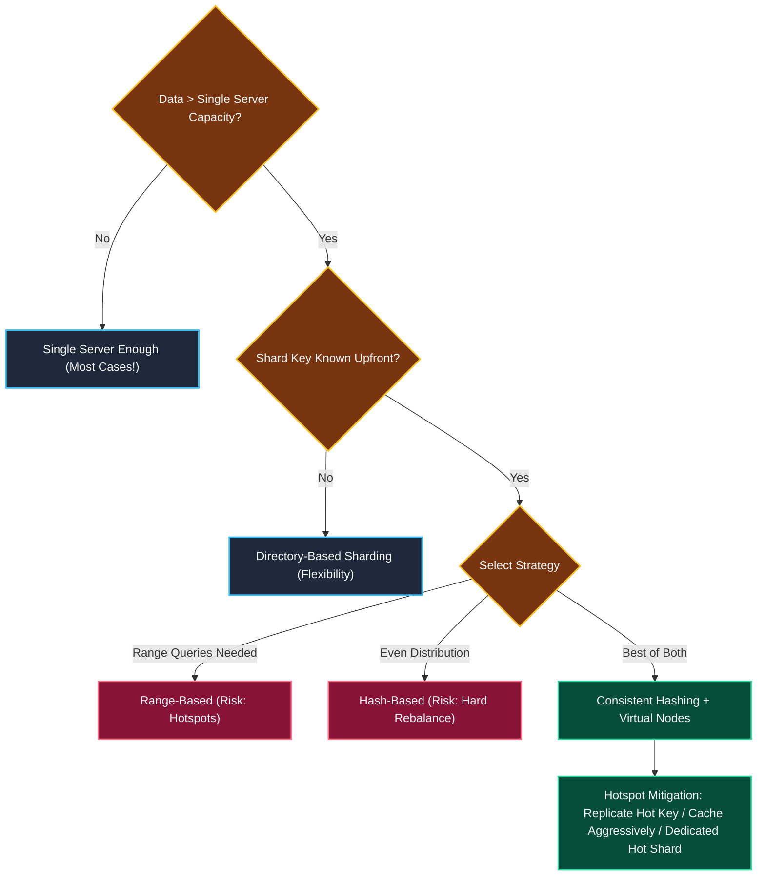

| Strategy | Strengths | Weaknesses | Hotspot Mitigation |
| :--- | :--- | :--- | :--- |
| **Single Server (No Shard)** | Zero distributed joins or cross-shard transactions | Ceiling at `~1–5K QPS` or single-node disk | Read replicas + vertical scaling first |
| **Range-Based** | Fast range scans (`WHERE ts BETWEEN ...`) | Hotspots (e.g., all today's writes hit 1 shard) | Pre-split ranges or salt keys |
| **Hash-Based (`key % N`)** | Even key distribution | Rebalancing is a nightmare when `N` changes | Migrate to Consistent Hashing |
| **Consistent Hashing** | Minimal key movement on node add/remove | Uneven ring without virtual nodes | Add **virtual nodes** (vnodes) per physical host |
| **Directory-Based** | Full flexibility to move any tenant/key | Lookup service becomes a potential bottleneck/SPOF | Cache directory heavily + replicate lookup |

> [!WARNING]
> Never jump to sharding without proving single-server limits are exceeded. When you *do* shard, proactively address **celebrity/hot keys** (replicate hot key, cache aggressively, accept uneven load for minor 20% skew, or isolate into a dedicated hot shard).

---

## Consistency vs Availability Trade-off

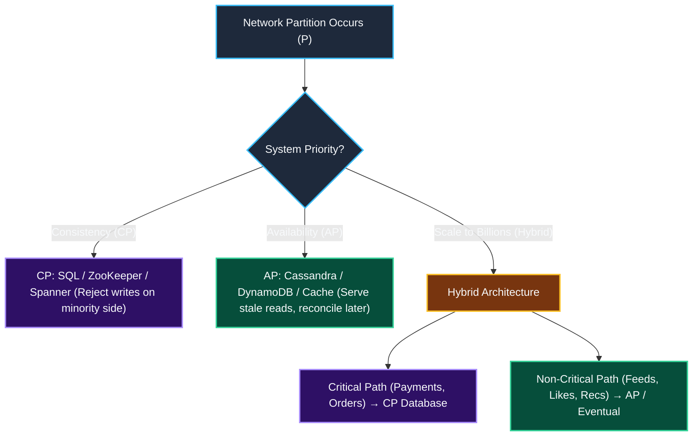

| Requirement | Architecture Choice | Concrete Tech | Accepted Trade-off |
| :--- | :--- | :--- | :--- |
| **Must have strong consistency** | **CP System** | PostgreSQL, Spanner, etcd | Limited horizontal write scalability / unavailability during split |
| **Must have high availability** | **AP System** | Cassandra, DynamoDB, Redis | Eventual consistency (stale reads, conflict resolution needed) |
| **Must scale to billions** | **Hybrid** | Separate DBs by domain | Operational complexity (syncing CP core to AP read views) |

> [!IMPORTANT]
> In a distributed system, **Partition Tolerance (P) is non-negotiable**—networks always drop packets eventually. The real interview decision is **CP vs AP** during a partition, or **Hybrid** (CP for payments/orders, AP for feeds/recommendations).

---

## Latency vs Storage Trade-off

| Tier | Medium | Typical Latency | Typical Capacity | Optimization Strategy |
| :--- | :--- | :--- | :--- | :--- |
| **L1** | CPU Cache | `1 ns` | `MB` | CPU-local hot instructions/data |
| **L2** | Memory (RAM) | `100 ns` | `GB` | Process-local state / L1 app cache |
| **L3** | SSD | `100 µs` | `TB` | Local NVMe / DB buffer pool |
| **L4** | Redis | `1 ms` | `GB–TB` | **Hot data** (everything accessed in last 24h) |
| **L5** | Database | `10–100 ms` | `TB–PB` | **Warm data** (active transactional records) |
| **L6** | Blob Storage | `100–500 ms` | `EB` | Media, immutable objects, logs |
| **L7** | Archive | `5–60 seconds` | `EB` | **Cold data** (older than 1 year) |

> [!TIP]
> Apply the **80/20 caching rule**: keeping the last 24 hours of hot data in Redis (`1 ms`) while keeping warm data in the DB and archiving records older than 1 year lets **99% of queries hit cache (`&lt; 1 ms`)**.

---

## Red Flags (What NOT to Do)

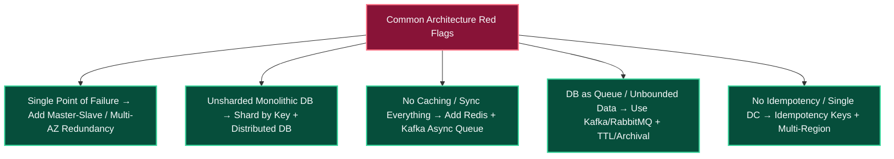

| Red Flag | Why It Fails | Exact Fix |
| :--- | :--- | :--- |
| ❌ **Single Point of Failure** | One server down = entire system down | Redundancy (master-slave, master-master) |
| ❌ **Unsharded Monolithic Database** | Cannot scale past single server (`1–5K QPS` max) | Shard by key, use distributed databases |
| ❌ **No Caching** | Database queries are slow (`10–100ms` each) | Cache layer (Redis) between app and DB |
| ❌ **Synchronous Everything** | One slow operation blocks entire system | Async with message queue (Kafka) |
| ❌ **No Monitoring** | Cannot detect when system breaks | Metrics, alerts, dashboards |
| ❌ **Database as Queue** | Polling is inefficient and slow | Use message queue (Kafka, RabbitMQ) |
| ❌ **Single Datacenter** | Regional outage = `100%` downtime | Multi-region replication |
| ❌ **No Load Balancing** | Traffic concentration on single server | Load balancer distributes traffic |
| ❌ **Unbounded Data** | Keeps growing until storage explodes | TTL, archival, data lifecycle policies |
| ❌ **No Idempotency** | Retries cause duplicate operations | Idempotent APIs, deduplication keys |

> [!CAUTION]
> Using a **relational database as a polling queue** or skipping **idempotency keys** on write/payment APIs are two of the fastest ways to lose senior/staff calibration in an interview.

---

## How to Handle "What If..." Questions

| "What If..." Question | High-Signal Answer |
| :--- | :--- |
| **"What if traffic increases 10x?"** | Scale horizontally: add stateless app servers, add database shards, increase CDN capacity (cost increases `~10x`). |
| **"What if the database fails?"** | Replication handles it: master-slave setup; promote slave to master (`&lt; 1 minute` downtime), zero data loss with synchronous replication. |
| **"What if there's a network partition?"** | Depends on consistency: critical systems use **CP** (consistency wins); general systems use **AP** (availability wins); hybrid separates them by domain. |
| **"How would you test this?"** | Multi-pronged: Unit tests (`70%`), Integration tests (`20%`), E2E tests (`5%`), Load testing / chaos engineering, plus canary & blue-green rollouts. |
| **"How would you monitor this?"** | Metrics (`QPS`, `p50`/`p95`/`p99` latency), Errors (rate & types), Resources (CPU, memory, disk, network), Alerts (paging for critical, Slack for warnings), real-time dashboards. |
| **"How would you handle cost?"** | Reserved instances (`30–50%` discount), Spot instances for non-critical (`70%` discount), data lifecycle (hot/warm/cold), compression (`10:1` text, `2:1` video), tiered caching (`memory → SSD → HDD → S3`). |
| **"How would you migrate data from old system?"** | Dual-write strategy: (1) write to both old & new, (2) batch-copy historical data, (3) validate integrity, (4) switch reads to new, (5) stop writes to old & cleanup. |

> [!TIP]
> Never freeze on *"What if..."* questions—frame every answer around **blast radius**, **recovery time objective (RTO)**, and **data loss tolerance (RPO)**.

---

## Quick Reference: Top 20 System Design Questions

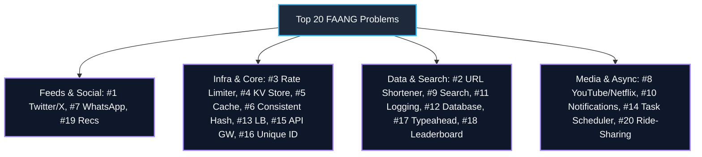

| Rank | Problem | Common Companies | Primary Pattern |
| :--- | :--- | :--- | :--- |
| **1** | Design Twitter / X Feed | Meta, Twitter | Fan-out on write vs read (hybrid) |
| **2** | Design URL Shortener | Google, Amazon | Base62 + KGS / hash + read cache |
| **3** | Design Rate Limiter | Uber, Stripe, many | Token Bucket + Redis atomic Lua |
| **4** | Design Key-Value Store | Amazon, Google | Consistent hashing + LSM-tree + quorum |
| **5** | Design Distributed Cache | LinkedIn, Adobe | Consistent hashing + LRU + replication |
| **6** | Design Consistent Hashing | Amazon, many | Hash ring + virtual nodes |
| **7** | Design WhatsApp / Chat | Meta, Microsoft | WebSockets + message queue + delivery receipts |
| **8** | Design YouTube / Netflix | Video companies | Chunked upload + transcoding DAG + CDN |
| **9** | Design Google Search | Google, Microsoft | Inverted index + crawler + PageRank |
| **10** | Design Notification System | Uber, Lyft | Priority queues + provider adapters + retries |
| **11** | Design Logging System | Amazon, Google | Agent → Kafka → Elasticsearch / S3 |
| **12** | Design Database | Amazon, Google, Microsoft | WAL + B-Tree/LSM + MVCC + Raft/Paxos |
| **13** | Design Load Balancer | Amazon, Microsoft | L4/L7 routing + health checks + Maglev |
| **14** | Design Task Scheduler | Many | Delay queue / time wheel + worker leases |
| **15** | Design API Gateway | Amazon, Google | Auth + rate limit + routing + circuit breaker |
| **16** | Design Unique ID Generator | Twitter, many | Snowflake (timestamp + worker + seq) |
| **17** | Design Typeahead / Autocomplete | Google, Microsoft | Trie + top-K aggregation + edge cache |
| **18** | Design Leaderboard | Gaming companies | Redis Sorted Sets (`ZADD` / `ZREVRANGE`) |
| **19** | Design Recommendations | Netflix, Amazon | Candidate generation + ranking + feature store |
| **20** | Design Ride-Sharing | Uber, Lyft | QuadTree / Geohash + dispatch matching |

> [!NOTE]
> Mastering just **6–8 foundational patterns** (consistent hashing, fan-out, rate limiting, WebSockets, inverted index, geo-indexing) covers over **80%** of all 20 FAANG prompts.

---

## Template: Fill-in-the-Blank Structure

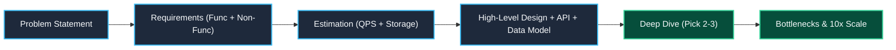

| Section | Fill-in-the-Blank Prompts |
| :--- | :--- |
| **Problem Statement** | `Design: [system name]` |
| **Requirements** | **Functional:** `[Feature 1]`, `[Feature 2]`, `[Feature 3]` · **Non-Functional:** Scale `[DAU]`, Write QPS `[QPS]` (from `[ops]/day`), Read QPS `[QPS]` (typically higher), Latency `[target] ms (p99)`, Consistency `[Strong/Eventual]`, Availability `[99.9%/99.99%]` |
| **Estimation** | Daily Ops: `[DAU] × [ops/user] = [X]` · Write QPS: `[X] / 86,400 = [Y]` · Read QPS: `[Z]` (`5–10x` higher) · Peak QPS: `[Y] × 3` · Daily Storage: `[ops] × [size/op] = [GB/day]` · Yearly Storage: `[GB/day] × 365 × [replication] = [TB]` |
| **High-Level Design** | Draw simple diagram: `Client → Load Balancer → API/App Servers → Cache / Database / Queue` |
| **API Design** | Describe 2–3 key APIs: `POST /resource` with `Input: {...}` and `Output: {...}` |
| **Data Model** | Table schema: `table: [name]`, `[column1]: [type]`, `[column2]: [type]`, `Index: [indexed columns]` |
| **Deep Dive (Pick 2–3)** | `1. [Critical Component 1]`: how it works, algorithm/approach, scaling strategy · `2. [Critical Component 2]`: ... |
| **Bottlenecks & Scale** | **Current scale:** DB `[X] QPS max`, Cache hit rate `[%]`, Storage `[TB]` · **10x scale:** Solution 1 `[shard database]`, Solution 2 `[add more caching]`, Solution 3 `[CDN for distribution]` |

> [!TIP]
> Sketch these 8 section headers in the corner of your whiteboard or shared doc in the first 30 seconds so you never lose track of API contracts or data models under pressure.

---

## Interviewer Evaluation Criteria

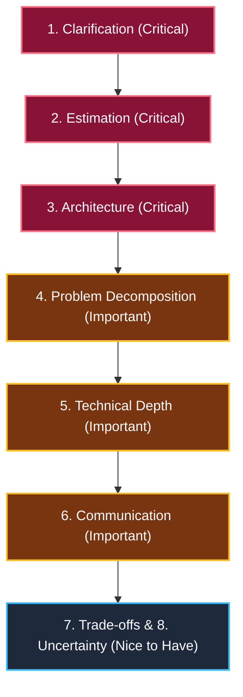

| Priority | Criterion | What Interviewers Look For |
| :--- | :--- | :--- |
| **1. Critical** | **Clarification** | Asked the right questions, confirmed assumptions, defined explicit scope |
| **2. Critical** | **Estimation** | Back-of-envelope math, reasonable calculations, double-checked numbers |
| **3. Critical** | **Architecture** | Clear diagram, reasonable components, justified technology choices |
| **4. Important** | **Problem Decomposition** | Broke complex problem into parts, prioritized correctly, covered all aspects |
| **5. Important** | **Technical Depth** | Went deep on 2–3 topics, explained algorithms, understood trade-offs |
| **6. Important** | **Communication** | Explained clearly, listened to feedback, adjusted design based on feedback |
| **7. Nice to have** | **Trade-offs** | Discussed pros/cons, knew when to use what, made reasonable choices |
| **8. Nice to have** | **Handling Uncertainty** | Made reasonable assumptions, acknowledged limitations, proposed solutions anyway |

> [!IMPORTANT]
> Notice that **Clarification, Estimation, and Architecture** sit at the top of the rubric. A brilliant deep dive cannot rescue an interview where you solved the wrong problem or ignored scale constraints.

---

## Interview Day Tips

```mermaid
flowchart LR
    B["Before: Sleep 8h + 5m Review"] --> D1["First 5m: Listen + Clarify"]
    D1 --> D2["Req & Est: Talk Out Loud"]
    D2 --> D3["Design: Start Simple → Iterate"]
    D3 --> D4["Deep Dive: Pick Your Strengths"]
    D4 --> D5["End Strong: Summarize + Trade-offs"]

    classDef prep fill:#2e1065,stroke:#a78bfa,stroke-width:2px,color:#f8fafc
    classDef exec fill:#1e293b,stroke:#38bdf8,stroke-width:2px,color:#f8fafc
    classDef endnode fill:#064e3b,stroke:#34d399,stroke-width:2px,color:#f8fafc

    class B prep
    class D1,D2,D3,D4 exec
    class D5 endnode
```

| Phase | Actionable Playbook |
| :--- | :--- |
| **Before Interview** | Get 8 hours sleep, eat breakfast, review these notes (`5 min`), join `5 min` early |
| **First 5 Min** | Listen carefully, take notes, ask clarifying questions, confirm understanding |
| **Requirements (5–10m)** | *"Let me confirm I understand..."* — ask scale (users), consistency, target latency, narrow scope |
| **Estimation (10–15m)** | Talk out loud, write calculations, double-check math, state assumptions, ask *"Does this seem reasonable?"* |
| **Design (15–20m)** | Draw on whiteboard/shared screen, start simple, gradually add components, explain each choice |
| **Deep Dive (15–20m)** | Pick components **you** know well, explain algorithms clearly, draw sub-diagrams, discuss scaling |
| **Bottleneck (5–10m)** | Identify the *actual* bottleneck (not random), propose specific fix, calculate new capacity (*"handles 10x growth"*) |
| **Handling Interruptions** | *"Good point, let me reconsider..."* — listen to hints, adapt without defensiveness, reason when unsure |
| **Handling Silence** | Do not panic (silence = thinking); keep talking, ask *"Does this make sense so far?"*, pivot if stuck |
| **Ending Strong (Last 5m)** | Summarize design, call out trade-offs, mention what you'd add with more time, thank interviewer |
| **Avoid** | Talking too fast, inventing technologies, being defensive, overcomplicating early, premature optimization, saying *"I don't know"* without offering a path forward |

> [!TIP]
> When an interviewer interrupts with a *"What if..."* or suggests a different direction, treat it as a **gift**—they are steering you toward the exact rubric item they still need to check off.

---

## Post-Interview

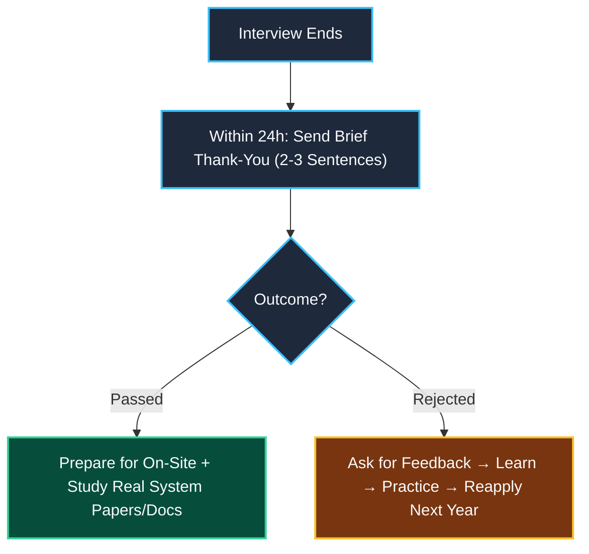

| Stage | Checklist / Template |
| :--- | :--- |
| **Within 24 Hours** | Thank interviewer by email, mention one specific thing you learned, express interest, keep it brief (`2–3` sentences) |
| **Sample Email** | *"Hi [Name], Thanks for the great conversation about designing [system]. I appreciated your feedback on [specific thing]. I'm very interested in this role and look forward to hearing from you. Best regards, [Your name]"* |
| **If Rejected** | Ask for feedback (if offered), learn from mistakes, practice more (system design is learnable), reapply next year |
| **If Passed** | Celebrate, prepare for harder on-site rounds, study real production architectures (engineering blogs & papers) |

> [!NOTE]
> System design is a **learnable engineering skill**, not an innate trait. Every mock or real interview exposes one specific gap you can close before the next round.

---

## Final Reminders

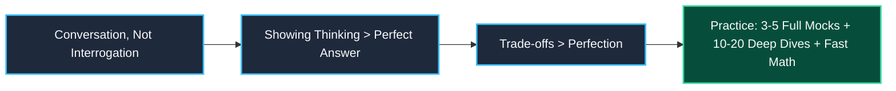

| Mindset (Remember) | Traps That Sink Interviews | Practice Plan |
| :--- | :--- | :--- |
| ✓ Conversation, not interrogation | ❌ Not asking clarifying questions | ✓ `3–5` more full system design mocks |
| ✓ Solving a problem together | ❌ Designing without requirements | ✓ `10–20` smaller component deep-dives |
| ✓ Showing thinking `&gt;` correct answer | ❌ Getting bogged down in details too early | ✓ Whiteboard drawing practice |
| ✓ Trade-offs matter more than perfection | ❌ Not communicating clearly | ✓ Estimation math drills (get fast!) |
| ✓ Be humble and open to feedback | ❌ Refusing to adapt / overcomplicating tech | ✓ You'll be ready—you got this! |

> [!IMPORTANT]
> **Final Golden Rule:** Clarity, structured pacing, and honest trade-offs beat buzzword-heavy over-engineering every single time. Good luck—you've got this!
