# Design a Payment Processing System — The Question That Separates Mid-Level From Senior

> "Design a payment processing system that handles millions of transactions daily while ensuring data consistency and fault tolerance."

This is the #1 system design question for Java engineers interviewing at fintech companies, payment processors, and FAANG. This document gives you a complete, interview-ready answer covering every dimension the interviewer expects.

---

## Table of Contents

1. [How to Approach This in an Interview](#1-how-to-approach-this-in-an-interview)
2. [Step 1: Requirements & Estimation](#2-step-1-requirements--estimation)
3. [Step 2: High-Level Architecture](#3-step-2-high-level-architecture)
4. [Step 3: Core Components Deep Dive](#4-step-3-core-components-deep-dive)
5. [Step 4: Data Consistency — The Hard Part](#5-step-4-data-consistency--the-hard-part)
6. [Step 5: Fault Tolerance & Resilience](#6-step-5-fault-tolerance--resilience)
7. [Step 6: Concurrency at Scale](#7-step-6-concurrency-at-scale)
8. [Step 7: Idempotent API Design](#8-step-7-idempotent-api-design)
9. [Step 8: Database Design & Optimization](#9-step-8-database-design--optimization)
10. [Step 9: JVM Performance Tuning](#10-step-9-jvm-performance-tuning)
11. [Step 10: Security & Compliance](#11-step-10-security--compliance)
12. [The Senior Engineer Answers vs Mid-Level Answers](#12-the-senior-engineer-answers-vs-mid-level-answers)
13. [Follow-Up Questions & Answers](#13-follow-up-questions--answers)

---

## 1. How to Approach This in an Interview

**Don't jump into architecture.** Start structured:


| Time Window | Phase | Primary Goal |
|-------------|-------|--------------|
| Minute 0–5 | Clarify Requirements | Lock down functional scope, SLAs, consistency, and PCI-DSS boundaries |
| Minute 5–10 | Back-of-Envelope Estimation | Derive average/peak TPS, daily storage, and 500ms latency budget |
| Minute 10–20 | High-Level Architecture | Draw CQRS write/read split, state machine, ledger, DB, Kafka, Redis |
| Minute 20–35 | Deep Dive (2–3 Components) | Walk through State Machine, Double-Entry Ledger, Saga, and Idempotency |
| Minute 35–45 | Trade-offs & Scaling | Cover circuit breakers, locking, partitioning, and reconciliation |

> [!IMPORTANT]
> **Key mindset shift:** The interviewer doesn't want you to design Stripe. They want to see **HOW** you think about:
> - Data consistency in distributed systems
> - Handling failures gracefully (what happens when things go wrong)
> - Trade-offs you make and **WHY**

---

## 2. Step 1: Requirements & Estimation

### Functional Requirements
- Process payments (credit card, debit, bank transfer)
- Support multiple currencies
- Handle refunds and chargebacks
- Provide transaction history and status tracking
- Integrate with external payment gateways (Visa, Mastercard, bank networks)
- Merchant settlement (batch payouts)

### Non-Functional Requirements
- **Availability:** 99.999% (5 nines — 5.26 minutes downtime/year)
- **Latency:** < 500ms for payment authorization, < 2s end-to-end
- **Consistency:** STRONG consistency for balance updates (no double-charging, no money loss)
- **Idempotency:** Same request must produce same result (network retries must be safe)
- **Auditability:** Every state change must be traceable
- **Security:** PCI-DSS compliance, encryption at rest and in transit

### Back-of-Envelope Estimation

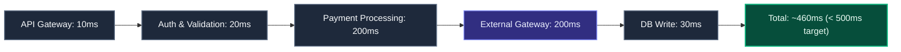

| Metric | Calculation / Value | Notes |
|--------|---------------------|-------|
| Daily transactions | 10 million | Baseline daily volume |
| QPS (average) | `10M / 86400 ≈ 116 TPS` | Steady-state baseline |
| QPS (peak, 10x) | `~1,200 TPS` | Normal peak traffic hours |
| QPS (Black Friday, 50x) | `~6,000 TPS` | Extreme burst load test target |
| Per transaction size | `~2 KB` | Request payload + metadata |
| Daily storage | `10M × 2 KB = 20 GB/day` | Requires monthly table partitioning |
| Yearly storage | `~7.3 TB/year` | Archive receipts to S3 |
| Latency budget | `10 + 20 + 200 + 200 + 30 = ~460ms` | Under 500ms authorization target |

> [!TIP]
> **Interview tip:** Say these numbers out loud. The interviewer wants to see you **THINK** about scale, not memorize formulas.

---

## 3. Step 2: High-Level Architecture

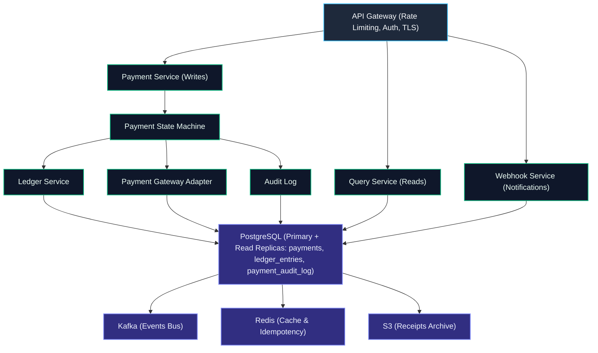

### Why This Architecture?

| Architectural Choice | Responsibility | Why It Matters |
|----------------------|----------------|----------------|
| **CQRS** | Separate write (`Payment Service`) and read (`Query Service`) paths | Writes need strong consistency; reads scale horizontally via replicas |
| **Event-driven** | `Kafka` event bus | Decouples payment processing from notifications, settlement, and analytics |
| **Payment State Machine** | Core business logic | Enforces valid state transitions only and enables partial-failure recovery |
| **Ledger Service** | Double-entry bookkeeping | Every debit has a matching credit so balances always reconcile |
| **Adapter pattern** | `PaymentGateway` interface | Stripe, Visa, Mastercard, and UPI sit behind one uniform contract |

> [!IMPORTANT]
> Separating the write path (`Payment Service` → Primary PostgreSQL) from the read path (`Query Service` → Read Replicas) prevents heavy merchant dashboard queries from contending with latency-sensitive payment writes.

---

## 4. Step 3: Core Components Deep Dive

### A. Payment State Machine

This is the HEART of the system. Every payment goes through well-defined states:

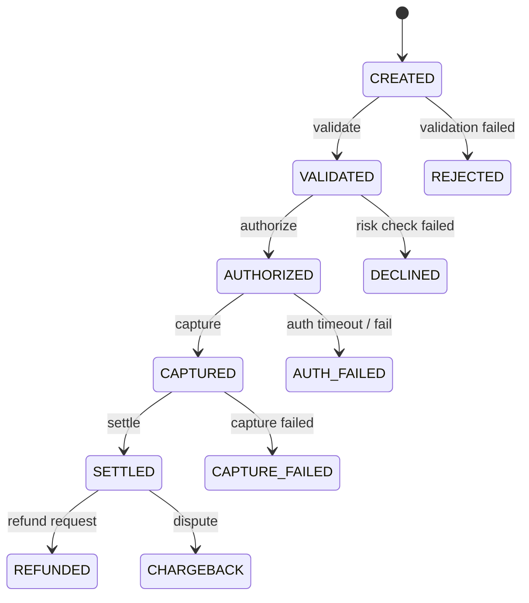

| Current State | Event | Next State | Meaning |
|---------------|-------|------------|---------|
| `CREATED` | `VALIDATE` / `REJECT` | `VALIDATED` / `REJECTED` | Schema and basic validation |
| `VALIDATED` | `AUTHORIZE` / `DECLINE` | `AUTHORIZED` / `DECLINED` | Risk check + gateway authorization |
| `AUTHORIZED` | `CAPTURE` / `AUTH_TIMEOUT` | `CAPTURED` / `AUTH_FAILED` | Funds captured or auth timed out |
| `CAPTURED` | `SETTLE` / `CAPTURE_FAIL` | `SETTLED` / `CAPTURE_FAILED` | Merchant payout settled or failed |
| `SETTLED` | `REFUND` / `DISPUTE` | `REFUNDED` / `CHARGEBACK` | Post-settlement reversal |

**Java Implementation:**

```java
public enum PaymentState {
    CREATED, VALIDATED, AUTHORIZED, CAPTURED, SETTLED,
    REJECTED, DECLINED, AUTH_FAILED, CAPTURE_FAILED,
    REFUNDED, CHARGEBACK
}

public enum PaymentEvent {
    VALIDATE, AUTHORIZE, CAPTURE, SETTLE, REFUND,
    REJECT, DECLINE, AUTH_TIMEOUT, CAPTURE_FAIL, DISPUTE
}

@Service
public class PaymentStateMachine {

    private static final Map<PaymentState, Map<PaymentEvent, PaymentState>> TRANSITIONS;

    static {
        TRANSITIONS = Map.of(
            PaymentState.CREATED, Map.of(
                PaymentEvent.VALIDATE, PaymentState.VALIDATED,
                PaymentEvent.REJECT, PaymentState.REJECTED
            ),
            PaymentState.VALIDATED, Map.of(
                PaymentEvent.AUTHORIZE, PaymentState.AUTHORIZED,
                PaymentEvent.DECLINE, PaymentState.DECLINED
            ),
            PaymentState.AUTHORIZED, Map.of(
                PaymentEvent.CAPTURE, PaymentState.CAPTURED,
                PaymentEvent.AUTH_TIMEOUT, PaymentState.AUTH_FAILED
            ),
            PaymentState.CAPTURED, Map.of(
                PaymentEvent.SETTLE, PaymentState.SETTLED,
                PaymentEvent.CAPTURE_FAIL, PaymentState.CAPTURE_FAILED
            ),
            PaymentState.SETTLED, Map.of(
                PaymentEvent.REFUND, PaymentState.REFUNDED,
                PaymentEvent.DISPUTE, PaymentState.CHARGEBACK
            )
        );
    }

    public PaymentState transition(PaymentState current, PaymentEvent event) {
        Map<PaymentEvent, PaymentState> allowed = TRANSITIONS.get(current);
        if (allowed == null || !allowed.containsKey(event)) {
            throw new InvalidStateTransitionException(
                "Cannot apply " + event + " to payment in state " + current
            );
        }
        return allowed.get(event);
    }
}
```

**Why this matters in interviews:** Interviewers want to see that you don't just process payments in one step. A state machine prevents invalid transitions (e.g., you can't refund a payment that was never captured), creates an audit trail, and enables recovery from partial failures.

---

### B. Ledger Service (Double-Entry Bookkeeping)

Every financial system needs double-entry bookkeeping. For every debit, there's a credit. Money is never created or destroyed.

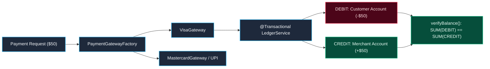

```java
@Service
@Transactional
public class LedgerService {

    @Autowired
    private LedgerEntryRepository ledgerRepo;

    /**
     * Record a payment: Debit customer account, credit merchant account.
     * Both entries are in ONE transaction — atomic.
     */
    public void recordPayment(String paymentId, String customerId,
                               String merchantId, BigDecimal amount,
                               String currency) {

        String transactionRef = UUID.randomUUID().toString();

        // DEBIT: money leaves customer account
        LedgerEntry debit = LedgerEntry.builder()
            .transactionRef(transactionRef)
            .paymentId(paymentId)
            .accountId(customerId)
            .type(EntryType.DEBIT)
            .amount(amount)
            .currency(currency)
            .createdAt(Instant.now())
            .build();

        // CREDIT: money enters merchant account
        LedgerEntry credit = LedgerEntry.builder()
            .transactionRef(transactionRef)
            .paymentId(paymentId)
            .accountId(merchantId)
            .type(EntryType.CREDIT)
            .amount(amount)
            .currency(currency)
            .createdAt(Instant.now())
            .build();

        ledgerRepo.saveAll(List.of(debit, credit));
        // Both succeed or both fail — database transaction guarantees this
    }

    /**
     * Verify ledger integrity — total debits must equal total credits.
     * Run this as a scheduled reconciliation job.
     */
    public boolean verifyBalance() {
        BigDecimal totalDebits = ledgerRepo.sumByType(EntryType.DEBIT);
        BigDecimal totalCredits = ledgerRepo.sumByType(EntryType.CREDIT);
        return totalDebits.compareTo(totalCredits) == 0;
    }
}
```

> [!TIP]
> **Interview tip:** When you mention double-entry bookkeeping, the interviewer immediately knows you understand financial systems. This is rare among candidates and makes you stand out.

---

### C. Payment Gateway Adapter (Strategy Pattern)

```java
// Common interface for all payment gateways
public interface PaymentGateway {
    AuthorizationResult authorize(PaymentRequest request);
    CaptureResult capture(String authorizationId, BigDecimal amount);
    RefundResult refund(String captureId, BigDecimal amount);
    GatewayType getType();
}

// Visa implementation
@Component
public class VisaGateway implements PaymentGateway {

    @Autowired
    private WebClient visaClient;

    @Override
    @CircuitBreaker(name = "visa", fallbackMethod = "visaFallback")
    @Retry(name = "visa")
    @TimeLimiter(name = "visa")
    public AuthorizationResult authorize(PaymentRequest request) {
        return visaClient.post()
            .uri("/v1/authorizations")
            .bodyValue(mapToVisaFormat(request))
            .retrieve()
            .bodyToMono(VisaResponse.class)
            .map(this::mapToResult)
            .block(Duration.ofMillis(300));
    }

    private AuthorizationResult visaFallback(PaymentRequest request, Exception ex) {
        log.error("Visa gateway unavailable, payment={}", request.getPaymentId(), ex);
        return AuthorizationResult.builder()
            .status(AuthStatus.GATEWAY_UNAVAILABLE)
            .retryable(true)
            .build();
    }

    @Override
    public GatewayType getType() { return GatewayType.VISA; }
}

// Factory to select the right gateway
@Component
public class PaymentGatewayFactory {

    private final Map<GatewayType, PaymentGateway> gateways;

    public PaymentGatewayFactory(List<PaymentGateway> gatewayList) {
        this.gateways = gatewayList.stream()
            .collect(Collectors.toMap(PaymentGateway::getType, Function.identity()));
    }

    public PaymentGateway getGateway(CardNetwork network) {
        GatewayType type = GatewayType.fromNetwork(network);
        return Optional.ofNullable(gateways.get(type))
            .orElseThrow(() -> new UnsupportedGatewayException(network));
    }
}
```

**Why this design?** Adding a new payment gateway (say, Mastercard or UPI) is just adding a new class that implements `PaymentGateway`. No changes to existing code. Open/Closed Principle in action.

---

## 5. Step 4: Data Consistency — The Hard Part

This is where most candidates fail. The interviewer is testing whether you understand distributed consistency.

### The Problem: What can go wrong?

| Failure Scenario | Root Cause | Consequence Without Safeguards |
|------------------|------------|--------------------------------|
| **Partial DB crash** | Customer debited + Visa authorized, then DB crashes before crediting merchant | Customer charged, merchant never got money (**MONEY LOST**) |
| **Ambiguous gateway timeout** | Visa authorized, but network times out before response returns | Blind retry charges the customer twice |
| **Dual-write inconsistency** | DB commits payment, but Kafka publish fails | Downstream notifications & settlement never fire |

> [!WARNING]
> **Never retry a `GatewayTimeoutException` blindly.** You do not know whether Visa already authorized the charge. Move the payment to `PENDING_VERIFICATION` and query the gateway status asynchronously.

### Solution 1: The Saga Pattern with Compensation

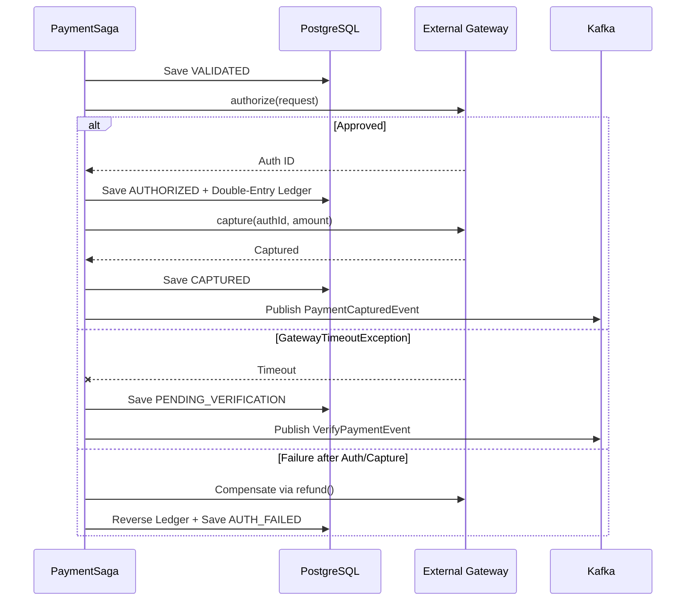

```java
@Service
public class PaymentSaga {

    @Autowired private LedgerService ledger;
    @Autowired private PaymentGatewayFactory gatewayFactory;
    @Autowired private PaymentRepository paymentRepo;
    @Autowired private KafkaTemplate<String, PaymentEvent> kafka;

    @Transactional
    public PaymentResult processPayment(PaymentRequest request) {

        Payment payment = createPayment(request);

        try {
            // Step 1: Validate
            validatePayment(payment);
            payment.setState(PaymentState.VALIDATED);
            paymentRepo.save(payment);

            // Step 2: Authorize with external gateway
            PaymentGateway gateway = gatewayFactory.getGateway(payment.getCardNetwork());
            AuthorizationResult authResult = gateway.authorize(request);

            if (!authResult.isApproved()) {
                payment.setState(PaymentState.DECLINED);
                payment.setDeclineReason(authResult.getReason());
                paymentRepo.save(payment);
                return PaymentResult.declined(authResult.getReason());
            }

            payment.setAuthorizationId(authResult.getAuthId());
            payment.setState(PaymentState.AUTHORIZED);
            paymentRepo.save(payment);

            // Step 3: Record in ledger (double-entry)
            ledger.recordPayment(
                payment.getId(), payment.getCustomerId(),
                payment.getMerchantId(), payment.getAmount(),
                payment.getCurrency()
            );

            // Step 4: Capture
            CaptureResult captureResult = gateway.capture(
                authResult.getAuthId(), payment.getAmount()
            );
            payment.setState(PaymentState.CAPTURED);
            paymentRepo.save(payment);

            // Publish event for async downstream (notifications, analytics)
            kafka.send("payment-events", payment.getId(),
                new PaymentCapturedEvent(payment));

            return PaymentResult.success(payment.getId());

        } catch (GatewayTimeoutException e) {
            // DON'T retry blindly — check status first
            handleGatewayTimeout(payment, e);
            return PaymentResult.pending(payment.getId());

        } catch (Exception e) {
            // COMPENSATE: reverse any completed steps
            compensate(payment, e);
            return PaymentResult.failed(e.getMessage());
        }
    }

    private void compensate(Payment payment, Exception e) {
        log.error("Payment failed, compensating. paymentId={}, state={}",
            payment.getId(), payment.getState(), e);

        if (payment.getState() == PaymentState.AUTHORIZED
            || payment.getState() == PaymentState.CAPTURED) {
            // Reverse the authorization/capture at the gateway
            try {
                PaymentGateway gateway = gatewayFactory.getGateway(payment.getCardNetwork());
                gateway.refund(payment.getAuthorizationId(), payment.getAmount());
            } catch (Exception refundEx) {
                // Log for manual intervention — this is a CRITICAL alert
                log.error("CRITICAL: Compensation failed for payment={}",
                    payment.getId(), refundEx);
                alertOps(payment, refundEx);
            }
        }

        // Reverse ledger entries if they were written
        ledger.reverseLedgerEntries(payment.getId());

        payment.setState(PaymentState.AUTH_FAILED);
        payment.setFailureReason(e.getMessage());
        paymentRepo.save(payment);
    }

    private void handleGatewayTimeout(Payment payment, GatewayTimeoutException e) {
        // Schedule a status check — don't retry the charge
        payment.setState(PaymentState.PENDING_VERIFICATION);
        paymentRepo.save(payment);

        // Async job will query the gateway to check actual status
        kafka.send("payment-verification", payment.getId(),
            new VerifyPaymentEvent(payment.getId(), payment.getAuthorizationId()));
    }
}
```

### Solution 2: Transactional Outbox Pattern

For publishing events reliably (ensuring DB write + Kafka publish are atomic):

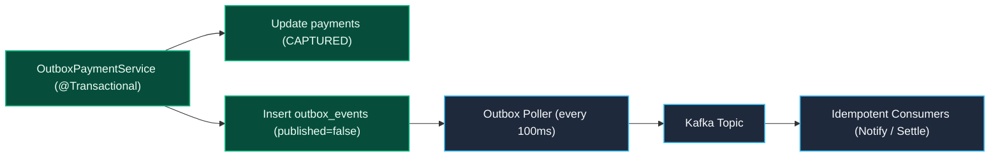

```java
@Service
public class OutboxPaymentService {

    @Autowired private PaymentRepository paymentRepo;
    @Autowired private OutboxRepository outboxRepo;

    @Transactional  // Single DB transaction for both operations
    public void completePayment(Payment payment) {
        // 1. Update payment state
        payment.setState(PaymentState.CAPTURED);
        paymentRepo.save(payment);

        // 2. Write event to outbox TABLE (same DB, same transaction)
        OutboxEvent event = OutboxEvent.builder()
            .aggregateId(payment.getId())
            .aggregateType("Payment")
            .eventType("PaymentCaptured")
            .payload(objectMapper.writeValueAsString(
                new PaymentCapturedEvent(payment)))
            .createdAt(Instant.now())
            .published(false)
            .build();
        outboxRepo.save(event);

        // If transaction commits → both payment + event are saved
        // If transaction fails → neither is saved
        // A separate poller/CDC reads the outbox and publishes to Kafka
    }
}

// Outbox poller — runs every 100ms, publishes unpublished events to Kafka
@Scheduled(fixedDelay = 100)
@Transactional
public void publishOutboxEvents() {
    List<OutboxEvent> pending = outboxRepo
        .findByPublishedFalseOrderByCreatedAtAsc(PageRequest.of(0, 100));

    for (OutboxEvent event : pending) {
        try {
            kafka.send(event.getEventType(), event.getAggregateId(),
                event.getPayload()).get(5, TimeUnit.SECONDS);
            event.setPublished(true);
            event.setPublishedAt(Instant.now());
            outboxRepo.save(event);
        } catch (Exception e) {
            log.warn("Failed to publish outbox event={}", event.getId(), e);
            break; // Preserve ordering, retry next cycle
        }
    }
}
```

> [!TIP]
> **Interview tip:** When you mention the Outbox pattern, say: *"This guarantees at-least-once delivery. Combined with idempotent consumers, we get effectively-once processing."*

---

## 6. Step 5: Fault Tolerance & Resilience

### Circuit Breaker States Explained

```mermaid
stateDiagram-v2
    [*] --> CLOSED
    CLOSED --> OPEN : failure rate &gt;= 50% (100-call window)
    OPEN --> HALF_OPEN : wait 30s elapsed
    HALF_OPEN --> CLOSED : 10 test calls succeed
    HALF_OPEN --> OPEN : test calls fail
```

| Resilience4j Setting | Configured Value | Purpose |
|----------------------|------------------|---------|
| `sliding-window-size` | `100` | Evaluate failure rate over last 100 calls |
| `failure-rate-threshold` | `50` | Open circuit when 50% of calls fail |
| `wait-duration-in-open-state` | `30s` | Fail fast for 30s before probing |
| `permitted-number-of-calls-in-half-open-state` | `10` | Allow 10 probe requests in `HALF-OPEN` |
| `retry.max-attempts` | `3` | Exponential backoff: `500ms`, `1s`, `2s` |
| `timelimiter.timeout-duration` | `3s` | Bound external gateway wait time |

> [!WARNING]
> Always configure `ignore-exceptions: com.payment.DeclinedException` in Resilience4j. A customer card decline is a valid business outcome, **not** a gateway outage — counting declines would trip the circuit breaker unnecessarily.

### Circuit Breaker Configuration for External Gateways

```java
// application.yml — Resilience4j configuration
resilience4j:
  circuitbreaker:
    instances:
      visa:
        sliding-window-size: 100
        failure-rate-threshold: 50          # Open circuit at 50% failure
        wait-duration-in-open-state: 30s    # Try again after 30s
        permitted-number-of-calls-in-half-open-state: 10
        record-exceptions:
          - java.io.IOException
          - java.util.concurrent.TimeoutException
        ignore-exceptions:
          - com.payment.DeclinedException   # Declined is not a system failure

  retry:
    instances:
      visa:
        max-attempts: 3
        wait-duration: 500ms
        exponential-backoff-multiplier: 2   # 500ms, 1s, 2s
        retry-exceptions:
          - java.io.IOException
        ignore-exceptions:
          - com.payment.DeclinedException

  timelimiter:
    instances:
      visa:
        timeout-duration: 3s
```

### Fallback Strategy: Gateway Routing

```java
@Service
public class ResilientPaymentProcessor {

    private final List<PaymentGateway> gateways; // Primary + fallback order

    /**
     * Try primary gateway first. If circuit is open, try fallback.
     * This is why companies like Stripe integrate multiple processors.
     */
    public AuthorizationResult authorizeWithFallback(PaymentRequest request) {
        for (PaymentGateway gateway : gateways) {
            try {
                AuthorizationResult result = gateway.authorize(request);
                if (result.getStatus() != AuthStatus.GATEWAY_UNAVAILABLE) {
                    return result;
                }
            } catch (CallNotPermittedException e) {
                // Circuit is open for this gateway, try next
                log.warn("Circuit open for gateway={}, trying fallback",
                    gateway.getType());
            }
        }
        // All gateways down — queue for retry
        return AuthorizationResult.builder()
            .status(AuthStatus.QUEUED_FOR_RETRY)
            .build();
    }
}
```

### Graceful Degradation Hierarchy

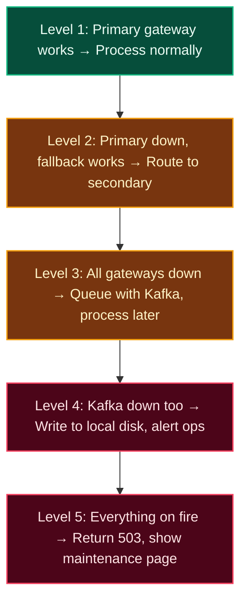

---

## 7. Step 6: Concurrency at Scale

### The Problem: Double-Charging

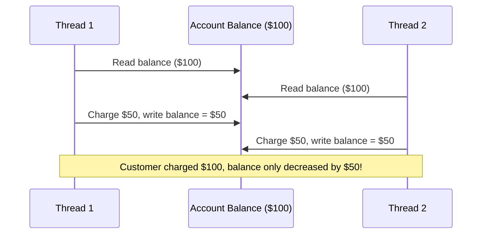

### Choosing the Right Concurrency Strategy

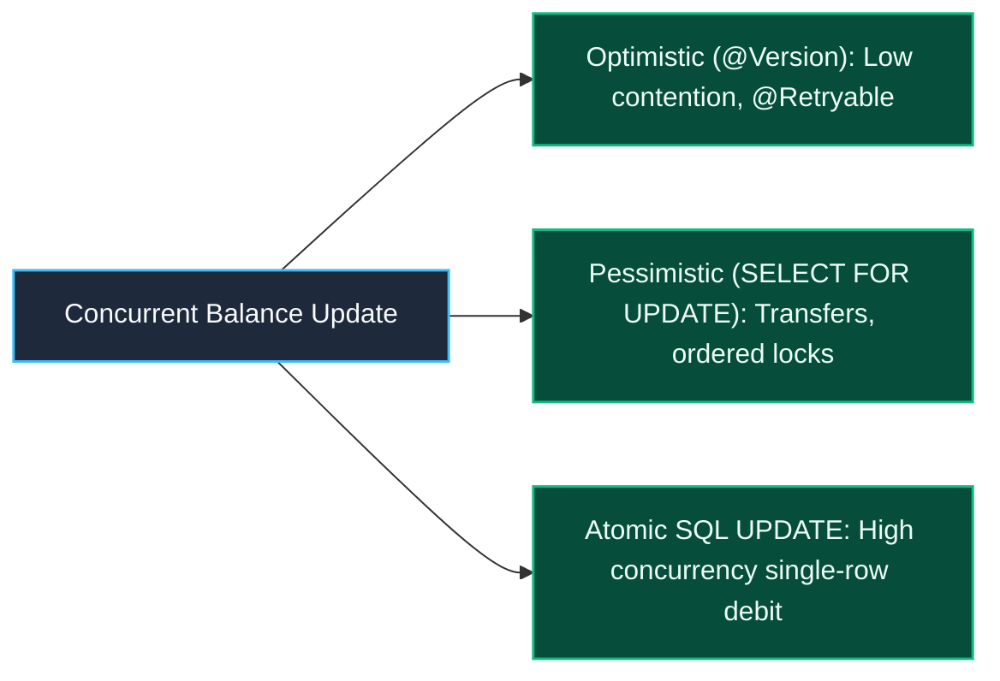

| Strategy | Best For | Mechanism | Trade-off |
|----------|----------|-----------|-----------|
| **Optimistic Locking** | General updates with low contention | `@Version` column + `@Retryable` | Retries under heavy contention |
| **Pessimistic Locking** | Multi-account transfers | `SELECT ... FOR UPDATE` in sorted ID order | Holds row locks; requires lock ordering |
| **Atomic SQL Update** | High-concurrency single-account debits | `UPDATE ... WHERE balance &gt;= :amount` | Zero Java read-modify-write race |

### Solution: Optimistic Locking with JPA

```java
@Entity
@Table(name = "accounts")
public class Account {

    @Id
    private String id;

    private BigDecimal balance;

    @Version  // JPA optimistic locking — auto-incremented on every update
    private Long version;
}

@Service
public class AccountService {

    @Transactional
    @Retryable(value = OptimisticLockException.class, maxAttempts = 3,
               backoff = @Backoff(delay = 100, multiplier = 2))
    public void debit(String accountId, BigDecimal amount) {
        Account account = accountRepo.findById(accountId)
            .orElseThrow(() -> new AccountNotFoundException(accountId));

        if (account.getBalance().compareTo(amount) < 0) {
            throw new InsufficientFundsException(accountId, amount);
        }

        account.setBalance(account.getBalance().subtract(amount));
        accountRepo.save(account);
        // If another thread modified this row, version won't match
        // → OptimisticLockException → @Retryable retries automatically
    }
}
```

### Solution: Pessimistic Locking for Critical Paths

```java
public interface AccountRepository extends JpaRepository<Account, String> {

    @Lock(LockModeType.PESSIMISTIC_WRITE)
    @Query("SELECT a FROM Account a WHERE a.id = :id")
    Optional<Account> findByIdForUpdate(@Param("id") String id);
    // Translates to: SELECT ... FOR UPDATE
    // Blocks other transactions from reading/writing this row
}

@Transactional(isolation = Isolation.READ_COMMITTED)
public void transferFunds(String fromId, String toId, BigDecimal amount) {
    // ALWAYS lock in consistent order to prevent deadlocks
    String firstId = fromId.compareTo(toId) < 0 ? fromId : toId;
    String secondId = fromId.compareTo(toId) < 0 ? toId : fromId;

    Account first = accountRepo.findByIdForUpdate(firstId)
        .orElseThrow();
    Account second = accountRepo.findByIdForUpdate(secondId)
        .orElseThrow();

    Account from = first.getId().equals(fromId) ? first : second;
    Account to = first.getId().equals(fromId) ? second : first;

    if (from.getBalance().compareTo(amount) < 0) {
        throw new InsufficientFundsException(fromId, amount);
    }

    from.setBalance(from.getBalance().subtract(amount));
    to.setBalance(to.getBalance().add(amount));

    accountRepo.save(from);
    accountRepo.save(to);
}
```

> [!IMPORTANT]
> **Interview point:** *"I lock accounts in alphabetical ID order to prevent deadlocks. If Thread 1 locks A then B, and Thread 2 also locks A then B, they can't deadlock. But if Thread 2 locked B then A, deadlock is possible."*

### Solution: Database-Level Atomic Operation (Best for High Concurrency)

```sql
-- Instead of read-modify-write in Java, do it in one SQL statement
UPDATE accounts
SET balance = balance - :amount,
    version = version + 1,
    updated_at = NOW()
WHERE id = :accountId
  AND balance >= :amount;
-- Returns affected rows = 1 (success) or 0 (insufficient funds)
-- No race condition possible — database handles atomicity
```

```java
@Modifying
@Query(value = "UPDATE accounts SET balance = balance - :amount, " +
       "version = version + 1, updated_at = NOW() " +
       "WHERE id = :accountId AND balance >= :amount", nativeQuery = true)
int debitAtomic(@Param("accountId") String accountId,
                @Param("amount") BigDecimal amount);
// Returns 1 if successful, 0 if insufficient funds
```

---

## 8. Step 7: Idempotent API Design

### Why Idempotency is Critical

```
Client → "Charge $50"  → Server processes → Network timeout → Client never gets response
Client → "Charge $50" (retry) → Server processes AGAIN → Customer charged $100!
```

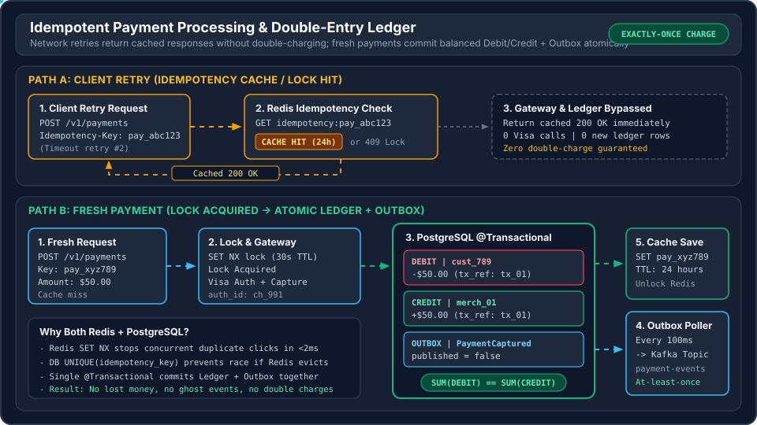

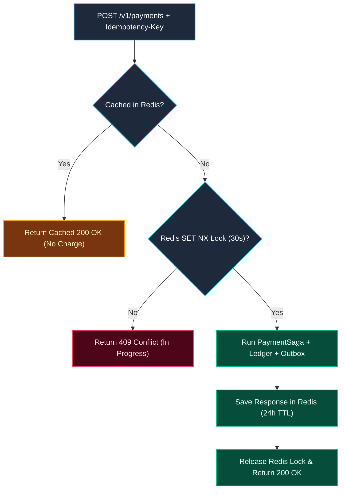

| Request Scenario | Redis State | HTTP Response | Gateway / Ledger Impact |
|------------------|-------------|---------------|-------------------------|
| First request | Cache miss, lock acquired | `200 OK` | Processed once, cached for 24h |
| Concurrent duplicate click | Cache miss, lock held | `409 Conflict` | Blocked before saga runs |
| Timeout retry | Cache hit | `200 OK` (cached) | Zero gateway calls, zero ledger writes |

> [!TIP]
> Pair Redis `SET NX` with a PostgreSQL `UNIQUE` constraint on `payments.idempotency_key`. Redis stops duplicate bursts in under 2ms, while the DB constraint guarantees safety even if Redis evicts a key.

### The Idempotency Key Pattern

```java
@RestController
@RequestMapping("/v1/payments")
public class PaymentController {

    @PostMapping
    public ResponseEntity<PaymentResponse> createPayment(
            @RequestHeader("Idempotency-Key") String idempotencyKey,
            @RequestBody @Valid PaymentRequest request) {

        // 1. Check if we've seen this key before
        Optional<PaymentResponse> cached = idempotencyService.get(idempotencyKey);
        if (cached.isPresent()) {
            // Return the SAME response — don't process again
            return ResponseEntity.ok(cached.get());
        }

        // 2. Acquire a lock on this key to prevent concurrent duplicates
        if (!idempotencyService.tryLock(idempotencyKey)) {
            return ResponseEntity.status(409)
                .body(PaymentResponse.conflict("Request is being processed"));
        }

        try {
            // 3. Process the payment
            PaymentResult result = paymentSaga.processPayment(request);
            PaymentResponse response = mapToResponse(result);

            // 4. Cache the response for future retries (TTL: 24 hours)
            idempotencyService.save(idempotencyKey, response, Duration.ofHours(24));

            return ResponseEntity.ok(response);
        } finally {
            idempotencyService.unlock(idempotencyKey);
        }
    }
}

@Service
public class IdempotencyService {

    @Autowired private StringRedisTemplate redis;

    public Optional<PaymentResponse> get(String key) {
        String cached = redis.opsForValue().get("idempotency:" + key);
        if (cached == null) return Optional.empty();
        return Optional.of(objectMapper.readValue(cached, PaymentResponse.class));
    }

    public boolean tryLock(String key) {
        // SET NX — only sets if key doesn't exist (atomic)
        Boolean acquired = redis.opsForValue()
            .setIfAbsent("idempotency-lock:" + key, "locked",
                Duration.ofSeconds(30));
        return Boolean.TRUE.equals(acquired);
    }

    public void save(String key, PaymentResponse response, Duration ttl) {
        redis.opsForValue().set("idempotency:" + key,
            objectMapper.writeValueAsString(response), ttl);
    }

    public void unlock(String key) {
        redis.delete("idempotency-lock:" + key);
    }
}
```

**Client usage:**
```
POST /v1/payments
Idempotency-Key: "pay_abc123_attempt1"    ← Client generates unique key
Content-Type: application/json

{ "amount": 5000, "currency": "INR", "customer_id": "cust_789" }
```

If the request times out, the client retries with the SAME idempotency key. Server returns cached response without processing again.

---

## 9. Step 8: Database Design & Optimization

### Core Schema

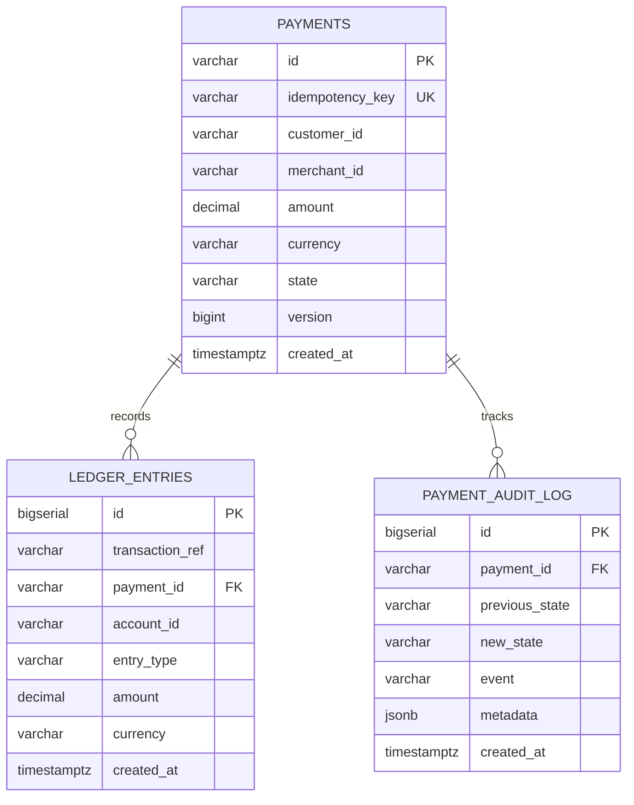

| Table | Mutation Pattern | Key Indexes & Constraints |
|-------|------------------|---------------------------|
| `payments` | Write-heavy + state updates | `UNIQUE(idempotency_key)`, `(customer_id, created_at DESC)`, partial index on `AUTHORIZED` / `PENDING_VERIFICATION` |
| `ledger_entries` | Append-only (never updated) | `CHECK (entry_type IN ('DEBIT', 'CREDIT'))`, `(payment_id)`, `(account_id, created_at DESC)` |
| `payment_audit_log` | Immutable compliance trail | `(payment_id, created_at)` |

> [!IMPORTANT]
> `ledger_entries` and `payment_audit_log` are **append-only**. Never `UPDATE` or `DELETE` a ledger row — corrections must be recorded as new compensating entries.

```sql
-- Payment table (write-heavy, indexed for lookups)
CREATE TABLE payments (
    id              VARCHAR(36) PRIMARY KEY,  -- UUID
    idempotency_key VARCHAR(64) UNIQUE,
    customer_id     VARCHAR(36) NOT NULL,
    merchant_id     VARCHAR(36) NOT NULL,
    amount          DECIMAL(19,4) NOT NULL,
    currency        VARCHAR(3) NOT NULL,
    state           VARCHAR(20) NOT NULL,
    card_network    VARCHAR(20),
    authorization_id VARCHAR(64),
    failure_reason  TEXT,
    version         BIGINT NOT NULL DEFAULT 0,
    created_at      TIMESTAMPTZ NOT NULL DEFAULT NOW(),
    updated_at      TIMESTAMPTZ NOT NULL DEFAULT NOW(),
    CONSTRAINT positive_amount CHECK (amount > 0)
);

-- Indexes optimized for query patterns
CREATE INDEX idx_payments_customer_date ON payments (customer_id, created_at DESC);
CREATE INDEX idx_payments_merchant_date ON payments (merchant_id, created_at DESC);
CREATE INDEX idx_payments_state ON payments (state) WHERE state IN ('AUTHORIZED', 'PENDING_VERIFICATION');

-- Ledger (append-only, never updated)
CREATE TABLE ledger_entries (
    id              BIGSERIAL PRIMARY KEY,
    transaction_ref VARCHAR(36) NOT NULL,
    payment_id      VARCHAR(36) NOT NULL REFERENCES payments(id),
    account_id      VARCHAR(36) NOT NULL,
    entry_type      VARCHAR(6) NOT NULL CHECK (entry_type IN ('DEBIT', 'CREDIT')),
    amount          DECIMAL(19,4) NOT NULL,
    currency        VARCHAR(3) NOT NULL,
    created_at      TIMESTAMPTZ NOT NULL DEFAULT NOW()
);

CREATE INDEX idx_ledger_payment ON ledger_entries (payment_id);
CREATE INDEX idx_ledger_account_date ON ledger_entries (account_id, created_at DESC);

-- Audit log (immutable, for compliance)
CREATE TABLE payment_audit_log (
    id              BIGSERIAL PRIMARY KEY,
    payment_id      VARCHAR(36) NOT NULL,
    previous_state  VARCHAR(20),
    new_state       VARCHAR(20) NOT NULL,
    event           VARCHAR(30) NOT NULL,
    actor           VARCHAR(64),
    metadata        JSONB,
    created_at      TIMESTAMPTZ NOT NULL DEFAULT NOW()
);

CREATE INDEX idx_audit_payment ON payment_audit_log (payment_id, created_at);
```

### Preventing N+1 Queries

```java
// BAD: N+1 problem
List<Payment> payments = paymentRepo.findByCustomerId(customerId);
for (Payment p : payments) {
    List<LedgerEntry> entries = ledgerRepo.findByPaymentId(p.getId()); // N extra queries!
}

// GOOD: JOIN FETCH in one query
@Query("SELECT p FROM Payment p " +
       "LEFT JOIN FETCH p.ledgerEntries " +
       "WHERE p.customerId = :customerId " +
       "ORDER BY p.createdAt DESC")
List<Payment> findByCustomerIdWithLedger(@Param("customerId") String customerId);

// GOOD: @EntityGraph
@EntityGraph(attributePaths = {"ledgerEntries"})
List<Payment> findByCustomerId(String customerId);
```

### Partitioning for Scale

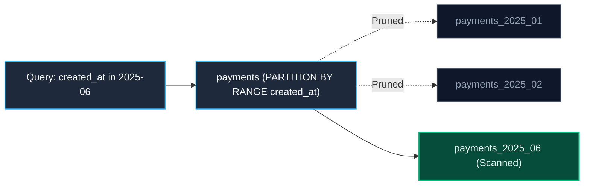

```sql
-- Partition payments by month for fast range queries and easy archival
CREATE TABLE payments (
    id          VARCHAR(36),
    created_at  TIMESTAMPTZ NOT NULL,
    -- ... other columns
) PARTITION BY RANGE (created_at);

CREATE TABLE payments_2025_01 PARTITION OF payments
    FOR VALUES FROM ('2025-01-01') TO ('2025-02-01');
CREATE TABLE payments_2025_02 PARTITION OF payments
    FOR VALUES FROM ('2025-02-01') TO ('2025-03-01');
-- Auto-create partitions with pg_partman

-- Queries with date filter only scan relevant partitions:
SELECT * FROM payments
WHERE created_at >= '2025-06-01' AND created_at < '2025-07-01'
AND customer_id = 'cust_789';
-- Only scans payments_2025_06, not the entire table
```

---

## 10. Step 9: JVM Performance Tuning

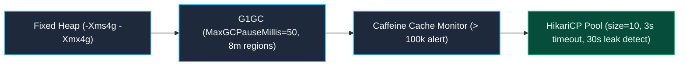

| Layer | Configuration | Target / Benefit |
|-------|---------------|------------------|
| **Heap** | `-Xms4g -Xmx4g`, `MetaspaceSize=256m` | Eliminates dynamic heap resizing pauses |
| **GC** | `-XX:+UseG1GC -XX:MaxGCPauseMillis=50` | Keeps GC stop-the-world pauses under 50ms |
| **Strings & Refs** | `-XX:+UseStringDeduplication`, `-XX:+ParallelRefProcEnabled` | Reduces memory pressure from JSON/UUID strings |
| **HikariCP** | `maximum-pool-size: 10`, `connection-timeout: 3000` | Prevents DB thread thrashing; fails fast in 3s |

> [!TIP]
> Use the HikariCP sizing formula: `connections = (core_count * 2) + effective_spindle_count`. For a 4-core server with SSD, `(4 * 2) + 1 = 9` (rounded to `10`) outperforms oversized pools that cause context-switching overhead.

### GC Configuration for Low-Latency Payment Processing

```bash
# JVM flags for payment service (targeting <50ms GC pauses)
java \
  -Xms4g -Xmx4g \                          # Fixed heap (no resizing overhead)
  -XX:+UseG1GC \                            # G1 for balanced latency/throughput
  -XX:MaxGCPauseMillis=50 \                 # Target max pause 50ms
  -XX:G1HeapRegionSize=8m \                 # Larger regions for 4GB heap
  -XX:+ParallelRefProcEnabled \             # Parallel reference processing
  -XX:+UseStringDeduplication \             # Deduplicate String objects
  -XX:MetaspaceSize=256m \                  # Pre-size metaspace
  -XX:MaxMetaspaceSize=256m \
  -Xlog:gc*:file=/var/log/gc.log:time \     # GC logging for analysis
  -jar payment-service.jar
```

### Detecting Memory Leaks

```java
// Common leak in payment systems: accumulating transaction cache
@Component
public class TransactionCacheMonitor {

    @Autowired
    private CacheManager cacheManager;

    @Scheduled(fixedRate = 60000) // Every minute
    public void monitorCacheSize() {
        Cache cache = cacheManager.getCache("transactions");
        if (cache instanceof CaffeineCache caffeineCache) {
            long size = caffeineCache.getNativeCache().estimatedSize();
            if (size > 100_000) {
                log.warn("Transaction cache size={} exceeds threshold. " +
                         "Possible memory leak or missing eviction.", size);
                Metrics.gauge("cache.transactions.size", size);
            }
        }
    }
}
```

### Connection Pool Sizing (HikariCP)

```yaml
spring:
  datasource:
    hikari:
      # Formula: connections = (core_count * 2) + effective_spindle_count
      # For 4-core server with SSD: (4 * 2) + 1 = 9, round up to 10
      maximum-pool-size: 10
      minimum-idle: 10          # Keep pool full (avoid cold start)
      connection-timeout: 3000  # Fail fast (3s) if pool exhausted
      idle-timeout: 600000      # 10 minutes
      max-lifetime: 1800000     # 30 minutes (before DB kills it)
      leak-detection-threshold: 30000  # Alert if connection held > 30s
```

---

## 11. Step 10: Security & Compliance

### PCI-DSS Requirements (Senior-Level Answer)

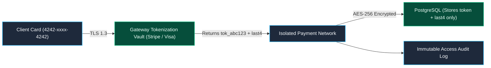

| # | PCI-DSS Requirement | Concrete Implementation |
|---|---------------------|-------------------------|
| 1 | **Never store raw card numbers** | Tokenize via gateway (`tok_abc123` + `last4` only) |
| 2 | **Encrypt at rest & in transit** | AES-256 for PII fields + TLS 1.3 everywhere |
| 3 | **Log all payment data access** | Immutable `payment_audit_log` |
| 4 | **Network segmentation** | Isolate payment processing in its own VPC/subnet |
| 5 | **Key rotation** | Rotate encryption keys every 90 days |

> [!WARNING]
> **NEVER** store raw PANs (card numbers) or CVVs in your database. Tokenizing at the gateway keeps your core database out of full PCI-DSS Cardholder Data Environment (CDE) scope.

```java
// Tokenization — never handle raw card numbers
@Service
public class TokenizationService {

    public PaymentToken tokenize(CardDetails card) {
        // Call gateway's tokenization endpoint
        // Raw card number never touches our servers
        TokenResponse token = stripeClient.createToken(card);
        return new PaymentToken(token.getId(), card.getLast4(), card.getBrand());
    }
}

// Encryption for sensitive fields stored in DB
@Entity
public class Payment {

    @Convert(converter = EncryptedStringConverter.class)
    private String customerEmail;  // Encrypted at rest

    // Card number is NEVER stored — only the token
    private String cardToken;      // "tok_abc123"
    private String cardLast4;      // "4242" (for display only)
}
```

---

## 12. The Senior Engineer Answers vs Mid-Level Answers

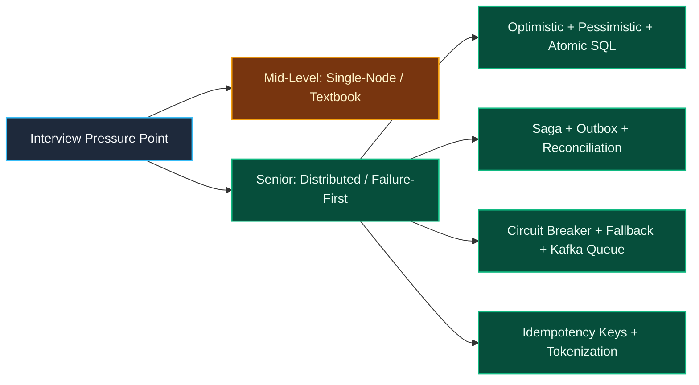

| Question | Mid-Level Answer | Senior Answer |
|----------|-----------------|---------------|
| "How do you handle concurrent payments?" | "I use synchronized blocks" | "Optimistic locking with @Version for most cases, pessimistic locking (SELECT FOR UPDATE) for transfers, and atomic SQL updates for balance changes. Lock ordering prevents deadlocks." |
| "How do you ensure consistency?" | "I use @Transactional" | "Local transactions for single-DB operations, Saga pattern with compensation for distributed operations, Outbox pattern for reliable event publishing, and scheduled reconciliation jobs that verify ledger integrity." |
| "What happens if Visa is down?" | "Return an error" | "Circuit breaker prevents cascading failure, fallback to secondary processor, queue retries in Kafka with exponential backoff, graceful degradation with clear customer messaging." |
| "How do you prevent double charging?" | "Check if already charged" | "Idempotency keys with Redis-backed dedup, database unique constraints on idempotency_key, and the state machine prevents invalid transitions." |
| "How do you scale?" | "Add more servers" | "Stateless services behind a load balancer, read replicas for query traffic, partitioned payments table by date, Redis cache for hot data, CQRS to separate read/write paths." |
| "How do you store card numbers?" | "Encrypt them in the database" | "We never store card numbers. Tokenization via the gateway — we store only tokens and last4 for display. PCI-DSS compliance requires us to minimize cardholder data exposure." |

> [!TIP]
> Notice the pattern in every Senior answer: **layered defense**. Never rely on a single mechanism (e.g., Redis alone or `@Transactional` alone) — pair fast-path guards with durable database guarantees and async reconciliation.

---

## 13. Follow-Up Questions & Answers

### "How would you handle a payment that's stuck in AUTHORIZED state?"

"I'd run a scheduled reconciliation job every 5 minutes that queries the payment gateway for the actual status of any payment stuck in AUTHORIZED for more than 15 minutes. Based on the gateway response, I'd either capture, void, or mark for manual review. This handles network timeouts and dropped responses."

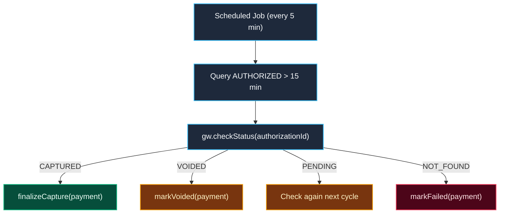

```java
@Scheduled(fixedRate = 300_000) // Every 5 minutes
public void reconcileStuckPayments() {
    List<Payment> stuck = paymentRepo.findByStateAndCreatedBefore(
        PaymentState.AUTHORIZED,
        Instant.now().minus(15, ChronoUnit.MINUTES)
    );
    for (Payment payment : stuck) {
        try {
            PaymentGateway gw = gatewayFactory.getGateway(payment.getCardNetwork());
            GatewayStatus actual = gw.checkStatus(payment.getAuthorizationId());
            switch (actual) {
                case CAPTURED -> finalizeCapture(payment);
                case VOIDED   -> markVoided(payment);
                case PENDING  -> { /* Still processing, check again later */ }
                case NOT_FOUND -> markFailed(payment, "Authorization not found at gateway");
            }
        } catch (Exception e) {
            log.error("Reconciliation failed for payment={}", payment.getId(), e);
        }
    }
}
```

### "How do you handle currency conversion?"

"I store amounts in the smallest unit (cents/paise) as BIGINT to avoid floating-point errors. For cross-currency, I fetch rates from a rate service, store both the original and converted amounts, and lock the rate at authorization time so the customer isn't surprised at capture."

> [!WARNING]
> **NEVER** use `double` or `float` for money (`0.1 + 0.2 = 0.30000000000000004`). Always use `BigDecimal` in Java and `BIGINT` (smallest currency unit) or `DECIMAL(19,4)` in SQL.

```java
// NEVER use double for money
BigDecimal amount = new BigDecimal("19.99");  // ✓
double amount = 19.99;                        // ✗ (0.1 + 0.2 = 0.30000000000000004)

// Store as cents/paise in the database
long amountInCents = amount.multiply(new BigDecimal(100)).longValueExact();
```

### "What metrics would you monitor?"

| Category | Metric / Alert Rule | Target / Action |
|----------|---------------------|-----------------|
| **Business** | Payment success rate | Target `> 99.5%`; `< 99%` for 5m → Page on-call |
| **Business** | Authorization approval rate by gateway | Detect silent issuer/gateway degradation |
| **Business** | Payment latency (`P50`, `P95`, `P99`) & refund rate | `P99 > 2s` → Warning |
| **System** | Gateway response time & Circuit breaker state | Circuit breaker opens → Alert |
| **System** | DB pool utilization, Kafka consumer lag, JVM GC pauses | Detect backpressure before timeouts |
| **Integrity** | Daily ledger & gateway reconciliation mismatches | Any mismatch → **Critical alert** |

### "How would you test this system?"

| Test Layer | Scope & Tooling | What It Proves |
|------------|-----------------|----------------|
| **Unit tests** | State machine transitions, validation logic, amount math | Core invariants and `BigDecimal` accuracy |
| **Integration tests** | Database operations with Testcontainers (real PostgreSQL) | Locking, constraints, and `JOIN FETCH` queries |
| **Contract tests** | Gateway adapter against mock gateway (WireMock) | Timeouts, 5xx responses, and payload mapping |
| **E2E tests** | Full payment flow in staging with test card numbers | End-to-end saga + outbox + webhook flow |
| **Load tests** | K6 / Gatling simulating 6,000 TPS | Black Friday burst readiness |
| **Chaos tests** | Kill a database replica mid-transaction | Failover and recovery without data loss |
| **Reconciliation** | Daily job comparing our records vs gateway records | Zero silent financial drift |

---

> **How to use this in interviews:** Don't try to cover everything in 45 minutes. Start with the high-level architecture, then let the interviewer guide you to what they care about most. If they ask about consistency → go to Section 5. If they ask about scale → Section 7. If they ask about failure handling → Section 6. The key is having depth to go wherever the conversation leads.
