# Event-Driven Order Management System Design

**Target Audience:** Mid-level Java Engineers (5 YOE) | FAANG Interviews
**Duration:** 60-90 minutes discussion | 500+ lines of content + code
**Prerequisites:** Basic microservices, Kafka, SQL, Spring Boot knowledge

---

## Table of Contents

1. [Problem Statement & Requirements](#problem-statement--requirements)
2. [High-Level Architecture](#high-level-architecture)
3. [Event Sourcing Implementation](#event-sourcing-implementation)
4. [Saga Pattern — Order Processing](#saga-pattern--order-processing)
5. [Exactly-Once Processing](#exactly-once-processing)
6. [Inventory Management](#inventory-management)
7. [CQRS for Order Queries](#cqrs-for-order-queries)
8. [Production Concerns](#production-concerns)
9. [Interview Follow-ups & Answers](#interview-follow-ups--answers)
10. [Quick Reference & Tips](#quick-reference--tips)

---

## Problem Statement & Requirements

### Business Context

You're designing the order management backbone for a high-scale e-commerce platform (Amaz-like):
- **Throughput:** 50,000 orders/hour (~14/second)
- **Peak load:** 150,000 orders/hour during flash sales
- **SLA:** 99.99% uptime, <100ms latency for order placement
- **Regions:** Multi-region (Europe, Asia, US)

### Functional Requirements

1. **Order Placement:** Accept order, validate inventory, hold/reserve stock
2. **Payment Processing:** Process payment, handle declined cards, retries
3. **Inventory Management:** Track reservations, deductions, backorders
4. **Shipping:** Allocate warehouse, generate labels, track shipment
5. **Notifications:** Email/SMS for order confirmation, shipment, delivery
6. **Returns/Refunds:** Refund payment, restore inventory, reship
7. **Audit Trail:** Complete history of every order state change
8. **Admin Dashboard:** Real-time order status, stuck orders, metrics

### Non-Functional Requirements

| Requirement | Why It Matters |
|-------------|----------------|
| **Eventual Consistency** | Multi-service coordination can't be synchronous; accept temporary inconsistency |
| **Exactly-Once Processing** | Can't charge customer twice or skip notifications |
| **Fault Tolerance** | If Payment Service is down, order doesn't fail; it waits |
| **Audit Trail** | Compliance, debugging, payment disputes, regulatory requirements |
| **Temporal Queries** | "Show me all order state changes on 2024-01-15" (event sourcing!) |
| **Scalability** | Horizontal scaling of each service independently |

### Scale & Capacity Estimations

| Metric | Baseline | Peak (Flash Sale 3x) | Design Implication |
|--------|----------|----------------------|--------------------|
| **Order Throughput** | 50,000 orders/hr (~14/sec) | 150,000 orders/hr (~42/sec) | 10 Kafka partitions per core topic easily handles 10k+ msg/sec |
| **Order Placement Latency** | < 100ms (p99) | < 100ms (p99) | Async Saga via Kafka; synchronous path only writes Event Store + Outbox (~7ms) |
| **Availability SLA** | 99.99% (~52 min/yr downtime) | 99.99% | Replication factor 3, `min.insync.replicas=2`, multi-AZ Postgres |
| **Event Fan-out** | ~5 events/order (~70 events/sec) | ~5 events/order (~210 events/sec) | Separate consumer groups for Saga, CQRS Read Model, and Notifications |

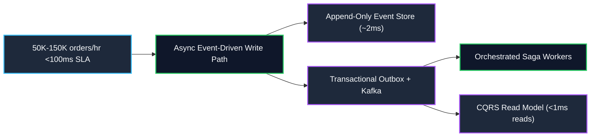

> [!IMPORTANT]
> The `<100ms` order placement SLA is only achievable because the synchronous HTTP request **never waits** for Payment, Inventory, or Shipping. It appends `OrderCreated` + an Outbox row in one local ACID transaction and returns `202 Accepted` (or `PENDING` status) immediately.

---

## High-Level Architecture

### System Components

```
┌─────────────────────────────────────────────────────────────────────┐
│                        API Gateway / Client                         │
│                     (REST/gRPC, rate limiting)                      │
└──────────────────────────┬──────────────────────────────────────────┘
                          │
         ┌────────────────┴───────────────┐
         │                                 │
    ┌────▼──────────────┐        ┌────────▼──────────┐
    │  Order Service    │        │  Read Model DB    │
    │  (Event Store)    │        │  (PostgreSQL)     │
    │                   │        │                   │
    │ - Place Order     │        │ - Order List      │
    │ - Event Sourcing  │        │ - Order Detail    │
    │ - Saga Coord      │        │ - Admin Dashboard │
    └────┬──────────────┘        └───────────────────┘
         │
    ┌────┴──────────────────────────────────────────────────┐
    │                                                        │
    │          Kafka Event Bus (3+ brokers, 3+ replicas)   │
    │                                                        │
    │  Topics:                                             │
    │  - order-events (compacted)                         │
    │  - inventory-events                                 │
    │  - payment-events                                   │
    │  - shipping-events                                  │
    │  - notification-events                              │
    │  - saga-events                                      │
    │                                                        │
    └────┬──────────┬──────────┬──────────┬────────────────┘
         │          │          │          │
    ┌────▼─┐  ┌─────▼──┐  ┌────▼──┐  ┌──▼──────┐
    │ Inv  │  │ Payment│  │ Ship  │  │Notif   │
    │ Svc  │  │ Service│  │ Svc   │  │Service │
    │      │  │        │  │       │  │        │
    │(DLQ) │  │ (DLQ)  │  │(DLQ)  │  │ (DLQ)  │
    └─┬────┘  └────┬───┘  └───┬───┘  └────┬───┘
      │            │          │           │
    ┌─┴──────┐  ┌──┴────┐  ┌──┴─────┐  ┌─┴──────┐
    │Inv DB  │  │Pay DB │  │Ship DB │  │Cache   │
    │(Postgres)  │(Postgres)  │(Postgres)  │(Redis)  │
    └────────┘  └───────┘  └────────┘  └────────┘

```

### Event Flow: Happy Path (Order Completion)

```
1. Client places order
   │
   └──> POST /orders {items, address, payment}
        │
        ├─> Order Service creates OrderAggregate
        │   └─> publishes OrderCreated event
        │
        ├─> Kafka: order-events topic
        │
        ├─> Inventory Service
        │   ├─> reserves inventory (soft reserve)
        │   └─> publishes InventoryReserved event
        │
        ├─> Saga Orchestrator (listens to all events)
        │   └─> sees InventoryReserved
        │       └─> commands Payment Service to process
        │
        ├─> Payment Service
        │   ├─> calls Stripe/Square API
        │   └─> publishes PaymentProcessed event
        │
        ├─> Saga sees PaymentProcessed
        │   └─> commands Shipping Service to ship
        │
        ├─> Shipping Service
        │   ├─> allocates warehouse
        │   ├─> generates label
        │   └─> publishes ShippingInitiated event
        │
        ├─> Order Service (read model consumer)
        │   └─> updates order view to "SHIPPED"
        │
        └─> Notification Service
            └─> sends email "Your order is on the way!"
```

### Visual Architecture & Happy-Path Sequence

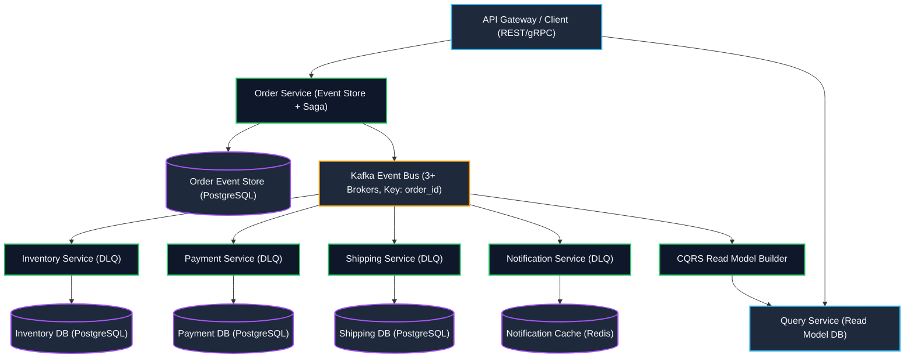

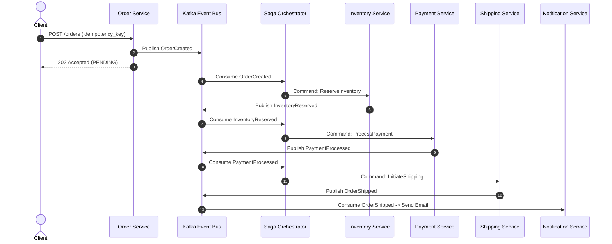

### Service Boundaries & Isolation

| Component | Owned Data Store | Kafka Topics Produced | Kafka Topics Consumed |
|-----------|------------------|-----------------------|-----------------------|
| **Order Service** | `order_events`, `order_snapshots` | `order-events` | `saga-events` |
| **Saga Orchestrator** | `saga_states` (PostgreSQL) | `inventory-commands`, `payment-commands`, `shipping-commands`, `saga-dlq` | `order-events`, `inventory-events`, `payment-events`, `shipping-events` |
| **Inventory Service** | `inventory`, `inventory_reservations` | `inventory-events` | `inventory-commands` |
| **Payment Service** | `payment_deduplication`, `outbox` | `payment-events` | `payment-commands` |
| **Shipping Service** | `shipments` (PostgreSQL) | `shipping-events` | `shipping-commands` |
| **Read Model Builder** | `order_view`, `order_list_view`, `order_status_aggregation` | `read-model-dlq` | `order-events`, `inventory-events`, `payment-events`, `shipping-events` |

> [!TIP]
> Emphasize **database-per-service** in interviews: no service ever joins across another service's tables. Cross-service state synchronization happens strictly via immutable Kafka events keyed by `order_id`.

---

## Event Sourcing Implementation

### Why Event Sourcing for Orders?

**Event sourcing** means storing every state change as an immutable event, rather than overwriting order records.

**Benefits:**
1. **Audit Trail:** Complete history without additional logging; events ARE the log
2. **Replay:** Recreate any order state at any point in time
3. **Temporal Queries:** "What orders transitioned to SHIPPED on 2024-01-15?"
4. **Debugging:** Reproduce exact sequence that led to a bug
5. **Saga Coordination:** Natural event-driven architecture
6. **No Lost Updates:** Append-only; concurrent writes safe

**Trade-offs:**
- Event store queries are harder (can't just `SELECT * WHERE status = 'SHIPPED'`) → need read models (CQRS)
- Event versioning complexity (schema evolution)
- Storage overhead (all events vs. current state only)

### Event-Driven Order State Machine

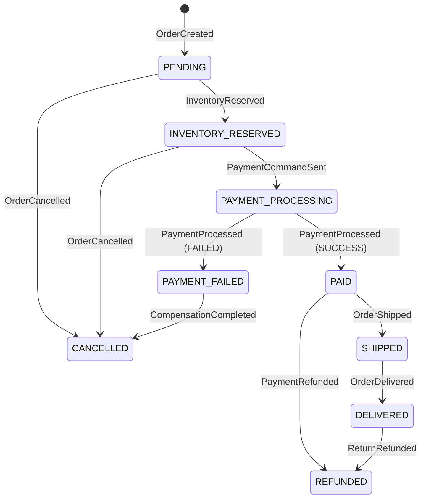

### Snapshot + Tail Event Replay Optimization

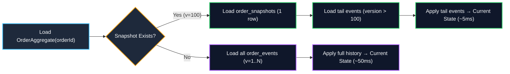

### Event Sourcing vs. Traditional CRUD

| Dimension | Event Sourcing (`order_events`) | Traditional CRUD (`orders` row update) |
|-----------|---------------------------------|----------------------------------------|
| **Write Pattern** | Append-only `INSERT` (~2ms sequential) | In-place `UPDATE` (row locks, overwrites history) |
| **Audit & Compliance** | Built-in immutable log of every transition | Requires separate audit triggers or CDC |
| **Concurrency Control** | `UNIQUE (order_id, aggregate_version)` optimistic check | Row-level locking / `version` column |
| **Read Queries** | Slow via replay alone; fast with CQRS projections | Fast single-table `SELECT` |
| **Time-Travel / Debug** | Replay events up to any `timestamp` or `version` | Impossible without external snapshots |

> [!NOTE]
> The `UNIQUE (order_id, aggregate_version)` constraint in `order_events` acts as a built-in **optimistic concurrency guard**. If two threads attempt to append version `4` to the same order simultaneously, PostgreSQL rejects the second write with a unique constraint violation.

### Event Store Schema (PostgreSQL)

```sql
-- Event store: immutable append-only log
CREATE TABLE order_events (
    event_id BIGSERIAL PRIMARY KEY,
    order_id UUID NOT NULL,
    event_type VARCHAR(100) NOT NULL,
    aggregate_version INT NOT NULL,  -- Version of this order's state
    timestamp TIMESTAMPTZ NOT NULL DEFAULT NOW(),

    -- Event payload (JSON to handle all event types)
    payload JSONB NOT NULL,

    -- For idempotency and deduplication
    idempotency_key VARCHAR(100) UNIQUE,

    -- Partitioning for performance
    created_date DATE NOT NULL DEFAULT CURRENT_DATE,

    -- Ensure order_id + aggregate_version is unique
    UNIQUE (order_id, aggregate_version),
    INDEX (order_id),
    INDEX (event_type),
    INDEX (created_date)  -- Partition key
) PARTITION BY RANGE (created_date);

-- Snapshots: speed up aggregate loading
CREATE TABLE order_snapshots (
    snapshot_id BIGSERIAL PRIMARY KEY,
    order_id UUID NOT NULL UNIQUE,
    aggregate_version INT NOT NULL,
    order_state JSONB NOT NULL,  -- Full order aggregate state
    timestamp TIMESTAMPTZ NOT NULL DEFAULT NOW(),

    INDEX (order_id)
);

-- Read model: materialized view for fast queries
CREATE TABLE order_view (
    order_id UUID PRIMARY KEY,
    customer_id UUID NOT NULL,
    status VARCHAR(50) NOT NULL,  -- PENDING, PAYMENT_PROCESSING, PAID, SHIPPED, DELIVERED, REFUNDED
    total_amount DECIMAL(12, 2) NOT NULL,
    created_at TIMESTAMPTZ NOT NULL,
    updated_at TIMESTAMPTZ NOT NULL,

    -- Denormalized for dashboard queries
    payment_id VARCHAR(100),
    shipping_id VARCHAR(100),
    carrier VARCHAR(50),
    tracking_number VARCHAR(100),

    INDEX (customer_id),
    INDEX (status),
    INDEX (created_at DESC)
);
```

### Java: Event Classes

```java
// Base event
public abstract class DomainEvent {
    public final UUID orderId;
    public final int aggregateVersion;
    public final Instant timestamp;
    public final String idempotencyKey;  // For idempotent replay

    protected DomainEvent(UUID orderId, int aggregateVersion,
                         Instant timestamp, String idempotencyKey) {
        this.orderId = orderId;
        this.aggregateVersion = aggregateVersion;
        this.timestamp = timestamp;
        this.idempotencyKey = idempotencyKey;
    }
}

// Concrete events
public class OrderCreated extends DomainEvent {
    public final UUID customerId;
    public final List<OrderItem> items;
    public final Address shippingAddress;
    public final BigDecimal totalAmount;
    public final String idempotencyKey;

    public OrderCreated(UUID orderId, UUID customerId, List<OrderItem> items,
                       Address shippingAddress, BigDecimal totalAmount,
                       String idempotencyKey) {
        super(orderId, 1, Instant.now(), idempotencyKey);
        this.customerId = customerId;
        this.items = items;
        this.shippingAddress = shippingAddress;
        this.totalAmount = totalAmount;
        this.idempotencyKey = idempotencyKey;
    }
}

public class InventoryReserved extends DomainEvent {
    public final String reservationId;
    public final Map<String, Integer> reservedQuantities;

    public InventoryReserved(UUID orderId, int version, String reservationId,
                            Map<String, Integer> reservedQuantities) {
        super(orderId, version, Instant.now(), null);
        this.reservationId = reservationId;
        this.reservedQuantities = reservedQuantities;
    }
}

public class PaymentProcessed extends DomainEvent {
    public final String paymentId;
    public final String paymentGateway;  // stripe, square, paypal
    public final BigDecimal amount;
    public final PaymentStatus status;  // SUCCESS, FAILED, DECLINED

    public PaymentProcessed(UUID orderId, int version, String paymentId,
                           String paymentGateway, BigDecimal amount,
                           PaymentStatus status) {
        super(orderId, version, Instant.now(), null);
        this.paymentId = paymentId;
        this.paymentGateway = paymentGateway;
        this.amount = amount;
        this.status = status;
    }
}

public class OrderShipped extends DomainEvent {
    public final String shippingId;
    public final String carrier;
    public final String trackingNumber;
    public final Instant estimatedDelivery;

    public OrderShipped(UUID orderId, int version, String shippingId,
                       String carrier, String trackingNumber,
                       Instant estimatedDelivery) {
        super(orderId, version, Instant.now(), null);
        this.shippingId = shippingId;
        this.carrier = carrier;
        this.trackingNumber = trackingNumber;
        this.estimatedDelivery = estimatedDelivery;
    }
}

public class OrderCancelled extends DomainEvent {
    public final String reason;

    public OrderCancelled(UUID orderId, int version, String reason) {
        super(orderId, version, Instant.now(), null);
        this.reason = reason;
    }
}
```

### Java: Order Aggregate with Event Replay

```java
/**
 * OrderAggregate: Core domain model
 *
 * Principles:
 * - Immutable state; changes only via apply() methods
 * - Pure function: replay(events) -> final state
 * - No external dependencies; easy to test
 */
public class OrderAggregate {
    private UUID orderId;
    private UUID customerId;
    private OrderStatus status;
    private List<OrderItem> items;
    private BigDecimal totalAmount;
    private String reservationId;
    private String paymentId;
    private String shippingId;
    private int aggregateVersion = 0;

    // Event stream for publishing
    private List<DomainEvent> uncommittedEvents = new ArrayList<>();

    // Reconstruct from event history
    public static OrderAggregate fromHistory(List<DomainEvent> events) {
        OrderAggregate aggregate = new OrderAggregate();
        for (DomainEvent event : events) {
            aggregate.apply(event);
        }
        return aggregate;
    }

    // Reconstruct from snapshot + tail events (optimization)
    public static OrderAggregate fromSnapshot(OrderSnapshot snapshot,
                                             List<DomainEvent> tailEvents) {
        OrderAggregate aggregate = new OrderAggregate();
        aggregate.orderId = snapshot.orderId;
        aggregate.customerId = snapshot.customerId;
        aggregate.status = snapshot.status;
        aggregate.items = snapshot.items;
        aggregate.totalAmount = snapshot.totalAmount;
        aggregate.reservationId = snapshot.reservationId;
        aggregate.paymentId = snapshot.paymentId;
        aggregate.shippingId = snapshot.shippingId;
        aggregate.aggregateVersion = snapshot.aggregateVersion;

        // Replay tail events since snapshot
        for (DomainEvent event : tailEvents) {
            aggregate.apply(event);
        }
        return aggregate;
    }

    // Commands: intent to change state
    public void createOrder(UUID customerId, List<OrderItem> items,
                           Address shippingAddress, BigDecimal totalAmount,
                           String idempotencyKey) {
        if (this.orderId != null) {
            throw new IllegalStateException("Order already created");
        }

        DomainEvent event = new OrderCreated(
            UUID.randomUUID(), customerId, items, shippingAddress,
            totalAmount, idempotencyKey
        );
        apply(event);
        uncommittedEvents.add(event);
    }

    public void reserveInventory(String reservationId,
                                Map<String, Integer> reservedQuantities) {
        if (status != OrderStatus.PENDING) {
            throw new IllegalStateException(
                "Cannot reserve inventory; status is " + status
            );
        }

        DomainEvent event = new InventoryReserved(
            orderId, aggregateVersion + 1, reservationId, reservedQuantities
        );
        apply(event);
        uncommittedEvents.add(event);
    }

    public void processPayment(String paymentId, String gateway,
                              BigDecimal amount, PaymentStatus paymentStatus) {
        if (status != OrderStatus.INVENTORY_RESERVED) {
            throw new IllegalStateException(
                "Cannot process payment; status is " + status
            );
        }

        DomainEvent event = new PaymentProcessed(
            orderId, aggregateVersion + 1, paymentId, gateway, amount,
            paymentStatus
        );
        apply(event);
        uncommittedEvents.add(event);
    }

    public void shipOrder(String shippingId, String carrier,
                         String trackingNumber, Instant estimatedDelivery) {
        if (status != OrderStatus.PAID) {
            throw new IllegalStateException(
                "Cannot ship; status is " + status
            );
        }

        DomainEvent event = new OrderShipped(
            orderId, aggregateVersion + 1, shippingId, carrier,
            trackingNumber, estimatedDelivery
        );
        apply(event);
        uncommittedEvents.add(event);
    }

    public void cancelOrder(String reason) {
        if (status == OrderStatus.SHIPPED || status == OrderStatus.DELIVERED) {
            throw new IllegalStateException(
                "Cannot cancel shipped/delivered order"
            );
        }

        DomainEvent event = new OrderCancelled(orderId, aggregateVersion + 1, reason);
        apply(event);
        uncommittedEvents.add(event);
    }

    // Internal: Apply events (state machine)
    private void apply(DomainEvent event) {
        if (event instanceof OrderCreated) {
            applyOrderCreated((OrderCreated) event);
        } else if (event instanceof InventoryReserved) {
            applyInventoryReserved((InventoryReserved) event);
        } else if (event instanceof PaymentProcessed) {
            applyPaymentProcessed((PaymentProcessed) event);
        } else if (event instanceof OrderShipped) {
            applyOrderShipped((OrderShipped) event);
        } else if (event instanceof OrderCancelled) {
            applyOrderCancelled((OrderCancelled) event);
        }

        aggregateVersion = event.aggregateVersion;
    }

    private void applyOrderCreated(OrderCreated event) {
        this.orderId = event.orderId;
        this.customerId = event.customerId;
        this.items = event.items;
        this.totalAmount = event.totalAmount;
        this.status = OrderStatus.PENDING;
    }

    private void applyInventoryReserved(InventoryReserved event) {
        this.reservationId = event.reservationId;
        this.status = OrderStatus.INVENTORY_RESERVED;
    }

    private void applyPaymentProcessed(PaymentProcessed event) {
        this.paymentId = event.paymentId;
        if (event.status == PaymentStatus.SUCCESS) {
            this.status = OrderStatus.PAID;
        } else {
            this.status = OrderStatus.PAYMENT_FAILED;
        }
    }

    private void applyOrderShipped(OrderShipped event) {
        this.shippingId = event.shippingId;
        this.status = OrderStatus.SHIPPED;
    }

    private void applyOrderCancelled(OrderCancelled event) {
        this.status = OrderStatus.CANCELLED;
    }

    // Getters & event flushing
    public List<DomainEvent> getUncommittedEvents() {
        return uncommittedEvents;
    }

    public void markEventsAsCommitted() {
        uncommittedEvents.clear();
    }

    public UUID getOrderId() { return orderId; }
    public OrderStatus getStatus() { return status; }
    public int getAggregateVersion() { return aggregateVersion; }
}

enum OrderStatus {
    PENDING, INVENTORY_RESERVED, PAYMENT_PROCESSING, PAID,
    PAYMENT_FAILED, SHIPPED, DELIVERED, REFUNDED, CANCELLED
}
```

### Java: Event Store Repository

```java
@Repository
public class EventStoreRepository {
    private final JdbcTemplate jdbc;
    private final ObjectMapper objectMapper;

    public EventStoreRepository(JdbcTemplate jdbc, ObjectMapper objectMapper) {
        this.jdbc = jdbc;
        this.objectMapper = objectMapper;
    }

    /**
     * Save all uncommitted events atomically
     */
    public void saveEvents(UUID orderId, List<DomainEvent> events)
            throws JsonProcessingException {

        String sql = "INSERT INTO order_events " +
            "(order_id, event_type, aggregate_version, payload, " +
            "idempotency_key, timestamp, created_date) " +
            "VALUES (?, ?, ?, ?::jsonb, ?, ?, ?)";

        for (DomainEvent event : events) {
            jdbc.update(sql, ps -> {
                ps.setObject(1, orderId);
                ps.setString(2, event.getClass().getSimpleName());
                ps.setInt(3, event.aggregateVersion);
                ps.setString(4, objectMapper.writeValueAsString(event));
                ps.setString(5, event.idempotencyKey);
                ps.setObject(6, event.timestamp);
                ps.setDate(7, Date.valueOf(LocalDate.now()));
            });
        }
    }

    /**
     * Load all events for an order (replay)
     */
    public List<DomainEvent> loadEvents(UUID orderId) {
        String sql = "SELECT event_type, payload FROM order_events " +
            "WHERE order_id = ? ORDER BY aggregate_version ASC";

        return jdbc.query(sql, new Object[]{orderId}, (rs, rowNum) -> {
            String eventType = rs.getString("event_type");
            String payload = rs.getString("payload");
            return deserializeEvent(eventType, payload);
        });
    }

    /**
     * Load from snapshot for performance (don't replay 10K events)
     */
    public Optional<OrderAggregate> loadOrderFromSnapshot(UUID orderId) {
        String snapshotSql = "SELECT aggregate_version, order_state FROM " +
            "order_snapshots WHERE order_id = ?";

        return jdbc.query(snapshotSql, new Object[]{orderId}, rs -> {
            if (!rs.next()) return Optional.empty();

            int snapshotVersion = rs.getInt("aggregate_version");
            OrderSnapshot snapshot = objectMapper.readValue(
                rs.getString("order_state"), OrderSnapshot.class
            );

            // Load only events after snapshot
            String tailSql = "SELECT event_type, payload FROM order_events " +
                "WHERE order_id = ? AND aggregate_version > ? " +
                "ORDER BY aggregate_version ASC";

            List<DomainEvent> tailEvents = jdbc.query(
                tailSql, new Object[]{orderId, snapshotVersion},
                (rs2, rowNum) -> {
                    String eventType = rs2.getString("event_type");
                    String payload = rs2.getString("payload");
                    return deserializeEvent(eventType, payload);
                }
            );

            return Optional.of(
                OrderAggregate.fromSnapshot(snapshot, tailEvents)
            );
        }).stream().findFirst().orElse(Optional.empty());
    }

    /**
     * Create snapshot every N events
     */
    public void createSnapshot(UUID orderId, OrderAggregate aggregate)
            throws JsonProcessingException {

        OrderSnapshot snapshot = new OrderSnapshot(
            orderId, aggregate.getCustomerId(), aggregate.getStatus(),
            aggregate.getItems(), aggregate.getTotalAmount(),
            aggregate.getAggregateVersion()
        );

        String sql = "INSERT INTO order_snapshots " +
            "(order_id, aggregate_version, order_state, timestamp) " +
            "VALUES (?, ?, ?::jsonb, ?) " +
            "ON CONFLICT (order_id) DO UPDATE SET " +
            "aggregate_version = ?, order_state = ?::jsonb";

        jdbc.update(sql, ps -> {
            ps.setObject(1, orderId);
            ps.setInt(2, aggregate.getAggregateVersion());
            ps.setString(3, objectMapper.writeValueAsString(snapshot));
            ps.setObject(4, Instant.now());
            ps.setInt(5, aggregate.getAggregateVersion());
            ps.setString(6, objectMapper.writeValueAsString(snapshot));
        });
    }

    private DomainEvent deserializeEvent(String eventType, String payload) {
        try {
            return switch (eventType) {
                case "OrderCreated" -> objectMapper.readValue(payload, OrderCreated.class);
                case "InventoryReserved" -> objectMapper.readValue(payload, InventoryReserved.class);
                case "PaymentProcessed" -> objectMapper.readValue(payload, PaymentProcessed.class);
                case "OrderShipped" -> objectMapper.readValue(payload, OrderShipped.class);
                case "OrderCancelled" -> objectMapper.readValue(payload, OrderCancelled.class);
                default -> throw new IllegalArgumentException("Unknown event type: " + eventType);
            };
        } catch (JsonProcessingException e) {
            throw new RuntimeException("Failed to deserialize event", e);
        }
    }
}
```

---

## Saga Pattern — Order Processing

### The Distributed Transaction Problem

In traditional monoliths, you use database transactions:

```java
// Monolith: ACID guarantee
@Transactional
public void processOrder(Order order) {
    inventoryService.reserve(order.items);       // DB write 1
    paymentService.charge(order.paymentMethod);  // DB write 2
    shippingService.ship(order);                 // DB write 3
    // Rollback all 3 if any fails
}
```

But in microservices:
- Each service has its own database
- No shared transactions across services
- Network calls can timeout/fail
- Services may be temporarily unavailable

**Example failure scenario:**
```
1. Inventory reserves stock ✓
2. Payment charges customer ✓
3. Shipping service is down ✗

Result: Customer charged, inventory reserved, but order never shipped!
Need manual intervention / compensation logic.
```

### Saga Pattern: Solution

A **Saga** is a distributed transaction across microservices using:
1. **Local transactions** within each service
2. **Compensation transactions** to undo if later steps fail

Two styles:

#### Style 1: Choreography (Event-Driven)

```
Order Service publishes "OrderCreated"
  ↓
Inventory Service listens, reserves stock, publishes "InventoryReserved"
  ↓
Payment Service listens, charges customer, publishes "PaymentProcessed"
  ↓
Shipping Service listens, ships, publishes "OrderShipped"
  ↓
Order Service updates read model

If Payment fails:
  Payment Service publishes "PaymentFailed"
  ↓
Inventory Service listens, publishes "InventoryReservationCancelled" (compensation)
  ↓
Order Service marks as cancelled
```

**Pros:** Decoupled, no central orchestrator
**Cons:** Hard to visualize/debug, circular dependencies possible

#### Style 2: Orchestration (Centralized)

```
Order Service publishes "OrderCreated"
  ↓
OrderSaga (orchestrator) listens
  ↓
OrderSaga commands Inventory Service: "Reserve stock for order X"
  ↓
Inventory Service reserves, publishes "InventoryReserved"
  ↓
OrderSaga listens, commands Payment Service: "Charge customer"
  ↓
Payment Service charges, publishes "PaymentProcessed"
  ↓
OrderSaga listens, commands Shipping Service: "Ship order"
  ↓
...on failure, OrderSaga commands compensation steps
```

**Pros:** Clear flow, easy to debug, timeout handling clear
**Cons:** Central orchestrator becomes bottleneck

**For this design, we use orchestration** (clearer for interviews).

### Animated Saga & Outbox Flow

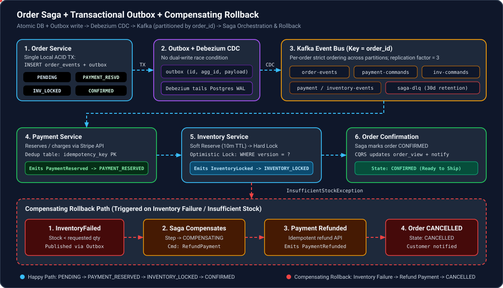

### Choreography vs. Orchestration Comparison

| Dimension | Choreography (Event-Driven) | Orchestration (Centralized `OrderSaga`) |
|-----------|-----------------------------|-----------------------------------------|
| **Control Flow** | Implicit across service listeners | Explicit state machine in `OrderSaga` |
| **Coupling** | Low service coupling; high topic coupling | Services only know commands/events; orchestrator knows workflow |
| **Debugging & Visibility** | Hard to trace end-to-end without distributed tracing | Single `saga_states` table shows exact step & age |
| **Timeout & Compensation** | Difficult to coordinate multi-step rollbacks | Clean `@Scheduled` timeout detection + reverse compensation |
| **Failure Risk** | Cyclic event loops possible | Central orchestrator must be HA & stateless/DB-backed |

### Saga Orchestration & Compensation Flow

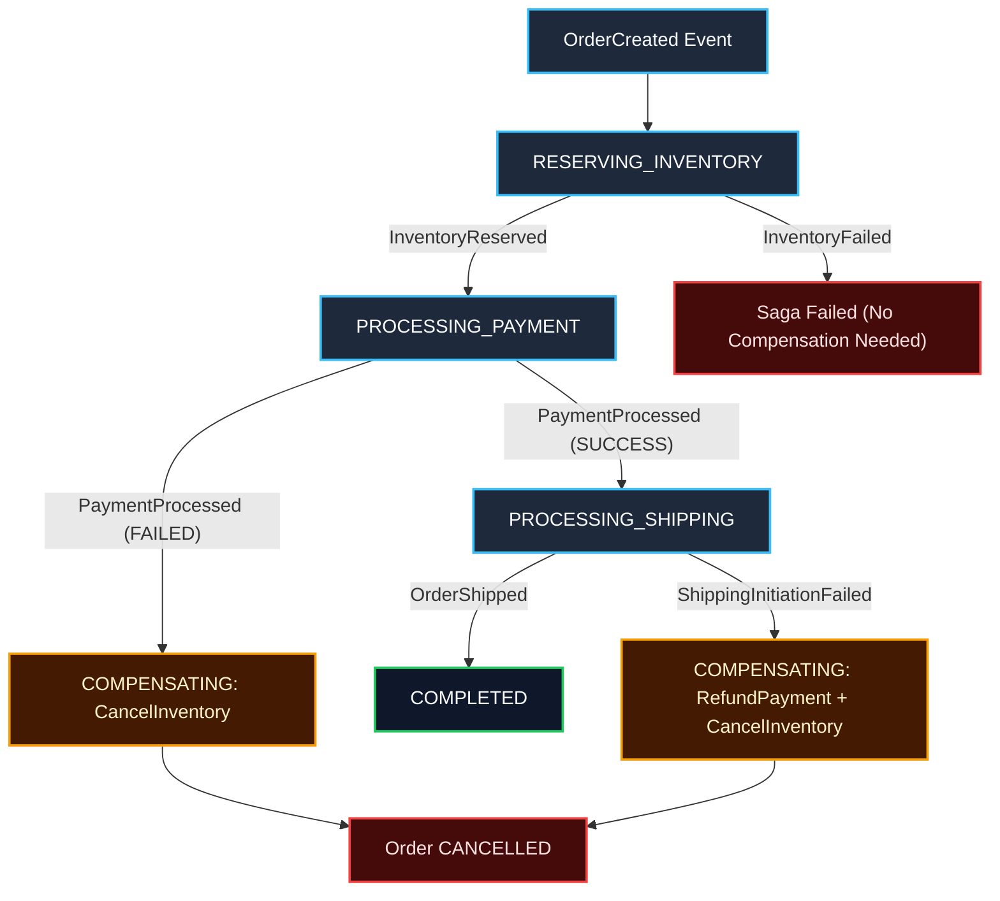

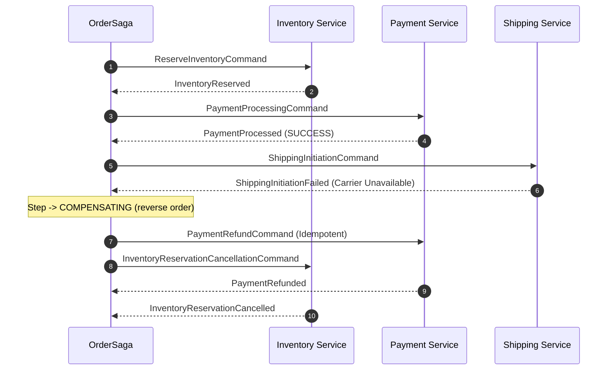

> [!WARNING]
> Never keep `SagaState` *only* in an in-memory `ConcurrentHashMap` in production! Always persist `SagaState` to PostgreSQL (`sagaStateRepository.save(sagaState)`) before publishing the next command, otherwise a pod restart mid-saga will lose in-flight state and miss timeouts.

### Orchestration-Based Saga: State Diagram

```
                    ┌─────────────────────┐
                    │   OrderCreated      │
                    │   (saga starts)     │
                    └──────────┬──────────┘
                               │
                               ▼
                    ┌─────────────────────┐
                    │ ReservingInventory  │
                    │  (waiting for inv)  │
                    └──────────┬──────────┘
                               │
                    ┌──────────┴──────────┐
                    │                     │
                    ▼                     ▼
         ┌────────────────────┐   ┌──────────────────┐
         │InventoryReserved   │   │InventoryFailed   │
         └──────────┬─────────┘   │  (saga failed)    │
                    │             │  -> no comp step  │
                    ▼             └──────────────────┘
         ┌────────────────────┐
         │ProcessingPayment   │
         └──────────┬─────────┘
                    │
         ┌──────────┴───────────┐
         │                      │
         ▼                      ▼
    ┌────────────┐      ┌──────────────────┐
    │PaymentOK   │      │PaymentFailed     │
    └──────┬─────┘      │ -> compensate:   │
           │            │ CancelInventory  │
           ▼            └──────────────────┘
    ┌────────────────────┐
    │ProcessingShipping  │
    └──────────┬─────────┘
               │
    ┌──────────┴──────────┐
    │                     │
    ▼                     ▼
┌────────────┐    ┌──────────────────┐
│OrderShipped│    │ShippingFailed    │
└────────────┘    │ -> compensate:   │
                  │ RefundPayment +  │
                  │ CancelInventory  │
                  └──────────────────┘
```

### Java: Orchestration-Based Saga

```java
/**
 * OrderSaga: Central orchestrator for the order fulfillment saga
 *
 * Coordinates:
 * 1. Inventory reservation
 * 2. Payment processing
 * 3. Shipment initialization
 *
 * Handles failures and compensation (rollback) steps.
 */
@Component
public class OrderSaga {
    private static final Logger logger = LoggerFactory.getLogger(OrderSaga.class);

    private final KafkaTemplate<String, DomainEvent> kafkaTemplate;
    private final OrderRepository orderRepository;
    private final SagaStateRepository sagaStateRepository;
    private final Clock clock;

    // Track saga state for timeout detection
    private final Map<UUID, SagaState> sagaStates = new ConcurrentHashMap<>();

    public OrderSaga(KafkaTemplate<String, DomainEvent> kafkaTemplate,
                     OrderRepository orderRepository,
                     SagaStateRepository sagaStateRepository,
                     Clock clock) {
        this.kafkaTemplate = kafkaTemplate;
        this.orderRepository = orderRepository;
        this.sagaStateRepository = sagaStateRepository;
        this.clock = clock;
    }

    /**
     * Triggered by OrderCreated event
     */
    @KafkaListener(topics = "order-events", groupId = "order-saga")
    public void handleOrderCreated(OrderCreated event) {
        logger.info("Starting saga for order {}", event.orderId);

        SagaState sagaState = new SagaState(
            event.orderId,
            SagaStep.RESERVING_INVENTORY,
            clock.instant()
        );
        sagaStates.put(event.orderId, sagaState);
        sagaStateRepository.save(sagaState);

        // Step 1: Command inventory service to reserve stock
        InventoryReservationCommand cmd = new InventoryReservationCommand(
            event.orderId,
            event.items.stream()
                .collect(Collectors.toMap(
                    OrderItem::getProductId,
                    OrderItem::getQuantity
                ))
        );

        publishCommand(cmd, "inventory-commands");
    }

    /**
     * Inventory reservation succeeded
     */
    @KafkaListener(topics = "inventory-events", groupId = "order-saga")
    public void handleInventoryReserved(InventoryReserved event) {
        UUID orderId = event.orderId;
        SagaState sagaState = sagaStates.get(orderId);

        if (sagaState == null || sagaState.currentStep != SagaStep.RESERVING_INVENTORY) {
            logger.warn("Unexpected inventory event for order {}", orderId);
            return;
        }

        logger.info("Inventory reserved for order {}", orderId);
        sagaState.currentStep = SagaStep.PROCESSING_PAYMENT;
        sagaStateRepository.save(sagaState);

        // Step 2: Load order, command payment service
        OrderAggregate order = orderRepository.loadOrder(orderId)
            .orElseThrow(() -> new IllegalStateException(
                "Order not found: " + orderId
            ));

        PaymentProcessingCommand cmd = new PaymentProcessingCommand(
            orderId,
            order.getTotalAmount(),
            order.getPaymentMethod()
        );

        publishCommand(cmd, "payment-commands");
    }

    /**
     * Payment succeeded
     */
    @KafkaListener(topics = "payment-events", groupId = "order-saga")
    public void handlePaymentProcessed(PaymentProcessed event) {
        UUID orderId = event.orderId;
        SagaState sagaState = sagaStates.get(orderId);

        if (sagaState == null || sagaState.currentStep != SagaStep.PROCESSING_PAYMENT) {
            logger.warn("Unexpected payment event for order {}", orderId);
            return;
        }

        if (event.status != PaymentStatus.SUCCESS) {
            logger.error("Payment failed for order {}", orderId);
            handlePaymentFailure(event);
            return;
        }

        logger.info("Payment processed for order {}", orderId);
        sagaState.currentStep = SagaStep.PROCESSING_SHIPPING;
        sagaStateRepository.save(sagaState);

        // Step 3: Command shipping service
        ShippingInitiationCommand cmd = new ShippingInitiationCommand(
            orderId,
            event.amount
        );

        publishCommand(cmd, "shipping-commands");
    }

    /**
     * Payment failed: compensation step
     * Undo: Cancel inventory reservation
     */
    private void handlePaymentFailure(PaymentProcessed event) {
        UUID orderId = event.orderId;
        logger.info("Initiating compensation: canceling inventory for order {}", orderId);

        SagaState sagaState = sagaStates.get(orderId);
        sagaState.currentStep = SagaStep.COMPENSATING;
        sagaStateRepository.save(sagaState);

        // Undo inventory reservation
        InventoryReservationCancellationCommand cmd =
            new InventoryReservationCancellationCommand(orderId);

        publishCommand(cmd, "inventory-commands");
    }

    /**
     * Shipping initiated successfully
     */
    @KafkaListener(topics = "shipping-events", groupId = "order-saga")
    public void handleShippingInitiated(OrderShipped event) {
        UUID orderId = event.orderId;
        SagaState sagaState = sagaStates.get(orderId);

        if (sagaState == null || sagaState.currentStep != SagaStep.PROCESSING_SHIPPING) {
            logger.warn("Unexpected shipping event for order {}", orderId);
            return;
        }

        logger.info("Saga completed successfully for order {}", orderId);
        sagaState.currentStep = SagaStep.COMPLETED;
        sagaStateRepository.save(sagaState);

        // Saga complete!
        sagaStates.remove(orderId);
    }

    /**
     * Shipping failed: compensation steps
     * Undo: Refund payment, cancel inventory
     */
    @KafkaListener(topics = "shipping-events", groupId = "order-saga")
    public void handleShippingFailed(ShippingInitiationFailed event) {
        UUID orderId = event.orderId;
        SagaState sagaState = sagaStates.get(orderId);

        if (sagaState == null || sagaState.currentStep != SagaStep.PROCESSING_SHIPPING) {
            return;
        }

        logger.error("Shipping failed for order {}, initiating compensation", orderId);
        sagaState.currentStep = SagaStep.COMPENSATING;
        sagaStateRepository.save(sagaState);

        // Undo payment
        PaymentRefundCommand refundCmd = new PaymentRefundCommand(orderId);
        publishCommand(refundCmd, "payment-commands");

        // Undo inventory
        InventoryReservationCancellationCommand invCmd =
            new InventoryReservationCancellationCommand(orderId);
        publishCommand(invCmd, "inventory-commands");
    }

    /**
     * Timeout detection: if saga stuck for > 30min, mark as failed
     */
    @Scheduled(fixedRate = 300000)  // Every 5 minutes
    public void detectTimeouts() {
        Instant threshold = clock.instant().minus(Duration.ofMinutes(30));

        for (SagaState state : sagaStates.values()) {
            if (state.createdAt.isBefore(threshold)) {
                logger.error("Saga timeout detected for order {}, step: {}",
                    state.orderId, state.currentStep);

                // Create DLQ event for manual investigation
                SagaTimedOutEvent timeoutEvent = new SagaTimedOutEvent(
                    state.orderId, state.currentStep.name()
                );
                publishEvent(timeoutEvent, "saga-dlq");
            }
        }
    }

    private void publishCommand(Object command, String topic) {
        kafkaTemplate.send(topic, command.toString(), (DomainEvent) command);
    }

    private void publishEvent(Object event, String topic) {
        kafkaTemplate.send(topic, event.toString(), (DomainEvent) event);
    }
}

// Supporting classes
@Data
class SagaState {
    private UUID orderId;
    private SagaStep currentStep;
    private Instant createdAt;

    public SagaState(UUID orderId, SagaStep currentStep, Instant createdAt) {
        this.orderId = orderId;
        this.currentStep = currentStep;
        this.createdAt = createdAt;
    }
}

enum SagaStep {
    RESERVING_INVENTORY,
    PROCESSING_PAYMENT,
    PROCESSING_SHIPPING,
    COMPENSATING,
    COMPLETED
}

@Repository
public interface SagaStateRepository extends JpaRepository<SagaState, UUID> {}

// Commands sent by saga
class InventoryReservationCommand {
    public UUID orderId;
    public Map<String, Integer> quantities;

    public InventoryReservationCommand(UUID orderId, Map<String, Integer> quantities) {
        this.orderId = orderId;
        this.quantities = quantities;
    }
}

class PaymentProcessingCommand {
    public UUID orderId;
    public BigDecimal amount;
    public PaymentMethod paymentMethod;

    public PaymentProcessingCommand(UUID orderId, BigDecimal amount,
                                   PaymentMethod paymentMethod) {
        this.orderId = orderId;
        this.amount = amount;
        this.paymentMethod = paymentMethod;
    }
}

class PaymentRefundCommand {
    public UUID orderId;

    public PaymentRefundCommand(UUID orderId) {
        this.orderId = orderId;
    }
}

class ShippingInitiationCommand {
    public UUID orderId;
    public BigDecimal amount;

    public ShippingInitiationCommand(UUID orderId, BigDecimal amount) {
        this.orderId = orderId;
        this.amount = amount;
    }
}
```

---

## Exactly-Once Processing

### The Problem

Kafka guarantees **at-least-once** delivery:
- Consumer reads message
- Processes it
- Commits offset
- If processing succeeds but commit fails, message is reread → **duplicate processing**

**Real example:**
```
Payment Service reads "ProcessPayment" message
  ↓
Charges customer's Stripe account ✓
  ↓
Network hiccup prevents offset commit ✗
  ↓
Kafka redelivers message
  ↓
Charges customer again ✗✗ (double charge!)
```

### Solution 1: Idempotency Keys & Deduplication

Every command/event includes an `idempotency_key`. Processing the same key twice = same result.

```java
// Payment Service Consumer
@KafkaListener(topics = "payment-commands")
public void processPayment(PaymentProcessingCommand cmd) {
    // Check if we've already processed this idempotency key
    Optional<PaymentResult> existing = paymentDeduplicationTable.findById(
        cmd.idempotencyKey
    );

    if (existing.isPresent()) {
        logger.info("Duplicate payment command, returning cached result");
        publishEvent(existing.get(), "payment-events");
        return;
    }

    // First time: process
    logger.info("Processing payment for order {}", cmd.orderId);
    StripeCharge charge = stripeClient.charge(
        cmd.amount,
        cmd.paymentMethod,
        idempotencyKey = cmd.idempotencyKey  // Tell Stripe too!
    );

    // Save to deduplication table
    PaymentResult result = new PaymentResult(
        cmd.idempotencyKey,
        charge.chargeId,
        PaymentStatus.SUCCESS
    );
    paymentDeduplicationTable.save(result);

    // Publish event
    PaymentProcessed event = new PaymentProcessed(
        cmd.orderId,
        charge.chargeId,
        charge.amount,
        PaymentStatus.SUCCESS
    );
    eventBus.publish(event);
}
```

**Deduplication table schema:**
```sql
CREATE TABLE payment_deduplication (
    idempotency_key VARCHAR(100) PRIMARY KEY,
    payment_id VARCHAR(100) NOT NULL,
    status VARCHAR(50) NOT NULL,
    result_json JSONB NOT NULL,
    created_at TIMESTAMPTZ DEFAULT NOW(),

    INDEX (payment_id)
);
```

### Solution 2: Transactional Outbox Pattern

Problem: What if we save to deduplication table but crash before publishing event?

**Transactional Outbox** = write event to database + publish atomically:

```sql
-- Same transaction: save result + save outbox entry
BEGIN;
  INSERT INTO payment_deduplication (idempotency_key, payment_id, status, result_json)
  VALUES (...);

  INSERT INTO outbox (aggregate_id, event_type, payload, published)
  VALUES (order_id, 'PaymentProcessed', {...}, false);
COMMIT;
```

Then a separate **Outbox Poller** publishes to Kafka:

```java
@Service
public class OutboxPollerService {

    @Scheduled(fixedRate = 1000)  // Poll every second
    public void pollAndPublish() {
        // Read unpublished events from outbox
        List<OutboxEvent> unpublished = outboxRepository
            .findByPublishedFalseOrderByCreatedAtAsc();

        for (OutboxEvent event : unpublished) {
            try {
                // Publish to Kafka
                kafkaTemplate.send(
                    event.getEventType().getTopic(),
                    event.getAggregateId().toString(),
                    event.getPayload()
                );

                // Mark as published
                event.setPublished(true);
                outboxRepository.save(event);

            } catch (Exception e) {
                logger.error("Failed to publish outbox event", e);
                // Retry on next poll
            }
        }
    }
}
```

**Outbox schema:**
```sql
CREATE TABLE outbox (
    id BIGSERIAL PRIMARY KEY,
    aggregate_id UUID NOT NULL,
    event_type VARCHAR(100) NOT NULL,
    payload JSONB NOT NULL,
    published BOOLEAN DEFAULT FALSE,
    created_at TIMESTAMPTZ DEFAULT NOW(),

    INDEX (published, created_at)
);
```

### Outbox Poller vs. Debezium CDC (Log Tailing)

At higher throughput (50K–150K+ orders/hour), polling PostgreSQL every second adds unnecessary read load. Production systems pair the **Transactional Outbox** with **Debezium CDC**, which tails the PostgreSQL Write-Ahead Log (WAL) and streams committed `outbox` inserts directly to Kafka in sub-10ms latency.

```mermaid
flowchart LR
    Svc["Payment / Order Service"] -- "Single ACID TX" --> DB[("PostgreSQL (orders + outbox)")]
    DB -- "WAL Stream" --> Debezium["Debezium CDC Connector"]
    Debezium -- "Key: aggregate_id" --> Kafka["Kafka Event Bus"]
    Kafka --> Consumer["Idempotent Consumer"]
    Consumer --> Dedup[("payment_deduplication")]

    classDef svc fill:#1e293b,stroke:#38bdf8,stroke-width:2px,color:#f8fafc
    classDef db fill:#1e293b,stroke:#a855f7,stroke-width:2px,color:#f8fafc
    classDef cdc fill:#0f172a,stroke:#22c55e,stroke-width:2px,color:#f8fafc
    classDef bus fill:#1e293b,stroke:#f59e0b,stroke-width:2px,color:#f8fafc
    class Svc,Consumer svc
    class DB,Dedup db
    class Debezium cdc
    class Kafka bus
```

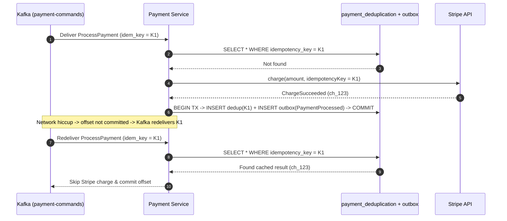

| Outbox Delivery Mechanism | Latency | DB Load | Operational Complexity | Best Fit |
|---------------------------|---------|---------|------------------------|----------|
| **Polling Publisher (`@Scheduled`)** | 100ms – 1,000ms | Periodic `SELECT` queries | Low (pure Spring Boot) | Low-to-moderate throughput (&lt;500 events/sec) |
| **Debezium CDC (WAL Tailing)** | &lt; 10ms | Zero polling queries | Medium (Kafka Connect + Debezium) | High-scale production (150K+ orders/hr) |

> [!IMPORTANT]
> **"Exactly-Once" in distributed systems** is actually **At-Least-Once Delivery + Idempotent Processing + Transactional Outbox**. Never rely solely on Kafka's `enable.idempotence=true`—that only deduplicates broker writes within a producer session, not downstream DB writes or external Stripe API calls.

---

## Inventory Management

### Reservation Pattern

Orders go through three reservation stages to prevent overselling and align with physical warehouse fulfillment:

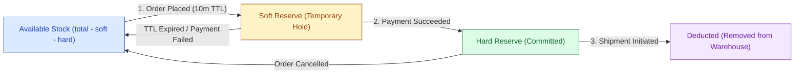

| Stage | Trigger | Releasable? | Purpose |
|-------|---------|-------------|---------|
| **1. Soft Reserve** | Customer places order | Yes (10-min TTL or payment failure) | Handles abandoned carts and payment latency without blocking stock forever |
| **2. Hard Reserve** | Payment succeeded | Only on order cancellation | Locks stock for confirmed orders |
| **3. Deduction** | Shipment initiated | No (physical removal) | Creates audit trail and syncs with warehouse inventory |

> [!TIP]
> Use **optimistic locking** (`@Version` + retry loop) instead of `SELECT ... FOR UPDATE` for inventory updates. It avoids row-lock contention during flash sales while preventing overselling.

### Java: Inventory Service with Locking

```java
@Service
public class InventoryService {
    private final InventoryRepository inventoryRepository;
    private final ReservationRepository reservationRepository;
    private final KafkaTemplate<String, DomainEvent> eventBus;

    /**
     * Soft reservation: hold stock with TTL
     * Uses optimistic locking to handle concurrent requests
     */
    public String softReserveInventory(UUID orderId, Map<String, Integer> quantities)
            throws InsufficientStockException {

        String reservationId = UUID.randomUUID().toString();
        Instant expiresAt = Instant.now().plus(Duration.ofMinutes(10));

        for (String productId : quantities.keySet()) {
            int requiredQty = quantities.get(productId);

            // Optimistic locking: version-based
            while (true) {
                Inventory inv = inventoryRepository.findById(productId)
                    .orElseThrow(() -> new IllegalArgumentException(
                        "Product not found: " + productId
                    ));

                if (inv.getAvailableStock() < requiredQty) {
                    throw new InsufficientStockException(
                        productId + ": only " + inv.getAvailableStock() +
                        " available, need " + requiredQty
                    );
                }

                // Update with version check (optimistic lock)
                inv.setSoftReservedStock(inv.getSoftReservedStock() + requiredQty);
                int rows = inventoryRepository.updateWithVersion(
                    productId, inv.getVersion(), inv
                );

                if (rows > 0) {
                    // Success! Create reservation record
                    Reservation res = new Reservation(
                        reservationId, orderId, productId, requiredQty,
                        ReservationType.SOFT, expiresAt
                    );
                    reservationRepository.save(res);
                    break;
                }

                // Version mismatch: retry
                logger.debug("Retrying soft reserve for {} due to concurrent update", productId);
            }
        }

        logger.info("Soft reserved {} items for order {}, reservation {}",
            quantities.size(), orderId, reservationId);

        return reservationId;
    }

    /**
     * Hard reservation: confirm after payment
     */
    public void hardReserveInventory(String reservationId, UUID orderId) {
        List<Reservation> softReservations = reservationRepository
            .findByReservationIdAndType(reservationId, ReservationType.SOFT);

        for (Reservation softRes : softReservations) {
            softRes.setType(ReservationType.HARD);
            softRes.setExpiresAt(null);  // No expiry for hard reserves
            reservationRepository.save(softRes);

            // Update inventory: move from soft to hard reserved
            Inventory inv = inventoryRepository.findById(softRes.getProductId())
                .orElseThrow();

            inv.setSoftReservedStock(inv.getSoftReservedStock() - softRes.getQuantity());
            inv.setHardReservedStock(inv.getHardReservedStock() + softRes.getQuantity());
            inventoryRepository.save(inv);
        }

        logger.info("Hard reserved for order {}", orderId);
    }

    /**
     * Release soft reservation if expired or order cancelled
     */
    @Scheduled(fixedRate = 60000)  // Every minute
    public void releaseExpiredReservations() {
        List<Reservation> expired = reservationRepository
            .findByTypeAndExpiresAtBefore(
                ReservationType.SOFT,
                Instant.now()
            );

        for (Reservation res : expired) {
            Inventory inv = inventoryRepository.findById(res.getProductId()).orElseThrow();
            inv.setSoftReservedStock(inv.getSoftReservedStock() - res.getQuantity());
            inventoryRepository.save(inv);

            reservationRepository.delete(res);
            logger.info("Released expired soft reserve: {}", res.getReservationId());
        }
    }

    /**
     * Deduct inventory when shipment initiated
     */
    public void deductInventory(UUID orderId) {
        List<Reservation> hardReservations = reservationRepository
            .findByOrderIdAndType(orderId, ReservationType.HARD);

        for (Reservation hardRes : hardReservations) {
            Inventory inv = inventoryRepository.findById(hardRes.getProductId())
                .orElseThrow();

            inv.setHardReservedStock(inv.getHardReservedStock() - hardRes.getQuantity());
            inv.setDeductedStock(inv.getDeductedStock() + hardRes.getQuantity());
            inventoryRepository.save(inv);

            // Mark reservation as deducted
            hardRes.setType(ReservationType.DEDUCTED);
            reservationRepository.save(hardRes);
        }

        logger.info("Deducted inventory for order {}", orderId);
    }
}

// Domain models
@Entity
@Table(name = "inventory")
@Data
public class Inventory {
    @Id
    private String productId;

    private int totalStock;
    private int softReservedStock = 0;  // Soft reserve (temporary hold)
    private int hardReservedStock = 0;  // Hard reserve (confirmed)
    private int deductedStock = 0;      // Physically removed from warehouse

    @Version  // Optimistic locking
    private long version;

    public int getAvailableStock() {
        return totalStock - softReservedStock - hardReservedStock;
    }
}

@Entity
@Table(name = "inventory_reservations")
@Data
public class Reservation {
    @Id
    private String reservationId;

    private UUID orderId;
    private String productId;
    private int quantity;

    @Enumerated(EnumType.STRING)
    private ReservationType type;

    private Instant expiresAt;
    private Instant createdAt;

    public Reservation(String reservationId, UUID orderId, String productId,
                      int quantity, ReservationType type, Instant expiresAt) {
        this.reservationId = reservationId;
        this.orderId = orderId;
        this.productId = productId;
        this.quantity = quantity;
        this.type = type;
        this.expiresAt = expiresAt;
        this.createdAt = Instant.now();
    }
}

enum ReservationType {
    SOFT, HARD, DEDUCTED
}

@Repository
public interface ReservationRepository extends JpaRepository<Reservation, String> {
    List<Reservation> findByReservationIdAndType(String id, ReservationType type);
    List<Reservation> findByTypeAndExpiresAtBefore(ReservationType type, Instant before);
    List<Reservation> findByOrderIdAndType(UUID orderId, ReservationType type);
}
```

---

## CQRS for Order Queries

### The Problem

Event sourcing makes writes efficient (append-only), but queries are slow:

```java
// SLOW: every query replays thousands of events
List<Order> orders = orderStore.loadAndReplay(orderIds);  // 5 seconds!
```

**CQRS** (**Command Query Responsibility Segregation**) separates writes and reads:
- **Write model:** Event store (authoritative, append-only)
- **Read model:** Materialized views (fast queries, eventually consistent)

> [!NOTE]
> Read models may lag behind the event store by a few milliseconds to seconds, but they are **eventually accurate** and can be completely rebuilt from the event store if corrupted.

### Architecture

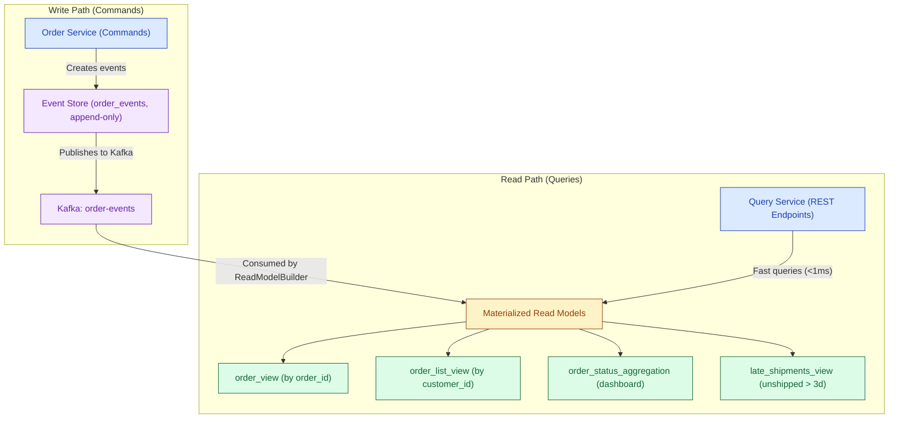

| Read Model View | Primary Lookup | Purpose |
|-----------------|----------------|---------|
| `order_view` | `order_id` | Fast single-order detail lookup |
| `order_list_view` | `customer_id` | Paginated customer order history |
| `order_status_aggregation` | `status` | Admin dashboard counts by status |
| `late_shipments_view` | `created_at` / `status` | Operational alert for orders not shipped in 3 days |

### Java: Read Model Builder

```java
/**
 * ReadModelBuilderService: Consumes events and updates materialized views
 *
 * Eventually consistent: may lag by seconds, but always eventual accurate
 */
@Component
public class ReadModelBuilderService {
    private final OrderViewRepository orderViewRepository;
    private final OrderListViewRepository orderListViewRepository;
    private final OrderStatusAggRepository statusAggRepository;
    private final KafkaTemplate<String, String> kafkaTemplate;

    /**
     * Listen to all order events and update read models
     */
    @KafkaListener(topics = "order-events", groupId = "read-model-builder")
    public void handleOrderEvent(String eventJson) {
        try {
            Map<String, Object> eventMap = parseJson(eventJson);
            String eventType = (String) eventMap.get("eventType");
            UUID orderId = UUID.fromString((String) eventMap.get("orderId"));

            switch (eventType) {
                case "OrderCreated":
                    updateOnOrderCreated(eventMap);
                    break;
                case "InventoryReserved":
                    updateOnInventoryReserved(eventMap);
                    break;
                case "PaymentProcessed":
                    updateOnPaymentProcessed(eventMap);
                    break;
                case "OrderShipped":
                    updateOnOrderShipped(eventMap);
                    break;
                case "OrderCancelled":
                    updateOnOrderCancelled(eventMap);
                    break;
            }
        } catch (Exception e) {
            logger.error("Failed to update read model", e);
            // Send to DLQ for manual review
            kafkaTemplate.send("read-model-dlq", eventJson);
        }
    }

    private void updateOnOrderCreated(Map<String, Object> event) {
        UUID orderId = UUID.fromString((String) event.get("orderId"));
        UUID customerId = UUID.fromString((String) event.get("customerId"));
        BigDecimal amount = new BigDecimal((String) event.get("totalAmount"));

        // Update order_view
        OrderView view = new OrderView(
            orderId, customerId, "PENDING", amount,
            Instant.now(), Instant.now()
        );
        orderViewRepository.save(view);

        // Update order_list_view (by customer)
        OrderListView listView = new OrderListView(
            orderId, customerId, "PENDING", amount, Instant.now()
        );
        orderListViewRepository.save(listView);

        // Update status aggregation
        updateStatusAggregation(orderId, "PENDING");

        logger.info("Read model updated for new order {}", orderId);
    }

    private void updateOnInventoryReserved(Map<String, Object> event) {
        UUID orderId = UUID.fromString((String) event.get("orderId"));
        String reservationId = (String) event.get("reservationId");

        OrderView view = orderViewRepository.findById(orderId).orElseThrow();
        view.setStatus("INVENTORY_RESERVED");
        view.setUpdatedAt(Instant.now());
        orderViewRepository.save(view);

        updateStatusAggregation(orderId, "INVENTORY_RESERVED");
    }

    private void updateOnPaymentProcessed(Map<String, Object> event) {
        UUID orderId = UUID.fromString((String) event.get("orderId"));
        String paymentId = (String) event.get("paymentId");
        String status = (String) event.get("status");

        OrderView view = orderViewRepository.findById(orderId).orElseThrow();
        view.setPaymentId(paymentId);

        if ("SUCCESS".equals(status)) {
            view.setStatus("PAID");
        } else {
            view.setStatus("PAYMENT_FAILED");
        }

        view.setUpdatedAt(Instant.now());
        orderViewRepository.save(view);

        updateStatusAggregation(orderId, view.getStatus());
    }

    private void updateOnOrderShipped(Map<String, Object> event) {
        UUID orderId = UUID.fromString((String) event.get("orderId"));
        String shippingId = (String) event.get("shippingId");
        String carrier = (String) event.get("carrier");
        String trackingNumber = (String) event.get("trackingNumber");

        OrderView view = orderViewRepository.findById(orderId).orElseThrow();
        view.setShippingId(shippingId);
        view.setCarrier(carrier);
        view.setTrackingNumber(trackingNumber);
        view.setStatus("SHIPPED");
        view.setUpdatedAt(Instant.now());
        orderViewRepository.save(view);

        updateStatusAggregation(orderId, "SHIPPED");
    }

    private void updateOnOrderCancelled(Map<String, Object> event) {
        UUID orderId = UUID.fromString((String) event.get("orderId"));

        OrderView view = orderViewRepository.findById(orderId).orElseThrow();
        view.setStatus("CANCELLED");
        view.setUpdatedAt(Instant.now());
        orderViewRepository.save(view);

        updateStatusAggregation(orderId, "CANCELLED");
    }

    private void updateStatusAggregation(UUID orderId, String newStatus) {
        // Find and update old status count
        OrderView view = orderViewRepository.findById(orderId).orElseThrow();
        String oldStatus = view.getStatus();

        if (oldStatus != null && !oldStatus.equals(newStatus)) {
            statusAggRepository.decrementStatus(oldStatus);
        }

        // Increment new status count
        statusAggRepository.incrementStatus(newStatus);
    }
}

// Read model entities
@Entity
@Table(name = "order_view")
@Data
public class OrderView {
    @Id
    private UUID orderId;

    private UUID customerId;
    private String status;
    private BigDecimal totalAmount;

    private String paymentId;
    private String shippingId;
    private String carrier;
    private String trackingNumber;

    private Instant createdAt;
    private Instant updatedAt;

    public OrderView(UUID orderId, UUID customerId, String status,
                    BigDecimal amount, Instant createdAt, Instant updatedAt) {
        this.orderId = orderId;
        this.customerId = customerId;
        this.status = status;
        this.totalAmount = amount;
        this.createdAt = createdAt;
        this.updatedAt = updatedAt;
    }
}

@Entity
@Table(name = "order_list_view")
@Data
public class OrderListView {
    @Id
    @GeneratedValue(strategy = GenerationType.IDENTITY)
    private Long id;

    private UUID orderId;
    private UUID customerId;
    private String status;
    private BigDecimal totalAmount;
    private Instant createdAt;

    public OrderListView(UUID orderId, UUID customerId, String status,
                        BigDecimal amount, Instant createdAt) {
        this.orderId = orderId;
        this.customerId = customerId;
        this.status = status;
        this.totalAmount = amount;
        this.createdAt = createdAt;
    }
}

@Entity
@Table(name = "order_status_aggregation")
@Data
public class OrderStatusAgg {
    @Id
    private String status;
    private long count;
}

// REST API using read models (very fast)
@RestController
@RequestMapping("/api/orders")
public class OrderQueryController {
    private final OrderViewRepository viewRepository;
    private final OrderListViewRepository listRepository;

    @GetMapping("/{orderId}")
    public ResponseEntity<OrderView> getOrder(@PathVariable UUID orderId) {
        return viewRepository.findById(orderId)
            .map(ResponseEntity::ok)
            .orElse(ResponseEntity.notFound().build());
    }

    @GetMapping
    public ResponseEntity<List<OrderListView>> listByCustomer(
            @RequestParam UUID customerId,
            @RequestParam(defaultValue = "0") int page) {

        List<OrderListView> orders = listRepository
            .findByCustomerIdOrderByCreatedAtDesc(customerId,
                PageRequest.of(page, 20)).getContent();

        return ResponseEntity.ok(orders);
    }

    @GetMapping("/dashboard/status-summary")
    public ResponseEntity<List<OrderStatusAgg>> getStatusSummary() {
        // Used for admin dashboard showing counts by status
        return ResponseEntity.ok(statusAggRepository.findAll());
    }
}
```

### Rebuilding Read Models (Recovery)

If read model gets corrupted, rebuild it from event store:

```java
@Service
public class ReadModelRebuildService {
    private final EventStoreRepository eventStore;
    private final ReadModelBuilderService builder;

    /**
     * Manual trigger: Admin wants to rebuild all read models
     */
    @PostMapping("/admin/rebuild-read-models")
    public ResponseEntity<String> rebuild() {
        logger.warn("Starting full read model rebuild!");

        // Clear all read models
        orderViewRepository.deleteAll();
        orderListViewRepository.deleteAll();
        statusAggRepository.deleteAll();

        // Replay all events from event store
        List<DomainEvent> allEvents = eventStore.loadAllEventsSorted();
        for (DomainEvent event : allEvents) {
            builder.handleOrderEvent(objectMapper.writeValueAsString(event));
        }

        logger.info("Read model rebuild complete");
        return ResponseEntity.ok("Rebuild started, check logs");
    }
}
```

---

## Production Concerns

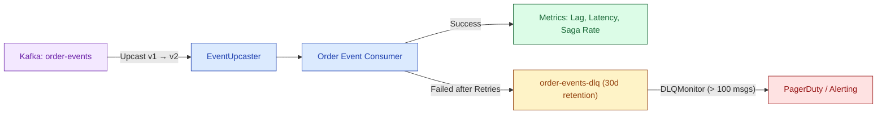

### 1. Dead Letter Queue (DLQ) for Failed Events

Events that fail to process after retries go to a DLQ for investigation and replay:

> [!WARNING]
> Never silently drop failed Kafka events. Route them to a DLQ with error context and alert when unprocessed DLQ messages exceed your threshold (e.g., `> 100`).

```yaml
# Kafka topic configuration
---
name: order-events-dlq
partitions: 3
replication-factor: 3
retention-ms: 2592000000  # 30 days retention for investigation
```

```java
@KafkaListener(topics = "order-events")
public void processOrderEvent(OrderEvent event) {
    try {
        // Process...
    } catch (Exception e) {
        logger.error("Failed to process event, sending to DLQ", e);

        // Send to DLQ with original event + error context
        kafkaTemplate.send("order-events-dlq",
            new DLQMessage(event, e.getMessage(), Instant.now())
        );
    }
}

// DLQ monitoring
@Component
public class DLQMonitor {
    @Scheduled(fixedRate = 60000)  // Every minute
    public void checkDLQ() {
        int dlqSize = dlqRepository.countUnprocessed();

        if (dlqSize > 100) {
            alertingService.sendAlert(
                "DLQ backlog critical: " + dlqSize + " messages"
            );
        }
    }
}
```

### 2. Monitoring & Observability

```java
@Component
public class KafkaMetricsCollector {
    private final MeterRegistry meterRegistry;

    /**
     * Track consumer lag: how far behind are we processing?
     */
    public void trackConsumerLag(String topic, String group, long lag) {
        meterRegistry.gauge(
            "kafka.consumer.lag",
            Collections.singleton(
                Tag.of("topic", topic), Tag.of("group", group)
            ),
            lag
        );
    }

    /**
     * Track event processing latency
     */
    public void recordProcessingTime(String eventType, long durationMs) {
        meterRegistry.timer(
            "event.processing.time",
            Tag.of("event_type", eventType)
        ).record(durationMs, TimeUnit.MILLISECONDS);
    }

    /**
     * Track saga completion rate
     */
    public void recordSagaCompletion(String sagaName, boolean success) {
        meterRegistry.counter(
            "saga.completion",
            Tag.of("saga", sagaName),
            Tag.of("status", success ? "success" : "failure")
        ).increment();
    }
}

// Spring Boot Actuator metrics exposed
```

**Key metrics to monitor:**

| Metric | Target | Why It Matters |
|--------|--------|----------------|
| **Consumer lag** | `< 100ms` | Detects consumers falling behind event production |
| **Event processing latency** | `p99 < 1s` | Catches slow DB queries or downstream stalls |
| **Saga completion rate** | `99%+` | Measures end-to-end order workflow health |
| **DLQ message count** | `~0` | Surfaces poison pills and schema/logic bugs |
| **Kafka broker replication lag** | `< 10ms` | Ensures durability and HA failover readiness |

### 3. Schema Evolution

Events change over time. How to handle old events in new code?

```java
/**
 * Upcaster: transform old event versions to new format
 */
public interface EventUpcaster {
    boolean canUpcast(String eventType, int version);
    DomainEvent upcast(String json);
}

// Example: OrderCreated v1 -> v2
public class OrderCreatedUpcasterV1toV2 implements EventUpcaster {

    @Override
    public boolean canUpcast(String eventType, int version) {
        return "OrderCreated".equals(eventType) && version == 1;
    }

    @Override
    public DomainEvent upcast(String jsonV1) throws JsonProcessingException {
        // V1: {orderId, customerId, items, totalAmount}
        // V2: add new field "discountCode"

        Map<String, Object> v1Map = objectMapper.readValue(jsonV1, Map.class);
        v1Map.put("discountCode", null);  // Default for new orders

        return objectMapper.convertValue(v1Map, OrderCreated.class);
    }
}

// In EventStoreRepository
@Override
public DomainEvent deserializeEvent(String eventType, int version, String payload) {
    // Try upcasters
    Optional<EventUpcaster> upcaster = upcasters.stream()
        .filter(u -> u.canUpcast(eventType, version))
        .findFirst();

    if (upcaster.isPresent()) {
        return upcaster.get().upcast(payload);
    }

    // No upcaster needed, deserialize directly
    return switch (eventType) {
        case "OrderCreated" -> objectMapper.readValue(payload, OrderCreated.class);
        // ...
    };
}
```

### 4. Testing Event-Driven Systems

```java
@SpringBootTest
@EmbeddedKafka(partitions = 1, brokerProperties = {
    "listeners=PLAINTEXT://localhost:9092",
    "port=9092"
})
public class OrderSagaIntegrationTest {

    @Autowired private KafkaTemplate<String, DomainEvent> kafkaTemplate;
    @Autowired private OrderRepository orderRepository;
    @Autowired private OrderSaga orderSaga;
    @Autowired private Testcontainers postgres;  // @Testcontainers

    private BlockingQueue<Object> receivedEvents = new LinkedBlockingQueue<>();

    @Test
    public void testHappyPathSaga() throws InterruptedException {
        // Setup: listen for all events
        new KafkaListenerAnnotationBeanPostProcessor()
            .subscribeToTopic("order-events", receivedEvents::add);

        // When: create order
        UUID orderId = UUID.randomUUID();
        OrderCreated event = new OrderCreated(
            orderId, UUID.randomUUID(),
            List.of(new OrderItem("prod1", 2)),
            new Address("123 Main St"),
            BigDecimal.valueOf(99.99),
            "idem-key-1"
        );

        kafkaTemplate.send("order-events", event.toString(), event);

        // Then: saga should complete
        // Wait for InventoryReserved
        DomainEvent invRes = (DomainEvent) receivedEvents.poll(5, TimeUnit.SECONDS);
        assertThat(invRes).isInstanceOf(InventoryReserved.class);

        // Wait for PaymentProcessed
        DomainEvent payRes = (DomainEvent) receivedEvents.poll(5, TimeUnit.SECONDS);
        assertThat(payRes).isInstanceOf(PaymentProcessed.class);

        // Wait for OrderShipped
        DomainEvent shipRes = (DomainEvent) receivedEvents.poll(5, TimeUnit.SECONDS);
        assertThat(shipRes).isInstanceOf(OrderShipped.class);

        // Verify order state in DB
        OrderAggregate order = orderRepository.loadOrder(orderId).orElseThrow();
        assertThat(order.getStatus()).isEqualTo(OrderStatus.SHIPPED);
    }

    @Test
    public void testPaymentFailureCompensation() throws InterruptedException {
        // Setup
        UUID orderId = UUID.randomUUID();

        // Simulate: inventory reserved, then payment fails
        kafkaTemplate.send("order-events",
            new InventoryReserved(orderId, 2, "res-1", Map.of("prod1", 2)).toString(),
            new InventoryReserved(orderId, 2, "res-1", Map.of("prod1", 2))
        );

        // Payment fails
        kafkaTemplate.send("payment-events",
            new PaymentProcessed(orderId, 3, "pay-1", "stripe",
                BigDecimal.valueOf(99.99), PaymentStatus.FAILED).toString(),
            new PaymentProcessed(orderId, 3, "pay-1", "stripe",
                BigDecimal.valueOf(99.99), PaymentStatus.FAILED)
        );

        // Wait for compensation: inventory cancellation
        DomainEvent invCancel = (DomainEvent) receivedEvents
            .poll(5, TimeUnit.SECONDS);

        assertThat(invCancel).isInstanceOf(InventoryReservationCancelled.class);
    }
}
```

Using **Testcontainers** for integration tests:

```xml
<!-- pom.xml -->
<dependency>
    <groupId>org.testcontainers</groupId>
    <artifactId>testcontainers</artifactId>
    <version>1.19.0</version>
    <scope>test</scope>
</dependency>
<dependency>
    <groupId>org.testcontainers</groupId>
    <artifactId>kafka</artifactId>
    <version>1.19.0</version>
    <scope>test</scope>
</dependency>
<dependency>
    <groupId>org.testcontainers</groupId>
    <artifactId>postgresql</artifactId>
    <version>1.19.0</version>
    <scope>test</scope>
</dependency>
```

---

## Interview Follow-ups & Answers

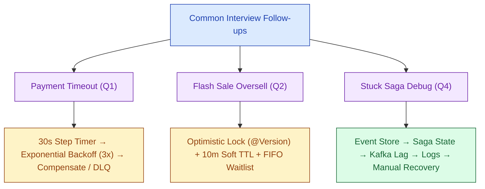

### Q1: "How do you handle a payment timeout mid-saga?"

**Scenario:** Saga sent payment command to Payment Service, but service is slow and doesn't respond for 5 minutes.

**Answer:**
1. **Timeout Detection:** Saga maintains a timeout on each step (e.g., `30 seconds`). If no event arrives in 30s, trigger compensation.
2. **Implementation:**

```java
@KafkaListener(topics = "order-events")
public void handleOrderCreated(OrderCreated event) {
    scheduledExecutor.schedule(() -> {
        if (sagaStates.get(event.orderId).currentStep ==
            SagaStep.PROCESSING_PAYMENT) {
            // Still waiting; timeout!
            handlePaymentTimeout(event.orderId);
        }
    }, 30, TimeUnit.SECONDS);
}
```

3. **Compensation:**
   - Cancel inventory reservation
   - Notify customer: `"Payment processing delayed, please retry"`
   - Store in `pending-retries` for manual processing
4. **Retry Strategy (exponential backoff):**
   - **1st try:** immediate → **2nd try:** `+30 seconds` → **3rd try:** `+5 minutes`
   - **Max retries:** `3 attempts` → after max, route to **DLQ** for manual review

### Q2: "How do you ensure inventory doesn't oversell during flash sales?"

**Scenario:** 10,000 orders placed simultaneously, all trying to reserve the same product with only 5,000 units.

**Answer:**
1. **Optimistic Locking Strategy:** Database `version` field prevents overselling; if update fails due to version mismatch, retry.

```java
Inventory inv = inventoryRepository.findById(productId);
inv.setSoftReservedStock(inv.getSoftReservedStock() + needed);

int rows = inventoryRepository.updateWithVersion(
    productId, inv.getVersion(), inv
);

if (rows == 0) {
    // Version conflict: another transaction updated it
    throw InsufficientStockException();
}
```

2. **Soft Reserve with TTL:** Hold for `10 minutes` only; auto-release if unconfirmed to free stock for other orders.
3. **Queue if Insufficient:** Don't reject immediately — add to waitlist (`"Notifying you when back in stock"`). Notify customers in FIFO order when inventory is released.
4. **Monitoring:** Alert if oversold (`stock < 0` → DB corruption); track `soft-reserve + hard-reserve + deducted` and real-time `available stock`.

> [!NOTE]
> **Alternative (Pessimistic Locking — not recommended for flash sales):** `SELECT * FROM inventory WHERE product_id = ? FOR UPDATE;` locks the row and causes severe contention at scale.

### Q3: "How would you add a new step to the saga (e.g., fraud check)?"

- **Before:** `Order Created → Reserve Inventory → Process Payment → Ship`
- **After:** `Order Created → Fraud Check → Reserve Inventory → Process Payment → Ship`

**Answer:**
1. **Update Event Model:** Add `FraudCheckRequested`, `FraudCheckPassed` / `FraudCheckFailed` events, and `FRAUD_CHECKING` to `OrderStatus`.
2. **Update Saga State Machine:**

```java
enum SagaStep {
    CHECKING_FRAUD,          // NEW
    RESERVING_INVENTORY,
    PROCESSING_PAYMENT,
    PROCESSING_SHIPPING,
    COMPLETED
}
```

3. **Update Saga Orchestrator:**

```java
@KafkaListener(topics = "order-events")
public void handleOrderCreated(OrderCreated event) {
    SagaState state = new SagaState(
        event.orderId,
        SagaStep.CHECKING_FRAUD,  // NEW: start with fraud check
        clock.instant()
    );
    sagaStates.put(event.orderId, state);

    // Command fraud service
    FraudCheckCommand cmd = new FraudCheckCommand(
        event.orderId,
        event.customerId,
        event.totalAmount,
        event.shippingAddress
    );
    publishCommand(cmd, "fraud-commands");
}
```

4. **Handle Fraud Check Results:**

```java
@KafkaListener(topics = "fraud-events")
public void handleFraudCheckPassed(FraudCheckPassed event) {
    SagaState state = sagaStates.get(event.orderId);
    if (state.currentStep != SagaStep.CHECKING_FRAUD) {
        return;  // Unexpected
    }

    // Move to next step: inventory reservation
    state.currentStep = SagaStep.RESERVING_INVENTORY;
    InventoryReservationCommand cmd = new InventoryReservationCommand(...);
    publishCommand(cmd, "inventory-commands");
}

@KafkaListener(topics = "fraud-events")
public void handleFraudCheckFailed(FraudCheckFailed event) {
    // No compensation needed (no previous steps)
    // Just mark order as blocked
    OrderAggregate order = orderRepository.loadOrder(event.orderId);
    order.blockDueToFraud(event.reason);
    orderRepository.save(order);

    notificationService.sendEmail(
        order.getCustomerId(),
        "Order blocked for security review"
    );
}
```

5. **Database Changes:** None needed! Saga state lives in `sagaStateRepository`, new events append to `order_events` automatically, and read models are updated by event consumers.

### Q4: "How do you debug issues in event-driven systems?"

**Scenario:** Order is stuck in `PAYMENT_PROCESSING` state for 24 hours.

**Answer:**

1. **Check Event Store:**
```sql
SELECT * FROM order_events WHERE order_id = ?
ORDER BY aggregate_version ASC;

-- Expected sequence:
-- 1. OrderCreated
-- 2. InventoryReserved
-- 3. PaymentProcessingCommand sent (logged? check logs)
-- 4. PaymentProcessed (missing?)
```

2. **Check Saga State:**
```sql
SELECT * FROM saga_states WHERE order_id = ?;
-- Is it stuck in PROCESSING_PAYMENT? Check created_at.
```

3. **Check Kafka Consumer Lag:**
```bash
kafka-consumer-groups.sh --bootstrap-server localhost:9092 \
    --group order-saga --describe
-- Consumer lag high? Consumer error rate high?
```

4. **Check Logs:** Search by order `UUID` for exception stacktraces and Saga service logs:
   - `[OrderCreated event]` → creates saga state
   - `[InventoryReserved event]` → moves to `PROCESSING_PAYMENT`
   - `[Timeout detected at 30s mark]` → should see compensation logs (if missing: saga pod crashed, consumer not consuming, or event not published to Kafka)
5. **Manual Recovery:**
   - **Inventory reserved, payment failed:** Manually publish `PaymentFailed` event so Saga compensates
   - **Stuck too long:** Query DLQ for failed events, fix root cause, and replay
   - **Kill stuck saga:** `DELETE FROM saga_states WHERE order_id = ?;` (stops timeout loop) and resolve order manually
6. **Prevent Future Issues:**
   - Structured logging with `order_id` + `saga_step`
   - Metric `saga_stuck_duration_seconds` + alert if saga `> 10 minutes` without progress
   - Distributed tracing (**Jaeger/Zipkin**) to follow an order across all services

### Q5: "What's the latency impact of event sourcing?"

**Answer:**

| Operation | Latency | Notes |
|-----------|---------|-------|
| **Write (Event Store + Kafka)** | `~7ms` | `~2ms` sequential append + `~5ms` Kafka publish (vs multiple sync RPCs) |
| **Read (1,000 events, no snapshot)** | `~50ms` | Full event replay |
| **Read (with snapshots every 100 events)** | `~5ms` | Load snapshot (`~1ms`) + replay 10 events |
| **Read Model (CQRS)** | `<1ms` | Index lookup on denormalized view |

**Optimizations:**
1. **Snapshots every 100 events:** Reduces replay from 1,000 → 10 events (`1ms` write + `1ms` read overhead).
2. **CQRS for queries:** Write-optimized event store + query-optimized denormalized read model (`<1ms` with index + cache).
3. **Async Kafka consumers:** Sync path only writes to event store (`2ms`); read models update asynchronously with zero blocking.

### Q6: "How do you handle distributed transactions reliably?"

**The Challenge:** Step A succeeds, Step B fails → A must be undone, with no shared database transaction.

**Solution: Compensating Transactions (Sagas)**

| Path | Execution Flow |
|------|----------------|
| **Happy Path** | `Order ✓ → Reserve Inventory ✓ → Charge Payment ✓ → Ship ✓` |
| **Payment Declined** | `Order → Reserve Inventory → Charge Payment ✗` → **Compensate:** `Cancel Inventory` / `Refund` |
| **Shipping Unavailable** | `Order → Reserve Inventory → Charge Payment → Ship ✗` → **Compensate:** `Refund Payment` → `Cancel Inventory` |

- **Guarantees:** **Atomicity** (compensations ensure all-or-nothing), **Consistency** (consistent final state), **Isolation** (immutable events per saga), **Durability** (replicated DB event store).
- **Trade-offs:** Not instant (lag between steps), not ACID (eventually consistent), requires compensating logic (extra code) and idempotency (handle retries).

### Q7: Mid-Level vs Senior-Level Comparison

| Aspect | Mid-Level (5 YOE) | Senior (8+ YOE) |
|--------|-------------------|-----------------|
| **Problem Scope** | Design order saga | Design entire e-commerce platform |
| **Consistency Model** | Eventual consistency given | Argues trade-offs: sync vs async |
| **Event Sourcing** | Understands it | Predicts pain points: versioning, storage costs |
| **Saga Patterns** | Choreography OR orchestration | Hybrid approach based on domain |
| **Monitoring** | Basic metrics | Distributed tracing, SLO/SLI definition |
| **Failure Scenarios** | Handles common ones | Explores uncommon edge cases |
| **Testing** | Integration tests with testcontainers | Chaos engineering, property-based testing |
| **Technology Choices** | Uses Kafka | Evaluates Kafka vs Pulsar vs RabbitMQ |
| **Scale** | 50K orders/hour | 1M orders/hour, multi-region, multi-tenant |

---

## Quick Reference & Tips

### 60-Minute Interview Pacing & Strategy

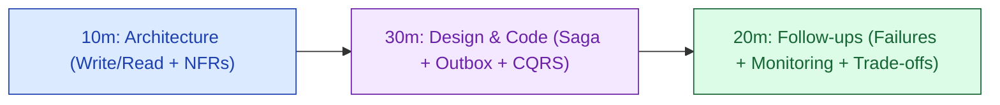

1. **Start with write-path (command flow)**, then read-path (queries)
2. **Draw the architecture first**, then code key components
3. **Mention non-functional requirements early**: exactly-once, fault tolerance
4. **Prepare 1–2 failure scenarios** you've thought through
5. **Be honest about trade-offs**: event sourcing is powerful but adds complexity
6. **Code the saga orchestrator**: it's the heart of the system
7. **Mention monitoring**: interviewer wants to see you think about production
8. **Time management**: `60 min = 10 min arch + 30 min design/code + 20 min follow-ups`

### Kafka Configurations for Production

```yaml
# Order Events Topic (compacted, for event sourcing)
Topic: order-events
  Partitions: 10 (scale with throughput)
  Replication Factor: 3 (HA)
  Retention: 30 days (compliance)
  Cleanup Policy: compact (keep latest event per order)
  Min Insync Replicas: 2 (durability)

# Command Topics
Topic: inventory-commands
  Partitions: 10
  Replication Factor: 3
  Retention: 7 days (commands are transient)

# DLQ Topics
Topic: order-events-dlq
  Partitions: 3
  Retention: 30 days (investigation)

# Consumer Group Settings
max.poll.interval.ms: 300000 (5 min timeout for processing)
session.timeout.ms: 30000 (detect failures)
enable.auto.commit: false (manual offset commits)
```

### Postgres Tuning for Event Store

```sql
-- Batch inserts
INSERT INTO order_events (...) VALUES (...), (...), (...)
ON CONFLICT (order_id, aggregate_version) DO NOTHING;

-- Index on order_id for fast replay
CREATE INDEX CONCURRENTLY idx_order_events_order_id ON order_events(order_id);

-- Index on event type for analytics
CREATE INDEX CONCURRENTLY idx_order_events_type ON order_events(event_type);

-- Partitioning by date
CREATE TABLE order_events PARTITION BY RANGE (created_date);
CREATE TABLE order_events_2024_01 PARTITION OF order_events
  FOR VALUES FROM ('2024-01-01') TO ('2024-02-01');

-- Auto-analyze for query planner
ALTER TABLE order_events SET (autovacuum_analyze_scale_factor = 0.05);
```

### Common Mistakes to Avoid

1. **No idempotency keys** → double charging
2. **Synchronous saga calls** → cascading failures
3. **Ignoring timeout handling** → stuck orders
4. **No DLQ** → lost events silently
5. **Oversized batches** → OOM in consumers
6. **Not thinking about GDPR/data deletion** with event sourcing
7. **Snapshot strategy missing** → slow event replay at scale
8. **No schema versioning** → breaking changes in production

### Resources to Read

- "Designing Data-Intensive Applications" by Duckworth (Chapter 8: Distributed transactions, Chapter 11: Stream processing)
- Confluent blog: "Event Sourcing and Stream Processing"
- Sam Newman: "Building Microservices" (Chapter on sagas)
- Axon Framework docs (production event sourcing library)

---

## Final Checklist Before Interview

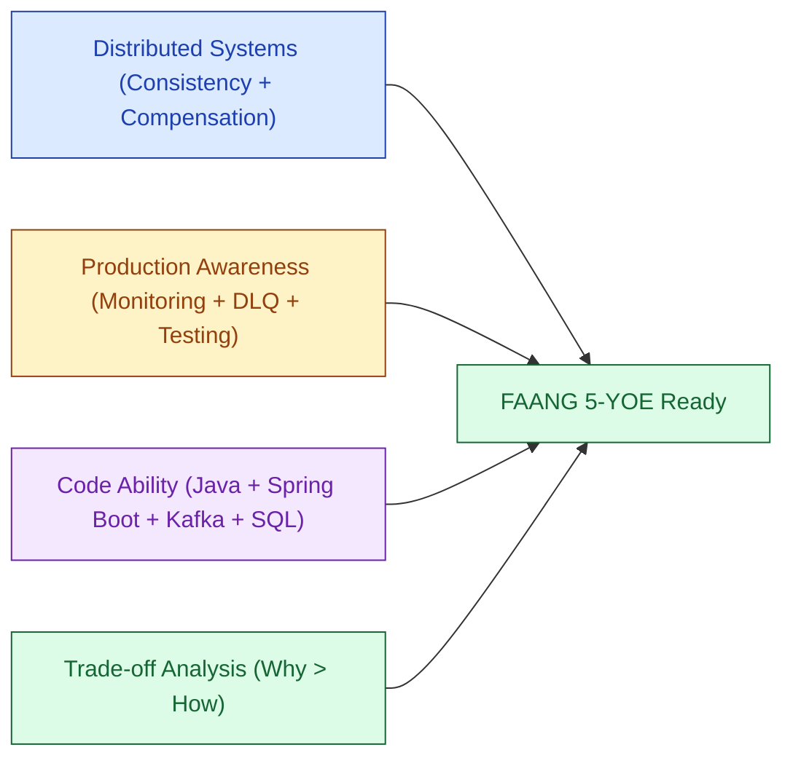

- [ ] Can explain event sourcing benefits/trade-offs without notes
- [ ] Can draw saga orchestration state diagram from memory
- [ ] Understand exactly-once processing: idempotency + deduplication
- [ ] Know how to scale: partitioning, consumer groups, snapshot strategy
- [ ] Have 1-2 failure scenarios pre-planned
- [ ] Mention monitoring/observability early
- [ ] Time management: architecture → design → code → follow-ups
- [ ] Ready to pivot: "What if we needed real-time consistency?" etc.

> [!TIP]
> **Good luck with your interview!** For a 5 YOE engineer targeting FAANG, focus on **explaining the "why"** (business constraints drive design) not just the "how."
