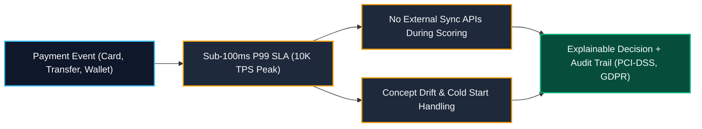
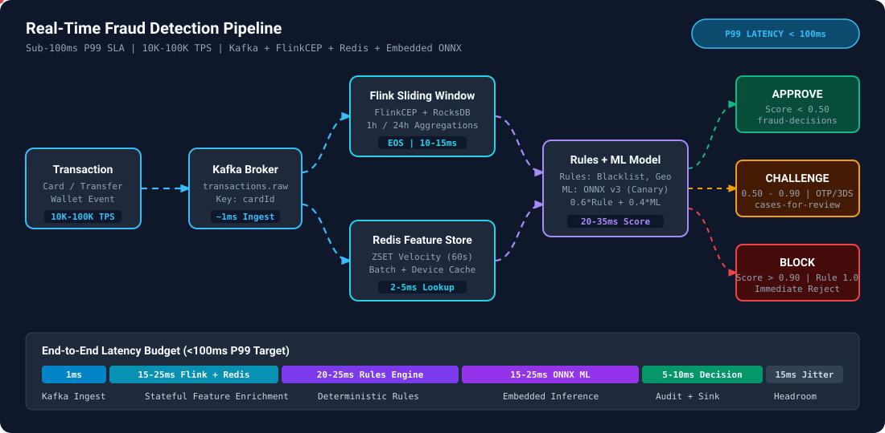
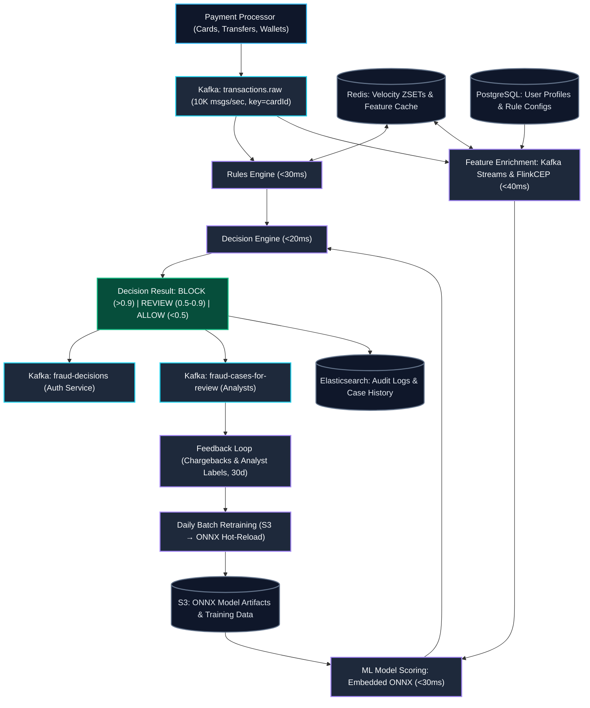
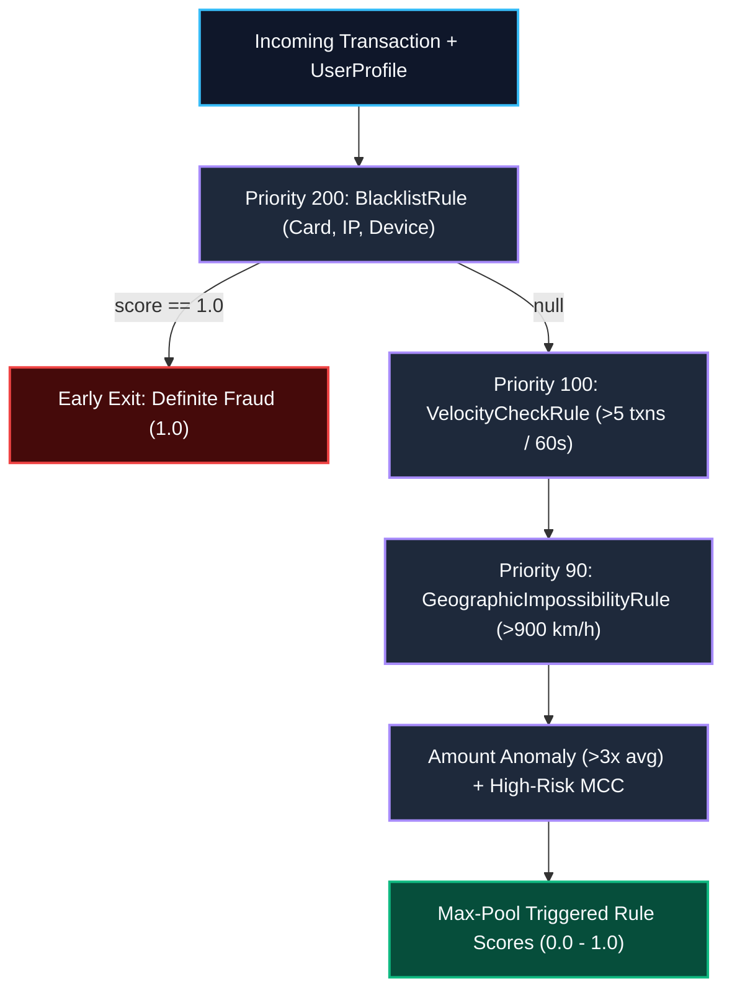
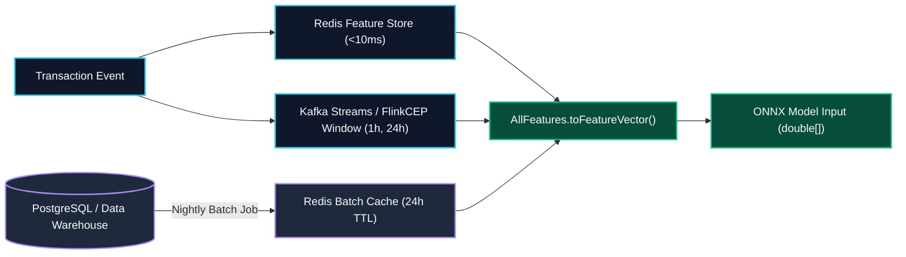
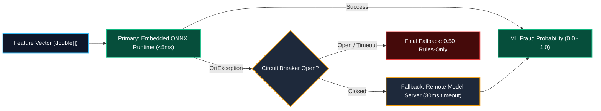
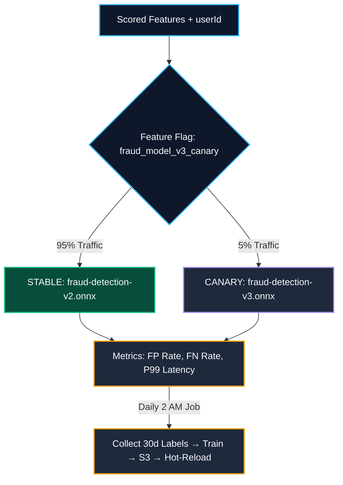

# Real-Time Fraud Detection Engine System Design

> **Target Audience**: Mid-level Java engineers (5 YOE) with banking background, interviewing for FAANG
> **Complexity**: Hard — Tests stream processing, ML integration, low-latency system design
> **Time**: 45-60 minutes in an interview setting

---

## Table of Contents
1. [Problem Statement & Requirements](#problem-statement--requirements)
2. [High-Level Architecture](#high-level-architecture)
3. [Rule-Based Engine](#rule-based-engine)
4. [Feature Engineering for ML](#feature-engineering-for-ml)
5. [ML Model Integration](#ml-model-integration)
6. [Stream Processing with Kafka Streams](#stream-processing-with-kafka-streams)
7. [Decision Engine](#decision-engine)
8. [Production Concerns](#production-concerns)
9. [Interview Follow-ups & Expected Answers](#interview-follow-ups--expected-answers)
10. [Appendix: Complete Code Examples](#appendix-complete-code-examples)

---

## Problem Statement & Requirements

### Business Context
You're designing a fraud detection system for a global payment processor that handles card transactions, bank transfers, and digital wallets. The system must prevent financial fraud in real-time while minimizing customer friction.



> [!IMPORTANT]
> The **&lt;100ms P99 latency budget** is the defining architectural constraint: you cannot make synchronous external HTTP calls (e.g., third-party IP enrichment or remote feature stores) on the hot path. Every feature and model artifact must reside in memory, local RocksDB state, or sub-5ms Redis caches.

### Functional Requirements
1. **Real-time Transaction Scoring**: Analyze incoming transactions and produce a fraud risk score within 100ms
2. **Blocking**: Automatically block transactions scoring >0.9 (90% fraud probability)
3. **Flagging for Review**: Flag transactions scoring 0.5-0.9 for manual analyst review
4. **Rules Engine**: Support deterministic, configurable rules (no code deployment needed)
5. **ML Model Scoring**: Integrate gradient boosting or neural network models for fraud probability
6. **False Positive Reduction**: Continuously improve to reduce false positives (<1% of legitimate transactions)
7. **Explainability**: Track which rules triggered and what the model contributed to each decision
8. **Feedback Loop**: Analyst decisions and true fraud labels feed back to retrain the model

### Non-Functional Requirements & SLA Targets

| Dimension | Target | Architectural Implication |
|-----------|--------|---------------------------|
| **Latency** | `<100ms` P99 (ingestion to decision) | Embedded ONNX inference, Redis cache, no external sync calls |
| **Throughput** | `10,000` TPS peak (Black Friday scale) | Partitioned Kafka topics by `cardId`, horizontal pod autoscaling |
| **Availability** | `99.99%` uptime (~52 mins/year) | Multi-AZ Kafka + Redis, rule-only fallback if ML degrades |
| **Consistency** | Exactly-once processing (EOS) | Kafka `EXACTLY_ONCE_V2`, idempotent decision sinks |
| **Scalability** | Linear horizontal scaling | Stateless scoring pods + partitioned stateful stream processors |
| **Audit & Compliance** | Complete decision lineage (PCI-DSS, GDPR) | Immutable `AuditLog` capturing triggered rules, scores, and model version |

### Key Constraints
- **No external calls during scoring**: Latency budget is tight; can't call external APIs
- **Cold start**: New customers have no transaction history
- **Concept drift**: Fraud patterns evolve; model must be updated regularly (but not in real-time)
- **Geographic diversity**: System operates across US, EU, APAC with different regulations

> [!TIP]
> In an interview, anchor your design around the **two-speed reality** of fraud detection: the **hot path (`<100ms`)** must be deterministic, self-contained, and fail-safe, while the **cold path (hours/days)** handles heavy feature aggregation, analyst feedback, and model retraining.

---

## High-Level Architecture

### Animated End-to-End Scoring Pipeline



> [!IMPORTANT]
> Partitioning `transactions.raw` by `cardId` guarantees strict per-card event ordering. Every transaction for a given card lands on the same Kafka partition and stream task, enabling lock-free sliding window aggregations without cross-node coordination.

### System Overview Diagram



### Hot-Path Request Lifecycle

```mermaid
sequenceDiagram
    autonumber
    participant P as Payment Processor
    participant K as Kafka (transactions.raw)
    participant S as Stream Engine (Flink / Kafka Streams)
    participant R as Redis Feature Store
    participant E as Rules + ONNX ML
    participant D as Decision & Audit Sink

    P->>K: Publish Transaction (key = cardId)
    K->>S: Consume event (~1ms)
    par Parallel State & Feature Lookup
        S->>S: Update FlinkCEP / RocksDB sliding window
        S->>R: Fetch 60s ZSET velocity + batch features (2-5ms)
    end
    S->>E: Evaluate Rules (priority order) + ONNX inference
    Note over E: Blacklist = 1.0 triggers immediate short-circuit
    E->>D: Combine 0.6*Rule + 0.4*ML → APPROVE / CHALLENGE / BLOCK
    D-->>K: Emit to fraud-decisions & audit log (&lt;100ms P99)
```

### Component Breakdown & Storage Layers

| Component | Technology | Latency Budget | Responsibility |
|-----------|-----------|-----------------|-----------------|
| **Rule Engine** | Java, Redis | `<30ms` | Velocity, blacklist, geographic checks |
| **Feature Enrichment** | Kafka Streams / FlinkCEP | `<40ms` | Compute sliding window features |
| **ML Model Serving** | Embedded ONNX / Spring Boot | `<30ms` | Gradient boosting or NN inference |
| **Decision Engine** | Java | `<20ms` | Combine scores, apply thresholds |
| **Coordination** | Kafka Streams / Flink topology | `<100ms` (total) | Orchestrate entire flow |

| Storage Layer | Primary Workload | Access Pattern |
|---------------|------------------|----------------|
| **Redis** | Real-time velocity ZSETs, device/IP flags, batch feature cache | Sub-5ms key-value & sorted-set lookups on hot path |
| **PostgreSQL** | User profiles, merchant metadata, dynamic `fraud_rules` | Periodic rule reload (`60s`) & cache-miss fallback |
| **S3** | Versioned `.onnx` model artifacts & 30-day labeled training datasets | Startup / hot-reload fetch & daily batch training |
| **Elasticsearch** | Immutable audit logs, explainability payloads, analyst case history | Async indexing & regulatory/analyst search |

> [!TIP]
> Keep **hot-path** storage (Redis + local RocksDB) strictly decoupled from **cold-path** analytics (PostgreSQL + Elasticsearch + S3). If Elasticsearch or PostgreSQL experiences a slowdown, the `<100ms` scoring pipeline remains completely unaffected.

---

## Rule-Based Engine

### Why Rule-Based First?
1. **Deterministic & Fast**: No model inference latency
2. **Explainable**: Analysts understand why transactions are blocked
3. **Immediate**: Can block known patterns (blacklists, geographic impossibilities) instantly
4. **Configurable**: Update rules without redeploying code
5. **Fail-safe**: If ML system goes down, rules still work



| Rule | Priority | Trigger Condition | Score Contribution | Backing Store |
|------|----------|-------------------|--------------------|---------------|
| **Blacklist Check** | `200` | Compromised `cardId`, `ipAddress`, or `deviceFingerprint` | `1.0` (Early Exit) | Redis key lookup |
| **Velocity Check** | `100` | `&gt;5` transactions for `cardId` in last `60s` | `+0.4` | Redis Sorted Set (`ZSET`) |
| **Geographic Impossibility** | `90` | Speed between consecutive txns `&gt;900 km/h` | `+0.5` | `UserProfile` Haversine |
| **Amount Anomaly** | `80` | `amount &gt; 3 × user_avg_amount` | `+0.3` | `UserProfile` / Batch cache |
| **High-Risk MCC** | `70` | MCC in `{6211, 6051, 9211}` &amp; new for user | `+0.2` | Redis key / `UserProfile` |

> [!IMPORTANT]
> `RuleEngine` isolates each `FraudRule` inside a `try/catch` block. A single misconfigured rule or transient Redis timeout logs an error and continues evaluating remaining rules—never failing the entire scoring pipeline.

### Rules to Implement

#### Rule 1: Velocity Check (Multiple Transactions in Short Time)
```
IF card_id has >5 transactions in the last 60 seconds
THEN fraud_score += 0.4
```

#### Rule 2: Amount Anomaly (Unusual Spending)
```
IF transaction_amount > 3 × user's_average_transaction_amount
THEN fraud_score += 0.3
```

#### Rule 3: Geographic Impossibility (Impossible Travel)
```
IF (last_transaction_country != current_transaction_country)
   AND (distance_between_countries > 900 km)
   AND (time_between_transactions < distance / 900 * 1 hour)
THEN fraud_score += 0.5  /* Can't physically travel that far */
```

#### Rule 4: High-Risk Merchant Categories
```
IF merchant_category_code IN {6211, 6051, 9211}  /* Crypto, forex, lotteries */
   AND user_has_never_transacted_in_category_before
THEN fraud_score += 0.2
```

#### Rule 5: Blacklist Checks
```
IF card_id IN known_compromised_cards
   OR ip_address IN known_fraud_ips
   OR device_fingerprint IN known_fraud_devices
THEN fraud_score = 1.0  /* Immediate block */
```

### Java Implementation

#### Rule Interface
```java
public interface FraudRule {
    /**
     * Evaluate this rule against a transaction.
     * @return fraud contribution (0.0-1.0), or null if rule doesn't apply
     */
    Double evaluate(Transaction transaction, UserProfile profile, RuleContext context);

    String ruleName();
    int priority();  // Higher = runs first
}
```

#### Transaction & Supporting Classes
```java
public class Transaction {
    public String cardId;
    public String userId;
    public BigDecimal amount;
    public String merchantCategoryCode;
    public String merchantCountry;
    public String userCountry;
    public String ipAddress;
    public String deviceFingerprint;
    public long timestamp;  // milliseconds
    public String transactionId;
    public Geolocation currentGeolocation;
}

public class UserProfile {
    public String userId;
    public BigDecimal averageTransactionAmount;
    public String primaryCountry;
    public Geolocation lastKnownLocation;
    public long lastTransactionTime;
    public Set<String> frequentMerchantCategories;
    public LocalDateTime accountCreatedDate;
}

public class RuleContext {
    private final RedisTemplate<String, Object> redis;
    private final UserProfileRepository userRepo;

    public Long getVelocityCount(String cardId, int windowSeconds) {
        String key = "velocity:" + cardId + ":" + (System.currentTimeMillis() / 1000);
        return redis.opsForValue().increment(key);
    }

    public void recordTransaction(String cardId) {
        // Increment velocity counter with sliding window
        String key = "velocity:" + cardId + ":" + (System.currentTimeMillis() / 1000);
        redis.opsForValue().increment(key);
        redis.expire(key, Duration.ofMinutes(2));
    }
}
```

#### Concrete Rule Implementations

```java
public class VelocityCheckRule implements FraudRule {
    private static final int VELOCITY_THRESHOLD = 5;
    private static final int VELOCITY_WINDOW_SECONDS = 60;

    @Override
    public Double evaluate(Transaction txn, UserProfile profile, RuleContext ctx) {
        // Count transactions for this card in the last 60 seconds
        Long count = ctx.getVelocityCount(txn.cardId, VELOCITY_WINDOW_SECONDS);

        if (count > VELOCITY_THRESHOLD) {
            // More than 5 transactions in 1 minute is suspicious
            return 0.4;
        }
        return null;  // Rule doesn't apply
    }

    @Override
    public String ruleName() { return "velocity_check"; }

    @Override
    public int priority() { return 100; }  // Run early
}

public class GeographicImpossibilityRule implements FraudRule {
    private static final double IMPOSSIBLE_SPEED_KMH = 900;  // Fastest plane ~900 km/h

    @Override
    public Double evaluate(Transaction txn, UserProfile profile, RuleContext ctx) {
        if (profile.lastKnownLocation == null) {
            return null;
        }

        double distanceKm = profile.lastKnownLocation.distanceTo(txn.currentGeolocation);
        long timeElapsedMs = txn.timestamp - profile.lastTransactionTime;
        double timeElapsedHours = timeElapsedMs / (3600_000.0);
        double requiredTimeHours = distanceKm / IMPOSSIBLE_SPEED_KMH;

        if (timeElapsedHours < requiredTimeHours) {
            // Physically impossible to travel this far in this time
            return 0.5;
        }
        return null;
    }

    @Override
    public String ruleName() { return "geographic_impossibility"; }

    @Override
    public int priority() { return 90; }
}

public class BlacklistRule implements FraudRule {
    private final RedisTemplate<String, Boolean> blacklistCache;

    @Override
    public Double evaluate(Transaction txn, UserProfile profile, RuleContext ctx) {
        Boolean isBlacklisted = blacklistCache.opsForValue().get("blacklist:card:" + txn.cardId);
        if (Boolean.TRUE.equals(isBlacklisted)) {
            return 1.0;  // Definite fraud
        }

        isBlacklisted = blacklistCache.opsForValue().get("blacklist:ip:" + txn.ipAddress);
        if (Boolean.TRUE.equals(isBlacklisted)) {
            return 1.0;
        }

        return null;
    }

    @Override
    public String ruleName() { return "blacklist"; }

    @Override
    public int priority() { return 200; }  // Run first
}
```

#### Rule Engine (Chain of Responsibility)

```java
@Component
public class RuleEngine {
    private final List<FraudRule> rules;
    private final RuleContext ruleContext;
    private static final Logger log = LoggerFactory.getLogger(RuleEngine.class);

    public RuleEngine(List<FraudRule> rules, RuleContext ruleContext) {
        this.rules = rules.stream()
            .sorted(Comparator.comparingInt(FraudRule::priority).reversed())
            .collect(Collectors.toList());
        this.ruleContext = ruleContext;
    }

    /**
     * Evaluate all rules and return combined score.
     * Uses max pooling: if any rule returns 1.0, transaction is definitely fraudulent.
     * Otherwise, uses max score from applicable rules.
     */
    public FraudScoreResult evaluateRules(Transaction txn, UserProfile profile) {
        List<RuleTriggered> triggeredRules = new ArrayList<>();
        double maxScore = 0.0;

        long startTime = System.nanoTime();

        for (FraudRule rule : rules) {
            try {
                Double ruleScore = rule.evaluate(txn, profile, ruleContext);

                if (ruleScore != null && ruleScore > 0) {
                    triggeredRules.add(new RuleTriggered(rule.ruleName(), ruleScore));
                    maxScore = Math.max(maxScore, ruleScore);

                    // Early exit: definite fraud
                    if (ruleScore >= 1.0) {
                        break;
                    }
                }
            } catch (Exception e) {
                log.error("Error evaluating rule: {}", rule.ruleName(), e);
                // Don't fail the entire pipeline; continue with next rule
            }
        }

        long durationMs = (System.nanoTime() - startTime) / 1_000_000;

        return new FraudScoreResult(maxScore, triggeredRules, durationMs);
    }
}

public class FraudScoreResult {
    public double ruleScore;
    public List<RuleTriggered> triggeredRules;
    public long durationMs;

    public FraudScoreResult(double ruleScore, List<RuleTriggered> triggeredRules, long durationMs) {
        this.ruleScore = ruleScore;
        this.triggeredRules = triggeredRules;
        this.durationMs = durationMs;
    }
}

public class RuleTriggered {
    public String ruleName;
    public Double score;

    public RuleTriggered(String ruleName, Double score) {
        this.ruleName = ruleName;
        this.score = score;
    }
}
```

### Making Rules Configurable

**Store rules in PostgreSQL**, not in code:

```java
@Entity
@Table(name = "fraud_rules")
public class RuleDefinition {
    @Id
    public Long id;
    public String name;
    public String ruleType;  // "velocity", "amount_anomaly", "geographic", etc.
    public Map<String, Object> parameters;  // {"threshold": 5, "window_seconds": 60}
    public Double weightIfTriggered;  // Contribution to fraud score
    public Boolean enabled;
    public LocalDateTime lastModified;
}
```

**Rule Registry Pattern**:

```java
@Component
public class DynamicRuleRegistry {
    private final RuleDefinitionRepository ruleRepo;
    private Map<String, FraudRule> ruleCache = new ConcurrentHashMap<>();

    @Scheduled(fixedDelay = 60_000)  // Reload every 60 seconds
    public void reloadRules() {
        List<RuleDefinition> definitions = ruleRepo.findByEnabledTrue();

        for (RuleDefinition def : definitions) {
            FraudRule rule = createRuleFromDefinition(def);
            ruleCache.put(def.name, rule);
        }
    }

    private FraudRule createRuleFromDefinition(RuleDefinition def) {
        switch (def.ruleType) {
            case "velocity":
                return new ParameterizedVelocityRule(def.parameters);
            case "geographic":
                return new ParameterizedGeographicRule(def.parameters);
            default:
                throw new IllegalArgumentException("Unknown rule type: " + def.ruleType);
        }
    }
}
```

### Redis for Real-Time Counters

**Sliding Window Counter** (using Redis Sorted Sets):

```java
public class SlidingWindowCounter {
    private final StringRedisTemplate redis;

    /**
     * Increment counter for given key within a sliding window.
     * Uses Redis sorted set where score = timestamp.
     */
    public long incrementAndGetCount(String key, int windowSeconds) {
        long now = System.currentTimeMillis();
        long oldestTime = now - (windowSeconds * 1000L);

        // Add current event
        redis.opsForZSet().add(key, UUID.randomUUID().toString(), now);

        // Remove old events outside the window
        redis.opsForZSet().removeRangeByScore(key, 0, oldestTime);

        // Get current count
        Long count = redis.opsForZSet().size(key);

        // Set expiration (cleanup old keys)
        redis.expire(key, Duration.ofSeconds(windowSeconds + 10));

        return count != null ? count : 0L;
    }
}
```

**Performance Implications**:
- Redis sliding window: ~2-5ms per lookup
- Suitable for 10K txns/sec (Redis handles millions of ops/sec)
- Alternative: Use Kafka Streams windowed aggregations (covered in section 6)

> [!TIP]
> In production, combine the `ZADD`, `ZREMRANGEBYSCORE`, `ZCARD`, and `EXPIRE` operations inside a **Redis Lua script** or pipeline so the sliding window update executes atomically in a single network round-trip (`<2ms`).

---

## Feature Engineering for ML



| Feature Tier | Source | Serving Latency | Refresh Cadence | Key Examples |
|--------------|--------|-----------------|-----------------|--------------|
| **Real-Time Features** | Redis ZSETs + Kafka Streams / Flink | `<10ms` | Per-transaction (streaming) | `txnCountLast1Hour`, `isNewDevice`, `distanceFromLastTxnKm` |
| **Batch Features** | PostgreSQL / S3 → Redis Cache | `2-5ms` (cache hit) | Nightly batch (`24h` TTL) | `accountAgeInDays`, `allTimeStdDevTxnAmount`, `historicalFraudRate` |

> [!IMPORTANT]
> **Training-Serving Skew Prevention**: The exact column order and normalization in `AllFeatures.toFeatureVector()` must match the schema used during Python/XGBoost/ONNX training. Version the feature schema alongside the `.onnx` artifact!

### Feature Categories

#### Real-Time Features (Computed Instantly from Redis)
These are computed from recent transaction history, available with <10ms latency.

```java
public class RealTimeFeatures {
    // Velocity features
    public int txnCountLast1Hour;
    public int txnCountLast24Hours;
    public double totalAmountLast1Hour;
    public double totalAmountLast24Hours;

    // Temporal features
    public long secondsSinceLastTxn;
    public int txnCountSameHourOfDay;  // What time of day does user usually transact?

    // Device/IP features
    public boolean isNewDevice;
    public boolean isNewIpAddress;
    public int deviceUsageFrequency;
    public int ipUsageFrequency;

    // Merchant features
    public boolean isMerchantCategoryNew;
    public boolean isMerchantNew;
    public double userHistoricalFraudRateForMerchant;

    // Geographic features
    public double distanceFromHomeKm;
    public double distanceFromLastTxnKm;
    public boolean isInUnusualCountry;
}
```

#### Batch Features (Precomputed Daily, Refreshed in Cache)
These aggregate historical data, updated overnight.

```java
public class BatchFeatures {
    // User profile features
    public long accountAgeInDays;
    public double allTimeAverageTxnAmount;
    public double allTimeMaxTxnAmount;
    public double allTimeStdDevTxnAmount;
    public int totalUniqueDevices;
    public int totalUniqueIps;
    public int totalUniqueCountries;
    public double historicalFraudRate;

    // Card features
    public long cardAgeInDays;
    public int cardUsageFrequency;

    // Merchant features
    public double merchantHistoricalChargebackRate;
    public double merchantHistoricalFraudRate;
    public int merchantMonthlyTransactionVolume;
}
```

### Feature Computation Service

```java
@Service
public class FeatureComputationService {
    private final StringRedisTemplate redis;
    private final UserProfileRepository userRepo;
    private final MerchantRepository merchantRepo;
    private final TransactionHistoryRepository txnHistoryRepo;
    private static final Logger log = LoggerFactory.getLogger(FeatureComputationService.class);

    /**
     * Compute all features for a transaction.
     * Latency target: <40ms (batch features cached, real-time computed on-the-fly)
     */
    public AllFeatures computeFeatures(Transaction txn) {
        long startTime = System.currentTimeMillis();

        RealTimeFeatures rtFeatures = computeRealTimeFeatures(txn);
        BatchFeatures batchFeatures = getBatchFeatures(txn.userId);

        long durationMs = System.currentTimeMillis() - startTime;
        log.debug("Feature computation took {}ms for txn {}", durationMs, txn.transactionId);

        return new AllFeatures(rtFeatures, batchFeatures, durationMs);
    }

    private RealTimeFeatures computeRealTimeFeatures(Transaction txn) {
        RealTimeFeatures features = new RealTimeFeatures();

        // Velocity features
        features.txnCountLast1Hour =
            (int) getVelocityCount(txn.cardId, 3600);  // 3600 seconds
        features.txnCountLast24Hours =
            (int) getVelocityCount(txn.cardId, 86400);

        features.totalAmountLast1Hour =
            getTotalAmountLast(txn.cardId, 3600);
        features.totalAmountLast24Hours =
            getTotalAmountLast(txn.cardId, 86400);

        // Device features
        String deviceKey = "device:" + txn.deviceFingerprint;
        Boolean isNewDevice = redis.hasKey(deviceKey) == Boolean.FALSE;
        features.isNewDevice = isNewDevice;

        if (isNewDevice) {
            redis.opsForValue().set(deviceKey, "1", Duration.ofDays(90));
        }

        // Merchant category features
        String merchantCategoryKey = "user:" + txn.userId + ":merchant_category:" + txn.merchantCategoryCode;
        features.isMerchantCategoryNew = redis.hasKey(merchantCategoryKey) == Boolean.FALSE;

        if (features.isMerchantCategoryNew) {
            redis.opsForValue().set(merchantCategoryKey, "1", Duration.ofDays(30));
        }

        return features;
    }

    private BatchFeatures getBatchFeatures(String userId) {
        // Features precomputed daily and cached in Redis
        String cacheKey = "batch_features:" + userId;
        String cached = redis.opsForValue().get(cacheKey);

        if (cached != null) {
            return deserialize(cached, BatchFeatures.class);
        }

        // If not in cache, compute from database (should rarely happen)
        UserProfile profile = userRepo.findById(userId).orElse(null);
        if (profile == null) {
            return new BatchFeatures();  // Default features for new user
        }

        BatchFeatures features = new BatchFeatures();
        features.accountAgeInDays = ChronoUnit.DAYS.between(
            profile.accountCreatedDate,
            LocalDateTime.now()
        );
        features.allTimeAverageTxnAmount = profile.averageTransactionAmount.doubleValue();
        // ... compute other batch features

        // Cache for 24 hours
        redis.opsForValue().set(cacheKey, serialize(features), Duration.ofHours(24));

        return features;
    }

    private long getVelocityCount(String cardId, int windowSeconds) {
        long now = System.currentTimeMillis();
        long oldestTime = now - (windowSeconds * 1000L);
        String key = "velocity:" + cardId;

        return redis.opsForZSet().countByScore(key, oldestTime, now).longValue();
    }

    private double getTotalAmountLast(String cardId, int windowSeconds) {
        String key = "velocity_amounts:" + cardId;
        // In practice, you'd need a more sophisticated approach:
        // Option 1: Store individual amounts in Redis (memory intensive)
        // Option 2: Use Kafka Streams windowed aggregations
        return 0.0;  // Simplified
    }
}

public class AllFeatures {
    public RealTimeFeatures realTime;
    public BatchFeatures batch;
    public long computationTimeMs;

    public AllFeatures(RealTimeFeatures realTime, BatchFeatures batch, long computationTimeMs) {
        this.realTime = realTime;
        this.batch = batch;
        this.computationTimeMs = computationTimeMs;
    }

    /**
     * Convert to feature vector (array of doubles) for ML model input.
     * Order must match the model's expected input feature order.
     */
    public double[] toFeatureVector() {
        return new double[]{
            realTime.txnCountLast1Hour,
            realTime.txnCountLast24Hours,
            realTime.totalAmountLast1Hour,
            realTime.totalAmountLast24Hours,
            realTime.secondsSinceLastTxn,
            realTime.isNewDevice ? 1.0 : 0.0,
            realTime.isNewIpAddress ? 1.0 : 0.0,
            realTime.isMerchantCategoryNew ? 1.0 : 0.0,
            realTime.distanceFromHomeKm,
            realTime.distanceFromLastTxnKm,
            batch.accountAgeInDays,
            batch.allTimeAverageTxnAmount,
            batch.allTimeStdDevTxnAmount,
            batch.totalUniqueDevices,
            batch.totalUniqueCountries,
            batch.historicalFraudRate
        };
    }
}
```

### Sliding Window Aggregations with Kafka Streams

**Problem**: How to compute total amount spent in last 1 hour efficiently?

**Solution**: Use Kafka Streams windowed aggregations. Transactions are partitioned by card ID, so all transactions for a card go to the same partition.

```java
@Component
public class VelocityStreamBuilder {

    public KStream<String, TransactionWithFeatures> buildVelocityStream(
            StreamsBuilder streamsBuilder) {

        // Source: transactions by card ID
        KStream<String, Transaction> transactions = streamsBuilder.stream(
            "transactions.raw",
            Consumed.with(Serdes.String(), new TransactionSerde())
        );

        // Aggregate: count transactions in 1-hour tumbling windows
        KTable<Windowed<String>, Long> txnCountPerHour = transactions
            .groupByKey()
            .windowedBy(TimeWindows.of(Duration.ofHours(1))
                .grace(Duration.ofMinutes(5)))  // Allow 5 min late data
            .count(Materialized.as("txn-count-1h-store"));

        // Aggregate: sum amounts in 1-hour tumbling windows
        KTable<Windowed<String>, Double> totalAmountPerHour = transactions
            .groupByKey()
            .windowedBy(TimeWindows.of(Duration.ofHours(1))
                .grace(Duration.ofMinutes(5)))
            .aggregate(
                () -> 0.0,  // initializer
                (key, txn, aggregate) -> aggregate + txn.amount.doubleValue(),  // adder
                (key, txn, aggregate) -> aggregate - txn.amount.doubleValue(),  // subtractor
                Materialized.as("txn-amount-1h-store")
            );

        // Enrich transactions with aggregations
        KStream<String, TransactionWithFeatures> enriched = transactions
            .leftJoin(
                txnCountPerHour,
                (txn, count) -> new TransactionEnriched(
                    txn,
                    count != null ? count : 0L,
                    null  // will fill amount below
                ),
                JoinWindows.of(Duration.ofHours(1)),
                StreamJoined.with(Serdes.String(), new TransactionSerde(), Serdes.Long())
            )
            .map((key, enriched) -> {
                // Join with amount
                enriched.txnCountLast1Hour = enriched.count;
                return new KeyValue<>(key, enriched);
            });

        return enriched;
    }
}
```

**Trade-offs**:
- **Kafka Streams windowed aggregations**: More scalable, handles billions of events, but harder to query individual aggregations
- **Redis sorted sets**: Simpler code, easier to query, but limited to single machine's memory
- **Recommendation**: Use Kafka Streams for real-time aggregations at scale; use Redis for cache of recent computations

> [!WARNING]
> Avoid storing unbounded raw transaction histories in Redis Sorted Sets for high-volume cards (e.g., corporate or merchant test cards). Always enforce `ZREMRANGEBYSCORE` and key `TTL`s, or offload multi-hour sum aggregations to Kafka Streams / Flink RocksDB state stores.

---

## ML Model Integration

### Model Serving Options



| Serving Strategy | Latency | Deployment Coupling | Fault Tolerance | Best Used For |
|------------------|---------|---------------------|-----------------|---------------|
| **Embedded ONNX** | `<5ms` (in-process) | Coupled unless S3 hot-reloaded | Immune to network blips | Hot-path `<100ms` P99 scoring |
| **Remote Serving (gRPC/REST)** | `25-30ms` (network + serde) | Independent model deploys | Needs Circuit Breaker + timeout | Heavy deep-learning models / GPU |
| **Shadow / Canary (A/B)** | Same as primary | Feature-flag routed (`5%` canary) | Zero blast radius in shadow mode | Safe rollout of new `.onnx` models |

> [!IMPORTANT]
> **Embedded ONNX + S3 Hot-Reload** gives you the best of both worlds: `<5ms` in-memory inference without network hops, while `reloadModel(newModelPath)` swaps the `OrtSession` dynamically when a new validated model lands in S3.

#### Option 1: Embedded Model (Fast, No Network Latency)
**Pros**: Sub-5ms inference, no network latency
**Cons**: Model updates require code redeployment (mitigated via S3 hot-reload), large JAR size, memory footprint

#### Option 2: Remote Model Serving (Flexible, Network Latency)
**Pros**: Model updates independent of service deployment, can A/B test models
**Cons**: Added latency (25-30ms total), network failure risk, need circuit breaker

### Recommendation for 100ms Budget
**Use embedded model** for low latency, but:
1. Version model files separately from code
2. Support hot-reload of model from S3 on startup/periodically
3. Have fallback logic if model is corrupted



> [!TIP]
> Always run a new model in **Shadow Mode** for 7 days (logging its predictions without acting on them) before promoting it to a **5% Canary** via `ABTestingMLScorer`.

### Java Implementation with ONNX Runtime

```java
@Service
public class MLModelScorer {
    private OrtSession session;
    private final OrtEnvironment env;
    private static final Logger log = LoggerFactory.getLogger(MLModelScorer.class);

    public MLModelScorer() throws OrtException {
        this.env = OrtEnvironment.getEnvironment();
        loadModel();
    }

    private void loadModel() throws OrtException {
        // Load model from S3 or local file system
        String modelPath = System.getProperty("fraud.model.path",
            "/models/fraud-detection-v3.onnx");

        session = env.createSession(modelPath);
        log.info("Loaded fraud detection model from: {}", modelPath);
    }

    /**
     * Score a transaction using the ML model.
     * Latency target: <30ms
     */
    public MLScoringResult score(AllFeatures features) {
        long startTime = System.nanoTime();

        try {
            // Prepare input
            double[] featureVector = features.toFeatureVector();
            OnnxTensor tensor = OnnxTensor.createTensor(env, new double[][] {featureVector});

            // Run inference
            Map<String, OnnxTensor> inputs = Collections.singletonMap("input", tensor);
            OrtSession.Result output = session.run(inputs);

            // Extract prediction
            float[][] predictions = (float[][]) output.get(0).getValue();
            float fraudProbability = predictions[0][1];  // Index 1 = fraud class

            long durationMs = (System.nanoTime() - startTime) / 1_000_000;

            return new MLScoringResult(
                fraudProbability,
                durationMs,
                "success"
            );

        } catch (OrtException e) {
            log.error("ML model inference failed", e);
            return new MLScoringResult(
                0.5,  // Default to medium risk on error
                -1,
                "error: " + e.getMessage()
            );
        }
    }

    /**
     * Hot-reload model (e.g., when a new version is available on S3).
     * Can be called periodically or via admin endpoint.
     */
    public synchronized void reloadModel(String newModelPath) throws OrtException {
        log.info("Reloading ML model from: {}", newModelPath);

        if (session != null) {
            session.close();
        }

        this.session = env.createSession(newModelPath);
        log.info("Model reloaded successfully");
    }
}

public class MLScoringResult {
    public float fraudProbability;  // 0.0 - 1.0
    public long durationMs;
    public String status;

    public MLScoringResult(float fraudProbability, long durationMs, String status) {
        this.fraudProbability = fraudProbability;
        this.durationMs = durationMs;
        this.status = status;
    }
}
```

### Model Serving REST API (Alternative)

```java
@RestController
@RequestMapping("/api/ml")
public class ModelServerController {

    @PostMapping("/score")
    public MLScoringResult score(@RequestBody AllFeatures features) {
        // Simple HTTPS endpoint for model scoring
        // Can be called from any service
    }
}

// Client side
@Component
public class RemoteMLScorer {
    private final RestTemplate restTemplate;
    private static final int TIMEOUT_MS = 30;

    public MLScoringResult score(AllFeatures features) {
        try {
            ResponseEntity<MLScoringResult> response = restTemplate
                .postForEntity(
                    "https://model-server:8080/api/ml/score",
                    features,
                    MLScoringResult.class
                );
            return response.getBody();
        } catch (RestClientTimeoutException e) {
            log.warn("Model server timeout, falling back to rules-only scoring");
            return new MLScoringResult(0.5f, -1, "timeout");
        }
    }
}
```

### Handling Model Latency & Failures

```java
@Component
public class RobustMLScorer {
    private final MLModelScorer embeddedScorer;
    private final RemoteMLScorer remoteScorer;
    private final CircuitBreaker modelCircuitBreaker;
    private final MeterRegistry metrics;

    public RobustMLScorer(MLModelScorer embeddedScorer, RemoteMLScorer remoteScorer) {
        this.embeddedScorer = embeddedScorer;
        this.remoteScorer = remoteScorer;

        // Circuit breaker: stop calling remote scorer if it fails consistently
        this.modelCircuitBreaker = CircuitBreaker.ofDefaults("ml-scorer");
    }

    /**
     * Score with fallback strategy.
     * 1. Try embedded model (fast, reliable)
     * 2. If embedded fails, fall back to rules-only
     * 3. If remote scorer available, try it (with timeout)
     */
    public MLScoringResult score(AllFeatures features) {
        long startTime = System.currentTimeMillis();

        try {
            // Primary: embedded model
            MLScoringResult result = embeddedScorer.score(features);
            if (result.status.equals("success")) {
                return result;
            }

            // Fallback: try remote scorer if available and circuit breaker is closed
            if (modelCircuitBreaker.isCallPermitted()) {
                try {
                    MLScoringResult remoteResult = remoteScorer.score(features);
                    if (remoteResult.status.equals("success")) {
                        return remoteResult;
                    }
                } catch (Exception e) {
                    modelCircuitBreaker.recordException(e);
                    metrics.counter("ml_remote_scorer_failure").increment();
                }
            }

            // Final fallback: default score
            return new MLScoringResult(0.5f, -1, "fallback");

        } finally {
            long durationMs = System.currentTimeMillis() - startTime;
            metrics.timer("ml_scoring_duration").record(durationMs, TimeUnit.MILLISECONDS);
        }
    }
}
```

### A/B Testing Models

```java
public enum ModelVersion {
    STABLE("fraud-detection-v2.onnx"),
    CANARY("fraud-detection-v3.onnx");

    public final String modelPath;
    ModelVersion(String modelPath) {
        this.modelPath = modelPath;
    }
}

@Component
public class ABTestingMLScorer {
    private final MLModelScorer stableScorer;
    private final MLModelScorer canaryScorer;
    private final FeatureFlagService featureFlags;
    private final MetricsCollector metrics;

    /**
     * Route to different models based on feature flags.
     * This enables canary deployment: 5% traffic to new model, 95% to stable.
     * Compare metrics and gradually increase canary percentage.
     */
    public MLScoringResult scoreWithABTest(AllFeatures features, String userId) {
        ModelVersion modelToUse = STABLE;

        // Use feature flags: "fraud_model_v3_canary" might be enabled for 5% of users
        if (featureFlags.isEnabledForUser("fraud_model_v3_canary", userId)) {
            modelToUse = CANARY;
        }

        MLScoringResult result = null;
        if (modelToUse == STABLE) {
            result = stableScorer.score(features);
            metrics.recordModelScore("stable", result.fraudProbability);
        } else {
            result = canaryScorer.score(features);
            metrics.recordModelScore("canary", result.fraudProbability);
        }

        return result;
    }
}
```

### Model Retraining Pipeline (Batch)

```java
@Component
public class FraudModelRetrainingJob {
    private final TransactionHistoryRepository txnRepo;
    private final S3Client s3;
    private final TrainingDataGenerator dataGenerator;
    private static final Logger log = LoggerFactory.getLogger(FraudModelRetrainingJob.class);

    @Scheduled(cron = "0 0 2 * * *")  // Run daily at 2 AM
    public void retrainModel() {
        log.info("Starting daily fraud model retraining");

        try {
            // 1. Collect training data: transactions from last 30 days with known labels
            List<TrainingExample> trainingData = collectTrainingData();

            if (trainingData.size() < 10_000) {
                log.warn("Insufficient training data ({}), skipping retraining", trainingData.size());
                return;
            }

            // 2. Generate features for all examples
            List<double[]> featureVectors = new ArrayList<>();
            List<Integer> labels = new ArrayList<>();

            for (TrainingExample example : trainingData) {
                double[] vector = example.features.toFeatureVector();
                featureVectors.add(vector);
                labels.add(example.isFraud ? 1 : 0);
            }

            // 3. Train model using external ML framework (Python, R, etc.)
            // Upload training data to S3
            uploadTrainingDataToS3(featureVectors, labels);

            // 4. Trigger training job (e.g., SageMaker, custom training service)
            String jobId = triggerRemoteTrainingJob();
            log.info("Training job {} submitted", jobId);

            // 5. Once complete, evaluate model performance
            // 6. If good, download new model and trigger hot-reload

        } catch (Exception e) {
            log.error("Model retraining failed", e);
            // Alert ops, but don't fail; next day's retraining will retry
        }
    }

    private List<TrainingExample> collectTrainingData() {
        // Collect transactions from last 30 days where we have fraud labels
        LocalDateTime thirtyDaysAgo = LocalDateTime.now().minusDays(30);
        List<Transaction> transactions = txnRepo.findByTimestampAfter(thirtyDaysAgo);

        List<TrainingExample> examples = new ArrayList<>();
        for (Transaction txn : transactions) {
            // Only include if we have a label (chargeback, analyst review outcome, etc.)
            if (txn.fraudLabel != null) {
                examples.add(new TrainingExample(
                    txn.features,
                    txn.fraudLabel
                ));
            }
        }
        return examples;
    }
}

public class TrainingExample {
    public AllFeatures features;
    public Boolean isFraud;

    public TrainingExample(AllFeatures features, Boolean isFraud) {
        this.features = features;
        this.isFraud = isFraud;
    }
}
```

---

## Stream Processing with Kafka Streams

### Why Kafka Streams?

| Aspect | Kafka Streams | Spark Streaming | Flink |
|--------|--------------|-----------------|-------|
| **Latency** | <100ms | ~2s | ~100ms |
| **State Management** | Excellent (RocksDB) | Good | Excellent |
| **Integration** | Native with Kafka | Separate cluster | Separate cluster |
| **Complexity** | Low | Medium | Medium |
| **Exactly-once** | Yes | Yes | Yes |

**For fraud detection, Kafka Streams is ideal** because:
1. Sub-100ms latency
2. Stateful operations (windowing, KTable joins)
3. Exactly-once guarantees (no duplicate processing)
4. No external cluster needed

### Fraud Detection Topology

```java
@Component
public class FraudDetectionTopology {
    private final MLModelScorer mlScorer;
    private final RuleEngine ruleEngine;
    private final DecisionEngine decisionEngine;
    private final Properties kafkaStreamsConfig;
    private KafkaStreams kafkaStreams;

    public void buildAndStart() {
        StreamsBuilder builder = new StreamsBuilder();

        // ════════════════════════════════════════════════════════════════
        // Step 1: INGEST TRANSACTIONS (Partitioned by card ID)
        // ════════════════════════════════════════════════════════════════
        KStream<String, Transaction> transactions = builder.stream(
            "transactions.raw",
            Consumed.with(Serdes.String(), new TransactionSerde())
        );

        // ════════════════════════════════════════════════════════════════
        // Step 2: ENRICH WITH USER PROFILE & BATCH FEATURES
        // ════════════════════════════════════════════════════════════════
        KTable<String, UserProfile> userProfiles = builder.table(
            "user-profiles",
            Consumed.with(Serdes.String(), new UserProfileSerde()),
            Materialized.as("user-profiles-store")
        );

        KStream<String, TransactionEnriched> enriched = transactions
            .leftJoin(
                userProfiles,
                (txn, profile) -> new TransactionEnriched(txn, profile),
                JoinWindows.of(Duration.ofSeconds(30))
            );

        // ════════════════════════════════════════════════════════════════
        // Step 3: COMPUTE VELOCITY FEATURES (Sliding windows)
        // ════════════════════════════════════════════════════════════════
        KTable<Windowed<String>, Long> txnCountLast1Hour = transactions
            .groupByKey()
            .windowedBy(TimeWindows.of(Duration.ofHours(1))
                .grace(Duration.ofMinutes(5)))
            .count(Materialized.as("velocity-count-1h"));

        // ════════════════════════════════════════════════════════════════
        // Step 4: COMPUTE REAL-TIME FEATURES & RUN RULES
        // ════════════════════════════════════════════════════════════════
        KStream<String, FraudScoringResult> withRuleScores = enriched
            .mapValues((key, enrichedTxn) -> {
                FraudScoreResult ruleResult = ruleEngine.evaluateRules(
                    enrichedTxn.transaction,
                    enrichedTxn.userProfile
                );

                return new FraudScoringResult(
                    enrichedTxn.transaction.transactionId,
                    enrichedTxn.transaction,
                    ruleResult,
                    null  // ML score computed next
                );
            });

        // ════════════════════════════════════════════════════════════════
        // Step 5: RUN ML MODEL
        // ════════════════════════════════════════════════════════════════
        KStream<String, FraudScoringResult> withMLScores = withRuleScores
            .mapValues((key, scoringResult) -> {
                AllFeatures allFeatures = new AllFeatures(
                    computeRealTimeFeatures(scoringResult.transaction),
                    getBatchFeatures(scoringResult.transaction.userId),
                    0
                );

                MLScoringResult mlScore = mlScorer.score(allFeatures);
                scoringResult.mlScore = mlScore;

                return scoringResult;
            });

        // ════════════════════════════════════════════════════════════════
        // Step 6: DECISION ENGINE (Combine rule + ML score)
        // ════════════════════════════════════════════════════════════════
        KStream<String, FraudDecision> decisions = withMLScores
            .mapValues((key, scoringResult) -> {
                FraudDecision decision = decisionEngine.makeDecision(scoringResult);
                return decision;
            });

        // ════════════════════════════════════════════════════════════════
        // Step 7: OUTPUT: SEND DECISIONS
        // ════════════════════════════════════════════════════════════════
        // Send all decisions to auth service
        decisions
            .to("fraud-decisions",
                Produced.with(Serdes.String(), new FraudDecisionSerde()));

        // Send flagged cases to review queue
        decisions
            .filter((key, decision) -> decision.decision == FraudDecision.Decision.REVIEW)
            .to("fraud-cases-for-review",
                Produced.with(Serdes.String(), new FraudDecisionSerde()));

        // Send metrics for monitoring
        decisions
            .mapValues(decision -> new DecisionMetric(
                decision.transactionId,
                decision.finalScore,
                decision.decision.name(),
                System.currentTimeMillis()
            ))
            .to("fraud-decision-metrics",
                Produced.with(Serdes.String(), new DecisionMetricSerde()));

        // ════════════════════════════════════════════════════════════════
        // Step 8: START TOPOLOGY
        // ════════════════════════════════════════════════════════════════
        Topology topology = builder.build();
        this.kafkaStreams = new KafkaStreams(topology, kafkaStreamsConfig);
        this.kafkaStreams.start();
    }
}

public class FraudScoringResult {
    public String transactionId;
    public Transaction transaction;
    public FraudScoreResult ruleScore;
    public MLScoringResult mlScore;

    public FraudScoringResult(String transactionId, Transaction transaction,
                              FraudScoreResult ruleScore, MLScoringResult mlScore) {
        this.transactionId = transactionId;
        this.transaction = transaction;
        this.ruleScore = ruleScore;
        this.mlScore = mlScore;
    }
}
```

### State Store Management

```java
@Component
public class StateStoreQueryService {
    private final KafkaStreams kafkaStreams;

    /**
     * Query the user profile state store.
     * Allows other services to look up computed user profiles on-demand.
     */
    public UserProfile getUserProfile(String userId) {
        ReadOnlyKeyValueStore<String, UserProfile> store =
            kafkaStreams.getQueryableStore("user-profiles-store",
                QueryableStoreTypes.keyValueStore());

        return store.get(userId);
    }

    /**
     * Query velocity (transaction count) from windowed state store.
     */
    public long getTransactionCountInWindow(String cardId, Instant windowTime) {
        ReadOnlyWindowStore<String, Long> store =
            kafkaStreams.getQueryableStore("velocity-count-1h",
                QueryableStoreTypes.windowStore());

        // Query the specific window
        WindowSearchKey key = new WindowSearchKey(cardId, windowTime.toEpochMilli());
        return store.get(cardId, windowTime.toEpochMilli()).getOrElse(0L);
    }
}
```

### Configuration for Production

```java
@Configuration
public class KafkaStreamsConfig {

    @Bean
    public KafkaStreams kafkaStreams() {
        Properties props = new Properties();

        // Essential configs
        props.put(StreamsConfig.APPLICATION_ID_CONFIG, "fraud-detection-app");
        props.put(StreamsConfig.BOOTSTRAP_SERVERS_CONFIG, "kafka1:9092,kafka2:9092,kafka3:9092");

        // Performance tuning
        props.put(StreamsConfig.NUM_STREAM_THREADS_CONFIG, 16);  // 16 threads per instance
        props.put(StreamsConfig.BUFFER_MEMORY_CONFIG, 134217728);  // 128 MB
        props.put(StreamsConfig.LINGER_MS_CONFIG, 10);  // 10ms batching

        // Latency vs throughput trade-off
        props.put(StreamsConfig.COMMIT_INTERVAL_MS_CONFIG, 5000);  // Commit every 5 sec
        props.put(StreamsConfig.CACHE_MAX_BYTES_BUFFERING_CONFIG, 104857600);  // 100 MB cache

        // Exactly-once semantics
        props.put(StreamsConfig.PROCESSING_GUARANTEE_CONFIG, StreamsConfig.EXACTLY_ONCE_V2);

        // State store configuration
        props.put(StreamsConfig.STATE_DIR_CONFIG, "/var/lib/fraud-detection/state");
        props.put(StreamsConfig.ROCKSDB_CONFIG_SETTER_CLASS_CONFIG,
            "com.example.fraud.CustomRocksDBConfig");

        // Consumer configs
        props.put(ConsumerConfig.ISOLATION_LEVEL_CONFIG, "read_committed");
        props.put(ConsumerConfig.AUTO_OFFSET_RESET_CONFIG, "earliest");
        props.put(ConsumerConfig.FETCH_MIN_BYTES_CONFIG, 1024 * 10);  // 10 KB
        props.put(ConsumerConfig.FETCH_MAX_WAIT_MS_CONFIG, 100);

        return new KafkaStreams(topologySupplier().get(), props);
    }

    @Bean
    public Supplier<Topology> topologySupplier() {
        return () -> new FraudDetectionTopology().buildTopology();
    }
}
```

---

## Decision Engine

### Decision Logic

```java
@Component
public class DecisionEngine {
    private static final double BLOCK_THRESHOLD = 0.90;      // >90% probability = BLOCK
    private static final double REVIEW_THRESHOLD = 0.50;     // 50-90% = REVIEW
    private static final double ALLOW_THRESHOLD = 0.00;      // <50% = ALLOW

    private final ConfigRepository configRepo;
    private final CaseManagementService caseService;
    private final DecisionMetricsCollector metrics;

    public enum Decision {
        BLOCK,      // Automatically reject
        REVIEW,     // Send to analyst
        CHALLENGE,  // Ask user for OTP/3D Secure
        ALLOW       // Approve transaction
    }

    /**
     * Make final decision combining rule score and ML score.
     */
    public FraudDecision makeDecision(FraudScoringResult scoringResult) {
        long startTime = System.currentTimeMillis();

        // Extract scores
        double ruleScore = scoringResult.ruleScore.ruleScore;
        double mlScore = scoringResult.mlScore.fraudProbability;

        // Weighted combination: rules are more trusted (explicit logic)
        // ML is supportive (learned patterns)
        double finalScore = (ruleScore * 0.6) + (mlScore * 0.4);

        // Make decision
        Decision decision = null;
        String reasoning = "";

        if (finalScore >= BLOCK_THRESHOLD) {
            decision = Decision.BLOCK;
            reasoning = "High fraud probability";
        } else if (finalScore >= REVIEW_THRESHOLD) {
            decision = Decision.REVIEW;
            reasoning = "Medium fraud probability";
        } else if (shouldChallenge(scoringResult.transaction)) {
            decision = Decision.CHALLENGE;
            reasoning = "Require verification (3D Secure/OTP)";
        } else {
            decision = Decision.ALLOW;
            reasoning = "Low fraud risk";
        }

        FraudDecision result = new FraudDecision(
            scoringResult.transaction.transactionId,
            scoringResult.transaction.userId,
            decision,
            finalScore,
            ruleScore,
            mlScore,
            reasoning,
            scoringResult.ruleScore.triggeredRules,
            System.currentTimeMillis() - startTime
        );

        // Record decision for audit trail
        metrics.recordDecision(result);

        // If REVIEW, create case for analyst
        if (decision == Decision.REVIEW) {
            caseService.createCaseForReview(result);
        }

        return result;
    }

    /**
     * Dynamic challenge logic: ask for additional verification.
     * More customer-friendly than blocking.
     */
    private boolean shouldChallenge(Transaction txn) {
        // Example: challenge if new device but not in high-risk zone
        return txn.isNewDevice && !txn.isHighRiskMerchant;
    }
}

public class FraudDecision {
    public String transactionId;
    public String userId;
    public Decision decision;
    public double finalScore;        // Weighted combination of rule + ML
    public double ruleScore;
    public double mlScore;
    public String reasoning;
    public List<RuleTriggered> triggeredRules;
    public long processingTimeMs;
    public long timestamp;

    public enum Decision { BLOCK, REVIEW, CHALLENGE, ALLOW }

    public FraudDecision(String transactionId, String userId, Decision decision,
                        double finalScore, double ruleScore, double mlScore,
                        String reasoning, List<RuleTriggered> triggeredRules,
                        long processingTimeMs) {
        this.transactionId = transactionId;
        this.userId = userId;
        this.decision = decision;
        this.finalScore = finalScore;
        this.ruleScore = ruleScore;
        this.mlScore = mlScore;
        this.reasoning = reasoning;
        this.triggeredRules = triggeredRules;
        this.processingTimeMs = processingTimeMs;
        this.timestamp = System.currentTimeMillis();
    }
}
```

### Dynamic Threshold Adjustment

```java
@Component
public class DynamicThresholdAdjustment {
    private final MetricsRepository metricsRepo;
    private volatile DecisionThresholds currentThresholds;

    @Scheduled(fixedDelay = 3600_000)  // Hourly
    public void adjustThresholds() {
        // Analyze last hour's metrics
        DecisionMetrics metrics = metricsRepo.getMetricsForLastHour();

        // If false positive rate is too high, raise threshold (block fewer txns)
        if (metrics.falsePositiveRate > 0.02) {  // >2% FP rate
            currentThresholds.blockThreshold += 0.05;
        }

        // If false negative rate is too high, lower threshold (block more txns)
        if (metrics.falseNegativeRate > 0.01) {  // >1% FN rate
            currentThresholds.blockThreshold -= 0.03;
        }

        log.info("Thresholds adjusted: block={}, review={}",
            currentThresholds.blockThreshold,
            currentThresholds.reviewThreshold);
    }
}
```

---

## Production Concerns

### Latency Budget Breakdown

```
Target: <100ms P99

Transaction Ingestion (Kafka) ........... 1ms
├─ Network latency
└─ Partition assignment

Rule Engine Evaluation ................. 25-30ms
├─ Redis lookups for velocity ......... 5-10ms
├─ Rule execution ..................... 15-20ms
└─ Blacklist check

Feature Enrichment ..................... 10-15ms
├─ Kafka Streams join with profile .... 5ms
├─ Batch feature lookup (Redis cache) . 5-10ms

ML Model Inference ..................... 15-25ms
├─ ONNX model invocation .............. 10-15ms
├─ Feature vector preparation ......... 3-5ms
└─ Fallback logic ..................... 2-5ms (worst case)

Decision Engine ........................ 5-10ms
├─ Combine scores ..................... 1ms
└─ Create audit record ................ 4-9ms

Kafka output & serialization ........... 5-10ms

Total: ~71-110ms (95th percentile)
Margin: 10-30ms for network jitter
```

**Latency Optimization Tactics**:
1. **Pre-compute batch features nightly** (already cached in Redis)
2. **Use RocksDB for state stores** (sub-ms access)
3. **Batch feature serialization** (serialize once, use many times)
4. **Model quantization** (reduce model size, faster inference)
5. **Async enrichment** where possible (though fraud detection must be synchronous)

### Handling Spikes (Black Friday, Holidays)

#### Auto-Scaling Architecture
```
        ┌─────────────────────────────────┐
        │  Kafka Topic: transactions.raw  │
        │  10K msgs/sec (baseline)        │
        │  → 100K msgs/sec (Black Friday) │
        └──────────────┬──────────────────┘
                       │
        ┌──────────────▼──────────────┐
        │  Fraud Detection Pod Cluster │
        │  • Baseline: 10 pods         │
        │  • Black Friday: 100 pods    │
        │  • HPA: Scale based on lag   │
        └──────────────┬──────────────┘
                       │
                    10K→100K msgs/sec
```

**Configuration**:

```yaml
apiVersion: autoscaling/v2
kind: HorizontalPodAutoscaler
metadata:
  name: fraud-detection-hpa
spec:
  scaleTargetRef:
    apiVersion: apps/v1
    kind: Deployment
    name: fraud-detection
  minReplicas: 10
  maxReplicas: 100
  metrics:
  - type: Resource
    resource:
      name: cpu
      target:
        type: Utilization
        averageUtilization: 70
  - type: Pods
    pods:
      metric:
        name: kafka_consumer_lag  # Kafka lag metric
      target:
        type: AverageValue
        averageValue: 1000  # Scale if lag > 1000 messages
  behavior:
    scaleUp:
      stabilizationWindowSeconds: 30
      policies:
      - type: Percent
        value: 100  # Double pods if needed (fast scaling)
        periodSeconds: 30
    scaleDown:
      stabilizationWindowSeconds: 300  # Wait 5 minutes before scaling down
```

### False Positive Management

**Impact of False Positives**:
- **Declining Transactions**: Customer's transaction is blocked
- **Customer Frustration**: "Why was I blocked? I didn't do anything suspicious"
- **Support Tickets**: Increased contact center load
- **Revenue Loss**: Customer uses competitor's card instead

**Mitigation Strategies**:

```java
@Component
public class FalsePositiveReduction {
    private final FeatureFlagService flags;
    private final CustomerServiceRepository custService;

    /**
     * Before blocking, try a "challenge" instead.
     * Examples: OTP, 3D Secure verification.
     * If user responds correctly, let transaction through.
     */
    public FraudDecision.Decision applyChallengeBefore Block(
            FraudScoringResult scoring,
            String userId) {

        // Challenge is preferred for medium-fraud-risk transactions
        if (scoring.getFinalScore() > 0.75 && scoring.getFinalScore() < 0.95) {
            // Send OTP to user, wait for response
            return FraudDecision.Decision.CHALLENGE;
        }

        return FraudDecision.Decision.BLOCK;
    }

    /**
     * Whitelist: trusted users, known patterns shouldn't be blocked.
     * Example: if user always buys from Amazon with this card,
     * don't block even if amount is slightly higher.
     */
    public boolean shouldBypassRules(Transaction txn, UserProfile profile) {
        CustomerServiceTier tier = custService.getTier(txn.userId);

        if (tier == CustomerServiceTier.VIP) {
            // VIP customers: only block if definitely fraudulent (score > 0.95)
            return true;
        }

        // Known merchant pattern: if user has bought from this merchant >10 times,
        // lower the threshold for blocking
        return false;
    }
}
```

**Monitoring False Positives**:

```java
@Component
public class FalsePositiveMonitoring {
    private final MetricsRegistry metrics;

    /**
     * After 24-48 hours, check if blocked transaction was actually fraud.
     * If not (no chargeback, user confirms it was them), count as false positive.
     */
    @Scheduled(fixedDelay = 86400_000)  // Daily
    public void analyzeFalsePositives() {
        List<BlockedTransaction> blocked = getBlockedTransactionsFrom48HoursAgo();

        int falsePositives = 0;
        for (BlockedTransaction txn : blocked) {
            if (!txn.hasChargeback && txn.userConfirmed) {
                falsePositives++;
                // Log for analysis
                metrics.counter("false_positive").increment();

                // Retrain model to reduce this pattern
                sendToRetainingQueue(txn);
            }
        }

        double fpRate = (double) falsePositives / blocked.size();
        metrics.gauge("false_positive_rate", fpRate);

        if (fpRate > 0.01) {  // >1% FP rate
            alertOps("False positive rate {fpRate} exceeds threshold");
        }
    }
}
```

### Audit Trail & Explainability

Every decision must be traceable and explainable (regulatory requirement).

```java
@Entity
@Table(name = "fraud_decision_audit_log")
public class AuditLog {
    @Id
    public String transactionId;

    public String userId;
    public String cardId;
    public BigDecimal amount;
    public String merchant;

    // Decision details
    public String finalDecision;  // BLOCK, REVIEW, CHALLENGE, ALLOW
    public Double finalScore;
    public Double ruleScore;
    public Double mlScore;

    // Explainability
    @ElementCollection
    public List<String> triggeredRules;  // ["velocity_check", "geographic_impossibility"]

    @ElementCollection
    public Map<String, Double> ruleScores;  // {"velocity_check": 0.4, "geographic": 0.5}

    public String mlModelVersion;
    public Long processingTimeMs;

    // For analysis
    public LocalDateTime decisionTime;
    public LocalDateTime chargebackReportedTime;  // NULL if no chargeback
    public String chargebackReason;  // NULL if approved

    public LocalDateTime analystReviewTime;
    public String analystDecision;  // CONFIRMED_FRAUD, FALSE_POSITIVE
    public String analystNotes;
}

@Component
public class AuditTrailService {
    private final AuditLogRepository auditRepo;

    public void recordDecision(FraudDecision decision, FraudScoringResult scoring) {
        AuditLog log = new AuditLog();
        log.transactionId = decision.transactionId;
        log.userId = decision.userId;
        log.finalDecision = decision.decision.name();
        log.finalScore = decision.finalScore;
        log.ruleScore = decision.ruleScore;
        log.mlScore = decision.mlScore;

        // Record which rules triggered
        log.triggeredRules = scoring.ruleScore.triggeredRules.stream()
            .map(r -> r.ruleName)
            .collect(Collectors.toList());

        log.ruleScores = scoring.ruleScore.triggeredRules.stream()
            .collect(Collectors.toMap(r -> r.ruleName, r -> r.score));

        log.mlModelVersion = "fraud-detection-v3.onnx";
        log.processingTimeMs = decision.processingTimeMs;
        log.decisionTime = Instant.now().atZone(ZoneId.systemDefault()).toLocalDateTime();

        auditRepo.save(log);
    }

    /**
     * API to explain a decision to customer or analyst.
     * "Your transaction was blocked because: [list rules that triggered]"
     */
    public String explainDecision(String transactionId) {
        AuditLog log = auditRepo.findById(transactionId).orElse(null);
        if (log == null) return "Decision not found";

        StringBuilder explanation = new StringBuilder();
        explanation.append("Decision: ").append(log.finalDecision).append("\n");
        explanation.append("Risk Score: ").append(String.format("%.2f", log.finalScore)).append("/1.0\n\n");

        explanation.append("Rules that triggered:\n");
        for (String rule : log.triggeredRules) {
            Double score = log.ruleScores.get(rule);
            explanation.append(String.format("- %s (contributed %.2f)\n", rule, score));
        }

        return explanation.toString();
    }
}
```

### Cold Start Problem

**Challenge**: New user has no transaction history; rules can't compute velocity.

```java
@Component
public class ColdStartHandler {

    public FraudScoreResult evaluateWithColdStart(Transaction txn, UserProfile profile) {
        // If user is brand new (account created <1 hour ago)
        if (profile.accountAgeInMinutes < 60) {
            // Apply stricter rules
            // More likely to require challenge/review
            return new FraudScoreResult(0.6, List.of(
                new RuleTriggered("cold_start_new_account", 0.3)
            ), 0);
        }

        // If card is brand new
        if (txn.cardAgeInDays < 1) {
            // Be more cautious
            return new FraudScoreResult(0.4, List.of(
                new RuleTriggered("cold_start_new_card", 0.2)
            ), 0);
        }

        return null;
    }
}
```

### Feedback Loop: From Analyst Review to Model Improvement

```
Transaction blocked/reviewed
         │
         ▼
┌─────────────────────────────────┐
│ Analyst reviews in 24-48 hours  │
│ - Confirms fraud?               │
│ - False positive?               │
│ - Uncertain?                    │
└────────────┬────────────────────┘
             │
             ▼
      ┌──────────────────┐
      │ Update AuditLog  │
      │ with true label  │
      └────────┬─────────┘
               │
               ▼
    ┌──────────────────────────────┐
    │ Daily retraining pipeline:   │
    │ 1. Collect labeled txns      │
    │ 2. Compute features          │
    │ 3. Train new model           │
    │ 4. Evaluate performance      │
    │ 5. If better, deploy         │
    └──────────────────────────────┘
```

### Monitoring & Alerting

```java
@Component
public class FraudDetectionMetricsCollector {
    private final MeterRegistry meterRegistry;

    private final Counter fraudDecisionsTotal;
    private final Timer decisionLatency;
    private final AtomicDouble falsePositiveRate;
    private final AtomicDouble falseNegativeRate;
    private final AtomicDouble modelAccuracy;

    public FraudDetectionMetricsCollector(MeterRegistry meterRegistry) {
        this.meterRegistry = meterRegistry;

        this.fraudDecisionsTotal = Counter.builder("fraud_decisions_total")
            .description("Total fraud decisions made")
            .tag("service", "fraud-detection")
            .register(meterRegistry);

        this.decisionLatency = Timer.builder("fraud_decision_latency")
            .description("Time to make fraud decision (ms)")
            .publishPercentiles(0.5, 0.95, 0.99)
            .register(meterRegistry);

        this.falsePositiveRate = meterRegistry.gauge(
            "fraud_false_positive_rate",
            new AtomicDouble(0.0)
        );

        this.falseNegativeRate = meterRegistry.gauge(
            "fraud_false_negative_rate",
            new AtomicDouble(0.0)
        );

        this.modelAccuracy = meterRegistry.gauge(
            "fraud_model_accuracy",
            new AtomicDouble(0.0)
        );
    }

    public void recordDecision(FraudDecision decision) {
        fraudDecisionsTotal.increment();
        decisionLatency.record(decision.processingTimeMs, TimeUnit.MILLISECONDS);

        // Record decision type
        Counter.builder("fraud_decisions_by_type")
            .tag("decision", decision.decision.name())
            .register(meterRegistry)
            .increment();
    }

    @Scheduled(fixedDelay = 3600_000)  // Hourly
    public void publishMetrics() {
        // Query audit logs for accuracy metrics
        double fpRate = calculateFalsePositiveRate();
        double fnRate = calculateFalseNegativeRate();
        double accuracy = calculateModelAccuracy();

        falsePositiveRate.set(fpRate);
        falseNegativeRate.set(fnRate);
        modelAccuracy.set(accuracy);

        // Alert if thresholds exceeded
        if (fpRate > 0.02) {
            alertOps("False positive rate {fpRate} exceeds 2%");
        }
        if (fnRate > 0.01) {
            alertOps("False negative rate {fnRate} exceeds 1%");
        }
    }
}
```

---

## Interview Follow-ups & Expected Answers

### Follow-up 1: "How do you handle a new type of fraud the system hasn't seen before?"

**Expected Answer Framework**:

1. **Rules-based detection first**: If fraud has a deterministic pattern (e.g., known mule accounts, specific merchant abuse), add a rule before rules-only scoring detects it
2. **Model improvement**: Retrain model daily; new fraud patterns will eventually show up in historical data as analyst labels
3. **Analyst alerting**: Anomaly detection layer (isolated transactions with unusual features) flags edge cases for review
4. **Manual overrides**: Analysts can instantly block patterns; rules updated within hours

**Detailed Response**:

> "Good question. Fraud evolves. Here's how we'd handle a novel fraud pattern:
>
> **Immediate (minutes)**: Our rule-based engine acts first. If analysts see a pattern (e.g., 100 transactions from a new merchant in 5 minutes), they can instantly add a blacklist rule without code deployment.
>
> **Short-term (hours)**: Analysts create a new rule through our rules management UI. Example: 'Block if transaction amount > 10x average AND from new country.' Rules are evaluated within the next batch cycle.
>
> **Medium-term (days)**: We run our daily retraining job. New fraud instances from the last 24 hours are labeled by analysts. The ML model retrains and picks up the pattern. Once validated, we canary deploy to 5% of traffic.
>
> **Longer-term (weeks)**: If the fraud pattern persists, we adjust our feature engineering or model architecture to explicitly capture it.
>
> **Safety net**: We have an anomaly detection layer that flags transactions with statistically unusual features (e.g., account suddenly spending 100x their average in a 1-hour window). These go to analysts immediately, regardless of the primary model score."

### Follow-up 2: "How do you reduce false positives without increasing fraud?"

**Expected Answer Framework**:

1. **Threshold tuning**: Adjust block/review thresholds based on true positive vs. false positive trade-off
2. **Whitelist trusted patterns**: VIP customers, merchants, high-confidence repeats
3. **Challenge instead of block**: Use 3D Secure/OTP for gray-area transactions
4. **Feature improvement**: Better features = better predictions = fewer errors
5. **Model ensemble**: Multiple models voting reduces outliers

**Detailed Response**:

> "This is the classic fraud detection trade-off. High sensitivity catches fraud but hurts customer experience; low sensitivity is customer-friendly but misses fraud.
>
> **Our approach**:
>
> **1. Threshold management**: We calculate the ROC curve daily. Plot false positive rate vs. true positive rate. Our business says 'we can tolerate 1% false positives but need to catch 95% of fraud.' We set the threshold accordingly.
>
> **2. Tiered decisions**: Don't just ALLOW or BLOCK. We have CHALLENGE (send OTP, require 3D Secure) for gray-area transactions (60-80% fraud score). Users with correct OTP are approved; we don't block them. This is customer-friendly while catching fraud.
>
> **3. Whitelist trusted patterns**: If a customer has successfully purchased from Amazon 100 times, don't block just because they bought a $500 laptop. The rule contributes 0.3 to fraud score, but the whitelist overrides it: ALLOW if merchant is highly trusted.
>
> **4. Better features**: Most false positives come from bad features. Example: we thought 'large purchase = fraud,' but really it's 'large purchase FROM NEW DEVICE = fraud.' So we add device age as a feature. Precision improves.
>
> **5. A/B testing models**: We deploy new models to 5% of traffic (canary), monitor FP/FN rates. If better, increase to 100%.
>
> **6. Analyst feedback loop**: When an analyst marks a blocked transaction as 'false positive,' we send it to a ML retraining queue. Over time, the model learns to avoid those patterns."

### Follow-up 3: "How do you explain to a customer why their transaction was blocked?"

**Expected Answer Framework**:

1. **Audit log captures decision**: Which rules triggered, what was the model score
2. **Customer-friendly explanation**: Translate technical rules into plain language
3. **Appeal process**: Customer can contact support; analyst reviews the decision
4. **Transparency without revealing exploits**: Don't say "we detected a geographic impossibility" (fraudsters will then disguise location changes), but do say "unusual account activity"

**Detailed Response**:

> "Transparency is important, but we can't reveal our detection logic (fraudsters would adapt). Here's our approach:
>
> **Step 1: Immediate notification**:
> *'Your transaction was temporarily blocked. Please call us at 1-800-BANK or chat with support for more details.'*
>
> **Step 2: Support conversation**:
> The support agent looks up the audit log. If the block was due to:
> - **Geographic impossibility**: 'Your account showed activity in India 2 hours ago, then New York now. We wanted to verify it was you.'
> - **New device**: 'We detected a purchase from a new device. Standard verification for your security.'
> - **Velocity check**: 'Multiple transactions in short time. We need to confirm you authorized them.'
> - **Amount anomaly**: 'This purchase is larger than your typical spending. Is this expected?'
>
> **Step 3: Resolution**:
> - If customer confirms (yes, I authorized it), unblock and add to whitelist
> - If uncertain, require 3D Secure
> - If customer says 'I did not do this,' open fraud case
>
> **Step 4: Appeal**:
> If customer contests the block, it goes to an analyst. We have SLA: resolve within 24 hours.
>
> **No rule details revealed**: We never say 'rule X triggered with score Y' because fraudsters optimize for it. We explain the business reason instead."

### Follow-up 4: "How do you test a fraud detection system?"

**Expected Answer Framework**:

1. **Unit tests**: Individual rules in isolation
2. **Integration tests**: Full pipeline with synthetic transactions
3. **Simulation**: Replay historical transactions, measure metrics
4. **A/B testing**: Shadow mode (new model runs but doesn't affect decisions)
5. **Chaos engineering**: Inject failures, ensure system is resilient

**Detailed Response**:

> "Testing fraud detection is tricky because we deal with real money. Here's our multi-layered approach:
>
> **1. Unit tests**:
> ```java
> @Test
> public void testVelocityRule() {
>     Transaction txn1 = createTransaction(cardId, amount=100, time=1000);
>     Transaction txn2 = createTransaction(cardId, amount=100, time=1005);
>     // ... 5 more transactions within 60 seconds
>
>     FraudScoreResult result = ruleEngine.evaluateRules(txn8, profile);
>     assertTrue(result.ruleScore >= 0.4);  // Velocity triggered
> }
> ```
>
> **2. Integration tests**: Full pipeline with synthetic data
>
> **3. Replay testing**: Extract historical transactions (anonymized), replay through new model:
> - Measure: Did it catch the frauds analysts caught?
> - Measure: Did it avoid false positives on approved transactions?
>
> **4. Shadow mode (critical!)**:
> - Run new model alongside old model for 1 week
> - Don't use new model's decisions (keep using old)
> - Compare metrics: new model FP rate vs. old
> - Only deploy if new is better
>
> **5. Canary deployment**:
> - Deploy to 5% of production traffic
> - Monitor false positive rate
> - If good, increase to 25%, then 100%
>
> **6. Chaos testing**:
> - Kafka down: Does system gracefully degrade?
> - Redis down: Fall back to rules-only
> - Model server down: Use rules-only until recovery
> - High latency: Measure P99 latency with delays
>
> **7. Business validation**:
> - Compare false positive rate to SLA (<1%)
> - Compare fraud catch rate to target (>95%)
> - Monitor customer complaints, support tickets"

---

## Mid-Level vs. Senior Comparison

| Aspect | Mid-Level (5 YOE) | Senior (8+ YOE) |
|--------|-------------------|-----------------|
| **System Design** | Covers main components; understands architecture | Considers operational aspects (cost, team structure, constraints) |
| **Trade-offs** | Aware of some (speed vs. accuracy) | Deeply analyzes: Kafka Streams vs. Spark vs. Flink, embedded vs. remote models, RocksDB vs. Redis |
| **Failure Modes** | Mentions timeouts, fallbacks | Discusses cascading failures, partial degradation, recovery strategies |
| **Production Experience** | Theoretical understanding | Lived through outages; knows what breaks in practice |
| **Monitoring** | Lists metrics to track | Designs alerting thresholds, runbooks, on-call procedures |
| **Scalability** | Horizontal scaling with more pods | Understands partition strategy, state store limits, coordination complexity at scale |
| **Follow-ups** | Answers directly | Asks clarifying questions: "What's our fraud loss rate today?" "How many analysts do we have?" |

**Senior Response to "Design Fraud Detection"**:
> "Before I architect this, let me ask:
> 1. What's your current fraud loss rate? (determines accuracy requirements)
> 2. What's your customer base? (5M users → different scaling than 500M)
> 3. Do you have analysts today? (if not, can't do reviewed cases)
> 4. What's your cost structure? (affects Kafka vs. Spark choice)
> 5. Regulatory constraints? (PCI-DSS, GDPR impact audit trail design)
> 6. What's currently broken about the system? (Maybe latency, maybe false positives)
>
> Given these constraints, here's my approach..."

---

## Appendix: Complete Code Examples

### Transaction Model & Serialization

```java
@Data
@AllArgsConstructor
@NoArgsConstructor
public class Transaction {
    public String transactionId;
    public String userId;
    public String cardId;
    public BigDecimal amount;
    public String currency;
    public String merchantId;
    public String merchantName;
    public String merchantCategoryCode;
    public String merchantCountry;
    public String userCountry;
    public String ipAddress;
    public String deviceFingerprint;
    public Geolocation currentGeolocation;
    public long timestamp;
    public String status;  // PENDING
}

public class TransactionSerde implements Serde<Transaction> {
    private static final ObjectMapper mapper = new ObjectMapper();

    @Override
    public Serializer<Transaction> serializer() {
        return (topic, data) -> {
            try {
                return mapper.writeValueAsBytes(data);
            } catch (JsonProcessingException e) {
                throw new RuntimeException(e);
            }
        };
    }

    @Override
    public Deserializer<Transaction> deserializer() {
        return (topic, data) -> {
            try {
                return mapper.readValue(data, Transaction.class);
            } catch (IOException e) {
                throw new RuntimeException(e);
            }
        };
    }
}

public class Geolocation {
    public double latitude;
    public double longitude;
    public String country;
    public String city;

    public double distanceTo(Geolocation other) {
        // Haversine formula
        double lat1 = Math.toRadians(this.latitude);
        double lat2 = Math.toRadians(other.latitude);
        double lon1 = Math.toRadians(this.longitude);
        double lon2 = Math.toRadians(other.longitude);

        double dLat = lat2 - lat1;
        double dLon = lon2 - lon1;

        double a = Math.sin(dLat / 2) * Math.sin(dLat / 2) +
                   Math.cos(lat1) * Math.cos(lat2) *
                   Math.sin(dLon / 2) * Math.sin(dLon / 2);

        double c = 2 * Math.atan2(Math.sqrt(a), Math.sqrt(1 - a));
        double earthRadiusKm = 6371.0;

        return earthRadiusKm * c;
    }
}
```

### Main Service Orchestration

```java
@Service
public class FraudDetectionService {
    private final FraudDetectionTopology topology;
    private final MLModelScorer mlScorer;
    private final RuleEngine ruleEngine;
    private final DecisionEngine decisionEngine;
    private final AuditTrailService auditTrail;

    @PostConstruct
    public void initialize() {
        topology.buildAndStart();
    }

    /**
     * Process a single transaction (for testing or synchronous requests).
     */
    public FraudDecision processSynchronous(Transaction txn, UserProfile profile) {
        // Run rules
        FraudScoreResult ruleResult = ruleEngine.evaluateRules(txn, profile);

        // Compute features and score with ML
        AllFeatures features = new AllFeatures(
            computeRealTimeFeatures(txn, profile),
            getBatchFeatures(txn.userId),
            0
        );
        MLScoringResult mlResult = mlScorer.score(features);

        // Make decision
        FraudScoringResult scoring = new FraudScoringResult(
            txn.transactionId, txn, ruleResult, mlResult
        );
        FraudDecision decision = decisionEngine.makeDecision(scoring);

        // Audit
        auditTrail.recordDecision(decision, scoring);

        return decision;
    }
}
```

---

## Summary

This real-time fraud detection system design covers:

1. **Architecture**: Kafka → Rule Engine → ML Model → Decision Engine → Output
2. **Rules**: Deterministic, configurable, explainable
3. **Features**: Real-time (Redis) + Batch (precomputed)
4. **ML**: Embedded ONNX model with fallback logic
5. **Streaming**: Kafka Streams for windowed aggregations and joins
6. **Decisions**: Combine rule + ML score with thresholds
7. **Production**: Latency budget, scaling, false positives, audit trail
8. **Testing**: Unit, integration, replay, shadow, canary modes

**Key Metrics to Monitor**:
- **Latency**: P50, P95, P99 (target <100ms)
- **Throughput**: Transactions/second processed
- **Accuracy**: False positive rate, false negative rate
- **System Health**: Kafka consumer lag, model inference time, rule evaluation time
- **Business Impact**: Fraud loss rate, customer complaints

---

**Recommended Further Reading**:
- Kafka Streams documentation: state stores, exactly-once semantics
- ONNX Runtime for Java: model inference performance
- GDPR & PCI-DSS audit trail requirements
- Online learning for concept drift (fraud patterns evolve daily)
