# Design a Flash Sale System: Sell Exactly 100 iPhones — Not 101, Not 99

> **The Interview Question:**
> "Flipkart Big Billion Day: 100 iPhones priced at ₹100. Expect millions of concurrent users. How do you ensure exactly 100 are sold — not 101 (overselling) and not 99 (underselling)?"

This question is deceptively simple. The real challenge is handling extreme concurrency while maintaining exact inventory counts.

---

## Table of Contents

1. [Why This Problem Is Hard](#1-why-this-problem-is-hard)
2. [The Naive Approach — And Why It Fails](#2-the-naive-approach--and-why-it-fails)
3. [Solution Architecture](#3-solution-architecture)
4. [Layer 1: Traffic Management](#4-layer-1-traffic-management)
5. [Layer 2: Redis — The Atomic Counter](#5-layer-2-redis--the-atomic-counter)
6. [Layer 3: Order Processing](#6-layer-3-order-processing)
7. [Layer 4: Payment and Confirmation](#7-layer-4-payment-and-confirmation)
8. [The Complete Flow](#8-the-complete-flow)
9. [Database Schema](#9-database-schema)
10. [Handling Edge Cases](#10-handling-edge-cases)
11. [Why Not Just Use Database Locking?](#11-why-not-just-use-database-locking)
12. [Senior-Level Talking Points](#12-senior-level-talking-points)
13. [Interview Follow-Up Questions](#13-interview-follow-up-questions)
14. [Summary: The One-Page Answer](#summary-the-one-page-answer)

---

## 1. Why This Problem Is Hard

At `12:00:00.000 AM`, 10 million users hit **BUY** within a 1–2 second window. The system must guarantee **zero overselling**, **zero underselling**, and **sub-second responses** for every single user.

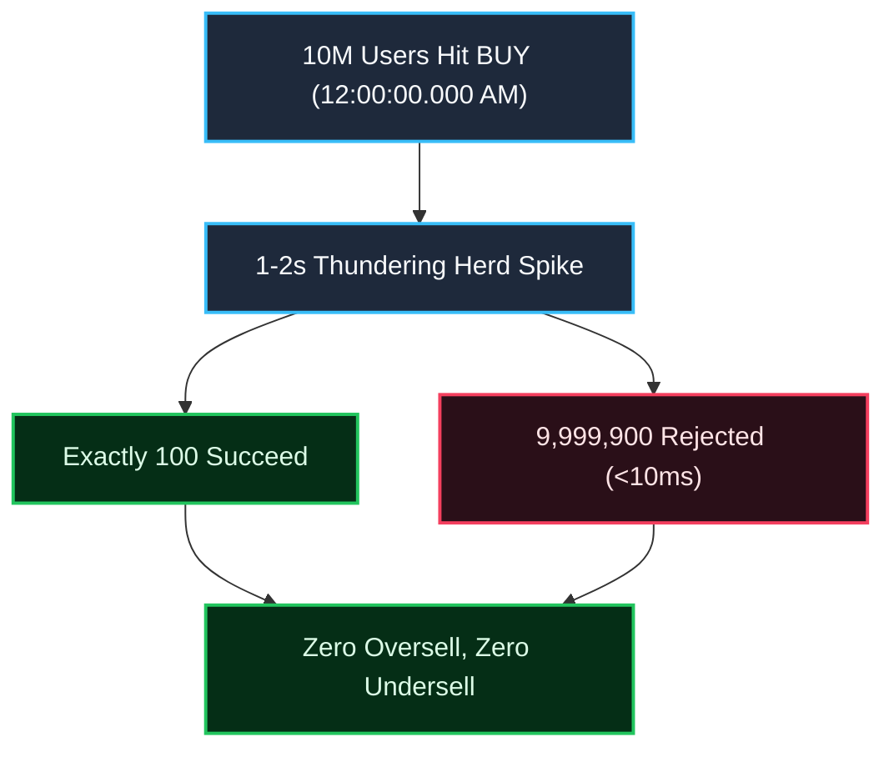

| Failure Mode | Root Cause | Business Impact | Prevention Mechanism |
| :--- | :--- | :--- | :--- |
| **Overselling (101+ sold)** | Concurrent threads read `stock = 1` before either writes | Customer charged with no iPhone to ship; refunds & lawsuits | Single-threaded Redis Lua `DECR &gt;= 0` + DB `CHECK` constraint |
| **Underselling (99 sold)** | Payment fails or cart abandoned without releasing reservation | Stock stuck in limbo forever; lost revenue | 10-minute TTL auto-release + Redis↔DB reconciliation job |
| **System Crash** | 10M req/s hits primary relational database directly | Total outage; nobody can buy | Multi-layer funnel: CDN, WAF, rate limiter, local flag, Redis |

> [!IMPORTANT]
> **The Core Invariant:** At every point in time, `total = available + reserved + sold` must equal `100`, with `available >= 0`, `reserved >= 0`, and `sold >= 0`.

---

## 2. The Naive Approach — And Why It Fails

```java
// ❌ THIS WILL OVERSELL — DO NOT USE
@Transactional
public boolean purchasePhone(String userId) {
    Product product = productRepo.findById("iphone-100");

    if (product.getStock() > 0) {          // Thread A reads stock=1
                                             // Thread B reads stock=1 (SAME TIME)
        product.setStock(product.getStock() - 1);  // Thread A sets stock=0
        productRepo.save(product);                   // Thread B sets stock=0
        orderRepo.save(new Order(userId, product));  // BOTH succeed → OVERSOLD!
        return true;
    }
    return false;
}
```

### The Race Condition Timeline

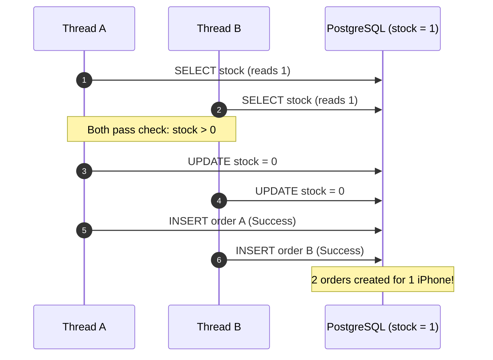

| Isolation / Pattern | Reads Same `stock = 1`? | Outcome Under Concurrency | Verdict |
| :--- | :--- | :--- | :--- |
| **No Lock (`READ COMMITTED`)** | Yes | Lost update; 2+ orders created | **Oversells** |
| **Application `synchronized`** | No (single JVM only) | Fails across multiple app instances | **Broken horizontally** |
| **Atomic Counter (Redis Lua)** | No (single-threaded) | Check + decrement execute as one unit | **Safe & fast** |

> [!WARNING]
> Even `@Transactional` does not save you here because default `READ COMMITTED` isolation allows both threads to read `stock = 1` before either commits its `UPDATE`.

---

## 3. Solution Architecture


Key Insight: Funnel 10M requests through cheap, fast edge layers first. Only ~100–150 winning requests ever reach Kafka and the database.

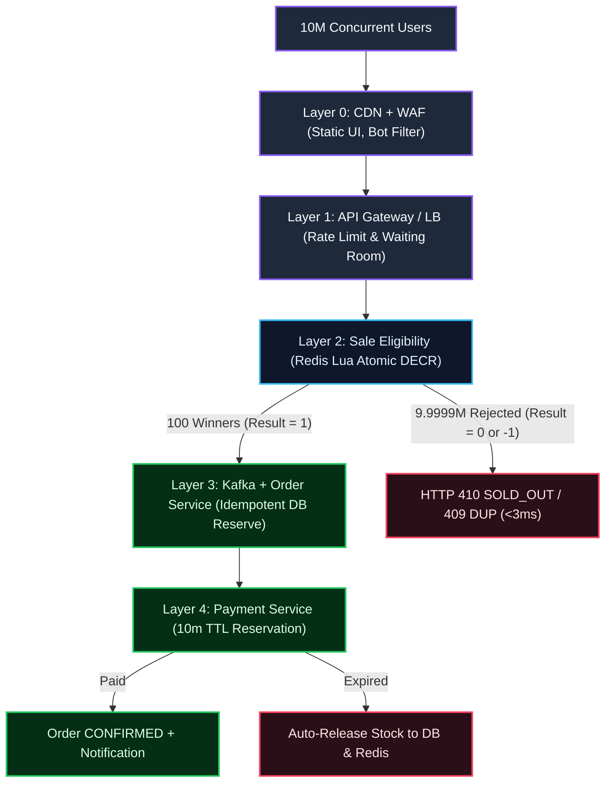

| Layer | Component | Responsibility | Traffic Volume | Latency |
| :--- | :--- | :--- | :--- | :--- |
| **Layer 0** | CDN + WAF | Serve pre-rendered sale UI; drop bots | 10M → 6M | &lt;1ms |
| **Layer 1** | API Gateway + Local Flag | Per-user rate limit (1 req/5s) + `saleActive` check | 6M → 3M | &lt;1ms |
| **Layer 2** | Redis Lua Script | Single-threaded atomic `SISMEMBER` + `DECR` | 3M → 100 | ~2ms |
| **Layer 3** | Kafka + Order Service | Async idempotent order creation + DB `CHECK` | ~100 | ~20ms |
| **Layer 4** | Payment + TTL Reclaim | Charge ₹100; release unpaid stock after 10m | ~100 | Async |

> [!TIP]
> **Interview Framing:** Always emphasize the **Funnel Pattern** — shed load at the cheapest layer possible so your relational database never experiences the thundering herd.

---

## 4. Layer 1: Traffic Management

### Goal: Survive 10M requests without dying

**Strategy: Reject as early and cheaply as possible.**

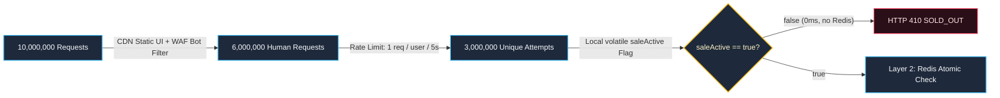

| Mitigation Technique | Where It Runs | What It Drops | Cost per Request |
| :--- | :--- | :--- | :--- |
| **Static Page Caching** | CDN Edge (CloudFront/Akamai) | HTML/JS/CSS asset fetches | ~0 (Edge) |
| **Bot / CAPTCHA Challenge** | WAF / Edge | ~40% automated scalper bots | Low |
| **Token-Bucket Rate Limit** | API Gateway (Spring Cloud GW) | Duplicate clicks / spam retries | ~1ms |
| **In-Memory `saleActive` Flag** | App Server JVM (`volatile`) | All requests after stock hits 0 | **0ms (no network)** |

**Implementation — API Gateway Rate Limiting:**

```yaml
# Spring Cloud Gateway rate limiter
spring:
  cloud:
    gateway:
      routes:
        - id: flash-sale
          uri: lb://sale-service
          predicates:
            - Path=/api/v1/flash-sale/buy
          filters:
            - name: RequestRateLimiter
              args:
                redis-rate-limiter.replenishRate: 1    # 1 request per second
                redis-rate-limiter.burstCapacity: 1    # No burst
                key-resolver: "#{@userKeyResolver}"    # Per-user limiting
```

**Pre-sale optimizations:**

```java
// Serve "SOLD OUT" from a local boolean — no Redis call needed
@RestController
public class FlashSaleController {

    // Volatile ensures visibility across threads
    private volatile boolean saleActive = true;

    @PostMapping("/api/v1/flash-sale/buy")
    public ResponseEntity<?> buy(@RequestHeader("X-User-Id") String userId) {

        // FASTEST CHECK: local in-memory flag (0ms, no network)
        if (!saleActive) {
            return ResponseEntity.status(410)
                .body(new SaleResponse("SOLD_OUT", "All iPhones have been sold"));
        }

        // Proceed to Redis check (Layer 2)
        return saleService.attemptPurchase(userId);
    }

    // Called when Redis counter hits 0
    public void markSaleEnded() {
        this.saleActive = false;  // All future requests fail instantly
    }
}
```

> [!IMPORTANT]
> If an unpaid reservation expires in Layer 4, `saleController.markSaleActive()` must flip `saleActive` back to `true` across instances (e.g., via Redis Pub/Sub) so remaining units can be sold without underselling.

---

## 5. Layer 2: Redis — The Atomic Counter

### This is the CORE of the solution

Redis `DECR` is atomic. Even with 10M concurrent calls, it will NEVER go below 0 if we use a Lua script.

**Why Redis?**
- Single-threaded command execution → no race conditions
- 100K+ operations per second on a single node
- Sub-millisecond latency
- `DECR` is O(1) and atomic

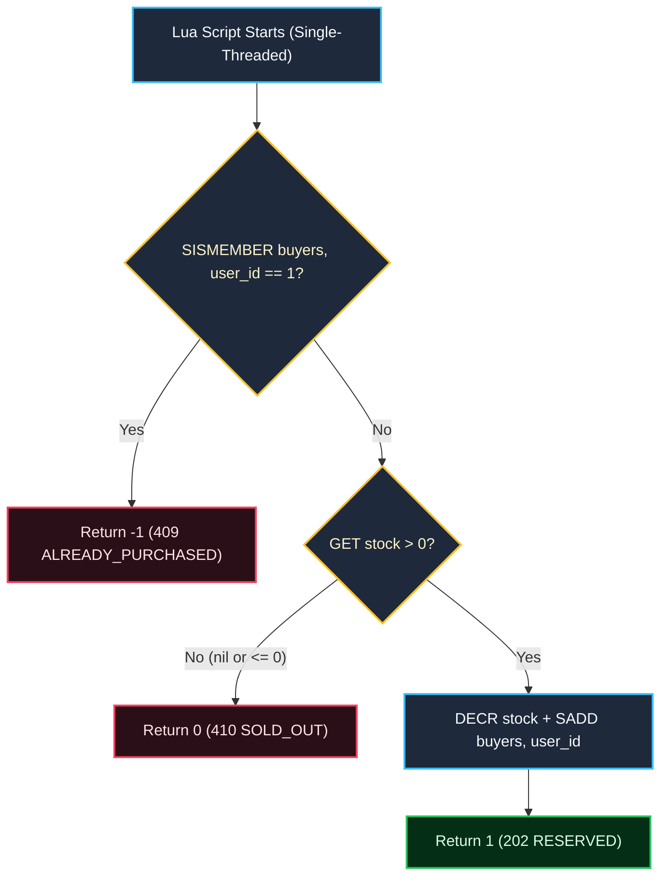

### The Lua Script — Atomic Stock Reservation

```lua
-- reserve_stock.lua
-- This script runs ATOMICALLY in Redis (single-threaded)
-- No other command can interleave between these operations

local stock_key = KEYS[1]           -- "flash_sale:iphone:stock"
local user_set_key = KEYS[2]        -- "flash_sale:iphone:buyers"
local user_id = ARGV[1]             -- The user attempting to buy

-- Check 1: Has this user already purchased? (prevent double-buy)
if redis.call('SISMEMBER', user_set_key, user_id) == 1 then
    return -1  -- Already purchased
end

-- Check 2: Is there stock remaining?
local current_stock = tonumber(redis.call('GET', stock_key))
if current_stock == nil or current_stock <= 0 then
    return 0   -- Sold out
end

-- ATOMIC: Decrement stock AND record the buyer
-- These two operations happen as ONE atomic unit
redis.call('DECR', stock_key)
redis.call('SADD', user_set_key, user_id)

return 1  -- Success! User got one.
```

**Why Lua script instead of just `DECR`?**

| Approach | Atomicity | Prevents Negative Stock? | Prevents Double-Buy? |
| :--- | :--- | :--- | :--- |
| **GET + DECR in App** | Non-atomic | No (TOCTOU race) | No |
| **Plain `DECR`** | Atomic decrement only | No (can go to -1, -2...) | No |
| **Redis Lua Script** | Atomic check + `DECR` + `SADD` | **Yes (`stock >= 0`)** | **Yes (`SISMEMBER`)** |

### Java Implementation

```java
@Service
public class FlashSaleService {

    @Autowired
    private StringRedisTemplate redis;

    private final DefaultRedisScript<Long> reserveScript;

    @PostConstruct
    public void init() {
        reserveScript = new DefaultRedisScript<>();
        reserveScript.setScriptText("""
            local stock_key = KEYS[1]
            local user_set_key = KEYS[2]
            local user_id = ARGV[1]

            if redis.call('SISMEMBER', user_set_key, user_id) == 1 then
                return -1
            end

            local current_stock = tonumber(redis.call('GET', stock_key))
            if current_stock == nil or current_stock <= 0 then
                return 0
            end

            redis.call('DECR', stock_key)
            redis.call('SADD', user_set_key, user_id)
            return 1
        """);
        reserveScript.setResultType(Long.class);
    }

    /**
     * Initialize sale: set stock to exactly 100
     */
    public void initializeSale(String productId, int quantity) {
        String stockKey = "flash_sale:" + productId + ":stock";
        String buyerKey = "flash_sale:" + productId + ":buyers";

        redis.opsForValue().set(stockKey, String.valueOf(quantity));
        redis.delete(buyerKey);  // Clear any previous buyers
    }

    /**
     * Attempt to reserve one unit. Returns in <5ms.
     *
     * @return 1 = reserved, 0 = sold out, -1 = already purchased
     */
    public long attemptReserve(String productId, String userId) {
        String stockKey = "flash_sale:" + productId + ":stock";
        String buyerKey = "flash_sale:" + productId + ":buyers";

        Long result = redis.execute(
            reserveScript,
            List.of(stockKey, buyerKey),
            userId
        );

        if (result != null && result == 0) {
            // Stock is 0 → flip the local flag on all instances
            applicationEventPublisher.publishEvent(new SaleEndedEvent(productId));
        }

        return result != null ? result : 0;
    }
}
```

### What the Numbers Look Like (100th vs 101st Request)

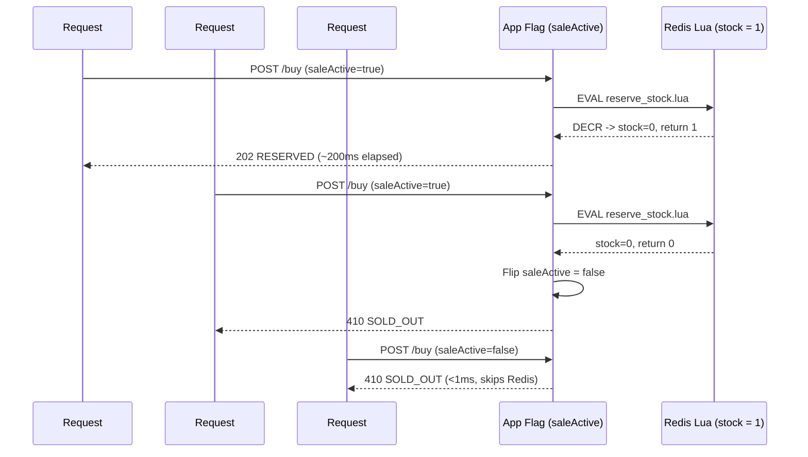

**This guarantees EXACTLY 100 reservations — not 101, not 99.**

> [!TIP]
> Put `stock_key` and `user_set_key` on the same Redis Cluster hash slot using hash tags (e.g., `flash_sale:{iphone-100}:stock` and `flash_sale:{iphone-100}:buyers`) so multi-key Lua scripts never throw `CROSSSLOT` errors.

---

## 6. Layer 3: Order Processing

### Problem: What if the user reserves in Redis but the DB write fails?

Redis said "yes" → stock decremented → but order creation in PostgreSQL fails → one iPhone is in limbo (**underselling**).

### Solution: Kafka + Idempotent Order Creation

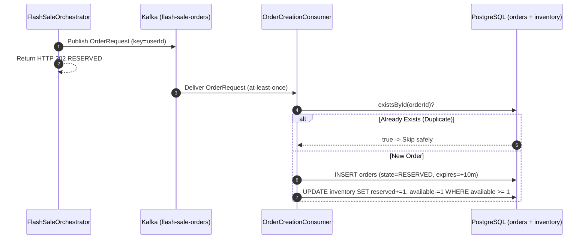

| Concern | Mechanism | Why It Matters |
| :--- | :--- | :--- |
| **Hot-Path Decoupling** | Kafka `flash-sale-orders` topic | Returns `202 Accepted` in ~5ms without waiting on DB |
| **Duplicate Delivery** | `orderRepo.existsById(orderId)` + `UNIQUE(user_id, product_id)` | Kafka at-least-once delivery never creates 2 orders |
| **Defensive DB Check** | `UPDATE inventory ... WHERE available >= :qty` | Last line of defense; restores Redis if DB rejects |

```java
// After Redis reserves successfully, publish to Kafka
@Service
public class FlashSaleOrchestrator {

    @Autowired private FlashSaleService flashSaleService;
    @Autowired private KafkaTemplate<String, OrderRequest> kafka;

    public ResponseEntity<?> attemptPurchase(String userId) {

        long result = flashSaleService.attemptReserve("iphone-100", userId);

        switch ((int) result) {
            case 1 -> {
                // Reserved in Redis! Now create order asynchronously.
                String orderId = "ORD-" + UUID.randomUUID();
                OrderRequest orderReq = new OrderRequest(
                    orderId, userId, "iphone-100", 1,
                    new BigDecimal("100"), Instant.now()
                );

                // Publish to Kafka — guaranteed delivery
                kafka.send("flash-sale-orders", userId, orderReq);

                // Return immediately — user sees "Processing your order..."
                return ResponseEntity.accepted()
                    .body(new SaleResponse("RESERVED", orderId,
                        "You got one! Complete payment within 10 minutes."));
            }
            case 0 -> {
                return ResponseEntity.status(410)
                    .body(new SaleResponse("SOLD_OUT",
                        "Sorry, all iPhones have been sold."));
            }
            case -1 -> {
                return ResponseEntity.status(409)
                    .body(new SaleResponse("ALREADY_PURCHASED",
                        "You have already reserved one."));
            }
            default -> {
                return ResponseEntity.status(500)
                    .body(new SaleResponse("ERROR", "Please try again."));
            }
        }
    }
}
```

### Kafka Consumer — Idempotent Order Creation

```java
@Component
public class OrderCreationConsumer {

    @Autowired private OrderRepository orderRepo;
    @Autowired private InventoryRepository inventoryRepo;

    @KafkaListener(topics = "flash-sale-orders", groupId = "order-service")
    @Transactional
    public void createOrder(OrderRequest request) {

        // IDEMPOTENCY: Check if order already exists (Kafka may deliver twice)
        if (orderRepo.existsById(request.getOrderId())) {
            log.info("Duplicate order detected, skipping. orderId={}",
                request.getOrderId());
            return;
        }

        // Create order in DB
        Order order = Order.builder()
            .id(request.getOrderId())
            .userId(request.getUserId())
            .productId(request.getProductId())
            .quantity(1)
            .amount(request.getAmount())
            .state(OrderState.RESERVED)
            .reservedAt(Instant.now())
            .expiresAt(Instant.now().plus(10, ChronoUnit.MINUTES))
            .build();

        orderRepo.save(order);

        // Reserve in database (double-check against Redis)
        int updated = inventoryRepo.reserveStock(request.getProductId(), 1);
        if (updated == 0) {
            // Should never happen (Redis already checked), but defensive
            log.error("DB stock reservation failed for order={}",
                request.getOrderId());
            order.setState(OrderState.FAILED);
            orderRepo.save(order);
            // Restore Redis stock
            flashSaleService.restoreStock(request.getProductId(), request.getUserId());
        }
    }
}
```

### Database-Level Atomic Stock Reservation

```java
@Repository
public interface InventoryRepository extends JpaRepository<Inventory, String> {

    // Atomic: decrement only if stock > 0
    // Returns 1 if successful, 0 if no stock
    @Modifying
    @Query(value = """
        UPDATE inventory
        SET reserved = reserved + :qty,
            available = available - :qty,
            updated_at = NOW()
        WHERE product_id = :productId
          AND available >= :qty
        """, nativeQuery = true)
    int reserveStock(@Param("productId") String productId,
                     @Param("qty") int qty);
}
```

> [!IMPORTANT]
> Partition the `flash-sale-orders` Kafka topic by `userId` so retries or duplicate events for the same user land on the same consumer partition in order.

---

## 7. Layer 4: Payment and Confirmation

### The Reservation Timer Problem

User reserves an iPhone but never pays → that unit is stuck forever → **underselling**.

**Solution: 10-minute TTL reservation with automatic stock reclaim.**

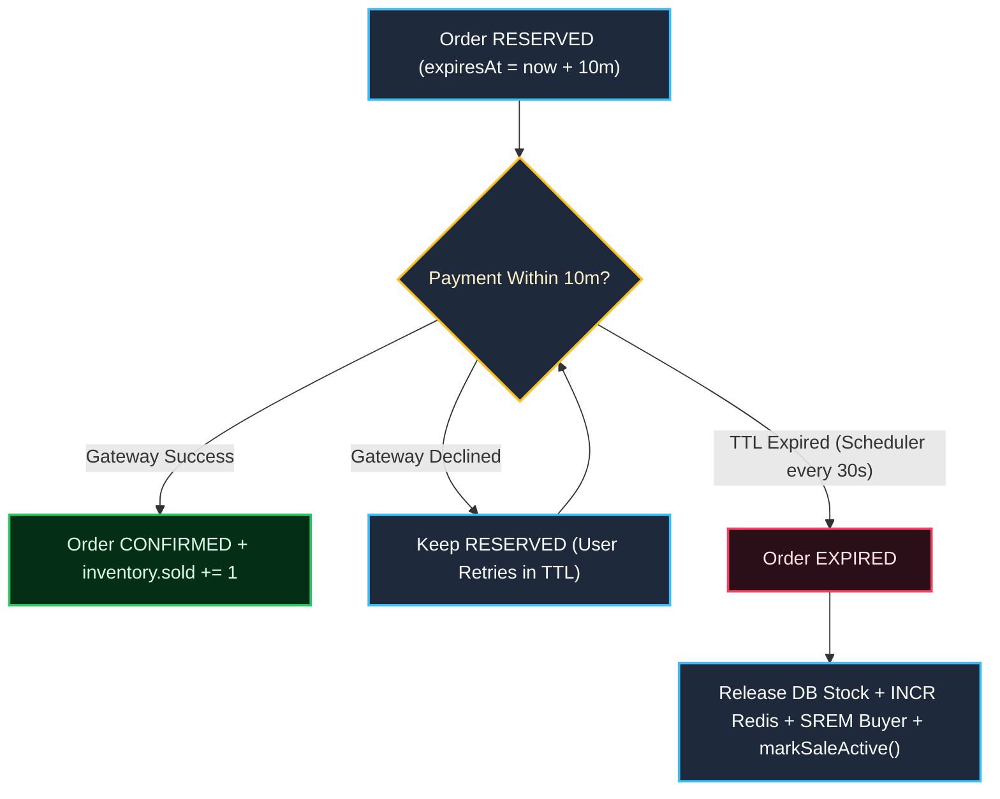

| Event | Order State | `inventory` Change | Redis Change |
| :--- | :--- | :--- | :--- |
| **Reservation Created** | `RESERVED` | `available - 1`, `reserved + 1` | `DECR stock`, `SADD buyers` |
| **Payment Succeeded** | `CONFIRMED` | `reserved - 1`, `sold + 1` | No change |
| **Payment Declined (within TTL)** | `RESERVED` | No change (user can retry) | No change |
| **10-Min TTL Expired** | `EXPIRED` | `reserved - 1`, `available + 1` | `INCR stock`, `SREM buyers` |

```java
// Scheduled job: release expired reservations
@Scheduled(fixedRate = 30_000)  // Every 30 seconds
@Transactional
public void releaseExpiredReservations() {
    List<Order> expired = orderRepo.findByStateAndExpiresAtBefore(
        OrderState.RESERVED, Instant.now()
    );

    for (Order order : expired) {
        log.info("Releasing expired reservation. orderId={}, userId={}",
            order.getId(), order.getUserId());

        // 1. Cancel the order
        order.setState(OrderState.EXPIRED);
        orderRepo.save(order);

        // 2. Restore DB stock
        inventoryRepo.releaseStock(order.getProductId(), 1);

        // 3. Restore Redis stock (so someone else can buy it)
        redisTemplate.opsForValue().increment(
            "flash_sale:" + order.getProductId() + ":stock");

        // 4. Remove user from buyers set (they can try again)
        redisTemplate.opsForSet().remove(
            "flash_sale:" + order.getProductId() + ":buyers",
            order.getUserId());

        // 5. Re-activate sale if it was marked ended
        saleController.markSaleActive();
    }
}
```

### Payment Flow

```java
@Service
public class PaymentService {

    @Transactional
    public PaymentResult processPayment(String orderId, PaymentDetails details) {

        Order order = orderRepo.findById(orderId)
            .orElseThrow(() -> new OrderNotFoundException(orderId));

        // Check order hasn't expired
        if (order.getState() != OrderState.RESERVED) {
            return PaymentResult.failed("Order is no longer reserved");
        }
        if (order.getExpiresAt().isBefore(Instant.now())) {
            return PaymentResult.failed("Reservation expired. Please try again.");
        }

        // Process payment (call payment gateway)
        try {
            GatewayResponse response = paymentGateway.charge(
                details, order.getAmount());

            if (response.isSuccess()) {
                order.setState(OrderState.CONFIRMED);
                order.setPaymentId(response.getTransactionId());
                order.setPaidAt(Instant.now());
                orderRepo.save(order);

                // Convert reserved to sold in inventory
                inventoryRepo.confirmSale(order.getProductId(), 1);

                // Send confirmation
                notificationService.sendOrderConfirmation(order);

                return PaymentResult.success(order.getId());
            } else {
                // Payment failed — keep reservation (user can retry within TTL)
                return PaymentResult.failed(response.getDeclineReason());
            }
        } catch (Exception e) {
            log.error("Payment processing error for order={}", orderId, e);
            return PaymentResult.failed("Payment error. Please retry.");
        }
    }
}
```

> [!WARNING]
> **Race between Payment & Expiry Job:** Always guard both `processPayment()` and `releaseExpiredReservations()` with an optimistic version check or `UPDATE orders SET state = 'EXPIRED' WHERE id = :id AND state = 'RESERVED'` so a user paying at `9m 59s` is never double-booked with an expiry reclaim.

---

## 8. The Complete Flow

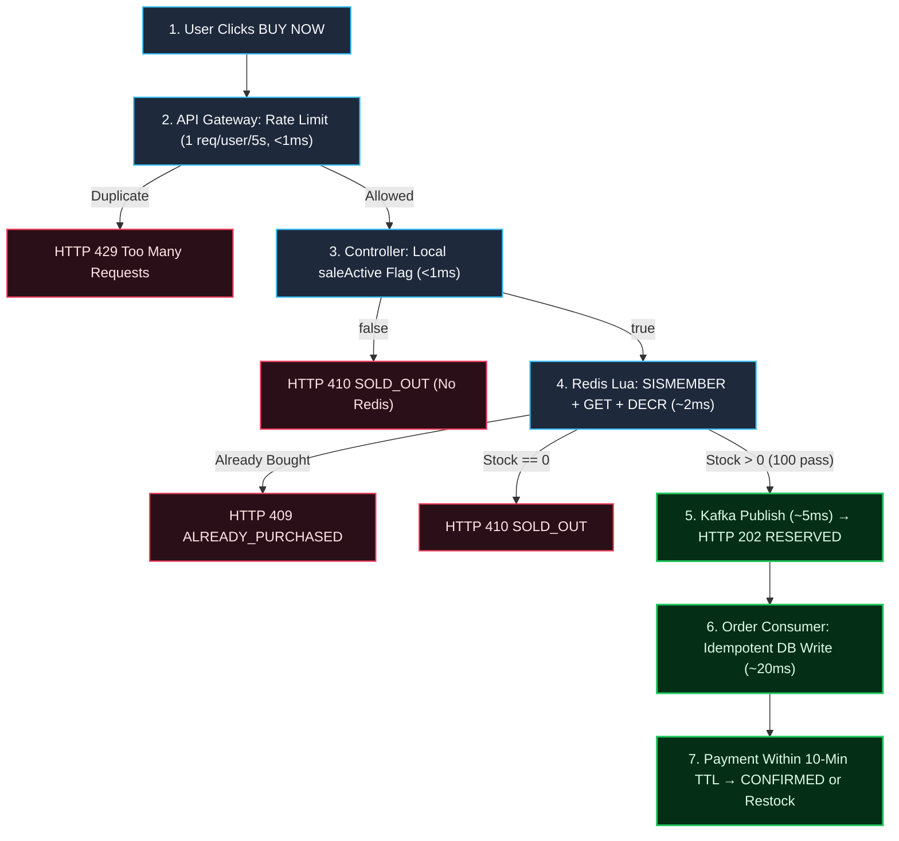

| User Outcome | Path Taken | End-to-End Latency | DB Queries |
| :--- | :--- | :--- | :--- |
| **Winner (100 users)** | Gateway → Local Flag → Redis Lua → Kafka `202` | **~10ms** (async DB ~20ms) | 1 order insert + 1 inventory update |
| **Sold Out (9.99M users)** | Gateway → Local `saleActive = false` → `410` | **&lt;1ms** | **0** |
| **Duplicate Click** | Gateway Rate Limit `429` or Redis `409` | **&lt;3ms** | **0** |

> [!TIP]
> Returning `202 Accepted` immediately after Kafka publish keeps the hot-path latency around **~10ms** while PostgreSQL persists the order asynchronously.

---

## 9. Database Schema

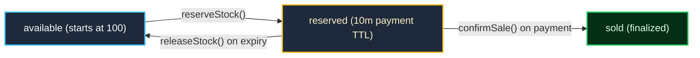

```sql
-- Inventory table (source of truth)
CREATE TABLE inventory (
    product_id   VARCHAR(64) PRIMARY KEY,
    product_name VARCHAR(255) NOT NULL,
    total        INT NOT NULL,          -- 100 (never changes)
    available    INT NOT NULL,          -- Starts at 100, decreases
    reserved     INT NOT NULL DEFAULT 0, -- Soft-reserved, not yet paid
    sold         INT NOT NULL DEFAULT 0, -- Confirmed purchases
    updated_at   TIMESTAMPTZ NOT NULL DEFAULT NOW(),

    -- INVARIANT: total = available + reserved + sold (ALWAYS)
    CONSTRAINT stock_balance CHECK (total = available + reserved + sold),
    CONSTRAINT non_negative CHECK (available >= 0 AND reserved >= 0 AND sold >= 0)
);

-- Insert initial stock
INSERT INTO inventory (product_id, product_name, total, available)
VALUES ('iphone-100', 'iPhone 16 (Flash Sale)', 100, 100);

-- Orders table
CREATE TABLE orders (
    id           VARCHAR(64) PRIMARY KEY,
    user_id      VARCHAR(64) NOT NULL,
    product_id   VARCHAR(64) NOT NULL REFERENCES inventory(product_id),
    quantity     INT NOT NULL DEFAULT 1,
    amount       DECIMAL(10,2) NOT NULL,
    state        VARCHAR(20) NOT NULL,  -- RESERVED, CONFIRMED, EXPIRED, FAILED
    payment_id   VARCHAR(64),
    reserved_at  TIMESTAMPTZ NOT NULL,
    expires_at   TIMESTAMPTZ NOT NULL,
    paid_at      TIMESTAMPTZ,
    created_at   TIMESTAMPTZ NOT NULL DEFAULT NOW(),

    -- One purchase per user per product
    CONSTRAINT unique_user_product UNIQUE (user_id, product_id)
);

CREATE INDEX idx_orders_expired ON orders (state, expires_at)
    WHERE state = 'RESERVED';
```

| Constraint / Index | Purpose | What It Prevents |
| :--- | :--- | :--- |
| `CHECK (total = available + reserved + sold)` | Hard conservation-of-inventory invariant | Any bug causing phantom stock or oversell |
| `CHECK (available >= 0 AND reserved >= 0 AND sold >= 0)` | Non-negative counters | Negative stock under any race condition |
| `UNIQUE (user_id, product_id)` | One unit per user at DB level | Double-buy even if Redis is bypassed |
| `idx_orders_expired` (partial index) | Fast lookup of `state = 'RESERVED'` | Full table scans by the 30s expiry job |

> [!IMPORTANT]
> **The `CHECK` constraint `total = available + reserved + sold` is your safety net.** If any application bug causes inconsistency, PostgreSQL itself rejects the write.

---

## 10. Handling Edge Cases

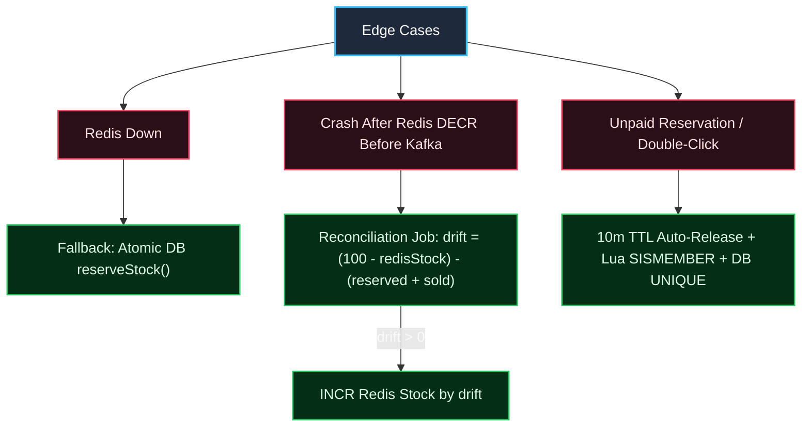

### Edge Case 1: Redis Goes Down

```java
// Fallback: use database-level atomic decrement
public long attemptReserveFallback(String productId, String userId) {
    try {
        // Atomic DB operation — slower but correct
        int updated = inventoryRepo.reserveStock(productId, 1);
        return updated > 0 ? 1 : 0;
    } catch (DataIntegrityViolationException e) {
        // Unique constraint violation → user already bought
        return -1;
    }
}
```

### Edge Case 2: Server Crashes After Redis DECR but Before Kafka Publish

If Redis decrements `stock` to `99` and the app crashes before `kafka.send()`, one iPhone is lost (**underselling**).

**Solution: Reconciliation job.**

```java
@Scheduled(fixedRate = 60_000)  // Every minute during sale
public void reconcileRedisWithDB() {
    int redisStock = getRedisStock("iphone-100");
    int dbAvailable = inventoryRepo.getAvailable("iphone-100");
    int dbReserved = inventoryRepo.getReserved("iphone-100");
    int dbSold = inventoryRepo.getSold("iphone-100");

    int redisAccountedFor = 100 - redisStock;           // How many Redis gave out
    int dbAccountedFor = dbReserved + dbSold;            // How many DB knows about

    int drift = redisAccountedFor - dbAccountedFor;      // Should be 0

    if (drift > 0) {
        // Redis gave out more than DB recorded → some orders were lost
        log.warn("Stock drift detected: {} unaccounted reservations. " +
                 "Restoring Redis stock.", drift);
        redis.opsForValue().increment("flash_sale:iphone-100:stock", drift);
    }
}
```

### Edge Case 3: User Gets Reservation but Doesn't Pay

Already handled by the TTL-based auto-release (Section 7). Reservation expires after 10 minutes, stock is restored to Redis and DB, and another user can buy.

### Edge Case 4: Double-Click / Network Retry

Already handled across 3 layers:
1. Redis Lua script checks `SISMEMBER` — same user can't reserve twice
2. API Gateway rate limits: 1 request per user per 5 seconds
3. DB unique constraint on `(user_id, product_id)`

### Edge Case 5: Exactly 100 Users Pay — Verification

```java
// Final verification after sale ends
@Scheduled(cron = "0 0 1 * * *")  // 1 AM daily
public void verifySaleIntegrity() {
    Inventory inv = inventoryRepo.findById("iphone-100").orElseThrow();

    // The CHECK constraint ensures: total = available + reserved + sold
    assert inv.getTotal() == inv.getAvailable() + inv.getReserved() + inv.getSold();

    long confirmedOrders = orderRepo.countByProductIdAndState("iphone-100",
        OrderState.CONFIRMED);

    if (confirmedOrders != inv.getSold()) {
        alertOps("CRITICAL: Order count mismatch! " +
                 "DB sold=" + inv.getSold() +
                 " confirmed_orders=" + confirmedOrders);
    }

    log.info("Sale verification: total={}, available={}, reserved={}, sold={}, " +
             "confirmed_orders={}",
             inv.getTotal(), inv.getAvailable(), inv.getReserved(),
             inv.getSold(), confirmedOrders);
}
```

| Edge Case | Failure Symptom | Recovery Mechanism |
| :--- | :--- | :--- |
| **Redis Outage** | `RedisConnectionFailureException` | Circuit breaker falls back to atomic DB `reserveStock()` |
| **Crash Before Kafka** | Redis `100 - stock > reserved + sold` | 1-min reconciliation job restores `drift` to Redis |
| **Abandoned Checkout** | Order stays `RESERVED` past 10m | 30s scheduler marks `EXPIRED`, restocks DB & Redis |
| **Double-Click / Retry** | Duplicate `POST /buy` | Rate limit (`429`) + Lua `SISMEMBER` (`409`) + DB `UNIQUE` |
| **Post-Sale Audit** | `confirmedOrders != inventory.sold` | Daily 1 AM integrity job triggers Ops alert |

> [!WARNING]
> **Reconciliation Timing:** Only adjust Redis stock when `drift > 0` has persisted across two consecutive checks (or after Kafka consumer lag is zero) so in-flight Kafka messages aren't mistaken for lost reservations.

---

## 11. Why Not Just Use Database Locking?

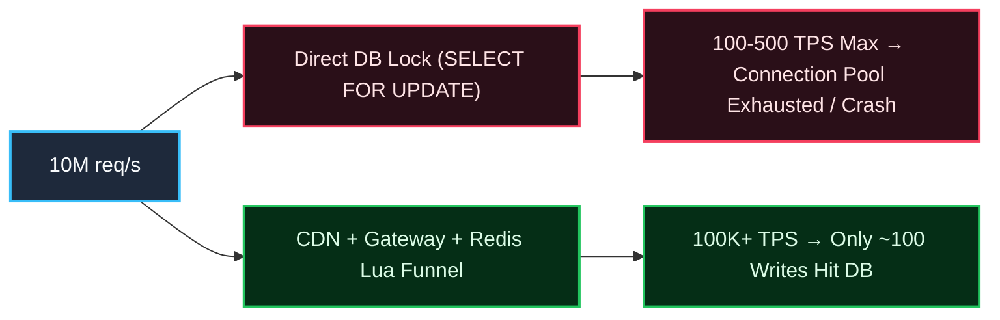

| Approach | Can Handle 10M req/s? | Oversell Risk | Complexity |
| :--- | :--- | :--- | :--- |
| No locking (naive) | Yes | HIGH (race conditions) | Low |
| Pessimistic lock (`SELECT FOR UPDATE`) | No — 100-500 TPS max | None | Low |
| Optimistic lock (`@Version`) | 1000-5000 TPS | None (but high retry rate) | Medium |
| **Redis atomic counter** | **100K+ TPS** | **None** | **Medium** |
| Redis + DB + Kafka (our solution) | **10M+ TPS** | **None** | High |

**Database locking at 10M requests/second = database death.**

The key insight: Use Redis to handle the 10M-to-100 reduction. The database only sees ~100 writes. This is why the layered architecture matters.

> [!TIP]
> If an interviewer asks "Why not optimistic locking?", point out that with 100 items and 10M contenders, **99.9999% of optimistic transactions fail version checks and retry**, creating a retry storm that still melts the DB.

---

## 12. Senior-Level Talking Points

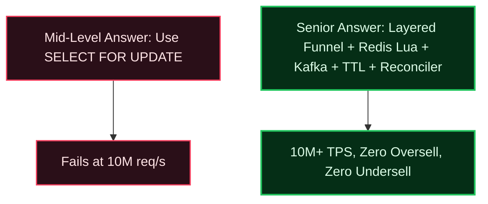

**What a mid-level says:**
> "I'd use a database transaction with `SELECT FOR UPDATE` to lock the row."

**What a senior says:**
> "Database locks can't handle 10M concurrent requests. I'd use a multi-layered approach: CDN and rate limiting shed 99% of traffic, Redis atomic counters handle the stock reservation in sub-millisecond time, Kafka decouples order creation from the hot path, and the database only sees the ~100 confirmed orders. Redis Lua scripts ensure atomicity without race conditions, TTL-based reservations prevent underselling from abandoned checkouts, and a reconciliation job catches any drift between Redis and the database."

### Key Phrases That Impress Interviewers

| Buzzword / Concept | What It Solves |
| :--- | :--- |
| **"Funnel pattern"** | Shed load at each layer, cheapest layer first |
| **"Atomic operations in Redis"** | Lua scripts for check-and-decrement (`DECR >= 0`) |
| **"Reservation with TTL"** | Solves underselling from abandoned carts |
| **"Reconciliation"** | Catches any drift between Redis and PostgreSQL |
| **"Database CHECK constraint as last defense"** | `total = available + reserved + sold` |
| **"Idempotent consumers"** | Kafka at-least-once delivery is safe with deduplication |
| **"Eventual consistency between Redis and DB"** | Strong consistency for the count, async persistence for orders |

> [!IMPORTANT]
> Always distinguish **consistency of the counter** (strong, single-threaded in Redis Lua + DB `CHECK`) from **persistence of the order** (eventually consistent via Kafka).

---

## 13. Interview Follow-Up Questions

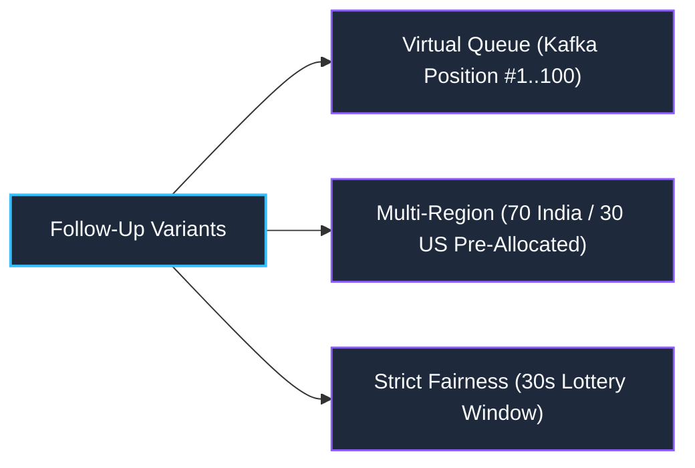

| Follow-Up Scenario | Recommended Architecture | Key Trade-Off |
| :--- | :--- | :--- |
| **Guaranteed Queue Position** | Kafka-backed Virtual Waiting Room assigning sequence numbers | Fairer UX ("You're #47"), but slower than instant reject |
| **Multi-Region (India + US)** | Pre-allocated regional Redis buckets (e.g., 70 Mumbai, 30 Virginia) | Low latency per region; needs cross-region rebalance if one sells out |
| **100,000 iPhones Instead of 100** | Partitioned `orders` table + more Kafka partitions + horizontal Payment | Redis `DECR` is still `O(1)`; DB & payment throughput become the bottleneck |
| **Strict Fairness (Anti-Latency)** | 30-second lottery entry window → randomly pick 100 winners | Eliminates network proximity advantage; delays confirmation by 30s |

### "What if the user needs a guaranteed position in the queue instead of instant rejection?"

Use a virtual queue:
1. All 10M users enter a Kafka-backed queue
2. Assign position numbers
3. Process first 100 in order
4. Notify position to user: `"You're #47 in line"`
5. Users #101+ get `"Sorry, sold out"` after processing

This is fairer but slower. Trade-off: **fairness vs speed**.

### "What if we're selling across multiple regions (India + US)?"

- **Approach 1: Centralized Redis (simpler)** — Single Redis cluster (Mumbai region); all regions talk to it. Problem: ~200ms round-trip latency for US users.
- **Approach 2: Pre-allocated stock per region** — Total `100` iPhones split into India `70` units (Redis in Mumbai) and US `30` units (Redis in Virginia). Each region manages stock independently, with optional cross-region re-allocation of unsold units.

### "How would you test this system?"

1. **Unit test:** Redis Lua script with concurrent threads (100+ threads, 100 stock)
2. **Integration:** Testcontainers with Redis + PostgreSQL
3. **Load test:** Gatling / k6 simulating 10M requests in 2 seconds
4. **Chaos test:** Kill Redis mid-sale → verify fallback to DB works
5. **Reconciliation test:** Inject drift → verify reconciliation job fixes it
6. **Edge case:** 101st request must get `SOLD_OUT`, never success

### "What if it's not 100 iPhones but 100,000?"

Same architecture, with horizontal scaling:
- Redis handles it (`DECR` is `O(1)` regardless of count)
- DB needs a partitioned `orders` table
- Kafka needs more partitions for parallel consumer processing
- Payment service scales horizontally

### "What about fairness? First-come-first-served?"

Redis processes commands in order (single-threaded), so it IS first-come-first-served at the Redis level. However, network latency gives users closer to the data center an advantage. For strict fairness, use a **lottery system**: accept entries for 30 seconds, then randomly select 100 winners.

> [!TIP]
> When asked about **Testing**, mentioning **Chaos Testing (killing Redis mid-sale)** and **Drift Injection** immediately signals production maturity.

---

## Summary: The One-Page Answer

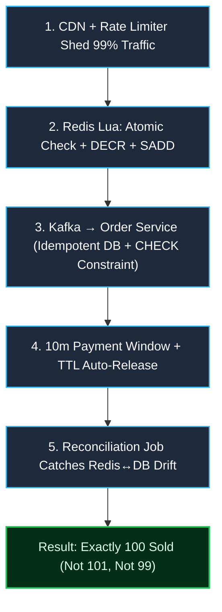

| Pillar | Guarantee |
| :--- | :--- |
| **1. Edge & Gateway Funnel** | Survives 10M req/s without touching DB |
| **2. Redis Lua `DECR >= 0`** | Exactly 100 reservations, zero double-buys |
| **3. Kafka + DB `CHECK`** | Zero lost orders, hard invariant enforcement |
| **4. 10-Min TTL Auto-Release** | Zero stuck inventory from unpaid carts |
| **5. Redis↔DB Reconciliation** | Belt-and-suspenders drift recovery |

> [!IMPORTANT]
> **Final Takeaway:** Redis Lua gives you **speed and exactness** under extreme contention; PostgreSQL `CHECK` constraints, 10-minute TTL reclaims, and the reconciliation job give you **durability and zero underselling**.
