# Design a Seat Booking System (BookMyShow / Airline Seats)

> **The Interview Question:**
> "Design a system where millions of users are trying to book specific seats for a movie/flight/concert. Prevent double-booking of the same seat while allowing concurrent booking of different seats. Handle hold-and-release when users abandon checkout."

This is HARDER than the flash sale problem because:
- Flash sale: 100 identical items, any user gets any item
- Booking: Each seat is UNIQUE. User A wants seat C5, User B also wants seat C5, but User C wants seat D7 — C's booking should NOT be blocked by A and B fighting over C5.

**The core challenge: maximize concurrency (don't lock the entire theater) while preventing double-booking of individual seats.**

---

## Table of Contents

1. [Why This Problem Is Harder Than Flash Sale](#1-why-this-problem-is-harder-than-flash-sale)
2. [Requirements & Estimation](#2-requirements--estimation)
3. [High-Level Architecture](#3-high-level-architecture)
4. [The Seat Map — Data Model](#4-the-seat-map--data-model)
5. [Core Problem: Seat Locking Strategies](#5-core-problem-seat-locking-strategies)
6. [The Winning Approach: Optimistic Lock + Temporary Hold](#6-the-winning-approach-optimistic-lock--temporary-hold)
7. [Redis-Based Seat Hold System](#7-redis-based-seat-hold-system)
8. [Complete Booking Flow — End to End](#8-complete-booking-flow--end-to-end)
9. [Handling Concurrent Seat Selection](#9-handling-concurrent-seat-selection)
10. [Payment and Confirmation](#10-payment-and-confirmation)
11. [Seat Map Real-Time Updates (WebSocket)](#11-seat-map-real-time-updates)
12. [Scaling for Aamir Khan Movie / IPL Final](#12-scaling-for-high-demand-events)
13. [Edge Cases That Interviewers Love](#13-edge-cases-that-interviewers-love)
14. [Database Schema](#14-database-schema)
15. [Senior vs Mid-Level Comparison](#15-senior-vs-mid-level-comparison)
16. [Interview Follow-Up Questions](#16-interview-follow-up-questions)

---

## 1. Why This Problem Is Harder Than Flash Sale

```
Flash Sale (100 iPhones):                Seat Booking (500 seats):
─────────────────────────                ─────────────────────────
Items are IDENTICAL                      Every seat is UNIQUE
One Redis counter (DECR)                 500 individual locks needed
User gets "any" iPhone                   User picks SPECIFIC seat(s)
Simple accept/reject                     Show real-time availability map
No "hold" period for selection           User browses → selects → pays (minutes)
100 items, done                          Same seats sold across multiple shows

Concurrency model:                       Concurrency model:
  Global lock (one counter)                Per-seat lock (fine-grained)
  Users compete for pool                   Users compete for individual seats
                                           BUT: different seats = no contention!
```

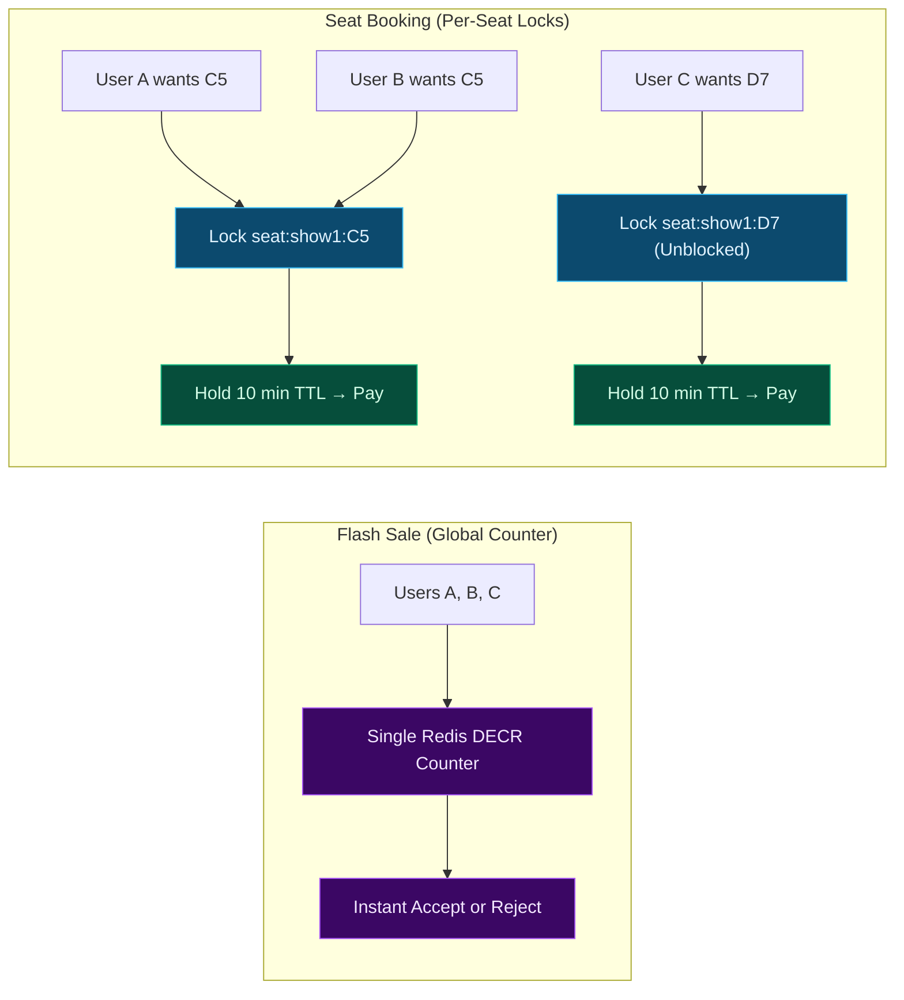

| Dimension | Flash Sale (100 iPhones) | Seat Booking (500 Seats) |
|-----------|--------------------------|--------------------------|
| **Inventory** | Identical fungible items | Unique non-fungible seats (`C5`, `D7`) |
| **Lock Granularity** | Global atomic counter (`DECR`) | Per-seat distributed key (`seat:{showId}:{seatId}`) |
| **Contention** | All users compete for 1 pool | Only users picking the exact same seat contend |
| **Lifecycle** | Instant buy or reject | Browse → Hold (10 min TTL) → Pay → Confirm |
| **UI Requirement** | Stock count / sold-out badge | Live interactive seat map updated in 1–2s |

> [!IMPORTANT]
> **The key insight the interviewer wants:** You should lock at the **SEAT** level, not the **SHOW** level. Two users booking different seats (`C5` vs `D7`) should never block each other.

---

## 2. Requirements & Estimation

### Functional Requirements
- Browse movies/events and available shows
- View seat map with real-time availability (available / held / booked)
- Select 1-6 seats and hold them temporarily (7-10 minutes)
- Complete payment within the hold window
- Release seats automatically if payment not completed
- Prevent double-booking of the same seat by two users
- Support multiple shows for same movie at same venue

### Non-Functional Requirements
- **Consistency:** STRONG — a seat sold is a seat sold, no double-booking ever
- **Availability:** 99.99% — booking must work during peak launches
- **Latency:** Seat selection < 200ms, seat map load < 500ms
- **Concurrency:** 100K users viewing the same show simultaneously
- **Real-time:** Seat map updates within 1-2 seconds when a seat is held/released

### Back-of-Envelope

```
Popular movie (Aamir Khan release / Avengers):
  - 5,000 screens across India
  - ~300 seats per screen = 1.5M seats total
  - Opening day: 50M users trying to book in first hour
  - QPS: 50M / 3600 ≈ 14,000 seat-selection requests/sec (peak: 50K)

Per show:
  - 300 seats, 100K users competing
  - Seat map view: 100K reads/sec (cacheable)
  - Seat hold: 300 seats → max 300 successful holds
  - 99.7% of users get "seat already taken" — fast rejection needed

Storage:
  - Seat state per show: 300 seats × 100 bytes = 30KB per show
  - 5000 shows/day × 30KB = 150MB/day (trivial)
```

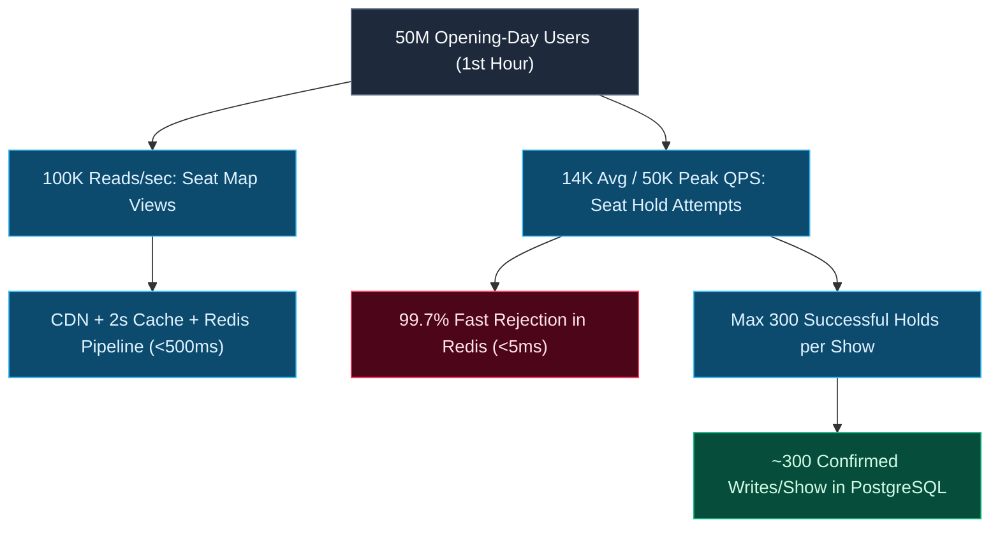

| Metric | Estimate | Design Implication |
|--------|----------|--------------------|
| **Opening-day traffic** | 50M users in hour 1 (~14K avg, 50K peak QPS) | Redis handles hot-path holds; DB cannot absorb 50K TPS |
| **Per-show viewers** | 100K concurrent viewers for 300 seats | Cache seat map (2s TTL) + push deltas via WebSocket |
| **Rejection ratio** | 99.7% of hold attempts fail on hot shows | Fast-fail in &lt;5ms via Redis `SET NX` |
| **Seat state storage** | 30KB/show (150MB/day across 5,000 shows) | Fits effortlessly in Redis memory |

> [!TIP]
> Emphasize the **asymmetry** between read/hold QPS (50K–100K/sec) and confirmed DB writes (300/show). This single observation justifies why Redis absorbs the hold traffic while PostgreSQL only records confirmed bookings.

---

## 3. High-Level Architecture

```
                    50M Users (opening day)
                          │
                ┌─────────▼──────────┐
                │   CDN (seat map    │  ← Static assets, movie posters
                │   initial load)    │
                └─────────┬──────────┘
                          │
                ┌─────────▼──────────┐
                │   API Gateway      │  ← Auth, rate limit (5 req/user/sec)
                │   + Load Balancer  │
                └─────────┬──────────┘
                          │
           ┌──────────────┼──────────────┐
           ▼              ▼              ▼
    ┌────────────┐ ┌────────────┐ ┌────────────┐
    │  Catalog   │ │  Booking   │ │  Payment   │
    │  Service   │ │  Service   │ │  Service   │
    │ (read-heavy│ │(seat holds │ │            │
    │  cached)   │ │ + orders)  │ │            │
    └─────┬──────┘ └─────┬──────┘ └─────┬──────┘
          │              │              │
          │        ┌─────▼──────┐       │
          │        │   Redis    │       │
          │        │ (seat holds│       │
          │        │  per show) │       │
          │        └─────┬──────┘       │
          │              │              │
    ┌─────▼──────────────▼──────────────▼──────┐
    │              PostgreSQL                    │
    │  shows, seats, bookings, payments          │
    │  (Read Replicas for catalog queries)       │
    └──────────────────┬────────────────────────┘
                       │
                ┌──────▼───────┐
                │    Kafka     │  ← Booking events, notifications
                └──────────────┘
                       │
           ┌───────────┼───────────┐
           ▼           ▼           ▼
    ┌───────────┐ ┌──────────┐ ┌──────────┐
    │Notification│ │Analytics │ │WebSocket │
    │  Service   │ │ Service  │ │ Service  │
    │(SMS/email) │ │          │ │(seat map │
    └───────────┘ └──────────┘ │ updates) │
                               └──────────┘
```

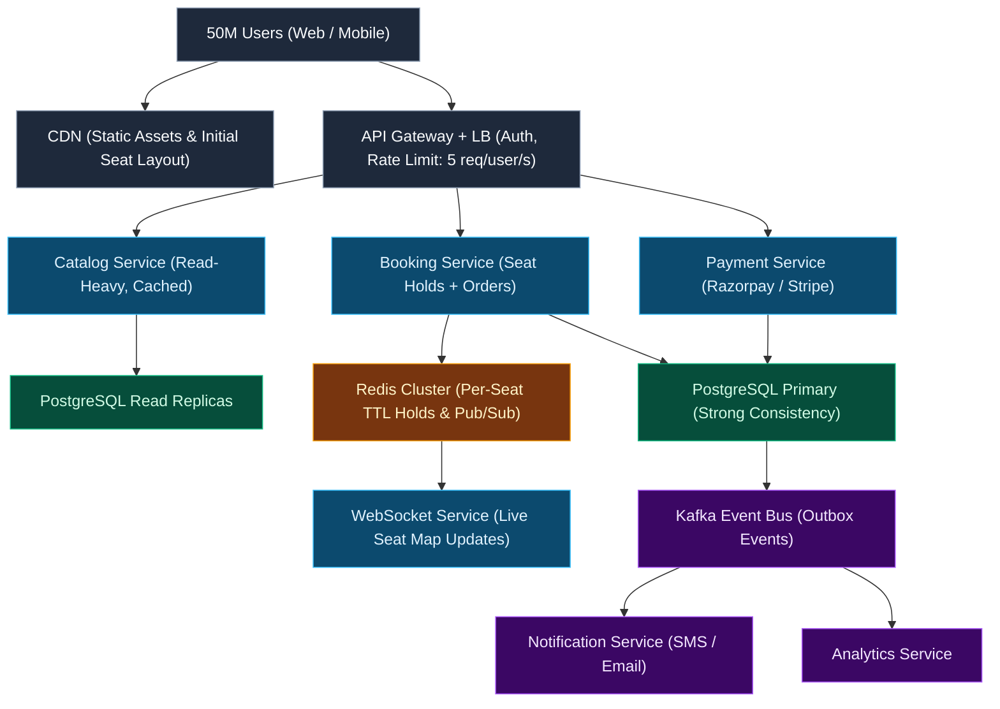

| Component | Primary Responsibility | Scaling / Consistency Model |
|-----------|------------------------|-----------------------------|
| **API Gateway** | JWT auth, TLS termination, rate limiting (5 req/user/sec) | Stateless horizontal scaling |
| **Catalog Service** | Movie, venue, show listings &amp; static seat templates | Read replicas + CDN/Redis caching |
| **Booking Service** | Seat holds, order creation, idempotent confirmation | Stateless; delegates locks to Redis &amp; DB |
| **Redis** | Sub-ms per-seat TTL locks + Pub/Sub for seat map updates | Cluster sharded by `showId` / city |
| **PostgreSQL** | Durable source of truth (`shows`, `seats`, `bookings`) | Primary for writes, replicas for catalog reads |
| **Kafka + Outbox** | Decoupled notifications, analytics, audit trail | At-least-once delivery via transactional outbox |

> [!IMPORTANT]
> Notice the separation of concerns: **Catalog Service** reads from PostgreSQL Read Replicas and caches aggressively, while **Booking Service** isolates high-frequency seat contention in Redis before touching the PostgreSQL primary.

---

## 4. The Seat Map — Data Model

### How a Theater Looks in Code

```
Screen 1 — Avengers: Endgame — 6:30 PM Show
─────────────────────────────────────────────
              [  SCREEN  ]

Row A (Premium):  [A1][A2][A3]  [A4][A5][A6][A7]  [A8][A9][A10]
Row B (Premium):  [B1][B2][B3]  [B4][B5][B6][B7]  [B8][B9][B10]
Row C (Gold):     [C1][C2][C3]  [C4][C5][C6][C7]  [C8][C9][C10]
Row D (Gold):     [D1][D2][D3]  [D4][D5][D6][D7]  [D8][D9][D10]
Row E (Silver):   [E1][E2][E3]  [E4][E5][E6][E7]  [E8][E9][E10]

Status:  ⬜ = Available    🟡 = Held (someone is paying)    🟥 = Booked
```

### Seat State Machine

```
    ┌───────────┐
    │ AVAILABLE │◄──────── Hold expires (TTL) ────┐
    └─────┬─────┘                                  │
          │ User selects seat                      │
          ▼                                        │
    ┌───────────┐                                  │
    │   HELD    │──── Payment timeout (10 min) ────┘
    └─────┬─────┘
          │ Payment successful
          ▼
    ┌───────────┐
    │  BOOKED   │──── Refund / Cancellation ──► AVAILABLE
    └───────────┘
```

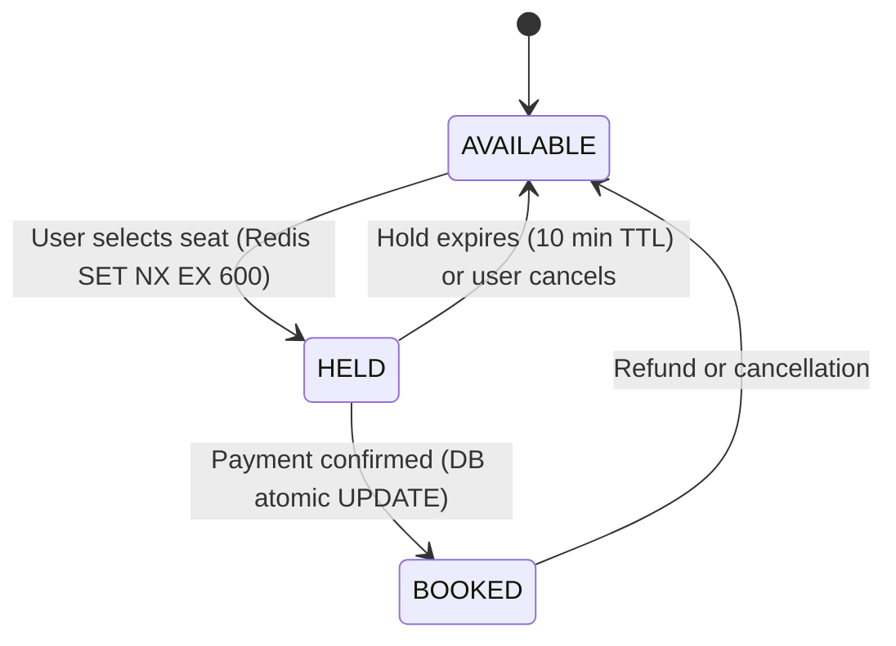

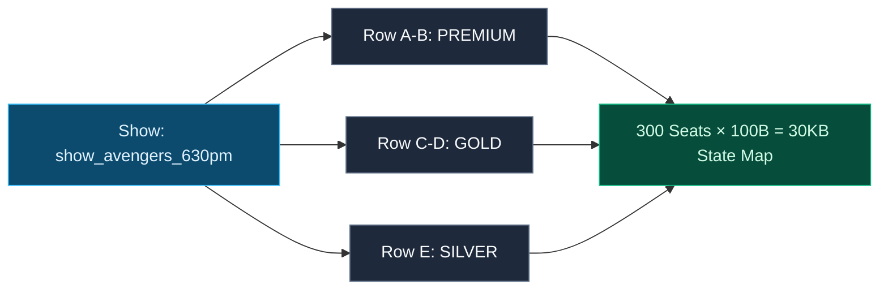

| Seat State | Storage Location | Visual Indicator | Transition Trigger |
|------------|------------------|------------------|--------------------|
| `AVAILABLE` | Implicit (`nil` in Redis, `AVAILABLE` in DB) | White / Green | Initial state, TTL expiry, or cancellation |
| `HELD` | Redis only (`seat:{showId}:{seatId} = userId`, TTL 600s) | Yellow / Amber | User clicks seats and invokes atomic hold |
| `BOOKED` | PostgreSQL (`BOOKED`) + Redis (`BOOKED:{orderId}`, no TTL) | Red | Payment gateway confirmation webhook/API |

**Only 3 states. Simple = fewer bugs.**

> [!TIP]
> Keeping `HELD` ephemeral in Redis (and **not** persisting temporary holds as rows locked in PostgreSQL) avoids millions of wasted `UPDATE` writes when users browse and abandon seats.

---

## 5. Core Problem: Seat Locking Strategies

### Strategy 1: Pessimistic Lock on Entire Show ❌

```java
// ❌ TERRIBLE — locks ALL 300 seats when one person books
@Transactional
public void bookSeat(String showId, String seatId) {
    Show show = showRepo.findByIdForUpdate(showId);  // LOCKS ENTIRE SHOW
    Seat seat = show.getSeat(seatId);
    if (seat.isAvailable()) {
        seat.setStatus(HELD);
    }
}
// 299 other users are BLOCKED even though they want DIFFERENT seats!
// At 100K concurrent users, this creates a massive bottleneck.
```

### Strategy 2: Pessimistic Lock Per Seat ⚠️ (Better, but still slow)

```java
// ⚠️ Better — only locks the specific seat row
@Transactional
public boolean holdSeat(String showId, String seatId, String userId) {
    Seat seat = seatRepo.findByShowIdAndSeatIdForUpdate(showId, seatId);
    // SELECT ... WHERE show_id = ? AND seat_id = ? FOR UPDATE

    if (seat.getStatus() == SeatStatus.AVAILABLE) {
        seat.setStatus(SeatStatus.HELD);
        seat.setHeldBy(userId);
        seat.setHeldUntil(Instant.now().plus(10, ChronoUnit.MINUTES));
        seatRepo.save(seat);
        return true;
    }
    return false;  // Already held or booked
}
// ✓ Different seats don't block each other
// ✗ Still hits DB for every attempt — 50K TPS on DB for popular shows
// ✗ Row-level lock contention when 1000 users want the same seat
```

### Strategy 3: Optimistic Lock Per Seat ⚠️ (Good for low contention)

```java
@Entity
public class Seat {
    @Version
    private Long version;  // Optimistic lock — auto-incremented
}

// Attempt to hold — no lock acquired during read
@Transactional
@Retryable(value = OptimisticLockException.class, maxAttempts = 2)
public boolean holdSeat(String showId, String seatId, String userId) {
    Seat seat = seatRepo.findByShowIdAndSeatId(showId, seatId);  // No lock

    if (seat.getStatus() != SeatStatus.AVAILABLE) {
        return false;
    }

    seat.setStatus(SeatStatus.HELD);
    seat.setHeldBy(userId);
    seat.setHeldUntil(Instant.now().plus(10, ChronoUnit.MINUTES));
    seatRepo.save(seat);  // Version check here — fails if someone else modified
    return true;
}
// ✓ No lock during read — high read throughput
// ✓ Concurrent writes to DIFFERENT seats succeed
// ✗ When 1000 users try same seat, 999 get OptimisticLockException + retry
// ✗ Still 50K DB writes/sec under peak load
```

### Strategy 4: Redis + DB (The Winner) ✅

```
Use Redis for the hot path (seat hold/release) — sub-millisecond
Use DB for the cold path (confirmed bookings) — strong consistency
```

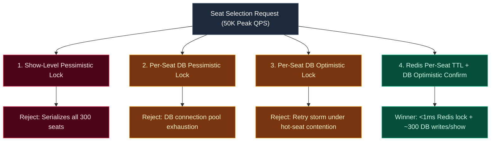

| Strategy | Contention Scope | DB Write Load (Peak) | Latency | Verdict |
|----------|------------------|----------------------|---------|---------|
| **1. Show Pessimistic Lock** | Entire show (300 seats blocked) | High + lock wait queues | Seconds | ❌ Unusable |
| **2. Seat Pessimistic Lock** | Single seat row (`FOR UPDATE`) | 50K TPS on DB | 50–200ms+ | ⚠️ Pool exhaustion |
| **3. Seat Optimistic Lock** | Single seat (`@Version`) | 50K TPS + retry storms | Unpredictable | ⚠️ Fails on hot seats |
| **4. Redis Hold + DB Confirm** | Per-seat key in Redis | ~300 writes/show total | &lt;5ms hold | ✅ Production Winner |

> [!WARNING]
> Relying solely on PostgreSQL `SELECT ... FOR UPDATE` or `@Version` retries during a blockbuster launch will exhaust your database connection pool (typically 100–200 connections) within seconds when 50,000 requests/sec arrive.

---

## 6. The Winning Approach: Optimistic Lock + Temporary Hold

### The Two-Phase Approach

```
Phase 1: HOLD (Redis — fast, distributed lock per seat)
  └─ User selects seats → Redis atomically marks them as HELD
  └─ Returns instantly (<5ms)
  └─ TTL auto-expires if user abandons

Phase 2: CONFIRM (Database — strong consistency)
  └─ User completes payment → DB records the booking
  └─ Only ~300 writes per show (not 50K)
  └─ Atomic transaction: payment + booking
```

**Why this works:**
- 50K users hitting "select seat" → Redis handles it (100K+ ops/sec)
- Only 300 users reach "confirm booking" → DB handles it easily
- Different seats = zero contention in Redis (different keys)
- Same seat = Redis SETNX resolves in <1ms (first one wins)

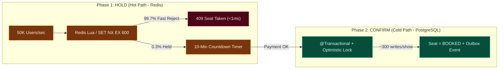

| Phase | Store | Operations/Show | Latency Target | Failure Handling |
|-------|-------|-----------------|----------------|------------------|
| **Phase 1: Hold** | Redis | Up to 50K/sec attempts | &lt;5ms | Auto-expires via 600s TTL |
| **Phase 2: Confirm** | PostgreSQL | ~300 confirmed writes | ~30ms | Optimistic `version` check + unique constraint |

> [!IMPORTANT]
> This two-phase split gives you **defense in depth**: Redis filters 99.7% of contention in memory, and PostgreSQL's `version` + `UNIQUE (show_id, seat_id, booking_id)` guarantees zero double-booking even if Redis ever experiences a split-brain or failover.

---

## 7. Redis-Based Seat Hold System


### Redis Key Design

```
Key format:  seat:{showId}:{seatId}
Value:       {userId}
TTL:         600 seconds (10 minutes)

Example:
  Key:   seat:show_avengers_630pm:C5
  Value: user_mohit_123
  TTL:   600

When TTL expires → key auto-deletes → seat becomes available again
No background job needed for expiry!
```

### Lua Script — Atomic Multi-Seat Hold

Users typically book 2-4 seats together. ALL selected seats must be held atomically — either all succeed or none do. You can't hold C5 and C6 but fail on C7, leaving the user with a split group.

```lua
-- hold_seats.lua
-- Atomically hold multiple seats for a user
-- Returns: 1 = all held, 0 = one or more unavailable

local user_id = ARGV[1]
local ttl = tonumber(ARGV[2])   -- 600 seconds
local num_seats = #KEYS

-- Phase 1: CHECK all seats are available
for i = 1, num_seats do
    local current = redis.call('GET', KEYS[i])
    if current ~= false then
        -- Seat is already held by someone
        if current ~= user_id then
            -- Return which seat is taken (helpful for UI)
            return {0, KEYS[i]}
        end
        -- Same user re-selecting same seat — that's fine
    end
end

-- Phase 2: All available → HOLD all seats atomically
for i = 1, num_seats do
    redis.call('SET', KEYS[i], user_id, 'EX', ttl, 'NX')
    -- NX = only set if not exists (prevents race with another Lua script)
    -- If NX fails (extremely rare race), the seat was just taken
    local result = redis.call('GET', KEYS[i])
    if result ~= user_id then
        -- Race condition: someone else got it between check and set
        -- ROLLBACK: release all seats we just held
        for j = 1, i - 1 do
            redis.call('DEL', KEYS[j])
        end
        return {0, KEYS[i]}
    end
end

return {1, "OK"}
```

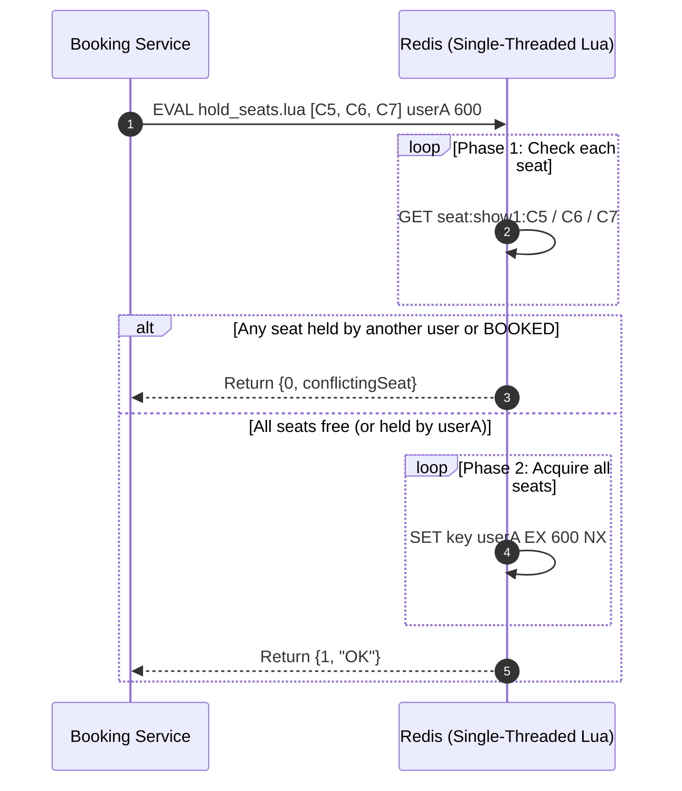

| Redis Key Pattern | Value Format | TTL | Purpose |
|-------------------|--------------|-----|---------|
| `seat:{showId}:{seatId}` | `{userId}` | 600s (10 min) | Temporary exclusive hold during checkout |
| `seat:{showId}:{seatId}` | `BOOKED:{orderId}` | None (until show ends) | Permanent booked marker for fast map reads |
| `user-hold:{showId}:{userId}` | `["C5","C6"]` | 600s | Tracks active hold to prevent multi-browser hoarding |
| `seat-updates:{showId}` | JSON `SeatUpdateEvent` | N/A (Pub/Sub) | Broadcasts `HELD`/`AVAILABLE`/`BOOKED` to WebSocket nodes |

### Java Implementation

```java
@Service
public class SeatHoldService {

    @Autowired private StringRedisTemplate redis;

    private final DefaultRedisScript<List> holdScript;
    private final DefaultRedisScript<Long> releaseScript;

    private static final int HOLD_TTL_SECONDS = 600;  // 10 minutes

    @PostConstruct
    public void init() {
        holdScript = new DefaultRedisScript<>();
        holdScript.setScriptText("""
            local user_id = ARGV[1]
            local ttl = tonumber(ARGV[2])
            local num_seats = #KEYS

            for i = 1, num_seats do
                local current = redis.call('GET', KEYS[i])
                if current ~= false and current ~= user_id then
                    return {0, KEYS[i]}
                end
            end

            for i = 1, num_seats do
                redis.call('SET', KEYS[i], user_id, 'EX', ttl)
            end

            return {1, 'OK'}
        """);
        holdScript.setResultType(List.class);

        releaseScript = new DefaultRedisScript<>();
        releaseScript.setScriptText("""
            local user_id = ARGV[1]
            local released = 0
            for i = 1, #KEYS do
                local current = redis.call('GET', KEYS[i])
                if current == user_id then
                    redis.call('DEL', KEYS[i])
                    released = released + 1
                end
            end
            return released
        """);
        releaseScript.setResultType(Long.class);
    }

    /**
     * Attempt to hold multiple seats for a user.
     * Atomic: either ALL seats are held or NONE.
     *
     * @return HoldResult with success/failure and which seat conflicts
     */
    public HoldResult holdSeats(String showId, String userId, List<String> seatIds) {

        // Validate: max 6 seats per booking
        if (seatIds.size() > 6) {
            return HoldResult.failed("Maximum 6 seats per booking");
        }

        // Build Redis keys
        List<String> keys = seatIds.stream()
            .map(seatId -> "seat:" + showId + ":" + seatId)
            .toList();

        // Execute atomic Lua script
        List<?> result = redis.execute(
            holdScript,
            keys,
            userId,
            String.valueOf(HOLD_TTL_SECONDS)
        );

        if (result != null && ((Long) result.get(0)) == 1L) {
            // All seats held successfully
            Instant expiresAt = Instant.now().plusSeconds(HOLD_TTL_SECONDS);

            // Publish event for real-time seat map update
            publishSeatUpdate(showId, seatIds, SeatStatus.HELD);

            return HoldResult.success(seatIds, expiresAt);
        } else {
            // One or more seats unavailable
            String conflictingSeat = result != null ? (String) result.get(1) : "unknown";
            return HoldResult.conflict(conflictingSeat);
        }
    }

    /**
     * Release seats (user changed mind or hold expired on frontend).
     * Only releases seats held by THIS user (can't release someone else's).
     */
    public int releaseSeats(String showId, String userId, List<String> seatIds) {
        List<String> keys = seatIds.stream()
            .map(seatId -> "seat:" + showId + ":" + seatId)
            .toList();

        Long released = redis.execute(releaseScript, keys, userId);

        if (released != null && released > 0) {
            publishSeatUpdate(showId, seatIds, SeatStatus.AVAILABLE);
        }

        return released != null ? released.intValue() : 0;
    }

    /**
     * Get current seat map for a show.
     * Returns status of all seats (available/held/booked).
     */
    public Map<String, SeatStatus> getSeatMap(String showId, List<String> allSeatIds) {
        // Pipeline: batch all GET commands in one round trip
        List<String> keys = allSeatIds.stream()
            .map(seatId -> "seat:" + showId + ":" + seatId)
            .toList();

        List<Object> results = redis.executePipelined((RedisCallback<Object>) connection -> {
            for (String key : keys) {
                connection.stringCommands().get(key.getBytes());
            }
            return null;
        });

        Map<String, SeatStatus> seatMap = new LinkedHashMap<>();
        for (int i = 0; i < allSeatIds.size(); i++) {
            String holder = (String) results.get(i);
            if (holder == null) {
                seatMap.put(allSeatIds.get(i), SeatStatus.AVAILABLE);
            } else if (holder.startsWith("BOOKED:")) {
                seatMap.put(allSeatIds.get(i), SeatStatus.BOOKED);
            } else {
                seatMap.put(allSeatIds.get(i), SeatStatus.HELD);
            }
        }
        return seatMap;
    }

    private void publishSeatUpdate(String showId, List<String> seatIds, SeatStatus status) {
        SeatUpdateEvent event = new SeatUpdateEvent(showId, seatIds, status);
        redis.convertAndSend("seat-updates:" + showId, objectMapper.writeValueAsString(event));
    }
}
```

> [!TIP]
> In **Redis Cluster**, multi-key Lua scripts require all `KEYS` to map to the same hash slot. Use a hash tag like `seat:{showId}:C5` (wrapping `{showId}` in curly braces) so every seat of a show lives on the same shard!

---

## 8. Complete Booking Flow — End to End

```
User opens show page
    │
    ▼
┌────────────────────────────────────────────────────────────┐
│ 1. LOAD SEAT MAP                                           │
│    GET /api/v1/shows/{showId}/seats                        │
│    → Redis pipeline: GET seat:{showId}:* (all 300 seats)   │
│    → Return map: {C5: AVAILABLE, C6: HELD, C7: BOOKED...} │
│    → Latency: ~5ms (Redis pipeline)                        │
│    → Cache: 2-second cache for non-critical freshness      │
└─────────────────────────┬──────────────────────────────────┘
                          │ User selects C5, C6, C7
                          ▼
┌────────────────────────────────────────────────────────────┐
│ 2. HOLD SEATS                                              │
│    POST /api/v1/shows/{showId}/hold                        │
│    Body: { seats: ["C5", "C6", "C7"], userId: "mohit123" } │
│    → Redis Lua script: atomic hold of all 3 seats          │
│    → If ALL available → hold with 10-min TTL               │
│    → If ANY taken → return which seat conflicts             │
│    → WebSocket: broadcast "C5, C6, C7 now HELD" to all     │
│    → Response: { status: "HELD", expiresAt: "...", ... }   │
│    → Latency: ~3ms                                         │
└─────────────────────────┬──────────────────────────────────┘
                          │ User sees countdown: "9:58 remaining"
                          │ User clicks "Proceed to Pay"
                          ▼
┌────────────────────────────────────────────────────────────┐
│ 3. CREATE ORDER                                            │
│    POST /api/v1/bookings                                   │
│    → Verify seats still held by this user in Redis         │
│    → Create order in PostgreSQL (state: PENDING_PAYMENT)   │
│    → Idempotency key prevents duplicate orders             │
│    → Latency: ~20ms                                        │
└─────────────────────────┬──────────────────────────────────┘
                          │ User enters payment details
                          ▼
┌────────────────────────────────────────────────────────────┐
│ 4. PROCESS PAYMENT                                         │
│    POST /api/v1/payments                                   │
│    → Charge ₹300 (3 seats × ₹100)                         │
│    → Payment gateway (Razorpay/Stripe)                     │
│    → Latency: ~500ms (external gateway)                    │
└─────────────────────────┬──────────────────────────────────┘
                          │ Payment SUCCESS
                          ▼
┌────────────────────────────────────────────────────────────┐
│ 5. CONFIRM BOOKING (atomic transaction)                    │
│    @Transactional:                                         │
│      a. Update order state → CONFIRMED                     │
│      b. Update seats in DB → BOOKED (permanent)            │
│      c. Replace Redis hold with permanent "BOOKED:" marker │
│      d. Delete Redis TTL (seat stays BOOKED forever)       │
│    → WebSocket: broadcast "C5, C6, C7 now BOOKED"          │
│    → Kafka: publish BookingConfirmedEvent                   │
│    → Notification: send SMS + email with ticket             │
│    → Latency: ~30ms                                        │
└────────────────────────────────────────────────────────────┘

Total happy path: ~560ms (dominated by payment gateway)
```

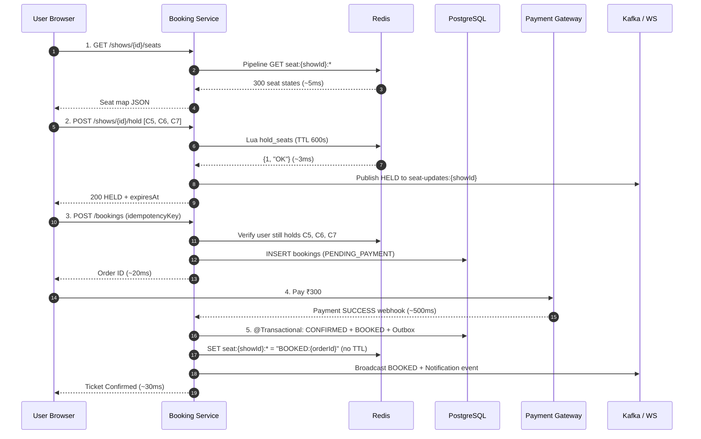

### What Happens If User Abandons at Each Stage?

```
Abandons at Stage 1 (viewing seat map):
  → Nothing to clean up. No seats held.

Abandons at Stage 2 (seats held, never pays):
  → Redis TTL expires after 10 minutes
  → Seats automatically become available
  → WebSocket broadcasts "C5, C6, C7 now AVAILABLE"
  → No database write needed

Abandons at Stage 3 (order created, payment not started):
  → Same as Stage 2: Redis TTL handles it
  → Scheduled job cleans up orphaned orders in DB

Fails at Stage 4 (payment declined):
  → Seats remain HELD — user can retry with different card
  → TTL still counting down
  → If they give up, TTL releases seats

Crashes at Stage 5 (payment charged but confirmation fails):
  → THIS is the scary one. Handled below.
```

| Stage | Typical Latency | Abandonment / Failure Impact | Cleanup Mechanism |
|-------|-----------------|------------------------------|-------------------|
| **1. Load Seat Map** | ~5ms (2s cache) | Zero side effects | None needed |
| **2. Hold Seats** | ~3ms | Seats locked for 10 min | Redis TTL auto-deletes key |
| **3. Create Order** | ~20ms | Orphaned `PENDING_PAYMENT` row | Redis TTL frees seats; cron expires order |
| **4. Process Payment** | ~500ms | Payment declined | Hold stays active until TTL for retry |
| **5. Confirm Booking** | ~30ms | Charged but DB crashed | Reconciliation job + idempotent confirm |

> [!WARNING]
> **Stage 5 crash** (payment charged at Razorpay/Stripe, but DB confirmation fails) is the highest-severity failure mode in ticketing. Never leave it unhandled — pair `@Transactional` + Outbox with a background reconciliation job.

---

## 9. Handling Concurrent Seat Selection

### Scenario: 500 Users Want Seat C5

```
User 1  ──► Redis SETNX seat:show1:C5 → SUCCESS (first one wins)
User 2  ──► Redis SETNX seat:show1:C5 → FAIL (key exists)
User 3  ──► Redis SETNX seat:show1:C5 → FAIL
...
User 500 ─► Redis SETNX seat:show1:C5 → FAIL

Time taken: <5ms total (Redis single-threaded, queues commands)
Users 2-500 get instant "Seat C5 is not available" response
```

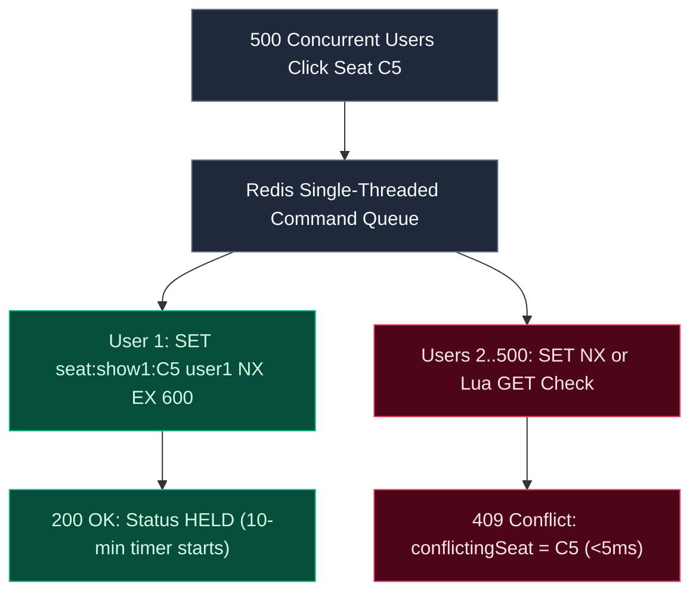

### Scenario: User Selects Seats C5 + C6, But C6 Is Already Taken

```java
@PostMapping("/api/v1/shows/{showId}/hold")
public ResponseEntity<?> holdSeats(
        @PathVariable String showId,
        @RequestBody @Valid SeatHoldRequest request) {

    HoldResult result = seatHoldService.holdSeats(
        showId, request.getUserId(), request.getSeatIds());

    if (result.isSuccess()) {
        return ResponseEntity.ok(SeatHoldResponse.builder()
            .status("HELD")
            .seats(result.getHeldSeats())
            .expiresAt(result.getExpiresAt())
            .message("Seats held for 10 minutes. Complete payment to confirm.")
            .build());
    } else {
        // Tell the user WHICH seat is unavailable
        return ResponseEntity.status(409)
            .body(SeatHoldResponse.builder()
                .status("CONFLICT")
                .conflictingSeat(result.getConflictingSeat())
                .message("Seat " + result.getConflictingSeat() +
                         " is no longer available. Please select a different seat.")
                .build());
    }
}
```

| Outcome | HTTP Status | Payload Highlights | Frontend UX Action |
|---------|-------------|--------------------|--------------------|
| **All seats held** | `200 OK` | `status: "HELD"`, `seats`, `expiresAt` | Start 10-min countdown &amp; navigate to checkout |
| **Partial/full conflict** | `409 Conflict` | `status: "CONFLICT"`, `conflictingSeat` | Highlight conflicting seat in red without full reload |
| **Limit exceeded (&gt;6)** | `400 Bad Request` | `"Maximum 6 seats per booking"` | Show inline validation toast |

**UX Best Practice:** Return which specific seat is taken, so the UI can highlight it in red and let the user pick an alternative without reloading the entire seat map.

> [!TIP]
> Returning `409 Conflict` with the exact `conflictingSeat` ID avoids unnecessary full-page seat-map reloads during peak traffic, cutting read load while improving conversion.

---

## 10. Payment and Confirmation

### The Dangerous Moment: Payment Succeeded but Confirmation Failed

```
User pays ₹300 → Razorpay charges card → SUCCESS
Server tries to update DB → DATABASE CRASH
→ User is charged but seats are not booked!
```

### Solution: Idempotent Confirmation with Outbox Pattern

```java
@Service
public class BookingConfirmationService {

    @Autowired private OrderRepository orderRepo;
    @Autowired private SeatRepository seatRepo;
    @Autowired private SeatHoldService seatHoldService;
    @Autowired private OutboxRepository outboxRepo;

    /**
     * Confirm booking after successful payment.
     * IDEMPOTENT: Can be called multiple times safely.
     */
    @Transactional(isolation = Isolation.READ_COMMITTED)
    public BookingConfirmation confirmBooking(String orderId, String paymentId) {

        Order order = orderRepo.findById(orderId)
            .orElseThrow(() -> new OrderNotFoundException(orderId));

        // Idempotent: if already confirmed, return existing confirmation
        if (order.getState() == OrderState.CONFIRMED) {
            return BookingConfirmation.alreadyConfirmed(order);
        }

        if (order.getState() != OrderState.PENDING_PAYMENT) {
            throw new InvalidStateException("Order " + orderId +
                " is in state " + order.getState());
        }

        // 1. Update order
        order.setState(OrderState.CONFIRMED);
        order.setPaymentId(paymentId);
        order.setConfirmedAt(Instant.now());
        orderRepo.save(order);

        // 2. Mark seats as BOOKED in database (permanent)
        for (String seatId : order.getSeatIds()) {
            int updated = seatRepo.bookSeat(order.getShowId(), seatId,
                order.getUserId(), orderId);
            if (updated == 0) {
                // Should never happen (seat was held by this user)
                throw new SeatBookingException("Failed to book seat " + seatId);
            }
        }

        // 3. Update Redis: replace TTL hold with permanent "BOOKED:" marker
        for (String seatId : order.getSeatIds()) {
            String key = "seat:" + order.getShowId() + ":" + seatId;
            redis.opsForValue().set(key, "BOOKED:" + orderId);
            // No TTL → stays forever (until show is over)
        }

        // 4. Write to outbox for reliable event publishing
        outboxRepo.save(OutboxEvent.builder()
            .aggregateId(orderId)
            .eventType("BookingConfirmed")
            .payload(objectMapper.writeValueAsString(
                new BookingConfirmedEvent(order)))
            .build());

        return BookingConfirmation.success(order);
    }
}
```

### What If DB Crashes Mid-Confirmation?

The `@Transactional` annotation ensures atomicity: either ALL of these happen or NONE:
- Order state → CONFIRMED
- Seats → BOOKED in DB
- Outbox event → created

If the transaction fails, the payment gateway payment is orphaned. A **reconciliation job** catches this:

```java
@Scheduled(fixedRate = 120_000)  // Every 2 minutes
public void reconcilePaymentsWithBookings() {
    // Find orders that have payment but aren't confirmed
    List<Order> unconfirmed = orderRepo.findByStateAndPaymentIdIsNotNull(
        OrderState.PENDING_PAYMENT);

    for (Order order : unconfirmed) {
        // Verify payment actually succeeded at gateway
        PaymentStatus gatewayStatus = paymentGateway
            .checkStatus(order.getPaymentId());

        if (gatewayStatus == PaymentStatus.SUCCESS) {
            // Payment succeeded but confirmation failed → retry confirmation
            try {
                confirmBooking(order.getId(), order.getPaymentId());
                log.info("Reconciled: confirmed booking {} after payment {}",
                    order.getId(), order.getPaymentId());
            } catch (Exception e) {
                log.error("Reconciliation failed for order {}", order.getId(), e);
                alertOps(order);
            }
        } else if (gatewayStatus == PaymentStatus.FAILED) {
            // Payment failed → release seats
            order.setState(OrderState.PAYMENT_FAILED);
            orderRepo.save(order);
            seatHoldService.releaseSeats(order.getShowId(),
                order.getUserId(), order.getSeatIds());
        }
    }
}
```

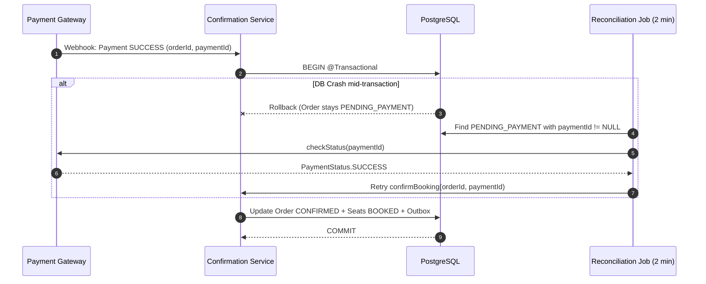

| Failure Scenario | System Behavior | Recovery Outcome |
|------------------|-----------------|------------------|
| **Duplicate webhook** | `order.getState() == CONFIRMED` short-circuits | Returns existing confirmation (idempotent) |
| **DB crash after payment** | `@Transactional` rolls back cleanly | 2-min reconciliation job retries `confirmBooking` |
| **Payment failed at gateway** | `gatewayStatus == FAILED` | Order marked `PAYMENT_FAILED`, Redis seats released |
| **Kafka down during confirm** | Event saved in `outbox` table in same DB tx | Outbox relay publishes once Kafka recovers |

> [!IMPORTANT]
> Always make `confirmBooking` **idempotent**: both the payment webhook and the 2-minute reconciliation job (or user-facing redirect) may call it for the same `orderId`.

---

## 11. Seat Map Real-Time Updates

### WebSocket for Live Seat Map

When User A holds seat C5, User B (viewing the same show) should see C5 turn yellow within 1-2 seconds.

```java
@Configuration
@EnableWebSocketMessageBroker
public class WebSocketConfig implements WebSocketMessageBrokerConfigurer {

    @Override
    public void configureMessageBroker(MessageBrokerRegistry config) {
        config.enableSimpleBroker("/topic");
        config.setApplicationDestinationPrefixes("/app");
    }

    @Override
    public void registerStompEndpoints(StompEndpointRegistry registry) {
        registry.addEndpoint("/ws/seats").setAllowedOrigins("*").withSockJS();
    }
}

@Service
public class SeatUpdateBroadcaster {

    @Autowired
    private SimpMessagingTemplate messagingTemplate;

    /**
     * Broadcast seat status change to all users viewing this show.
     * Called when seats are held, released, or booked.
     */
    public void broadcastSeatUpdate(String showId, List<String> seatIds,
                                     SeatStatus newStatus) {
        SeatUpdateMessage message = new SeatUpdateMessage(
            seatIds, newStatus, Instant.now()
        );

        // All users subscribed to /topic/shows/{showId}/seats receive this
        messagingTemplate.convertAndSend(
            "/topic/shows/" + showId + "/seats",
            message
        );
    }
}
```

**Frontend (React):**
```javascript
// Subscribe to seat updates for this show
const client = new Client({ brokerURL: 'ws://api.bookmyshow.com/ws/seats' });

client.onConnect = () => {
  client.subscribe(`/topic/shows/${showId}/seats`, (message) => {
    const update = JSON.parse(message.body);
    // update = { seats: ["C5", "C6"], status: "HELD", timestamp: "..." }

    update.seats.forEach(seatId => {
      setSeatMap(prev => ({
        ...prev,
        [seatId]: update.status  // Update seat color on the map
      }));
    });
  });
};
```

### Redis Pub/Sub for Multi-Instance Broadcasting

If you have 20 instances of the Booking Service behind a load balancer, a seat update on Instance 1 needs to reach users connected via WebSocket to Instance 15.

```java
// Redis Pub/Sub listener — runs on every instance
@Component
public class RedisSeatUpdateListener {

    @Autowired private SeatUpdateBroadcaster broadcaster;

    @PostConstruct
    public void subscribe() {
        redis.getConnectionFactory().getConnection()
            .subscribe((message, pattern) -> {
                SeatUpdateEvent event = objectMapper.readValue(
                    message.getBody(), SeatUpdateEvent.class);
                broadcaster.broadcastSeatUpdate(
                    event.getShowId(), event.getSeatIds(), event.getStatus());
            }, "seat-updates:*".getBytes());
    }
}
```

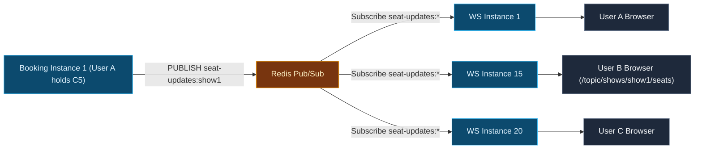

| Mechanism | Update Latency | Multi-Node Support | Server Load |
|-----------|----------------|--------------------|-------------|
| **HTTP Polling (5s)** | 0–5 seconds | Trivial | Very high (100K viewers = 20K QPS wasted) |
| **In-Memory STOMP Only** | &lt;1 second | ❌ Isolated per instance | Low |
| **WebSocket + Redis Pub/Sub** | 1–2 seconds | ✅ Fan-out across all 20+ instances | Low (delta events only) |

> [!TIP]
> Notice that we only push **delta events** (`{ seats: ["C5", "C6"], status: "HELD" }`) over WebSocket rather than re-sending the entire 300-seat map on every change.

---

## 12. Scaling for High-Demand Events

### Problem: Aamir Khan Movie / IPL Final / Concert

```
Regular movie:    500 bookings/hour, ~100 concurrent viewers per show
Blockbuster:      50,000 bookings/hour, ~100K concurrent viewers per show
IPL Final:        500,000 users fighting for 60,000 stadium seats
```

### Scaling Strategy

```
                     ┌──────────────────────┐
                     │   REGULAR SHOW       │
                     │                      │
                     │   Redis: 1 instance  │
                     │   DB: primary only   │
                     │   WebSocket: 2 nodes │
                     └──────────────────────┘

                     ┌──────────────────────┐
                     │   BLOCKBUSTER        │
                     │                      │
                     │   Redis: cluster     │
                     │   DB: + read replica │
                     │   WebSocket: 10 nodes│
                     │   Queue: Kafka buffer│
                     └──────────────────────┘

                     ┌──────────────────────┐
                     │   IPL FINAL          │
                     │                      │
                     │   Redis: cluster     │
                     │   Virtual queue      │
                     │   Staged access      │
                     │   WS: 50 nodes       │
                     └──────────────────────┘
```

### Virtual Queue for Extreme Demand

When 500K users want 60K stadium seats:

```java
@Service
public class VirtualQueueService {

    /**
     * For high-demand events, put users in a FIFO queue
     * instead of letting everyone rush the seat map.
     */
    public QueueResponse joinQueue(String showId, String userId) {
        // Add to Redis sorted set with timestamp as score
        double score = System.currentTimeMillis();
        redis.opsForZSet().add("queue:" + showId, userId, score);

        // Get position
        Long position = redis.opsForZSet().rank("queue:" + showId, userId);

        return QueueResponse.builder()
            .position(position + 1)
            .estimatedWait(estimateWait(position))
            .message("You're in the queue! We'll let you in when it's your turn.")
            .build();
    }

    /**
     * Scheduled: let next batch of users into the booking page.
     * 50 users every 10 seconds = 300 users/minute
     */
    @Scheduled(fixedRate = 10_000)
    public void admitNextBatch() {
        for (String showId : activeHighDemandShows) {
            Set<String> nextBatch = redis.opsForZSet()
                .range("queue:" + showId, 0, 49);  // Next 50 users

            if (nextBatch != null && !nextBatch.isEmpty()) {
                for (String userId : nextBatch) {
                    // Grant access token (valid for 15 minutes)
                    String token = UUID.randomUUID().toString();
                    redis.opsForValue().set(
                        "access:" + showId + ":" + userId,
                        token, Duration.ofMinutes(15));

                    // Notify user via WebSocket: "It's your turn!"
                    notifyUser(userId, showId, token);
                }

                // Remove admitted users from queue
                redis.opsForZSet().removeRange("queue:" + showId, 0, 49);
            }
        }
    }
}
```

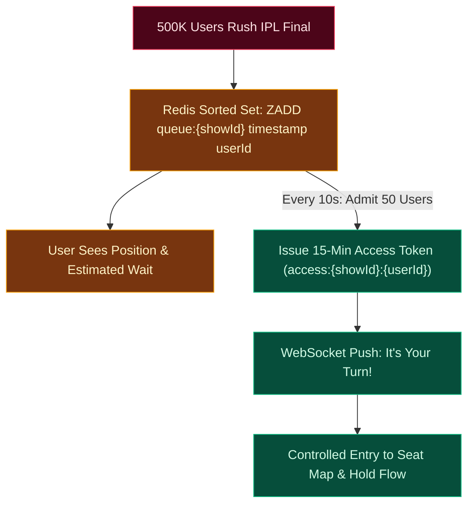

| Event Tier | Demand Profile | Infrastructure Footprint | Admission Control |
|------------|----------------|--------------------------|-------------------|
| **Regular Show** | 500 bookings/hr, ~100 viewers | 1 Redis, 1 DB primary, 2 WS nodes | Direct access |
| **Blockbuster** | 50K bookings/hr, ~100K viewers | Redis cluster, DB read replicas, 10 WS nodes, Kafka | Rate limiting + 2s map cache |
| **IPL Final / Concert** | 500K users for 60K seats | Redis cluster, 50 WS nodes, Virtual Queue | Staged FIFO (50 users / 10s) |

> [!IMPORTANT]
> Only activate the **Virtual Queue** for extreme-demand events (stadiums, Coldplay concerts). For regular movies, direct Redis per-seat locking gives a faster, friction-free user experience.

---

## 13. Edge Cases That Interviewers Love

### Edge Case 1: User Holds Seats in Multiple Browsers

```
Browser 1: User holds C5, C6 (Session A)
Browser 2: Same user holds D1, D2 (Session B)

Policy decision: Allow it? Or enforce 1 active hold per user?
```

```java
// Enforce single active hold per user
public HoldResult holdSeats(String showId, String userId, List<String> seatIds) {

    // Check if user already has an active hold for this show
    String existingHoldKey = "user-hold:" + showId + ":" + userId;
    String existingSeats = redis.opsForValue().get(existingHoldKey);

    if (existingSeats != null) {
        // Release previous hold first
        List<String> previousSeats = objectMapper.readValue(existingSeats, List.class);
        releaseSeats(showId, userId, previousSeats);
    }

    // Proceed with new hold
    HoldResult result = holdSeatsInternal(showId, userId, seatIds);

    if (result.isSuccess()) {
        // Track this user's current hold
        redis.opsForValue().set(existingHoldKey,
            objectMapper.writeValueAsString(seatIds),
            Duration.ofSeconds(HOLD_TTL_SECONDS));
    }

    return result;
}
```

### Edge Case 2: Show Is Filling Up — Only Scattered Singles Left

```
After 280/300 seats are booked:
  Available: A3, B7, D2, E1, E4, ... (scattered singles)
  User wants 4 seats together — impossible!

Solution: Suggest best available group
```

```java
public List<SeatGroup> suggestBestAvailable(String showId, int numSeats) {
    Map<String, SeatStatus> seatMap = getSeatMap(showId);

    // Find consecutive available seats in each row
    List<SeatGroup> suggestions = new ArrayList<>();

    for (String row : List.of("A", "B", "C", "D", "E")) {
        List<String> consecutive = new ArrayList<>();
        for (int i = 1; i <= 10; i++) {
            String seatId = row + i;
            if (seatMap.get(seatId) == SeatStatus.AVAILABLE) {
                consecutive.add(seatId);
                if (consecutive.size() == numSeats) {
                    suggestions.add(new SeatGroup(new ArrayList<>(consecutive),
                        getSeatPrice(row)));
                    consecutive.remove(0);  // Slide window
                }
            } else {
                consecutive.clear();
            }
        }
    }

    // Sort by preference: center of row, lower price first
    suggestions.sort(Comparator.comparing(SeatGroup::distanceFromCenter));
    return suggestions;
}
```

### Edge Case 3: Clock Skew — Hold Expired in Redis but User Thinks They Still Have Time

```
User's browser: "7:32 remaining"
Redis TTL:       Already expired (server clock is 3 seconds ahead)
User clicks "Pay" → Seats no longer held → Error!
```

**Solution:** Set the hold TTL 30 seconds longer in Redis than what you show the user. User sees 10:00 countdown, Redis TTL is 10:30.

```java
private static final int USER_VISIBLE_TTL = 600;     // 10 minutes shown to user
private static final int REDIS_TTL = 630;             // 10.5 minutes actual TTL (30s buffer)
```

### Edge Case 4: Redis Goes Down During Peak

```java
@Service
public class SeatHoldServiceWithFallback {

    @CircuitBreaker(name = "redis", fallbackMethod = "holdSeatsFallback")
    public HoldResult holdSeats(String showId, String userId, List<String> seatIds) {
        return redisBasedHold(showId, userId, seatIds);
    }

    // Fallback: use database pessimistic lock
    public HoldResult holdSeatsFallback(String showId, String userId,
                                         List<String> seatIds, Exception ex) {
        log.warn("Redis unavailable, falling back to DB locking. show={}", showId);

        return dbBasedHold(showId, userId, seatIds);
        // Slower (~50ms vs ~3ms) but correct
        // Acceptable degradation during Redis outage
    }
}
```

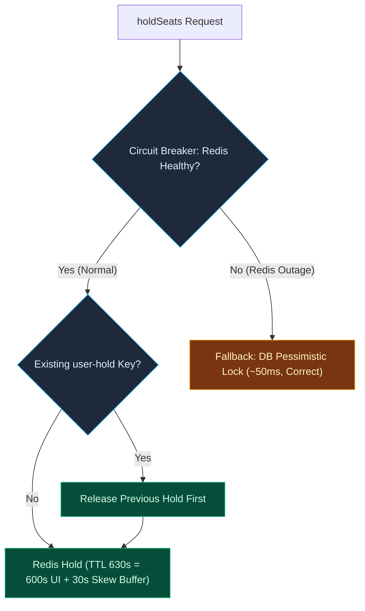

| Edge Case | Root Cause | Production Mitigation |
|-----------|------------|-----------------------|
| **Multi-browser hoarding** | Same user opens 2 tabs to lock 12 seats | `user-hold:{showId}:{userId}` releases prior hold automatically |
| **Scattered single seats** | 280/300 booked, no contiguous blocks obvious | Sliding-window search per row sorted by center distance |
| **Clock skew at checkout** | Client timer lags server Redis expiry | Show `600s` in UI, set `630s` TTL in Redis (30s buffer) |
| **Redis outage** | Cache/lock cluster unreachable | `@CircuitBreaker` degrades gracefully to DB `FOR UPDATE` |

> [!WARNING]
> When falling back to database locking during a Redis outage, shed non-essential traffic (e.g., tighten rate limits at the API Gateway) so the 50ms DB locks don't overwhelm your PostgreSQL connection pool.

---

## 14. Database Schema

```sql
-- Shows table
CREATE TABLE shows (
    id              VARCHAR(64) PRIMARY KEY,
    movie_id        VARCHAR(64) NOT NULL,
    venue_id        VARCHAR(64) NOT NULL,
    screen_number   INT NOT NULL,
    show_time       TIMESTAMPTZ NOT NULL,
    total_seats     INT NOT NULL,
    available_seats INT NOT NULL,
    status          VARCHAR(20) NOT NULL DEFAULT 'ACTIVE', -- ACTIVE, CANCELLED, COMPLETED
    created_at      TIMESTAMPTZ NOT NULL DEFAULT NOW()
);

-- Seats table (one row per seat per show)
CREATE TABLE seats (
    show_id         VARCHAR(64) NOT NULL REFERENCES shows(id),
    seat_id         VARCHAR(10) NOT NULL,    -- "C5"
    row_name        CHAR(1) NOT NULL,        -- "C"
    seat_number     INT NOT NULL,            -- 5
    category        VARCHAR(20) NOT NULL,    -- PREMIUM, GOLD, SILVER
    price           DECIMAL(10,2) NOT NULL,
    status          VARCHAR(20) NOT NULL DEFAULT 'AVAILABLE', -- AVAILABLE, BOOKED
    booked_by       VARCHAR(64),
    booking_id      VARCHAR(64),
    version         BIGINT NOT NULL DEFAULT 0,
    updated_at      TIMESTAMPTZ NOT NULL DEFAULT NOW(),

    PRIMARY KEY (show_id, seat_id),

    -- CRITICAL: Prevent double-booking at DB level
    CONSTRAINT unique_booking UNIQUE (show_id, seat_id, booking_id)
);

-- Partial index: only query available seats
CREATE INDEX idx_seats_available ON seats (show_id)
    WHERE status = 'AVAILABLE';

-- Bookings table
CREATE TABLE bookings (
    id              VARCHAR(64) PRIMARY KEY,
    show_id         VARCHAR(64) NOT NULL REFERENCES shows(id),
    user_id         VARCHAR(64) NOT NULL,
    seat_ids        TEXT[] NOT NULL,          -- {"C5", "C6", "C7"}
    total_amount    DECIMAL(10,2) NOT NULL,
    state           VARCHAR(20) NOT NULL,     -- PENDING_PAYMENT, CONFIRMED, CANCELLED
    payment_id      VARCHAR(64),
    idempotency_key VARCHAR(64) UNIQUE,
    created_at      TIMESTAMPTZ NOT NULL DEFAULT NOW(),
    confirmed_at    TIMESTAMPTZ,
    expires_at      TIMESTAMPTZ NOT NULL,

    -- One active booking per user per show
    CONSTRAINT unique_user_show UNIQUE (user_id, show_id)
);

-- Atomic seat booking (prevents double-book at DB level)
-- Used during confirmation, not during hold
UPDATE seats
SET status = 'BOOKED',
    booked_by = :userId,
    booking_id = :bookingId,
    version = version + 1,
    updated_at = NOW()
WHERE show_id = :showId
  AND seat_id = :seatId
  AND status = 'AVAILABLE'
  AND version = :expectedVersion;
-- Returns 0 affected rows if seat was already booked → fail safely
```

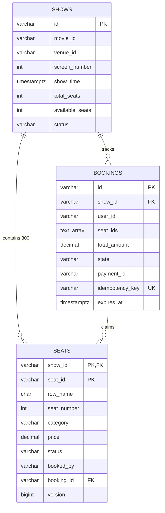

| Schema Guardrail | Definition | Why It Matters |
|------------------|------------|----------------|
| **Composite PK** | `PRIMARY KEY (show_id, seat_id)` | Partitions/indexes seats naturally by show |
| **Partial Index** | `CREATE INDEX idx_seats_available ON seats (show_id) WHERE status = 'AVAILABLE'` | Keeps index tiny as shows fill up |
| **Optimistic Version** | `WHERE status = 'AVAILABLE' AND version = :expectedVersion` | Returns `0` rows if another tx modified the seat |
| **Idempotency Key** | `idempotency_key VARCHAR(64) UNIQUE` | Prevents duplicate order creation on client retries |
| **User-Show Uniqueness** | `CONSTRAINT unique_user_show UNIQUE (user_id, show_id)` | Enforces one active booking per user per show |

> [!IMPORTANT]
> The `UPDATE seats ... WHERE status = 'AVAILABLE' AND version = :expectedVersion` statement is your **final safety net**. Even if Redis lost a key during a failover, PostgreSQL refuses to overwrite an already-booked seat.

---

## 15. Senior vs Mid-Level Comparison

| Question | Mid-Level Answer | Senior Answer |
|----------|-----------------|---------------|
| "How do you prevent double-booking?" | "Use database transactions with SELECT FOR UPDATE" | "Redis Lua script for the hold phase (sub-ms, handles 100K TPS), DB optimistic lock for confirmation (handles 300 TPS). Two layers of defense." |
| "How do you handle seat selection concurrency?" | "Lock the entire show" | "Per-seat keys in Redis. Users booking different seats have ZERO contention. Only same-seat conflicts are resolved by SETNX — first one wins in <1ms." |
| "What if user doesn't pay?" | "Background job to clean up" | "Redis TTL auto-expires the hold. Zero background jobs needed for the common case. Reconciliation job only for edge cases where Redis and DB drift." |
| "How do you show real-time availability?" | "Poll the API every 5 seconds" | "WebSocket + Redis Pub/Sub. Every hold/release/booking publishes an event. All connected users see updates within 1-2 seconds without polling." |
| "What about very high demand?" | "Scale horizontally" | "Virtual queue for extreme demand (IPL Final). Staged access: 50 users every 10 seconds. Fair, controlled, no system crash. Regular movies don't need this — Redis handles them directly." |
| "What if Redis crashes?" | "System goes down" | "Circuit breaker falls back to DB pessimistic locking. Slower (50ms vs 3ms) but correct. Acceptable degradation." |

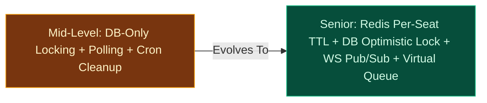

> [!TIP]
> In interviews, always pair **fast-path mechanics** (Redis Lua + TTL + WebSocket) with **failure-mode guarantees** (DB optimistic lock + idempotent outbox + reconciliation + circuit breaker). That combination signals senior production experience.

---

## 16. Interview Follow-Up Questions

### "How is this different from the iPhone flash sale problem?"

"The flash sale had 100 identical items and one global counter. Here, every seat is unique, so we need per-seat locking, not a global counter. The key insight is that per-seat Redis keys give us maximum concurrency — two users booking seats in different rows have zero contention. Additionally, the flash sale was instant (buy or reject), while bookings have a hold-and-pay lifecycle with TTL-based expiry."

### "How do you prevent scalpers / bots?"

"Multiple layers: CAPTCHA before showing the seat map, device fingerprinting, rate limiting (1 hold attempt per 5 seconds per user), maximum 6 seats per booking, phone number verification, and anomaly detection (same IP booking 50 seats across different accounts). For high-profile events, we can add a lottery system."

### "How would you add seat pricing tiers (premium vs regular)?"

"It's already in the data model — each seat has a `category` and `price` field. The seat map UI shows different colors for different tiers. The pricing can be dynamic too: if 90% of premium seats are sold but regular has 60% availability, we can adjust prices (like airline yield management). This is a read from the DB, applied at order creation."

### "How would you handle 50 screens across India showing the same movie?"

"Each show has its own set of seats — Show ID is the partition key. Screen 1 at PVR Phoenix Mall and Screen 3 at INOX Forum Mall are completely independent. Redis keys are `seat:{showId}:{seatId}`, so there's zero cross-show contention. We can even shard Redis by city if needed."

### "What metrics would you monitor?"

```
Business:
  - Booking success rate per show
  - Average time from hold → payment → confirmation
  - Hold expiry rate (are users struggling with payment?)
  - Revenue per show, per screen

Technical:
  - Redis hold latency P99 (<5ms target)
  - Seat map load latency P99 (<500ms target)
  - WebSocket message delivery time
  - Hold expiry rate (are TTLs too short?)
  - DB booking confirmation latency
  - Reconciliation mismatches (should be 0)
```

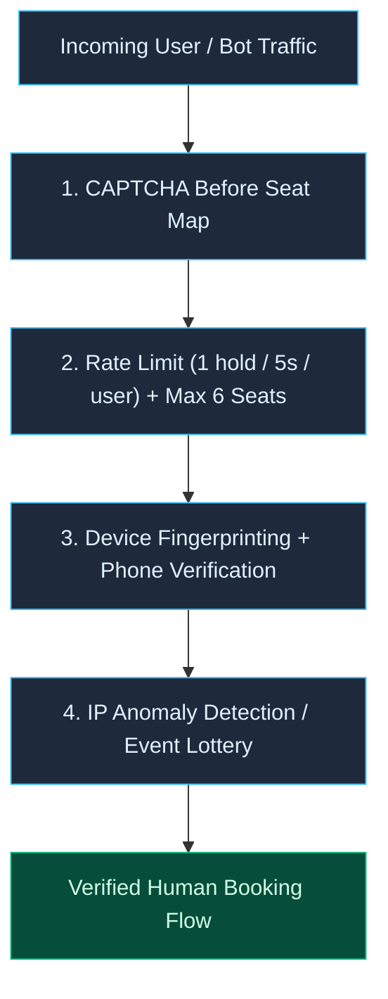

| Metric Category | Key Metric | Target / Alert Threshold |
|-----------------|------------|--------------------------|
| **Technical** | Redis hold latency P99 | &lt; 5ms |
| **Technical** | Seat map load latency P99 | &lt; 500ms |
| **Technical** | Reconciliation mismatches | `0` (alert immediately if &gt; 0) |
| **Business** | Hold expiry rate | Spike indicates payment gateway or UX friction |
| **Business** | Hold → Confirm conversion time | Track P50 / P95 against 10-min TTL |

> [!IMPORTANT]
> **Partition by `showId`** across both Redis (`seat:{showId}:{seatId}`) and PostgreSQL (`PRIMARY KEY (show_id, seat_id)`). Because shows are completely independent, horizontal scaling across cities and screens is linear.

---

## One-Page Summary for the Interview

```
┌─────────────────────────────────────────────────────────────┐
│          SEAT BOOKING — NO DOUBLE BOOKING                   │
│                                                             │
│  1. Redis per-seat keys (seat:{showId}:{seatId})           │
│     └─ SETNX: first user to hold a seat wins               │
│     └─ Different seats = zero contention                    │
│     └─ Lua script for atomic multi-seat hold                │
│                                                             │
│  2. TTL-based auto-release (10 min)                         │
│     └─ No background job needed                             │
│     └─ Abandoned holds self-heal                            │
│                                                             │
│  3. Database confirmation with optimistic lock              │
│     └─ Only ~300 writes per show (confirmed bookings)       │
│     └─ Version check prevents any double-book at DB level   │
│                                                             │
│  4. WebSocket + Redis Pub/Sub for real-time seat map        │
│     └─ All users see holds/releases within 1-2 seconds      │
│                                                             │
│  5. Virtual queue for extreme demand (IPL/concerts)         │
│     └─ Staged access: controlled, fair, no system crash     │
│                                                             │
│  Key Insight: Lock per SEAT, not per SHOW.                  │
│  Users booking different seats never block each other.      │
└─────────────────────────────────────────────────────────────┘
```

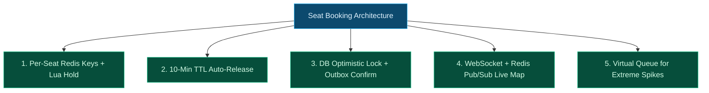

| Pillar | Technology | Core Guarantee |
|--------|------------|----------------|
| **Atomic Multi-Seat Hold** | Redis Lua + `SET NX EX 600` | All-or-nothing hold in &lt;5ms; zero cross-seat blocking |
| **Self-Healing Expiry** | Redis Key TTL | Abandoned holds release automatically without cron jobs |
| **Zero Double-Booking** | PostgreSQL `version` + `UNIQUE` | Strong consistency on confirmed bookings + idempotent outbox |
| **Live Seat Map** | STOMP WebSocket + Redis Pub/Sub | 1–2s delta updates across all service instances |
| **Extreme Spike Control** | Redis ZSET Virtual Queue | Staged admission (50 users / 10s) prevents system collapse |

> [!TIP]
> Open your whiteboard explanation with the single sentence: **"We lock per seat in Redis for sub-millisecond holds, and confirm in PostgreSQL with optimistic locking."** Every other component flows naturally from that architecture.
