# Design a Distributed Lock Service

> **The Interview Question:**
> "Design a distributed locking mechanism that works across multiple servers. How do you prevent two processes from modifying the same resource simultaneously in a distributed system? How do you handle node failures, network partitions, and split-brain scenarios?"

This is the question that tests whether you TRULY understand distributed systems — not just how to use Redis, but why naive approaches fail in subtle, dangerous ways.

---

## Table of Contents

1. [Why Distributed Locks Are Hard](#1-why-distributed-locks-are-hard)
2. [Single-Node Redis Lock](#2-single-node-redis-lock)
3. [Why Single-Node Lock Fails](#3-why-single-node-lock-fails)
4. [Fencing Tokens](#4-fencing-tokens)
5. [The Redlock Algorithm](#5-the-redlock-algorithm)
6. [Martin Kleppmann's Critique of Redlock](#6-martin-kleppmanns-critique-of-redlock)
7. [ZooKeeper-Based Locks — The Consensus Approach](#7-zookeeper-based-locks--the-consensus-approach)
8. [Leader Election](#8-leader-election)
9. [Split-Brain Problem](#9-split-brain-problem)
10. [Comparison: Redis vs ZooKeeper vs etcd](#10-comparison-redis-vs-zookeeper-vs-etcd)
11. [Production Java Implementation](#11-production-java-implementation)
12. [When Do You Actually Need Distributed Locks?](#12-when-do-you-actually-need-distributed-locks)
13. [Senior vs Mid-Level Comparison](#13-senior-vs-mid-level-comparison)
14. [Interview Follow-Up Questions](#14-interview-follow-up-questions)
15. [One-Page Summary](#one-page-summary)

---

## 1. Why Distributed Locks Are Hard

### Locks on a Single Machine Are Simple

```java
// Single JVM — works perfectly
synchronized (resource) {
    // Only one thread enters here at a time
    modifyResource();
}
```

### In Distributed Systems, Everything Breaks

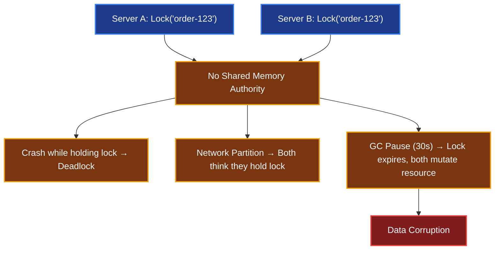

| Challenge | Single-JVM Lock | Distributed Lock |
|-----------|-----------------|------------------|
| **Authority** | Shared RAM & OS/JVM monitor | External coordinator over unreliable network |
| **Process Crash** | OS reclaims process memory/locks | Lock held until TTL or session expires |
| **Network Partition** | Not applicable | Client cannot tell "node dead" vs "network slow" |
| **Process / GC Pause** | Paused thread still owns monitor | Lock TTL expires while client is frozen |
| **Clock Drift** | Monotonic CPU clock | Independent machine clocks drift or jump |

> [!IMPORTANT]
> **The fundamental problem:** In an asynchronous distributed system, you cannot distinguish between "the other node crashed" and "the network or GC is slow." Furthermore, physical clocks across machines drift.

---

## 2. Single-Node Redis Lock

### The Basic Approach

```java
// Acquire lock
SET resource_name my_random_value NX EX 30
// NX = only set if not exists (mutual exclusion)
// EX 30 = expires in 30 seconds (prevents deadlock if holder crashes)
// my_random_value = unique per client (prevents releasing someone else's lock)

// Release lock (ONLY if we still own it)
// Must be atomic — use Lua script
if redis.call("GET", KEYS[1]) == ARGV[1] then
    return redis.call("DEL", KEYS[1])
else
    return 0
end
```

### Acquire & Safe-Release Flow

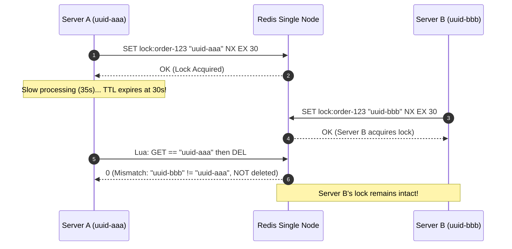

### Java Implementation

```java
@Service
public class SimpleRedisLock {

    @Autowired private StringRedisTemplate redis;

    private static final String UNLOCK_SCRIPT = """
        if redis.call('GET', KEYS[1]) == ARGV[1] then
            return redis.call('DEL', KEYS[1])
        else
            return 0
        end
    """;

    /**
     * Acquire a distributed lock.
     *
     * @param lockKey    The resource to lock (e.g., "order:123")
     * @param requestId  Unique ID for this lock holder (UUID)
     * @param ttlSeconds Lock auto-expires after this time
     * @return true if lock acquired, false if already held by someone else
     */
    public boolean tryLock(String lockKey, String requestId, long ttlSeconds) {
        Boolean acquired = redis.opsForValue().setIfAbsent(
            "lock:" + lockKey,
            requestId,
            Duration.ofSeconds(ttlSeconds)
        );
        return Boolean.TRUE.equals(acquired);
    }

    /**
     * Release the lock — ONLY if we still own it.
     * Uses Lua script for atomic check-and-delete.
     */
    public boolean unlock(String lockKey, String requestId) {
        DefaultRedisScript<Long> script = new DefaultRedisScript<>(UNLOCK_SCRIPT, Long.class);
        Long result = redis.execute(script,
            List.of("lock:" + lockKey),
            requestId);
        return result != null && result == 1;
    }
}
```

### Usage

```java
String lockKey = "payment:order-456";
String requestId = UUID.randomUUID().toString();

if (redisLock.tryLock(lockKey, requestId, 30)) {
    try {
        // Critical section — only one server executes this
        processPayment("order-456");
    } finally {
        redisLock.unlock(lockKey, requestId);
    }
} else {
    // Lock held by another server — retry or fail
    throw new ResourceBusyException("Payment is being processed by another node");
}
```

### Why the Random Value & Lua Script Matter

| Mechanism | Without It | With It |
|-----------|-----------|---------|
| **`NX` (Set if Not Exists)** | Multiple clients overwrite the key | Only first client creates the key |
| **`EX 30` (TTL)** | Client crash leaves lock held forever | Lock auto-expires after 30s |
| **Random `requestId` (UUID)** | Slow Server A deletes Server B's lock | Server A sees `"uuid-bbb" ≠ "uuid-aaa"` and aborts `DEL` |
| **Atomic Lua Script** | `GET` then `DEL` has a TOCTOU race condition | `GET` + `DEL` execute atomically inside Redis |

> [!TIP]
> **Lease Renewal / Watchdog Pattern (e.g., Redisson Watchdog):** If your critical section legitimately takes longer than the initial TTL, a background watchdog thread can periodically renew the lease (`PEXPIRE` every `TTL / 3`, e.g., every 10s for a 30s lock) *only* while the holder thread is alive and still owns `requestId`. Note that a watchdog still cannot stop a **Stop-The-World GC pause** from freezing the renewal thread too—which is why fencing tokens remain essential for strict correctness.

---

## 3. Why Single-Node Lock Fails

### Problem 1: Redis Failover (Asynchronous Replication)

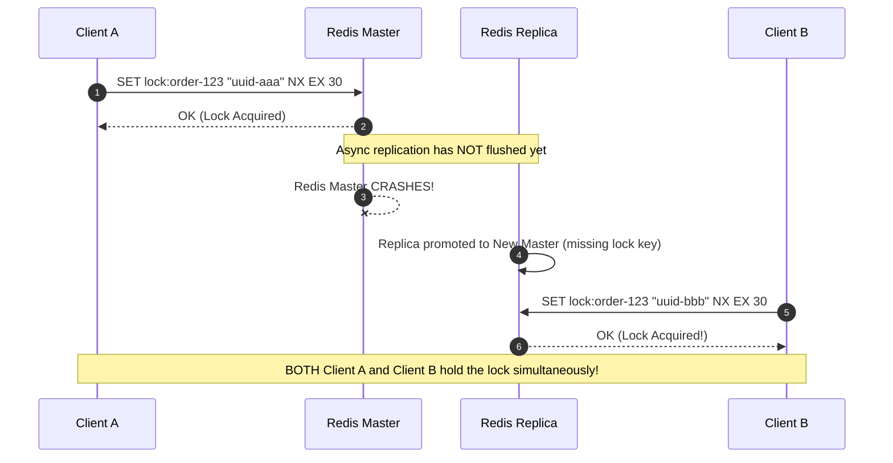

This is a fundamental problem with single-node or master-slave Redis locks. Replication is asynchronous — the lock can be lost during failover.

### Problem 2: The GC Pause (Process Pause) Problem


| Failure Mode | Root Cause | Impact | Mitigated by Watchdog? |
|--------------|------------|--------|------------------------|
| **Master Crash Before Sync** | Async replication in Redis | Two clients hold lock on new master | No — lock key is lost on failover |
| **STW GC Pause > TTL** | JVM freezes all threads (including watchdog) | Lock expires; client wakes up & writes | No — watchdog thread is frozen too |
| **Network Delay > TTL** | Packet stalls between client & storage | Stale write arrives after lock expiry | No — packet is already in flight |

> [!WARNING]
> **This isn't theoretical.** Java Stop-The-World (STW) GC pauses of 30+ seconds happen in production with large heaps and full GC events. Client A's lock expires at 30s, and when it wakes up at 40s, it has no idea it lost the lock.

---

## 4. Fencing Tokens

### The Fix: Monotonically Increasing Tokens

Instead of just locking, the lock service returns a **fencing token** — a number that increases every time a lock is granted. The protected resource REJECTS any request with a token older than the last one it saw.


### Sequence & Storage Validation

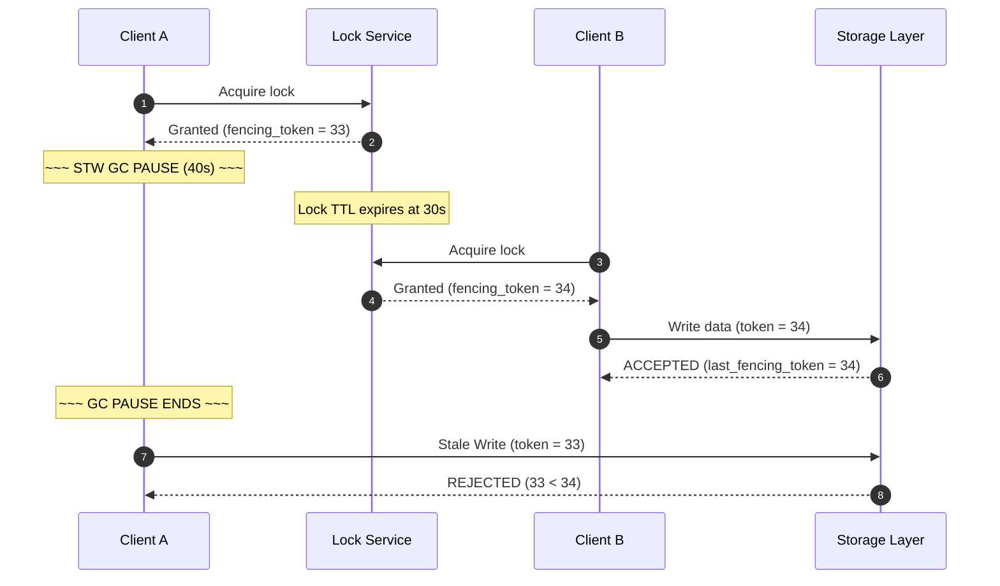

| Layer | Responsibility | Guarantee |
|-------|---------------|-----------|
| **Lock Service** | Issues strictly monotonic `fencing_token` per lock grant | Never issues the same or lower token twice |
| **Client** | Passes `fencing_token` with every storage mutation | Transparently propagates proof of recency |
| **Storage Layer** | Executes `WHERE last_fencing_token < :token` atomically | Rejects stale writes even if lock service or client fails |

### Java Implementation with Fencing

```java
@Service
public class FencedLockService {

    @Autowired private StringRedisTemplate redis;

    // Atomic Lua script: acquire lock AND get fencing token
    private static final String ACQUIRE_SCRIPT = """
        local lockKey = KEYS[1]
        local tokenKey = KEYS[2]
        local requestId = ARGV[1]
        local ttl = tonumber(ARGV[2])

        -- Try to acquire lock
        local acquired = redis.call('SET', lockKey, requestId, 'NX', 'EX', ttl)
        if acquired then
            -- Increment global fencing token counter
            local token = redis.call('INCR', tokenKey)
            -- Store token with the lock
            redis.call('SET', lockKey .. ':token', token, 'EX', ttl)
            return token
        else
            return -1
        end
    """;

    /**
     * Acquire lock with fencing token.
     * Returns the fencing token (>0) if acquired, -1 if lock is held.
     */
    public long tryLockWithFencing(String resource, String requestId, long ttlSeconds) {
        DefaultRedisScript<Long> script = new DefaultRedisScript<>(ACQUIRE_SCRIPT, Long.class);

        Long token = redis.execute(script,
            List.of("lock:" + resource, "fence:" + resource),
            requestId,
            String.valueOf(ttlSeconds));

        return token != null ? token : -1;
    }
}

// The STORAGE side must validate fencing tokens
@Service
public class FencedStorageService {

    @Autowired private JdbcTemplate jdbc;

    /**
     * Write to storage ONLY if the fencing token is the latest.
     * Rejects stale writes from clients with expired locks.
     */
    @Transactional
    public boolean writeWithFencing(String resourceId, String data, long fencingToken) {

        // Atomic: update only if our token >= the stored token
        int updated = jdbc.update("""
            UPDATE resources
            SET data = ?,
                last_fencing_token = ?,
                updated_at = NOW()
            WHERE id = ?
              AND last_fencing_token < ?
        """, data, fencingToken, resourceId, fencingToken);

        if (updated == 0) {
            log.warn("Stale write rejected. resource={}, token={}", resourceId, fencingToken);
            return false;  // A newer token already wrote — our lock was expired
        }

        return true;
    }
}
```

### Usage with Fencing

```java
String requestId = UUID.randomUUID().toString();
long token = fencedLockService.tryLockWithFencing("order:456", requestId, 30);

if (token > 0) {
    try {
        String result = processOrder("order:456");

        // Write with fencing — storage rejects if our lock expired
        boolean written = fencedStorage.writeWithFencing("order:456", result, token);

        if (!written) {
            log.warn("Our lock expired during processing. Another client may have taken over.");
            // Don't panic — the storage is consistent. We just lost the race.
        }
    } finally {
        fencedLockService.unlock("order:456", requestId);
    }
}
```

> [!IMPORTANT]
> **Interview key point:** "Fencing tokens push the correctness guarantee to the storage layer. Even if the lock service has bugs or the client has a GC pause, the storage will never accept a stale write. This is defense in depth."

---

## 5. The Redlock Algorithm

### The Problem Redlock Solves

Single Redis node = single point of failure. If Redis crashes, all locks are lost.

### The Algorithm (by Salvatore Sanfilippo, creator of Redis)

**Setup:** $N$ independent Redis master nodes (no replication). Typically $N = 5$.

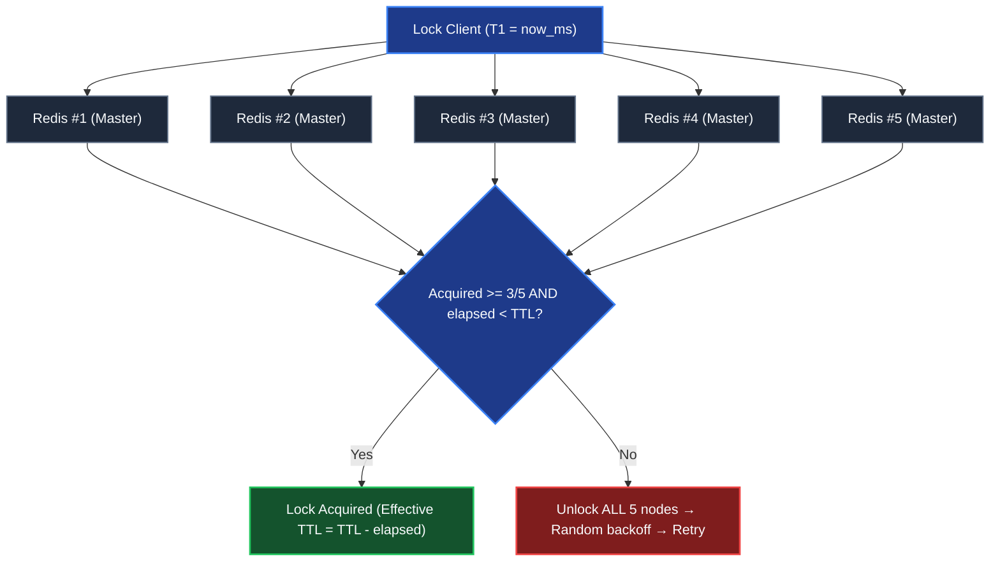

**Steps:**
1. Get current time in milliseconds (`T1`).
2. Try to acquire lock on ALL $N$ Redis instances sequentially using `SET NX EX` with the same key, same random value, and same TTL. Each attempt uses a **short timeout (5–50ms)** so one down node doesn't stall the client.
3. Calculate elapsed time: `elapsed = now() - T1`.
4. Lock is acquired **IF AND ONLY IF**:
   - Lock was acquired on a **MAJORITY** of nodes ($\ge N/2 + 1 = 3$ of $5$).
   - Total `elapsed < lock TTL` (if it took 29s to acquire a 30s lock, you only have 1s left).
5. If lock acquired: **Effective TTL = original TTL - elapsed time**.
6. If lock NOT acquired: **Release the lock on ALL nodes** (even ones where you succeeded), wait a random delay, then retry.

### Why Majority Matters

| Scenario (5 Independent Redis Nodes) | Outcome | Mutual Exclusion? |
|--------------------------------------|---------|-------------------|
| **2 nodes crash after Client A gets 3** | Client A holds 3; others can get at most 2 (&lt; 3) | Preserved |
| **Client A holds 3, Client B tries all 5** | Client B gets at most 2 (&lt; 3) | Preserved |
| **Network partition `[1,2] | [3,4,5]`** | Minority `[1,2]` cannot reach quorum; only `[3,4,5]` can | Preserved |

### Java Implementation

```java
@Service
public class RedlockService {

    private final List<StringRedisTemplate> redisNodes;  // 5 independent Redis instances

    private static final int QUORUM;
    private static final int LOCK_TTL_MS = 30_000;
    private static final int SINGLE_NODE_TIMEOUT_MS = 50;
    private static final int RETRY_DELAY_MS = 200;
    private static final int MAX_RETRIES = 3;

    private static final String UNLOCK_SCRIPT = """
        if redis.call('GET', KEYS[1]) == ARGV[1] then
            return redis.call('DEL', KEYS[1])
        else
            return 0
        end
    """;

    public RedlockService(List<StringRedisTemplate> redisNodes) {
        this.redisNodes = redisNodes;
        QUORUM = (redisNodes.size() / 2) + 1;  // Majority: 3 of 5
    }

    /**
     * Acquire a distributed lock using the Redlock algorithm.
     * Tries to lock on majority of Redis nodes.
     */
    public Optional<RedlockHandle> tryLock(String resource, long ttlMs) {
        String requestId = UUID.randomUUID().toString();
        String lockKey = "lock:" + resource;

        for (int attempt = 0; attempt < MAX_RETRIES; attempt++) {
            long startTime = System.currentTimeMillis();
            int acquiredCount = 0;

            // Step 1: Try to acquire on all N nodes
            for (StringRedisTemplate node : redisNodes) {
                if (tryLockOnNode(node, lockKey, requestId, ttlMs)) {
                    acquiredCount++;
                }
            }

            // Step 2: Calculate elapsed time
            long elapsed = System.currentTimeMillis() - startTime;
            long effectiveTtl = ttlMs - elapsed;

            // Step 3: Check if we got majority AND still have time left
            if (acquiredCount >= QUORUM && effectiveTtl > 0) {
                return Optional.of(new RedlockHandle(
                    resource, requestId, effectiveTtl, acquiredCount));
            }

            // Step 4: Failed — release lock on ALL nodes
            unlockAll(lockKey, requestId);

            // Step 5: Random delay before retry (prevent thundering herd)
            try {
                Thread.sleep(RETRY_DELAY_MS + ThreadLocalRandom.current().nextInt(100));
            } catch (InterruptedException e) {
                Thread.currentThread().interrupt();
                return Optional.empty();
            }
        }

        return Optional.empty();  // Failed after all retries
    }

    /**
     * Release the lock on ALL Redis nodes.
     */
    public void unlock(RedlockHandle handle) {
        unlockAll("lock:" + handle.getResource(), handle.getRequestId());
    }

    private boolean tryLockOnNode(StringRedisTemplate node, String key,
                                   String value, long ttlMs) {
        try {
            Boolean result = node.opsForValue().setIfAbsent(
                key, value, Duration.ofMillis(ttlMs));
            return Boolean.TRUE.equals(result);
        } catch (Exception e) {
            // Node is down — that's OK, we just need majority
            return false;
        }
    }

    private void unlockAll(String key, String requestId) {
        DefaultRedisScript<Long> script = new DefaultRedisScript<>(UNLOCK_SCRIPT, Long.class);
        for (StringRedisTemplate node : redisNodes) {
            try {
                node.execute(script, List.of(key), requestId);
            } catch (Exception e) {
                // Best effort — node might be down
            }
        }
    }
}

// The lock handle — returned to the client
@Data
@AllArgsConstructor
public class RedlockHandle {
    private String resource;
    private String requestId;
    private long effectiveTtlMs;
    private int nodesAcquired;
}
```

### Usage

```java
Optional<RedlockHandle> lock = redlockService.tryLock("order:789", 30_000);

if (lock.isPresent()) {
    try {
        log.info("Lock acquired on {}/{} nodes, effective TTL: {}ms",
            lock.get().getNodesAcquired(), 5, lock.get().getEffectiveTtlMs());

        processOrder("order:789");
    } finally {
        redlockService.unlock(lock.get());
    }
} else {
    log.warn("Could not acquire lock on order:789");
}
```

> [!TIP]
> Always use a randomized retry delay (`RETRY_DELAY_MS + jitter`) when Redlock fails to reach quorum—otherwise competing clients will repeatedly collide in lockstep and cause livelock.

---

## 6. Martin Kleppmann's Critique of Redlock

This is the **MOST important** part for senior-level interviews. Knowing the Redlock controversy shows deep understanding of distributed systems.

### Kleppmann's Argument (2016) — Clock Jumps & Process Pauses

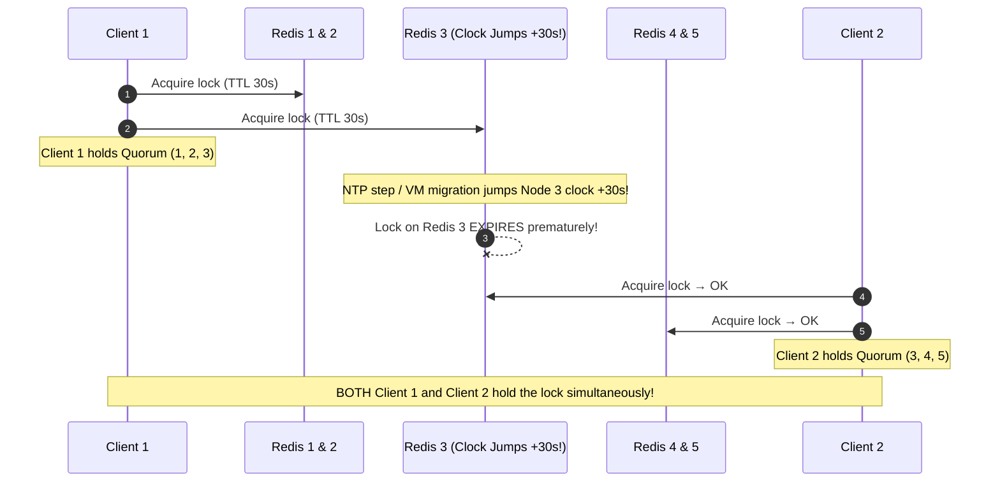

**Problem 1: Clock jumps** — Redlock relies on time-based TTL across 5 independent nodes. If one node's clock jumps forward (NTP step correction, leap second, VM migration), its lock expires prematurely, allowing a second client to form a quorum on `{3, 4, 5}`.

**Problem 2: Process pauses** — Even with Redlock, if Client A pauses (STW GC) for longer than the TTL, it wakes up thinking it still holds the lock. Redlock provides no fencing token.

### Kleppmann vs. Antirez (Redis Creator)

| Dimension | Martin Kleppmann (DDIA Author) | Salvatore Sanfilippo (Antirez) |
|-----------|-------------------------------|--------------------------------|
| **Core Stance** | Redlock is unsafe for correctness; relies on bounded clock drift & timing | Redlock is safe under practical operational assumptions |
| **Clock Jumps** | NTP steps, VM pauses, and leap seconds break time-based mutual exclusion | Avoid NTP step adjustments (`ntpd -x` / slewing) and use `fsync` |
| **Fencing Tokens** | Mandatory for correctness; Redlock lacks monotonic consensus tokens | Acknowledged for storage safety, argues Redlock is valid for lock use cases |
| **Recommended Use** | Single Redis for efficiency; ZooKeeper/etcd + fencing for correctness | Redlock for distributed Redis high availability without ZK/etcd |

**Kleppmann's conclusion:** For **efficiency** (avoiding duplicate work), a single Redis lock with TTL is fine. For **correctness** (preventing data corruption), you need either:
1. **Fencing tokens** (any lock service + fenced storage)
2. **Consensus-based lock** (ZooKeeper / etcd with sessions)

> [!IMPORTANT]
> **Interview Answer:**
> "I'm aware of the Kleppmann vs. Antirez debate on Redlock. Kleppmann argues that Redlock is unsafe because it relies on synchronized clocks and can fail during process pauses or clock jumps. Antirez counters that under practical assumptions, it works well. My position: for efficiency-based locks (preventing duplicate work where worst case is doing work twice), single-node Redis with TTL is fine. For safety-critical locks (preventing data corruption in financial systems), I'd use ZooKeeper or etcd for true consensus, combined with fencing tokens at the storage layer for defense in depth."

---

## 7. ZooKeeper-Based Locks — The Consensus Approach

### Why ZooKeeper (ZAB) & etcd (Raft) Are Different

ZooKeeper uses the **ZAB protocol** (ZooKeeper Atomic Broadcast) and etcd uses **Raft** — both are strong consensus algorithms. Writes are replicated to a majority **BEFORE** being acknowledged, so no acknowledged lock is ever lost on failover.

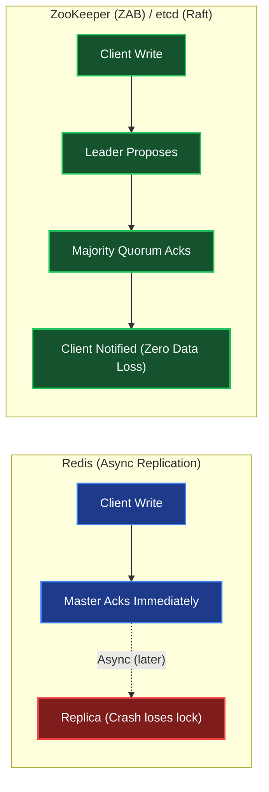

### How ZooKeeper Ephemeral Sequential Locks Work

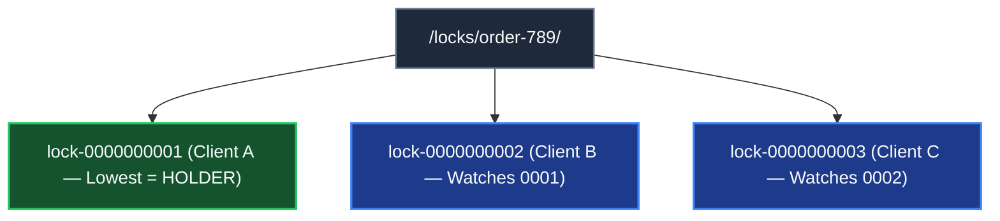

**Lock acquisition steps:**
1. Client creates an **EPHEMERAL SEQUENTIAL** znode under `/locks/order-789/` (e.g., `lock-0000000042`).
2. Client lists all children: `[lock-0000000040, lock-0000000041, lock-0000000042]`.
3. Is mine the smallest?
   - **Yes** → **LOCK ACQUIRED**.
   - **No** → Set a **WATCH** on the node *just before mine* (`lock-0000000041`), not the head node.
4. When `lock-0000000041` is deleted (holder released or crashed), client is notified and re-checks if it is now the smallest.

| ZooKeeper Feature | Purpose | Equivalent in etcd (Raft) |
|-------------------|---------|---------------------------|
| **Ephemeral znode** | Auto-deleted if client crashes / session times out | **Lease** with keep-alive heartbeats |
| **Sequential znode** | Strict total ordering (`0001`, `0002`, ...) + natural fencing token (`zxid` / seq) | **Revision number** (`mod_revision`) |
| **Predecessor Watch** | Wakes only ONE next client (avoids thundering herd) | Watch on previous `create_revision` key |

> [!TIP]
> **Why watch only the predecessor (not the lock holder)?** If 100 clients are waiting and the lock holder releases, watching the head node wakes ALL 100 clients simultaneously (**thundering herd**). Watching only the immediate predecessor wakes **exactly ONE** client—the next in line.

### Java Implementation with Apache Curator

```java
@Service
public class ZookeeperLockService {

    @Autowired private CuratorFramework curator;

    /**
     * Acquire a distributed lock using ZooKeeper.
     * This is SAFE for correctness — consensus-backed, session-based.
     */
    public <T> T executeWithLock(String resource, Duration timeout,
                                  Callable<T> criticalSection) throws Exception {

        InterProcessMutex lock = new InterProcessMutex(
            curator, "/locks/" + resource);

        if (lock.acquire(timeout.toMillis(), TimeUnit.MILLISECONDS)) {
            try {
                return criticalSection.call();
            } finally {
                lock.release();
            }
        } else {
            throw new LockAcquisitionException(
                "Could not acquire lock on " + resource +
                " within " + timeout);
        }
    }

    /**
     * Read-write lock: multiple readers OR one writer.
     */
    public <T> T executeWithReadLock(String resource, Duration timeout,
                                      Callable<T> readOperation) throws Exception {

        InterProcessReadWriteLock rwLock = new InterProcessReadWriteLock(
            curator, "/locks/" + resource);

        InterProcessMutex readLock = rwLock.readLock();

        if (readLock.acquire(timeout.toMillis(), TimeUnit.MILLISECONDS)) {
            try {
                return readOperation.call();
            } finally {
                readLock.release();
            }
        } else {
            throw new LockAcquisitionException("Could not acquire read lock");
        }
    }
}
```

### Usage

```java
// ZooKeeper lock — safe for correctness
BigDecimal balance = zookeeperLock.executeWithLock(
    "account:mohit-123",
    Duration.ofSeconds(10),
    () -> {
        Account account = accountRepo.findById("mohit-123").orElseThrow();
        account.setBalance(account.getBalance().subtract(amount));
        accountRepo.save(account);
        return account.getBalance();
    }
);
```

---

## 8. Leader Election

### The Problem

In a cluster of 5 instances of your payment service, you need **exactly ONE** to run the scheduled reconciliation job. If two run simultaneously, you get duplicate processing.

### Leader Election Flow

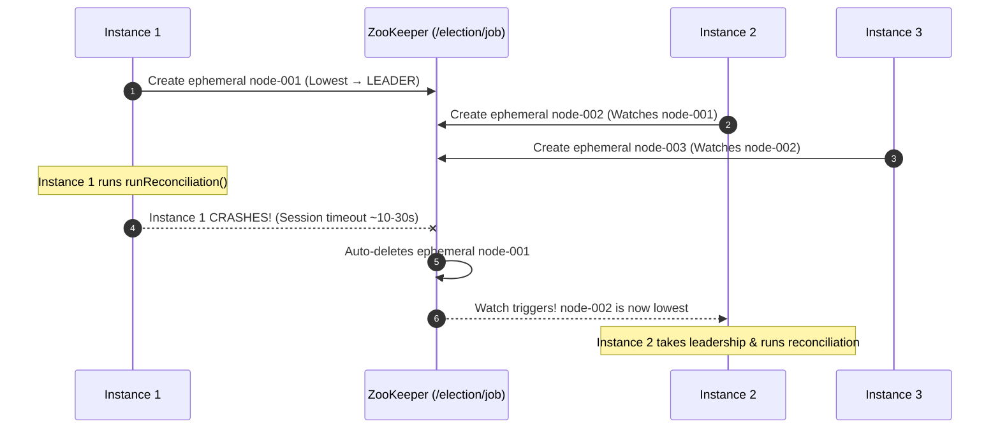

| Role | State | Behavior |
|------|-------|----------|
| **Instance 1 (Lowest seq)** | `isLeader = true` | Executes `@Scheduled` reconciliation job |
| **Instance 2 (Next seq)** | `isLeader = false` | Watches `node-001`; skips scheduled runs |
| **Instance 3..5** | `isLeader = false` | Watches immediate predecessor; skips scheduled runs |

### ZooKeeper Leader Election (Java)

```java
@Service
public class LeaderElectionService {

    private final LeaderSelector leaderSelector;
    private final AtomicBoolean isLeader = new AtomicBoolean(false);

    public LeaderElectionService(CuratorFramework curator) {
        this.leaderSelector = new LeaderSelector(
            curator,
            "/election/payment-reconciliation",
            new LeaderSelectorListenerAdapter() {

                @Override
                public void takeLeadership(CuratorFramework client) throws Exception {
                    log.info("This instance is now the LEADER for reconciliation");
                    isLeader.set(true);

                    try {
                        // Hold leadership until cancelled or session lost
                        // This method must NOT return while we want to be leader
                        while (!Thread.currentThread().isInterrupted()) {
                            Thread.sleep(1000);
                        }
                    } finally {
                        isLeader.set(false);
                        log.info("Lost leadership");
                    }
                }
            }
        );

        leaderSelector.autoRequeue();  // Re-join election if leadership lost
        leaderSelector.start();
    }

    public boolean isLeader() {
        return isLeader.get();
    }
}

// Only the leader runs scheduled tasks
@Service
public class ReconciliationScheduler {

    @Autowired private LeaderElectionService leaderElection;

    @Scheduled(fixedRate = 300_000)  // Every 5 minutes
    public void runReconciliation() {
        if (!leaderElection.isLeader()) {
            return;  // Not the leader — skip
        }

        log.info("Running reconciliation as leader...");
        reconciliationService.reconcile();
    }
}
```

> [!WARNING]
> **Failover latency:** When the leader crashes, ZooKeeper waits for the **session timeout** (typically 10–30 seconds) before deleting its ephemeral node and promoting Instance 2. Always pair leader election with idempotent jobs or fencing tokens in case the old leader is merely network-partitioned rather than dead.

---

## 9. Split-Brain Problem

### How ZooKeeper Prevents Split-Brain vs. How Redlock Can Fail

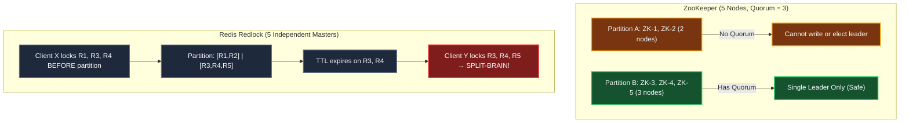

| System | Partition Behavior | Split-Brain Risk |
|--------|-------------------|------------------|
| **Single Redis** | Old master in minority partition still accepts writes until fenced | High |
| **Redlock (5 Masters)** | Safe if partition happens *before* acquire; **unsafe** if locks acquired *before* partition expire on majority side | Moderate (timing-dependent) |
| **ZooKeeper / etcd** | Minority partition (&lt; N/2 + 1) rejects all writes and elections | None (strict quorum) |

### Preventing Split-Brain in Your Application

```java
@Service
public class SplitBrainProtection {

    @Autowired private CuratorFramework curator;

    /**
     * Before performing any critical operation, verify we can
     * still reach ZooKeeper (i.e., we're in the majority partition).
     */
    public boolean isInMajorityPartition() {
        try {
            // Try a lightweight ZK operation
            curator.checkExists().forPath("/health-check");
            return true;  // We can talk to ZK → we're in the majority partition
        } catch (Exception e) {
            log.warn("Cannot reach ZooKeeper — may be in minority partition");
            return false;
        }
    }

    /**
     * Wrap critical operations with split-brain check.
     */
    public <T> T executeIfSafe(Callable<T> operation) throws Exception {
        if (!isInMajorityPartition()) {
            throw new SplitBrainException(
                "This instance may be in a minority partition. " +
                "Refusing to execute critical operation.");
        }
        return operation.call();
    }
}
```

> [!IMPORTANT]
> Even with `isInMajorityPartition()`, there is a tiny race window between checking ZooKeeper and executing `operation.call()`. For true zero-window safety, pass a **fencing token** into the storage mutation itself.

---

## 10. Comparison: Redis vs ZooKeeper vs etcd

### Selection Architecture

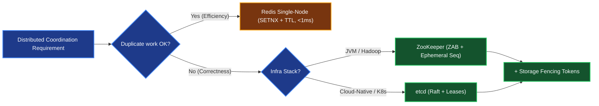

| Feature | Redis (single) | Redlock (multi) | ZooKeeper | etcd |
|---------|---------------|-----------------|-----------|------|
| **Consensus** | None | Quorum (weak) | ZAB (strong) | Raft (strong) |
| **Replication** | Async | N/A (independent) | Synchronous | Synchronous |
| **Lock safety** | Best-effort | Debated | Strong | Strong |
| **Fencing support** | Manual | Manual | Session-based | Lease-based |
| **Auto-release on crash** | TTL-based | TTL-based | Ephemeral nodes | Lease expiry |
| **Latency** | &lt;1ms | &lt;10ms | ~2-10ms | ~2-10ms |
| **Throughput** | 100K ops/s | 20K ops/s | 10K ops/s | 10K ops/s |
| **Complexity** | Low | Medium | High | Medium |
| **Split-brain safe** | No | Partially | Yes | Yes |
| **Use case** | Efficiency locks | Moderate safety | Correctness locks | Correctness locks |

### When to Use What

- **"I don't want to send duplicate emails"** → Redis single-node lock. If it fails, worst case = 2 emails. Acceptable.
- **"I don't want to process the same payment twice"** → ZooKeeper or etcd lock + fencing tokens. Double-charge = lawsuit.
- **"I need leader election for a scheduled job"** → ZooKeeper / etcd. Must have exactly one leader.
- **"I need to coordinate microservices during deployment"** → etcd (used by Kubernetes). Well-suited for config + coordination.

> [!TIP]
> In Kubernetes-native environments, **etcd** is often preferred over ZooKeeper because it speaks gRPC/HTTP2, has simpler operations, and uses **Raft** with explicit **Leases** and `mod_revision` fencing tokens.

---

## 11. Production Java Implementation

### Strategy Pattern Architecture


| Bean Qualifier | Backing Store | Intended Use Case | Returns Fencing Token? |
|----------------|---------------|-------------------|------------------------|
| `@Qualifier("redisLock")` | Single-node Redis | Deduplication, cache stampede prevention | Optional (`INCR`) |
| `@Qualifier("zkLock")` | ZooKeeper / Curator | Payments, inventory, ledger mutations | Yes (sequence / `zxid`) |

### A Complete Lock Service with Strategy Pattern

```java
// Interface — swap implementations without changing business code
public interface DistributedLock {
    Optional<LockHandle> tryLock(String resource, Duration timeout);
    void unlock(LockHandle handle);
}

@Data
public class LockHandle {
    private final String resource;
    private final String requestId;
    private final long fencingToken;
    private final Instant expiresAt;
}

// Redis implementation (for efficiency locks)
@Component("redisLock")
public class RedisDistributedLock implements DistributedLock {
    // ... (implementation from Section 2)
}

// ZooKeeper implementation (for correctness locks)
@Component("zkLock")
public class ZookeeperDistributedLock implements DistributedLock {
    // ... (implementation from Section 7)
}

// Usage — inject the right implementation based on context
@Service
public class PaymentProcessor {

    @Qualifier("zkLock")  // Correctness lock for payments
    @Autowired private DistributedLock lock;

    @Qualifier("redisLock")  // Efficiency lock for dedup
    @Autowired private DistributedLock dedupLock;

    public void processPayment(String orderId) {
        Optional<LockHandle> handle = lock.tryLock(
            "payment:" + orderId, Duration.ofSeconds(30));

        if (handle.isPresent()) {
            try {
                doProcessPayment(orderId, handle.get().getFencingToken());
            } finally {
                lock.unlock(handle.get());
            }
        }
    }
}
```

> [!TIP]
> Abstracting `DistributedLock` behind an interface lets you start with Redis for non-critical paths and swap to ZooKeeper/etcd for financial paths without rewriting business logic—while keeping `fencingToken` first-class in `LockHandle`.

---

## 12. When Do You Actually Need Distributed Locks?

### Decision Framework

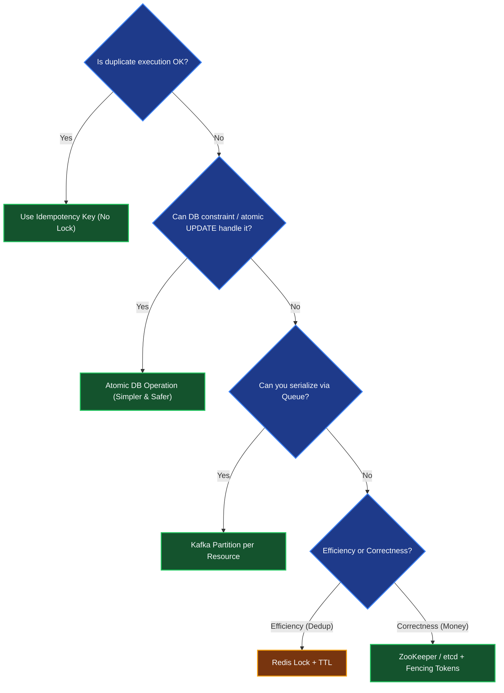

### Often You Don't — Alternatives

| Pattern | Instead of Lock | How It Works |
|---------|----------------|--------------|
| **Atomic DB operation** | `UPDATE ... WHERE balance >= amount` | Database handles concurrency |
| **Idempotency key** | Check-before-write with unique constraint | Prevents duplicate processing |
| **Optimistic locking** | `@Version` field + retry | No lock held during processing |
| **Queue-based serialization** | Kafka partition per resource | One consumer per partition = serial |
| **CAS operations** | Redis `WATCH + MULTI` or compare-and-swap | Lock-free concurrency |

> [!TIP]
> **Interview tip:** Starting with "Do we actually need a distributed lock?" shows maturity. Many candidates jump to Redlock when a simple DB unique constraint or atomic `UPDATE` would suffice.

---

## 13. Senior vs Mid-Level Comparison

### Interview Depth Progression

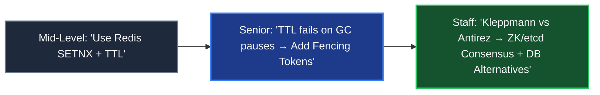

| Topic | Mid-Level | Senior |
|-------|-----------|--------|
| **Lock mechanism** | "Use Redis SETNX" | "Redis SETNX for efficiency, ZooKeeper for correctness. Always with TTL and random value for safe release." |
| **Failure handling** | "Set a TTL so locks expire" | "TTL handles crashes, but doesn't handle GC pauses. Fencing tokens at the storage layer are needed for true correctness." |
| **Redlock** | "Use 5 Redis nodes, get majority" | "I know the Kleppmann critique — Redlock depends on clock synchronization which can fail. For safety-critical systems, I'd prefer consensus-based locks." |
| **Split-brain** | "..." | "Quorum-based systems (ZK, etcd) prevent split-brain because the minority partition can't form a quorum. Redis Redlock partially mitigates but has timing-dependent edge cases." |
| **Alternatives** | "Use a lock" | "First question: do we need a lock at all? Atomic DB operations, idempotency keys, or queue-based serialization often eliminate the need for distributed locks entirely." |

> [!IMPORTANT]
> The fastest way to signal senior/staff depth in a distributed locking interview is to proactively bring up **GC pauses**, **fencing tokens at the storage layer**, and **the Kleppmann vs. Antirez Redlock debate**.

---

## 14. Interview Follow-Up Questions

### Testing & Verification Matrix


| Follow-Up Question | Core Answer | Key Trade-off |
|--------------------|-------------|---------------|
| **Read-Write Lock?** | ZooKeeper `InterProcessReadWriteLock` natively; Redis via `writers` + `readers` keys | Redis RW lock is complex and race-prone |
| **ZooKeeper Down?** | 3/5 quorum survives 1–2 node failures; beyond that, cluster is read-only | Existing sessions hold locks; new acquires fail |
| **How to Test?** | Unit → 100-thread race → Kill holder → Network partition → Clock skew → `sleep(TTL+10s)` | Chaos/Jepsen-style fault injection catches timing bugs |
| **How to Choose TTL?** | Critical section P99 + safety margin (e.g., 15s P99 → 30s TTL) | Too short = concurrent overlap; too long = slow crash recovery |

### "How would you implement a distributed read-write lock?"

"ZooKeeper supports this natively with shared (read) and exclusive (write) locks. Multiple readers can hold the lock simultaneously, but a writer needs exclusive access. With Redis, I'd use two keys: `lock:resource:writers` (exclusive) and `lock:resource:readers` (counter). Writers check both are free; readers only check writers is free then increment the reader count. But this gets complex with Redis — ZooKeeper's recipe is more reliable."

### "What happens if ZooKeeper itself goes down?"

"ZooKeeper is a 3- or 5-node cluster with quorum. If 1 of 3 nodes fails, the cluster still works. If 2 of 3 fail, the cluster becomes read-only (no new locks). Clients with existing locks keep them (session is still valid), but new lock acquisitions fail. The application should have a fallback — either fail gracefully or queue work for later."

### "How do you test distributed locks?"

1. **Unit test:** Lock/unlock with single client — verify mutual exclusion.
2. **Concurrency test:** 100 threads competing for same lock — verify only 1 succeeds.
3. **Failure test:** Kill lock holder mid-operation — verify lock eventually released.
4. **Partition test:** Simulate network partition — verify no split-brain.
5. **Clock skew test:** Advance one Redis node's clock — verify Redlock handles it.
6. **GC pause test:** `Thread.sleep(TTL + 10s)` — verify fencing token rejects stale writes.

### "How do you choose the TTL value?"

"The TTL needs to be longer than the critical section takes, plus a safety margin. If processing takes 5 seconds on average and 15 seconds at P99, I'd set TTL to 30 seconds. Too short: lock expires during processing, allowing concurrent access. Too long: if the holder crashes, the resource is blocked for the full TTL. For ZooKeeper, there's no TTL — ephemeral nodes are deleted on session close, which is more precise."

> [!TIP]
> If asked about long-running jobs with unpredictable duration, mention combining a **heartbeat/watchdog lease renewal** with **storage-layer fencing tokens** rather than setting an arbitrarily huge TTL (like 1 hour).

---

## One-Page Summary

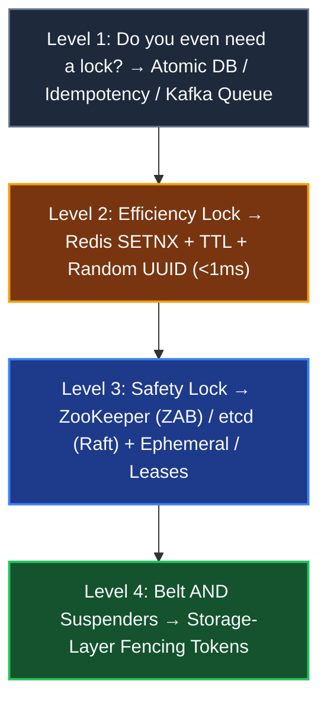

| Level | Strategy | Protects Against | Limitation |
|-------|----------|------------------|------------|
| **Level 1** | No Lock (DB Constraints / Idempotency / Queue) | Lock service overhead & failure modes | Requires DB/queue support |
| **Level 2** | Redis `SETNX` + TTL + Random UUID | Duplicate work under normal operation | Async failover & GC pauses |
| **Level 3** | ZooKeeper / etcd (Consensus + Quorum) | Split-brain & failover lock loss | Higher latency (~2–10ms) |
| **Level 4** | Any Lock + **Storage Fencing Tokens** | GC pauses, clock skew, buggy lock services | Requires storage to check token |

> [!IMPORTANT]
> **The Kleppmann Argument:** "If you need correctness, use consensus + fencing tokens. If you need efficiency, a single Redis lock is fine."
