# Stock Trading Platform Design
### A Comprehensive System Design Guide for Mid-Level Java Engineers

**Target Audience:** Mid-level Java engineer (5 YOE), Barclays investment banking background, targeting FAANG/fintech
**Document Length:** Visual Study Guide (Complete Reference)
**Last Updated:** 2026-02-09

---

## Table of Contents

1. [Problem Statement & Requirements](#problem-statement--requirements)
2. [High-Level Architecture](#high-level-architecture)
3. [Order Types Explained](#order-types-explained)
4. [The Order Matching Engine](#the-order-matching-engine)
5. [Order Book Data Structure](#order-book-data-structure)
6. [Market Data Streaming](#market-data-streaming)
7. [Risk Management & Pre-Trade Checks](#risk-management--pre-trade-checks)
8. [Low-Latency Architecture](#low-latency-architecture)
9. [Settlement & Clearing](#settlement--clearing)
10. [Database & Storage Design](#database--storage-design)
11. [Scaling & Fault Tolerance](#scaling--fault-tolerance)
12. [Senior vs Mid-Level Comparison](#senior-vs-mid-level-comparison)
13. [Interview Follow-Up Questions & Answers](#interview-follow-up-questions--answers)

---

## Problem Statement & Requirements

### The Business Problem

Design a **stock trading platform** (like Zerodha or Robinhood) supporting retail and institutional investors with:
- **Order Lifecycle:** Place, modify, and cancel orders in real time
- **Matching & Execution:** Price-time priority matching in `< 10ms` p99 at `100,000+` orders/sec during market open
- **Market Data & Portfolio:** Live price feeds, order book depth, holdings, P&L, and regulatory audit trails

> [!NOTE]
> With an investment banking background, emphasize both **financial domain correctness** (price-time priority, self-trade prevention, T+1 settlement) and **systems engineering** (single-threaded matching, zero-GC hot path).

### Architecture Overview: Functional Pillars to NFR Targets

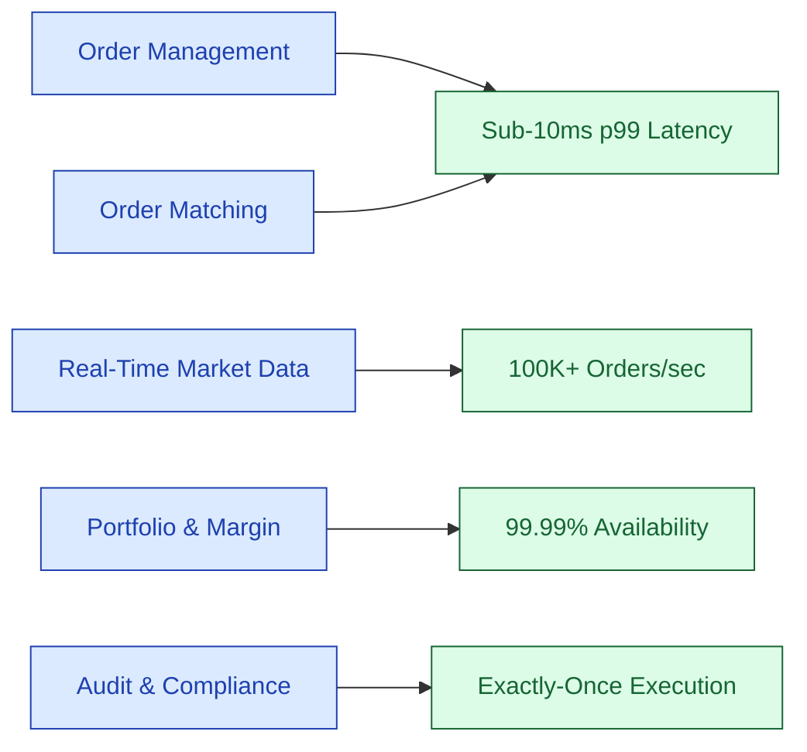

### Functional Requirements

- **Order Management:** Place (`MARKET`, `LIMIT`, `STOP_LOSS`, `STOP_LIMIT`), cancel, modify (price/quantity), view active/historical orders, and institutional batch placement.
- **Order Matching:** Price-time priority (FIFO), best-price execution, partial fills, self-trade prevention, and duration types (`GTC`, `IOC`, `FOK`).
- **Real-Time Market Data:** Live bid/ask/last price feeds, OHLCV candles (`1m`, `5m`, `1h`, `1d`), Level 2 depth (top 5–10 levels), trade stream, and 52-week stats.
- **Portfolio Management:** Real-time holdings, average cost, realized/unrealized P&L, cash balance, and margin utilization.
- **Audit & Compliance:** Timestamped order/trade logs and immutable regulatory audit trails.

### Non-Functional Requirements

| Requirement | Target | Why It Matters |
|---|---|---|
| **Order Matching Latency** | `< 10ms` (p99) | Faster execution = competitive advantage, attract HFT clients |
| **Order Throughput** | `100K` orders/second | Market open generates massive order volume |
| **Availability** | `99.99%` (market hours) | ~52 minutes/year downtime acceptable |
| **Data Consistency** | Exactly-once execution | No double-fills, no missing orders |
| **Price Feed Latency** | `< 1ms` per tick | Lag in price data = stale orders |
| **Scalability** | Linear with # symbols | Handle `500+` symbols simultaneously |

### Back-of-Envelope Calculations

| Metric | Assumptions & Math | Daily / Cluster Estimate |
|---|---|---|
| **Order Volume** | `6.5 hrs` (`23,400s`), `100K` peak ord/s, `~10K` active orders/side/symbol | `1–2 billion` orders/day |
| **Order Storage** | `2B orders × 500 bytes` (uncompressed) | `1 TB/day` · `365 TB/yr` (hot) · `2.5 PB/7yr` (S3 cold) |
| **Market Data Volume** | `10,000` symbols × `1,000+` ticks/s × `100 bytes/tick` | `10M ticks/s` · `1 GB/s` · `86 TB/day` |
| **Order Book Memory** | `10,000` symbols × `10,000` orders/side × `200 bytes` | `40 GB` minimum in-memory |
| **Hot Cluster RAM** | `40 GB` order book + `50 GB` recent trades (`~1B/day`) + `1 GB/10s` tick buffer | `~100–150 GB` per matching engine cluster |

> [!IMPORTANT]
> **Capacity Key:** `86 TB/day` of market data ticks and `100–150 GB` of hot memory dictate that the matching engine must stay **in-memory** while market data streaming and persistence are **asynchronous**.

---

## High-Level Architecture

### System Architecture Diagram

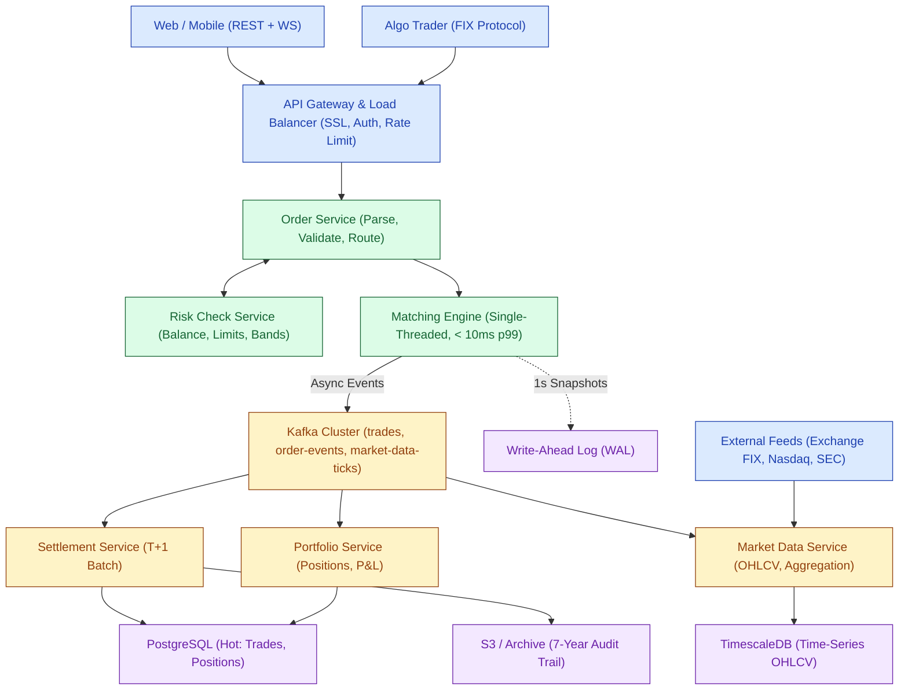

### Hot Path vs Cold Path Execution Flow

```mermaid
sequenceDiagram
    participant Client
    participant Gateway as API Gateway
    participant OrderSvc as Order Service
    participant RiskSvc as Risk Service
    participant Engine as Matching Engine
    participant Kafka
    participant Cold as Settlement / Market Data / Portfolio

    Client->>Gateway: Place Order {Auth Token}
    Gateway->>OrderSvc: Forward Validated Request
    OrderSvc->>RiskSvc: Pre-Trade Risk Checks (&lt; 1ms)
    RiskSvc-->>OrderSvc: APPROVED
    OrderSvc->>Engine: Route by Symbol (Single-Threaded)
    Engine-->>Client: Execution Confirmation (&lt; 10ms p99)
    Engine-)Kafka: Publish TradeEvent &amp; OrderEvent (Async)
    Kafka-)Cold: Consume for T+1 Settlement, OHLCV, P&amp;L
```

### Why This Architecture?

| Design Choice | Rationale |
|---|---|
| **Matching Engine as the Heart** | Single-threaded per symbol eliminates lock contention and keeps `< 10ms` p99 latency; all other services are non-blocking. |
| **Hot Path vs Cold Path** | Hot path (Order → Risk → Match) is synchronous; Cold path (Settlement, Audit, Portfolio) runs asynchronously via Kafka because settlement is T+1 anyway. |
| **Event-Driven with Kafka** | Every trade emits a `TradeEvent` to multiple independent consumers with at-least-once delivery and idempotent processing. |
| **Partitioning by Symbol** | Each symbol (`RELIANCE`, `TCS`, `INFY`) runs on its own matching engine instance—eliminating cross-symbol locks and scaling horizontally to `100K+` ord/s. |

> [!TIP]
> **Interview Framing:** Always draw the **Hot Path vs Cold Path** boundary explicitly. Clients wait for order confirmation (`< 10ms`), never for T+1 settlement or database writes.

---

## Order Types Explained

### Order Type Hierarchy

```java
// Base order interface
public interface Order {
    String getOrderId();
    String getSymbol();
    double getPrice();
    int getQuantity();
    OrderSide getSide();          // BUY or SELL
    OrderType getOrderType();     // MARKET, LIMIT, STOP_LOSS, etc.
    OrderDuration getDuration(); // GTC, IOC, FOK
    OrderStatus getStatus();      // NEW, ACCEPTED, FILLED, CANCELLED, etc.
    long getTimestamp();
}

// Enums for order properties
public enum OrderSide {
    BUY,
    SELL
}

public enum OrderType {
    MARKET,          // Execute immediately at best available price
    LIMIT,           // Execute only at specified price or better
    STOP_LOSS,       // Trigger market order when price hits level
    STOP_LIMIT,      // Trigger limit order when price hits level
    ICEBERG          // Large order hidden in batches
}

public enum OrderDuration {
    GTC,    // Good Till Cancelled (stays in market until manually cancelled)
    IOC,    // Immediate or Cancel (execute what can, cancel rest instantly)
    FOK     // Fill or Kill (all-or-nothing: execute all or cancel all)
}

public enum OrderStatus {
    NEW,             // Just created
    VALIDATED,       // Passed risk checks
    ACCEPTED,        // In matching engine
    PARTIAL_FILL,    // Partially matched
    FILLED,          // Fully matched
    CANCELLED,       // User or system cancelled
    REJECTED         // Failed validation
}
```

### Market Order

```java
public class MarketOrder implements Order {
    private final String orderId;
    private final String symbol;
    private final OrderSide side;      // BUY or SELL
    private int quantityRequested;
    private int quantityFilled = 0;
    private final long timestamp;
    private OrderStatus status = OrderStatus.NEW;
    private final String userId;

    // Market order: no price limit, execute at current best price
    private final Double priceLimit = null;  // Not used for market orders

    public MarketOrder(String orderId, String symbol, OrderSide side,
                       int quantity, long timestamp, String userId) {
        this.orderId = orderId;
        this.symbol = symbol;
        this.side = side;
        this.quantityRequested = quantity;
        this.timestamp = timestamp;
        this.userId = userId;
    }

    // Market buy: will buy at ask price (seller's asking price)
    // Market sell: will sell at bid price (buyer's bid price)
    // This is why we immediately match against opposite side
    @Override
    public double getPrice() {
        return Double.POSITIVE_INFINITY;  // Matches any price
    }

    @Override
    public OrderType getOrderType() {
        return OrderType.MARKET;
    }
}

// Example: User places market buy order for 100 shares of RELIANCE
// Order book before:
//   ASK: 2500.50 (500 shares), 2501.00 (300 shares)
//   BID: 2500.00 (200 shares), 2499.50 (100 shares)
//
// Market buy 100 shares matches against:
// - 100 @ 2500.50 (best ask) = 100 shares filled at 2500.50
// Result: Immediately filled at 2500.50
```

### Limit Order

```java
public class LimitOrder implements Order {
    private final String orderId;
    private final String symbol;
    private final OrderSide side;
    private final double priceLimit;   // Only execute at this price or better
    private int quantityRequested;
    private int quantityFilled = 0;
    private final long timestamp;
    private OrderStatus status = OrderStatus.NEW;
    private final String userId;

    public LimitOrder(String orderId, String symbol, OrderSide side,
                      int quantity, double priceLimit, long timestamp, String userId) {
        this.orderId = orderId;
        this.symbol = symbol;
        this.side = side;
        this.quantityRequested = quantity;
        this.priceLimit = priceLimit;
        this.timestamp = timestamp;
        this.userId = userId;
    }

    @Override
    public double getPrice() {
        return priceLimit;
    }

    @Override
    public OrderType getOrderType() {
        return OrderType.LIMIT;
    }
}

// Example: User places limit buy order: buy 100 shares @ 2499.00
// Order book before:
//   ASK: 2500.50 (500 shares), 2501.00 (300 shares)
//   BID: 2500.00 (200 shares), 2499.50 (100 shares)
//
// Limit buy 100 @ 2499.00:
// - Best ask is 2500.50 (> 2499.00 price limit)
// - No match possible, order stays in book
// - Added to BID side @ 2499.00
// Result: 0 shares filled, 100 shares waiting in order book
//
// If later someone sells 50 @ 2499.00:
// - Matches against our buy order
// Result: 50 shares filled @ 2499.00, 50 shares remain in book
```

### Stop-Loss Order

```java
public class StopLossOrder implements Order {
    private final String orderId;
    private final String symbol;
    private final OrderSide side;
    private final double stopPrice;    // Trigger price
    private int quantityRequested;
    private int quantityFilled = 0;
    private final long timestamp;
    private OrderStatus status = OrderStatus.NEW;
    private final String userId;
    private boolean triggered = false;

    public StopLossOrder(String orderId, String symbol, OrderSide side,
                         int quantity, double stopPrice, long timestamp, String userId) {
        this.orderId = orderId;
        this.symbol = symbol;
        this.side = side;
        this.quantityRequested = quantity;
        this.stopPrice = stopPrice;
        this.timestamp = timestamp;
        this.userId = userId;
    }

    @Override
    public double getPrice() {
        return Double.POSITIVE_INFINITY;  // Will execute as market order
    }

    @Override
    public OrderType getOrderType() {
        return OrderType.STOP_LOSS;
    }

    // This order is NOT in the order book initially
    // Market data service monitors price, triggers order when price <= stopPrice
}

// Example: User bought RELIANCE @ 2500, current price 2505
// Places stop-loss: sell 100 @ stop price 2490
//
// If price drops to 2490 or below:
// - Stop order is TRIGGERED
// - Converted to market sell order
// - Immediately sent to matching engine
// - Executes at best available bid price
// Result: Loss limited to ~250 (sold at 2490 vs bought at 2500)
```

### Stop-Limit Order

```java
public class StopLimitOrder implements Order {
    private final String orderId;
    private final String symbol;
    private final OrderSide side;
    private final double stopPrice;    // Trigger price
    private final double limitPrice;   // Execution price limit
    private int quantityRequested;
    private int quantityFilled = 0;
    private final long timestamp;
    private OrderStatus status = OrderStatus.NEW;
    private final String userId;
    private boolean triggered = false;

    public StopLimitOrder(String orderId, String symbol, OrderSide side,
                          int quantity, double stopPrice, double limitPrice,
                          long timestamp, String userId) {
        this.orderId = orderId;
        this.symbol = symbol;
        this.side = side;
        this.quantityRequested = quantity;
        this.stopPrice = stopPrice;
        this.limitPrice = limitPrice;
        this.timestamp = timestamp;
        this.userId = userId;
    }

    @Override
    public double getPrice() {
        return limitPrice;
    }

    @Override
    public OrderType getOrderType() {
        return OrderType.STOP_LIMIT;
    }
}

// Example: User bought RELIANCE @ 2500, current price 2505
// Places stop-limit: sell 100 @ stop 2490, limit price 2485
//
// If price drops to 2490:
// - Stop order is TRIGGERED
// - Converted to LIMIT SELL order @ 2485
// - Will only execute if someone bids >= 2485
// - If price crashes to 2480, order won't execute (limit price not met)
// Result: More control than stop-loss, but may not execute when needed
```

### Order Duration Types

```java
// IOC = Immediate or Cancel
// Execute as much as possible immediately, cancel remaining
public class IOCOrder implements Order {
    // Example: IOC buy 100 @ 2500
    // If only 60 shares available @ 2500:
    // - 60 shares filled
    // - 40 shares cancelled immediately (not added to order book)
}

// FOK = Fill or Kill
// All-or-nothing: execute entire order or cancel entire order
public class FOKOrder implements Order {
    // Example: FOK buy 100 @ 2500
    // If only 60 shares available @ 2500:
    // - ENTIRE order cancelled (no fill)
    // Not partially filled
}

// GTC = Good Till Cancelled
// Order stays in market until user manually cancels or end of trading day
public class GTCOrder implements Order {
    // Example: GTC buy 100 @ 2480
    // Stays in order book until:
    // 1. User cancels it
    // 2. Fully filled
    // 3. End of trading day (automatically cancelled)
}
```

### Order Types & Duration Summary

| Type / Duration | Trigger / Behavior | In Order Book Initially? |
|---|---|---|
| `MARKET` | Executes immediately at best available price | No (matches immediately) |
| `LIMIT` | Executes only at specified price or better | Yes (if unmatched remainder) |
| `STOP_LOSS` | Triggers a `MARKET` order when price hits `stopPrice` | No (monitored by Market Data) |
| `STOP_LIMIT` | Triggers a `LIMIT` order at `limitPrice` when `stopPrice` hits | No (until triggered) |
| `ICEBERG` | Hides total size; reveals only visible batch at a time | Only visible portion |
| `GTC` | Good Till Cancelled (persists until cancelled/EOD) | Yes |
| `IOC` | Immediate or Cancel (fill what's available, cancel rest) | Never rests in book |
| `FOK` | Fill or Kill (all-or-nothing; cancel entire order if partial) | Never rests in book |

> [!NOTE]
> **Stop-Loss vs Stop-Limit:** `STOP_LOSS` guarantees execution (as a market order) but not price; `STOP_LIMIT` guarantees price (`limitPrice`) but may go unfilled during a rapid crash.

### Order State Machine

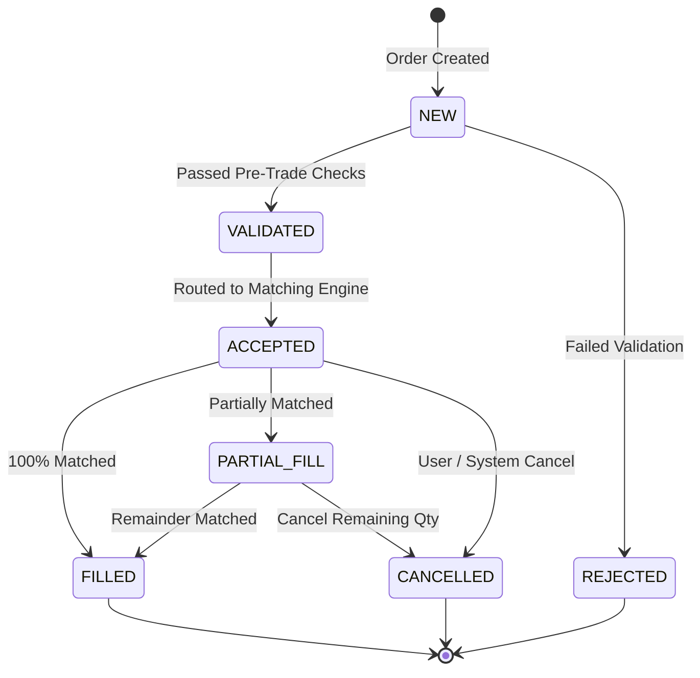

---

## The Order Matching Engine

This is the **core** of the platform. It must be:
- **Fast:** `< 10ms` to match an order against the entire book (`< 1ms` typical)
- **Correct:** Price-time priority (FIFO) strictly enforced
- **Reliable:** Exactly-once execution (no double-fills, no lost orders)
- **Stateful:** Maintains the live in-memory order book per symbol

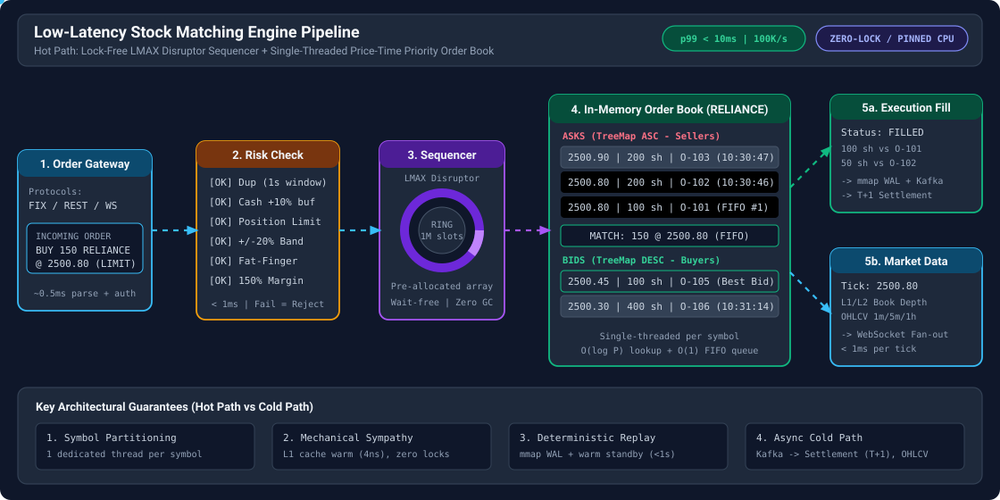

### Matching Algorithm: Price-Time Priority (FIFO)

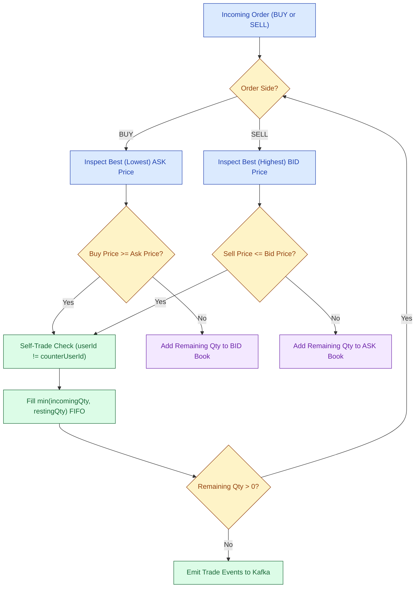

### Order Book Snapshot (RELIANCE @ Last Trade `2500.45`, Spread `0.35`)

| Side | Price | Quantity | Trader | Order ID | Timestamp |
|---|---|---|---|---|---|
| **ASK** (ASC) | `2500.80` | `300 sh` | Alice | `O-101` | `10:30:45.123` |
| **ASK** (ASC) | `2500.90` | `200 sh` | Bob | `O-102` | `10:30:46.456` |
| **ASK** (ASC) | `2501.00` | `500 sh` | Charlie | `O-103` | `10:30:47.789` |
| **ASK** (ASC) | `2501.50` | `100 sh` | Diana | `O-104` | `10:31:12.234` |
| **BID** (DESC) | `2500.45` | `100 sh` | Eve | `O-105` | `10:31:13.567` |
| **BID** (DESC) | `2500.30` | `400 sh` | Frank | `O-106` | `10:31:14.890` |
| **BID** (DESC) | `2500.10` | `200 sh` | Grace | `O-107` | `10:31:15.234` |
| **BID** (DESC) | `2499.90` | `600 sh` | Henry | `O-108` | `10:31:16.567` |

### Complete Java Implementation

```java
import java.math.BigDecimal;
import java.util.*;
import java.util.concurrent.*;

public class OrderBook {
    private final String symbol;

    // TreeMap: O(log n) price level lookup
    // Price → LinkedList of orders at that price (FIFO within level)
    private final TreeMap<BigDecimal, LinkedList<Order>> askSide;    // Sellers, ASC
    private final TreeMap<BigDecimal, LinkedList<Order>> bidSide;    // Buyers, DESC

    // Book statistics
    private volatile BigDecimal lastTradePrice = BigDecimal.ZERO;
    private volatile long lastTradeTime = 0;
    private volatile long lastUpdateTime = System.nanoTime();

    // Object pool for orders (avoid GC)
    private final Queue<Order> orderPool = new ConcurrentLinkedQueue<>();

    // All active orders by ID for quick lookup
    private final Map<String, Order> activeOrders = new ConcurrentHashMap<>();

    public OrderBook(String symbol) {
        this.symbol = symbol;
        // Natural ordering (ascending)
        this.askSide = new TreeMap<>(BigDecimal::compareTo);
        // Reverse ordering (descending)
        this.bidSide = new TreeMap<>(Collections.reverseOrder());
    }

    /**
     * Matching engine: the hot path
     * Single-threaded, must complete in < 10ms
     */
    public List<Trade> matchOrder(Order incomingOrder) {
        List<Trade> trades = new ArrayList<>();

        // Pre-fill checks
        if (incomingOrder.getOrderType() == OrderType.MARKET) {
            trades.addAll(matchMarketOrder(incomingOrder));
        } else if (incomingOrder.getOrderType() == OrderType.LIMIT) {
            trades.addAll(matchLimitOrder(incomingOrder));
        }

        // Add remaining quantity to order book (if any)
        int remaining = incomingOrder.getQuantityRequested() -
                       incomingOrder.getQuantityFilled();

        if (remaining > 0 && shouldAddToBook(incomingOrder)) {
            addToBook(incomingOrder);
        }

        return trades;
    }

    /**
     * Market order: match at ANY price
     */
    private List<Trade> matchMarketOrder(Order marketOrder) {
        List<Trade> trades = new ArrayList<>();
        int quantityRemaining = marketOrder.getQuantityRequested();

        if (marketOrder.getSide() == OrderSide.BUY) {
            // Match against ask side (sellers)
            // Start from LOWEST ask (best price for buyer)
            for (Map.Entry<BigDecimal, LinkedList<Order>> entry :
                 askSide.entrySet()) {

                if (quantityRemaining <= 0) break;

                BigDecimal askPrice = entry.getKey();
                LinkedList<Order> ordersAtPrice = entry.getValue();

                // Process all orders at this price level (FIFO)
                while (!ordersAtPrice.isEmpty() && quantityRemaining > 0) {
                    Order sellerOrder = ordersAtPrice.peek();

                    // Self-trade prevention
                    if (sellerOrder.getUserId().equals(marketOrder.getUserId())) {
                        ordersAtPrice.removeFirst();
                        continue;
                    }

                    int fillQty = Math.min(
                        quantityRemaining,
                        sellerOrder.getQuantityRequested() -
                        sellerOrder.getQuantityFilled()
                    );

                    // Create trade
                    Trade trade = new Trade(
                        UUID.randomUUID().toString(),
                        symbol,
                        fillQty,
                        askPrice,
                        marketOrder.getUserId(),      // Buyer
                        sellerOrder.getUserId(),      // Seller
                        System.currentTimeMillis()
                    );
                    trades.add(trade);

                    // Update order states
                    marketOrder.addFill(fillQty, askPrice);
                    sellerOrder.addFill(fillQty, askPrice);
                    quantityRemaining -= fillQty;

                    // Remove order if fully filled
                    if (sellerOrder.getQuantityFilled() ==
                        sellerOrder.getQuantityRequested()) {
                        ordersAtPrice.removeFirst();
                        activeOrders.remove(sellerOrder.getOrderId());
                    }
                }

                // Remove price level if empty
                if (ordersAtPrice.isEmpty()) {
                    askSide.remove(askPrice);
                }
            }
        } else {
            // SELL market order: match against bid side (buyers)
            // Start from HIGHEST bid (best price for seller)
            for (Map.Entry<BigDecimal, LinkedList<Order>> entry :
                 bidSide.entrySet()) {

                if (quantityRemaining <= 0) break;

                BigDecimal bidPrice = entry.getKey();
                LinkedList<Order> ordersAtPrice = entry.getValue();

                // Same logic as buy side
                while (!ordersAtPrice.isEmpty() && quantityRemaining > 0) {
                    Order buyerOrder = ordersAtPrice.peek();

                    if (buyerOrder.getUserId().equals(marketOrder.getUserId())) {
                        ordersAtPrice.removeFirst();
                        continue;
                    }

                    int fillQty = Math.min(
                        quantityRemaining,
                        buyerOrder.getQuantityRequested() -
                        buyerOrder.getQuantityFilled()
                    );

                    Trade trade = new Trade(
                        UUID.randomUUID().toString(),
                        symbol,
                        fillQty,
                        bidPrice,
                        buyerOrder.getUserId(),       // Buyer
                        marketOrder.getUserId(),      // Seller
                        System.currentTimeMillis()
                    );
                    trades.add(trade);

                    marketOrder.addFill(fillQty, bidPrice);
                    buyerOrder.addFill(fillQty, bidPrice);
                    quantityRemaining -= fillQty;

                    if (buyerOrder.getQuantityFilled() ==
                        buyerOrder.getQuantityRequested()) {
                        ordersAtPrice.removeFirst();
                        activeOrders.remove(buyerOrder.getOrderId());
                    }
                }

                if (ordersAtPrice.isEmpty()) {
                    bidSide.remove(bidPrice);
                }
            }
        }

        return trades;
    }

    /**
     * Limit order: match ONLY at specified price or better
     */
    private List<Trade> matchLimitOrder(Order limitOrder) {
        List<Trade> trades = new ArrayList<>();
        int quantityRemaining = limitOrder.getQuantityRequested();
        BigDecimal limitPrice = BigDecimal.valueOf(limitOrder.getPrice());

        if (limitOrder.getSide() == OrderSide.BUY) {
            // Buy limit: match against asks <= limitPrice
            for (Map.Entry<BigDecimal, LinkedList<Order>> entry :
                 askSide.entrySet()) {

                BigDecimal askPrice = entry.getKey();

                // Stop matching if ask > limit price
                if (askPrice.compareTo(limitPrice) > 0) break;

                if (quantityRemaining <= 0) break;

                LinkedList<Order> ordersAtPrice = entry.getValue();

                while (!ordersAtPrice.isEmpty() && quantityRemaining > 0) {
                    Order sellerOrder = ordersAtPrice.peek();

                    if (sellerOrder.getUserId().equals(limitOrder.getUserId())) {
                        ordersAtPrice.removeFirst();
                        continue;
                    }

                    int fillQty = Math.min(
                        quantityRemaining,
                        sellerOrder.getQuantityRequested() -
                        sellerOrder.getQuantityFilled()
                    );

                    Trade trade = new Trade(
                        UUID.randomUUID().toString(),
                        symbol,
                        fillQty,
                        askPrice,
                        limitOrder.getUserId(),
                        sellerOrder.getUserId(),
                        System.currentTimeMillis()
                    );
                    trades.add(trade);

                    limitOrder.addFill(fillQty, askPrice);
                    sellerOrder.addFill(fillQty, askPrice);
                    quantityRemaining -= fillQty;

                    if (sellerOrder.getQuantityFilled() ==
                        sellerOrder.getQuantityRequested()) {
                        ordersAtPrice.removeFirst();
                        activeOrders.remove(sellerOrder.getOrderId());
                    }
                }

                if (ordersAtPrice.isEmpty()) {
                    askSide.remove(askPrice);
                }
            }
        } else {
            // Sell limit: match against bids >= limitPrice
            for (Map.Entry<BigDecimal, LinkedList<Order>> entry :
                 bidSide.entrySet()) {

                BigDecimal bidPrice = entry.getKey();

                // Stop matching if bid < limit price
                if (bidPrice.compareTo(limitPrice) < 0) break;

                if (quantityRemaining <= 0) break;

                LinkedList<Order> ordersAtPrice = entry.getValue();

                while (!ordersAtPrice.isEmpty() && quantityRemaining > 0) {
                    Order buyerOrder = ordersAtPrice.peek();

                    if (buyerOrder.getUserId().equals(limitOrder.getUserId())) {
                        ordersAtPrice.removeFirst();
                        continue;
                    }

                    int fillQty = Math.min(
                        quantityRemaining,
                        buyerOrder.getQuantityRequested() -
                        buyerOrder.getQuantityFilled()
                    );

                    Trade trade = new Trade(
                        UUID.randomUUID().toString(),
                        symbol,
                        fillQty,
                        bidPrice,
                        buyerOrder.getUserId(),
                        limitOrder.getUserId(),
                        System.currentTimeMillis()
                    );
                    trades.add(trade);

                    limitOrder.addFill(fillQty, bidPrice);
                    buyerOrder.addFill(fillQty, bidPrice);
                    quantityRemaining -= fillQty;

                    if (buyerOrder.getQuantityFilled() ==
                        buyerOrder.getQuantityRequested()) {
                        ordersAtPrice.removeFirst();
                        activeOrders.remove(buyerOrder.getOrderId());
                    }
                }

                if (ordersAtPrice.isEmpty()) {
                    bidSide.remove(bidPrice);
                }
            }
        }

        return trades;
    }

    /**
     * Add unmatched order to order book
     */
    private void addToBook(Order order) {
        BigDecimal price = BigDecimal.valueOf(order.getPrice());
        TreeMap<BigDecimal, LinkedList<Order>> side =
            (order.getSide() == OrderSide.BUY) ? bidSide : askSide;

        side.computeIfAbsent(price, k -> new LinkedList<>()).add(order);
        activeOrders.put(order.getOrderId(), order);
    }

    /**
     * Get best bid (highest price buyers are willing to pay)
     */
    public BigDecimal getBestBid() {
        if (bidSide.isEmpty()) return null;
        return bidSide.firstKey();
    }

    /**
     * Get best ask (lowest price sellers are willing to accept)
     */
    public BigDecimal getBestAsk() {
        if (askSide.isEmpty()) return null;
        return askSide.firstKey();
    }

    /**
     * Get spread (difference between best ask and best bid)
     */
    public BigDecimal getSpread() {
        BigDecimal bid = getBestBid();
        BigDecimal ask = getBestAsk();
        if (bid == null || ask == null) return null;
        return ask.subtract(bid);
    }

    /**
     * Cancel an order
     */
    public void cancelOrder(String orderId) {
        Order order = activeOrders.remove(orderId);
        if (order == null) return;

        TreeMap<BigDecimal, LinkedList<Order>> side =
            (order.getSide() == OrderSide.BUY) ? bidSide : askSide;

        BigDecimal price = BigDecimal.valueOf(order.getPrice());
        LinkedList<Order> ordersAtPrice = side.get(price);

        if (ordersAtPrice != null) {
            ordersAtPrice.remove(order);
            if (ordersAtPrice.isEmpty()) {
                side.remove(price);
            }
        }

        order.setCancelled();
    }
}
```

### Why TreeMap + LinkedList?

| Structure | Role | Complexity & Benefit |
|---|---|---|
| `TreeMap<BigDecimal, LinkedList<Order>>` | Sorted price levels | `O(log n)` price lookup, `firstKey()` is always best bid/ask |
| `LinkedList<Order>` | FIFO queue per price level | `O(1)` append at tail, `O(1)` match/remove at head |
| **Typical Match** | `K=5` levels, `M=10` orders | `O(log n + K × M)` → `~50` ops, `< 1ms` (even thin book `K=100, M=1` is fast) |

### Single-Threaded Matching: Counter-Intuitive Performance

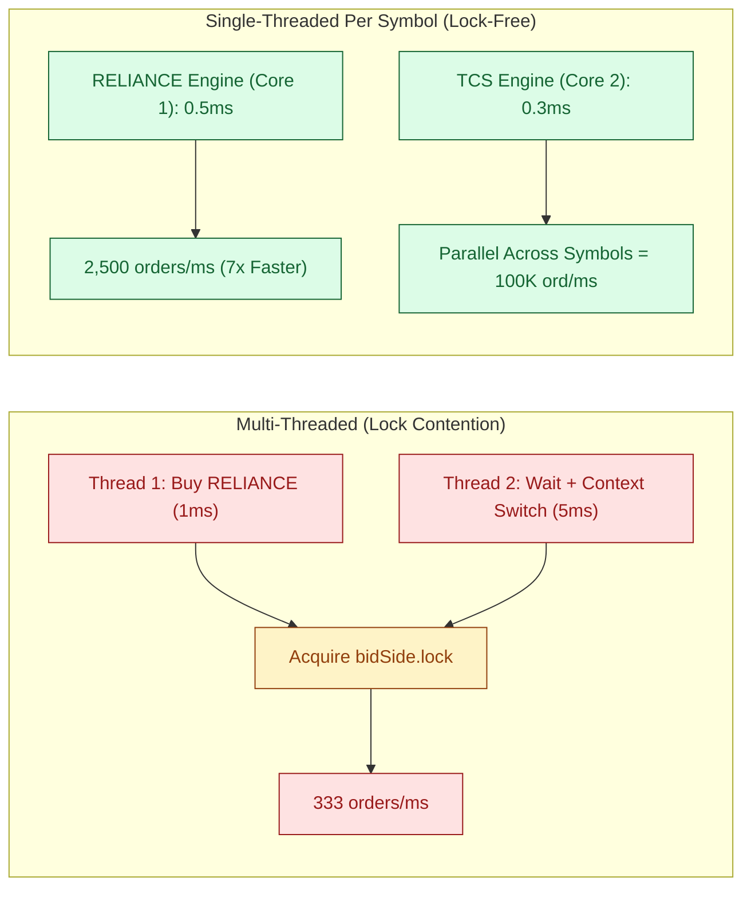

> [!IMPORTANT]
> **Key Insight:** Order matching for a single symbol is inherently sequential (two buys contend for the same best ask). Eliminating locks avoids context switches and CPU cache misses; partitioning **by symbol** achieves `2,500 orders/ms × 40 symbols = 100K orders/ms` aggregate throughput.

---

## Order Book Data Structure

### Depth & Levels Overview

| Level | Audience | Contents | Footprint / Scale |
|---|---|---|---|
| **Level 1** | 1-click retail trading | Best Ask (`2500.50 × 300`), Best Bid (`2500.35 × 500`), Spread (`0.15`) | Single top-of-book tick |
| **Level 2** | Active / day traders | Top 5 price levels on both Bid & Ask sides with aggregated quantities | `5–10` levels per side |
| **Level 3** | Matching Engine (internal) | Every individual resting order in FIFO order (`~10K` asks + `~10K` bids) | `~40 MB` per active book |

**Level 2 Top-5 Book Example:**

| Ask Price | Ask Qty | Bid Price | Bid Qty |
|---|---|---|---|
| `2500.50` | `300` | `2500.35` | `500` |
| `2500.60` | `200` | `2500.25` | `400` |
| `2500.70` | `150` | `2500.15` | `300` |
| `2500.80` | `100` | `2500.05` | `250` |
| `2500.90` | `250` | `2499.95` | `600` |

### Order Book Snapshot & Object Pool Model

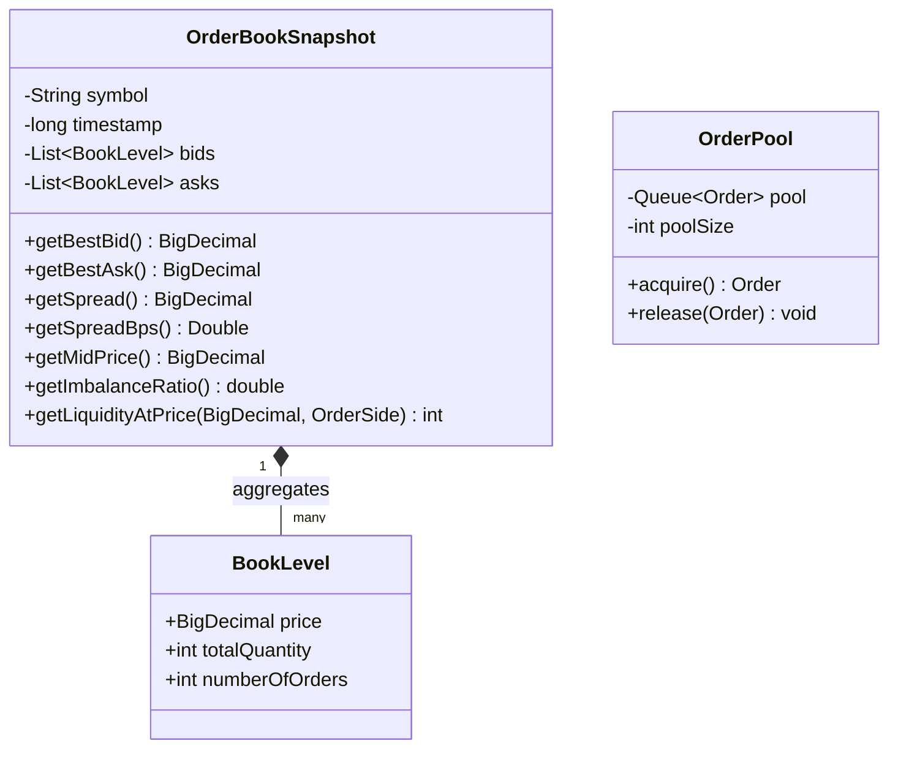

> [!TIP]
> **Memory Optimization:** Using `OrderPool` pre-allocates and recycles `Order` objects (`acquire()` / `release()`), preventing JVM garbage collection pauses from spiking matching latency.

### Java: Order Book Interface & Analytics

```java
import java.math.BigDecimal;
import java.util.*;

public class OrderBookSnapshot {
    private final String symbol;
    private final long timestamp;

    // Bid side (highest prices first)
    private final List<BookLevel> bids;
    // Ask side (lowest prices first)
    private final List<BookLevel> asks;

    public OrderBookSnapshot(String symbol, long timestamp,
                             List<BookLevel> bids, List<BookLevel> asks) {
        this.symbol = symbol;
        this.timestamp = timestamp;
        this.bids = bids;
        this.asks = asks;
    }

    public static class BookLevel {
        public final BigDecimal price;
        public final int totalQuantity;  // Sum of all orders at this price
        public final int numberOfOrders; // How many orders at this price

        public BookLevel(BigDecimal price, int totalQuantity, int numberOfOrders) {
            this.price = price;
            this.totalQuantity = totalQuantity;
            this.numberOfOrders = numberOfOrders;
        }
    }

    // Get best bid
    public BigDecimal getBestBid() {
        return bids.isEmpty() ? null : bids.get(0).price;
    }

    // Get best ask
    public BigDecimal getBestAsk() {
        return asks.isEmpty() ? null : asks.get(0).price;
    }

    // Get spread
    public BigDecimal getSpread() {
        BigDecimal bid = getBestBid();
        BigDecimal ask = getBestAsk();
        if (bid == null || ask == null) return null;
        return ask.subtract(bid);
    }

    // Get bid-ask percentage
    public Double getSpreadBps() {  // basis points
        BigDecimal spread = getSpread();
        BigDecimal mid = getMidPrice();
        if (spread == null || mid == null) return null;
        return (spread.doubleValue() / mid.doubleValue()) * 10000;
    }

    // Get mid price (average of best bid and ask)
    public BigDecimal getMidPrice() {
        BigDecimal bid = getBestBid();
        BigDecimal ask = getBestAsk();
        if (bid == null || ask == null) return null;
        return bid.add(ask).divide(BigDecimal.TWO);
    }

    // Get total buy pressure (sum of quantities on bid side)
    public int getTotalBidQuantity() {
        return bids.stream().mapToInt(l -> l.totalQuantity).sum();
    }

    // Get total sell pressure (sum of quantities on ask side)
    public int getTotalAskQuantity() {
        return asks.stream().mapToInt(l -> l.totalQuantity).sum();
    }

    // Imbalance ratio: bid quantity vs ask quantity
    // > 1.0 = more buyers than sellers = bullish
    // < 1.0 = more sellers than buyers = bearish
    public double getImbalanceRatio() {
        int bidQty = getTotalBidQuantity();
        int askQty = getTotalAskQuantity();
        if (askQty == 0) return Double.POSITIVE_INFINITY;
        return (double) bidQty / askQty;
    }

    // Market depth: how much liquidity is available at each price?
    // Traders use this to determine if it's safe to place a large order
    public int getLiquidityAtPrice(BigDecimal targetPrice, OrderSide side) {
        List<BookLevel> levels = (side == OrderSide.BUY) ? asks : bids;
        int totalLiquidity = 0;

        for (BookLevel level : levels) {
            if (side == OrderSide.BUY) {
                // For buying, we go UP in price until we exceed target
                if (level.price.compareTo(targetPrice) <= 0) {
                    totalLiquidity += level.totalQuantity;
                } else {
                    break;
                }
            } else {
                // For selling, we go DOWN in price until we go below target
                if (level.price.compareTo(targetPrice) >= 0) {
                    totalLiquidity += level.totalQuantity;
                } else {
                    break;
                }
            }
        }

        return totalLiquidity;
    }
}

/**
 * Memory optimization: Object pooling for Order objects
 * Avoids GC pressure from creating millions of order objects
 */
public class OrderPool {
    private final Queue<Order> pool = new ConcurrentLinkedQueue<>();
    private final int poolSize;

    public OrderPool(int initialSize) {
        this.poolSize = initialSize;
        for (int i = 0; i < initialSize; i++) {
            pool.add(new Order());
        }
    }

    // Get order from pool, or create new if empty
    public Order acquire() {
        Order order = pool.poll();
        return order != null ? order : new Order();
    }

    // Return order to pool for reuse
    public void release(Order order) {
        order.reset();  // Clear state
        if (pool.size() < poolSize) {
            pool.add(order);
        }
    }
}
```

---

## Market Data Streaming

### Real-Time Price Feed Pipeline

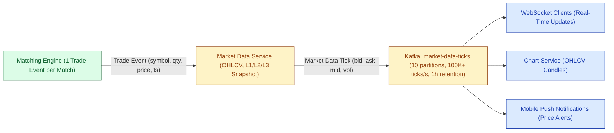

### WebSocket Subscription & Broadcast Flow

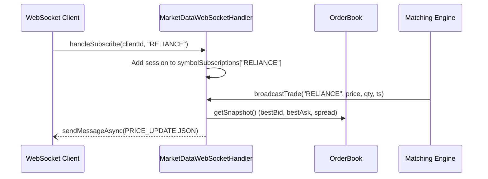

> [!NOTE]
> **Retention & Ordering:** Partitioning `market-data-ticks` by `symbol` preserves strict per-symbol tick ordering while allowing `100K+` ticks/sec horizontal scaling. `OHLCVService` keeps the last `1,440` 1-minute candles (`24 hours`) in memory per symbol.

### OHLCV Candle Aggregation

```java
import java.math.BigDecimal;
import java.util.*;

public class OHLCVService {
    // Symbol → Interval → OHLCV data
    // Example: RELIANCE → 1-MIN → [10:30 candle, 10:31 candle, ...]
    private final Map<String, Map<String, LinkedList<Candle>>> ohlcvData
        = new ConcurrentHashMap<>();

    public static class Candle {
        public final long startTime;
        public final long endTime;
        public BigDecimal open;     // First trade in this minute
        public BigDecimal high;     // Highest price in this minute
        public BigDecimal low;      // Lowest price in this minute
        public BigDecimal close;    // Last trade in this minute
        public long volume;         // Total shares traded in this minute

        public Candle(long startTime, long endTime) {
            this.startTime = startTime;
            this.endTime = endTime;
            this.open = null;
            this.high = null;
            this.low = null;
            this.close = null;
            this.volume = 0;
        }

        public void addTrade(BigDecimal price, long quantity) {
            if (open == null) {
                open = price;
            }

            // Update high
            if (high == null || price.compareTo(high) > 0) {
                high = price;
            }

            // Update low
            if (low == null || price.compareTo(low) < 0) {
                low = price;
            }

            close = price;
            volume += quantity;
        }
    }

    /**
     * Process a trade from matching engine
     * Update all relevant OHLCV candles
     */
    public void processTrade(String symbol, BigDecimal price, long quantity,
                             long tradeTime) {
        // 1-minute candle
        processTrade1Min(symbol, price, quantity, tradeTime);
        // 5-minute candle
        processTrade5Min(symbol, price, quantity, tradeTime);
        // Hourly candle
        processTradeHourly(symbol, price, quantity, tradeTime);
        // Daily candle
        processTradeDaily(symbol, price, quantity, tradeTime);
    }

    private void processTrade1Min(String symbol, BigDecimal price,
                                  long quantity, long tradeTime) {
        // Calculate which 1-min candle this trade belongs to
        long oneMinTime = (tradeTime / 60_000) * 60_000;  // Round down to minute
        long nextMin = oneMinTime + 60_000;

        Map<String, LinkedList<Candle>> symbolData =
            ohlcvData.computeIfAbsent(symbol, k -> new ConcurrentHashMap<>());

        LinkedList<Candle> candles =
            symbolData.computeIfAbsent("1MIN", k -> new LinkedList<>());

        // Get or create candle for this minute
        Candle candle;
        if (candles.isEmpty() || candles.getLast().endTime <= oneMinTime) {
            // New candle needed
            candle = new Candle(oneMinTime, nextMin);
            candles.add(candle);

            // Keep only last 1440 candles (1 day of 1-min data)
            while (candles.size() > 1440) {
                candles.removeFirst();
            }
        } else {
            candle = candles.getLast();
        }

        candle.addTrade(price, quantity);
    }

    // Similar for 5-min, hourly, daily...

    /**
     * Get OHLCV for a symbol and interval
     * Used by chart service to plot candlestick charts
     */
    public List<Candle> getCandles(String symbol, String interval) {
        Map<String, LinkedList<Candle>> symbolData = ohlcvData.get(symbol);
        if (symbolData == null) return Collections.emptyList();

        LinkedList<Candle> candles = symbolData.get(interval);
        return candles != null ? new ArrayList<>(candles) : Collections.emptyList();
    }

    /**
     * Get last candle (current incomplete candle)
     */
    public Candle getCurrentCandle(String symbol, String interval) {
        List<Candle> candles = getCandles(symbol, interval);
        return candles.isEmpty() ? null : candles.get(candles.size() - 1);
    }
}

/**
 * WebSocket server for pushing market data to clients
 */
public class MarketDataWebSocketHandler {
    private final OHLCVService ohlcvService;
    private final OrderBook orderBook;

    // All connected clients
    private final Set<WebSocketSession> sessions = ConcurrentHashMap.newKeySet();

    // Client subscriptions: which symbols each client is interested in
    private final Map<String, Set<WebSocketSession>> symbolSubscriptions
        = new ConcurrentHashMap<>();

    public void handleSubscribe(String clientId, String symbol,
                               WebSocketSession session) {
        sessions.add(session);
        symbolSubscriptions
            .computeIfAbsent(symbol, k -> ConcurrentHashMap.newKeySet())
            .add(session);
    }

    public void handleUnsubscribe(String clientId, String symbol,
                                  WebSocketSession session) {
        Set<WebSocketSession> subscribers = symbolSubscriptions.get(symbol);
        if (subscribers != null) {
            subscribers.remove(session);
        }
    }

    /**
     * Called when a new trade happens in matching engine
     * Push price update to all subscribed clients
     */
    public void broadcastTrade(String symbol, BigDecimal price, long quantity,
                               long timestamp) {
        Set<WebSocketSession> subscribers = symbolSubscriptions.get(symbol);
        if (subscribers == null) return;

        // Build market data tick
        OrderBookSnapshot snapshot = orderBook.getSnapshot();
        String message = new JSONBuilder()
            .put("type", "PRICE_UPDATE")
            .put("symbol", symbol)
            .put("lastPrice", price)
            .put("lastQuantity", quantity)
            .put("timestamp", timestamp)
            .put("bid", snapshot.getBestBid())
            .put("ask", snapshot.getBestAsk())
            .put("spread", snapshot.getSpread())
            .build();

        // Send to all subscribed clients (non-blocking)
        subscribers.forEach(session -> {
            if (session.isOpen()) {
                session.sendMessageAsync(message);
            }
        });
    }
}
```

---

## Risk Management & Pre-Trade Checks

### Pre-Trade Risk Check Pipeline (`< 1ms` Budget)

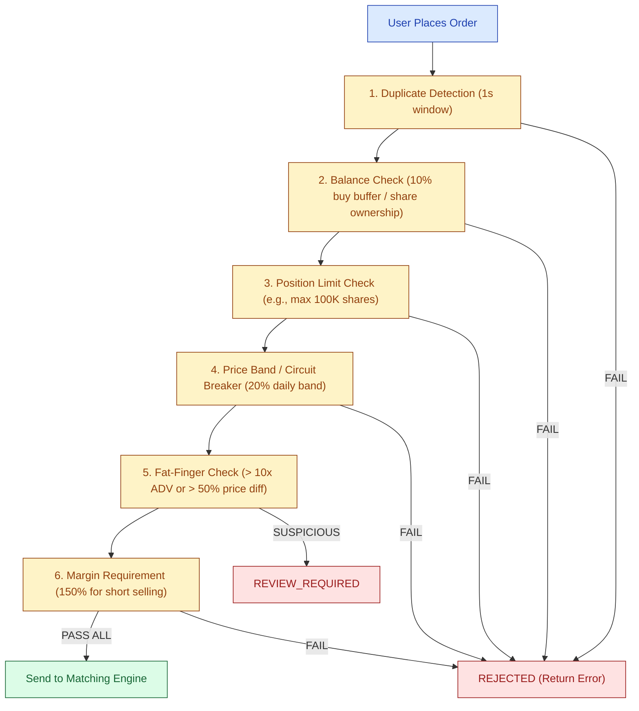

| Check | Rule / Threshold | Failure Outcome |
|---|---|---|
| **1. Duplicate Order** | Same user, symbol, side, qty, price (`&lt; 0.01`) within `1s` | `REJECTED` |
| **2. Balance Check** | Buy: `price × qty × 1.1` cash; Sell: sufficient shares | `REJECTED` |
| **3. Position Limit** | `currentPosition + qty <= maxPosition` (default `100,000`) | `REJECTED` |
| **4. Price Band** | Outside `[0.80 × 52wLow, 1.20 × 52wHigh]` (`20%` circuit breaker) | `REJECTED` |
| **5. Fat-Finger** | `qty > 10 × ADV` or `> 50%` away from last trade price | `REVIEW_REQUIRED` |
| **6. Short Margin** | Short sale (`qty > currentPosition`) needs `150%` margin | `REJECTED` |

> [!WARNING]
> **Gatekeeper Rule:** Risk checks MUST execute **before** the matching engine. Rejecting invalid or fat-finger orders early protects single-threaded matching capacity from wasted work.

### Java: Risk Check Service

```java
import java.math.BigDecimal;
import java.util.*;
import java.util.concurrent.*;

public class RiskCheckService {
    private final UserAccountService accountService;
    private final OrderBook orderBook;
    private final MarketDataService marketDataService;

    // Track recent orders per user (for duplicate detection)
    private final Map<String, Queue<Order>> recentOrdersByUser
        = new ConcurrentHashMap<>();

    // User position limits (configurable)
    private final Map<String, Map<String, Integer>> positionLimits
        = new ConcurrentHashMap<>();

    /**
     * Run all risk checks on incoming order
     * Returns: RiskCheckResult (APPROVED, REJECTED, or REVIEW_REQUIRED)
     */
    public RiskCheckResult checkOrder(Order order) {
        // Check 1: Duplicate detection
        RiskCheckResult dupResult = checkDuplicate(order);
        if (dupResult.status == RiskStatus.REJECTED) {
            return dupResult;
        }

        // Check 2: Balance check
        RiskCheckResult balanceResult = checkBalance(order);
        if (balanceResult.status == RiskStatus.REJECTED) {
            return balanceResult;
        }

        // Check 3: Position limit
        RiskCheckResult positionResult = checkPositionLimit(order);
        if (positionResult.status == RiskStatus.REJECTED) {
            return positionResult;
        }

        // Check 4: Price band (circuit breaker)
        RiskCheckResult priceBandResult = checkPriceBand(order);
        if (priceBandResult.status == RiskStatus.REJECTED) {
            return priceBandResult;
        }

        // Check 5: Fat-finger check
        RiskCheckResult fatFingerResult = checkFatFinger(order);
        if (fatFingerResult.status == RiskStatus.REJECTED) {
            return fatFingerResult;
        }

        // Check 6: Margin requirement
        RiskCheckResult marginResult = checkMarginRequirement(order);
        if (marginResult.status == RiskStatus.REJECTED) {
            return marginResult;
        }

        // All checks passed
        return new RiskCheckResult(RiskStatus.APPROVED, "All risk checks passed");
    }

    /**
     * Prevent accidental duplicate orders
     */
    private RiskCheckResult checkDuplicate(Order order) {
        Queue<Order> recentOrders = recentOrdersByUser
            .computeIfAbsent(order.getUserId(), k -> new ConcurrentLinkedQueue<>());

        long now = System.currentTimeMillis();
        long oneSecondAgo = now - 1_000;

        // Remove orders older than 1 second
        recentOrders.removeIf(o -> o.getTimestamp() < oneSecondAgo);

        // Check if same order placed in last 1 second
        for (Order recent : recentOrders) {
            if (recent.getSymbol().equals(order.getSymbol()) &&
                recent.getSide() == order.getSide() &&
                recent.getQuantityRequested() == order.getQuantityRequested() &&
                Math.abs(recent.getPrice() - order.getPrice()) < 0.01) {

                return new RiskCheckResult(RiskStatus.REJECTED,
                    "Duplicate order detected within last 1 second");
            }
        }

        recentOrders.add(order);
        return new RiskCheckResult(RiskStatus.APPROVED, "No duplicate detected");
    }

    /**
     * Check if user has sufficient balance to place order
     */
    private RiskCheckResult checkBalance(Order order) {
        UserAccount account = accountService.getAccount(order.getUserId());

        if (order.getSide() == OrderSide.BUY) {
            // Buy order: need cash
            // Cost = price × quantity (with 10% margin buffer)
            BigDecimal orderCost = BigDecimal.valueOf(order.getPrice())
                .multiply(BigDecimal.valueOf(order.getQuantityRequested()))
                .multiply(BigDecimal.valueOf(1.1));  // 10% safety margin

            if (account.getCashBalance().compareTo(orderCost) < 0) {
                return new RiskCheckResult(RiskStatus.REJECTED,
                    String.format("Insufficient balance. Need: %s, Have: %s",
                        orderCost, account.getCashBalance()));
            }
        } else {
            // Sell order: need shares
            int currentPosition = account.getPosition(order.getSymbol());
            if (currentPosition < order.getQuantityRequested()) {
                return new RiskCheckResult(RiskStatus.REJECTED,
                    String.format("Insufficient shares. Need: %d, Have: %d",
                        order.getQuantityRequested(), currentPosition));
            }
        }

        return new RiskCheckResult(RiskStatus.APPROVED, "Sufficient balance");
    }

    /**
     * Check position limits (regulatory requirement)
     */
    private RiskCheckResult checkPositionLimit(Order order) {
        Map<String, Integer> userLimits = positionLimits
            .getOrDefault(order.getUserId(), new HashMap<>());

        int maxPosition = userLimits.getOrDefault(order.getSymbol(), 100_000);

        UserAccount account = accountService.getAccount(order.getUserId());
        int currentPosition = account.getPosition(order.getSymbol());

        if (order.getSide() == OrderSide.BUY) {
            if (currentPosition + order.getQuantityRequested() > maxPosition) {
                return new RiskCheckResult(RiskStatus.REJECTED,
                    String.format("Position limit exceeded. Max: %d, Current: %d, " +
                        "Would be: %d",
                        maxPosition, currentPosition,
                        currentPosition + order.getQuantityRequested()));
            }
        }

        return new RiskCheckResult(RiskStatus.APPROVED, "Within position limits");
    }

    /**
     * Circuit breaker: prevent trading at extreme prices
     */
    private RiskCheckResult checkPriceBand(Order order) {
        MarketData marketData = marketDataService.getMarketData(order.getSymbol());

        // Get 52-week high/low
        BigDecimal low52Week = marketData.getLow52Week();
        BigDecimal high52Week = marketData.getHigh52Week();

        // 20% circuit breaker bands
        BigDecimal upperBand = high52Week.multiply(BigDecimal.valueOf(1.20));
        BigDecimal lowerBand = low52Week.multiply(BigDecimal.valueOf(0.80));

        BigDecimal orderPrice = BigDecimal.valueOf(order.getPrice());

        if (orderPrice.compareTo(lowerBand) < 0 ||
            orderPrice.compareTo(upperBand) > 0) {

            return new RiskCheckResult(RiskStatus.REJECTED,
                String.format("Price outside circuit breaker bands. " +
                    "Lower: %s, Upper: %s, Order: %s",
                    lowerBand, upperBand, orderPrice));
        }

        return new RiskCheckResult(RiskStatus.APPROVED, "Price within circuit breaker bands");
    }

    /**
     * Fat-finger check: prevent obviously wrong orders
     */
    private RiskCheckResult checkFatFinger(Order order) {
        MarketData marketData = marketDataService.getMarketData(order.getSymbol());
        long avgDailyVolume = marketData.getAverageDailyVolume();

        // Order size > 10x average daily volume = suspicious
        if (order.getQuantityRequested() > avgDailyVolume * 10) {
            return new RiskCheckResult(RiskStatus.REVIEW_REQUIRED,
                String.format("Unusually large order. Avg daily volume: %d, " +
                    "Order size: %d",
                    avgDailyVolume, order.getQuantityRequested()));
        }

        // Price > 50% away from last trade = suspicious
        BigDecimal lastPrice = marketData.getLastTradePrice();
        BigDecimal orderPrice = BigDecimal.valueOf(order.getPrice());

        double priceDiff = Math.abs(
            orderPrice.subtract(lastPrice).doubleValue() /
            lastPrice.doubleValue()
        );

        if (priceDiff > 0.50) {
            return new RiskCheckResult(RiskStatus.REVIEW_REQUIRED,
                String.format("Price significantly different from last trade. " +
                    "Last: %s, Order: %s (%.2f%% diff)",
                    lastPrice, orderPrice, priceDiff * 100));
        }

        return new RiskCheckResult(RiskStatus.APPROVED, "Fat-finger checks passed");
    }

    /**
     * Margin requirement: short selling requires more capital
     */
    private RiskCheckResult checkMarginRequirement(Order order) {
        if (order.getSide() == OrderSide.SELL) {
            // Check if this is a short sell (selling more than they own)
            UserAccount account = accountService.getAccount(order.getUserId());
            int currentPosition = account.getPosition(order.getSymbol());

            if (order.getQuantityRequested() > currentPosition) {
                // Short selling: need 150% of order value as margin
                BigDecimal marginRequired = BigDecimal
                    .valueOf(order.getPrice())
                    .multiply(BigDecimal.valueOf(
                        order.getQuantityRequested() - currentPosition))
                    .multiply(BigDecimal.valueOf(1.50));

                BigDecimal availableMargin = account.getAvailableMargin();

                if (availableMargin.compareTo(marginRequired) < 0) {
                    return new RiskCheckResult(RiskStatus.REJECTED,
                        String.format("Insufficient margin for short selling. " +
                            "Required: %s, Available: %s",
                            marginRequired, availableMargin));
                }
            }
        }

        return new RiskCheckResult(RiskStatus.APPROVED, "Margin requirements met");
    }

    public enum RiskStatus {
        APPROVED,
        REJECTED,
        REVIEW_REQUIRED
    }

    public static class RiskCheckResult {
        public final RiskStatus status;
        public final String reason;

        public RiskCheckResult(RiskStatus status, String reason) {
            this.status = status;
            this.reason = reason;
        }
    }
}
```

---

## Low-Latency Architecture

### The Latency Problem & `10ms (p99)` Budget

Every `1ms` of latency is lost opportunity (e.g., on a `0.2%` move from `2500` to `2505`, a `100ms` firm sees `1,000+` trades pass and fills at `2504.50`, while a `1ms` firm captures the full move).

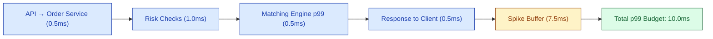

### Sub-10ms Latency Techniques

#### 1. Single-Threaded Matching (Already Covered)
- No locks = no contention; no context switches = warm CPU cache; `100K` orders/sec per symbol.

#### 2. Object Pooling & Memory-Mapped Order Log

> [!TIP]
> **Eliminating GC & Disk Syscalls:** Pre-allocating objects (`OrderObjectPool`) avoids `10–100ms` GC pauses, and `MappedByteBuffer` (`MemoryMappedOrderLog`) keeps WAL writes in memory while the OS flushes asynchronously.

```java
/**
 * Object pooling: avoid GC pauses
 * GC pause = 10-100ms latency spike = catastrophic for trading
 */
public class OrderObjectPool {
    private final BlockingQueue<OrderObject> pool;
    private final int maxSize;

    public OrderObjectPool(int size) {
        this.maxSize = size;
        this.pool = new LinkedBlockingQueue<>(size);

        // Pre-allocate all objects at startup
        for (int i = 0; i < size; i++) {
            pool.add(new OrderObject());
        }

        System.out.println(String.format(
            "OrderObjectPool initialized with %d objects (%.1f MB)",
            size,
            (size * 200.0) / (1024 * 1024)
        ));
    }

    public OrderObject acquire() throws InterruptedException {
        OrderObject obj = pool.take();  // BLOCKING if pool is empty
        return obj;
    }

    public void release(OrderObject obj) {
        obj.reset();  // Clear state
        pool.add(obj);
    }
}

/**
 * Memory-mapped files for persistent order log
 * No disk I/O latency, all I/O is through memory
 */
public class MemoryMappedOrderLog {
    private final FileChannel channel;
    private final MappedByteBuffer buffer;
    private volatile int writePosition = 0;

    public MemoryMappedOrderLog(String path, long sizeBytes) throws IOException {
        RandomAccessFile file = new RandomAccessFile(path, "rw");
        this.channel = file.getChannel();
        this.buffer = channel.map(FileChannel.MapMode.READ_WRITE, 0, sizeBytes);
    }

    /**
     * Append order to log (in-memory, very fast)
     * OS handles actual disk writes asynchronously
     */
    public void appendOrder(byte[] orderBytes) {
        if (writePosition + orderBytes.length > buffer.capacity()) {
            throw new RuntimeException("Memory-mapped buffer full");
        }

        buffer.position(writePosition);
        buffer.put(orderBytes);
        writePosition += orderBytes.length;

        // Force write to disk
        buffer.force();
    }

    /**
     * Recover all orders from log
     * Used when system restarts
     */
    public List<byte[]> recover() {
        List<byte[]> orders = new ArrayList<>();

        buffer.rewind();
        while (buffer.hasRemaining()) {
            int length = buffer.getInt();
            byte[] orderBytes = new byte[length];
            buffer.get(orderBytes);
            orders.add(orderBytes);
        }

        return orders;
    }
}
```

#### 3. LMAX Disruptor: Lock-Free Ring Buffer

```java
/**
 * LMAX Disruptor pattern: ultra-fast inter-thread communication
 * Used in: MatchingEngine → Settlement Service
 *
 * Why it's fast:
 * - No locks (wait-free data structure)
 * - Mechanical sympathy (CPU cache-friendly)
 * - Predictable latency (no GC pauses)
 */
public class DisruptorRingBuffer {
    private final int bufferSize;
    private final Trade[] trades;
    private volatile long writeIndex = 0;
    private volatile long readIndex = 0;

    public DisruptorRingBuffer(int size) {
        this.bufferSize = size;
        this.trades = new Trade[size];

        // Pre-allocate all Trade objects
        for (int i = 0; i < size; i++) {
            trades[i] = new Trade();
        }
    }

    /**
     * Publishing thread writes trade to ring buffer (lock-free)
     */
    public void publishTrade(String symbol, long quantity,
                             BigDecimal price, long timestamp) {
        long nextIndex = writeIndex;

        // Check if buffer is full (would overwrite unread data)
        if (nextIndex - readIndex >= bufferSize) {
            throw new RuntimeException("Ring buffer full");
        }

        // Place trade in buffer (lock-free write)
        Trade trade = trades[(int) (nextIndex % bufferSize)];
        trade.symbol = symbol;
        trade.quantity = quantity;
        trade.price = price;
        trade.timestamp = timestamp;

        writeIndex++;  // Volatile write signals new data
    }

    /**
     * Subscriber thread reads trades (lock-free)
     */
    public Trade[] readTrades() {
        if (readIndex >= writeIndex) {
            return new Trade[0];  // No new data
        }

        long available = writeIndex - readIndex;
        Trade[] batch = new Trade[(int) available];

        for (int i = 0; i < available; i++) {
            batch[i] = trades[(int) ((readIndex + i) % bufferSize)];
        }

        readIndex += available;
        return batch;
    }

    public static class Trade {
        public String symbol;
        public long quantity;
        public BigDecimal price;
        public long timestamp;
    }
}

/**
 * Main matching engine using Disruptor pattern
     */
public class LowLatencyMatchingEngine {
    private final DisruptorRingBuffer tradeBuffer;
    private final ExecutorService executor;

    public LowLatencyMatchingEngine() {
        this.tradeBuffer = new DisruptorRingBuffer(1_000_000);  // 1M slot buffer
        this.executor = Executors.newFixedThreadPool(4);

        // Start settlement service consumer
        executor.submit(this::settlementServiceLoop);

        // Pin threads to CPU cores (maximize cache locality)
        // This requires JNI on most JVMs
    }

    /**
     * Settlement service: reads trades asynchronously from ring buffer
     */
    private void settlementServiceLoop() {
        while (true) {
            DisruptorRingBuffer.Trade[] trades = tradeBuffer.readTrades();
            if (trades.length == 0) {
                // Spin-wait (busy loop, ultra-low latency)
                continue;
            }

            for (DisruptorRingBuffer.Trade trade : trades) {
                // Process settlement (doesn't block matching engine)
                processSettlement(trade);
            }
        }
    }

    private void processSettlement(DisruptorRingBuffer.Trade trade) {
        // TODO: settle trade asynchronously
    }
}
```

#### 4. JVM Tuning for Low-Latency

```bash
# JVM flags for sub-10ms latency trading systems

# Use ZGC (sub-1ms pause times) or Shenandoah GC
-XX:+UseZGC
# OR
-XX:-UseG1GC -XX:+UseShenandoahGC

# Pre-touch all heap pages to prevent page faults
-XX:+AlwaysPreTouch

# Use huge pages (2MB pages instead of 4KB)
-XX:+UseHugeTLBPages

# Disable biased locking (causes pause times)
-XX:-UseBiasedLocking

# Disable adaptive compilation (causes pauses)
-XX:TieredStopAtLevel=4

# Lock memory pages in RAM (prevent swapping)
-XX:+AlwaysPreTouch

# CPU binding: pin matching engine to specific cores
export JAVA_OPTS="$JAVA_OPTS -XX:+UseNUMA -XX:+UnlockDiagnosticVMOptions -XX:GuaranteedSafepointInterval=0"

# Example startup script for matching engine:
java -server \
  -XX:+UseZGC \
  -XX:+AlwaysPreTouch \
  -XX:+UseHugeTLBPages \
  -XX:-UseBiasedLocking \
  -Xms30G \
  -Xmx30G \
  -XX:ZUncommitDelay=300 \
  com.trading.MatchingEngineMain
```

#### 5. Kernel Bypass Networking (DPDK/Solarflare)

For extreme `< 1ms` HFT requirements, kernel bypass eliminates the OS TCP/IP context switch:

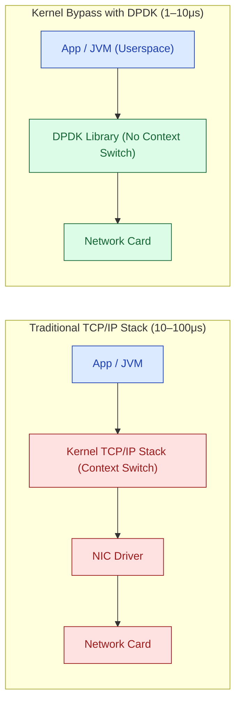

- **Trade-off:** Expensive specialized NIC hardware + complex configuration, justified for HFT firms where microseconds equal millions.

---

## Settlement & Clearing

### T+1 Settlement Cycle

```mermaid
sequenceDiagram
    participant User
    participant Engine as Matching Engine
    participant Kafka
    participant Settle as Settlement Service
    participant Depository as Depository / DB

    Note over User,Engine: Day 1 (Trade Date) - 9:30 AM
    User->>Engine: Buy 100 shares @ 2500
    Engine-->>User: Order FILLED (shown in portfolio, not yet settled)
    Engine-)Kafka: Emit TradeEvent
    Kafka-)Settle: Queue trade for T+1 settlement

    Note over Settle,Depository: Day 2 (Settlement Date T+1) - EOD 4:30 PM
    Settle->>Settle: 1. Netting (aggregate buys/sells per user &amp; symbol)
    Settle->>Settle: 2. Validate net positions
    Settle->>Depository: 3. Transfer net shares &amp; cash
    Settle->>Depository: 4. Update custody &amp; audit trail
    Depository-->>User: Official ownership &amp; cash settled
```

### Netting Engine Flow

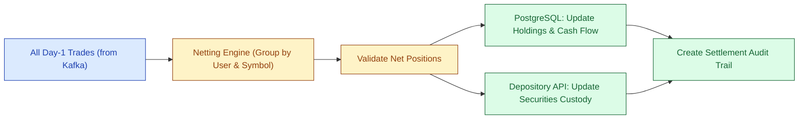

> [!NOTE]
> **Why Netting Matters:** If User A buys `100` shares at `2500` and sells `50` shares at `2505` in the same day, netting settles a single `+50` share transfer and net cash outflow (`~77,725`) instead of two separate custody movements.

### Settlement Service Architecture

```java
/**
 * Settlement service: asynchronous, batch-based
 * Consumes trades from Kafka, processes T+1 settlement
 */
public class SettlementService {
    private final KafkaConsumer<String, Trade> tradeConsumer;
    private final PostgresConnection db;
    private final DepositoryAPI depositoryAPI;

    // Batch trades by date
    private final Map<LocalDate, List<Trade>> tradesBySettlementDate
        = new ConcurrentHashMap<>();

    public void start() {
        // Run settlement at EOD (4:30 PM)
        ScheduledExecutorService scheduler = Executors.newScheduledThreadPool(1);

        scheduler.scheduleDaily(
            LocalTime.of(16, 30),  // 4:30 PM
            this::processDailySettlement
        );

        // Consume trades from Kafka
        consumeTradesFromKafka();
    }

    private void processDailySettlement() {
        LocalDate settlementDate = LocalDate.now().plusDays(1);
        List<Trade> trades = tradesBySettlementDate.get(settlementDate);

        if (trades == null || trades.isEmpty()) {
            System.out.println("No trades to settle for " + settlementDate);
            return;
        }

        System.out.println("Starting settlement for " +
            trades.size() + " trades on " + settlementDate);

        try {
            // Step 1: Netting
            Map<String, NetPosition> netPositions = nettingEngine(trades);

            // Step 2: Validation
            validateNetPositions(netPositions);

            // Step 3: Execute settlement
            for (Map.Entry<String, NetPosition> entry : netPositions.entrySet()) {
                String userId = entry.getKey();
                NetPosition position = entry.getValue();

                settleUser(userId, position);
            }

            // Step 4: Update depository
            depositoryAPI.updateSecuritiesCustody(netPositions);

            // Step 5: Create audit trail
            createSettlementAuditTrail(trades, netPositions);

            System.out.println("Settlement completed successfully");

        } catch (Exception e) {
            System.err.println("Settlement failed: " + e.getMessage());
            // Alert ops team, don't lose trades
            alertOperations(e);
        }
    }

    /**
     * Netting: combine all buys and sells to reduce transfers
     * Example:
     * - User A: bought 100 shares at 2500, sold 50 shares at 2505
     * - Net position: +50 shares bought, cash outflow = 100*2500 - 50*2505 = ~77,725
     */
    private Map<String, NetPosition> nettingEngine(List<Trade> trades) {
        Map<String, Map<String, PositionData>> userSymbolPositions
            = new HashMap<>();

        for (Trade trade : trades) {
            // Buyer side
            userSymbolPositions
                .computeIfAbsent(trade.buyerId, k -> new HashMap<>())
                .computeIfAbsent(trade.symbol, k -> new PositionData())
                .addBuy(trade.quantity, trade.price);

            // Seller side
            userSymbolPositions
                .computeIfAbsent(trade.sellerId, k -> new HashMap<>())
                .computeIfAbsent(trade.symbol, k -> new PositionData())
                .addSell(trade.quantity, trade.price);
        }

        // Convert to net positions
        Map<String, NetPosition> netPositions = new HashMap<>();
        for (Map.Entry<String, Map<String, PositionData>> userEntry :
             userSymbolPositions.entrySet()) {

            String userId = userEntry.getKey();
            Map<String, PositionData> positions = userEntry.getValue();

            NetPosition netPos = new NetPosition(userId);
            for (Map.Entry<String, PositionData> posEntry : positions.entrySet()) {
                String symbol = posEntry.getKey();
                PositionData pos = posEntry.getValue();

                netPos.addSymbolPosition(symbol,
                    pos.netQuantity,      // +100 or -50 etc
                    pos.netCashFlow);     // Total cash in/out
            }

            netPositions.put(userId, netPos);
        }

        return netPositions;
    }

    private void settleUser(String userId, NetPosition position) {
        // Update user's holdings in database
        for (Map.Entry<String, Integer> holding : position.getSymbolHoldings().entrySet()) {
            String symbol = holding.getKey();
            int quantityChange = holding.getValue();

            db.updateUserPosition(userId, symbol, quantityChange);
        }

        // Update user's cash balance
        db.updateUserCash(userId, position.getCashFlowNet());
    }

    static class PositionData {
        int buyQuantity = 0;
        double buyCost = 0;
        int sellQuantity = 0;
        double sellProceeds = 0;

        int netQuantity;
        double netCashFlow;

        void addBuy(int quantity, double price) {
            buyQuantity += quantity;
            buyCost += quantity * price;
        }

        void addSell(int quantity, double price) {
            sellQuantity += quantity;
            sellProceeds += quantity * price;
        }

        void calculateNet() {
            netQuantity = buyQuantity - sellQuantity;
            netCashFlow = sellProceeds - buyCost;  // Positive = cash in
        }
    }

    static class NetPosition {
        String userId;
        Map<String, Integer> symbolHoldings = new HashMap<>();
        double cashFlowNet = 0;

        NetPosition(String userId) {
            this.userId = userId;
        }

        void addSymbolPosition(String symbol, int quantity, double cashFlow) {
            symbolHoldings.put(symbol, quantity);
            cashFlowNet += cashFlow;
        }

        Map<String, Integer> getSymbolHoldings() {
            return symbolHoldings;
        }

        double getCashFlowNet() {
            return cashFlowNet;
        }
    }
}
```

---

## Database & Storage Design

### Data Tiers & Retention

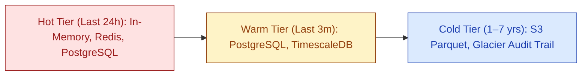

| Tier | Retention | Data Stored | Storage Engine |
|---|---|---|---|
| **Hot** | Last `24 hours` | Active orders, positions, recent trades | In-Memory + Redis + PostgreSQL |
| **Warm** | Last `3 months` | Completed trades, daily positions, OHLCV candles | PostgreSQL + TimescaleDB |
| **Cold** | `1–7 years` | Full regulatory audit trail, SEC filings, historical ticks | S3 (Parquet) + Glacier |

### Core Relational Entity-Relationship Diagram

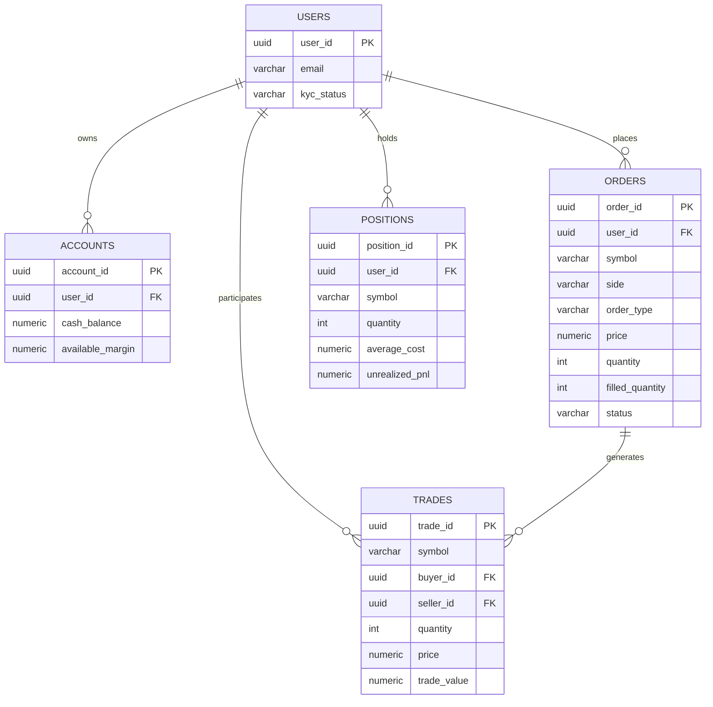

> [!IMPORTANT]
> **Durability Guarantee:** Every incoming order is appended to the memory-mapped **Write-Ahead Log (`WALManager`)** *before* matching. On crash recovery, replaying the WAL deterministically reconstructs the exact in-memory order book.

### PostgreSQL Schema

```sql
-- Users and Accounts
CREATE TABLE users (
    user_id UUID PRIMARY KEY,
    email VARCHAR(255) UNIQUE NOT NULL,
    kyc_status VARCHAR(50),
    created_at TIMESTAMP DEFAULT NOW()
);

CREATE TABLE accounts (
    account_id UUID PRIMARY KEY,
    user_id UUID NOT NULL REFERENCES users,
    cash_balance NUMERIC(20, 2) NOT NULL,
    available_margin NUMERIC(20, 2) NOT NULL,
    updated_at TIMESTAMP DEFAULT NOW()
);

-- Orders
CREATE TABLE orders (
    order_id UUID PRIMARY KEY,
    user_id UUID NOT NULL REFERENCES users,
    symbol VARCHAR(10) NOT NULL,
    side VARCHAR(10) NOT NULL,  -- BUY or SELL
    order_type VARCHAR(50) NOT NULL,  -- MARKET, LIMIT, etc
    price NUMERIC(10, 4),
    quantity INT NOT NULL,
    filled_quantity INT DEFAULT 0,
    status VARCHAR(50) NOT NULL,  -- NEW, ACCEPTED, FILLED, CANCELLED
    created_at TIMESTAMP NOT NULL,
    updated_at TIMESTAMP NOT NULL,

    INDEX idx_user_symbol (user_id, symbol),
    INDEX idx_status (status),
    INDEX idx_created_at (created_at DESC)
);

-- Trades (Matches)
CREATE TABLE trades (
    trade_id UUID PRIMARY KEY,
    symbol VARCHAR(10) NOT NULL,
    buyer_id UUID NOT NULL REFERENCES users,
    seller_id UUID NOT NULL REFERENCES users,
    quantity INT NOT NULL,
    price NUMERIC(10, 4) NOT NULL,
    trade_timestamp TIMESTAMP NOT NULL,
    trade_value NUMERIC(20, 2) GENERATED ALWAYS AS (quantity * price),

    INDEX idx_symbol_time (symbol, trade_timestamp DESC),
    INDEX idx_buyer (buyer_id),
    INDEX idx_seller (seller_id)
);

-- Current Positions
CREATE TABLE positions (
    position_id UUID PRIMARY KEY,
    user_id UUID NOT NULL REFERENCES users,
    symbol VARCHAR(10) NOT NULL,
    quantity INT NOT NULL,
    average_cost NUMERIC(10, 4),
    current_value NUMERIC(20, 2),
    unrealized_pnl NUMERIC(20, 2),
    updated_at TIMESTAMP,

    UNIQUE (user_id, symbol),
    INDEX idx_user_symbol (user_id, symbol)
);

-- Trades History
CREATE TABLE trade_history (
    trade_id UUID PRIMARY KEY,
    symbol VARCHAR(10) NOT NULL,
    buyer_id UUID NOT NULL,
    seller_id UUID NOT NULL,
    quantity INT NOT NULL,
    price NUMERIC(10, 4) NOT NULL,
    trade_timestamp TIMESTAMP NOT NULL,
    settlement_date DATE NOT NULL,

    INDEX idx_user_symbol (buyer_id, symbol, trade_timestamp),
    INDEX idx_settlement_date (settlement_date)
) PARTITION BY RANGE (settlement_date) (
    -- Partition by month
    PARTITION p_2026_01 VALUES LESS THAN ('2026-02-01'),
    PARTITION p_2026_02 VALUES LESS THAN ('2026-03-01')
);
```

### TimescaleDB for Time-Series Data

```sql
-- Create hypertable for OHLCV candles
CREATE TABLE IF NOT EXISTS ohlcv_1min (
    time TIMESTAMP NOT NULL,
    symbol VARCHAR(10) NOT NULL,
    open NUMERIC(10, 4),
    high NUMERIC(10, 4),
    low NUMERIC(10, 4),
    close NUMERIC(10, 4),
    volume BIGINT,

    PRIMARY KEY (symbol, time DESC)
);

SELECT create_hypertable('ohlcv_1min', 'time', if_not_exists => TRUE);

-- Create continuous aggregate for 5-min candles
CREATE MATERIALIZED VIEW ohlcv_5min WITH (timescaledb.continuous) AS
SELECT
    time_bucket('5 minutes', time) AS time,
    symbol,
    first(open, time) AS open,
    max(high) AS high,
    min(low) AS low,
    last(close, time) AS close,
    sum(volume) AS volume
FROM ohlcv_1min
GROUP BY 1, 2;

-- Index for fast queries
CREATE INDEX idx_ohlcv_symbol_time ON ohlcv_1min (symbol, time DESC);
```

### Write-Ahead Log (WAL) for Matching Engine Recovery

```java
/**
 * WAL ensures matching engine can recover after crash
 * Every order is written to WAL before matching
 * On restart, replay WAL to restore order book state
 */
public class WALManager {
    private final RandomAccessFile walFile;
    private final MappedByteBuffer buffer;

    public WALManager(String walPath) throws IOException {
        this.walFile = new RandomAccessFile(walPath, "rw");
        // 1GB WAL file
        this.buffer = walFile.getChannel()
            .map(FileChannel.MapMode.READ_WRITE, 0, 1_000_000_000L);
    }

    /**
     * Write order to WAL before it's matched
     */
    public void writeOrderToWAL(Order order) throws IOException {
        byte[] serialized = serializeOrder(order);

        // Write: [length][data]
        buffer.putInt(serialized.length);
        buffer.put(serialized);

        // Force to disk
        buffer.force();
    }

    /**
     * Replay WAL on startup to restore order book
     */
    public List<Order> replayWAL() throws IOException {
        List<Order> orders = new ArrayList<>();

        buffer.rewind();
        while (buffer.hasRemaining() && buffer.remaining() >= 4) {
            int length = buffer.getInt();
            if (length == 0) break;  // EOF

            byte[] data = new byte[length];
            buffer.get(data);

            Order order = deserializeOrder(data);
            orders.add(order);
        }

        System.out.println("Replayed " + orders.size() + " orders from WAL");
        return orders;
    }

    private byte[] serializeOrder(Order order) {
        // Simple serialization
        ByteBuffer bb = ByteBuffer.allocate(1024);
        bb.putLong(order.getTimestamp());
        bb.put(order.getOrderId().getBytes());
        bb.put((byte) order.getSide().ordinal());
        bb.putInt(order.getQuantityRequested());
        bb.putDouble(order.getPrice());
        // ... more fields
        return bb.array();
    }

    private Order deserializeOrder(byte[] data) {
        ByteBuffer bb = ByteBuffer.wrap(data);
        long timestamp = bb.getLong();
        // ... deserialize fields
        return new Order();  // placeholder
    }
}
```

---

## Scaling & Fault Tolerance

### Symbol-Based Partitioning

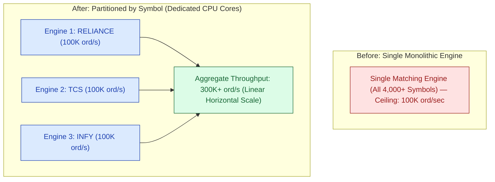

- Each engine is **single-threaded** (no locks), owns its **isolated order book** (no shared state), and is pinned to a **dedicated CPU core** across machines.

### High Availability: Active-Passive Failover

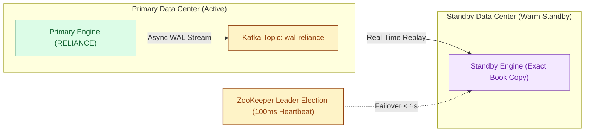

> [!WARNING]
> **Failover Window:** If the primary misses heartbeats (`100ms`), ZooKeeper triggers leadership resignation and the warm standby promotes in `< 1 second`. Up to `0–100ms` of in-flight orders are recovered by replaying the WAL.

### Failover Implementation

```java
public class MatchingEngineCluster {
    private final String symbol;
    private final MatchingEngine primary;
    private final MatchingEngine standby;
    private final KafkaProducer<String, byte[]> walProducer;
    private final ZooKeeperLeaderElection leaderElection;

    private volatile boolean isPrimary = true;
    private final AtomicReference<MatchingEngine> activeEngine;

    public MatchingEngineCluster(String symbol) throws Exception {
        this.symbol = symbol;
        this.primary = new MatchingEngine(symbol);
        this.standby = new MatchingEngine(symbol);
        this.walProducer = createKafkaProducer();
        this.leaderElection = new ZooKeeperLeaderElection(symbol);
        this.activeEngine = new AtomicReference<>(primary);

        // Start leader election
        startLeaderElection();

        // Start health check
        startHealthCheck();
    }

    private void startLeaderElection() throws Exception {
        // Use ZooKeeper to elect primary
        leaderElection.registerCandidate("primary-" + symbol, () -> {
            isPrimary = true;
            activeEngine.set(primary);
            System.out.println(symbol + " is now PRIMARY");
            startAcceptingOrders(primary);
        }, () -> {
            isPrimary = false;
            activeEngine.set(standby);
            System.out.println(symbol + " is now STANDBY");
            startReplayingWAL(standby);
        });
    }

    private void startHealthCheck() {
        ScheduledExecutorService scheduler = Executors.newScheduledThreadPool(1);

        scheduler.scheduleAtFixedRate(() -> {
            if (isPrimary && !isPrimaryHealthy()) {
                System.err.println("Primary health check FAILED");
                // Resign leadership, let standby take over
                leaderElection.resign();
            }
        }, 100, 100, TimeUnit.MILLISECONDS);
    }

    public void matchOrder(Order order) throws Exception {
        // Route order to currently active engine
        MatchingEngine engine = activeEngine.get();

        List<Trade> trades = engine.matchOrder(order);

        if (isPrimary) {
            // Primary: write WAL for standby to replay
            writeToWAL(order, trades);
        }

        // Return trades to client
        for (Trade trade : trades) {
            notifyClients(trade);
        }
    }

    private void writeToWAL(Order order, List<Trade> trades) {
        String key = symbol + "-" + System.nanoTime();
        byte[] value = serializeOrderAndTrades(order, trades);

        walProducer.send(new ProducerRecord<>(
            "wal-" + symbol,
            key,
            value
        ));
    }

    private void startReplayingWAL(MatchingEngine engine) {
        KafkaConsumer<String, byte[]> consumer = createKafkaConsumer();
        consumer.subscribe(Arrays.asList("wal-" + symbol));

        ExecutorService executor = Executors.newSingleThreadExecutor();
        executor.submit(() -> {
            while (true) {
                ConsumerRecords<String, byte[]> records = consumer.poll(100);

                for (ConsumerRecord<String, byte[]> record : records) {
                    Tuple2<Order, List<Trade>> orderAndTrades =
                        deserializeOrderAndTrades(record.value());

                    // Replay in standby engine
                    engine.replayOrder(orderAndTrades.t1, orderAndTrades.t2);
                }
            }
        });
    }

    private boolean isPrimaryHealthy() {
        // Check if primary is still responsive
        return primary.isHealthy();
    }
}
```

---

## Senior vs Mid-Level Comparison

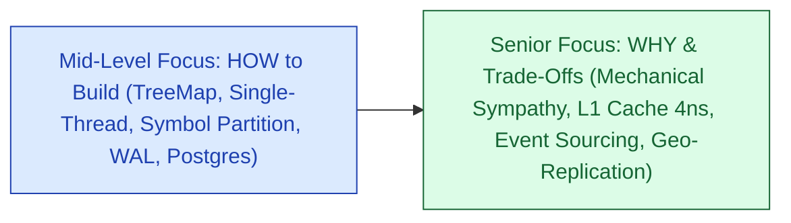

| Aspect | Mid-Level (Your Goal) | Senior Engineer |
|---|---|---|
| **Order Matching Engine** | Understands `TreeMap + LinkedList`, can implement basic matching | Optimizes for cache locality, mechanical sympathy, considers LMAX Disruptor |
| **Latency Analysis** | Knows single-threaded is faster than multi-threaded (why?) | Calculates exact latency: L1 cache hit = `4ns`, memory hit = `100ns`, disk = `100μs` |
| **Scaling** | Proposes symbol-based partitioning | Proposes symbol-based + hash-based partitioning on `user_id` for portfolio service |
| **Fault Tolerance** | Active-passive failover with WAL | Active-passive + cross-datacenter geo-replication, Byzantine fault tolerance |
| **Database Design** | PostgreSQL for ACID, TimescaleDB for OHLCV | Proposes immutable event log (event sourcing), snapshots every `1,000` events |
| **Risk Management** | Lists all risk checks | Proposes ML anomaly detection, multi-tier circuit breaker patterns |
| **Interview Confidence** | "I know HOW to build it" | "I can EXPLAIN WHY each piece exists and its trade-offs" |

> [!TIP]
> **Interview Goal:** Move from *"how to implement"* to *"why this data structure / isolation boundary exists and what trade-offs it buys."*

---

## Interview Follow-Up Questions & Answers

### Q1: "How do you handle a flash crash?"

**Situation:** Market drops `10%` in `1` second due to a runaway algorithm.
- **Mid-Level Answer:** "We have circuit breakers and halt trading when price moves `> 20%` in a day."
- **Senior Answer:** Flash crashes are driven by **correlation cascades** (Fund A sells → price drops → Fund B's stop-loss triggers → Fund C's stop-loss triggers). Defend with multi-tier circuit breakers and liquidity guardrails:

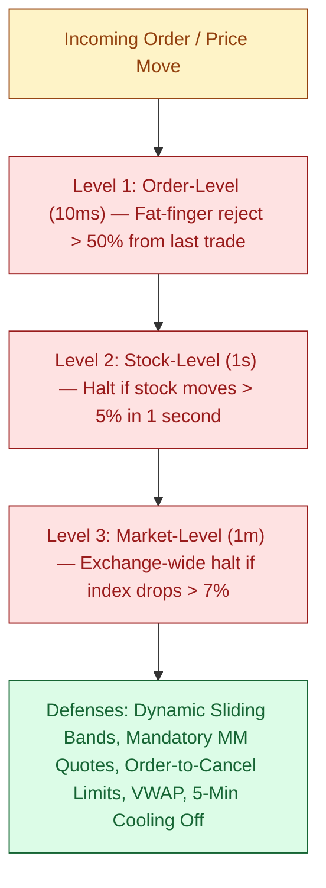

---

### Q2: "Why is single-threaded matching faster than multi-threaded?"

**Common Wrong Answer:** "Because there's no lock contention."
**Correct Answer:** It's **CPU cache locality and mechanical sympathy**, not just locks:

| Execution Model | Step-by-Step CPU Cost | Total Latency |
|---|---|---|
| **Multi-Threaded** | Thread 1 L1 hit (`4` cycles) → lock → context switch (`1,000` cycles) → Thread 2 L1 cache miss (`100+` cycles) → lock overhead | `1,100+ CPU cycles` |
| **Single-Threaded** | Order 1 L1 hit (`4` cycles) → Order 2 L1 hit (`4` cycles), warm branch predictor & prefetcher, zero atomic cache flushes | `8 CPU cycles` (`100–1000x` faster) |

> [!IMPORTANT]
> **Mechanical Sympathy:** No context switches keep the L1 cache and branch predictor warm, and zero lock acquisitions avoid atomic instructions that flush CPU cache lines.

---

### Q3: "How would you add iceberg orders to the matching engine?"

**Iceberg Order:** Large order (e.g., buy 1 million shares) but only shows 10,000 shares at a time. When the first 10,000 fill, the next 10,000 appears.

```java
public class IcebergOrder implements Order {
    private final String orderId;
    private final int totalQuantity;      // 1,000,000 shares
    private final int visibleQuantity;    // 10,000 shares (what shows in order book)
    private int quantityFilled = 0;

    /**
     * Only the visible quantity is added to order book
     * The rest is hidden
     */
    public void addToOrderBook(OrderBook book) {
        Order visibleOrder = new LimitOrder(
            orderId,
            symbol,
            side,
            visibleQuantity,
            priceLimit,
            timestamp,
            userId
        );

        book.addOrder(visibleOrder);
    }

    /**
     * When visible order fills, reveal next batch
     */
    public void onPartialFill(int filledQuantity) {
        quantityFilled += filledQuantity;

        if (quantityFilled < totalQuantity) {
            // Reveal next batch
            int remainingVisible = totalQuantity - quantityFilled;
            int nextVisibleQty = Math.min(visibleQuantity, remainingVisible);

            // Create new order for next batch
            Order nextBatch = new LimitOrder(
                orderId + "_" + (quantityFilled / visibleQuantity),
                symbol,
                side,
                nextVisibleQty,
                priceLimit,
                timestamp,
                userId
            );

            book.addOrder(nextBatch);
        }
    }
}

// Strategy pattern for different order behaviors
public interface OrderMatchingStrategy {
    List<Trade> match(Order order, OrderBook book);
}

public class StandardOrderMatching implements OrderMatchingStrategy {
    @Override
    public List<Trade> match(Order order, OrderBook book) {
        // ... existing matching logic
    }
}

public class IcebergOrderMatching implements OrderMatchingStrategy {
    @Override
    public List<Trade> match(Order order, OrderBook book) {
        if (!(order instanceof IcebergOrder)) {
            return new StandardOrderMatching().match(order, book);
        }

        IcebergOrder icebergOrder = (IcebergOrder) order;
        List<Trade> trades = new ArrayList<>();

        // Match only visible portion
        trades.addAll(matchVisiblePortion(icebergOrder, book));

        // If visible portion was partially filled, reveal next batch
        if (!trades.isEmpty()) {
            int filledQty = trades.stream()
                .mapToInt(Trade::getQuantity)
                .sum();
            icebergOrder.onPartialFill(filledQty);
        }

        return trades;
    }
}
```

---

### Q4: "What's different about this vs payment systems?"

**Payment System:** "Pay Bob" (one direction, one-way flow of money)

**Trading Platform:** Two-sided matching (I want to buy, you want to sell)

| Aspect | Payment | Trading Platform |
|--------|---------|------------------|
| **Core Problem** | Ensure money transfers safely | Ensure MATCHING of buyers + sellers |
| **Correctness** | Exactly-once payment | Exactly-once MATCH (no double-fills) |
| **Latency** | 10-100ms acceptable | < 10ms required |
| **State** | Account balance | Order book state |
| **Scaling Challenge** | Throughput (moving money) | MATCHING throughput (finding pairs) |
| **Concurrency** | Per-account locks acceptable | Single-threaded matching (no locks!) |
| **Failure Mode** | Lost money | Lost order or double-fill |

---

### Q5: "How do you handle order modification while matching is in progress?"

**Scenario:** User places `Buy 100 @ 2500`; while matching is in progress, user modifies to `Buy 150 @ 2510`.
**Solution:** Version-based optimistic locking using atomic `compareAndSwapLong` (`CAS`).

```mermaid
sequenceDiagram
    participant User
    participant Order as OrderWithVersion (v0)
    participant Engine as Matching Engine

    User->>Order: tryModify(Buy 150 @ 2510), expectedVersion = 0
    Engine->>Order: Match &amp; bump version (0 to 1)
    Order-->>User: CAS(expected=0, new=1) FAILS (version is now 1)
    User->>Order: Retry or Reject Modification Safely
```

```java
public class OrderWithVersion {
    private String orderId;
    private volatile long version = 0;

    public boolean tryModify(OrderModification mod) {
        long expectedVersion = version;

        // Make a copy for modification
        Order modified = createModifiedCopy(mod);
        modified.version = expectedVersion + 1;

        // Try to swap atomically
        return UNSAFE.compareAndSwapLong(
            this, VERSION_OFFSET,
            expectedVersion, expectedVersion + 1
        );
    }
}
```

---

This comprehensive guide covers everything needed for a FAANG-level system design interview on stock trading platforms. The emphasis on "why" over "how" and the detailed latency analysis make this suitable for a senior-level candidate or an ambitious mid-level engineer targeting senior positions.
