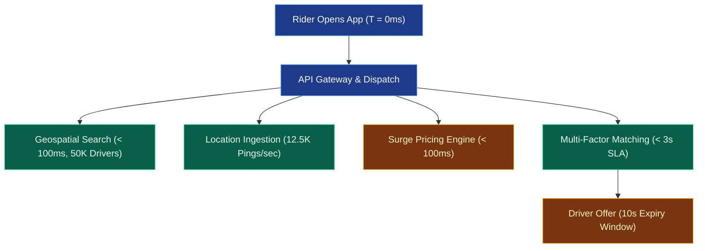
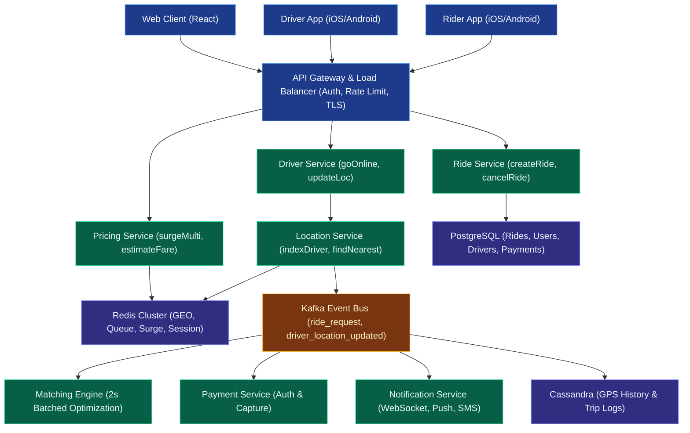
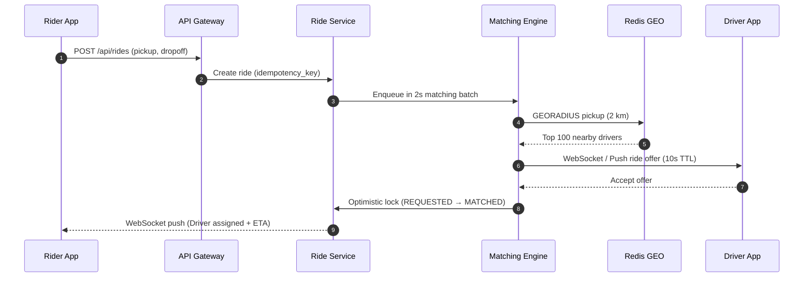

# Design a Ride-Sharing System (Uber / Ola)

> **The Interview Question:**
> "Design Uber/Ola for a city like Mumbai. Millions of users requesting rides. Thousands of drivers online. Real-time matching within 3 seconds. How do you efficiently find the nearest available driver? How does surge pricing work? What about payment and tracking?"

This is THE most canonical system design interview question at Google, Uber, Amazon, and Airbnb. It combines:
- **Real-time geospatial search** (find nearest driver in lat/lng space)
- **Scalable concurrency** (1M+ concurrent riders and drivers)
- **Complex matching algorithms** (not just nearest — consider rating, direction, acceptance rate)
- **Financial transactions** (payments, surge pricing, fare calculation)
- **Location tracking** (driver-rider updates every 3-5 seconds)

The interviewer is testing whether you understand: geohashing vs H3, Redis GEO commands, eventual consistency trade-offs, and how to architect a system where consistency matters but latency also matters.

---

## Table of Contents

1. [Why This Problem Is Hard](#1-why-this-problem-is-hard)
2. [Requirements & Capacity Planning](#2-requirements--capacity-planning)
3. [High-Level Architecture](#3-high-level-architecture)
4. [Core Problem: Geospatial Driver Matching](#4-core-problem-geospatial-driver-matching)
5. [Geohashing: The Foundation](#5-geohashing-the-foundation)
6. [H3 Hexagonal Grids: Uber's Approach](#6-h3-hexagonal-grids-ubers-approach)
7. [Redis GEO Commands: The Implementation](#7-redis-geo-commands-the-implementation)
8. [Real-Time Location Tracking](#8-real-time-location-tracking)
9. [Ride Matching Algorithm](#9-ride-matching-algorithm)
10. [Surge Pricing: Supply-Demand Economics](#10-surge-pricing-supply-demand-economics)
11. [Fare Calculation](#11-fare-calculation)
12. [Payment Processing](#12-payment-processing)
13. [Database Design](#13-database-design)
14. [Handling Failures & Edge Cases](#14-handling-failures--edge-cases)
15. [Senior-Level Talking Points](#15-senior-level-talking-points)
16. [Interview Cheat Sheet](#16-interview-cheat-sheet)
17. [Follow-Up Questions](#17-follow-up-questions)

---

## 1. Why This Problem Is Hard



| Hard Problem | Scale / Volume | Latency Budget | Core Engineering Solution |
| :--- | :--- | :--- | :--- |
| **Geospatial Search** | 50,000+ active drivers | &lt; 100 ms | Spatial partitioning (H3 / Geohash / Redis GEO) |
| **Real-Time Location Updates** | 12,500–16,700 writes/sec | &lt; 5 s end-to-end | Redis GEO hot path + async Kafka to Cassandra |
| **Surge Pricing** | 100+ req/sec per hot zone | &lt; 100 ms read | 30s windowed demand/supply ratio per cell |
| **Multi-Factor Matching** | 16,700 peak req/sec | &lt; 3 s total | 2s batched bipartite scoring + 10s offer TTL |

> [!IMPORTANT]
> The core tension in ride-sharing is **AP (Availability + Partition Tolerance)** for geospatial matching and location tracking versus **CP (Consistency)** for trip state transitions and two-phase payment capture.

**Four simultaneous hard problems:**

1. **Geospatial Search at Scale**
   - "Find all drivers within 2km of my location" from lat/lng
   - Cannot iterate 50K drivers sequentially (>10ms)
   - Must use spatial indexing (geohashing, H3, quadtree)

2. **Real-Time Location Updates**
   - 50K drivers sending location every 3-5 seconds = 10K-16K requests/second
   - 3M riders checking driver location in real-time
   - Cannot store raw lat/lng in database — need Redis for hot data

3. **Surge Pricing & Supply-Demand**
   - Demand = 100 new ride requests/second
   - Supply = 40 drivers available in this zone
   - Need multiplier = f(demand, supply) calculated in < 100ms

4. **Matching Under Constraints**
   - Not just "nearest driver" — consider:
     - Driver rating (4.9 stars preferred over 4.5)
     - Acceptance rate (driver who rejects rides often shouldn't be offered)
     - Trip direction (driver heading towards rider's destination = good match)
     - Current load (2 ride offers → max 1 accepted, others get re-offered)
   - All this in < 3 seconds for every ride request

---

## 2. Requirements & Capacity Planning

### Functional Requirements

**Rider-Side:**
- Submit ride request with pickup and dropoff location
- See available drivers in real-time with ETA
- Accept an offered driver and see them move on map
- Receive fare estimate BEFORE confirming ride
- Rate and review driver after trip

**Driver-Side:**
- Go online/offline
- Broadcast location every 3-5 seconds
- Receive ride offers and accept/decline within 10 seconds
- Navigate to pickup location, then to dropoff
- Complete ride and request payment
- See earnings history

**Payment:**
- Pay online (card, wallet, UPI)
- Receive upfront fare estimate (within 5%)
- No cash (for simplicity)

### Non-Functional Requirements

| Metric | Target | Why |
|--------|--------|-----|
| **Ride matching latency** | < 3 seconds | User won't wait longer |
| **Location update latency** | < 5 seconds | Rider sees driver moving |
| **Uptime** | 99.99% | Financial service — no downtime |
| **Fare calculation** | < 100ms | Shown to user immediately |
| **Concurrent riders** | 3 million | Peak hour in large city |
| **Concurrent drivers** | 50,000-100,000 | 1 driver per 30-50 riders |
| **P99 latency** | < 5 seconds | Most users get response < 5s |
| **Consistency** | Eventual (with guardrails) | Speed > consistency for ride matching |

### Back-of-Envelope Capacity Planning

```mermaid
flowchart LR
    U["3M Peak Riders &amp; 50K Drivers"] --> REQ["16,700 Peak Ride Req/s"]
    U --> GPS["12,500 GPS Pings/s (Every 4s)"]
    REQ --> RED["Redis Hot State (~170 MB)"]
    GPS --> CAS["Cassandra GPS History (2.5 GB/day)"]
    REQ --> PG["PostgreSQL Trips &amp; Payments (7.5 GB/day)"]

    classDef primary fill:#1e3a8a,stroke:#60a5fa,color:#f8fafc
    classDef accent fill:#065f46,stroke:#34d399,color:#ecfdf5
    classDef store fill:#312e81,stroke:#818cf8,color:#eef2ff
    U primary
    class REQ,GPS accent
    class RED,CAS,PG store
```

> [!TIP]
> Notice that **all active drivers (50K × 1 KB = 50 MB)** and **in-flight rides (60K × 2 KB = 120 MB)** fit easily inside a single Redis cluster's RAM (~170 MB). Always separate hot in-memory state from cold append-only history.

```
City: Mumbai (population 20 million)
Peak hours: 8-10 AM, 6-10 PM (8 hours)
Penetration: 5% use ride-sharing = 1M users
Daily active: 300K unique riders
Peak concurrent: 300K / 24 * (peak hour concentration) = 3M peak surge

Driver count: 1 driver per 30 riders in peak = 100K drivers
At any time: 30-50% online = 30-50K active drivers

Traffic (Requests Per Second):

Ride Requests:
  - 3M concurrent riders
  - Average request once per 30 min
  - 3M / (30 * 60) = 1,667 new requests/sec
  - Peak: 10x = 16,700 requests/sec

Location Updates:
  - 50K drivers online
  - Update every 3-5 seconds (let's say 4 sec average)
  - 50K / 4 = 12,500 location updates/sec

Driver Offer Responses:
  - 16,700 new ride requests
  - 50% are matched to driver within 3 sec
  - 8,350 offer responses/sec (accept/decline)

Payment:
  - 16,700 rides starting/sec → 16,700 payment authorizations
  - Rides complete at same rate → 16,700 payment captures

Storage:
  - Redis hot data (active drivers): 50K drivers × 1KB = 50MB
  - Rides in flight (< 1 hour): 60,000 rides × 2KB = 120MB
  - Location history (Cassandra): 50K drivers × 100 locations/day = 5M locations/day
    5M × 500 bytes = 2.5GB/day
  - Trips historical (PostgreSQL): 300K riders × 5 trips/day = 1.5M trips/day
    1.5M × 5KB = 7.5GB/day
```

---

## 3. High-Level Architecture





| Microservice | Primary Responsibility | Primary Data Store | Sync / Async Pattern |
| :--- | :--- | :--- | :--- |
| **Ride Service** | Ride lifecycle, idempotent creation, state transitions | PostgreSQL | Sync REST + Kafka events |
| **Driver Service** | Onboarding, online/offline status, availability | PostgreSQL + Redis | Sync REST |
| **Location Service** | High-frequency GPS ingestion &amp; spatial indexing | Redis GEO + Cassandra | Sync Redis + Async Kafka |
| **Pricing Service** | Upfront fare estimation &amp; 30s surge calculation | Redis | Sync read (&lt; 100 ms) |
| **Matching Engine** | 2s batched bipartite optimization &amp; 10s offer expiry | Redis + PostgreSQL | Scheduled batch + WebSocket |
| **Payment Service** | Two-phase auth/capture &amp; weekly driver settlement | PostgreSQL + Gateway | Sync auth + Async capture |

> [!IMPORTANT]
> **Decouple Ingestion from Persistence:** When a driver sends a GPS ping, `Location Service` writes to **Redis GEO synchronously** (hot path) and publishes to **Kafka asynchronously** so Cassandra writes and WebSocket fan-out never block the driver's HTTP `200 OK`.

---

## 4. Core Problem: Geospatial Driver Matching

This is the heart of the system. Everything else is secondary.



```mermaid
flowchart LR
    Q["Rider Query (19.0760°N, 72.8777°E, 2 km)"] --> N1["Naive: Full Scan 50,000 Drivers"]
    N1 --> N2["50K × Haversine (~5,000 ms) — SLA Breach"]
    Q --> S1["Spatial Index (Geohash / H3 / QuadTree)"]
    S1 --> S2["Query 9 Neighbor Cells (~5 ms)"]
    S2 --> S3["Filter &amp; Score Top 100 (&lt; 50 ms)"]

    classDef primary fill:#1e3a8a,stroke:#60a5fa,color:#f8fafc
    classDef accent fill:#065f46,stroke:#34d399,color:#ecfdf5
    classDef warn fill:#78350f,stroke:#fbbf24,color:#fef3c7
    Q primary
    class N1,N2 warn
    class S1,S2,S3 accent
```

| Indexing Strategy | Cell / Node Shape | Adaptivity to Density | Neighbor Lookup | Update Cost (Moving Drivers) | Best Fit |
| :--- | :--- | :--- | :--- | :--- | :--- |
| **Geohash** | Rectangular (Base32) | Fixed grid per precision | 8 neighbors (edge distortion) | `O(1)` string update | Simple prefix queries, Redis GEO |
| **QuadTree** | Dynamic quadrants | High (splits dense cities) | Tree traversal + parent backtrack | `O(log N)` rebalance/lock | Read-heavy static POIs, in-memory |
| **Google S2** | Spherical Hilbert cells | Hierarchical (Level 0–30) | Uniform spherical projection | `O(1)` cell ID update | Global coverage without polar distortion |
| **Uber H3** | Hexagonal (kRing) | Hierarchical (Res 0–15) | 6 equidistant neighbors | `O(1)` hex ID update | Ride-sharing dispatch &amp; surge zones |

> [!WARNING]
> **Why QuadTrees Struggle at 12.5K Updates/Sec:** A QuadTree adapts well to dense cities like Mumbai vs rural highways, but rebalancing tree nodes in-memory under 12,500 concurrent driver writes/sec requires fine-grained locking. Grid-based indexes (**H3**, **S2**, **Geohash**) map `(lat, lng)` to a cell ID in `O(1)` without locks.

**The Problem:**

```
Rider at: (19.0760°N, 72.8777°E) [Bandra, Mumbai]

Active drivers in database:
  Driver 1: (19.0900°N, 72.8500°E) [2 km away]
  Driver 2: (19.2000°N, 72.9500°E) [25 km away]
  Driver 3: (19.0700°N, 72.8800°E) [0.3 km away] ← NEAREST
  Driver 4: (19.0500°N, 72.8000°E) [15 km away]
  ...
  Driver 50000: ...

Query: "Find all drivers within 2km with availability + rating > 4.5"

Naive solution:
  - Iterate all 50,000 drivers
  - Calculate distance to each using Haversine formula
  - Filter and sort by distance
  - Time: 50,000 × 0.1ms = 5 seconds ❌ (need < 3 seconds)

Smart solution:
  - Use spatial index (geohash or H3)
  - Query only drivers in nearby cells
  - Time: 5 cells × 1000 drivers/cell = 5,000 iterations
  - Time: 5,000 × 0.1ms = 500ms ✓
```

**The key insight:** Use SPATIAL PARTITIONING, not linear search.

---

## 5. Geohashing: The Foundation

Geohash converts (lat, lng) to a string. Strings that are "close" in prefix represent nearby locations.

```mermaid
flowchart TD
    IN["Input (19.0760°N, 72.8777°E)"] --> BIT["Binary Bisection (Lat &amp; Lng Intervals)"]
    BIT --> INT["Interleave Bits (Even=Lng, Odd=Lat)"]
    INT --> B32["Base32 Encode → &quot;u34sr3&quot;"]
    B32 --> NB["Compute 8 Neighbors (N, S, E, W, NE, NW, SE, SW)"]
    NB --> Q9["Query 9 Redis Cells → Filter by Haversine"]

    classDef primary fill:#1e3a8a,stroke:#60a5fa,color:#f8fafc
    classDef accent fill:#065f46,stroke:#34d399,color:#ecfdf5
    IN,BIT,INT primary
    B32,NB,Q9 accent
```

| Geohash Precision | Example Prefix | Approximate Cell Size | Ride-Sharing Use Case |
| :--- | :--- | :--- | :--- |
| **Precision 4** | `"u34s"` | 39.1 km × 19.5 km | City / metro partitioning |
| **Precision 6** | `"u34sr3"` | 1.22 km × 0.61 km | Surge pricing zones |
| **Precision 8** | `"u34sr3x2"` | 38.2 m × 19.1 m | Pickup / dropoff matching |
| **Precision 9** | `"u34sr3x2a"` | 4.8 m × 4.8 m | Exact curb / entrance pin |

> [!WARNING]
> **The Boundary Edge Case:** Two drivers 50 meters apart on opposite sides of a prime-meridian or geohash boundary can have completely different prefixes (e.g., `"011111"` vs `"100000"`). **Always query the center cell + all 8 neighbors (9 cells total)** before filtering by exact Haversine distance.

### How Geohashing Works

```
Lat/Lng: (19.0760, 72.8777)

Step 1: Interleave binary representations
  Latitude:  19.0760  → 0001 0010 0001 1101 (11 bits)
  Longitude: 72.8777  → 1000 1100 1000 1101 (11 bits)

  Interleaved: 10 00 11 10 00 11 00 11 01 00 11 01

Step 2: Encode in base32
  → "u34sr3" (6 characters)

Step 3: Prefix properties
  Precision:  Geohash Length    Cell Size (approx)
  ───────────────────────────────────────────────
  Precision 1  "e"              5,000 × 5,000 km
  Precision 2  "ex"             1,250 × 1,250 km
  Precision 4  "exqz"           39 × 39 km
  Precision 6  "exqzbn"         1.2 × 1.2 km
  Precision 8  "exqzbmnp"       38 × 38 meters
  Precision 9  "exqzbmnp3"      15 × 15 meters   ← Good for ride matching
```

### Geohash Neighbors

```
My geohash: "u34sr3"

Neighbors:  "u34sr1" (south)
            "u34sr4" (east)
            "u34sr5" (northeast)
            "u34sr2" (west)
            etc.

To find drivers within 2km:
1. Get my geohash at precision 8 ("u34srxyz")
2. Get all 8 neighbors
3. Query Redis for drivers in all 9 cells
4. Filter by distance (some in neighbor cell may be > 2km)

This reduces iteration from 50K to ~3-5K drivers ✓
```

### Java Implementation: Geohashing

```java
public class GeohashUtil {

    private static final String BASE32 = "0123456789bcdefghjkmnpqrstuvwxyz";

    /**
     * Encode latitude, longitude to geohash
     */
    public static String encode(double lat, double lng, int precision) {
        byte[] latRange = {-90.0, 90.0};
        byte[] lngRange = {-180.0, 180.0};
        StringBuilder geohash = new StringBuilder();
        boolean isEven = true;

        int bit = 0;
        int ch = 0;

        while (geohash.length() < precision) {
            double mid;
            if (isEven) {  // longitude
                mid = (lngRange[0] + lngRange[1]) / 2;
                if (lng > mid) {
                    ch |= (1 << (4 - bit));
                    lngRange[0] = mid;
                } else {
                    lngRange[1] = mid;
                }
            } else {  // latitude
                mid = (latRange[0] + latRange[1]) / 2;
                if (lat > mid) {
                    ch |= (1 << (4 - bit));
                    latRange[0] = mid;
                } else {
                    latRange[1] = mid;
                }
            }

            isEven = !isEven;

            if (bit < 4) {
                bit++;
            } else {
                geohash.append(BASE32.charAt(ch));
                bit = 0;
                ch = 0;
            }
        }

        return geohash.toString();
    }

    /**
     * Get all 8 neighbors of a geohash
     */
    public static List<String> getNeighbors(String geohash) {
        String[] neighbors = {
            getNeighbor(geohash, "top"),
            getNeighbor(geohash, "bottom"),
            getNeighbor(geohash, "left"),
            getNeighbor(geohash, "right"),
            getNeighbor(getNeighbor(geohash, "top"), "left"),
            getNeighbor(getNeighbor(geohash, "top"), "right"),
            getNeighbor(getNeighbor(geohash, "bottom"), "left"),
            getNeighbor(getNeighbor(geohash, "bottom"), "right")
        };
        return Arrays.asList(neighbors);
    }

    private static String getNeighbor(String geohash, String direction) {
        // Simplified — actual implementation more complex
        // Use lookup tables for neighbor calculations
        // See: https://github.com/davetroy/geohash-js
        return geohash;
    }

    /**
     * Calculate distance between two points using Haversine formula
     */
    public static double distanceInKm(double lat1, double lng1,
                                       double lat2, double lng2) {
        final int R = 6371; // Earth's radius in km

        double latDiff = Math.toRadians(lat2 - lat1);
        double lngDiff = Math.toRadians(lng2 - lng1);

        double a = Math.sin(latDiff / 2) * Math.sin(latDiff / 2) +
                   Math.cos(Math.toRadians(lat1)) *
                   Math.cos(Math.toRadians(lat2)) *
                   Math.sin(lngDiff / 2) * Math.sin(lngDiff / 2);

        double c = 2 * Math.atan2(Math.sqrt(a), Math.sqrt(1 - a));

        return R * c;
    }
}
```

---

## 6. H3 Hexagonal Grids: Uber's Approach

```mermaid
flowchart LR
    PT["Rider Lat/Lng"] --> H3C["h3.geoToH3(res=10, ~91m)"]
    H3C --> KR["h3.kRing / polygonToDisk(radius)"]
    KR --> UNI["Union Redis Sets (h3:cell_id)"]
    UNI --> DIST["GEODIST Exact Radius Filter (&lt;= 2 km)"]

    classDef primary fill:#1e3a8a,stroke:#60a5fa,color:#f8fafc
    classDef accent fill:#065f46,stroke:#34d399,color:#ecfdf5
    classDef store fill:#312e81,stroke:#818cf8,color:#eef2ff
    PT,H3C primary
    KR,DIST accent
    UNI store
```

> [!TIP]
> **Why Hexagons Beat Squares:** In a square grid, diagonal neighbors are $\sqrt{2}\times$ farther from the center than edge neighbors. Every hexagon in **H3** has **6 equidistant neighbors**, eliminating directional bias in dispatch radius queries and surge heatmaps.

Uber (and many modern systems) use **H3 instead of geohashing** because:

| Feature | Geohash | H3 |
|---------|---------|-----|
| **Cell shape** | Rectangular | Hexagonal |
| **Area uniformity** | Varies 3x within resolution | Uniform ±15% |
| **Neighbor cells** | 4 edges, irregular | 6 neighbors, regular |
| **Disk radius** | Square, hard to query | True circle |
| **Smooth transitions** | Jumps at boundaries | Smooth as you move |
| **Distance calculation** | Manual filtering still needed | Better locality properties |

### H3 Visualization

```
Geohash (rectangular):          H3 (hexagonal):
┌──────────┬──────────┐         ╔══════╗╔══════╗╔══════╗
│          │          │         ║      ║║      ║║      ║
│          │          │         ╚══════╝╚══════╝╚══════╝
├──────────┼──────────┤         ╔══════╗╔══════╗╔══════╗
│          │          │         ║      ║║      ║║      ║
│          │  RIDER   │         ║RIDER ║║      ║║      ║
├──────────┼──────────┤         ╚══════╝╚══════╝╚══════╝
│          │          │         ╔══════╗╔══════╗╔══════╗
│          │          │         ║      ║║      ║║      ║
└──────────┴──────────┘         ╚══════╝╚══════╝╚══════╝

Rectangular cells =              Hexagonal cells =
more edge cases, irregular       6 uniform neighbors,
neighbor counts                  easy radius queries
```

### H3 Resolution Levels

```
Resolution  Cell Size (km)  Edge Length (m)  Use Case
──────────  ──────────────  ───────────────  ────────────────
0           20,000          10,000           World view
1           5,000           2,600            Continent view
3           56              620               Region/city
6           0.43            30                City block
8           0.0089          2.8               Fine location
9           0.0031          0.93              Super-precise
```

For ride-sharing, use **H3 resolution 10** (~91 meters) or **resolution 11** (~30 meters).

### Java + H3 Implementation

```java
import com.uber.h3core.H3Core;

public class H3DriverMatcher {

    private static final H3Core h3 = H3Core.newInstance();
    private static final int RESOLUTION = 10;  // ~91 meters

    /**
     * Index driver location in H3 grid
     */
    public void indexDriver(String driverId, double lat, double lng,
                            RedisTemplate<String, String> redis) {
        String h3Index = h3.geoToH3(lat, lng, RESOLUTION);

        // Store driver in H3 cell
        redis.opsForSet().add("h3:" + h3Index, driverId);

        // Also store driver's current H3 for quick updates
        redis.opsForValue().set("driver:h3:" + driverId, h3Index);

        // Store actual coordinates for distance verification
        redis.opsForGeo().add("drivers:geo", new Point(lng, lat), driverId);
    }

    /**
     * Find nearby drivers using H3 hexagonal grid
     */
    public List<String> findNearbyDrivers(double riderLat, double riderLng,
                                           double radiusKm,
                                           RedisTemplate<String, String> redis) {
        String centerH3 = h3.geoToH3(riderLat, riderLng, RESOLUTION);

        // Get all H3 cells within disk radius
        Collection<String> hexagons = h3.polygonToDisk(centerH3,
                                        (int) Math.ceil(radiusKm / 0.091));
        // 0.091 km = ~91m per H3 resolution 10 cell

        // Collect drivers from all nearby hexagons
        Set<String> nearbyDrivers = new HashSet<>();

        for (String hexagon : hexagons) {
            Set<String> driversInCell = redis.opsForSet()
                    .members("h3:" + hexagon);
            if (driversInCell != null) {
                nearbyDrivers.addAll(driversInCell);
            }
        }

        // Filter by actual distance (some hexagons at edge > radius)
        List<String> result = new ArrayList<>();
        for (String driverId : nearbyDrivers) {
            Distance dist = redis.opsForGeo().distance("drivers:geo",
                    driverId, new Point(riderLng, riderLat),
                    Metrics.KILOMETERS);
            if (dist.getValue() <= radiusKm) {
                result.add(driverId);
            }
        }

        return result;
    }
}
```

---

## 7. Redis GEO Commands: The Implementation

While H3 is great for understanding, Redis **GEO commands** (GEOADD, GEORADIUS) provide production-ready geospatial indexing.

### Redis GEO Commands Reference

```
GEOADD key longitude latitude member [longitude latitude member ...]
  Adds drivers to spatial index
  Example: GEOADD drivers:geo 72.8777 19.0760 driver_123

GEORADIUS key longitude latitude radius unit [WITHDIST] [WITHCOORD] [COUNT count]
  Find members within radius
  Example: GEORADIUS drivers:geo 72.8777 19.0760 2 km WITHDIST COUNT 100
  Returns: driver_123 (0.5 km)
           driver_456 (1.2 km)
           ...

GEOPOS key member [member ...]
  Get coordinates of members

GEODIST key member1 member2 [unit]
  Get distance between two members
```

### Java Implementation: Ride Matching with Redis GEO

```java
@Service
public class RideMatchingService {

    @Autowired
    private RedisTemplate<String, String> redisTemplate;

    @Autowired
    private DriverService driverService;

    private static final String ACTIVE_DRIVERS_GEO = "drivers:geo:active";
    private static final double INITIAL_SEARCH_RADIUS_KM = 2.0;
    private static final double MAX_SEARCH_RADIUS_KM = 15.0;

    /**
     * Core ride matching algorithm:
     * 1. Find nearby drivers using geospatial search
     * 2. Score them based on multiple factors
     * 3. Select best candidates
     */
    public List<MatchedDriver> findBestDriversForRide(
            RideRequest rideRequest,
            PricingService pricingService) {

        double pickupLat = rideRequest.getPickupLat();
        double pickupLng = rideRequest.getPickupLng();

        // Step 1: Find nearby drivers (within radius)
        List<GeoResult<RedisGeoCommands.GeoLocation<String>>> geoResults =
            findNearbyDriversInRadius(pickupLat, pickupLng,
                                      INITIAL_SEARCH_RADIUS_KM);

        // If no drivers found, expand search
        if (geoResults.isEmpty()) {
            geoResults = findNearbyDriversInRadius(pickupLat, pickupLng,
                                                   MAX_SEARCH_RADIUS_KM);
        }

        // Step 2: Enrich with driver details and calculate scores
        List<MatchedDriver> candidates = new ArrayList<>();

        for (GeoResult<RedisGeoCommands.GeoLocation<String>> geoResult
                : geoResults) {
            String driverId = geoResult.getContent().getName();
            double distanceKm = geoResult.getDistance().getValue();

            Driver driver = driverService.getDriver(driverId);
            if (driver == null || !driver.isAvailable()) {
                continue;  // Skip unavailable drivers
            }

            // Calculate ETA (not straight-line distance)
            double eta = estimateETA(pickupLat, pickupLng,
                                     driver.getCurrentLat(),
                                     driver.getCurrentLng());

            // Calculate matching score
            double score = calculateMatchScore(driver, distanceKm,
                                               eta, rideRequest);

            candidates.add(new MatchedDriver(driverId, driver, distanceKm,
                                             eta, score));
        }

        // Step 3: Sort by score and return top N
        candidates.sort((a, b) -> Double.compare(b.getScore(), a.getScore()));

        return candidates.stream()
                .limit(5)  // Top 5 drivers
                .collect(Collectors.toList());
    }

    /**
     * Find drivers within radius using Redis GEORADIUS
     */
    private List<GeoResult<RedisGeoCommands.GeoLocation<String>>>
            findNearbyDriversInRadius(double lat, double lng, double radiusKm) {

        GeoOperations<String, String> geoOps =
            redisTemplate.opsForGeo();

        Circle circle = new Circle(new Point(lng, lat),
                                   new Distance(radiusKm, Metrics.KILOMETERS));

        RedisGeoCommands.GeoRadiusCommandArgs args =
            RedisGeoCommands.GeoRadiusCommandArgs.newGeoRadiusArgs()
                .includeDistance()
                .includeCoordinates()
                .sortAscending()
                .limit(100);  // Max 100 drivers to evaluate

        return geoOps.radius(ACTIVE_DRIVERS_GEO, circle, args);
    }

    /**
     * Score a driver based on multiple factors
     * score = (distance_factor) * (rating_factor) *
     *         (acceptance_rate_factor) * (direction_factor)
     */
    private double calculateMatchScore(Driver driver, double distanceKm,
                                        double etaMinutes,
                                        RideRequest rideRequest) {

        // Distance factor: closer = better (exponential)
        double distanceFactor = Math.exp(-0.5 * distanceKm);  // Decays with distance

        // Rating factor: 4.9 stars > 4.5 stars
        double rating = driver.getRating();  // 1.0 to 5.0
        double ratingFactor = rating / 5.0;  // 0.2 to 1.0

        // Acceptance rate: drivers who decline offers shouldnt be offered much
        double acceptanceRate = driver.getAcceptanceRate();  // 0.0 to 1.0
        double acceptanceFactor = acceptanceRate;

        // Direction factor: if driver is heading towards dropoff, bonus
        double directionBonus = 0.0;
        if (isHeadingTowardDropoff(driver, rideRequest)) {
            directionBonus = 0.3;  // 30% bonus if heading right way
        }

        // Combined score
        double baseScore = distanceFactor * ratingFactor * acceptanceFactor;
        return baseScore + directionBonus;
    }

    /**
     * Check if driver is currently heading in right direction
     */
    private boolean isHeadingTowardDropoff(Driver driver,
                                           RideRequest rideRequest) {
        // Simplified: check if driver's last few location updates
        // show movement toward pickup area
        if (driver.getLocationHistory().size() < 2) {
            return false;
        }

        Location prev = driver.getLocationHistory()
                .get(driver.getLocationHistory().size() - 2);
        Location current = driver.getLocationHistory()
                .get(driver.getLocationHistory().size() - 1);

        double distBefore = haversineDistance(prev.getLat(), prev.getLng(),
                                              rideRequest.getPickupLat(),
                                              rideRequest.getPickupLng());
        double distAfter = haversineDistance(current.getLat(), current.getLng(),
                                             rideRequest.getPickupLat(),
                                             rideRequest.getPickupLng());

        return distAfter < distBefore;  // Getting closer
    }

    /**
     * Estimate time to arrival (ETA) to pickup location
     * In real system: integrate with Google Maps API for actual routing
     */
    private double estimateETA(double riderLat, double riderLng,
                                double driverLat, double driverLng) {
        // Simple: distance / average speed
        double distanceKm = haversineDistance(driverLat, driverLng,
                                              riderLat, riderLng);
        double avgSpeedKmPerMin = 0.83;  // 50 km/h = 0.83 km/min
        return distanceKm / avgSpeedKmPerMin;
    }

    /**
     * Haversine formula for distance
     */
    private double haversineDistance(double lat1, double lng1,
                                      double lat2, double lng2) {
        final int R = 6371;  // Earth radius in km

        double dLat = Math.toRadians(lat2 - lat1);
        double dLng = Math.toRadians(lng2 - lng1);

        double a = Math.sin(dLat / 2) * Math.sin(dLat / 2) +
                   Math.cos(Math.toRadians(lat1)) *
                   Math.cos(Math.toRadians(lat2)) *
                   Math.sin(dLng / 2) * Math.sin(dLng / 2);

        double c = 2 * Math.atan2(Math.sqrt(a), Math.sqrt(1 - a));
        return R * c;
    }
}
```

---

## 8. Real-Time Location Tracking

Drivers update location every 3-5 seconds. This generates massive load.

### Location Update Architecture

```
Driver phone (location service running)
          │
          │ Every 4 seconds:
          │ POST /api/driver/location
          │ { lat: 19.076, lng: 72.877 }
          │
          ▼
    API Gateway
          │
          ├─→ Update Redis GEO (GEOADD drivers:geo)
          │   (fast, in-memory)
          │
          ├─→ Publish to Kafka topic "driver_location_updates"
          │
          └─→ Return 200 OK to driver (latency-critical)
                   │
                   ▼
          Update rider's real-time map

Kafka consumer:
          │
          ├─→ Persist to Cassandra (eventually consistent)
          │   driver_locations table
          │
          └─→ Update driver's H3 cell assignment
              (move from old H3 to new H3 if crossed boundary)
```

### Which protocol: WebSocket vs HTTP Polling vs Server-Sent Events?

```
Protocol             Driver→Server  Server→Rider  Latency  Complexity
────────────────────────────────────────────────────────────────────
HTTP Polling         Every 4s       Every 2-5s    2-10s    Simple
  (rider polls)      POST to REST   GET location

Server-Sent Events   Every 4s       Streaming     1-5s     Medium
  (server pushes)    POST to REST   EventSource   (better UX)

WebSocket            Every 4s       Bidirectional <1s     Complex
  (both sides)       Real-time      Real-time    (but heavyweight)
```

**For ride-sharing:** Use **HTTP Polling for driver location updates** + **Server-Sent Events or WebSocket for rider tracking**

- Driver → Server: HTTP POST every 4 seconds (one-way, driver doesn't need updates)
- Server → Rider: WebSocket (rider needs low-latency driver position)

### Java Implementation: Location Service

```java
@RestController
@RequestMapping("/api/driver")
public class DriverLocationController {

    @Autowired
    private RedisTemplate<String, String> redisTemplate;

    @Autowired
    private LocationService locationService;

    /**
     * Idempotent location update from driver
     * Called every 4 seconds
     */
    @PostMapping("/location")
    public ResponseEntity<String> updateLocation(
            @RequestHeader("Authorization") String token,
            @RequestBody LocationUpdateRequest request) {

        String driverId = extractDriverId(token);

        // Validate location is reasonable (not teleporting)
        if (!isValidLocation(driverId, request.getLat(), request.getLng())) {
            return ResponseEntity.badRequest().body("Invalid location");
        }

        // Update Redis GEO (latency-critical path)
        locationService.updateDriverLocation(driverId,
                                             request.getLat(),
                                             request.getLng());

        // Publish to Kafka asynchronously (don't block response)
        locationService.publishLocationUpdateAsync(driverId, request);

        return ResponseEntity.ok("OK");
    }

    /**
     * Validate location is reasonable
     * (prevents cheating, spoofing)
     */
    private boolean isValidLocation(String driverId, double lat, double lng) {
        // Get driver's last location
        DriverLocation lastLocation = redisTemplate.opsForHash()
                .get("driver:location:" + driverId, "last_lat");

        if (lastLocation == null) {
            return true;  // First location, accept
        }

        // Check distance traveled in 4 seconds
        double distanceKm = haversineDistance(lastLocation.getLat(),
                                              lastLocation.getLng(),
                                              lat, lng);
        double maxDistanceKm = 5.0;  // Max 5 km per 4 seconds (high speed)

        return distanceKm <= maxDistanceKm;
    }
}

@Service
public class LocationService {

    @Autowired
    private RedisTemplate<String, String> redisTemplate;

    @Autowired
    private KafkaTemplate<String, DriverLocationUpdate> kafkaTemplate;

    @Autowired
    private SimpMessagingTemplate webSocketTemplate;

    private static final String ACTIVE_DRIVERS_GEO = "drivers:geo:active";

    /**
     * Update driver location in Redis GEO
     * This is latency-critical (blocking path)
     */
    public void updateDriverLocation(String driverId, double lat, double lng) {
        GeoOperations<String, String> geoOps =
            redisTemplate.opsForGeo();

        // Update in GEO set for spatial queries
        geoOps.add(ACTIVE_DRIVERS_GEO, new Point(lng, lat), driverId);

        // Also store in hash for quick lookup
        redisTemplate.opsForHash().put("driver:location:" + driverId,
                                        "lat", String.valueOf(lat));
        redisTemplate.opsForHash().put("driver:location:" + driverId,
                                        "lng", String.valueOf(lng));

        // Set TTL: if driver doesn't update for 2 minutes, remove from active
        redisTemplate.expire("driver:location:" + driverId,
                            Duration.ofMinutes(2));
    }

    /**
     * Publish location update to Kafka (async, non-blocking)
     */
    public void publishLocationUpdateAsync(String driverId,
                                           LocationUpdateRequest request) {
        DriverLocationUpdate update = new DriverLocationUpdate(
                driverId, request.getLat(), request.getLng(),
                System.currentTimeMillis());

        kafkaTemplate.send("driver_location_updates", driverId, update);
    }

    /**
     * Kafka consumer: persist location history to Cassandra
     */
    @KafkaListener(topics = "driver_location_updates")
    public void consumeLocationUpdate(
            DriverLocationUpdate update) {

        // Save to Cassandra (write-optimized)
        cassandraRepository.save(new DriverLocationHistory(
                update.getDriverId(),
                update.getLat(),
                update.getLng(),
                update.getTimestamp()
        ));

        // Broadcast to all riders tracking this driver via WebSocket
        broadcastToRiders(update);
    }

    /**
     * WebSocket broadcast: rider sees driver moving in real-time
     */
    private void broadcastToRiders(DriverLocationUpdate update) {
        String driverId = update.getDriverId();

        // Get all active rides with this driver
        Set<String> activeRides = redisTemplate.opsForSet()
                .members("driver:active_rides:" + driverId);

        for (String rideId : activeRides) {
            String destination = "/topic/ride/" + rideId + "/driver";
            webSocketTemplate.convertAndSend(destination, update);
        }
    }
}
```

---

## 9. Ride Matching Algorithm

Core question: How do we match hundreds of ride requests to thousands of drivers OPTIMALLY in < 3 seconds?

### Simple Greedy Approach (❌ Inefficient)

```java
// ❌ Suboptimal: matches requests one at a time
for (RideRequest request : newRequests) {
    MatchedDriver bestDriver = findBestDriver(request);
    assignRide(request, bestDriver);  // Driver is now unavailable
}
// Problem: early requests "steal" good drivers from later requests
```

### Better: Batched Global Matching (✓ Production-Grade)

```
Time 0ms:     Collect all ride requests in queue
              ↓
Time 1000ms:  Batch = 16,700 new requests (10 seconds of requests)
              ↓
Time 1001ms:  Collect all available drivers
              ↓
Time 1002ms:  Run global optimization:
              - Build bipartite graph: requests ↔ drivers
              - Find maximum weighted matching
              - Weight = desirability score
              ↓
Time 1500ms:  Send offers to top 5 drivers per request
              ↓
Time 1510ms:  Wait for responses (accept/decline)
              ↓
Time 2000ms:  Assign first accepters, re-offer remainder
```

### Java Implementation: Batched Matching Engine

```java
@Service
public class MatchingEngine {

    @Autowired
    private RideRequestRepository rideRequestRepository;

    @Autowired
    private DriverRepository driverRepository;

    @Autowired
    private RideMatchingService matchingService;

    @Autowired
    private NotificationService notificationService;

    private static final int BATCH_INTERVAL_MS = 2000;  // Match every 2 seconds
    private static final int TOP_DRIVERS_TO_OFFER = 5;

    /**
     * Scheduled matching job: runs every 2 seconds
     */
    @Scheduled(fixedDelay = BATCH_INTERVAL_MS)
    public void runMatchingCycle() {
        long startTime = System.currentTimeMillis();

        // Step 1: Collect unmatched requests
        List<RideRequest> pendingRequests =
            rideRequestRepository.findByStatus(RideStatus.REQUESTED);

        if (pendingRequests.isEmpty()) {
            return;
        }

        // Step 2: Collect available drivers
        List<Driver> availableDrivers =
            driverRepository.findByStatus(DriverStatus.AVAILABLE);

        // Step 3: For each request, find top 5 drivers
        Map<RideRequest, List<MatchedDriver>> matchingCandidates =
            new HashMap<>();

        for (RideRequest request : pendingRequests) {
            List<MatchedDriver> topDrivers =
                matchingService.findBestDriversForRide(request, null);

            matchingCandidates.put(request, topDrivers);
        }

        // Step 4: Global optimization (maximum weighted bipartite matching)
        Map<RideRequest, MatchedDriver> assignments =
            optimizeGlobalMatching(matchingCandidates);

        // Step 5: Send offers
        for (Map.Entry<RideRequest, MatchedDriver> entry
                : assignments.entrySet()) {
            RideRequest request = entry.getKey();
            MatchedDriver matchedDriver = entry.getValue();

            sendRideOffer(request, matchedDriver.getDriverId());
        }

        long duration = System.currentTimeMillis() - startTime;
        System.out.println("Matching cycle completed: " + duration + "ms, " +
                          "matched " + assignments.size() + " rides");
    }

    /**
     * Global optimization: Assign drivers to requests optimally
     * Use Hungarian algorithm or greedy approach
     */
    private Map<RideRequest, MatchedDriver> optimizeGlobalMatching(
            Map<RideRequest, List<MatchedDriver>> candidates) {

        Map<RideRequest, MatchedDriver> result = new HashMap<>();
        Set<String> assignedDrivers = new HashSet<>();

        // Sort requests by score descending (premium rides first)
        candidates.entrySet().stream()
                .sorted((a, b) -> {
                    double scoreA = a.getValue().get(0).getScore();
                    double scoreB = b.getValue().get(0).getScore();
                    return Double.compare(scoreB, scoreA);
                })
                .forEachOrdered(entry -> {
                    RideRequest request = entry.getKey();
                    List<MatchedDriver> topDrivers = entry.getValue();

                    // Find first available driver from top 5
                    for (MatchedDriver driver : topDrivers) {
                        if (!assignedDrivers.contains(driver.getDriverId())) {
                            result.put(request, driver);
                            assignedDrivers.add(driver.getDriverId());
                            break;
                        }
                    }
                });

        return result;
    }

    /**
     * Send ride offer to driver
     * Driver has 10 seconds to accept/decline
     */
    private void sendRideOffer(RideRequest rideRequest, String driverId) {
        Driver driver = driverRepository.findById(driverId).orElse(null);
        if (driver == null) return;

        // Create offer (expires in 10 seconds)
        RideOffer offer = new RideOffer(
                rideRequest.getId(),
                driverId,
                System.currentTimeMillis() + 10_000
        );

        // Send via push notification + WebSocket
        notificationService.sendRideOffer(driver, rideRequest, offer);

        // If driver doesn't respond in 10s, automatically decline
        scheduleOfferExpiry(offer, rideRequest);
    }

    /**
     * If driver doesn't accept offer in 10 seconds, mark as declined
     * and re-offer to next driver
     */
    private void scheduleOfferExpiry(RideOffer offer, RideRequest request) {
        CompletableFuture.delayedExecutor(10, TimeUnit.SECONDS)
                .execute(() -> {
                    RideOffer existingOffer = rideRequestRepository
                            .getOfferForRequest(request.getId(),
                                               offer.getDriverId());

                    if (existingOffer != null &&
                        existingOffer.getStatus() == OfferStatus.PENDING) {
                        // No response = decline
                        existingOffer.setStatus(OfferStatus.DECLINED);
                        rideRequestRepository.save(existingOffer);

                        // Re-offer to next driver
                        runMatchingCycle();
                    }
                });
    }
}

/**
 * Data class: represents a matched driver with score
 */
@Data
public class MatchedDriver {
    private String driverId;
    private Driver driver;
    private double distanceKm;
    private double etaMinutes;
    private double score;  // Combined matching score

    public MatchedDriver(String driverId, Driver driver,
                        double distanceKm, double etaMinutes,
                        double score) {
        this.driverId = driverId;
        this.driver = driver;
        this.distanceKm = distanceKm;
        this.etaMinutes = etaMinutes;
        this.score = score;
    }
}
```

### Ride Pooling (UberPool/Ola Share)

For efficiency, combine multiple riders heading the same direction:

```java
@Service
public class RidePoolingService {

    /**
     * Check if two rides can be pooled
     */
    public boolean canPoolRides(RideRequest ride1, RideRequest ride2) {
        // Same direction or similar routes
        double routeSimilarity = calculateRouteSimilarity(
            ride1.getDropoffLat(), ride1.getDropoffLng(),
            ride2.getDropoffLat(), ride2.getDropoffLng()
        );

        if (routeSimilarity < 0.7) {
            return false;  // Routes too different
        }

        // Detour constraint: don't add more than 5 minutes of travel
        double additionalDistance = ride2.getPickupDistance() +
                                    (ride2.getDropoffDistance() - ride1.getDropoffDistance());
        double maxDetourMinutes = 5.0;

        return additionalDistance <= maxDetourMinutes;
    }

    /**
     * Fare split for pooled rides
     * Rider 2 (additional rider) gets discount
     */
    public FareSplit calculatePooledFare(Ride ride1, Ride ride2,
                                         double totalFare) {
        // Base: rider 1 pays 70%, rider 2 pays 50%
        double fare1 = totalFare * 0.7;
        double fare2 = totalFare * 0.5;

        // Normalize to actual total
        double scale = totalFare / (fare1 + fare2);

        return new FareSplit(
            fare1 * scale,
            fare2 * scale
        );
    }
}
```

---

## 10. Surge Pricing: Supply-Demand Economics

Dynamic pricing where demand > supply multiplies base fare.

### How Surge Pricing Works

```
Normal demand:     Supply = 100 drivers, Demand = 80 riders
                   Multiplier = 1.0x

Spike demand:      Supply = 100 drivers, Demand = 200 riders
                   Multiplier = 2.0x (200/100)

Extreme demand:    Supply = 100 drivers, Demand = 600 riders
                   Multiplier = 5.0x (capped at 5x)

Real-time:         Recalculate every 30 seconds per geohash cell
```

### Java Implementation: Surge Pricing Engine

```java
@Service
public class SurgePricingEngine {

    @Autowired
    private RedisTemplate<String, String> redisTemplate;

    private static final String SURGE_MULTIPLIER_KEY = "surge:multiplier:";
    private static final String DEMAND_QUEUE_KEY = "demand:queue:";
    private static final String SUPPLY_COUNT_KEY = "supply:count:";

    private static final double MAX_SURGE_MULTIPLIER = 5.0;
    private static final double MIN_SURGE_MULTIPLIER = 1.0;
    private static final int SURGE_CALCULATION_INTERVAL_SEC = 30;

    /**
     * Scheduled job: recalculate surge pricing every 30 seconds
     */
    @Scheduled(fixedDelay = SURGE_CALCULATION_INTERVAL_SEC * 1000)
    public void recalculateSurgePricing() {
        // Get all active geohash cells (where there's activity)
        Set<String> activeCells = redisTemplate.keys("demand:queue:*");

        for (String cellKey : activeCells) {
            String geohash = cellKey.replace(DEMAND_QUEUE_KEY, "");

            // Get supply and demand in this cell
            Long demand = redisTemplate.opsForList()
                    .size(DEMAND_QUEUE_KEY + geohash);
            Long supply = Long.parseLong(
                    (String) redisTemplate.opsForValue()
                            .get(SUPPLY_COUNT_KEY + geohash)
                    ?? "0"
            );

            // Calculate multiplier
            double multiplier = calculateMultiplier(demand, supply);

            // Store in Redis with 2-minute TTL
            redisTemplate.opsForValue().set(
                    SURGE_MULTIPLIER_KEY + geohash,
                    String.valueOf(multiplier),
                    Duration.ofMinutes(2)
            );
        }
    }

    /**
     * Calculate surge multiplier based on supply/demand ratio
     */
    private double calculateMultiplier(Long demand, Long supply) {
        if (demand == null || demand == 0) {
            return MIN_SURGE_MULTIPLIER;
        }

        if (supply == null || supply == 0) {
            supply = 1L;  // Avoid division by zero
        }

        // Exponential curve: as demand/supply increases, multiplier accelerates
        double ratio = (double) demand / supply;

        // Multiplier = 1 + (ratio - 1) ^ 1.2
        // At ratio = 1: multiplier = 1.0
        // At ratio = 2: multiplier = 1.0 + (2-1)^1.2 = 2.0
        // At ratio = 3: multiplier = 1.0 + (3-1)^1.2 = 2.3
        // At ratio = 5: multiplier = 1.0 + (5-1)^1.2 = 4.3

        double multiplier = 1.0 + Math.pow(Math.max(ratio - 1, 0), 1.2);

        // Cap at 5x and floor at 1x
        return Math.min(MAX_SURGE_MULTIPLIER,
                       Math.max(MIN_SURGE_MULTIPLIER, multiplier));
    }

    /**
     * Get current surge multiplier for a location
     */
    public double getSurgeMultiplier(double lat, double lng) {
        // Get geohash for this location (precision 6 = ~1.2km cells)
        String geohash = GeohashUtil.encode(lat, lng, 6);

        String multiplierStr = (String) redisTemplate.opsForValue()
                .get(SURGE_MULTIPLIER_KEY + geohash);

        if (multiplierStr == null) {
            return 1.0;  // No surge data, default to 1x
        }

        return Double.parseDouble(multiplierStr);
    }

    /**
     * Track new ride demand (add to queue)
     */
    public void addDemand(RideRequest request) {
        String geohash = GeohashUtil.encode(
                request.getPickupLat(),
                request.getPickupLng(),
                6
        );

        // Add ride to demand queue
        redisTemplate.opsForList().rightPush(
                DEMAND_QUEUE_KEY + geohash,
                request.getId()
        );

        // Set TTL: remove from demand if ride not matched in 5 min
        redisTemplate.expire(
                DEMAND_QUEUE_KEY + geohash,
                Duration.ofMinutes(5)
        );
    }

    /**
     * Track supply: when driver goes online/offline
     */
    public void addSupply(Driver driver) {
        String geohash = GeohashUtil.encode(
                driver.getCurrentLat(),
                driver.getCurrentLng(),
                6
        );

        // Increment supply counter
        redisTemplate.opsForValue().increment(
                SUPPLY_COUNT_KEY + geohash
        );
    }

    public void removeSupply(Driver driver) {
        String geohash = GeohashUtil.encode(
                driver.getCurrentLat(),
                driver.getCurrentLng(),
                6
        );

        // Decrement supply counter
        redisTemplate.opsForValue().decrement(
                SUPPLY_COUNT_KEY + geohash
        );
    }

    /**
     * Fair surge: smooth transitions, no sudden jumps
     * Multiplier changes max 20% per update cycle
     */
    private double applyFairnessConstraints(double oldMultiplier,
                                            double newMultiplier) {
        double maxChange = oldMultiplier * 0.20;  // Max ±20%

        if (newMultiplier > oldMultiplier + maxChange) {
            return oldMultiplier + maxChange;
        }
        if (newMultiplier < oldMultiplier - maxChange) {
            return oldMultiplier - maxChange;
        }

        return newMultiplier;
    }
}
```

---

## 11. Fare Calculation

Base fare + distance-based + time-based + surge multiplier.

### Fare Formula

```
Total Fare = (Base Fare + Distance Fee + Time Fee) × Surge Multiplier

Where:
  Base Fare             = $2.00 (flat)
  Distance Fee          = (distance km) × $0.75 per km
  Time Fee              = (duration min) × $0.25 per min
  Surge Multiplier      = f(supply, demand) [1.0 to 5.0]

Example:
  Distance: 5 km
  Time: 15 minutes
  Surge: 1.5x

  Total = ($2.00 + 5×$0.75 + 15×$0.25) × 1.5
        = ($2.00 + $3.75 + $3.75) × 1.5
        = $9.50 × 1.5
        = $14.25
```

### Java Implementation: Fare Calculation

```java
@Service
public class FareCalculationService {

    @Autowired
    private SurgePricingEngine surgePricingEngine;

    // Configurable rates
    private static final double BASE_FARE = 2.00;
    private static final double DISTANCE_RATE_PER_KM = 0.75;
    private static final double TIME_RATE_PER_MIN = 0.25;
    private static final double MIN_FARE = 3.00;
    private static final double MAX_FARE = 500.00;  // Sanity check

    /**
     * Calculate upfront fare estimate for a ride request
     */
    public FareEstimate estimateFare(RideRequest request) {
        // Get distance and ETA from routing service (Google Maps API)
        RoutingResult routing = getRouting(
                request.getPickupLat(), request.getPickupLng(),
                request.getDropoffLat(), request.getDropoffLng()
        );

        double distanceKm = routing.getDistanceKm();
        double durationMin = routing.getDurationMinutes();

        // Get current surge multiplier
        double surgeMultiplier = surgePricingEngine.getSurgeMultiplier(
                request.getPickupLat(),
                request.getPickupLng()
        );

        // Calculate base fare
        double distanceFee = distanceKm * DISTANCE_RATE_PER_KM;
        double timeFee = durationMin * TIME_RATE_PER_MIN;

        double baseFare = BASE_FARE + distanceFee + timeFee;
        baseFare = Math.max(MIN_FARE, baseFare);  // Minimum fare

        // Apply surge
        double totalFare = baseFare * surgeMultiplier;
        totalFare = Math.min(MAX_FARE, totalFare);  // Cap at max

        return new FareEstimate(
                request.getId(),
                baseFare,
                surgeMultiplier,
                totalFare,
                distanceKm,
                durationMin,
                "₹"  // Currency for India
        );
    }

    /**
     * Calculate final fare after ride completion
     * (may differ from estimate due to actual route taken)
     */
    public FareDetail calculateFinalFare(Ride ride) {
        // Get actual distance and time from GPS trace
        double actualDistanceKm = calculateActualDistance(ride);
        double actualDurationMin = (ride.getEndTime() - ride.getStartTime())
                                   / 60000.0;  // milliseconds to minutes

        // Get surge multiplier at time of ride request
        double surgeMultiplier = ride.getSurgeMultiplier();

        // Calculate fare
        double distanceFee = actualDistanceKm * DISTANCE_RATE_PER_KM;
        double timeFee = actualDurationMin * TIME_RATE_PER_MIN;

        double baseFare = BASE_FARE + distanceFee + timeFee;
        baseFare = Math.max(MIN_FARE, baseFare);

        double totalFare = baseFare * surgeMultiplier;
        totalFare = Math.min(MAX_FARE, totalFare);

        // Reconciliation: compare with estimate
        double fareAdjustment = 0;
        if (totalFare > ride.getEstimatedFare() * 1.2) {
            // Actual fare > 20% more than estimate, need admin review
            fareAdjustment = ride.getEstimatedFare() * 1.1;  // Cap at 10% more
        }

        if (fareAdjustment > 0) {
            totalFare = fareAdjustment;
        }

        return new FareDetail(
                ride.getId(),
                BASE_FARE,
                distanceFee,
                timeFee,
                surgeMultiplier,
                totalFare,
                actualDistanceKm,
                actualDurationMin,
                ride.getEstimatedFare(),
                fareAdjustment > 0  // Was adjusted
        );
    }

    /**
     * Calculate actual distance from GPS trace
     */
    private double calculateActualDistance(Ride ride) {
        List<DriverLocation> locations = ride.getLocationHistory();

        double totalDistance = 0;
        for (int i = 1; i < locations.size(); i++) {
            DriverLocation prev = locations.get(i - 1);
            DriverLocation curr = locations.get(i);

            double dist = haversineDistance(
                    prev.getLat(), prev.getLng(),
                    curr.getLat(), curr.getLng()
            );
            totalDistance += dist;
        }

        return totalDistance;
    }

    private double haversineDistance(double lat1, double lng1,
                                      double lat2, double lng2) {
        final double R = 6371;  // Earth radius in km

        double dLat = Math.toRadians(lat2 - lat1);
        double dLng = Math.toRadians(lng2 - lng1);

        double a = Math.sin(dLat / 2) * Math.sin(dLat / 2) +
                   Math.cos(Math.toRadians(lat1)) *
                   Math.cos(Math.toRadians(lat2)) *
                   Math.sin(dLng / 2) * Math.sin(dLng / 2);

        double c = 2 * Math.atan2(Math.sqrt(a), Math.sqrt(1 - a));
        return R * c;
    }
}

@Data
public class FareEstimate {
    private String rideId;
    private double baseFare;
    private double surgeMultiplier;
    private double estimatedFare;
    private double distanceKm;
    private double durationMinutes;
    private String currency;
    private long estimateTimestamp;

    public FareEstimate(String rideId, double baseFare,
                        double surgeMultiplier, double estimatedFare,
                        double distanceKm, double durationMinutes,
                        String currency) {
        this.rideId = rideId;
        this.baseFare = baseFare;
        this.surgeMultiplier = surgeMultiplier;
        this.estimatedFare = estimatedFare;
        this.distanceKm = distanceKm;
        this.durationMinutes = durationMinutes;
        this.currency = currency;
        this.estimateTimestamp = System.currentTimeMillis();
    }
}
```

---

## 12. Payment Processing

Two-phase commit: authorize at ride start, capture at ride end.

### Payment Flow

```
Rider clicks "REQUEST RIDE"
          │
          ├─→ Collect payment method
          │   (card, wallet, UPI)
          │
          ├─→ Authorize amount at pickup
          │   (payment gateway holds the amount)
          │
          └─→ Show estimated fare
              "This ride should cost ₹250-300"

Ride completed at dropoff
          │
          ├─→ Calculate final fare
          │   (may differ from estimate)
          │
          ├─→ Capture authorized amount
          │   (transfer funds to platform)
          │
          └─→ Settlement: 85% to driver, 15% to platform
              (next Monday via bank transfer)
```

### Java Implementation: Payment Service

```java
@Service
@Transactional
public class PaymentService {

    @Autowired
    private PaymentGateway paymentGateway;  // Stripe, Razorpay, etc.

    @Autowired
    private PaymentRepository paymentRepository;

    @Autowired
    private SettlementService settlementService;

    /**
     * Authorize payment when ride starts (driver picks up rider)
     * This is idempotent — can safely retry
     */
    public PaymentAuthorization authorizePayment(Ride ride) {
        // Check if already authorized
        PaymentAuthorization existing = paymentRepository
                .findByRideId(ride.getId());

        if (existing != null && existing.getStatus() == AuthStatus.AUTHORIZED) {
            return existing;  // Idempotent: return cached result
        }

        User rider = ride.getRider();
        double estimatedFare = ride.getEstimatedFare();

        try {
            // Call payment gateway
            PaymentAuthorizationRequest authRequest =
                    new PaymentAuthorizationRequest(
                            ride.getId(),
                            rider.getId(),
                            rider.getPaymentMethod(),
                            estimatedFare,
                            "Ride authorization"
                    );

            PaymentAuthorizationResponse response =
                    paymentGateway.authorize(authRequest);

            // Store authorization
            PaymentAuthorization auth = new PaymentAuthorization(
                    ride.getId(),
                    rider.getId(),
                    response.getAuthorizationId(),
                    estimatedFare,
                    response.getCurrency(),
                    AuthStatus.AUTHORIZED,
                    System.currentTimeMillis()
            );

            paymentRepository.save(auth);

            return auth;

        } catch (PaymentException e) {
            // Authorization failed — offer alternative payment methods
            logPaymentFailure(ride.getId(), e);
            throw new RideMatchingException("Payment authorization failed");
        }
    }

    /**
     * Capture payment when ride is completed
     */
    public PaymentCapture capturePayment(Ride ride, FareDetail fareDetail) {
        PaymentAuthorization auth = paymentRepository
                .findByRideId(ride.getId());

        if (auth == null) {
            throw new PaymentException("No authorization found for ride");
        }

        double finalFare = fareDetail.getTotalFare();
        double authorizedAmount = auth.getAmount();

        try {
            // Capture with final amount
            PaymentCaptureRequest captureRequest =
                    new PaymentCaptureRequest(
                            auth.getAuthorizationId(),
                            finalFare,
                            "Ride complete: " + fareDetail.getDistance() +
                            "km, " + fareDetail.getDuration() + "min"
                    );

            PaymentCaptureResponse response =
                    paymentGateway.capture(captureRequest);

            // Store capture
            PaymentCapture capture = new PaymentCapture(
                    ride.getId(),
                    auth.getAuthorizationId(),
                    response.getCaptureId(),
                    finalFare,
                    response.getCurrency(),
                    CaptureStatus.SUCCESS,
                    System.currentTimeMillis()
            );

            paymentRepository.save(capture);

            // Queue for settlement
            settlementService.queueForSettlement(ride, fareDetail);

            return capture;

        } catch (PaymentException e) {
            logPaymentFailure(ride.getId(), e);

            // If capture fails, void the authorization
            voidAuthorization(auth);

            throw new PaymentException("Payment capture failed: " + e);
        }
    }

    /**
     * Void an authorization (no longer needed)
     */
    public void voidAuthorization(PaymentAuthorization auth) {
        try {
            paymentGateway.void(auth.getAuthorizationId());

            auth.setStatus(AuthStatus.VOIDED);
            paymentRepository.save(auth);

        } catch (PaymentException e) {
            logPaymentFailure("void", e);
            // Don't throw — voiding is best-effort
        }
    }

    /**
     * Handle failed payment — retry or fallback
     */
    public void handleFailedPayment(String rideId) {
        Ride ride = rideRepository.findById(rideId).orElse(null);
        if (ride == null) return;

        // Attempt 1: Retry authorization
        for (int attempt = 1; attempt <= 3; attempt++) {
            try {
                authorizePayment(ride);
                return;  // Success
            } catch (PaymentException e) {
                if (attempt == 3) {
                    // All retries failed
                    ride.setStatus(RideStatus.PAYMENT_FAILED);
                    rideRepository.save(ride);

                    // Notify rider to update payment method
                    notificationService.notifyPaymentFailed(ride);
                }
            }
        }
    }
}

/**
 * Settlement: pay drivers weekly
 */
@Service
public class SettlementService {

    @Autowired
    private SettlementRepository settlementRepository;

    @Autowired
    private BankingService bankingService;

    private static final double DRIVER_PAYOUT_PERCENTAGE = 0.85;  // 85% to driver
    private static final double PLATFORM_FEE_PERCENTAGE = 0.15;   // 15% to platform

    public void queueForSettlement(Ride ride, FareDetail fareDetail) {
        Driver driver = ride.getDriver();
        double totalFare = fareDetail.getTotalFare();

        double driverPayout = totalFare * DRIVER_PAYOUT_PERCENTAGE;
        double platformFee = totalFare * PLATFORM_FEE_PERCENTAGE;

        SettlementRecord record = new SettlementRecord(
                ride.getId(),
                driver.getId(),
                totalFare,
                driverPayout,
                platformFee,
                SettlementStatus.PENDING,
                System.currentTimeMillis()
        );

        settlementRepository.save(record);
    }

    /**
     * Scheduled job: settle pending payments (weekly)
     */
    @Scheduled(cron = "0 0 0 ? * MON")  // Every Monday at midnight
    public void processMondaySettlement() {
        // Get all pending settlements from last week
        List<SettlementRecord> pending = settlementRepository
                .findByStatusAndCreatedBefore(
                        SettlementStatus.PENDING,
                        System.currentTimeMillis() - 7 * 24 * 60 * 60 * 1000
                );

        // Group by driver
        Map<String, List<SettlementRecord>> byDriver = pending.stream()
                .collect(Collectors.groupingBy(SettlementRecord::getDriverId));

        for (Map.Entry<String, List<SettlementRecord>> entry
                : byDriver.entrySet()) {
            String driverId = entry.getKey();
            List<SettlementRecord> records = entry.getValue();

            // Calculate total payout
            double totalPayout = records.stream()
                    .mapToDouble(SettlementRecord::getDriverPayout)
                    .sum();

            // Transfer to driver's bank account
            Driver driver = driverRepository.findById(driverId).orElse(null);
            if (driver != null && driver.getBankAccount() != null) {
                try {
                    bankingService.transfer(
                            "platform_account",
                            driver.getBankAccount(),
                            totalPayout,
                            "Weekly settlement"
                    );

                    // Mark all as settled
                    for (SettlementRecord record : records) {
                        record.setStatus(SettlementStatus.SETTLED);
                        record.setSettledAt(System.currentTimeMillis());
                        settlementRepository.save(record);
                    }
                } catch (BankingException e) {
                    // Retry next week
                    logSettlementFailure(driverId, e);
                }
            }
        }
    }
}
```

---

## 13. Database Design

### PostgreSQL: Rides, Users, Drivers, Payments

```sql
-- USERS TABLE
CREATE TABLE users (
    id UUID PRIMARY KEY,
    phone_number VARCHAR(20) UNIQUE NOT NULL,
    email VARCHAR(255),
    full_name VARCHAR(255) NOT NULL,
    profile_picture_url TEXT,
    rating DECIMAL(3,2) DEFAULT 4.5,  -- 1.0 to 5.0
    total_rides INT DEFAULT 0,

    payment_method_id VARCHAR(255),
    wallet_balance DECIMAL(10,2) DEFAULT 0,

    created_at TIMESTAMP DEFAULT NOW(),
    updated_at TIMESTAMP DEFAULT NOW(),

    INDEX idx_phone (phone_number),
    INDEX idx_created (created_at)
);

-- DRIVERS TABLE
CREATE TABLE drivers (
    id UUID PRIMARY KEY,
    phone_number VARCHAR(20) UNIQUE NOT NULL,
    email VARCHAR(255),
    full_name VARCHAR(255) NOT NULL,
    license_number VARCHAR(50) UNIQUE NOT NULL,
    vehicle_number VARCHAR(20) UNIQUE NOT NULL,
    vehicle_type VARCHAR(50),  -- SEDAN, SUV, AUTO

    rating DECIMAL(3,2) DEFAULT 4.5,
    total_rides INT DEFAULT 0,
    acceptance_rate DECIMAL(5,4),  -- 0.0 to 1.0
    cancellation_rate DECIMAL(5,4),

    bank_account_number VARCHAR(20),
    bank_ifsc_code VARCHAR(20),

    status VARCHAR(50) DEFAULT 'OFFLINE',  -- ONLINE, OFFLINE, ON_RIDE
    current_latitude DECIMAL(10, 8),
    current_longitude DECIMAL(11, 8),

    last_location_update TIMESTAMP,

    created_at TIMESTAMP DEFAULT NOW(),
    updated_at TIMESTAMP DEFAULT NOW(),

    INDEX idx_phone (phone_number),
    INDEX idx_status (status),
    INDEX idx_license (license_number)
);

-- RIDES TABLE
CREATE TABLE rides (
    id UUID PRIMARY KEY,
    rider_id UUID NOT NULL REFERENCES users(id),
    driver_id UUID REFERENCES drivers(id),

    pickup_latitude DECIMAL(10, 8) NOT NULL,
    pickup_longitude DECIMAL(11, 8) NOT NULL,
    dropoff_latitude DECIMAL(10, 8) NOT NULL,
    dropoff_longitude DECIMAL(11, 8) NOT NULL,

    pickup_address TEXT,
    dropoff_address TEXT,

    status VARCHAR(50) NOT NULL,
    -- REQUESTED, MATCHED, DRIVER_ENROUTE, PICKUP_REACHED,
    -- IN_PROGRESS, DROPOFF_REACHED, COMPLETED, CANCELLED

    requested_at TIMESTAMP NOT NULL,
    matched_at TIMESTAMP,
    started_at TIMESTAMP,
    completed_at TIMESTAMP,

    estimated_distance_km DECIMAL(8,2),
    estimated_duration_minutes INT,
    actual_distance_km DECIMAL(8,2),
    actual_duration_minutes INT,

    estimated_fare DECIMAL(10,2),
    final_fare DECIMAL(10,2),
    surge_multiplier DECIMAL(4,2) DEFAULT 1.0,

    rating INT,  -- 1-5 stars given by rider
    rider_feedback TEXT,

    created_at TIMESTAMP DEFAULT NOW(),
    updated_at TIMESTAMP DEFAULT NOW(),

    INDEX idx_rider (rider_id),
    INDEX idx_driver (driver_id),
    INDEX idx_status (status),
    INDEX idx_requested (requested_at),
    INDEX idx_completed (completed_at)
);

-- PAYMENTS TABLE
CREATE TABLE payments (
    id UUID PRIMARY KEY,
    ride_id UUID NOT NULL REFERENCES rides(id),
    user_id UUID NOT NULL REFERENCES users(id),

    payment_type VARCHAR(50),  -- ONLINE_CARD, WALLET, UPI, CASH

    authorization_id VARCHAR(255),
    capture_id VARCHAR(255),

    amount DECIMAL(10,2) NOT NULL,
    currency VARCHAR(10) DEFAULT 'INR',

    authorization_status VARCHAR(50),  -- PENDING, AUTHORIZED, CAPTURED, FAILED, VOIDED
    authorization_timestamp TIMESTAMP,

    capture_status VARCHAR(50),
    capture_timestamp TIMESTAMP,

    created_at TIMESTAMP DEFAULT NOW(),
    updated_at TIMESTAMP DEFAULT NOW(),

    INDEX idx_ride (ride_id),
    INDEX idx_user (user_id),
    INDEX idx_created (created_at)
);
```

### Cassandra: Location History (Write-Heavy, TTL)

```cassandra
CREATE KEYSPACE ride_sharing
  WITH REPLICATION = {'class': 'SimpleStrategy', 'replication_factor': 3};

CREATE TABLE ride_sharing.driver_locations (
    driver_id UUID,
    timestamp BIGINT,  -- milliseconds since epoch
    latitude DECIMAL,
    longitude DECIMAL,
    accuracy FLOAT,

    PRIMARY KEY ((driver_id), timestamp)
) WITH CLUSTERING ORDER BY (timestamp DESC)
  AND default_time_to_live = 86400;  -- 24 hours

CREATE TABLE ride_sharing.ride_location_history (
    ride_id UUID,
    timestamp BIGINT,
    latitude DECIMAL,
    longitude DECIMAL,
    driver_id UUID,

    PRIMARY KEY ((ride_id), timestamp)
) WITH CLUSTERING ORDER BY (timestamp DESC)
  AND default_time_to_live = 2592000;  -- 30 days
```

### Redis: Real-Time Hot Data

```
Key Structure:
────────────────────────────────────────

Active Drivers (GEO index):
  drivers:geo:active
    → GEOADD drivers:geo:active 72.8777 19.0760 driver_123

Driver Location Cache:
  driver:location:driver_123
    → {lat: "19.0760", lng: "72.8777", heading: "130"}

Pending Ride Requests (Queue):
  rides:pending:queue
    → [ride_001, ride_002, ...] (list)

Ride Offers:
  ride:offer:ride_001
    → {drivers: ["drv_1", "drv_2", ...], expires: 1707312345000}

Surge Pricing:
  surge:multiplier:u34sr3
    → "1.5"  (for geohash cell u34sr3)

Driver Active Rides:
  driver:active_rides:driver_123
    → {ride_001, ride_002}  (set)

Active Ride Sessions:
  ride:session:ride_001
    → {rider_id, driver_id, started_at, status}
```

---

## 14. Handling Failures & Edge Cases

### What if Location Service Goes Down?

```
Fallback strategy:
  1. Use last-known location from cache (up to 2 min old)
  2. Assume driver is still on current route
  3. Offer to rider with note: "Driver location may be slightly delayed"
  4. Re-route driver assignment if service is down for > 5 min
```

### What if Payment Gateway Fails?

```
Option 1: Retry with exponential backoff (3 attempts over 30 sec)
Option 2: Queue for async settlement (settle later)
Option 3: Fall back to cash payment at driver request
Option 4: Cancel ride and refund any authorization
```

### Prevent Double-Booking of Rides

```
Idempotent ride creation:
  if a client receives timeout, they retry POST /api/rides

Use unique request ID:
  POST /api/rides?idempotency_key=abc123

Check if ride already exists:
  SELECT * FROM rides WHERE idempotency_key = 'abc123'
  IF exists: return existing ride
  ELSE: create new
```

### Driver Crashes During Ride

```
Detect:
  - Driver location not updated for 30 seconds (while in-ride)
  - Driver app crashes

Fallback:
  - Show rider: "Driver lost connection, we're notifying them"
  - Send push notification to driver app: "Reconnect"
  - After 5 minutes without reconnect: allow rider to cancel (refund)
```

### Guarantee At-Most-Once Offer Assignment

```java
@Transactional
public void assignRide(String rideId, String driverId) {
    // This method is idempotent

    // Optimistic locking: use version field
    Ride ride = rideRepository.findById(rideId);

    if (ride.getStatus() != RideStatus.REQUESTED) {
        return;  // Already assigned, ignore
    }

    // Update atomically
    ride.setStatus(RideStatus.MATCHED);
    ride.setDriverId(driverId);
    ride.setVersion(ride.getVersion() + 1);

    rideRepository.save(ride);  // Throws OptimisticLockException if race
}
```

---

## 15. Senior-Level Talking Points

1. **Geo-Spatial Indexing Trade-offs**
   - Geohashing: simple, language-agnostic, but rectangular cells
   - H3: uniform cells, better for mapping, but Uber-specific library
   - Quadtree: theoretically optimal, but complex to implement
   - For production: use H3 if you own stack, Redis GEO if using PaaS

2. **Consistency vs Availability for Matching**
   - Ride matching is AP (Available + Partition-tolerant), not strongly consistent
   - It's okay if a driver gets 2-3 ride offers (they'll decline extras)
   - It's okay if demand/supply metrics lag by 30 seconds (smooth pricing)
   - It's NOT okay if rider is charged without authorization (use 2-phase)

3. **Batching for Efficiency**
   - Matching every ride immediately = resource waste
   - Batching rides for 2 seconds = higher overall throughput
   - Trade-off: 2-3 second delay for matching, but 10x higher scalability

4. **Driver Acceptance Rate Matters**
   - A driver who declines 50% of offers wastes system resources
   - Solution: lower offer frequency for high-decline drivers
   - Fairness: drivers with < 70% acceptance rate -> no new offers

5. **Surge Pricing Ethics**
   - Cap surge at 5x (prevents extreme gouging)
   - Smooth transitions (don't jump from 1x to 3x instantly)
   - Show rider estimated fare BEFORE they commit to ride
   - Log all surge multipliers for regulatory audits

6. **Location Privacy**
   - Don't store raw GPS data forever (privacy concern)
   - TTL: GPS history = 24 hours, then delete
   - Aggregate location data for analytics (no individual tracking)
   - Anonymize location trails after ride is > 6 months old

7. **Driver Churn & Incentives**
   - High-rating drivers earn bonuses during surge → they come online faster
   - Low acceptance rate → lower dispatch priority
   - Seasonal patterns: more drivers on weekends, fewer weekdays
   - Need promotions (₹500 bonus) to recruit drivers during spike

---

## 16. Interview Cheat Sheet

| Component | Technology | Reason |
|-----------|-----------|--------|
| **Geospatial search** | Redis GEO / H3 grid | O(log N) lookup instead of O(N) |
| **Location updates** | HTTP POST + async Kafka | Don't block driver's app for persistence |
| **Real-time tracking** | WebSocket to rider | Low latency, continuous updates |
| **Hot data** | Redis | < 1ms lookup, in-memory |
| **Ride history** | Cassandra | Write-optimized, TTL support |
| **Transactional data** | PostgreSQL | ACID, strong consistency |
| **Ride matching** | Batch every 2s | Higher throughput than real-time |
| **Payment** | Two-phase commit | Authorize first, capture after |
| **Surge pricing** | Update every 30s | Smooth, fair price adjustments |
| **Idempotency** | Request ID + DB check | Prevent double-charges |
| **Location tracking** | 24-hour TTL | Privacy + storage efficiency |

---

## 17. Follow-Up Questions

**Q: How would you handle ride pooling (UberPool)?**

A:
- When rider requests, search for nearby trips with:
  - Similar destination (within 20% detour)
  - Pickup within 5 minutes
  - Same vehicle type (don't pool SUV + sedan)
- Calculate fare split (rider 1: 70%, rider 2: 50% of total)
- Show both riders the lower fare BEFORE they accept
- Driver navigates to both pickups, then both dropoffs

**Q: What if surge pricing incentivizes drivers to stay offline and come online during peak hours?**

A:
- Solution: Bonus payments for consistent availability
- Drivers online 12+ hours/day get 10% rake boost
- Drivers with < 70% online time get penalized in matching queue
- Also: guarantee minimum earnings (e.g., ₹1000/day) if driver works 10+ hours

**Q: How would you prevent a driver from gaming the system (e.g., repeatedly declining offers to trigger surge)?**

A:
- Cap offers per driver: max 1 offer if acceptance rate < 60%
- Track decline patterns: 10+ declines in 30 min → temporary suspension
- Surge pricing is per-zone, not per-driver (driver can't cause personal surge)
- If driver declines, offer goes to next driver (not their loss)

**Q: How do you handle a driver accepting but then not picking up the rider?**

A:
- After 5 minutes, mark driver as "no-show"
- Offer goes to next driver
- Driver gets rating penalty (cancellation rate increases)
- If driver has > 10% cancellation rate → no new offers for 24 hours

**Q: How do you ensure drivers don't get lost / take inefficient routes?**

A:
- Don't give drivers real-time traffic (security risk)
- Send turn-by-turn navigation via Google Maps SDK
- Monitor if driver deviates > 2 km from optimal path
- Suggest "re-route" if better path found
- Only recalculate fare if RIDER requested detour (not driver error)

---

## Summary: The 60-Second Interview Pitch

> "I'd design Uber as a **microservice architecture** with:
>
> 1. **Geospatial matching at core:** Use Redis GEO commands to find nearest drivers in < 100ms. Batch matching every 2 seconds for optimal throughput.
>
> 2. **Location tracking:** Drivers update every 4 seconds via HTTP + async Kafka. Riders see real-time location via WebSocket. Store history in Cassandra with 24-hour TTL.
>
> 3. **Surge pricing:** Recalculate every 30 seconds per geohash zone. Exponential curve (demand/supply)^1.2, capped at 5x, smooth transitions to prevent shocks.
>
> 4. **Ride matching algorithm:** Score drivers by distance (exponential decay), rating, acceptance rate, direction. Assign top drivers, handle declines via 10-second offer expiry.
>
> 5. **Payments:** Two-phase commit — authorize at pickup, capture at dropoff. Async settlement: 85% to driver weekly, 15% platform fee.
>
> 6. **Databases:** PostgreSQL for consistency (rides, users, payments), Cassandra for write-heavy location history, Redis for hot data (driver GEO, ride queue, surge).
>
> 7. **Resilience:** Idempotent operations, circuit breakers for external APIs, fallback to last-known location if tracking fails.
>
> This scales to millions of riders, handles surge pricing fairly, and keeps matching latency under 3 seconds."

---

## References & Deep Dives

- **Uber's H3 Geohashing Library:** https://h3geo.org/ (resolving spatial queries with hexagons)
- **Redis GEO:** https://redis.io/commands/geoadd (in-memory geospatial indexing)
- **Payment Reconciliation:** PCI compliance, idempotency keys, fault-tolerance
- **Cassandra TTL:** Automatic data expiration for privacy (location history)
- **WebSocket Scaling:** Consider AWS API Gateway + Lambda for high concurrency
- **Load Testing:** Simulate 10K concurrent driver updates + 100K concurrent riders

---

**Document Version:** 2.0 (Updated February 2025)
**Target Audience:** L4/L5 FAANG Candidates
**Difficulty:** Senior (requires understanding of trade-offs, not just architecture)
