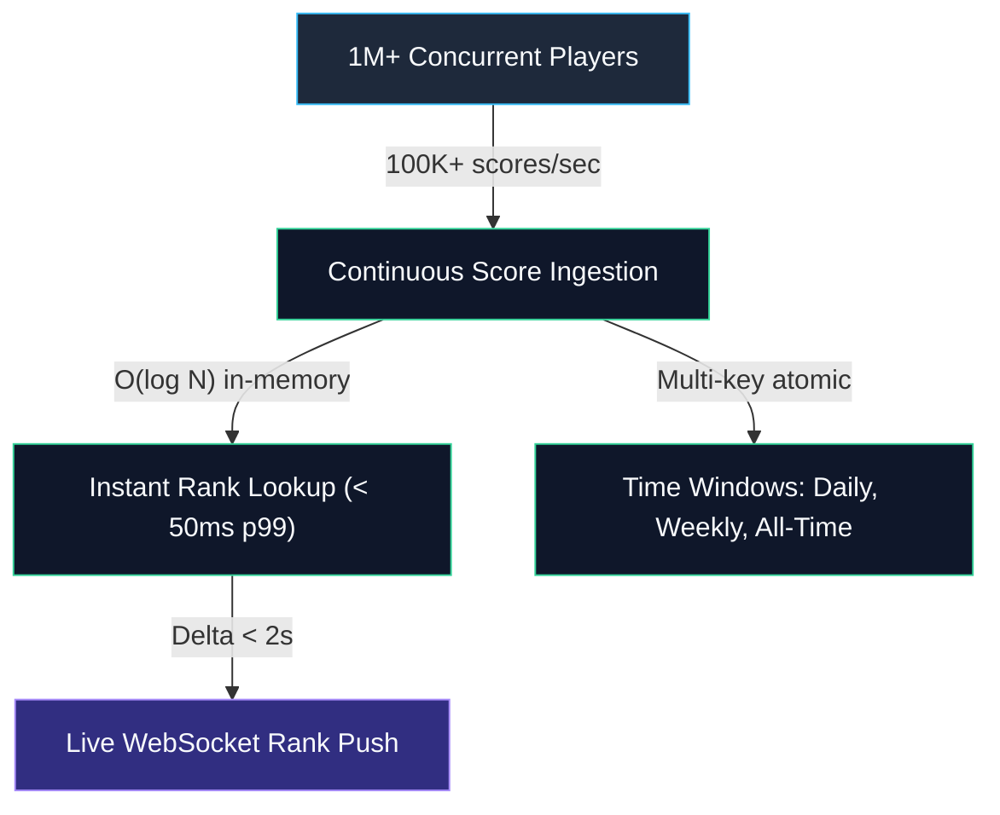
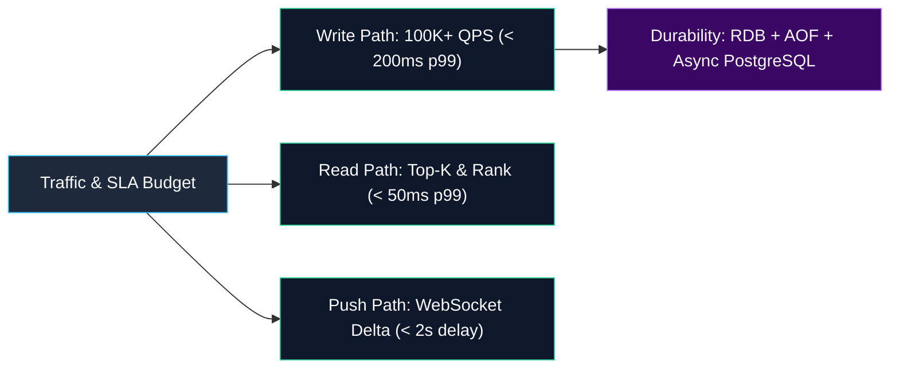
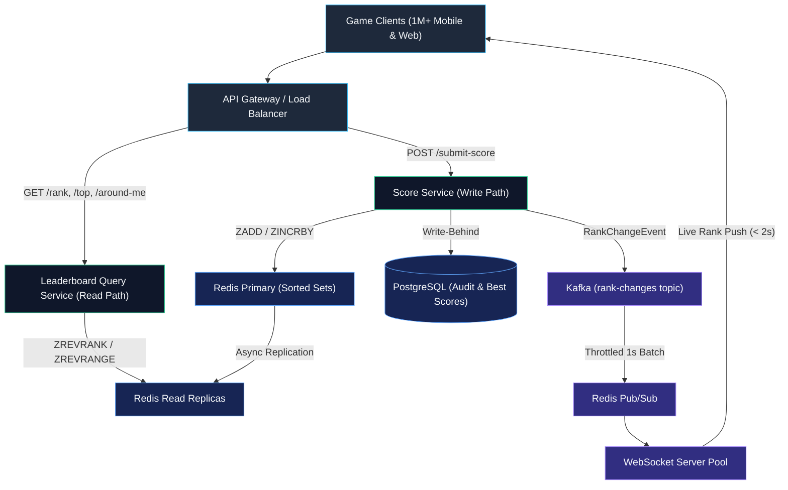
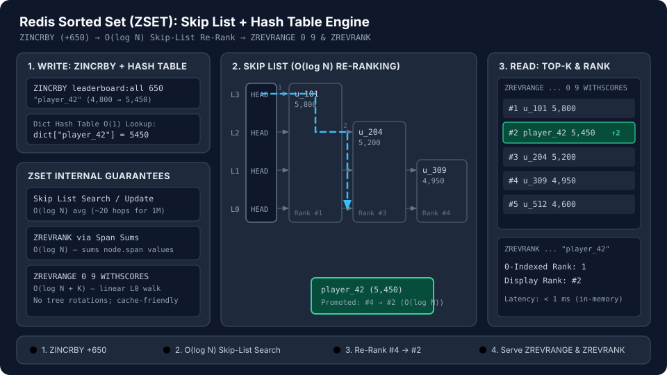
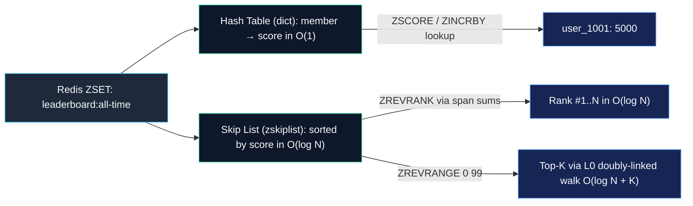
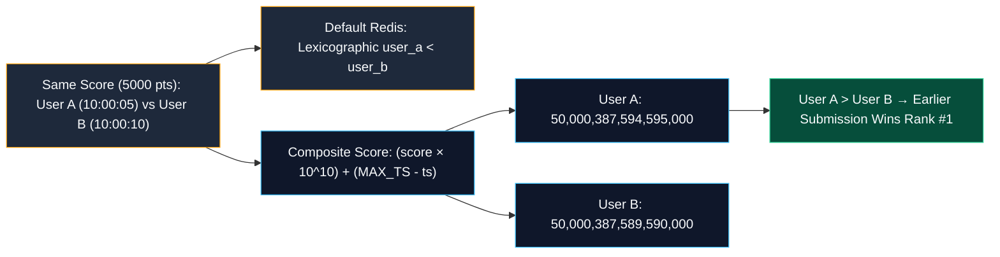
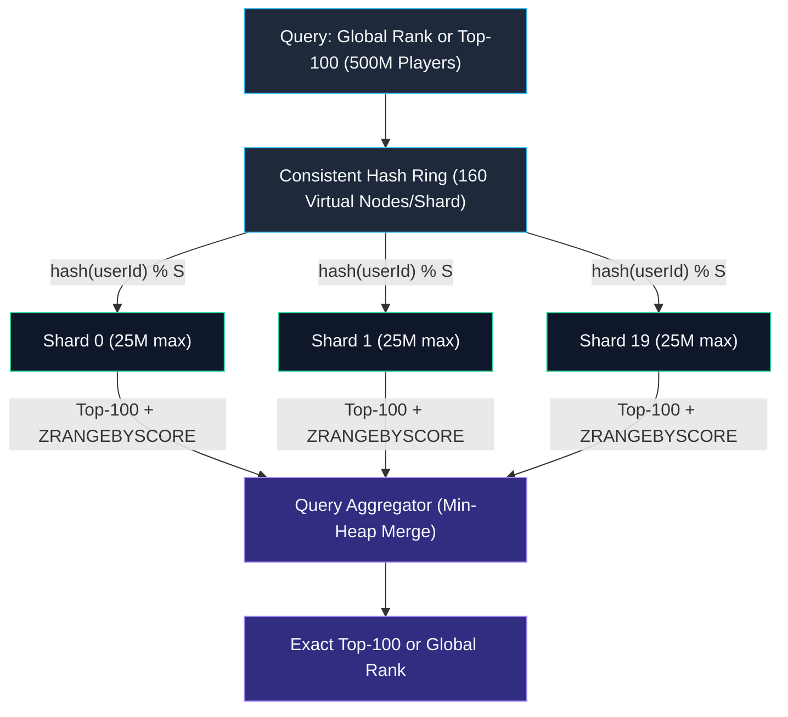
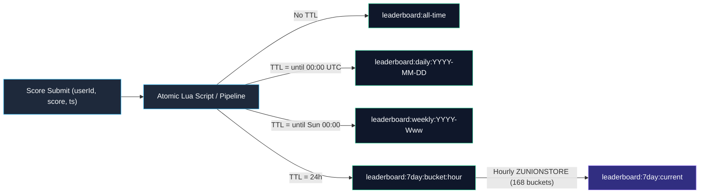

# Design a Real-Time Leaderboard System

> **The Interview Question:**
> "Design a real-time leaderboard system for a mobile game with 1 million active players. Players submit scores continuously. You need to support queries like:
> - Get top 100 players
> - Get user's global rank (must be < 50ms)
> - Get users around my rank (5 above, 5 below)
> - Support time-windowed leaderboards (daily, weekly, all-time)
> - Handle 100K+ score updates per second
> - Real-time push updates when player's rank changes."

This is one of the most common FAANG system design questions. It tests your understanding of **data structures, caching, scaling, and real-time systems**. The twist: everyone knows Redis is fast, but can you build a production system around it?

---

## Table of Contents

1. [Why This Problem Is Hard](#1-why-this-problem-is-hard)
2. [Functional and Non-Functional Requirements](#2-functional-and-non-functional-requirements)
3. [High-Level Architecture](#3-high-level-architecture)
4. [Core Data Structure: Redis Sorted Set (ZSET)](#4-core-data-structure-redis-sorted-set-zset)
5. [Handling Ties: Who Ranks Higher?](#5-handling-ties-who-ranks-higher)
6. [Sharding for Scale: Beyond 25M Players](#6-sharding-for-scale-beyond-25m-players)
7. [Time-Windowed Leaderboards](#7-time-windowed-leaderboards)
8. [Real-Time Updates via WebSocket](#8-real-time-updates-via-websocket)
9. [Leaderboard Around Me](#9-leaderboard-around-me)
10. [Database Design: Redis + PostgreSQL](#10-database-design-redis--postgresql)
11. [Scalability Patterns](#11-scalability-patterns)
12. [Fault Tolerance and Recovery](#12-fault-tolerance-and-recovery)
13. [Complete Java Implementation](#13-complete-java-implementation)
14. [Comparison with Alternatives](#14-comparison-with-alternatives)
15. [Interview Cheat Sheet](#15-interview-cheat-sheet)
16. [Common Follow-Up Questions](#16-common-follow-up-questions)

---

## 1. Why This Problem Is Hard



| Core Challenge | Why Naive Solutions Fail | Production Requirement |
|----------------|--------------------------|------------------------|
| **Speed** | SQL `ORDER BY` is `O(N log N)` on disk | `&lt; 50ms` p99 rank query via `O(log N)` RAM structure |
| **Concurrency** | Row/table locks serialize 100K+ writes/sec | Lock-free / single-threaded atomic `ZADD` &amp; `ZINCRBY` |
| **Scale** | Single Redis node caps around ~25M ZSET members | Hash/hybrid sharding across 20+ nodes for 500M+ users |
| **Tie-Breaking** | Redis breaks ties lexicographically by member ID | Deterministic composite score `(score × 10^10) + (MAX_TS - ts)` |
| **Real-Time Push** | Polling DB 100K/sec saturates network &amp; DB | Throttled Kafka + Redis Pub/Sub → WebSocket fanout |

> [!IMPORTANT]
> The trap in leaderboard interviews is stopping at "just use Redis ZSET." Interviewers expect you to solve **tie-breaking, 25M+ sharding, time-window resets, throttled WebSocket push, and durable DB recovery**.

**The Core Challenges:**

1. **Speed:** < 50ms rank query latency with 1M players (100K updates/sec)
   - Database SELECT with ORDER BY is too slow
   - Needs in-memory data structure with O(log N) operations

2. **Concurrency:** 100K+ concurrent score updates
   - Can't lock for every update
   - Needs atomic operations
   - Must prevent lost updates

3. **Scalability:** Single machine Redis can hold ~25M members in a ZSET
   - What if you have 500M players?
   - Sharding is complex

4. **Ties:** Two players with same score — who ranks higher?
   - Need deterministic tie-breaking
   - Earlier submission should rank higher

5. **Real-Time Push:** Broadcasting rank changes to millions of players
   - Can't query database 100K times per second
   - Needs efficient messaging (Redis Pub/Sub, Kafka)

---

## 2. Functional and Non-Functional Requirements

### Functional Requirements

| Feature | Details |
|---------|---------|
| Submit Score | Player submits score; if higher than previous, update leaderboard |
| Get Top-K | Fetch top 100/1000 players with names, scores, ranks |
| Get User Rank | Query user's global rank (must return "not ranked" if no score) |
| Get Around Me | Fetch 5 players above and 5 below user's current rank |
| Time Windows | Daily, weekly, all-time leaderboards (separate keys) |
| Rank Percentile | "You are in top 5%" (optional but requested) |
| Friend Leaderboard | Rank among friends (optional) |
| Leaderboard Reset | Admin endpoint to reset daily/weekly at scheduled time |

### Non-Functional Requirements

| Metric | Target |
|--------|--------|
| Rank Query Latency | < 50ms (p99) |
| Score Update Latency | < 200ms (p99) |
| Throughput | 100K+ score updates/sec |
| Consistency | Strong consistency (no stale ranks) |
| Availability | 99.95% SLA |
| Players | 1M+ concurrent, 500M+ registered |
| Real-Time Updates | < 2 seconds delay for rank push |
| Data Durability | No score loss (Redis persistence) |



> [!TIP]
> Clarify early in the interview whether scores are **replace-if-higher** (`ZADD GT`) or **cumulative** (`ZINCRBY`). Cumulative arcade/XP games use `ZINCRBY`, while single-run high-score games use `ZADD` (or `ZADD GT` in Redis 6.2+).

---

## 3. High-Level Architecture



```mermaid
sequenceDiagram
    participant C as Game Client
    participant SS as Score Service
    participant R as Redis Primary
    participant K as Kafka + WS Pool
    participant DB as PostgreSQL

    C->>SS: POST /submit-score (userId, score, idempotencyKey)
    SS->>R: ZADD / ZINCRBY leaderboard:all-time
    R-->>SS: Updated score
    SS->>R: ZREVRANK leaderboard:all-time userId
    R-->>SS: New rank
    SS-->>C: 200 OK (newRank)
    par Async Persistence &amp; Push
        SS->>DB: Async insert score_submissions + best_scores
        SS->>K: Publish RankChangeEvent (throttled 1s)
        K-->>C: WebSocket rank update push
    end
```

| Component | Role | Primary Operations | Scaling Mechanism |
|-----------|------|--------------------|-------------------|
| **API Gateway** | TLS, auth, rate limiting, routing | Route writes vs reads, cache Top-K | Horizontal stateless L7 LB |
| **Score Service** | Validate &amp; ingest scores | Anti-cheat check, `ZADD`/`ZINCRBY`, publish event | Auto-scaling stateless pods |
| **Query Service** | Serve low-latency rank reads | `ZREVRANK`, `ZREVRANGE`, `ZCARD` | Read replicas + CDN/edge cache for Top-100 |
| **Redis Cluster** | Authoritative real-time ranking | Sorted Sets (`leaderboard:*`), TTL, Pub/Sub | Hash/hybrid sharding + read replicas |
| **PostgreSQL** | Durable audit trail &amp; recovery | `score_submissions`, `best_scores`, snapshots | Partitioned tables + async write-behind |
| **Kafka + WebSocket** | Real-time rank change broadcast | 1s throttled batching → WS push | Partitioned by `userId` |

> [!NOTE]
> Separating the **Write Path** (Redis Primary) from the **Read Path** (Redis Read Replicas + Top-K cache) ensures 100K+ score writes/sec never starve sub-50ms rank lookups.

**Key Components:**

1. **API Gateway:** Routes requests, caches frequent queries
2. **Score Service:** Handles score submissions, updates Redis + DB
3. **Leaderboard Query Service:** Fast rank lookups from Redis
4. **Redis Cluster:** Sorted Sets for leaderboards + Pub/Sub for events
5. **PostgreSQL:** Audit trail, score history, player profiles
6. **Kafka/Redis Pub/Sub:** Broadcasts rank change events
7. **WebSocket Pool:** Pushes real-time updates to connected clients

---

## 4. Core Data Structure: Redis Sorted Set (ZSET)



### Why Redis ZSET?

Redis Sorted Sets are **the industry standard** for leaderboards because:

| Aspect | Why ZSET | Alternative | Why Not |
|--------|----------|-------------|---------|
| **Lookup Time** | O(log N) rank query | MySQL ORDER BY | O(N log N) or O(N) |
| **In-Memory** | All data in RAM | PostgreSQL | Must hit disk |
| **Atomic Update** | Single ZADD / ZINCRBY operation | DB + app logic | Race conditions |
| **Range Query** | ZREVRANGE returns top-K | Custom app logic | Multiple queries |
| **TTL Support** | EXPIRE per key | Manual cleanup | Resource leak |
| **Pub/Sub** | Integrated messaging | Separate queue | Extra infra |

**Redis ZSET is essentially a dual-indexed `HashTable + SkipList` with O(1) score lookup and O(log N) ordering:**



> [!TIP]
> Redis uses a **Skip List** instead of a Red-Black Tree or B-Tree because skip lists support lock-free/simple `O(log N)` range queries (`ZREVRANGE`) via Level-0 linked traversal and `O(log N)` rank computation (`ZREVRANK`) by summing `span` counters—without complex tree rotations.

### Core ZSET Operations for Leaderboards

```java
// Add or overwrite score
ZADD leaderboard:all-time member_score user_id
  → Time: O(log N)

// Increment existing score atomically (cumulative games / XP)
ZINCRBY leaderboard:all-time increment user_id
  → Time: O(log N)

// Get user's rank (0-indexed, highest score = rank 0)
ZREVRANK leaderboard:all-time user_id
  → Returns: 42 (user is 43rd)
  → Time: O(log N)

// Get top-K
ZREVRANGE leaderboard:all-time 0 99 WITHSCORES
  → Returns: top 100 with scores
  → Time: O(log N + K)

// Get around me (rank 42 ± 5)
ZREVRANGE leaderboard:all-time 37 47 WITHSCORES
  → Returns: 11 users centered on user
  → Time: O(log N + K)

// Count total members
ZCARD leaderboard:all-time
  → Time: O(1)

// Get rank by score range (leaderboard.getRanksBetween(4000, 5000))
ZREVRANGEBYSCORE leaderboard:all-time 5000 4000
  → Time: O(log N + K)

// Remove user (rare, only if player quits)
ZREM leaderboard:all-time user_id
  → Time: O(log N)
```

### Why Redis Skip List Implementation?

Redis doesn't use a simple balanced tree. It uses **Skip Lists** for better performance:

- **O(log N) without complex rebalancing:** Probabilistic levels (p = 0.25) avoid rotation overhead.
- **Cache-friendly linear access at level 0:** `ZREVRANGE 0 K-1` walks sequential pointers at Level 0.
- **Built-in `span` weights:** Each forward pointer stores how many nodes it skips, making `ZREVRANK` `O(log N)`.
- **Dual Hash Table:** `ZSCORE` and `ZINCRBY` locate the member's current score in `O(1)` before updating the skip list.

---

## 5. Handling Ties: Who Ranks Higher?



| Tie-Breaking Strategy | How It Works | Atomic? | Precision / Overhead | Verdict |
|-----------------------|--------------|---------|----------------------|---------|
| **Composite Score (Recommended)** | `(score × 10^10) + (MAX_TS - ts)` | Yes (`ZADD`) | Must fit 53-bit IEEE-754 mantissa | Best for production |
| **Composite Member Key** | `"user_a#1612919405000"` | Yes (`ZADD`) | String split on every read; breaks `ZSCORE` by `userId` | Debugging / small scale |
| **Two Sorted Sets** | Primary ZSET + secondary timestamp ZSET | No (2 keys) | Requires Lua/app merge on ties | Avoid unless required |

> [!WARNING]
> Redis stores ZSET scores as **IEEE-754 64-bit doubles**, which only represent integers exactly up to $2^{53} \approx 9 \times 10^{15}$. If `actual_score * 10^10` exceeds $9 \times 10^{15}$, use **second-level timestamps** (e.g., `10^9` multiplier or fractional decimal encoding `score + (MAX_TS - ts) / 10^13`) to avoid precision loss.

### The Problem

```
Two players with same score (5000 points):
  - User A: 5000 points, submitted at 10:00:05
  - User B: 5000 points, submitted at 10:00:10

Question: Who ranks higher?

In ZSET: ZADD leaderboard:all-time 5000 user_a 5000 user_b
  → Both have score 5000
  → Redis uses lexicographic order on member names (alphabetical)
  → user_a < user_b alphabetically
  → user_a ranks higher (arbitrary — not fair!)

Best Practice: Earlier submission should rank higher
  → User A submitted first → User A should be rank #1
```

### Solution 1: Composite Score (Most Common)

Use score as primary key and timestamp as tie-breaker:

```java
// Composite score formula:
// final_score = (actual_score) * 10^10 + (MAX_TIMESTAMP - submission_timestamp)
//             = score that preserves order AND breaks ties chronologically

long MAX_TIMESTAMP = 2_000_000_000_000L;  // year 2033 (safe)
long submission_timestamp = System.currentTimeMillis();
long actual_score = 5000;

double composite_score = actual_score * 10_000_000_000D
                         + (MAX_TIMESTAMP - submission_timestamp);

// For User A (submitted 10:00:05):
double score_a = 5000 * 10_000_000_000 + (MAX_TIMESTAMP - 1612919405000L)
               = 50_000_000_000_000 + 387_594_595_000
               = 50_000_387_594_595_000

// For User B (submitted 10:00:10, 5 seconds later):
double score_b = 5000 * 10_000_000_000 + (MAX_TIMESTAMP - 1612919410000L)
               = 50_000_000_000_000 + 387_589_590_000
               = 50_000_387_589_590_000

// score_a > score_b → User A ranks higher (first!)
// This works because:
//   1) Primary score difference >> timestamp difference
//   2) Earlier timestamp has larger (MAX_TIMESTAMP - ts) value
//   3) Redis ZSET descending rank preserves this order
```

**Advantages:**
- Simple to implement
- Single ZADD operation (atomic)
- No separate tie-breaking logic needed
- Works with all ZSET operations

**Disadvantages:**
- Score not human-readable
- Must reverse-engineer actual score: `score / 10^10`

### Solution 2: Composite Key in Application Layer

```java
// Store composite key like: "user_id#timestamp"
// ZADD leaderboard:all-time 5000 "user_a#1612919405000"
//                          5000 "user_b#1612919410000"

// Parse when displaying:
String composite_member = "user_a#1612919405000";
String[] parts = composite_member.split("#");
String user_id = parts[0];
long timestamp = Long.parseLong(parts[1]);
```

**Advantages:**
- More readable for debugging
- Easy to extract actual user_id later

**Disadvantages:**
- Extra parsing overhead
- String concatenation for every score update

### Solution 3: Two Sorted Sets (Rare)

```java
// Primary ZSET: score only
ZADD leaderboard:scores 5000 user_a 5000 user_b

// Secondary ZSET: same score, timestamp as score
ZADD leaderboard:scores:timestamps 1612919405000 user_a
                                     1612919410000 user_b

// When querying: get top by primary score,
// if tied, use secondary to break ties
```

**Disadvantages:** Requires two data structures, complex logic

---

## 6. Sharding for Scale: Beyond 25M Players



> [!IMPORTANT]
> For **100M–500M+ players**, avoid Range-Based Sharding alone because top-tier players create a **hot shard**. Use **Hash-Based (or Hybrid) Sharding** with consistent hashing virtual nodes, and cache the merged Top-100 for 1–2 seconds to eliminate scatter-gather fanout on reads.

### The Capacity Problem

```
Redis ZSET capacity: ~25 million members per node
Max members per node: 25M
Memory per member: ~100-200 bytes
Max memory per ZSET: 2.5-5GB

Scenario: 500 million active players
  500M / 25M = 20 Redis nodes needed

If single ZSET:
  - Memory: 50-100 GB (one node can't hold it)
  - "Get top 100" works fine (select 1 node)
  - "Get user rank" problematic (must hit correct shard)
```

### Sharding Strategy 1: Hash-Based Sharding (By User ID)

```
Calculate: shard_id = hash(user_id) % num_shards

Example: 8 shards
  user_1001 → hash = 12345 % 8 = 5 → shard 5
  user_2002 → hash = 67890 % 8 = 2 → shard 2
  user_3003 → hash = 11111 % 8 = 7 → shard 7

Advantages:
  ✓ Even distribution
  ✓ Deterministic (same user always goes to same shard)
  ✓ Easy to rebalance with consistent hashing
  ✓ Get user rank = O(1) shard lookup

Disadvantages:
  ✗ "Get top 100" requires querying ALL shards, then merging O(num_shards * K)
  ✗ Query becomes: ZREVRANGE shard_0 0 99, shard_1 0 99, ..., then merge
  ✗ With 20 shards × 100 = 2000 scores queried, then sorted locally
```

### Sharding Strategy 2: Range-Based Sharding (By Score)

```
Partition score ranges into buckets:

Shard 0: 0 - 1000 points
Shard 1: 1000 - 2000 points
Shard 2: 2000 - 3000 points
...
Shard 9: 9000 - 10000 points

Advantages:
  ✓ "Get top 100" = query shard_9 only (highest score range)
  ✓ "Get around me" = query 1-2 shards in that range
  ✓ Fewer network round-trips

Disadvantages:
  ✗ Hot shard problem: Top scores pile up in shard_9
  ✗ Rebalancing is complex (score ranges shift)
  ✗ Dynamic range changes needed as game progresses
  ✗ "Get user rank" requires scanning multiple shards
```

### Sharding Strategy 3: Hybrid (Recommended)

```
1. Use hash-based sharding for data distribution (even load)
2. For "Get Top-100":
   - Query each shard's top-100
   - Merge results locally
   - O(num_shards * K) but acceptable

3. For "Get User Rank":
   - Hash user_id → shard_id → rank
   - O(1) operation (direct shard)

4. Use consistent hashing for rebalancing:
   - Adding new shard doesn't rehash all users
   - Only rehash subset based on hash ring
```

### Consistent Hashing Implementation

```java
// When adding/removing shards, rebalance gracefully
class ConsistentHashRing {
    private TreeMap<Integer, String> ring = new TreeMap<>();

    public void addNode(String node) {
        for (int i = 0; i < 160; i++) {  // 160 virtual nodes per shard
            int hash = hash(node + ":" + i);
            ring.put(hash, node);
        }
    }

    public String getNode(String key) {
        int hash = hash(key);
        Map.Entry<Integer, String> entry = ring.ceilingEntry(hash);
        return entry != null ? entry.getValue() : ring.firstEntry().getValue();
    }
}
```

### Global Rank Computation Across Shards

```java
// Get user's global rank across all shards
public long getGlobalRank(String userId) {
    String shard = getShardForUser(userId);
    long userScore = redis.zscore(shard + ":leaderboard", userId);
    long rankInShard = redis.zrevrank(shard + ":leaderboard", userId);

    long totalRankBefore = 0;
    for (int i = 0; i < numShards; i++) {
        if (i == shardIndex) continue;

        // Count users in shard i with score > userScore
        long countHigher = redis.zrevrangebyscore(i + ":leaderboard",
                                                   "+inf",
                                                   userScore + 1,
                                                   "LIMIT", "0", "1000");
        totalRankBefore += countHigher;
    }

    return totalRankBefore + rankInShard;
}
```

**Trade-off Summary:**

| Approach | Max Players | Get Top-K | Get Rank | Complexity |
|----------|------------|----------|----------|-----------|
| Single ZSET | 25M | O(log N) | O(log N) | Simple |
| Hash-sharded | 500M+ | O(S × K) | O(1) | Medium |
| Range-sharded | 500M+ | O(log N) | O(S) | Complex |
| Hybrid | 500M+ | O(S × K) | O(1) | Medium |

**Recommendation for interview:** Start with single ZSET (simple), mention sharding as scale requirement.

---

## 7. Time-Windowed Leaderboards



| Window Type | Redis Key Pattern | Expiration / Reset | Update Mechanism |
|-------------|-------------------|--------------------|------------------|
| **All-Time** | `leaderboard:all-time` | Never expires | `ZADD` / `ZINCRBY` |
| **Daily** | `leaderboard:daily:YYYY-MM-DD` | `EXPIRE` at next `00:00 UTC` | Atomic pipeline/Lua |
| **Weekly** | `leaderboard:weekly:YYYY-Www` | `EXPIRE` at next Sunday `00:00 UTC` | Atomic pipeline/Lua |
| **Monthly / Seasonal** | `leaderboard:monthly:YYYY-MM` | `EXPIRE` 30 days + DB archive | Atomic pipeline/Lua |
| **Sliding 7-Day** | `leaderboard:7day:bucket:{hour}` | 168 hourly buckets (`EXPIRE 7d`) | Hourly `ZUNIONSTORE` |

> [!TIP]
> Always set `EXPIRE` **atomically** in the same Lua script or Redis pipeline as `ZADD` so an un-expired key never leaks memory if the application crashes between commands.

### Requirements

```
Game needs simultaneous leaderboards:
1. All-time (never resets)
2. Daily (resets at 00:00 UTC)
3. Weekly (resets on Sunday at 00:00 UTC)
4. Seasonal (resets monthly)
5. Sliding 7-day (shows performance last 7 days)
```

### Implementation: Separate ZSET per Window

```java
// Each leaderboard is independent ZSET
"leaderboard:all-time"        → Never expires
"leaderboard:daily:2026-02-10" → Expires at 2026-02-11 00:00:00 UTC
"leaderboard:weekly:2026-W06"  → Expires at 2026-02-15 00:00:00 UTC
"leaderboard:monthly:2026-02"  → Expires at 2026-03-01 00:00:00 UTC

When player submits score:
  1. ZADD leaderboard:all-time score user_id
  2. ZADD leaderboard:daily:2026-02-10 score user_id
  3. ZADD leaderboard:weekly:2026-W06 score user_id
  4. ZADD leaderboard:monthly:2026-02 score user_id
  5. Publish to rank-change channel
```

### Time Window Calculation

```java
public class LeaderboardWindowUtil {

    // Generate all applicable window keys for a score
    public List<String> getWindowKeys(long timestamp) {
        List<String> windows = new ArrayList<>();

        // All-time (no expiry)
        windows.add("leaderboard:all-time");

        // Daily: YYYY-MM-DD
        String dailyKey = "leaderboard:daily:" +
                         new SimpleDateFormat("yyyy-MM-dd")
                         .format(new Date(timestamp));
        windows.add(dailyKey);

        // Weekly: YYYY-Www
        Calendar cal = Calendar.getInstance();
        cal.setTimeInMillis(timestamp);
        int year = cal.get(Calendar.YEAR);
        int week = cal.get(Calendar.WEEK_OF_YEAR);
        String weeklyKey = String.format("leaderboard:weekly:%d-W%02d",
                                         year, week);
        windows.add(weeklyKey);

        // Monthly: YYYY-MM
        String monthlyKey = "leaderboard:monthly:" +
                           new SimpleDateFormat("yyyy-MM")
                           .format(new Date(timestamp));
        windows.add(monthlyKey);

        return windows;
    }

    // Calculate TTL for daily leaderboard
    public long getTTLForDaily() {
        Calendar tomorrow = Calendar.getInstance();
        tomorrow.add(Calendar.DAY_OF_MONTH, 1);
        tomorrow.set(Calendar.HOUR_OF_DAY, 0);
        tomorrow.set(Calendar.MINUTE, 0);
        tomorrow.set(Calendar.SECOND, 0);

        long ttlMs = tomorrow.getTimeInMillis() - System.currentTimeMillis();
        return ttlMs / 1000;  // in seconds
    }

    // Calculate TTL for weekly
    public long getTTLForWeekly() {
        Calendar nextSunday = Calendar.getInstance();
        nextSunday.set(Calendar.DAY_OF_WEEK, Calendar.SUNDAY);
        nextSunday.add(Calendar.WEEK_OF_MONTH, 1);
        nextSunday.set(Calendar.HOUR_OF_DAY, 0);

        long ttlMs = nextSunday.getTimeInMillis() - System.currentTimeMillis();
        return ttlMs / 1000;
    }
}
```

### Atomic Update of Multiple Windows

```java
@Transactional
public void submitScore(String userId, long score) {
    long timestamp = System.currentTimeMillis();

    // Get all applicable window keys
    List<String> windows = windowUtil.getWindowKeys(timestamp);

    // Use Lua script for atomic multi-key update
    String luaScript =
        "for i, key in ipairs(ARGV) do " +
        "  redis.call('ZADD', key, ARGV[1], ARGV[2]); " +
        "  if i <= 4 then " +  // Daily, weekly, monthly, all-time
        "    redis.call('EXPIRE', key, ARGV[3 + i]); " +
        "  end; " +
        "end; " +
        "return 'OK'";

    List<Object> args = new ArrayList<>();
    args.add(score);
    args.add(userId);
    args.add(getTTLForDaily());      // windows[1] TTL
    args.add(getTTLForWeekly());     // windows[2] TTL
    args.add(getTTLForMonthly());    // windows[3] TTL
    args.add(0);                     // windows[0] (all-time) no TTL

    redisTemplate.execute(new RedisScript<String>() {
        @Override
        public String getScriptAsString() { return luaScript; }
        @Override
        public Class<String> getResultType() { return String.class; }
    }, keys(windows), args);
}
```

### Sliding Window (7-Day Leaderboard)

```
Sliding window is harder because it doesn't align with calendar boundaries.
If we create a new ZSET every hour, that's 24 * 7 = 168 sets to manage!

Solution: Bucketing

1. Create hourly buckets: leaderboard:7day:bucket:2026-02-10:12
2. Every hour, aggregate last 7 days of buckets into leaderboard:7day:current
3. Don't track exact 7 days, track "last 168 hours"

Python-like pseudocode:
    def update_7day_sliding():
        current_hour = now() / 3600
        current_bucket = f"leaderboard:7day:bucket:{current_hour}"

        # Add score to current hour bucket
        ZADD current_bucket user_id score
        EXPIRE current_bucket 24*3600  # Keep 24 hours

        # Every hour, rebuild 7-day aggregate
        agg_key = "leaderboard:7day:current"
        ZUNIONSTORE agg_key 168 bucket_2026-02-10:12 bucket_2026-02-10:11 ... (last 7 days)
        EXPIRE agg_key 3600  # Rebuild every hour
```

---

## 8. Real-Time Updates via WebSocket

### Architecture

```
Score Update Flow:
  1. Player A submits score
  2. Redis ZADD → updates rank
  3. Rank change event published to Kafka
  4. Event processor picks it up
  5. WebSocket server broadcasts rank change to connected clients
  6. Client receives update in real-time (< 2s)

┌──────────────┐
│ Player A     │ Submits score 5000
└──────┬───────┘
       │
       ▼
┌──────────────────────┐
│ Score Service        │
│ ZADD leaderboard 5000│
└──────┬───────────────┘
       │
       ▼
┌──────────────────────────────────────┐
│ Rank Changed Event                   │
│ {userId: A, newRank: 23, newScore: 50│
│  oldRank: 47, window: all-time}      │
└──────┬───────────────────────────────┘
       │
       ▼
┌──────────────────────────────┐
│ Kafka Topic: rank-changes    │
│ (100K messages/sec)          │
└──────┬───────────────────────┘
       │
       ▼
┌──────────────────────────────┐
│ Event Processor              │
│ (Throttle: batch every 1s)   │
└──────┬───────────────────────┘
       │
       ▼
┌──────────────────────────────┐
│ Redis Pub/Sub: user_A_rank_ch│
│ Publish {userId:A, rank: 23} │
└──────┬───────────────────────┘
       │
       ▼
┌──────────────────────────────┐
│ WebSocket Server             │
│ (Connected client listening) │
└──────┬───────────────────────┘
       │
       ▼
┌──────────────────────────────┐
│ Player A's Browser           │
│ Rank Updated: 23 → 22        │
└──────────────────────────────┘
```

### Don't Push Every Single Score Change

```
If we push every score change:
  - 100K score updates/sec
  - Each generates 1 push event
  - That's 100K WebSocket messages/sec
  - Network saturated, clients overloaded

Solution: Throttle updates
  - Batch score changes every 1-2 seconds
  - Only push if rank changed
  - Example: User gains 50 points but rank unchanged → no push
```

### Implementation with Redis Pub/Sub

```java
@Service
public class RealTimeLeaderboardService {

    @Autowired
    private StringRedisTemplate redisTemplate;

    @Autowired
    private WebSocketService wsService;

    // Called after ZADD updates Redis
    public void publishRankChange(String userId, long newScore, int newRank) {

        // Publish to Redis Pub/Sub
        String channel = "rank-change:" + userId;
        RankChangeEvent event = new RankChangeEvent(
            userId, newScore, newRank, System.currentTimeMillis()
        );

        redisTemplate.convertAndSend(channel, convertToJson(event));
    }

    // Subscriber listening to rank changes
    @Component
    public static class RankChangeListener {

        @Autowired
        private StringRedisTemplate redisTemplate;

        @PostConstruct
        public void subscribe() {
            redisTemplate.getConnectionFactory()
                .getConnection()
                .subscribe(new MessageListener() {
                    @Override
                    public void onMessage(Message message, byte[] pattern) {
                        String event = new String(message.getBody());
                        RankChangeEvent rankChange = parseJson(event);

                        // Push to connected clients
                        wsService.broadcastRankChange(rankChange);
                    }
                }, "rank-change:*".getBytes());
        }
    }
}
```

### Throttling Implementation

```java
@Service
public class RankChangeThrottler {

    private final ScheduledExecutorService scheduler =
        Executors.newScheduledThreadPool(4);

    // Buffer changes, flush every 1 second
    private final Map<String, RankChangeEvent> buffer =
        new ConcurrentHashMap<>();

    public RankChangeThrottler() {
        // Flush buffer every 1 second
        scheduler.scheduleAtFixedRate(this::flushBuffer, 1, 1, TimeUnit.SECONDS);
    }

    public void queueRankChange(String userId, int newRank, long newScore) {
        buffer.put(userId, new RankChangeEvent(userId, newRank, newScore));
    }

    private void flushBuffer() {
        Map<String, RankChangeEvent> toFlush = new HashMap<>(buffer);
        buffer.clear();

        // Publish all changes in batch
        toFlush.values().forEach(event -> {
            redisTemplate.convertAndSend("batch-rank-changes",
                                         convertToJson(event));
        });
    }
}
```

---

## 9. Leaderboard Around Me

### Query Pattern

```
Player A wants to see:
  - 5 players ranked higher
  - Player A's rank
  - 5 players ranked lower

If Player A is rank 100:
  - Fetch ranks 95-105 (11 players total)
  - Include name, score, avatar
```

### Redis Command

```java
// Get rank
long rank = redisTemplate.opsForZSet()
    .reverseRank("leaderboard:all-time", userId);  // 0-indexed

// Get scores around rank
int start = Math.max(0, rank - 5);
int end = rank + 5;

Set<ZSetOperations.TypedTuple<String>> aroundMe =
    redisTemplate.opsForZSet()
        .reverseRangeWithScores("leaderboard:all-time", start, end);
```

### Complete Implementation

```java
@Service
public class LeaderboardService {

    @Autowired
    private StringRedisTemplate redisTemplate;

    @Autowired
    private UserService userService;

    public LeaderboardAroundMeResponse getAroundMe(String userId) {

        // Step 1: Get user's rank
        Long rank = redisTemplate.opsForZSet()
            .reverseRank("leaderboard:all-time", userId);

        if (rank == null) {
            // User not ranked
            return new LeaderboardAroundMeResponse(
                null, Collections.emptyList()
            );
        }

        // Step 2: Get 5 above, self, 5 below
        int startIndex = Math.max(0, (int) rank - 5);
        int endIndex = (int) rank + 5;

        Set<ZSetOperations.TypedTuple<String>> members =
            redisTemplate.opsForZSet()
                .reverseRangeWithScores("leaderboard:all-time",
                                        startIndex, endIndex);

        // Step 3: Build response with user details
        List<LeaderboardEntry> entries = new ArrayList<>();
        int currentRank = startIndex;

        for (ZSetOperations.TypedTuple<String> tuple : members) {
            String memberId = tuple.getValue();
            Double score = tuple.getScore();

            User user = userService.getUser(memberId);

            LeaderboardEntry entry = new LeaderboardEntry(
                memberId,
                user.getName(),
                user.getAvatarUrl(),
                score.longValue(),
                currentRank + 1,  // 1-indexed for display
                memberId.equals(userId)  // isCurrentUser
            );

            entries.add(entry);
            currentRank++;
        }

        User currentUser = userService.getUser(userId);
        LeaderboardEntry userEntry = new LeaderboardEntry(
            userId, currentUser.getName(), currentUser.getAvatarUrl(),
            redisTemplate.opsForZSet().score("leaderboard:all-time",
                                             userId).longValue(),
            (int) rank + 1, true
        );

        return new LeaderboardAroundMeResponse(userEntry, entries);
    }
}

@Data
public class LeaderboardAroundMeResponse {
    private LeaderboardEntry userRank;
    private List<LeaderboardEntry> aroundMe;
}

@Data
public class LeaderboardEntry {
    private String userId;
    private String userName;
    private String avatarUrl;
    private long score;
    private int rank;
    private boolean isCurrentUser;
}
```

---

## 10. Database Design: Redis + PostgreSQL

### Redis Schema

```
Keys:
  leaderboard:all-time                    → ZSET
  leaderboard:daily:YYYY-MM-DD            → ZSET (expires)
  leaderboard:weekly:YYYY-Www             → ZSET (expires)
  leaderboard:monthly:YYYY-MM             → ZSET (expires)

  user:profile:{userId}                   → HASH
  user:session:{userId}                   → STRING (WebSocket session)

Pub/Sub Channels:
  rank-change:{userId}                    → Score/rank changes
  batch-rank-changes                      → Batched updates
  leaderboard-reset                       → Admin resets
```

### PostgreSQL Schema

```sql
-- Players table
CREATE TABLE players (
    id BIGINT PRIMARY KEY,
    username VARCHAR(255) NOT NULL UNIQUE,
    email VARCHAR(255) UNIQUE,
    avatar_url VARCHAR(1024),
    country_code VARCHAR(2),
    created_at TIMESTAMP DEFAULT CURRENT_TIMESTAMP,
    updated_at TIMESTAMP DEFAULT CURRENT_TIMESTAMP ON UPDATE CURRENT_TIMESTAMP,
    INDEX idx_created (created_at)
);

-- Score history (audit trail)
CREATE TABLE score_submissions (
    id BIGINT PRIMARY KEY AUTO_INCREMENT,
    player_id BIGINT NOT NULL,
    score_value BIGINT NOT NULL,
    game_mode VARCHAR(50),  -- 'casual', 'competitive', etc.
    submitted_at TIMESTAMP DEFAULT CURRENT_TIMESTAMP,
    is_valid BOOLEAN DEFAULT TRUE,
    validation_notes TEXT,

    FOREIGN KEY (player_id) REFERENCES players(id),
    INDEX idx_player_submitted (player_id, submitted_at DESC),
    INDEX idx_score_submitted (score_value DESC, submitted_at DESC)
);

-- Player best scores per window
CREATE TABLE best_scores (
    id BIGINT PRIMARY KEY AUTO_INCREMENT,
    player_id BIGINT NOT NULL,
    leaderboard_window VARCHAR(50),  -- 'all-time', 'daily:2026-02-10', etc.
    best_score BIGINT NOT NULL,
    achieved_at TIMESTAMP,
    rank_at_time INT,

    FOREIGN KEY (player_id) REFERENCES players(id),
    UNIQUE KEY unique_player_window (player_id, leaderboard_window),
    INDEX idx_window_rank (leaderboard_window, rank_at_time)
);

-- Daily leaderboard snapshot (for historical reference)
CREATE TABLE leaderboard_snapshots (
    id BIGINT PRIMARY KEY AUTO_INCREMENT,
    window_type VARCHAR(50),  -- 'daily', 'weekly'
    window_key VARCHAR(100),  -- '2026-02-10', '2026-W06'
    player_id BIGINT NOT NULL,
    score BIGINT NOT NULL,
    rank INT NOT NULL,
    percentile DECIMAL(5, 2),  -- 99.5 = top 0.5%
    snapshot_at TIMESTAMP DEFAULT CURRENT_TIMESTAMP,

    FOREIGN KEY (player_id) REFERENCES players(id),
    INDEX idx_window_rank (window_key, rank),
    INDEX idx_player_window (player_id, window_key)
);
```

### Write-Behind Pattern

```java
@Service
public class ScoreServiceWithPersistence {

    @Autowired
    private StringRedisTemplate redisTemplate;

    @Autowired
    private ScoreSubmissionRepository scoreRepo;

    @Autowired
    private AsyncExecutor asyncExecutor;

    @Transactional
    public ScoreSubmissionResponse submitScore(String userId, long score) {

        // Step 1: Validate score
        if (!isValidScore(score)) {
            return new ScoreSubmissionResponse(false, "Invalid score");
        }

        long timestamp = System.currentTimeMillis();

        // Step 2: Update Redis immediately (hot path)
        List<String> windows = getLeaderboardWindows(timestamp);
        windows.forEach(window -> {
            redisTemplate.opsForZSet().add(window, userId, score);
        });

        // Step 3: Publish rank change event
        int newRank = redisTemplate.opsForZSet()
            .reverseRank("leaderboard:all-time", userId).intValue();
        publishRankChange(userId, score, newRank);

        // Step 4: Async persist to DB (write-behind)
        asyncExecutor.executeAsync(() -> {
            ScoreSubmission submission = new ScoreSubmission();
            submission.setPlayerId(userId);
            submission.setScoreValue(score);
            submission.setSubmittedAt(new Date(timestamp));
            submission.setIsValid(true);

            scoreRepo.save(submission);

            // Update best_scores
            updateBestScores(userId, score, timestamp);
        });

        return new ScoreSubmissionResponse(true, "Score accepted");
    }

    // Async task: persist to DB after Redis update succeeds
    private void updateBestScores(String userId, long score,
                                  long timestamp) {
        // Check if this is a new high score for each window
        windows.forEach(window -> {
            Long currentBest = getCurrentBestScore(userId, window);
            if (currentBest == null || score > currentBest) {
                updateOrCreateBestScore(userId, window, score, timestamp);
            }
        });
    }
}
```

**Advantages of Write-Behind:**
- ✓ Fast response to client (update Redis, return)
- ✓ DB writes don't block score submission
- ✓ Survives temporary DB outages
- ✓ Can batch DB writes

**Disadvantages:**
- ✗ Brief window where Redis and DB are out of sync
- ✗ If service crashes, pending writes are lost (mitigate with persistent queue)

---

## 11. Scalability Patterns

### Pattern 1: Read Replicas for Query Distribution

```
                    ┌─────────────────────────────────┐
                    │  Redis Primary (write)           │
                    │  leaderboard:all-time (write)   │
                    │  leaderboard:daily:* (write)    │
                    └────────────────┬─────────────────┘
                                     │ replication
                    ┌────────────────┴────────────────┐
                    ▼                                 ▼
        ┌──────────────────────┐      ┌──────────────────────┐
        │ Redis Replica 1      │      │ Redis Replica 2      │
        │ (read-only)          │      │ (read-only)          │
        │ Rank queries         │      │ Top-K queries        │
        │ 50K QPS              │      │ 50K QPS              │
        └──────────────────────┘      └──────────────────────┘

Write Path: Score Service → Primary (ZADD)
Read Path: Leaderboard Service → Replica 1 or 2 (ZREVRANK, ZREVRANGE)
```

### Pattern 2: Write Coalescing (Batch Updates)

```
Instead of:
  ZADD leaderboard:all-time 5000 user_a
  ZADD leaderboard:all-time 4950 user_b
  ZADD leaderboard:all-time 4900 user_c
  (3 separate network round-trips)

Do:
  pipeline.zadd(leaderboard:all-time, 5000, user_a)
  pipeline.zadd(leaderboard:all-time, 4950, user_b)
  pipeline.zadd(leaderboard:all-time, 4900, user_c)
  pipeline.execute()  // Single network round-trip
```

### Pattern 3: Approximate Ranking (For 1B+ Players)

```
For massive scale, exact rank becomes expensive:
  - 1 billion players
  - Each rank query = O(log N) = O(30) comparisons
  - 100K QPS = 3 million comparisons/sec (still fast, but...)

Probabilistic Solution: HyperLogLog + Sampling
  - Store score percentiles in separate HLL
  - "You are in top 5%" instead of exact rank
  - O(1) memory, O(1) query time
  - Error margin: ~1-2%

Implementation:
  PFADD leaderboard:percentile:user_a 5000
  // Later: estimate percentile from HLL
```

### Pattern 4: Segment Leaderboards

Instead of single global leaderboard:

```
1. Regional leaderboards:
   leaderboard:all-time:us
   leaderboard:all-time:eu
   leaderboard:all-time:apac

2. Country-level:
   leaderboard:all-time:us:california
   leaderboard:all-time:us:texas

3. Friend group:
   leaderboard:friend-group:{groupId}

4. Level-based:
   leaderboard:level-1:all-time
   leaderboard:level-5:all-time

Benefit: Smaller ZSETs (faster queries), more engaging for players
```

---

## 12. Fault Tolerance and Recovery

### Redis Persistence

```
Two persistence strategies:

1. RDB (Redis Database): Point-in-time snapshots
   - BGSAVE: Background save (non-blocking)
   - Save every 60 seconds
   - If crash: lose last 60 seconds of data

2. AOF (Append-Only File): Write every command to disk
   - fsync every 1 second
   - More durable, slightly slower

Best practice: Use both!
   save 60 1000  # Save if 1000 keys changed in 60 seconds
   appendonly yes
   appendfsync everysec
```

### Recovery from Redis Crash

```
Scenario: Redis node with leaderboard:all-time crashes

1. Identify missing node
2. Rebuild ZSET from PostgreSQL best_scores table:

   for row in SELECT player_id, best_score FROM best_scores
              WHERE leaderboard_window = 'all-time':
       ZADD leaderboard:all-time row.best_score row.player_id

3. Verify integrity:
   - Compare ZCARD(Redis) vs count(PostgreSQL)
   - If different, investigate

4. Gradual switchover:
   - Rebuild in background
   - Once caught up, switch traffic gradually
```

### Idempotent Score Updates

```
Problem: Network retry on timeout
  - Client sends score update
  - Network timeout
  - Client retries (thinks it failed)
  - Score submitted twice by accident

Solution: Idempotency keys

  Each score submission gets UUID:
    {
      "userId": "user_1001",
      "score": 5000,
      "idempotencyKey": "550e8400-e29b-41d4-a716-446655440000"
    }

  Server stores: idempotency_key → response
  If duplicate idempotency_key arrives → return cached response

Implementation:
  CREATE TABLE idempotency_log (
      key VARCHAR(36) PRIMARY KEY,
      response_json TEXT,
      created_at TIMESTAMP
  );

  @PostMapping("/submit-score")
  public ScoreResponse submitScore(@RequestBody ScoreRequest req) {

      // Check if already processed
      Optional<String> cachedResponse =
          idempotencyRepo.findResponseByKey(req.getIdempotencyKey());
      if (cachedResponse.isPresent()) {
          return deserialize(cachedResponse.get());
      }

      // Process score
      ScoreResponse response = processScore(req);

      // Cache response
      idempotencyRepo.save(new IdempotencyLog(
          req.getIdempotencyKey(),
          serialize(response)
      ));

      return response;
  }
```

### Anti-Cheat: Score Validation

```java
public boolean isValidScore(long score, String userId) {

    // Rule 1: Score can't exceed max possible in game
    if (score > MAX_POSSIBLE_SCORE) {
        return false;
    }

    // Rule 2: Score must be reasonable increase from last score
    long lastScore = getLastScoreFromDB(userId);
    long maxReasonableGain = 1000;  // Max gain per submission
    if (score > lastScore + maxReasonableGain) {
        return false;
    }

    // Rule 3: Score must be submitted at reasonable rate
    long lastSubmitTime = getLastSubmitTimeFromDB(userId);
    long minTimeBetweenSubmits = 5000;  // 5 seconds
    if (System.currentTimeMillis() - lastSubmitTime < minTimeBetweenSubmits) {
        return false;
    }

    // Rule 4: Check for impossible sequences
    if (!isPossibleGameSequence(userId, score)) {
        return false;
    }

    return true;
}
```

---

## 13. Complete Java Implementation

### Project Setup

```xml
<!-- pom.xml -->
<dependency>
    <groupId>org.springframework.boot</groupId>
    <artifactId>spring-boot-starter-data-redis</artifactId>
</dependency>

<dependency>
    <groupId>redis.clients</groupId>
    <artifactId>jedis</artifactId>
</dependency>

<dependency>
    <groupId>io.lettuce</groupId>
    <artifactId>lettuce-core</artifactId>
</dependency>

<dependency>
    <groupId>org.springframework.kafka</groupId>
    <artifactId>spring-kafka</artifactId>
</dependency>

<dependency>
    <groupId>org.springframework.boot</groupId>
    <artifactId>spring-boot-starter-websocket</artifactId>
</dependency>
```

### Redis Configuration

```java
@Configuration
public class RedisConfig {

    @Bean
    public LettuceConnectionFactory redisConnectionFactory() {
        LettuceClientConfiguration clientConfig = LettuceClientConfiguration
            .builder()
            .readFrom(ReadFrom.REPLICA_PREFERRED)
            .build();

        return new LettuceConnectionFactory(
            new RedisStandaloneConfiguration("localhost", 6379),
            clientConfig
        );
    }

    @Bean
    public StringRedisTemplate redisTemplate(
            LettuceConnectionFactory connectionFactory) {
        StringRedisTemplate template = new StringRedisTemplate();
        template.setConnectionFactory(connectionFactory);
        return template;
    }

    @Bean
    public RedisTemplate<String, Object> objectRedisTemplate(
            LettuceConnectionFactory connectionFactory) {
        RedisTemplate<String, Object> template = new RedisTemplate<>();
        template.setConnectionFactory(connectionFactory);

        Jackson2JsonRedisSerializer<Object> jackson2JsonRedisSerializer =
            new Jackson2JsonRedisSerializer<>(Object.class);
        ObjectMapper om = new ObjectMapper();
        om.setVisibility(PropertyAccessor.ALL, JsonAutoDetect.Visibility.ANY);
        jackson2JsonRedisSerializer.setObjectMapper(om);

        StringRedisSerializer stringRedisSerializer =
            new StringRedisSerializer();

        template.setKeySerializer(stringRedisSerializer);
        template.setValueSerializer(jackson2JsonRedisSerializer);
        template.setHashKeySerializer(stringRedisSerializer);
        template.setHashValueSerializer(jackson2JsonRedisSerializer);

        return template;
    }
}
```

### Core Leaderboard Service

```java
@Service
public class LeaderboardService {

    @Autowired
    private StringRedisTemplate redisTemplate;

    @Autowired
    private ObjectRedisTemplate objectRedisTemplate;

    @Autowired
    private PlayerRepository playerRepository;

    @Autowired
    private ScoreSubmissionRepository scoreRepository;

    @Autowired
    private RankChangePublisher rankChangePublisher;

    private static final String LEADERBOARD_KEY_ALL_TIME =
        "leaderboard:all-time";
    private static final String LEADERBOARD_KEY_DAILY_PREFIX =
        "leaderboard:daily:";
    private static final String LEADERBOARD_KEY_WEEKLY_PREFIX =
        "leaderboard:weekly:";

    /**
     * Submit a score for a player
     * - Updates all applicable leaderboards (all-time, daily, weekly)
     * - Publishes rank change event if rank changed
     * - Async persists to database
     */
    public ScoreSubmissionResponse submitScore(String userId, long score) {

        // Validation
        if (!playerRepository.existsById(userId)) {
            return ScoreSubmissionResponse.error("Player not found");
        }

        if (!isValidScore(userId, score)) {
            return ScoreSubmissionResponse.error("Invalid score");
        }

        long timestamp = System.currentTimeMillis();
        Long oldRank = null;

        try {
            // Get old rank before update
            oldRank = redisTemplate.opsForZSet()
                .reverseRank(LEADERBOARD_KEY_ALL_TIME, userId);

            // Update all leaderboard windows
            List<String> windowKeys = getLeaderboardWindowKeys(timestamp);

            // Use pipeline for batch update
            redisTemplate.executePipelined((RedisCallback<Object>) connection -> {
                for (String window : windowKeys) {
                    connection.zAdd(
                        window.getBytes(),
                        score,
                        userId.getBytes()
                    );

                    // Set TTL for time-windowed leaderboards
                    if (!window.equals(LEADERBOARD_KEY_ALL_TIME)) {
                        long ttl = getTTLForWindow(window);
                        connection.expire(window.getBytes(), ttl);
                    }
                }
                return null;
            });

            // Get new rank after update
            Long newRank = redisTemplate.opsForZSet()
                .reverseRank(LEADERBOARD_KEY_ALL_TIME, userId);

            // Publish rank change if rank changed
            if (oldRank != null && newRank != null &&
                !oldRank.equals(newRank)) {
                rankChangePublisher.publishRankChange(userId, score,
                                                      newRank.intValue());
            }

            // Async persist to database (non-blocking)
            asyncPersistScore(userId, score, timestamp);

            return ScoreSubmissionResponse.success(
                newRank != null ? newRank.intValue() + 1 : -1
            );

        } catch (Exception e) {
            return ScoreSubmissionResponse.error("Score update failed: " +
                                                 e.getMessage());
        }
    }

    /**
     * Get user's rank in a leaderboard
     * O(log N) operation
     */
    public RankResponse getUserRank(String userId, String leaderboard) {

        String key = getLeaderboardKey(leaderboard);

        Long rank = redisTemplate.opsForZSet()
            .reverseRank(key, userId);

        if (rank == null) {
            return RankResponse.notRanked();
        }

        Double score = redisTemplate.opsForZSet()
            .score(key, userId);

        Long totalPlayers = redisTemplate.opsForZSet()
            .zCard(key);

        double percentile = (100.0 * (rank + 1)) / totalPlayers;

        return RankResponse.builder()
            .rank(rank.intValue() + 1)  // 1-indexed
            .score(score.longValue())
            .percentile(String.format("%.2f", percentile))
            .totalPlayers(totalPlayers.intValue())
            .build();
    }

    /**
     * Get top K players
     * O(log N + K) operation
     */
    public List<LeaderboardEntry> getTopK(String leaderboard, int k) {

        String key = getLeaderboardKey(leaderboard);

        Set<ZSetOperations.TypedTuple<String>> topKSet =
            redisTemplate.opsForZSet()
                .reverseRangeWithScores(key, 0, k - 1);

        List<LeaderboardEntry> entries = new ArrayList<>();
        int rank = 1;

        for (ZSetOperations.TypedTuple<String> tuple : topKSet) {
            String userId = tuple.getValue();
            Long score = tuple.getScore().longValue();

            Player player = playerRepository.findById(userId)
                .orElse(null);

            LeaderboardEntry entry = LeaderboardEntry.builder()
                .rank(rank)
                .userId(userId)
                .userName(player != null ? player.getUsername() : userId)
                .avatarUrl(player != null ? player.getAvatarUrl() : "")
                .score(score)
                .build();

            entries.add(entry);
            rank++;
        }

        return entries;
    }

    /**
     * Get leaderboard around user
     * O(log N + K) operation
     */
    public LeaderboardAroundMeResponse getAroundMe(String userId,
                                                   String leaderboard,
                                                   int radius) {

        String key = getLeaderboardKey(leaderboard);

        Long rank = redisTemplate.opsForZSet()
            .reverseRank(key, userId);

        if (rank == null) {
            return LeaderboardAroundMeResponse.notRanked();
        }

        int startIndex = Math.max(0, (int) rank - radius);
        int endIndex = (int) rank + radius;

        Set<ZSetOperations.TypedTuple<String>> members =
            redisTemplate.opsForZSet()
                .reverseRangeWithScores(key, startIndex, endIndex);

        List<LeaderboardEntry> entries = new ArrayList<>();
        int currentRank = startIndex + 1;

        Player currentUser = playerRepository.findById(userId)
            .orElse(null);
        LeaderboardEntry userEntry = null;

        for (ZSetOperations.TypedTuple<String> tuple : members) {
            String memberId = tuple.getValue();
            Long score = tuple.getScore().longValue();

            Player player = playerRepository.findById(memberId)
                .orElse(null);

            LeaderboardEntry entry = LeaderboardEntry.builder()
                .rank(currentRank)
                .userId(memberId)
                .userName(player != null ? player.getUsername() : memberId)
                .avatarUrl(player != null ? player.getAvatarUrl() : "")
                .score(score)
                .isCurrentUser(memberId.equals(userId))
                .build();

            entries.add(entry);

            if (memberId.equals(userId)) {
                userEntry = entry;
            }

            currentRank++;
        }

        return LeaderboardAroundMeResponse.builder()
            .userRank(userEntry)
            .aroundMe(entries)
            .build();
    }

    /**
     * Get all leaderboard window keys applicable for a timestamp
     */
    private List<String> getLeaderboardWindowKeys(long timestamp) {
        List<String> windows = new ArrayList<>();

        // All-time (never expires)
        windows.add(LEADERBOARD_KEY_ALL_TIME);

        // Daily: YYYY-MM-DD
        SimpleDateFormat dailyFormat = new SimpleDateFormat("yyyy-MM-dd");
        dailyFormat.setTimeZone(TimeZone.getTimeZone("UTC"));
        String dailyKey = LEADERBOARD_KEY_DAILY_PREFIX +
                         dailyFormat.format(new Date(timestamp));
        windows.add(dailyKey);

        // Weekly: YYYY-Www
        Calendar cal = Calendar.getInstance(TimeZone.getTimeZone("UTC"));
        cal.setTimeInMillis(timestamp);
        int year = cal.get(Calendar.YEAR);
        int week = cal.get(Calendar.WEEK_OF_YEAR);
        String weeklyKey = LEADERBOARD_KEY_WEEKLY_PREFIX +
                          String.format("%d-W%02d", year, week);
        windows.add(weeklyKey);

        return windows;
    }

    /**
     * Validate score before accepting
     */
    private boolean isValidScore(String userId, long score) {

        // Rule 1: Score within valid range
        if (score < 0 || score > 1_000_000_000) {
            return false;
        }

        // Rule 2: Score must be reasonable increase from last
        Long lastScore = getLastScoreFromCache(userId);
        if (lastScore != null && score > lastScore + 100_000) {
            return false;  // Suspicious jump
        }

        // Rule 3: Rate limiting per player
        Long lastSubmitTime = (Long) redisTemplate.opsForValue()
            .get("last-submit:" + userId);
        if (lastSubmitTime != null) {
            long timeSinceLastSubmit = System.currentTimeMillis() -
                                      lastSubmitTime;
            if (timeSinceLastSubmit < 1000) {  // Minimum 1 second
                return false;
            }
        }

        return true;
    }

    /**
     * Calculate TTL for time-windowed leaderboards
     */
    private long getTTLForWindow(String windowKey) {
        if (windowKey.startsWith(LEADERBOARD_KEY_DAILY_PREFIX)) {
            return getTTLUntilNextDay();
        } else if (windowKey.startsWith(LEADERBOARD_KEY_WEEKLY_PREFIX)) {
            return getTTLUntilNextWeek();
        }
        return 0;  // All-time doesn't expire
    }

    private long getTTLUntilNextDay() {
        Calendar tomorrow = Calendar.getInstance(TimeZone.getTimeZone("UTC"));
        tomorrow.add(Calendar.DAY_OF_MONTH, 1);
        tomorrow.set(Calendar.HOUR_OF_DAY, 0);
        tomorrow.set(Calendar.MINUTE, 0);
        tomorrow.set(Calendar.SECOND, 0);

        long ttlMs = tomorrow.getTimeInMillis() - System.currentTimeMillis();
        return (ttlMs / 1000) + 1;
    }

    private long getTTLUntilNextWeek() {
        Calendar nextWeek = Calendar.getInstance(TimeZone.getTimeZone("UTC"));
        nextWeek.set(Calendar.DAY_OF_WEEK, Calendar.SUNDAY);
        nextWeek.add(Calendar.WEEK_OF_YEAR, 1);
        nextWeek.set(Calendar.HOUR_OF_DAY, 0);

        long ttlMs = nextWeek.getTimeInMillis() - System.currentTimeMillis();
        return (ttlMs / 1000) + 1;
    }

    private Long getLastScoreFromCache(String userId) {
        String score = (String) redisTemplate.opsForValue()
            .get("last-score:" + userId);
        return score != null ? Long.parseLong(score) : null;
    }

    private String getLeaderboardKey(String leaderboard) {
        switch (leaderboard) {
            case "daily":
                SimpleDateFormat fmt = new SimpleDateFormat("yyyy-MM-dd");
                fmt.setTimeZone(TimeZone.getTimeZone("UTC"));
                return LEADERBOARD_KEY_DAILY_PREFIX +
                       fmt.format(new Date());
            case "weekly":
                Calendar cal = Calendar.getInstance(
                    TimeZone.getTimeZone("UTC"));
                int year = cal.get(Calendar.YEAR);
                int week = cal.get(Calendar.WEEK_OF_YEAR);
                return LEADERBOARD_KEY_WEEKLY_PREFIX +
                       String.format("%d-W%02d", year, week);
            default:
                return LEADERBOARD_KEY_ALL_TIME;
        }
    }

    @Async
    private void asyncPersistScore(String userId, long score,
                                   long timestamp) {
        try {
            ScoreSubmission submission = new ScoreSubmission();
            submission.setPlayerId(userId);
            submission.setScoreValue(score);
            submission.setSubmittedAt(new Date(timestamp));
            submission.setIsValid(true);

            scoreRepository.save(submission);

            // Update cache for quick access
            redisTemplate.opsForValue()
                .set("last-score:" + userId, String.valueOf(score),
                     Duration.ofHours(1));
            redisTemplate.opsForValue()
                .set("last-submit:" + userId,
                     String.valueOf(System.currentTimeMillis()),
                     Duration.ofMinutes(5));

        } catch (Exception e) {
            // Log error but don't fail the request
            e.printStackTrace();
        }
    }
}
```

### WebSocket Real-Time Updates

```java
@Component
public class RankChangePublisher {

    @Autowired
    private KafkaTemplate<String, RankChangeEvent> kafkaTemplate;

    private static final String TOPIC = "rank-changes";

    public void publishRankChange(String userId, long score,
                                  int newRank) {
        RankChangeEvent event = RankChangeEvent.builder()
            .userId(userId)
            .score(score)
            .newRank(newRank)
            .timestamp(System.currentTimeMillis())
            .build();

        kafkaTemplate.send(TOPIC, event);
    }
}

@Component
public class RankChangeEventListener {

    @Autowired
    private WebSocketNotificationService wsService;

    @KafkaListener(topics = "rank-changes", groupId = "leaderboard-group")
    public void handleRankChange(RankChangeEvent event) {
        // Publish to WebSocket
        wsService.notifyUserRankChange(event.getUserId(), event);
    }
}

@RestController
@RequestMapping("/api/leaderboard")
public class LeaderboardController {

    @Autowired
    private LeaderboardService leaderboardService;

    @PostMapping("/submit-score")
    public ResponseEntity<ScoreSubmissionResponse> submitScore(
            @RequestParam String userId,
            @RequestParam long score) {

        ScoreSubmissionResponse response = leaderboardService
            .submitScore(userId, score);

        return ResponseEntity.ok(response);
    }

    @GetMapping("/rank/{userId}")
    public ResponseEntity<RankResponse> getRank(
            @PathVariable String userId,
            @RequestParam(defaultValue = "all-time") String leaderboard) {

        RankResponse response = leaderboardService
            .getUserRank(userId, leaderboard);

        return ResponseEntity.ok(response);
    }

    @GetMapping("/top/{k}")
    public ResponseEntity<List<LeaderboardEntry>> getTopK(
            @PathVariable int k,
            @RequestParam(defaultValue = "all-time") String leaderboard) {

        List<LeaderboardEntry> entries = leaderboardService
            .getTopK(leaderboard, k);

        return ResponseEntity.ok(entries);
    }

    @GetMapping("/around-me/{userId}")
    public ResponseEntity<LeaderboardAroundMeResponse> getAroundMe(
            @PathVariable String userId,
            @RequestParam(defaultValue = "all-time") String leaderboard,
            @RequestParam(defaultValue = "5") int radius) {

        LeaderboardAroundMeResponse response = leaderboardService
            .getAroundMe(userId, leaderboard, radius);

        return ResponseEntity.ok(response);
    }
}
```

### Data Models

```java
@Data
@Builder
public class RankResponse {
    private int rank;
    private long score;
    private String percentile;
    private int totalPlayers;

    public static RankResponse notRanked() {
        return RankResponse.builder()
            .rank(-1)
            .score(0)
            .percentile("0.00")
            .totalPlayers(0)
            .build();
    }
}

@Data
@Builder
public class LeaderboardEntry {
    private int rank;
    private String userId;
    private String userName;
    private String avatarUrl;
    private long score;
    private boolean isCurrentUser;
}

@Data
@Builder
public class LeaderboardAroundMeResponse {
    private LeaderboardEntry userRank;
    private List<LeaderboardEntry> aroundMe;

    public static LeaderboardAroundMeResponse notRanked() {
        return LeaderboardAroundMeResponse.builder()
            .userRank(null)
            .aroundMe(Collections.emptyList())
            .build();
    }
}

@Data
@Builder
public class ScoreSubmissionResponse {
    private boolean success;
    private String message;
    private Integer rank;

    public static ScoreSubmissionResponse error(String message) {
        return ScoreSubmissionResponse.builder()
            .success(false)
            .message(message)
            .build();
    }

    public static ScoreSubmissionResponse success(int rank) {
        return ScoreSubmissionResponse.builder()
            .success(true)
            .message("Score submitted")
            .rank(rank)
            .build();
    }
}

@Data
@Builder
public class RankChangeEvent {
    private String userId;
    private long score;
    private int newRank;
    private long timestamp;
}
```

---

## 14. Comparison with Alternatives

### Alternative 1: MySQL with ORDER BY

```sql
-- Naive approach
SELECT user_id, score, ROW_NUMBER() OVER (ORDER BY score DESC) as rank
FROM scores
WHERE leaderboard_window = 'all-time'
ORDER BY score DESC
LIMIT 100;
```

**Why it fails:**

| Metric | MySQL | Redis |
|--------|-------|-------|
| Latency (100K QPS) | 500ms-5s | < 50ms |
| Throughput | ~1K QPS max | 100K+ QPS |
| Rank query | O(N log N) | O(log N) |
| Concurrent writes | Locks table | Atomic ZADD |
| Memory | Disk-based | All RAM |
| Scaling | Vertical only | Horizontal shards |

**MySQL Problems:**
- ORDER BY on entire table is expensive
- Adding index on (score DESC) helps but still O(N) after first 100
- Concurrent writes cause lock contention
- Each score update = full re-rank for affected rows
- Disk I/O is 1000x slower than memory

---

### Alternative 2: In-Memory TreeMap (Single Node)

```java
// Single-threaded Java app
private TreeMap<Long, List<String>> leaderboard = new TreeMap<>();

public void submitScore(String userId, long score) {
    leaderboard.put(score, userId);
}

public int getRank(String userId) {
    return leaderboard.headMap(userId).size();  // O(log N)
}
```

**Why it fails:**

| Metric | TreeMap | Redis |
|--------|---------|-------|
| Durability | Lost on crash | Persisted |
| Replication | Manual | Built-in |
| Scaling | Single node only | Cluster support |
| Failover | Manual restart | Automatic |
| Multi-DC | Not supported | Supported |

**TreeMap Problems:**
- No persistence (crash = data loss)
- Single JVM = single node failure = entire system down
- No automatic failover
- No built-in replication
- Network requests require custom serialization

---

### Alternative 3: Cassandra / DynamoDB

```
Cassandra leaderboard table:
CREATE TABLE leaderboard (
    window TEXT,
    score BIGINT,
    user_id TEXT,
    PRIMARY KEY (window, score, user_id)
) WITH CLUSTERING ORDER BY (score DESC);
```

**Why Redis is better:**

| Aspect | Cassandra | Redis |
|--------|-----------|-------|
| Query Latency | 10-100ms | < 1ms |
| Rank Query | Complex | ZREVRANK |
| Top-K Query | Partition scan | ZREVRANGE |
| Write Throughput | High | Higher (in-memory) |
| Memory | Disk + cache | All memory |
| Operational Complexity | High | Low |

---

## 15. Interview Cheat Sheet

### Key Data Structures

| Operation | Time | Command |
|-----------|------|---------|
| Add/Update score | O(log N) | ZADD leaderboard:all-time score user_id |
| Get rank | O(log N) | ZREVRANK leaderboard:all-time user_id |
| Get top-K | O(log N + K) | ZREVRANGE leaderboard:all-time 0 K-1 |
| Get around me | O(log N + K) | ZREVRANGE leaderboard:all-time rank-5 rank+5 |
| Count players | O(1) | ZCARD leaderboard:all-time |
| Remove player | O(log N) | ZREM leaderboard:all-time user_id |

### Sharding Decision Tree

```
Number of players?

  < 25M
    └─ Single Redis ZSET
       ✓ Simple
       ✓ Fast
       ✗ No redundancy

  25M - 100M
    └─ Hash-based sharding (8-16 shards)
       ✓ Even distribution
       ✓ Easy consistent hashing
       ✗ Top-K requires merge

  > 100M
    └─ Hybrid + read replicas
       ✓ Distributed
       ✓ High availability
       ✗ Complex operations
```

### Time Complexity Cheat Sheet

```
Query Type                    Complexity
─────────────────────────────────────────
Get user's rank               O(log N)
Get top-K players             O(log N + K)
Get percentile rank           O(log N)
Get users around me (±5)      O(log N)
Count total players           O(1)
Range query (score 1000-2000) O(log N + K)
Submit score                  O(log N) per window
```

---

## 16. Common Follow-Up Questions

### Q1: "What if you have 1 billion players?"

**Answer:**

```
Challenge: 1B players, 100 ZSET (one per region/level/game-mode)
  - Memory: 1B * 100 bytes * 100 = 10TB
  - Single Redis node can't hold it

Solution 1: Hierarchical sharding
  - Shard 1: Users 0-50M (50 shards internally)
  - Shard 2: Users 50M-100M
  - etc.

Solution 2: Approximate ranking (HyperLogLog)
  - "You are in top 5%" instead of exact rank
  - O(1) memory, O(1) query

Solution 3: Probabilistic leaderboards
  - Only track top 1000, middle 10%, bottom 10%
  - Exact rank for top 1000, percentile for others

Trade-off: Exact rank vs memory usage
```

---

### Q2: "How do you handle cheaters and invalid scores?"

**Answer:**

```
Multi-layer validation:

1. Client-side validation
   - Impossible score values detected
   - Replay protection (idempotency keys)

2. Server-side validation
   - Score < max possible in game
   - Score increase is reasonable
   - Rate limiting per player
   - Time between submissions

3. Behavioral analysis
   - Detect unusual patterns
   - Machine learning model scores submission
   - Flag suspicious accounts

4. Game server verification
   - Game server signs score with HMAC
   - Server verifies signature before accepting
   - Timestamp tied to game session

5. Manual review
   - Flagged scores reviewed by moderators
   - Repeat offenders banned
   - Scores rolled back if fraud detected

Implementation:
@Transactional
public void submitScore(String userId, long score, String signature) {

    // 1. Verify signature
    if (!verifySignature(userId, score, signature)) {
        throw new InvalidScoreException("Signature invalid");
    }

    // 2. Server-side validation
    if (!isValidScore(userId, score)) {
        scoreRepository.flagAsInvalid(userId, score);
        throw new InvalidScoreException("Score invalid");
    }

    // 3. ML check
    if (mlModel.isSuspicious(userId, score)) {
        scoreRepository.flagForReview(userId, score);
        // Don't update leaderboard, await review
        return;
    }

    // 4. Accept and update
    redisTemplate.opsForZSet().add(leaderboard, score, userId);
}
```

---

### Q3: "How do you compute percentile rank?"

**Answer:**

```
Percentile = (# players ranked lower) / total * 100

Implementation:
  1. Get player's rank (0-indexed)
  2. Percentile = (rank + 1) / total_players * 100

Example:
  - Player A: rank 5 (6th place)
  - Total players: 100
  - Percentile = (5 + 1) / 100 * 100 = 6%
  - Meaning: A is in top 6%, better than 94% of players

Code:
  Long rank = redis.zrevrank("leaderboard:all-time", userId);
  Long total = redis.zcard("leaderboard:all-time");

  double percentile = ((rank + 1.0) / total) * 100;
  String percentileStr = String.format("top %.1f%%", percentile);
```

---

### Q4: "How do you reset daily/weekly leaderboards?"

**Answer:**

```
Automated Reset:

1. Scheduled job at exact reset time:

   @Scheduled(cron = "0 0 0 * * ?")  // Every day at 00:00 UTC
   public void resetDailyLeaderboard() {
       String today = new SimpleDateFormat("yyyy-MM-dd").format(new Date());
       String key = "leaderboard:daily:" + today;

       // Leaderboard will auto-expire due to TTL
       // But we can force deletion:
       redisTemplate.delete(key);

       // Optionally: snapshot to database
       snapshotLeaderboardToDB("daily", yesterday);
   }

2. TTL-based expiration (automatic):
   ZADD leaderboard:daily:2026-02-10 5000 user_a
   EXPIRE leaderboard:daily:2026-02-10 86400  // 24 hours

   // Automatically deleted after 24 hours

3. Leaderboard snapshot (archive):
   Before deleting daily leaderboard:
   - Save top 100 to best_scores table
   - Track rank and percentile at time of reset
   - Users can view historical rankings
```

---

### Q5: "How would you add friend leaderboards?"

**Answer:**

```
Friend leaderboards show ranking among your friends only.

Data Model:
  - Users have friend_list (stored in user service)
  - Leaderboard is subset of all players

Implementation Option 1: Separate ZSETs per friend group
  Key: leaderboard:friends:{userId}
  Members: all friends of userId with their scores

  Problem: O(friends) to update when one friend scores

  @PostScore
  public void updateFriendLeaderboards(String userId, long score) {
      List<String> friends = getFriends(userId);

      for (String friendId : friends) {
          String friendLBKey = "leaderboard:friends:" + friendId;
          redis.zadd(friendLBKey, score, userId);
      }
  }

Implementation Option 2: Dynamic scoring
  Query all friends, compute leaderboard on-demand

  public List<FriendLeaderboardEntry> getFriendLeaderboard(String userId) {
      List<String> friends = getFriends(userId);

      // Get scores for all friends
      Map<String, Long> scores = redis.mget(friends);

      // Sort locally
      scores.entrySet().stream()
          .sorted((a, b) -> b.getValue().compareTo(a.getValue()))
          .collect(toList());
  }

Recommendation: Option 2 (dynamic)
  ✓ Simpler implementation
  ✓ No separate data structure per user
  ✗ Requires sorting in app (usually OK for < 5000 friends)
```

---

### Q6: "What if Redis goes down for 1 hour?"

**Answer:**

```
Scenario: Primary Redis node crashes, failover takes 1 hour (worst case)

Impact:
  ✗ Can't submit scores to Redis
  ✗ Rank queries fail
  ✓ But: scores are still persisted to database

Recovery options:

1. Write to database directly (fallback)
   - During Redis outage, route score updates to DB
   - Queue them with Kafka
   - Client waits longer but doesn't lose score

   if (redis.isDown()) {
       scoreRepository.save(submission);  // DB write
       kafkaTemplate.send("pending-scores", submission);
   }

2. Rebuild from database
   - Once Redis recovers, rebuild ZSETs from DB
   - Redis is read-only until rebuild complete

   for row in SELECT player_id, MAX(score) FROM scores
             GROUP BY player_id:
       redis.zadd("leaderboard:all-time", row.max_score, row.player_id)

3. Use Redis Sentinel / Redis Cluster
   - Automatic failover to replica (< 30 seconds)
   - No manual intervention needed

   sentinel.conf:
     sentinel monitor mymaster 127.0.0.1 6379 1
     sentinel down-after-milliseconds mymaster 5000
     sentinel parallel-syncs mymaster 1

Lesson: Always have a fallback for critical paths
```

---

### Q7: "How would you implement seasonal leaderboards?"

**Answer:**

```
Seasonal leaderboard = 30-day rotating window

Implementation:
  1. Create season-specific key
  2. Set TTL = 30 days
  3. Rotate automatically

Code:
  String season = "season-2026-02";  // Feb 2026
  String key = "leaderboard:" + season;

  ZADD leaderboard:season-2026-02 5000 user_a
  EXPIRE leaderboard:season-2026-02 2592000  // 30 days

  // Next season automatically becomes current
  // This one auto-expires and is archived to DB

Archiving:
  @PostConstruct
  @Scheduled(fixedDelay = 86400000)  // Check daily
  public void archiveExpiredSeasons() {
      List<String> expiredKeys = redis.keys("leaderboard:season-*");

      for (String key : expiredKeys) {
          if (redis.ttl(key) < 0) {  // Already expired
              snapshotSeasonToDB(key);
              redis.delete(key);
          }
      }
  }
```

---

## Final Interview Summary

### Problem Recap

Design a real-time leaderboard supporting:
- 1M concurrent players
- 100K score updates/sec
- < 50ms rank query latency
- Multiple time windows (daily, weekly, all-time)
- Real-time rank push updates

### Solution Architecture

1. **Data Structure:** Redis Sorted Set (ZSET)
   - O(log N) rank lookup
   - O(log N + K) top-K query
   - Handles 25M+ players per node

2. **High-Level Design:**
   - Score Service (write path) → Redis + async DB
   - Leaderboard Query Service (read path) → Redis replicas
   - WebSocket server → push rank changes
   - Kafka → distribute events

3. **Scalability:**
   - Hash-based sharding for 500M+ players
   - Read replicas for query distribution
   - Approximate ranking for 1B+ players

4. **Fault Tolerance:**
   - Redis persistence (RDB + AOF)
   - Write-behind pattern (async DB)
   - Idempotency keys for retries
   - Anti-cheat validation layer

### Why This Approach

| Requirement | Solution | Why |
|-------------|----------|-----|
| < 50ms rank query | Redis ZSET | O(log N) in-memory |
| 100K updates/sec | Pipeline batching | Reduce round trips |
| Real-time updates | Pub/Sub + WebSocket | Push instead of poll |
| No data loss | Async DB + RDB | Survive crashes |
| 1B players | Sharding + approximation | Distribute load |

### Complexity Tradeoffs

| Aspect | Simple (25M) | Complex (500M+) |
|--------|-------------|-----------------|
| Implementation | Single ZSET | Hash sharding |
| Latency | O(log N) | O(log N) + merge |
| Operations | Simple | More moving parts |
| Testing | Easy | Need test harness |
| Debugging | Straightforward | Distributed debugging |

**Best approach for interview:** Start simple (single ZSET), then discuss how you'd scale to handle 500M players.

---

END OF DOCUMENT
