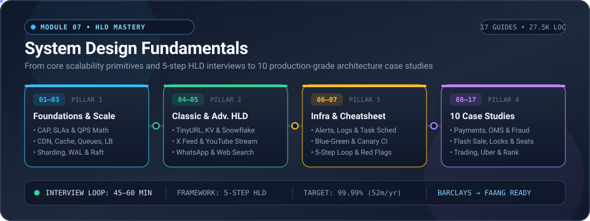
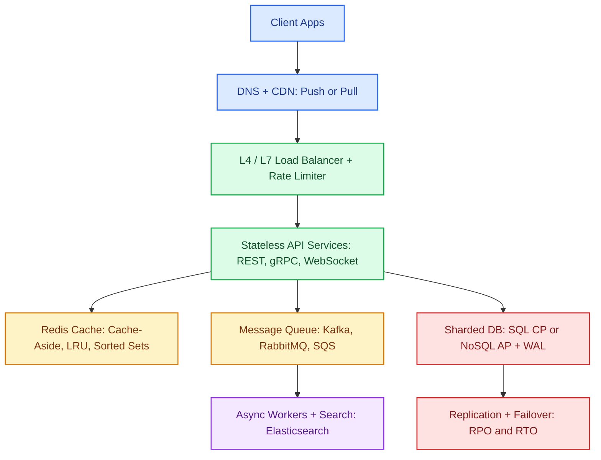
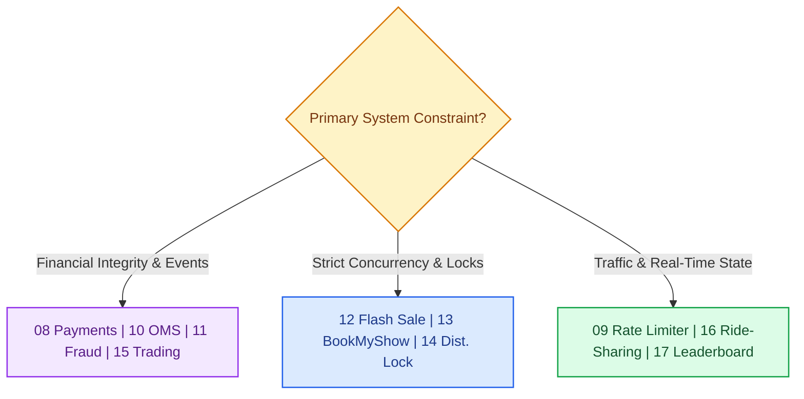

# System Design Interview Preparation (FAANG Level)

> [!NOTE]
> **Target Profile:** Mid-level Java engineer with 5 years at Barclays (investment banking, monolith decomposition, data lake work). **Goal:** Pass FAANG-level system design interviews (`Good Hire` / `Strong Hire`) in 45–60 minute sessions across **17 guides (27,522 lines)**.

---

## 🗺️ Module Learning Roadmap

Follow the 4-pillar progression from core distributed systems theory to 10 production-grade architecture case studies.

```mermaid
flowchart LR
  P1["Pillar 1: 01-03 Foundations &amp; Scale"] --> P2["Pillar 2: 04-05 Classic &amp; Adv HLD"]
  P2 --> P3["Pillar 3: 06-07 Infra &amp; Cheatsheet"]
  P3 --> P4["Pillar 4: 08-17 10 Case Studies"]
  P1 -. "Fast Track: 3 Weeks" .-> P2
  P2 -. "Skip 01, 03, 06" .-> P3

  classDef blue fill:#dbeafe,stroke:#2563eb,color:#1e3a8a,stroke-width:1.5px
  classDef green fill:#dcfce7,stroke:#16a34a,color:#14532d,stroke-width:1.5px
  classDef amber fill:#fef3c7,stroke:#d97706,color:#78350f,stroke-width:1.5px
  classDef purple fill:#f3e8ff,stroke:#9333ea,color:#581c87,stroke-width:1.5px

  class P1 blue
  class P2 green
  class P3 amber
  class P4 purple
```

### Core Foundations & Classic Designs (`01`–`07`, 7,943 lines)

| # | Guide | Lines | Core Topics Covered |
| :---: | :--- | :---: | :--- |
| **01** | [01-System-Design-Basics.md](./01-System-Design-Basics.md) | 690 | 45–60 min FAANG format, 5-step framework, back-of-envelope math, QPS/latency/throughput, CAP (CP vs AP), consistency models (strong/eventual/causal), SLAs/SLOs/SLIs |
| **02** | [02-Building-Blocks.md](./02-Building-Blocks.md) ⭐ | 1,742 | DNS & CDN (push/pull), L4/L7 LB, proxies, caching (strategies, LRU/LFU/TTL, stampede/penetration/avalanche), SQL/NoSQL/Graph, consistent hashing, Kafka/RabbitMQ/SQS, blob/Elasticsearch, REST/gRPC/GraphQL, rate limiting |
| **03** | [03-Scalability-and-Reliability.md](./03-Scalability-and-Reliability.md) | 1,180 | Horizontal vs vertical scaling, stateless vs stateful, replication (leader-follower, multi-leader, sync/async), sharding & hotspots, failover (active-passive/active-active), heartbeats, RPO/RTO, checkpointing, WAL, Paxos/Raft |
| **04** | [04-Classic-System-Designs.md](./04-Classic-System-Designs.md) | 1,021 | URL Shortener (Base62, MD5, sharding, cache), Rate Limiter (Redis token bucket, distributed), Consistent Hashing pseudocode, Key-Value Store (partitioning, conflict resolution), Snowflake Unique ID Generator |
| **05** | [05-Advanced-System-Designs.md](./05-Advanced-System-Designs.md) | 1,345 | Twitter/X Feed (fan-out read/write, celebrity hybrid, Redis sorted sets), YouTube (transcoding, ABR, CDN, GPU), WhatsApp Chat (WebSockets, delivery receipts, 1M+ group fanout), Google Search (crawler, inverted index, PageRank, Trie) |
| **06** | [06-Infra-and-DevOps-Design.md](./06-Infra-and-DevOps-Design.md) | 1,219 | Multi-channel Notification System (dedup, templates, rate limits), Logging & Monitoring (Elasticsearch, alerting, hot/warm/cold), Distributed Task Scheduler (locks, backoff), CI/CD (blue-green, canary, rollbacks) |
| **07** | [07-System-Design-Interview-Cheatsheet.md](./07-System-Design-Interview-Cheatsheet.md) ⭐ | 746 | 1-page 5-step framework, estimation formulas, latency/QPS numbers, tech matrix, decision trees, CAP matrix, red flags, "What if..." answers, top 20 questions, fill-in-the-blank template, evaluation rubric |

---

## 🧱 System Design Building Blocks Map

Every FAANG architecture composes the same core primitives from [02-Building-Blocks.md](./02-Building-Blocks.md) and [03-Scalability-and-Reliability.md](./03-Scalability-and-Reliability.md).

### Technology Decision Matrix

| Technology | Primary Strength | Trade-Off / Constraint | Best Fit In Interviews |
| :--- | :--- | :--- | :--- |
| **SQL (PostgreSQL / MySQL)** | ACID consistency + structured relations | Vertical scale limit; sharding adds complexity | Payments, order ledgers, seat inventory |
| **NoSQL (Cassandra / DynamoDB)** | High availability + horizontal write scale | Eventual consistency; limited ad-hoc joins | Timelines, chat messages, telemetry |
| **Redis** | Sub-ms in-memory caching & data structures | RAM cost; persistence/eviction trade-offs | Hot cache, rate limiting, leaderboards |
| **Kafka** | High-throughput async decoupling & replay | Operational complexity; consumer lag handling | Event-driven OMS, fraud pipelines, logs |
| **Elasticsearch** | Full-text search via inverted indexes | Eventual indexing; high memory/disk footprint | Search bars, log aggregation, autocomplete |
| **CDN** | Geographic edge caching & low latency | Cache invalidation propagation delay | Video chunks, static assets, read-heavy feeds |

---

## 🎯 Production Case Study Selector (`08`–`17`)

Use this decision router to pick from the **10 deep-dive case studies (19,579 lines)** based on the domain constraint your interviewer tests.

| # | Case Study | Lines | Key Architecture Focus |
| :---: | :--- | :---: | :--- |
| **08** | [08-Payment-Processing-System-Design.md](./08-Payment-Processing-System-Design.md) | 1,186 | Idempotency, double-entry ledger, PSP failover, strict consistency |
| **09** | [09-Distributed-Rate-Limiter-Design.md](./09-Distributed-Rate-Limiter-Design.md) | 2,638 | Distributed token bucket, Redis Lua scripts, multi-region sync |
| **10** | [10-Event-Driven-Order-Management-Design.md](./10-Event-Driven-Order-Management-Design.md) | 2,480 | Saga orchestration, outbox pattern, Kafka event sourcing |
| **11** | [11-Real-Time-Fraud-Detection-Design.md](./11-Real-Time-Fraud-Detection-Design.md) | 2,265 | Low-latency feature store, streaming rules + ML scoring |
| **12** | [12-Flash-Sale-Exactly-100-iPhones-Design.md](./12-Flash-Sale-Exactly-100-iPhones-Design.md) | 882 | Zero-oversell inventory, Redis atomic decrement, queue admission |
| **13** | [13-Booking-System-BookMyShow-Design.md](./13-Booking-System-BookMyShow-Design.md) | 1,237 | Seat locking TTL, pessimistic vs optimistic concurrency, checkout |
| **14** | [14-Distributed-Lock-Service-Design.md](./14-Distributed-Lock-Service-Design.md) | 1,116 | Fencing tokens, lease renewal, Raft/ZooKeeper coordination |
| **15** | [15-Stock-Trading-Platform-Design.md](./15-Stock-Trading-Platform-Design.md) | 2,988 | Order matching engine, ultra-low latency market data fanout |
| **16** | [16-Ride-Sharing-System-Design.md](./16-Ride-Sharing-System-Design.md) | 2,325 | Geospatial indexing (QuadTree/S2/H3), driver matching, ETA |
| **17** | [17-Real-Time-Leaderboard-Design.md](./17-Real-Time-Leaderboard-Design.md) | 2,462 | Redis Sorted Sets, sharded top-K aggregation, live rank updates |

> [!TIP]
> **Barclays Background Alignment:** Leverage your monolith decomposition and data lake experience first on **Database Sharding** (`03`), **Message Queues** (`02`, `10`), **Logging & Monitoring** (`06`), and **Distributed Consensus / Payments** (`03`, `08`, `11`).

---

## ⏱️ 45-Min HLD Interview Loop & Quick Reference

Structure every 45–60 minute session using the 5-step loop from [01-System-Design-Basics.md](./01-System-Design-Basics.md) and [07-System-Design-Interview-Cheatsheet.md](./07-System-Design-Interview-Cheatsheet.md).

```mermaid
flowchart LR
  S1["1. Requirements: 5-10 min"] --> S2["2. Estimation: 10-15 min"]
  S2 --> S3["3. High-Level Design: 10-15 min"]
  S3 --> S4["4. Deep Dive: 15-20 min"]
  S4 --> S5["5. Bottlenecks &amp; Scale: 5-10 min"]

  classDef blue fill:#dbeafe,stroke:#2563eb,color:#1e3a8a,stroke-width:1.5px
  classDef green fill:#dcfce7,stroke:#16a34a,color:#14532d,stroke-width:1.5px
  classDef amber fill:#fef3c7,stroke:#d97706,color:#78350f,stroke-width:1.5px
  classDef purple fill:#f3e8ff,stroke:#9333ea,color:#581c87,stroke-width:1.5px
  classDef red fill:#fee2e2,stroke:#dc2626,color:#7f1d1d,stroke-width:1.5px

  class S1 blue
  class S2 green
  class S3 amber
  class S4 purple
  class S5 red
```

### Formulas & Numbers to Memorize

| Category | Metric / Formula | Reference Value |
| :--- | :--- | :--- |
| **QPS** | `Daily Operations / 86,400 seconds` | `Peak QPS = Average QPS × 2–3` |
| **Storage** | `Daily Ops × Data Size × Retention × Replication` | Factor `3×` for standard replication |
| **Bandwidth** | `QPS × Payload Size` | Size ingress & egress separately |
| **Latency** | L1 Cache / RAM / Disk | `1 ns` / `100 ns` / `10 ms` |
| **Network** | Same DC / Cross-Country | `1 ms` / `100–200 ms` |
| **Throughput** | Single DB / Redis / Message Queue | `1–5K QPS` / `50–100K QPS` / `100K–1M QPS` |
| **Availability** | `99.9%` vs `99.99%` | `8.76 hrs/year` vs `52 mins/year` downtime |

### Interviewer Priority & Execution Discipline

| Priority | Evaluation Signal | What to Do | Common Mistake to Avoid |
| :---: | :--- | :--- | :--- |
| **1** | **Clarification** | Ask clarifying questions up front | Designing without confirming scope |
| **2** | **Estimation** | Estimate QPS, storage, bandwidth fast | Skipping math or guessing wildly |
| **3** | **Architecture** | Draw end-to-end boxes early | Never drawing a clear diagram |
| **4** | **Decomposition** | Break monoliths into focused services | Getting bogged down in details early |
| **5** | **Technical Depth** | Go deep on 2–3 critical bottlenecks | Staying purely surface-level |
| **6** | **Communication** | Think out loud and explain reasoning | Coding/drawing in silence |
| **7** | **Trade-Offs** | Compare pros/cons and adapt on feedback | Refusing to adapt to hints |
| **8** | **Uncertainty** | State assumptions; offer a structured approach | Saying "I don't know" and stopping |

> [!IMPORTANT]
> **Company Focus:** **Google** (search, indexing, distributed systems) · **Amazon** (scalability, CDN, storage) · **Meta** (feeds, real-time, massive scale) · **Microsoft** (data systems, cloud, APIs) · **Apple** (real-time, privacy-aware systems).

---

## 📅 Study Plans, Practice Projects & Resources

### Study Schedules (35–55 Hours Total · 5–8 Weeks at 1 hr/day)

| Track | Schedule | Target Materials |
| :--- | :--- | :--- |
| **Initial Learning (Week 1)** | Days 1–2 `01` · Days 3–5 `02` · Days 6–7 `07` (skim) | Framework, building blocks, quick reference |
| **Initial Learning (Week 2)** | Days 1–3 `03` · Days 4–6 `04` · Day 7 `07` (formulas) | Scalability constraints & classic designs |
| **Initial Learning (Week 3)** | Days 1–3 `05` · Days 4–5 `06` · Days 6–7 (3× 1-hr mocks) | Advanced HLD, infra thinking, live mocks |
| **Fast Track (3 Weeks)** | Focus on core high-ROI guides only | `02`, `04`, `05`, and `07` |
| **1-Week Sprint** | Mon–Tue: 2 deep dives (2h ea) · Wed–Thu: 2 mocks (1.5h ea) · Fri: cheatsheet/red flags (1h) · Sat: weak area mock (1.5h) · Sun: light review (30m) | Targeted case studies (`08`–`17`) + `07` |
| **Interview Day** | Night before: `07` formulas · Morning: 15m light review · Interview: 5-step loop · After: log feedback | Execution & calm pacing |

> [!WARNING]
> **Time Allocation Trap:** Do not spend all 35–55 hours passively reading. Reserve **15–20 hrs** for reading, **10–15 hrs** for system deep dives, **5–10 hrs** for timed mock interviews, and **5–10 hrs** for optional hands-on coding.

### Hands-On Practice Projects (1 Day Each, Optional)

| Project | Core Implementation | Concepts Reinforced |
| :--- | :--- | :--- |
| **URL Shortener** | Local shortener service | Hashing/Base62, sharding, cache-aside |
| **Rate Limiter** | Token bucket under high concurrency | Atomic counters, burst handling |
| **Cache System** | LRU cache from scratch | Eviction policies, O(1) lookup/update |
| **Mini-Search** | Simple inverted index | Tokenization, full-text ranking |

### Success Metrics & External References

- **Before:** Feeling lost in open-ended HLD prompts, unable to estimate at scale, unsure which datastore or queue fits.
- **After:** Consistent 5-step execution, accurate QPS/storage/bandwidth math, clear technology trade-offs, and 2–3 deep-dive components per interview.
- **Practice & Video:** LeetCode System Design, DesignGurus.io, Educative.io, YouTube (Tech Dummies, Gaurav Sen).
- **Classic Papers:** *Dynamo* (Amazon KVS), *Bigtable* (Google data store), *MapReduce*, *GFS* (Google File System).
- **Books:** *Designing Data-Intensive Applications* (Martin Kleppmann), *System Design Interview* (Alex Xu).

> System design is a skill, not a trivia test. Focus on **Thinking** (trade-offs), **Communication** (clarity), **Adaptability** (feedback), and **Pragmatism** (constraints). **You can do this. Good luck! 🚀**

---

*Last updated: Module 07 Visual Hub · 17 guides (27,522 lines) · Core `01`–`07` (7,943 lines) + Case Studies `08`–`17` (19,579 lines)*
