# STAR Method and Framework for Behavioral Interviews

## Table of Contents
1. [What Behavioral Interviews Test](#what-behavioral-interviews-test)
2. [The STAR Method Deep Dive](#the-star-method-deep-dive)
3. [Common Mistakes to Avoid](#common-mistakes-to-avoid)
4. [Quantifying Impact](#quantifying-impact)
5. [Story Length and Structure](#story-length-and-structure)
6. [Delivery Tips and Body Language](#delivery-tips-and-body-language)
7. [Handling Follow-Up Questions](#handling-follow-up-questions)
8. [Practice Framework](#practice-framework)
9. [10 Generic STAR Stories Everyone Should Prepare](#10-generic-star-stories-everyone-should-prepare)
10. [Key Takeaways](#key-takeaways)
11. [Next Steps](#next-steps)

---

## What Behavioral Interviews Test

Behavioral interviews assess how you actually operate in real engineering environments. At FAANG, interviewers evaluate six core pillars to determine whether you think strategically and operate at an SDE2+ level rather than just executing assigned tickets.

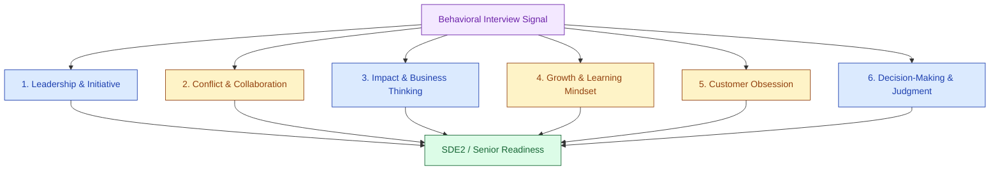

| Pillar | What Interviewers Probe | FAANG SDE2+ Context |
| :--- | :--- | :--- |
| **1. Leadership & Initiative** | Taking ownership, stepping up when others won't, influencing without authority, inspiring confidence | Tests whether you think strategically and grow toward senior scope rather than waiting for tasks |
| **2. Conflict & Collaboration** | Handling disagreements with peers/managers, disagree-and-commit, building consensus vs. silos, team dynamics | Fast-moving teams have strong opinions; you must engage in healthy, constructive conflict |
| **3. Impact & Business Thinking** | Understanding business implications, measuring impact, thinking beyond ticket completion, driving results | Mid-level engineers at FAANG need business acumen, not just coding ability |
| **4. Growth & Learning Mindset** | Learning tech quickly, seeking feedback, adapting to failure, curiosity beyond your comfort zone | Technology shifts fast; teams need engineers hungry to learn and self-correct |
| **5. Customer Obsession** | End-user empathy, balancing technical perfection with speed-to-market, fighting for UX | Core value across FAANG—applies directly to engineering, not just product management |
| **6. Decision-Making & Judgment** | Deciding with incomplete info, prioritizing competing demands, escalating appropriately, handling ambiguity | SDE2s are expected to make autonomous, well-reasoned technical and product calls |

> [!NOTE]
> Every behavioral question maps to one or more of these six pillars. Before answering, identify which pillar is being tested so you can emphasize the right signal.

---

## The STAR Method Deep Dive

STAR (**Situation, Task, Action, Result**) is the most effective structure for behavioral answers. The animated timeline below shows the target 5-minute pacing: spend **55% of your time on Action**, not on backstory.


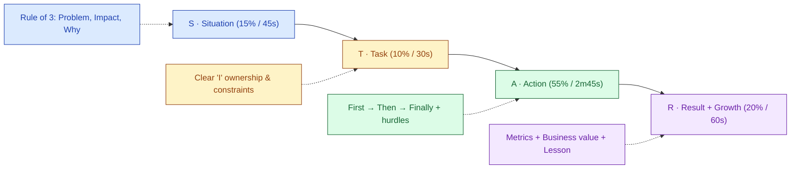

### S — Situation (Context Setup · 30–45 seconds)
Set the stage quickly so the interviewer understands the problem and stakes without getting lost in backstory.

- **Include:** Company/team context, specific problem or challenge, why it mattered, and your role.
- **Exclude:** Long company history, irrelevant people, excuses/external blame, or details that don't lead to your action.
- **Techniques:** Use the **Rule of Three** (*Problem, Impact, Why it matters*), anchor with concrete numbers (`500k lines`, `3–4 weeks`), establish urgency without drama, and state your role clearly.

| Bad Example | Good Example |
| :--- | :--- |
| *"So at Barclays, we had this monolith application that was built by someone who left like 3 years ago, and nobody really understood the codebase anymore. The tech lead was trying to figure out what to do, and there were a lot of meetings about it..."* | *"At Barclays, I was on a backend team maintaining a monolithic Java Spring application with 500k+ lines of code. Every small change required testing the entire system, and deployment cycles were 3–4 weeks. This was blocking our ability to ship features for regulatory compliance."* |

### T — Task (Your Responsibility · 15–30 seconds)
Clarify what **you** were personally accountable for—not what the team did.

- **Include:** Your specific responsibility (without inflating scope), ownership boundaries, role-specific constraints, and what "done" looked like.
- **Exclude:** What others were doing, tasks you only partially owned, vague `"we worked on it"` phrasing, or excuses about constraints.
- **Techniques:** Use `"I"` statements consistently, be honest about scope (*"I led the design and worked with 2 other senior engineers to execute"*), and name your primary constraint.

| Bad Example | Good Example |
| :--- | :--- |
| *"And then I was supposed to help fix this, but the architecture team wasn't helping enough and nobody understood the requirements clearly..."* | *"My task was to design and lead the technical decomposition of the monolith into 4 independent microservices without breaking existing functionality. I needed to maintain a single deployment initially while allowing teams to iterate independently."* |

### A — Action (What YOU Did · 60–165 seconds)
Demonstrate your engineering thinking, trade-offs, and execution. This is **50%+ of your answer** (up to 55% in a 5-minute story).

- **Include:** Specific actions you took, your thought process, how you overcame obstacles, decisions made, collaboration/communication, and iterations.
- **Exclude:** Generic claims (`"I worked hard"`, `"I collaborated well"`), others' actions, luck, passive voice, or exhaustive low-level implementation trivia unless asked.
- **Techniques:** Structure with **First → Then → Finally**, narrate your thinking (*"I realized..."*, *"I decided..."*), quantify obstacles (`3 N+1 queries`, `200+ dependencies`, `40% latency reduction`), and include 1–2 specific challenges you solved.

> [!TIP]
> **Strong Action Example (Monolith Story):**
> *"I started by mapping all 200+ inter-service dependencies in the monolith and built a dependency graph, which revealed that 60% of calls were between just 3 logical domains. I proposed a phased decomposition: Phase 1 (payment domain, loosest coupling as a POC), Phase 2 (reporting), Phase 3 (user management).*
>
> *I worked with each domain team to define service contracts and led pair programming sessions for knowledge transfer. When the payment service failed load testing, I profiled it, found 3 N+1 queries, and refactored the service layer—cutting latency by 40%. For the tricky payments-to-reporting dependency, instead of adding a direct call, I built an async event bus pattern. It took an extra week to design, but it decoupled the services and improved reporting latency."*

### R — Result (Outcomes & Impact · 30–60 seconds)
Make the impact unmistakable and tie technical metrics back to business value and personal growth.

- **Include:** Quantified outcomes (numbers, percentages, timeframes), business impact, what changed, lasting impact (still in use? scaled?), and what you learned.
- **Exclude:** Vague endings (`"We learned a lot"`, `"The team was happy"`), tech-only metrics with no business context, taking 100% credit, or unshipped future results.
- **Techniques:** Lead with the headline number, connect to revenue/compliance/speed/scale, acknowledge team contributions, and close with personal growth.

| Bad Example | Good Example |
| :--- | :--- |
| *"And yeah, so we got it done and the team was happy with the results."* | *"Within 6 months, all 4 microservices were in production. Deployment time dropped from 3–4 weeks to 2–3 days per service, and the payment service now scales independently to handle 10x traffic. This enabled us to onboard 3 new data sources into the data lake for regulatory compliance. The architecture is still running 2 years later at 40% higher transaction volume, and this project became the foundation for my promotion discussion."* |

---

## Common Mistakes to Avoid

Avoid these 10 frequent behavioral pitfalls that turn strong engineering work into weak interview signals.

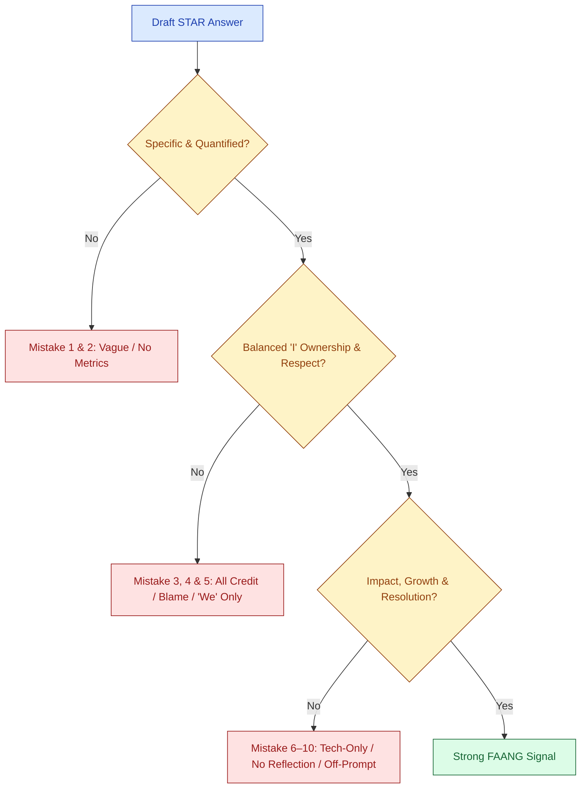

| # | Mistake | Why It Fails | How to Fix It |
| :--- | :--- | :--- | :--- |
| **1** | **Being Too Vague** (*"worked on a challenging Java project"*) | Interviewers cannot verify if you actually drove anything | Add concrete scope: *"I decomposed a 500k-line monolith into 4 microservices, cutting deployments from 3–4 weeks to 2–3 days."* |
| **2** | **No Quantifiable Metrics** (*"we improved code quality"*) | `"We"` and `"improved"` are hollow without numbers or measurement | *"I designed a JUnit coverage initiative—raising coverage from 62% to 89% in 6 months via pre-commit hooks and review standards."* |
| **3** | **Taking All Credit** (*"I single-handedly fixed..."*) | Sounds egotistical and unrealistic; senior engineers share credit | *"I owned the Sonar remediation, created a prioritization framework, personally fixed 400+ issues, and mentored juniors to fix 300+."* |
| **4** | **Bashing Past Company/Manager** (*"manager was incompetent"*) | Major culture red flag; signals you will trash your next team too | Reframe around initiative: *"I found the monolith challenging, so rather than wait top-down, I proposed and executed a decomposition POC."* |
| **5** | **No Clear Personal Contribution** (*"the team built a pipeline"*) | Describes what happened, not what **you** did | *"I designed the ingestion framework for 3 data sources and chose Apache NiFi over custom Python, saving 4 weeks of dev time."* |
| **6** | **Tech Details Over Impact** (*"we used Kafka and Spring Cloud"*) | Interviewers care why you chose it and what happened, not stack lists | *"I chose Kafka for ordering and replay—which proved critical later when we fixed a reporting bug by replaying from a checkpoint."* |
| **7** | **No Reflection or Growth** (*"and that's how we finished"*) | Shows zero self-awareness or learning mindset | *"Looking back, I should have gotten architectural sign-off earlier; I later introduced an RFC process so we got early feedback."* |
| **8** | **Complaining About Constraints** (*"not enough time or budget"*) | Sounds like making excuses or fishing for sympathy | *"We had a tight 3-month Spring Boot 2.2 → 2.7 timeline. I split it into 4-week phases and front-loaded dependencies, finishing in 11 weeks."* |
| **9** | **Answering the Wrong Question** (ignoring `"disagreed"` prompt) | Signals poor listening or avoidance | Listen for the core trait; for `"disagree"`, show: concern → respectful pushback → data/reasoning → alignment. |
| **10** | **No Clear Resolution** (*"not sure where that project ended up"*) | Signals poor follow-through or awareness of outcomes | Always know the ending; if you left early, state what you shipped and how the team scaled your approach. |

> [!WARNING]
> **Red Flag Alert:** Never blame teammates, managers, or past employers. Even in a conflict story, frame the other person's concern as valid and focus on how you used data or a pilot to align.

---

## Quantifying Impact

FAANG interviewers rely on concrete metrics to calibrate scope and impact. Translate every technical achievement into measurable engineering and business outcomes.

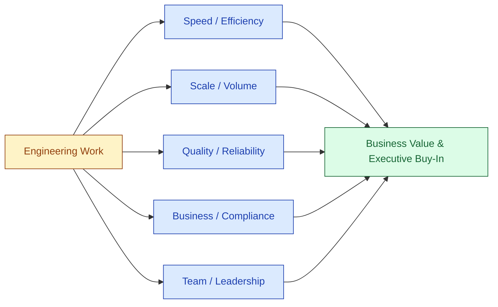

### The 5 Metric Categories

| Category | Standard Templates | Concrete Examples |
| :--- | :--- | :--- |
| **1. Speed / Efficiency** | Deployment (`X wks → Y days`), latency (`X ms → Y ms`), build time, time-to-market, review turnaround | Monolith: `3–4 weeks → 2–3 days` per service; Spring Boot migration: startup `200ms → 80ms` |
| **2. Scale / Volume** | Transactions/day, users, data (`GB → TB`), services, RPS, lines of code | Microservices: `+40%` transactions handled; Data lake: `3` new sources; JUnit: `62% → 89%` |
| **3. Quality** | Code coverage, bug reduction (`%`), tech debt fixed, test pass rate, incidents/month | JUnit: `62% → 89%` coverage; Sonar: `400+` issues resolved; Spring Boot: lower latency |
| **4. Business / Revenue** | Revenue earned/saved (`$X`), NPS, regulatory compliance, retention, feature adoption | Regulatory compliance delete utility; Data lake: enabled `3` regulatory reporting requirements |
| **5. Team / Leadership** | Engineers mentored, knowledge transfer, promotion impact, onboarding speed, MTTR | Mentored junior engineers on microservices; placed/won in company hackathon |

### Estimating & Connecting Metrics to Business Value
- **Reasonable estimates beat vague claims:**
  - Good: *"The monolith was around 500,000 lines of Java code."* / *"The payment service handles ~50,000 transactions/day on our highest-volume critical path."*
  - Avoid: *"I migrated millions of dollars of transactions."* (sounds inflated/ungrounded)
- **Always answer "So what?":**
  - **Weak:** *"We improved JUnit coverage from 62% to 89%."*
  - **Better:** *"I raised JUnit coverage from 62% to 89% via automated review thresholds, cutting production bugs by ~25% (`~8 → ~6/month`)."*
  - **Best:** *"This coverage jump gave senior leadership the confidence to approve our risky Spring Boot migration because regressions would be caught automatically."*

---

## Story Length and Structure

Do not memorize two separate versions of a story. Master one **2-minute core** and keep **2–3 expansion points** ready in case the interviewer leans in.

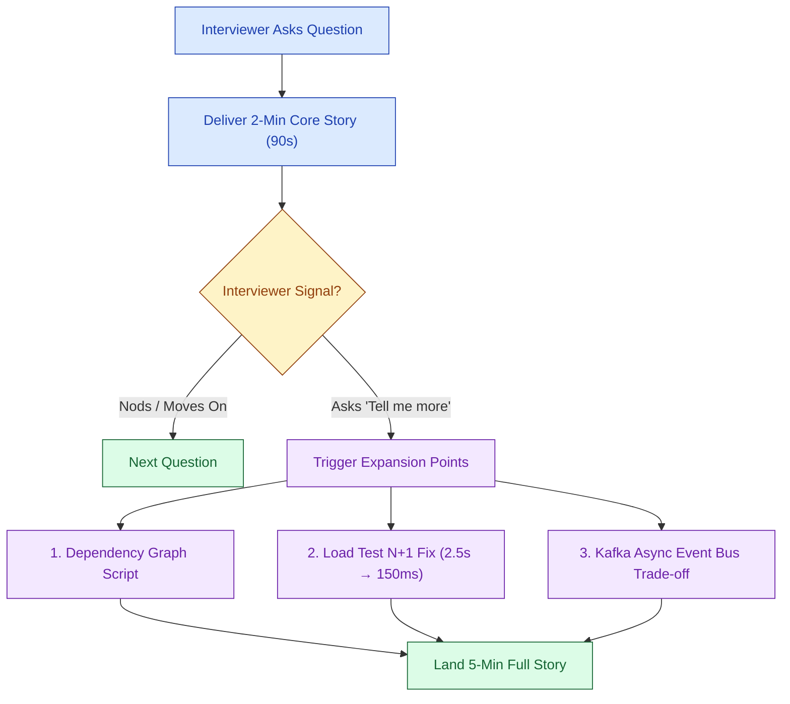

| Format | When to Use | Pacing Breakdown |
| :--- | :--- | :--- |
| **2-Minute Answer (~90s)** | Rushed interviewer, warm-up, or frequent follow-ups | **S:** 1 sentence (context + scale) · **T:** 1 sentence (role) · **A:** 3–4 sentences (1 key thing) · **R:** 1–2 sentences (numbers) |
| **5-Minute Answer (~4m30s)** | Open-ended prompt (*"Tell me about a challenging project"*) | **S:** 45s (context, scale, urgency) · **T:** 30s (ownership) · **A:** 2–3m (steps + iteration) · **R:** 45s (metrics + business + growth) |

### Full Reference Scripts (Monolith Story)

- **2-Minute Core (~90 seconds):**
  > *"At Barclays, I was on a backend team maintaining a 500k-line monolith where deployments took 3–4 weeks. I took ownership of decomposing it into 4 microservices. My key contribution was mapping all the inter-service dependencies and designing a phased extraction strategy, starting with the least-coupled domains. Within 6 months, we reduced deployment time to 2–3 days per service and improved our ability to scale independently."*

- **5-Minute Full Story (~4m 30s):**
  > *"At Barclays, I was on a backend team maintaining a monolithic Java Spring application with over 500,000 lines of code. Every small change required testing the entire system, and deployment cycles were 3–4 weeks, directly impacting our ability to ship regulatory compliance features.*
  >
  > *My task was to design and lead the technical decomposition into independent microservices without breaking existing functionality, maintaining a single deployment initially while letting teams iterate independently.*
  >
  > *First, I mapped all 200+ inter-service dependencies and created a visual dependency graph, revealing that 60% of calls were between just 3 logical domains. I proposed a phased strategy: extract payment first as a POC, then reporting, then user management, pairing with each team to define service contracts. When payment hit load testing, we found N+1 database queries. I debugged with JProfiler, isolated 3 query patterns, and refactored the service layer—cutting response times from 2.5s to 150ms (a 16x improvement). For the payment-to-reporting dependency, I designed an async Kafka event bus; it took 2 extra weeks, but decoupled the services and improved reporting performance.*
  >
  > *Within 6 months, all 4 microservices were in production: deployment time dropped from 3–4 weeks to 2–3 days, payment scales independently (10x traffic), and velocity rose. Two years later, the architecture handles 40% more transactions, and this project became the foundation for my promotion to senior engineer."*

### Pre-Built Expansion Points
Keep 2–3 deep-dive hooks ready for follow-ups:
1. **Dependency mapping technique:** How you parsed Spring beans and `@Autowired` annotations to find 200+ dependencies.
2. **Load testing incident:** The JProfiler N+1 query discovery and `2.5s → 150ms` fix.
3. **Event bus design decision:** Why Kafka over RabbitMQ or a custom Redis queue.
4. **Team dynamics & longevity:** How you got buy-in and why the architecture still scales 2 years later.

---

## Delivery Tips and Body Language

Your story content is **60%** of the evaluation; your delivery is the other **40%**.

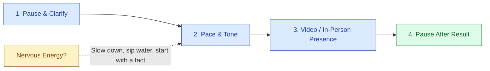

| Dimension | Do | Don't |
| :--- | :--- | :--- |
| **Voice & Pacing** | Speak conversationally with confidence; slow down for key numbers; pause after your Result so it lands; record yourself to catch `"um"`/`"uh"` | Rush when nervous; sound like you're reading a script; mumble technical terms; bury the punch line |
| **Video Interviews** | Sit upright; make regular eye contact with the camera; use natural hand gestures; nod and smile on positive outcomes | Slouch/lean back; stare at notes continuously; tap the desk or fidget; cross arms defensively; avoid the camera |
| **In-Person** | Lean forward slightly on your contributions; maintain ~80% natural eye contact; gesture to explain architecture; take 1–2s to think | Pace back and forth; stare at the ceiling/floor; giggle nervously; speak in a monotone; cross arms/legs defensively |

> [!TIP]
> **The "Pause and Clarify" Technique:** If a prompt feels ambiguous, take 2 seconds and ask: *"Just to make sure I answer what you're looking for—are you asking about a time I failed on the technical side, or more about managing stakeholder expectations?"* It signals thoughtfulness and alignment.

- **Handling Nervous Energy:** Deliberately slow your speech, take a sip of water (buys a 3-second reset), breathe for 2–3 seconds before starting, and open with a concrete fact (*"In 2023, I was working on..."*). After telling each story 10 times, delivery becomes automatic.

---

## Handling Follow-Up Questions

FAANG interviewers always probe beneath your initial answer to verify ownership, judgment, and self-awareness.

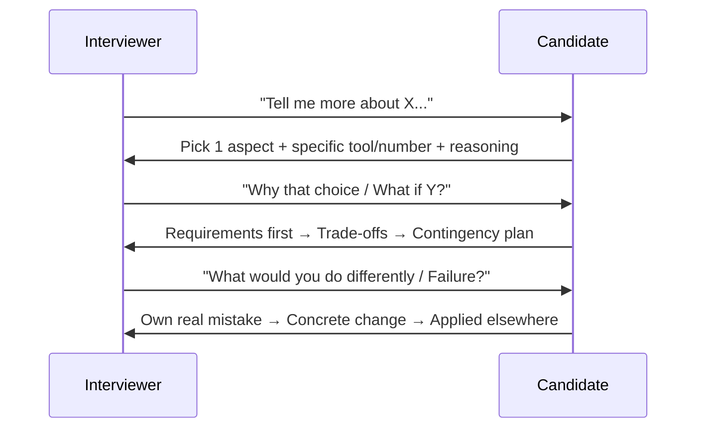

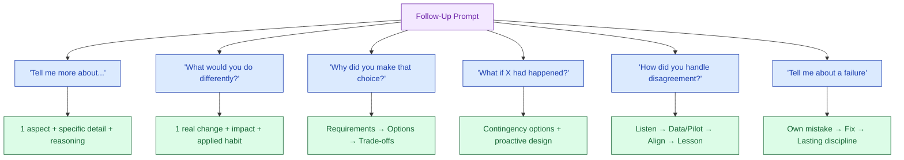

### 1. "Tell me more about..."
- **Goal:** Go deep on one glossed-over detail without repeating the whole story.
- **Script Example (Dependency Graph):** *"I wrote a Python script that parsed Spring Bean definitions and `@Autowired` annotations across all modules, then traced call chains via static analysis on compiled bytecode and visualized it in Graphviz. The UI service had 12+ dependencies, whereas payment had fewer than 3—proving payment was the cleanest POC."*

### 2. "What would you do differently?"
- **Goal:** Prove self-awareness and growth (never say *"nothing"* or give a trivial answer).
- **Script Example (Early RFC):** *"In retrospect, I would have gotten architectural sign-off from leadership 2 weeks earlier via an RFC-style review. When we presented later, leadership pushed back on timeline. Since then, I always draft an RFC, get feedback from 2–3 senior engineers, and refine before executing—which made my later Spring Boot migration much smoother."*

### 3. "Why did you make that choice?"
- **Goal:** Show structured trade-off analysis, not trend-chasing.
- **Script Example (Kafka vs. Alternatives):** *"We had 3 requirements: strong ordering, message replay, and multi-subscriber decoupling. A custom Redis queue failed on replay; RabbitMQ had weaker ordering across multiple subscribers. Kafka met all 3, and our team already had operational expertise from our data pipeline. Four months later, replay saved us when a credit calculation bug required replaying from a checkpoint."*

### 4. "What would you have done if X had happened?"
- **Goal:** Show calm contingency thinking grounded in proactive engineering.
- **Script Example (Post-Refactor Latency):** *"If latency persisted, we'd check database locks or network I/O, then evaluate async processing or caching. However, I also brought the database team into the design review early—they flagged the N+1 pattern in advance, so avoiding a dead end wasn't luck."*

### 5. "How did you handle disagreement with X?"
- **Goal:** Show empathy, data-driven persuasion, and relationship preservation.
- **Script Example (Microservices Skeptic):** *"A senior engineer worried 4 services would add operational overhead. Rather than argue, I proposed a pilot: extract payment as a POC, measure overhead, and decide with data. Because we had Docker and Kubernetes automation, overhead stayed low and deployment risk dropped—turning him into a strong advocate. People resist perceived risk, not good ideas."*

### 6. "Tell me about a time you failed / made a mistake"
- **Goal:** Own a real mistake, fix it, and show lasting process change.
- **Script Example (Narrow API Contract):** *"Early in the decomposition, I designed a service API contract too narrowly for one use case. When another team integrated, it broke their workflow. I owned it, redesigned the API with query parameters, versioning, and forward-compatibility, and adopted 'V1 thinking'—explicitly documenting assumptions for 10x evolution on every interface since."*

---

## Practice Framework

Knowing stories intellectually is different from delivering them smoothly under pressure. Use this 4-week cadence to make your stories automatic.

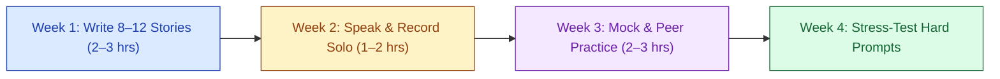

### Week 1: Write Them Down (2–3 hours)
Outline **8–12 stories** using the template below so your structure is locked before you start speaking:

```text
TITLE: [Monolith Decomposition / JUnit Coverage / etc.]

SITUATION (2-3 sentences):
- What company/team?
- What was the problem?
- Why did it matter?

TASK (1-2 sentences):
- What was my specific role?
- What did success look like?

ACTION (8-10 bullets):
- What I did
- Why I made each choice
- Key obstacles I overcame
- How I collaborated

RESULT (3-4 bullets):
- Quantified outcome
- Business impact
- Team impact
- What I learned

VARIATIONS:
- What question could this answer?
- How would I shorten this?
- What details could I go deeper on?
```

### Weeks 2–4 Execution Plan

| Week | Focus | Actions | Time / Target |
| :--- | :--- | :--- | :--- |
| **Week 2** | **Speak Out Loud (Solo)** | Read once silently → put notes away → speak to the wall for 2 min → record audio/video → audit filler words (`um`, `uh`, `like`), rushing, over-detailing, and confidence | **1–2 hrs** (3–4 reps per story) |
| **Week 3** | **Tell Others** | **Format 1 (30m Mock):** Full 3–5 min answer + follow-ups + feedback. **Format 2 (15m Peer):** Tell story and ask *"Did you understand what I did?"* | **2–3 hrs** (3–4 mocks or 8–12 peer chats) |
| **Week 4** | **Targeted Stress-Test** | Drill weakest stories and hard prompts: *"Disagreed with manager and were wrong"*, *"Failed"*, *"Incomplete info"*, *"Push back on unrealistic deadlines"* | Final polish before interviews |

---

## 10 Generic STAR Stories Everyone Should Prepare

Build a versatile 10-story bank covering every core FAANG behavioral theme.

```mermaid
flowchart TD
    SB["10-Story FAANG Bank"] --> G1["Ownership &amp; Execution"]
    SB --> G2["Collaboration &amp; Trust"]
    SB --> G3["Resilience &amp; Agility"]
    SB --> G4["Customer Impact"]

    G1 --> S1["1. Ownership (JUnit 62%→89%)"]
    G1 --> S5["5. Bias for Action (Spring Boot)"]
    G1 --> S9["9. Drive Results (11-wk Delivery)"]

    G2 --> S2["2. Conflict (Microservices Pilot)"]
    G2 --> S3["3. Mentoring (Juniors + Sonar)"]
    G2 --> S6["6. Inclusion &amp; Safety (Reviews)"]
    G2 --> S10["10. Earning Trust (Banking→FAANG)"]

    G3 --> S4["4. Failure (Payment N+1 Fix)"]
    G3 --> S7["7. Ambiguity (ML Hackathon)"]

    G4 --> S8["8. Customer Obsession (Compliance)"]

    classDef purple fill:#f3e8ff,stroke:#6b21a8,color:#6b21a8
    classDef blue fill:#dbeafe,stroke:#1e40af,color:#1e40af
    classDef green fill:#dcfce7,stroke:#166534,color:#166534
    classDef amber fill:#fef3c7,stroke:#92400e,color:#92400e

    class SB purple
    class G1,G2,G3,G4 blue
    class S1,S5,S9,S8 green
    class S2,S3,S6,S10,S4,S7 amber
```

| # | Story Theme | Core Framework (`Problem → Action → Growth`) | Mohit's Example | General Alternatives |
| :--- | :--- | :--- | :--- | :--- |
| **1** | **Ownership & Initiative** | Unaddressed problem → you noticed & volunteered → solved → now spot gaps proactively | **JUnit Coverage:** Raised `62% → 89%` via automated checks & targets when nobody prioritized it | Onboarding docs, design pattern library, untracked perf fixes |
| **2** | **Managing Conflict** | Disagreement → your concern → data/listening/pilot → alignment → lesson on other view | **Microservices Skeptic:** Proposed payment POC pilot instead of arguing; won buy-in via data | Manager timeline pushback, roadmap or architecture debate |
| **3** | **Technical Leadership / Mentoring** | Skill gap → pairing/reviews/sessions → obstacles → team growth → teaching insight | **Monolith Mentoring:** Paired with juniors on architecture; they resolved 300+ Sonar issues | Onboarding new hire, tech talk, learning program |
| **4** | **Failure & Resilience** | What broke → owned it without panic → fix steps → recovery → prevention habit | **Payment Load Test:** Debugged N+1 queries; now involve DB team in early design reviews | Launch issue, missed deadline, architectural mistake |
| **5** | **Bias for Action (Incomplete Info)** | Decision under uncertainty → gathered available data + set deadline → choice → outcome | **Spring Boot Migration:** Set 3-month timeline rather than waiting; security/deprecation outweighed risk | Tech adoption, launch call, escalation timing |
| **6** | **Diversity, Inclusion & Safety** | Situation needing voice/safety → specific inclusive action → dynamic shift → impact | **Code Reviews & Meetings:** Constructive feedback; explicitly invited quiet junior engineers to speak | Advocating for underrepresented peers, inclusive norms |
| **7** | **Ambiguity & Learning Agility** | Unfamiliar domain → upskilling/mentors → execution → outcome → learning playbook | **Sentiment Analysis Hackathon:** Researched ML frameworks & open-source models, iterated to working demo | New language, backend-to-mobile shift, IC-to-lead |
| **8** | **Customer Obsession** | Customer + pain → discovery → iterative fix → customer outcome → lasting habit | **Compliance Delete Utility:** Interviewed compliance team, prioritized their workflow over internal perfection | User research feature, usability fix, customer feedback loop |
| **9** | **Drive Results / Delivery** | Deliverable → obstacles/dependencies → unblocking & trade-offs → shipped → reflection | **Spring Boot Migration:** Coordinated breaking changes across teams, shipped in 11 weeks | Tight-deadline launch, cross-team service delivery |
| **10** | **Earning Trust / Credibility** | Initial skepticism → small wins & reliability → inflection point → new opportunities | **Banking → FAANG Transition:** Matched fast pace, delivered early, demonstrated depth + company values | New hire credibility, junior stepping into lead, bold RFC |

> [!IMPORTANT]
> **One Story, Multiple Angles:** A single rich project (like the Monolith Decomposition) can cover Ownership, Conflict, Mentoring, Failure, and Delivery—just adjust which 60% of the Action section you emphasize.

---

## Key Takeaways

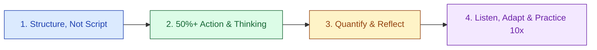

1. **STAR is a structure, not a script**—use it as a mental scaffold, never word-for-word memorization.
2. **Action is 50–55% of your answer**—slow down here and narrate your reasoning and trade-offs.
3. **Quantify everything**—numbers make impact memorable and credible.
4. **Reflect and learn**—explicitly state what you would improve and how you changed your process.
5. **Practice out loud 10+ times per story** until delivery is natural and you can focus on connection.
6. **Listen to the question**—80% of missed answers are good stories applied to the wrong prompt.
7. **Be honest about your role**—own your work, credit the team, and name what you didn't control.
8. **Prepare expansion points** so follow-up questions feel effortless.
9. **Delivery matters (40%)**—confident pacing and engagement elevate good stories to great ones.
10. **Tailor emphasis by company**—keep the same stories, but highlight customer obsession, bias for action, or ownership as needed.

---

## Next Steps

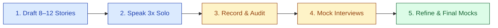

1. Write out your **8–12 stories** using the STAR template.
2. Practice telling each story **3 times out loud** (alone).
3. **Record yourself** and listen back for pacing, filler words, and clarity.
4. Run **mock interviews** with friends or mentors.
5. Ask for specific feedback on **clarity, confidence, and personal contribution**.
6. Refine your stories and expansion hooks based on feedback.
7. Complete final stress-test mocks before interview day so STAR feels like second nature—just how you work.
