# Amazon Leadership Principles — Deep Dive for FAANG Behavioral Interviews

## Overview: The 16 Leadership Principles and What Amazon Really Values


Amazon's 16 Leadership Principles act as a **cultural DNA filter** across every behavioral round. For a mid-level (**L5**) Java engineer at Barclays, interviewers look for **leadership through influence**, strategic problem-solving, organizational impact, and mentoring—not just individual task execution.

> [!IMPORTANT]
> **Critical L5 Insight**: At L5, Amazon expects *leadership through influence*—identifying unowned problems, driving architectural or process strategy across teams, quantifying outcomes with hard metrics, and raising the bar for junior engineers.

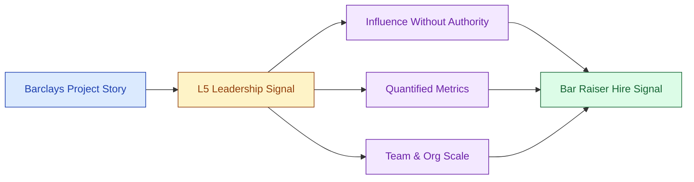

---

## 1. Customer Obsession

### What Amazon REALLY Looks For

Amazon evaluates whether you understand how your work impacts end customers and whether you prioritize customer outcomes over internal convenience. For a financial software engineer, **customers** include internal consumers (traders, risk teams, compliance, fellow developers) as well as end-market participants.

- **Deep pain-point discovery**: Uncover explicit and hidden customer needs before building.
- **Customer-first trade-offs**: Favor customer experience and reliability over implementation ease.
- **Outcome-driven metrics**: Measure success by customer adoption, trust, and effort saved—not just tickets closed.

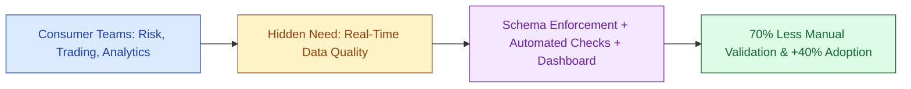

### STAR Story 1: Data Lake Onboarding (Customer Understanding)

| STAR Element | Key Details & Metrics |
| :--- | :--- |
| **Situation** | Onboarding 3 new data sources to the Barclays data lake; initial plan was a raw, as-is ETL pipeline. |
| **Task** | Ensure the ingestion solution solved actual downstream consumer needs before writing code. |
| **Action** | Shadowed 3 consumer teams (risk, trading, analytics); uncovered need for real-time transforms and quality guarantees; built data validation, schema enforcement, automated quality checks, and freshness/anomaly dashboards. |
| **Result** | **70% reduction** in manual validation; **+40% data lake adoption** in Q1; **0 data quality incidents** (down from 8–10/month); customer satisfaction rose **6.2/10 → 9.1/10**. |

> [!TIP]
> **Alternative Angle**: Frame this story as discovering a *hidden customer need* (data quality guarantees) that wasn't in the original spec—demonstrating proactive customer obsession.

**Follow-up Probes to Expect**:
- "What would you have done if customers wanted something technically infeasible?"
- "How did you balance customer requests with technical constraints?"
- "Walk me through one of those customer conversations in detail."

### STAR Story 2: Code Quality Improvement (Internal Customer Focus)

| STAR Element | Key Details & Metrics |
| :--- | :--- |
| **Situation** | During the Decoupling Project (Nov 2022–Present), breaking the monolith into 4 components exposed tech debt: **62% JUnit coverage** and **400+ Sonar issues**. |
| **Task** | Treat the development team as internal customers struggling with maintainability and slow, flaky test cycles. |
| **Action** | Diagnosed that devs spent **30% of time** debugging flaky tests; built a phased test roadmap for high-risk modules; cut flaky test failures by **85%**; added **85% merge coverage gates**; fixed **400+ Sonar issues**. |
| **Result** | JUnit coverage **62% → 89%** (+27 pts); feature dev velocity **+35%**; new-hire onboarding **40% faster**; production defect escape rate **-45%**. |

**Follow-up Probes to Expect**:
- "Why did you prioritize this when there were feature requests pending?"
- "How did you handle resistance to coverage gates?"
- "What's one Sonar issue you fixed that had the most impact?"

### Common Questions & Signals — Customer Obsession

| Sample Interview Questions | Green Flags (Do) | Red Flags (Avoid) |
| :--- | :--- | :--- |
| "Tell me about a time you did something not required that improved customer experience." | Shadow consumers; uncover unstated pain points. | "We just built what was in the spec/ticket." |
| "Describe a situation where you chose between customer needs and technical elegance." | Quantify customer outcomes (adoption, CSAT, hours saved). | "The customer didn't ask for it, so we skipped it." |
| "Give an example of going above and beyond for a customer." | Treat internal devs/ops as customers too. | "It's not my job to think about how customers use this." |
| "Tell me about a time you discovered an unstated customer need." | Trade implementation ease for reliability. | Optimizing for easiest build over best UX. |

**Principle Combinations in Follow-ups**:
- **With Ownership**: "You identified a customer pain point—how did you own the end-to-end solution?"
- **With Invent & Simplify**: "You understood customer needs—how did you innovate to meet them?"
- **With High Standards**: "How did you ensure quality met customer expectations?"

---

## 2. Ownership

### What Amazon REALLY Looks For

Ownership at L5 means acting like a tech lead on system health, team velocity, and cross-team delivery:
- **End-to-end accountability**: Never hand off problems midway; see initiatives from inception to production stability.
- **Long-term thinking**: Design for future teams, runbooks, and maintainability beyond the immediate ticket.
- **Proactive problem-finding**: Identify unowned bottlenecks without waiting for management assignment.
- **No blame-shifting**: Own failures, rollbacks, and fixes directly.

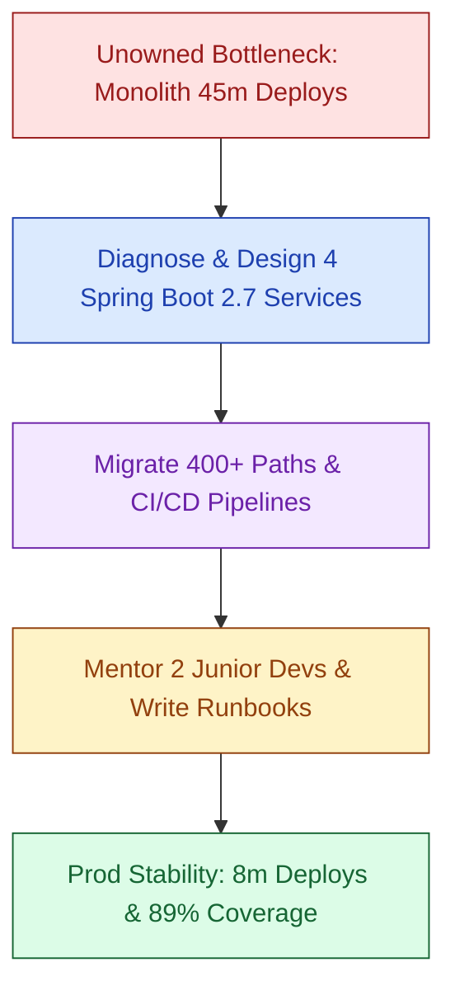

### STAR Story 1: Monolith Decoupling Ownership (Technical Strategy)

| STAR Element | Key Details & Metrics |
| :--- | :--- |
| **Situation** | Nov 2022: Monolith decoupling into 4 independent components had been discussed for years but never executed. |
| **Task** | Own the initiative end-to-end from architecture to production despite it not being formally assigned. |
| **Action** | Diagnosed **18% cyclomatic complexity** and **45-min deploys**; designed 4 independent Spring Boot 2.7 services; migrated Spring Boot **2.2 → 2.7** and **400+ code paths**; built independent CI/CD + rollback pipelines, runbooks, and mentored 2 junior devs. |
| **Result** | **-18% cyclomatic complexity**; deploy time **45 min → 8 min**; JUnit coverage **62% → 89%**; **400+ Sonar issues** resolved; 4 independently deployable services; **0 data migration issues** and near-zero rollbacks. |

**Follow-up Probes to Expect**:
- "Walk me through one architectural decision you made. How did you validate it was the right choice?"
- "What was the biggest risk you faced? How did you mitigate it?"
- "If the decoupling had failed, what would you have done?"
- "How did you decide on these 4 components specifically?"
- "Tell me about a time during this project when you realized you made a wrong assumption."

> [!NOTE]
> **Alternative Angle**: Frame this as *identifying a strategic bottleneck* (monolithic deployment drag) and *owning the solution* before being asked—a textbook L5 Ownership signal.

### STAR Story 2: Data Lake Automation Ownership (Process Ownership)

| STAR Element | Key Details & Metrics |
| :--- | :--- |
| **Situation** | Datasource Project (Aug 2021–Nov 2022): **70% of data onboarding** relied on manual operations intervention and Unix scripts. |
| **Task** | Own end-to-end automation across data engineering, operations, and compliance teams. |
| **Action** | Audited 12 manual steps; built stored procedures + Unix shell scripts + Autosys scheduling; owned compliance reviews and rollback testing; trained ops, wrote docs, monitored prod for 3 months, and automated data deletion utilities. |
| **Result** | **70% less manual effort** (8 hrs/wk → 2.4 hrs/wk per source); **60% less deletion utility effort** (GDPR compliance); error rate **5% → &lt;0.2%**; onboarding cycle **2 weeks → 3 days**; compliance reviews **90% automated**. |

**Follow-up Probes to Expect**:
- "What was the biggest resistance you faced during this rollout?"
- "How did you ensure compliance teams were comfortable with automation?"
- "Tell me about a time the automation failed in production. What did you learn?"
- "How would you approach this differently if you did it again?"

### Common Questions & Signals — Ownership

| Sample Interview Questions | Green Flags (Do) | Red Flags (Avoid) |
| :--- | :--- | :--- |
| "Tell me about taking ownership of something not explicitly assigned." | Own strategy, execution, and prod monitoring. | "I did my part and handed it off to the next team." |
| "Give an example of owning full end-to-end delivery." | Cross team boundaries (ops, compliance, eng). | "It wasn't my responsibility, so I flagged it." |
| "Describe a time you owned a failure and drove the fix." | Enable others with runbooks and mentoring. | "That failed because of X team's mistake." |
| "How do you ensure accountability when responsibility is shared?" | Never say "I wasn't the tech lead, so I couldn't own it." | Mentioning projects never shipped to production. |

**Principle Combinations in Follow-ups**:
- **With Invent & Simplify**: "You owned the problem—what innovative approach did you take?"
- **With Deliver Results**: "You owned the project—what were the final metrics?"
- **With High Standards**: "You owned this—what quality bar did you set?"

---

## 3. Invent and Simplify

### What Amazon REALLY Looks For

Amazon wants engineers who find **novel, pragmatic solutions** and actively **remove complexity** rather than over-engineering:
- **Pragmatic innovation**: Solve the real constraint instead of copying trendy architectures blindly.
- **Complexity reduction**: Optimize for maintainability, low cognitive load, and fast onboarding.
- **Bias to experiment**: Validate simple designs quickly rather than over-analyzing.

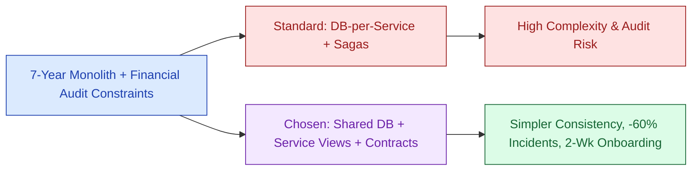

### STAR Story 1: Decoupling Architecture Innovation

| STAR Element | Key Details & Metrics |
| :--- | :--- |
| **Situation** | Monolith had 7 years of tech debt and undocumented dependencies; standard "database per service" would require complex distributed sagas. |
| **Task** | Invent an architecture that decoupled code structurally while simplifying financial consistency and auditability. |
| **Action** | Designed a **shared database with service-specific views and stored procedures** (preserving financial audit trails); replaced heavy integration tests with **contract-based testing**; built a **unified logging/metrics dashboard** across all 4 services. |
| **Result** | Junior dev onboarding **2 months → 2 weeks**; **-85% flaky test issues**; feature velocity **+40%**; operational incidents **-60%**. |

**Follow-up Probes to Expect**:
- "Why did you choose this architecture over microservices with separate databases?"
- "What trade-offs did you make with this approach?"
- "If you had more time, what would you have simplified further?"
- "Tell me about a design decision you changed during implementation."

### STAR Story 2: Data Quality Framework Innovation

| STAR Element | Key Details & Metrics |
| :--- | :--- |
| **Situation** | Needed data quality validation for 3 new sources without the 8+ week overhead of heavy frameworks (Great Expectations, Apache Beam). |
| **Task** | Build a simple, auditable validation layer that non-engineers could extend. |
| **Action** | Built a **JSON schema + stored procedure validation layer** (auditable in SQL by compliance); added **statistical anomaly detection** (mean ± 3σ, no ML overkill); created a **self-service alerting dashboard**. |
| **Result** | Delivered in **2 weeks** (vs. 8+ weeks); caught **87% of issues** at **99.2% precision** (**0.8% false positive rate**); ops extended rules without eng bottlenecks; audit time **-70%**. |

### Common Questions & Signals — Invent and Simplify

| Sample Interview Questions | Green Flags (Do) | Red Flags (Avoid) |
| :--- | :--- | :--- |
| "Tell me about a time you created a novel solution." | Justify *why* a simpler design beat industry hype. | "We just used the industry-standard framework." |
| "Describe a situation where you simplified something complex." | Empower non-engineers via self-service tools. | "I copied it from another company's tech blog." |
| "When did you choose simplicity over a sophisticated approach?" | Measure onboarding speed and incident drop. | Over-engineering to look impressive. |
| "How do you balance innovation with pragmatism?" | Maintain auditability and operational clarity. | Clever code that others cannot maintain. |

**Principle Combinations in Follow-ups**:
- **With High Standards**: "You simplified it—but did you maintain quality?"
- **With Ownership**: "You invented this solution—did you own it through production?"

---

## 4. Learn and Be Curious

### What Amazon REALLY Looks For

- **Continuous learning**: Actively acquire new stacks, domains, and tools before being forced to.
- **Relentless questioning**: Never assume; dig into *why* systems work the way they do.
- **Cross-functional curiosity**: Learn operations, compliance, and adjacent domains.
- **Force multiplication**: Document and teach what you learn so the whole team levels up.

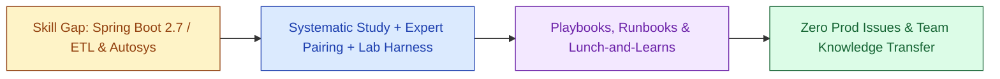

### STAR Story 1: Spring Boot Migration Learning Journey

| STAR Element | Key Details & Metrics |
| :--- | :--- |
| **Situation** | Decoupling required migrating **Spring Boot 2.2 → 2.7** simultaneously, introducing breaking DI, security, and Actuator changes. |
| **Task** | Master Spring Boot 2.7 rapidly without slowing project delivery. |
| **Action** | Spent 1 week dissecting changelogs and high-risk areas; built a **behavior-validation test harness**; wrote a team **learning playbook**; ran **2 lunch-and-learn sessions** and mentored 2 junior devs. |
| **Result** | **0 production issues** on migration; 2 junior devs became proficient; internal migration guide saved **10+ hours** for other org teams. |

### STAR Story 2: Data Lake and ETL Learning

| STAR Element | Key Details & Metrics |
| :--- | :--- |
| **Situation** | Joined Datasource Project (Aug 2021) with a pure Java backend background—no prior ETL, Autosys, or stored procedure experience. |
| **Task** | Master Autosys scheduling, SQL stored procedures, Unix scripting, and data lake architecture. |
| **Action** | Completed ETL/SQL courses; experimented in dev; paired with ops engineers asking *"Why do we do it this way? What if X fails?"*; iterated reliability **60% → 90% → 99.8%**; wrote comprehensive runbooks. |
| **Result** | Became go-to data automation expert in **3 months**; mentored 1 new engineer; automated **70% of manual effort**; bridged ops-engineering vocabulary. |

### Common Questions & Signals — Learn and Be Curious

| Sample Interview Questions | Green Flags (Do) | Red Flags (Avoid) |
| :--- | :--- | :--- |
| "Tell me about a time you had to learn something new quickly." | Show a structured learning loop + test harness. | "I only work with technologies I already know." |
| "Describe a skill you acquired because the job required it." | Cross-domain learning (e.g., Java → ETL/Autosys). | "Someone else knew that, so I didn't learn it." |
| "Give an example of asking lots of questions to understand something." | Teach others via playbooks and mentoring. | Waiting for formal training before starting. |
| "Tell me about a time you shared knowledge with your team." | Connect learning directly to business impact. | Learning without sharing; hoarding knowledge. |

---

## 5. Bias for Action

### What Amazon REALLY Looks For

- **Speed over perfection**: Decide with ~70% information and iterate using real feedback.
- **Experimentation**: Prototype and test with real data instead of endless architecture debates.
- **Self-unblocking**: Move forward without waiting for formal permission on reversible decisions.
- **Calculated risk**: Ship safely in increments—never recklessly.

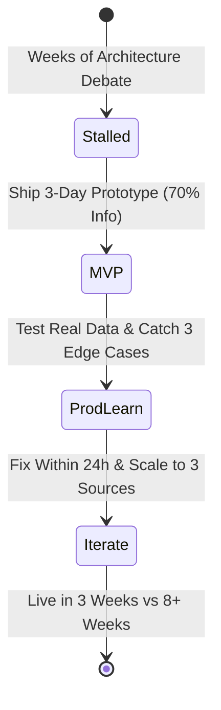

### STAR Story 1: Rapid Data Source Onboarding

| STAR Element | Key Details & Metrics |
| :--- | :--- |
| **Situation** | Team had debated the "perfect" data lake onboarding architecture for weeks while 3 sources waited. |
| **Task** | Unblock the stalled initiative and establish momentum. |
| **Action** | Proposed an MVP with stored procedures + basic validation; built the first source in **3 days**; tested with real data; fixed 3 edge cases within **24 hours** in week 1; scaled to the other 2 sources and optimized later. |
| **Result** | First source live in **3 weeks** (vs. **8+ weeks** estimated); real production data surfaced edge cases debates missed; initiative gained lasting momentum. |

### STAR Story 2: Test Coverage Acceleration

| STAR Element | Key Details & Metrics |
| :--- | :--- |
| **Situation** | Needed to raise Decoupling Project JUnit coverage from **62% → 85%** without stalling for months. |
| **Task** | Accelerate coverage gates without sacrificing quality or feature flow. |
| **Action** | Started writing tests immediately instead of designing a "perfect" suite; targeted highest-risk untested paths first; fixed flaky tests continuously (**2–3 pt/day** gains); shipped **85% gates** without waiting for 100%. |
| **Result** | Reached **85% coverage in 8 weeks** (vs. 4–5 months); defect escape rate **-45%**; inspired team to add **+10% coverage**; proved velocity and quality coexist. |

### Common Questions & Signals — Bias for Action

| Sample Interview Questions | Green Flags (Do) | Red Flags (Avoid) |
| :--- | :--- | :--- |
| "Tell me about making a decision with incomplete information." | Ship reversible MVPs and learn from real data. | "We analyzed it for 3 months before starting." |
| "Give an example of choosing speed over perfection." | Pair speed with rapid 24h iteration/fixes. | "I waited for management approval before moving." |
| "Describe a time you unblocked yourself instead of waiting." | Prioritize highest-ROI paths first. | Making reckless changes that break production. |
| "When have you taken a calculated risk?" | Show measurable time-to-market savings. | Shipping clearly untested or broken code. |

---

## 6. Earn Trust

### What Amazon REALLY Looks For

- **Follow-through**: Deliver on revised and original commitments consistently.
- **Radical transparency**: Surface bad news, blockers, and timeline risks early—never hide them.
- **Reliability & humility**: Admit mistakes or surprises quickly and present clear trade-off options.

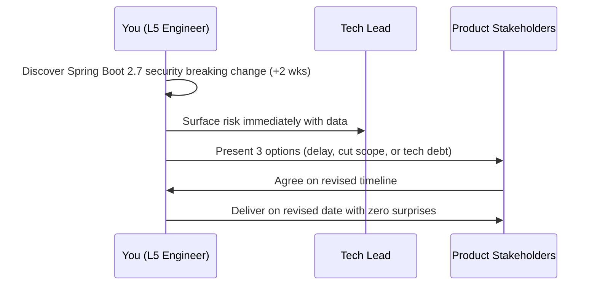

### STAR Story: Spring Boot Migration Transparency

| STAR Element | Key Details & Metrics |
| :--- | :--- |
| **Situation** | Midway through the Spring Boot **2.2 → 2.7** migration, a critical security dependency breaking change surfaced, adding **2 weeks** of work. |
| **Task** | Communicate the timeline impact honestly to stakeholders without eroding credibility. |
| **Action** | Immediately notified tech lead and product stakeholders; gave a realistic revised estimate instead of hoping to catch up silently; presented 3 clear options (delay feature, reduce scope, or accept tech debt) with trade-offs; executed on the revised plan. |
| **Result** | Stakeholders respected early transparency and adjusted expectations; **0 last-minute crises**; consensual, informed decision; **zero trust loss**. |

---

## 7. High Standards (Bar Raiser Favorite)

### What Amazon REALLY Looks For

Heavily weighted in **Bar Raiser** rounds:
- **Explicit, high bars**: Define concrete quality thresholds rather than accepting "good enough."
- **Refusal to compromise**: Push back respectfully on shortcuts and "we'll fix it later."
- **Team-wide elevation**: Turn personal standards into automated gates and team culture.

> [!IMPORTANT]
> **Bar Raiser 4-Step Formula for High Standards**:
> 1. **Define the standard explicitly** (e.g., *"85% coverage for new code"* or *"99.8% data accuracy"*).
> 2. **Show resistance** (*"Colleagues questioned if it was necessary under deadline"*).
> 3. **Demonstrate quantified impact** (*"62% → 89% coverage, -45% defects"*).
> 4. **Prove repeatability** (*"Adopted as the org-wide standard"*).

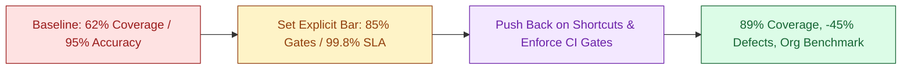

### STAR Story 1: Code Quality Standards in Decoupling

| STAR Element | Key Details & Metrics |
| :--- | :--- |
| **Situation** | Could have shipped the decoupled components at the **62% baseline** test coverage. |
| **Task** | Set and enforce a higher quality bar across the team. |
| **Action** | Proposed **85% JUnit coverage** for new code; enforced automated CI merge gates; fixed **400+ Sonar issues**; made code reviews rigorous and explained why skipping tests for "simple" changes was risky. |
| **Result** | JUnit coverage **62% → 89%** (+27 pts); production defects **-45%**; team began self-policing quality; faster onboarding for new engineers. |

**Follow-up Probes (Especially in Bar Raiser Rounds)**:
- "Tell me about a time you pushed back on quality standards. What happened?"
- "Describe a situation where you refused to ship because quality wasn't acceptable."
- "How did you balance shipping speed with quality standards?"
- "Tell me about a time a colleague disagreed with your quality bar. How did you handle it?"

### STAR Story 2: Data Quality Standards

| STAR Element | Key Details & Metrics |
| :--- | :--- |
| **Situation** | Datasource Project could have settled for 95% data accuracy; you set a **99.8% minimum**. |
| **Task** | Architect validation systems capable of hitting 99.8% accuracy in a regulated financial org. |
| **Action** | Built multi-layer validation (schema, statistical, business logic); tested empty/null/outlier/duplicate edge cases; added automated dashboards + SLAs (**1h freshness**, **2h accuracy verification**); rejected non-compliant sources instead of *"fix it later."* |
| **Result** | Achieved **99.8% data accuracy** (vs. 95% industry average); earned full compliance/risk trust; became the org-wide data quality benchmark. |

### Common Questions & Signals — High Standards

| Sample Interview Questions | Green Flags (Do) | Red Flags (Avoid) |
| :--- | :--- | :--- |
| "Tell me about setting a high standard others thought was too ambitious." | Define numeric bars + automate enforcement. | "Good enough is good enough." |
| "Describe refusing to ship because quality wasn't acceptable." | Show how you handled pushback constructively. | Shipping known flaws or perfectionism paralysis. |
| "Give an example of improving something beyond requirements." | Prove the standard became team/org culture. | "Others had lower standards, so I went with the flow." |
| "How do you balance high standards with shipping speed?" | Connect standards to fewer defects & faster onboarding. | Setting standards you never enforced. |

---

## 8. Think Big

### What Amazon REALLY Looks For

- **Ambitious, platform vision**: Solve today's problem in a way that scales 3–10x for future teams.
- **Systemic & strategic thinking**: Build shared abstractions, observability, and operational patterns—not one-off patches.

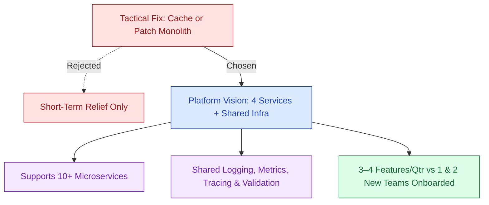

### STAR Story: Decoupling as Platform Thinking

| STAR Element | Key Details & Metrics |
| :--- | :--- |
| **Situation** | Monolith was slow and brittle; a quick optimization or caching layer would have been easier. |
| **Task** | Think bigger—create a platform enabling rapid, independent feature delivery across teams. |
| **Action** | Proposed 4 independent services with explicit contracts; architected for **10+ future microservices**; built shared logging/metrics/tracing, automated deployments, and reusable validation/model abstractions. |
| **Result** | 4 services deployed independently; feature throughput **1 → 3–4 features/quarter**; **2 new teams** adopted the platform patterns; **~2-year payback** on architectural investment. |

---

## 9. Disagree and Commit

### What Amazon REALLY Looks For

- **Backbone with respect**: Challenge decisions before they are locked using data and trade-offs, not ego.
- **Full commitment**: Once decided, execute 100% with zero grudges or *"I told you so"* behavior.

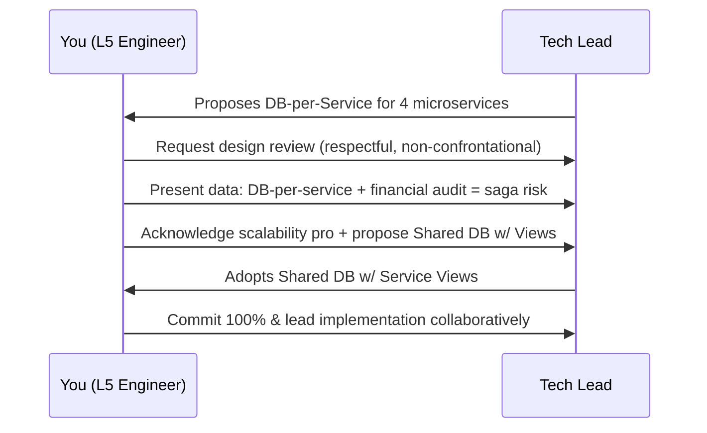

### STAR Story: Architecture Design Disagreement

| STAR Element | Key Details & Metrics |
| :--- | :--- |
| **Situation** | Tech lead initially proposed "database per service" for the Decoupling Project; you saw severe data consistency and financial audit-trail risks. |
| **Task** | Voice your disagreement respectfully and propose a viable alternative. |
| **Action** | Requested a structured design review; presented data on saga complexity vs. financial auditability; acknowledged the tech lead's scalability goal; proposed **shared DB with service-specific views**; once adopted, led implementation with full commitment and zero ego. |
| **Result** | Simpler, maintainable architecture; collective team ownership; demonstrated L5 influence without authority. |

---

## 10. Deliver Results

### What Amazon REALLY Looks For

- **Completion under obstacles**: Ship complex, multi-quarter initiatives despite external dependencies.
- **Metrics-driven execution**: Prove impact with concrete before/after numbers and zero scope creep.

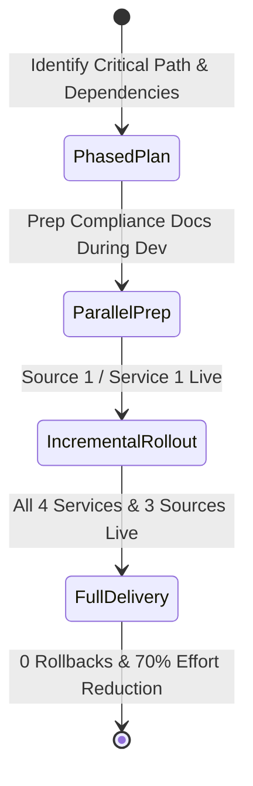

### STAR Story 1: Decoupling Project Delivery

| STAR Element | Key Details & Metrics |
| :--- | :--- |
| **Situation** | High-risk monolith decoupling (Nov 2022–Present) while ongoing feature work had to continue uninterrupted. |
| **Task** | Deliver all 4 independent services on schedule without disrupting feature teams. |
| **Action** | Executed a phased decoupling plan; coordinated dependencies with feature teams; shipped **1st component in 6 weeks** and **all 4 within 4 months**; raised JUnit coverage **62% → 89%** with zero scope creep. |
| **Result** | **All 4 components live & stable**; feature velocity **+40%**; deploy time **45 min → 8 min**; **0 post-launch rollbacks**. |

### STAR Story 2: Datasource Automation Delivery

| STAR Element | Key Details & Metrics |
| :--- | :--- |
| **Situation** | Onboarding 3 data sources depended on compliance reviews, ops adoption, and prod validation. |
| **Task** | Deliver on time despite cross-team external dependencies. |
| **Action** | Mapped critical path upfront; prepared compliance docs in parallel; rolled out incrementally (source 1 → 2 → 3); trained ops early; monitored prod and fixed issues within **24 hours**. |
| **Result** | **70% reduction in manual effort**; all 3 sources live on schedule; smooth compliance sign-off; ops team fully self-sufficient. |

### Common Questions & Signals — Deliver Results

| Sample Interview Questions | Green Flags (Do) | Red Flags (Avoid) |
| :--- | :--- | :--- |
| "Tell me about delivering a complex project on time." | Show phased milestones and critical-path management. | "We're still working on it" (for old projects). |
| "Describe facing obstacles and still delivering results." | Unblock dependencies in parallel (e.g., compliance docs). | "Delayed because of X team." |
| "When did you adjust course mid-project and still deliver?" | Pair delivery with quality (0 rollbacks, high coverage). | "We shipped it, but quality wasn't great." |
| "How do you track and measure results?" | Quantify before/after metrics; credit the team. | Vague claims ("It was a big project"). |

---

## 11. Frugality

### What Amazon REALLY Looks For

- **Resourcefulness & ROI**: Achieve more with existing tools and minimal spend before buying expensive licenses.
- **No vendor lock-in**: Build lean, maintainable solutions the team owns.

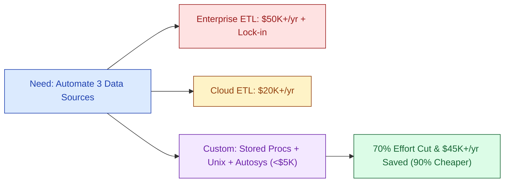

### STAR Story: Data Lake Automation ROI

| STAR Element | Key Details & Metrics |
| :--- | :--- |
| **Situation** | Could have purchased a **$50K+/year** enterprise ETL tool for the Datasource Project. |
| **Task** | Balance cost, capability, and long-term ownership. |
| **Action** | Evaluated enterprise (**$50K+**), cloud (**$20K+**), and custom (**8 weeks dev**); built custom automation using existing stored procedures + Unix scripting + Autosys at **&lt;$5K cost**. |
| **Result** | **70% manual effort reduction** at **&lt;10% of enterprise cost**; **$45K+/year saved**; **0 vendor lock-in**; ops owned the stack internally. |

---

## 12. Earn Trust (Already Covered)

See [6. Earn Trust](#6-earn-trust) for the full Spring Boot migration transparency story, sequence diagram, and stakeholder trade-off breakdown.


---

## 13. Insist on Highest Standards

### What Amazon REALLY Looks For

Closely paired with **High Standards (#7)**, emphasizing **continuous refinement** and **raising the team's bar**:
- **Targeted perfectionism**: Focus rigor on security, memory leaks, and production-impacting bugs.
- **Cultural shift**: Turn individual cleanup into automated CI/CD prevention.

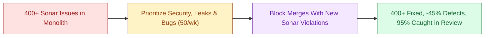

### STAR Story: Sonar Issues and Code Cleanliness

| STAR Element | Key Details & Metrics |
| :--- | :--- |
| **Situation** | Decoupling Project had **400+ Sonar issues**; many teams would have shipped anyway under deadline. |
| **Task** | Eliminate the backlog and prevent regression despite time pressure. |
| **Action** | Triaged security/memory/bug issues first; fixed **50 issues/week**; added **CI/CD Sonar merge blockers**; mentored devs on *why* each rule mattered. |
| **Result** | **400+ Sonar issues resolved**; defect rate **-45%**; **95% of code reviews** now catch issues before Sonar runs. |

---

## 14. Think Day 1

### What Amazon REALLY Looks For

- **5–10 year sustainability**: Architect systems as if you will maintain them forever.
- **Reversibility & clarity**: Clear boundaries, ADRs (decision docs), and self-serve runbooks so future teams thrive.

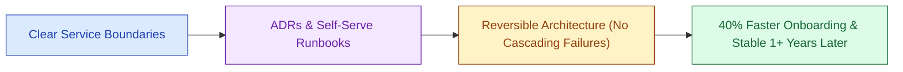

### STAR Story: Architecture for Long-term Maintainability

| STAR Element | Key Details & Metrics |
| :--- | :--- |
| **Situation** | Quick-and-dirty monolith refactoring would have been faster short-term but fragile long-term. |
| **Task** | Design for a **5–10 year** horizon. |
| **Action** | Defined clean service boundaries; documented *why* behind each architectural decision; wrote operator runbooks; built reversible boundaries so a service could be reverted without cascading failures. |
| **Result** | New-engineer onboarding **40% faster**; fewer operational incidents; architecture started **Nov 2022** remains stable and extensible in **2024+** with zero major redesigns. |

---

## 15. Diversity and Inclusion

### What Amazon REALLY Looks For

- **Psychological safety**: Create an environment where junior or underrepresented teammates ask questions freely and contribute ideas.
- **Adaptive mentoring**: Tailor coaching to different backgrounds and learning styles.

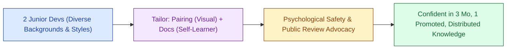

### STAR Story: Mentoring Diverse Team Members

| STAR Element | Key Details & Metrics |
| :--- | :--- |
| **Situation** | Mentored 2 junior developers on the Decoupling Project—one from a different background, one early-career—with distinct learning styles. |
| **Task** | Build an inclusive environment where both could contribute confidently. |
| **Action** | Adapted coaching (pair programming for visual learner, structured docs for self-learner); actively asked *"What would you do differently?"*; framed mistakes as learning; praised strengths in code reviews; explicitly normalized asking questions. |
| **Result** | Both became confident contributors in **3 months**; **1 promoted** to a more senior role; stronger team collaboration and distributed ownership. |

---

## 16. Transform Through Technology

### What Amazon REALLY Looks For

- **Eliminate toil via software**: Replace repetitive human work with scalable, self-service technology.
- **Empower non-engineers**: Build tools that scale from 1 user to 10+ pipelines without engineering bottlenecks.

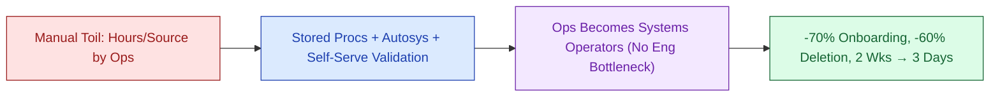

### STAR Story: Data Lake Automation Transformation

| STAR Element | Key Details & Metrics |
| :--- | :--- |
| **Situation** | Data onboarding required hours of repetitive manual ops work per source. |
| **Task** | Transform the workflow through scalable automation. |
| **Action** | Automated rule-based steps via stored procedures + Autosys + validation; enabled ops to add sources without engineering; architected for **10+ sources** (starting with 3). |
| **Result** | **70% less manual effort**; **60% less deletion utility effort**; onboarding **2 weeks → 3 days**; ops shifted from manual labor to systems operation. |

---

## Putting It All Together: How Principles Combine in Follow-ups

Amazon interviewers rarely test one LP in isolation—expect follow-up probes that stack **2–3 principles** onto a single story.

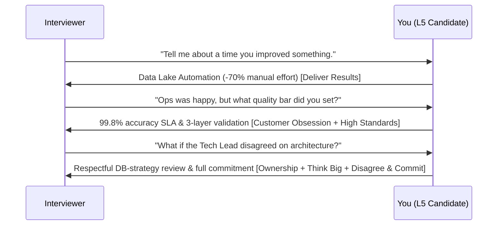

| Combination Pattern | Primary Question & Story | Likely Follow-up Probe | Signals Tested Together |
| :--- | :--- | :--- | :--- |
| **Customer Obsession + High Standards + Deliver Results** | *"Time you improved something"* → Data Lake Automation (70% effort cut) | *"Your customer (ops) was happy—what quality bar did you set?"* | Customer empathy + 99.8% accuracy bar + quantified delivery |
| **Ownership + Think Big + Disagree & Commit** | *"Time you owned a project"* → Decoupling Project | *"You owned it, but the tech lead had a different vision. How did you handle that?"* | End-to-end ownership + 10-service platform + respectful alignment |

---

## L5 Candidate Specific Strategy

At **L5**, individual coding excellence is table stakes. Your stories must highlight **5 leadership multipliers**:

1. **Influence Without Authority**: Influenced DB architecture without the tech lead title; mentored 2 junior devs; drove quality gates under deadline pressure.
2. **Strategic Thinking Over Task Execution**: Self-initiated the Decoupling Project; designed for 5–10 year org impact rather than one-off tickets.
3. **Cross-Functional Impact**: Aligned data engineering, operations, and compliance teams; unblocked downstream consumers.
4. **Systems Thinking**: Reasoned through system-wide trade-offs (shared DB vs. DB-per-service) and end-to-end operability.
5. **Driving Standards**: Replaced 62% baseline with 85% CI gates and Sonar blockers so the team internalized quality pragmatically.

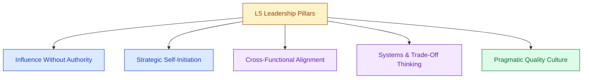

---

## Bar Raiser Specific Questions and Preparation

Bar Raisers are senior interviewers calibrated to protect Amazon's hiring bar. Prepare tight, metric-backed answers for these 5 staple prompts:

| Bar Raiser Question | What They Verify | Best Barclays Story |
| :--- | :--- | :--- |
| 1. *"Tell me about a time you raised the bar in your team."* | Identified gap → set explicit bar → enforced it → team internalized it | JUnit coverage (**62% → 89%**) or **400+ Sonar issues** |
| 2. *"When have you made a difficult trade-off between velocity and quality?"* | Conscious, data-backed balance of speed and rigor | Decoupling timeline + phased **85% test coverage** |
| 3. *"Describe a time you influenced a decision you initially disagreed with."* | Voiced data-backed concern → aligned → committed fully | Architecture disagreement (**shared DB vs. DB-per-service**) |
| 4. *"Tell me about going above and beyond your job description."* | Proactive problem-finding and unprompted ownership | Unassigned **Decoupling Project** or **Data Quality Framework** |
| 5. *"How do you balance high standards with shipping speed?"* | Shipped on time *while* enforcing quality gates | **Coverage gates** (enforced quality, shipped all 4 services in 4 mo) |


---

## Final Strategy Summary

> [!TIP]
> **4-Project Portfolio Rule**: You don't need 16 separate stories. Master **4 deep Barclays projects** and pivot each across multiple Leadership Principles with crisp metrics and team-level outcomes.

| Portfolio Anchor | Best Leadership Principles to Target | Non-Negotiable Habits in Every Answer |
| :--- | :--- | :--- |
| **Decoupling Project** | Ownership, Think Big, High Standards, Deliver Results, Invent & Simplify | **Always quote metrics**: *"62% → 89% coverage"*, *"45 min → 8 min"* |
| **Datasource Project** | Customer Obsession (internal), Bias for Action, Frugality, Transform Through Tech | **Always show team impact**: mentoring, runbooks, ops adoption |
| **Hackathon** | Invent & Simplify, Learn & Be Curious (if significant new tech learned) | **Always show end-to-end ownership**: from discovery to prod |
| **Spring Boot Migration** | Learn & Be Curious, High Standards, Disagree & Commit, Earn Trust | **Always stack LPs**: e.g., High Standards + Deliver Results |

```mermaid
flowchart LR
  P1["Decoupling Project"] --> LP1["Ownership, Think Big, High Standards, Deliver Results"]
  P2["Datasource Project"] --> LP2["Customer Obsession, Bias for Action, Frugality, Transform"]
  P3["Spring Boot Migration"] --> LP3["Learn & Be Curious, Earn Trust, Disagree & Commit"]
  P4["Hackathon"] --> LP4["Invent & Simplify, Learn & Be Curious"]

  classDef blue fill:#dbeafe,stroke:#1e40af,color:#1e40af
  classDef green fill:#dcfce7,stroke:#166534,color:#166534
  classDef purple fill:#f3e8ff,stroke:#6b21a8,color:#6b21a8
  classDef amber fill:#fef3c7,stroke:#92400e,color:#92400e

  class P1,LP1 blue
  class P2,LP2 green
  class P3,LP3 purple
  class P4,LP4 amber
```

---

## Quick Reference: Principles → Barclays Projects

```mermaid
erDiagram
  PROJECT ||--o{ PRINCIPLE : demonstrates
  PROJECT {
    string name
    string key_metric
  }
  PRINCIPLE {
    string title
    string role
  }
```

| Principle | Primary Story | Backup Story |
| :--- | :--- | :--- |
| **Customer Obsession** | Data Lake (understand ops needs) | Code Quality (understand dev needs) |
| **Ownership** | Decoupling Project (end-to-end) | Data Lake (automation ownership) |
| **Invent & Simplify** | Decoupling Architecture | Data Quality Framework |
| **Learn & Be Curious** | Spring Boot Migration | Data Lake / ETL / Autosys Learning |
| **Bias for Action** | Data Source Rapid Onboarding | Test Coverage Acceleration |
| **Earn Trust** | Spring Boot Migration Transparency | Honest Timeline Communication |
| **High Standards** | Code Quality / Sonar Issues | Data Quality 99.8% Accuracy |
| **Think Big** | Decoupling as Platform | Data Lake as Org-wide Asset |
| **Disagree & Commit** | Architecture Decision (DB strategy) | — |
| **Deliver Results** | Decoupling Project (all 4 services) | Data Lake (all 3 sources) |
| **Frugality** | Data Lake (vs. enterprise tools) | — |
| **Insist on Highest Standards** | 400+ Sonar Issues Fixed | — |
| **Think Day 1** | Architecture for Long-term | Documentation & Runbooks |
| **Diversity & Inclusion** | Mentoring Junior Developers | — |
| **Transform Through Technology** | Data Lake Automation | — |
