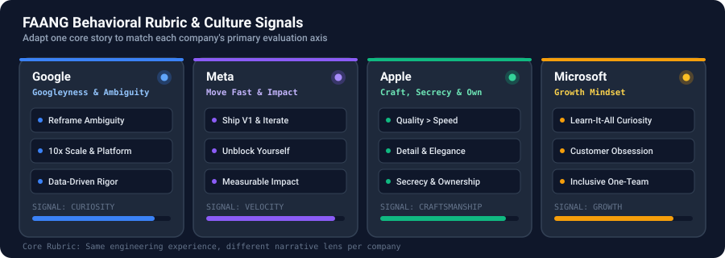
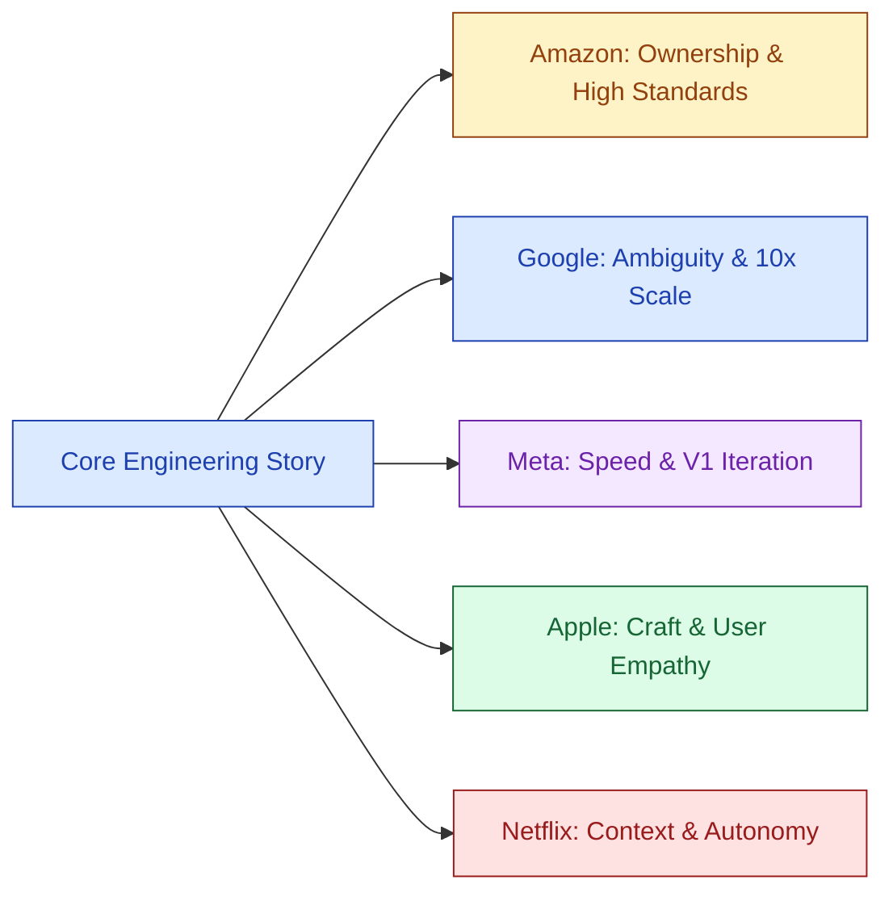
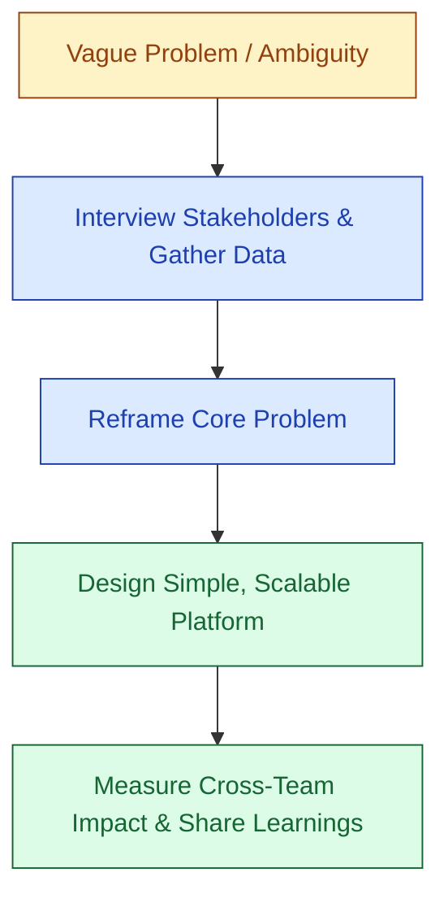
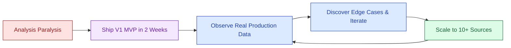
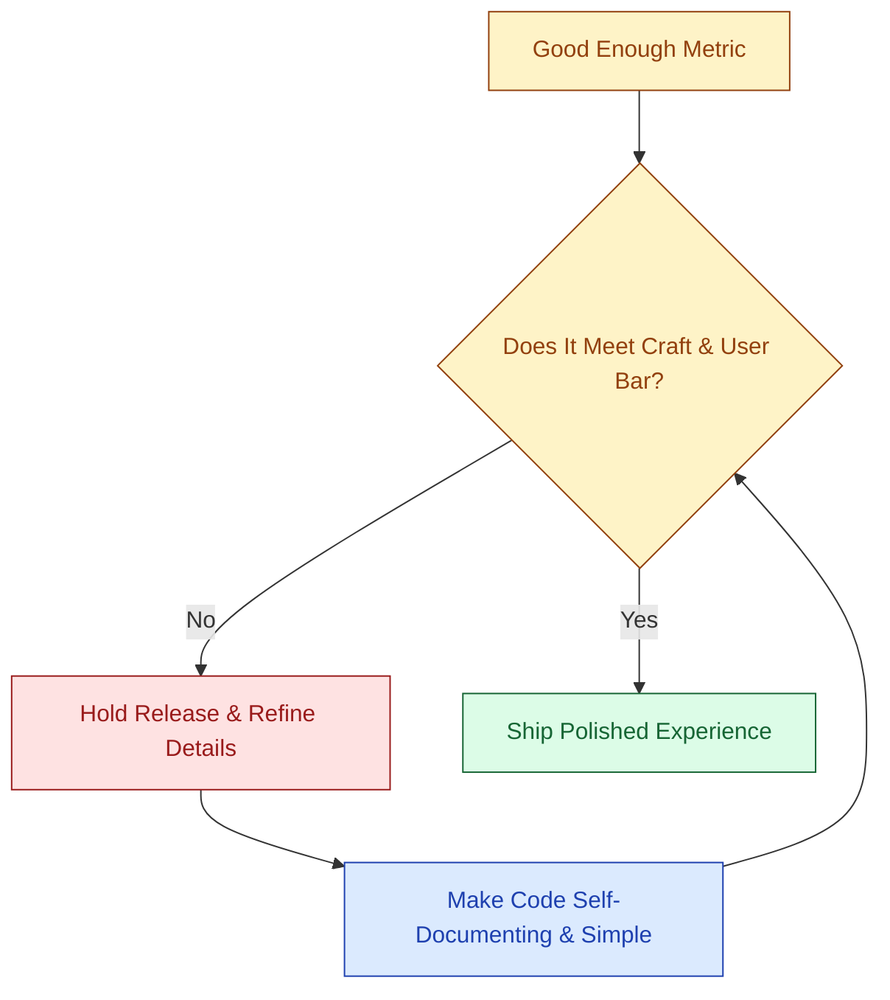
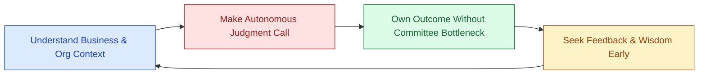
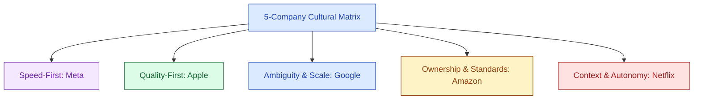
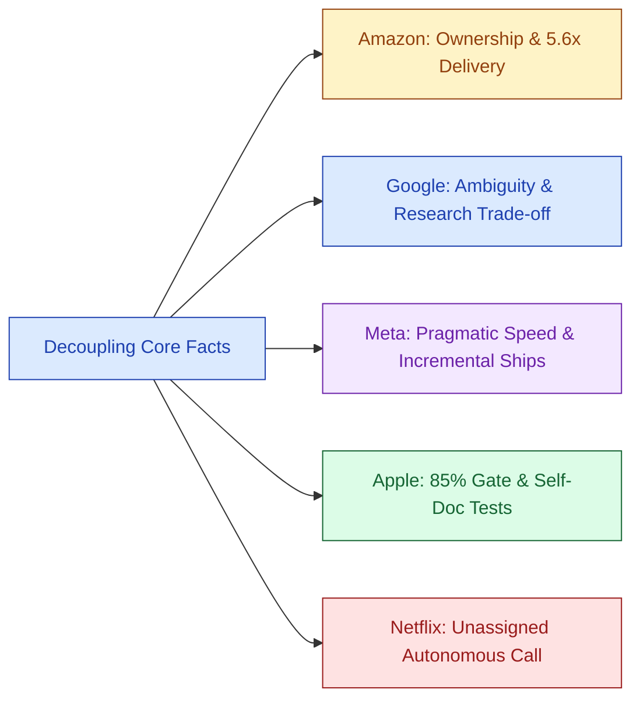
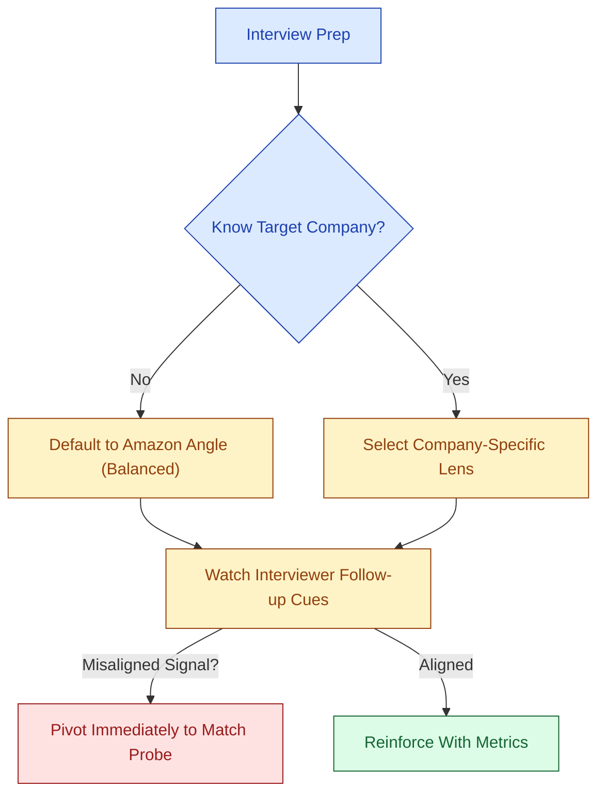
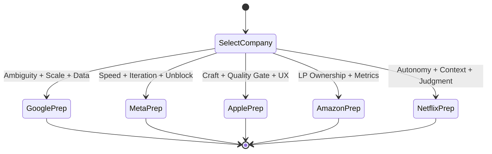

# FAANG Company Cultures: Tailoring Your Stories to Each Company

## Overview: Why Company Culture Matters

Every FAANG company evaluates behavioral stories through a distinct cultural lens. The same engineering project can sound compelling at Google and underwhelming at Apple if you emphasize the wrong signal.

| Company | Public / Core Pillar | Primary Behavioral Signal |
|---------|----------------------|---------------------------|
| **Amazon** | 16 Leadership Principles | Operational excellence &amp; end-to-end ownership |
| **Google** | Innovation &amp; Impact | Ambiguity framing, data rigor &amp; scale thinking |
| **Meta** | Move Fast &amp; Impact | Speed, bias for action &amp; rapid iteration |
| **Apple** | Simplicity &amp; Craft | Craftsmanship, attention to detail &amp; secrecy |
| **Netflix** | Freedom &amp; Responsibility | Context-driven autonomy &amp; judgment |

> [!IMPORTANT]
> Never deliver the exact same narrative verbatim across companies. Keep the core facts constant, but shift which trade-off, metric, and decision you highlight.

---

## GOOGLE: The Colossus of Innovation

### What Google Really Values (Beyond the Surface)

- **Publicly stated**: Innovation, impact, user-focused thinking.
- **Googleyness**: Intellectual curiosity, asking insightful questions, and thriving alongside peers from top research backgrounds without intimidation.
- **Technical leadership**: Driving cross-team technical decisions.
- **Data-driven decision making**: Backing architectural and product opinions with evidence, not intuition alone.
- **Long-term thinking**: Optimizing for multi-year platform impact rather than quarterly quick wins.
- **Bias toward learners**: Excitement for learning new domains and teaching others.

### How Google's Behavioral Interview Differs

| Focus Area | Typical Interviewer Probe |
|------------|---------------------------|
| **Dealing with ambiguity** | "You had no clear requirements. What did you do?" |
| **Technical depth + breadth** | "Tell me about a time you worked across different technologies." |
| **Impact at scale** | "Your solution affected millions of users. How did you think about that?" |
| **Culture fit** | "In a room with PhDs from MIT and Stanford, are you intimidated or inspired?" |

### Adapting Your Stories for Google

> [!TIP]
> Lead with intellectual curiosity, how you reframed ambiguity into structure, and how your design scales 10x beyond the initial ask.

#### Story 1: Data Lake Onboarding (Ambiguity + Impact)

- **Context &amp; Ambiguity**: At Barclays, tasked with onboarding 3 data sources to the data lake while different teams wanted conflicting things from the same data.
- **Action**: Acted like a PM instead of waiting for clear specs—interviewed 8+ stakeholder teams to uncover unspoken needs (real-time transformations, quality guarantees, audit trails).
- **Platform Design**: Built an elegant solution (stored procedures + validation layer + automated quality checks) architected to scale to 10+ data sources without structural changes.
- **Results**: 70% reduction in manual effort, 40% increase in Q1 adoption, zero quality incidents—and aligned diverse stakeholders around one coherent platform.
- **Google Assessment Signals**: Ambiguity reframing, multi-team impact, intellectual curiosity, platform thinking, data-driven validation.
- **Follow-up Questions Google Asks**:
  - "Walk me through one requirement conflict you had to resolve."
  - "How would this scale to 50 data sources?"
  - "What would you have done differently if you had more time?"
  - "Tell me about a time your design assumption was wrong."

#### Story 2: Decoupling Project (Technical Leadership + Scale)

- **Context &amp; Bottleneck**: Led refactoring of a 7-year-old Java monolith with undocumented dependencies, tight coupling, and 45-minute deployments requiring full regression testing.
- **Organizational Insight**: Recognized the real bottleneck was organizational—teams could not ship independently. Decomposed into 4 independent microservices aligned to 4 separate teams.
- **Controversial Trade-off**: Chose a shared database with service-specific views over "database per service" because distributed transactions in financial services add high risk; backed the choice with industry benchmarks to convince the tech lead.
- **Results**: Deployment time dropped 45 min → 8 min (5.6x faster), feature velocity rose 40%, and release cadence jumped from 1/week to 4/week.
- **Google Assessment Signals**: Technical leadership, complexity reduction, data-driven trade-offs, organizational thinking, scalability.
- **Follow-up Questions Google Asks**:
  - "Your architecture choice was controversial. Walk me through how you built consensus."
  - "If you had to redo this, what would you change?"
  - "How does this scale to 20 services?"
  - "Tell me about a time your architectural assumption was wrong during implementation."

### Google's Behavioral Question Bank (L5 Senior Engineer)

| # | Question | Signal Tested | Recommended Story |
|---|----------|---------------|-------------------|
| 1 | "Tell me about a time you made a decision with incomplete information." | Comfort with ambiguity | Data Lake or Decoupling |
| 2 | "Describe a situation where you had to learn something new quickly." | Continuous learning | Spring Boot 2.7 migration or Data Lake/ETL |
| 3 | "Tell me about a time you influenced a decision you didn't fully agree with." | Navigating disagreement | Shared DB vs. DB per service |
| 4 | "Give an example of a problem you solved that didn't have a clear right answer." | Ambiguity &amp; creativity | Data Quality Framework or Data Lake alignment |
| 5 | "Tell me about a time you took a risk on a technical decision." | Calculated risk | Rapid Data Source Onboarding MVP |
| 6 | "Describe a situation where you had to collaborate across different teams with different priorities." | Cross-functional alignment | Data Lake (data eng, ops, compliance) |
| 7 | "Tell me about a time you optimized something for scale." | Platform &amp; scale thinking | Decoupling (architected for 10+ services) |
| 8 | "How do you approach a problem when requirements are vague?" | Ambiguity decomposition | Data Lake stakeholder interviews |
| 9 | "Tell me about a time you broke down a complex problem into simpler pieces." | Decomposition &amp; clarity | Decoupling (4 services) or Data Quality layers |
| 10 | "Describe a time you pushed back on a decision and how it was resolved." | Intellectual rigor | Shared DB pushback |
| 11 | "Tell me about a time you improved a process or system." | Systems-level thinking | Data Lake automation (70% effort cut) |
| 12 | "Give an example of when you had to explain a complex technical concept to non-technical people." | Communication | Statistical anomaly detection to ops teams |

### Google Specific Strategy

- **Do**: Emphasize curiosity ("I dove deeper..."), ambiguity reframing, 10x scale design, data validation, and explicit learnings.

> [!WARNING]
> **What NOT to say at Google**: "We just followed the standard approach," "I wait for clear requirements before starting," "I stick with what I know," or "I'm not comfortable with ambiguity."

---

## META: The Speed Demons

### What Meta Really Values

- **Publicly stated**: Move Fast, Move Fast and Break Things, Flat Organization.
- **Speed above all**: Shipping quickly and embracing "done is better than perfect."
- **Impact &amp; execution**: Executing and iterating rather than over-planning.
- **Bias for action**: Unblocking yourself instead of waiting on others.
- **Low process overhead**: Discomfort with heavy bureaucracy.
- **Iteration mindset**: Shipping V1 and improving based on real production data.

### How Meta's Behavioral Interview Differs

- **Speed**: "How quickly can you ship?"
- **Bias for action**: "Tell me about a time you unblocked yourself."
- **Iteration**: "Tell me about a time you shipped something and then improved it."
- **Impact over perfection**: "Tell me about something you shipped that wasn't perfect but had impact."

### Adapting Your Stories for Meta

> [!TIP]
> Frame your stories around breaking analysis paralysis, shipping a pragmatic V1 fast, and using real production feedback to iterate.

#### Story 1: Data Source Rapid Onboarding (Speed + Iteration)

- **Context**: In Aug 2021, needed to onboard 3 data sources while the team debated the "perfect" ETL architecture for weeks.
- **Action**: Broke analysis paralysis by proposing a 2-week MVP using simple stored procedures, Unix scripts, and Autosys scheduling—no fancy frameworks.
- **Weekly Iteration**:
  - **Week 1**: Built and deployed Source 1 (MVP).
  - **Week 2**: Real data flowed; uncovered 3 edge cases.
  - **Week 3**: Added validation rules and improved monitoring.
  - **Week 4**: Deployed Source 2 using Week 2-3 learnings.
  - **Weeks 5-6**: Deployed Source 3; system matured and is now extending to 10 more sources.
- **Meta Assessment Signals**: 2-week MVP velocity, bias toward action, comfort with V1 imperfection, rapid iteration, self-unblocking.
- **Follow-up Questions Meta Asks**:
  - "Tell me about one of those 3 edge cases you discovered. How did you handle it?"
  - "If you had waited and built the 'perfect' system, what would have been different?"
  - "How did you balance speed with quality?"
  - "Tell me about a time the simple approach didn't work."

#### Story 2: Test Coverage Acceleration (Iteration + Unblocking)

- **Context**: During the Decoupling Project, test coverage sat at 62% vs. the required 85% quality gate—normally a 4-5 month grind.
- **Action**: Started writing tests immediately on highest-risk code for daily 1-2 point gains, and enabled the 85% coverage gate immediately as a forcing function for team accountability.
- **Results**: Reached 85% coverage in 8 weeks instead of 4-5 months.
- **Meta Assessment Signals**: High velocity, daily feedback loops, pragmatic forcing functions.

### Meta's Behavioral Question Bank

| # | Question | Signal Tested | Recommended Story |
|---|----------|---------------|-------------------|
| 1 | "Tell me about a time you shipped something that wasn't perfect but had impact." | Ship &gt; Perfect | Rapid Data Source Onboarding |
| 2 | "Describe a situation where you unblocked yourself instead of waiting." | Bias for action | Data Source Onboarding MVP |
| 3 | "Give an example of when you moved fast and had to iterate based on learnings." | Speed + iteration | MVP → learn → iterate → scale |
| 4 | "Tell me about a time you pushed back on process or bureaucracy." | Anti-bureaucracy | Cutting process to ship faster |
| 5 | "How do you balance speed with quality?" | Pragmatic guardrails | Coverage gates (fast + minimum bar) |
| 6 | "Tell me about a time you took a calculated risk." | Speed-oriented risk | Deploying MVP without perfect spec |
| 7 | "Describe a time you simplified something complex." | Simplicity | Statistical Data Quality vs. ML |
| 8 | "Tell me about a time you made a decision with limited information." | Moving despite unknowns | Shipping without all edge cases |
| 9 | "How do you decide when something is 'done enough' to ship?" | Pragmatism | Core functionality works → ship |
| 10 | "Give an example of when you got feedback and quickly changed direction." | Responsiveness | 24-hour production issue fixes |

### Meta Specific Strategy

- **Do**: Quote speed metrics ("X weeks → Y weeks"), V1 → V2 iterations, simple over perfect, self-initiated action, and opportunity capture.

> [!WARNING]
> **What NOT to say at Meta**: "We spent 3 months perfecting the design," "I never ship anything but my best work," "I prefer detailed requirements before starting," or "I'm uncomfortable shipping code with known issues."

---

## APPLE: The Perfectionists

### What Apple Really Values

- **Publicly stated**: Innovation, Simplicity, Design Excellence.
- **Craftsmanship**: Sweating the small details others overlook.
- **User-centric design**: Every technical choice serves the end user experience.
- **Secrecy &amp; discretion**: Protecting confidential projects and sensitive data.
- **Quality over speed**: Willingness to delay a release if quality is not acceptable.

### How Apple's Behavioral Interview Differs

- **Perfectionism**: "Tell me about a time you refused to ship because quality wasn't acceptable."
- **Attention to detail**: "Tell me about a small thing you fixed that made a big difference."
- **User empathy**: "Tell me about a time you thought about the end user experience."
- **Aesthetic sense**: "Tell me about a time you improved the elegance of a solution."
- **Secrecy/discretion**: "Tell me about a time you kept confidential information secure."

### Adapting Your Stories for Apple

> [!IMPORTANT]
> Emphasize why you refused to settle for "industry standard," how your technical choices protected end users, and the elegance of the final design.

#### Story 1: Code Quality Improvement (Craftsmanship + Details)

- **Context &amp; User Empathy**: During the Decoupling Project, 62% coverage was "industry acceptable," but traders and risk managers depended on this software for financial decisions.
- **Action**: Set 85% as a minimum floor, audited the codebase to identify the critical 20% of paths driving 80% of risk, and refused to merge tests that didn't also serve as clear behavioral documentation.
- **Results**: New team members onboarded 40% faster due to self-documenting tests, and defect escape rate dropped 45%.
- **Apple Assessment Signals**: Craftsmanship over metric-chasing, detail orientation, end-user empathy, willingness to take time for quality, code elegance.
- **Follow-up Questions Apple Asks**:
  - "Tell me about one test you wrote that you're proud of. Why are you proud of it?"
  - "You had time pressure. How did you balance that with quality?"
  - "Tell me about a time a colleague wanted to cut corners on quality. How did you handle it?"
  - "Show me an example of code you've written that you think is elegant."

#### Story 2: Data Quality Framework (Simplicity + Elegance + User Focus)

- **Context**: Needed data quality validations for the data lake—could build a complex ML anomaly detector or simple statistical rules.
- **Action**: Chose transparent statistical rules (`mean ± 3σ`) so operators didn't have to trust a black box, and built a clean dashboard visualizing the value distribution and exact outlier position.
- **Results**: 99.8% accuracy, 0.8% false positive rate, and high operator trust because users could verify the logic themselves.
- **Apple Assessment Signals**: User comprehension, elegance over complexity, aesthetic detail, long-term trust.

### Apple's Behavioral Question Bank

| # | Question | Signal Tested | Recommended Story |
|---|----------|---------------|-------------------|
| 1 | "Tell me about a time you refused to ship because quality wasn't acceptable." | Quality &gt; Speed | Coverage gates (85% minimum) |
| 2 | "Describe a situation where you obsessed over details that others might have missed." | Detail obsession | Self-documenting test suite |
| 3 | "Give an example of when you improved something that was 'good enough' but made it great." | Good → Great | Code quality (62% → 89% coverage) |
| 4 | "Tell me about a time you chose simplicity over a sophisticated solution." | Design simplicity | Statistical rules &gt; ML black box |
| 5 | "How do you think about user experience when making technical decisions?" | User obsession | Operator-friendly quality dashboard |
| 6 | "Tell me about a time you kept confidential information secure." | Secrecy &amp; discretion | Barclays financial data handling |
| 7 | "Describe a situation where you had to delay shipping to maintain quality." | Holding the quality bar | Taking time to hit 85% gate |
| 8 | "Give an example of elegant code or design you're proud of." | Aesthetic quality | Clean Decoupling service boundaries |
| 9 | "Tell me about a time you noticed a small detail that made a big difference." | Micro-craftsmanship | 400+ Sonar fixes → 45% fewer defects |
| 10 | "How do you define 'done'?" | Quality definition | Tested + self-documented |

### Apple Specific Strategy

- **Do**: Highlight delaying for quality, small details with big impact, user empathy, solution elegance, and multi-year maintainability.

> [!WARNING]
> **What NOT to say at Apple**: "We shipped fast even though quality wasn't perfect," "Good enough is good enough," "Details don't matter; speed matters," or "I don't think about how this impacts end users."

---

## NETFLIX: The Context-Based Culture

### What Netflix Really Values

- **Culture Deck Themes**: Freedom &amp; Responsibility, Context Not Control.
- **Autonomy &amp; ownership**: Making decisions without waiting for permission.
- **Context understanding**: Grasping organizational constraints and aligning decisions to them.
- **Excellence &amp; growth**: Continuous self-improvement.
- **Radical candor**: Giving and receiving direct, honest feedback.
- **Judgment &amp; wisdom**: Making sound calls with minimal oversight.

### How Netflix's Behavioral Interview Differs

- **Autonomy**: "Tell me about a time you made a decision without asking for approval."
- **Context understanding**: "Tell me about a time you made a decision because you understood the broader context."
- **Excellence**: "What are you working to improve about yourself?"
- **Candor**: "Tell me about a time you gave difficult feedback."
- **Judgment**: "Tell me about a decision that turned out differently than expected."

### Adapting Your Stories for Netflix

> [!TIP]
> Show that you don't wait for tickets or manager sign-off—you read the business context, make an informed judgment call, and seek wisdom (not permission) from peers.

#### Story 1: Decoupling Project (Autonomy + Judgment + Context)

- **Context &amp; Ownership**: Project wasn't formally assigned. Identified that 45-minute monolith deployments were constraining org growth and took autonomous ownership instead of waiting for assignment.
- **Contextual Judgment**: Chose a shared database over "database per service" because financial services context makes distributed transactions high-risk.
- **Results &amp; Reflection**: Achieved 5.6x faster deployments without committee bottlenecks; in hindsight, would seek wisdom from the tech lead earlier (feedback, not permission).
- **Netflix Assessment Signals**: Autonomous initiative, business context awareness, sound judgment, end-to-end ownership, openness to feedback.
- **Follow-up Questions Netflix Asks**:
  - "Did your manager support this, or did you have to convince them afterward?"
  - "If someone told you your architectural choice was wrong, how would you respond?"
  - "Tell me about a time your autonomous decision turned out badly."
  - "How do you balance autonomy with alignment with the team?"

#### Story 2: Datasource Automation Decision (Judgment + Speed + Autonomy)

- **Context**: Financial org with risk-averse operations teams who understand SQL and Unix scripting and distrust complex frameworks.
- **Action**: Made an autonomous judgment call to use stored procedures and Autosys instead of a heavy ETL framework so ops teams could safely understand and maintain it.
- **Results**: 70% effort reduction, high adoption, zero quality incidents—simplicity was intentional, not a shortcut.

### Netflix's Behavioral Question Bank

| # | Question | Signal Tested | Recommended Story |
|---|----------|---------------|-------------------|
| 1 | "Tell me about a time you made a decision without asking for permission." | Autonomy | Unassigned Decoupling ownership |
| 2 | "Describe a situation where you understood the context and made a decision based on it." | Context-based decisions | Simple Data Lake for risk-averse ops |
| 3 | "Give an example of when you made a decision that turned out differently than expected." | Handling uncertainty | Initial assumption pivot |
| 4 | "Tell me about a time you gave difficult feedback to a colleague." | Radical candor | Architectural pushback |
| 5 | "How do you stay excellent? What are you working to improve?" | Growth mindset | Spring Boot migration learning |
| 6 | "Describe a time you operated with incomplete information and still made a good decision." | Judgment under ambiguity | Rapid Data Source MVP |
| 7 | "Tell me about a time you collaborated with someone who disagreed with you." | Healthy debate | DB per service vs. shared DB |
| 8 | "Give an example of when you escalated something vs. solved it autonomously." | Escalation judgment | Spring Boot issue triage |
| 9 | "How do you balance autonomy with alignment?" | Context + alignment | Autonomous work informed by team context |
| 10 | "Tell me about a time you received feedback that changed your perspective." | Openness to feedback | Learning story shaped by peer input |

### Netflix Specific Strategy

- **Do**: Highlight self-initiated ownership, broad business context, explicit judgment calls, continuous self-improvement, and evidence-based validation.

> [!WARNING]
> **What NOT to say at Netflix**: "I waited for my manager to assign this work," "I just execute tasks without business context," "I make decisions on technical purity alone," or "I prefer clear rules and process."

---

## Quick Comparison Table: What Each Company Values

| Dimension | Amazon | Google | Meta | Apple | Netflix |
|-----------|--------|--------|------|-------|---------|
| **Speed vs. Quality** | Balanced | Quality-focused | Speed-focused | Quality &gt; Speed | Context-dependent |
| **Innovation** | Operational | Technical | Execution | Design | Cultural |
| **Perfection** | High standards (not perfection) | Elegant simplicity | Good enough fast | Craftsmanship obsession | Excellence in role |
| **Risk Tolerance** | Calculated | Thoughtful | High | Low | High (with judgment) |
| **Autonomy** | Within ownership | Within teams | High | Lower (process) | Very high |
| **Process** | Lightweight | Medium | Minimal | Rigorous | Context-based |
| **Values** | 16 Leadership Principles | Innovation + Impact | Move Fast + Impact | Simplicity + Craft | Freedom + Responsibility |

---

## How to Adapt a Single Story for Five Companies

**Core Facts (Decoupling Project)**: Broke monolith into 4 services | Deployment: 45 min → 8 min | Coverage: 62% → 89% | 400+ Sonar issues fixed | Spring Boot 2.2 → 2.7 | Mentored 2 junior devs.

| Company | Adapted Story Pitch |
|---------|---------------------|
| **Amazon** | "I identified a strategic problem (deployment bottleneck) and owned it end-to-end. I set high standards (85% coverage, not 62%), made a controversial architectural choice (shared DB) and built consensus, mentored junior developers, and delivered 5.6x faster deployments." |
| **Google** | "I faced ambiguity: the architecture wasn't clear. I researched financial companies' approaches to service boundaries, designed something elegant and scalable, influenced the tech lead to adopt a simpler approach, and achieved exponential improvement in team velocity." |
| **Meta** | "The monolith was a bottleneck. I shipped the refactoring faster than expected with pragmatic incremental deployments instead of waiting for the perfect design. Deployment time dropped from 45 min to 8 min—5.6x faster, unblocking team velocity." |
| **Apple** | "I obsessed over code quality, set coverage gates, and refused to merge below 85%. I designed clean, elegant service boundaries and self-documenting tests so new developers onboarded in 2 weeks instead of 2 months." |
| **Netflix** | "This project wasn't formally assigned. I understood the context—our deployment bottleneck limited growth—and autonomously chose to own it, making unconventional choices (shared DB) suited to our financial risk context." |

---

## Final Strategy: How to Choose Which Company's Angle to Use

- **Unknown company**: Lead with the **Amazon** version (balanced, well-structured) and adjust based on interviewer cues.
- **Amazon**: Emphasize ownership, high standards, influence.
- **Google**: Emphasize ambiguity handling, data-driven decisions, platform thinking.
- **Meta**: Emphasize speed, iteration, pragmatism.
- **Apple**: Emphasize quality, craftsmanship, user focus.
- **Netflix**: Emphasize autonomy, context understanding, judgment.

> [!WARNING]
> **Red Flag Pivot**: If a Google interviewer asks *"How do you handle ambiguity?"* and you start saying *"I wait for clear requirements,"* pivot immediately: *"I reframed this ambiguous requirement by talking to stakeholders, and discovered the real problem..."*

---

## Company-Specific Preparation Checklist

### Before a Google Interview
- [ ] Adapt one story to emphasize ambiguity handling
- [ ] Prepare to discuss scale thinking
- [ ] Have data ready (you measured success with numbers)
- [ ] Be ready to discuss learnings and intellectual curiosity

### Before a Meta Interview
- [ ] Adapt one story to emphasize speed
- [ ] Prepare to discuss iteration (shipped, learned, improved)
- [ ] Have a story about shipping something "imperfect" with impact
- [ ] Be ready to discuss unblocking yourself

### Before an Apple Interview
- [ ] Adapt one story to emphasize quality and craftsmanship
- [ ] Have a story about refusing to ship for quality reasons
- [ ] Be ready to discuss details and elegance
- [ ] Discuss user impact of your work

### Before an Amazon Interview
- [ ] Adapt stories to emphasize leadership principles
- [ ] Be ready to discuss ownership and influence
- [ ] Have metrics for all results
- [ ] Discuss how you raised team standards

### Before a Netflix Interview
- [ ] Adapt one story to emphasize autonomous decision-making
- [ ] Be ready to discuss context understanding
- [ ] Have examples of good judgment calls
- [ ] Discuss how you handled ambiguity and still succeeded
