# Your Personal Story Bank - Mohit's FAANG Interview Stories

This document is your personalized story library. Each of your major projects is broken down into multiple STAR tellings, each emphasizing different leadership principles. Use these as templates to adapt on the fly during interviews.

---

## Overview & Story Bank Matrix

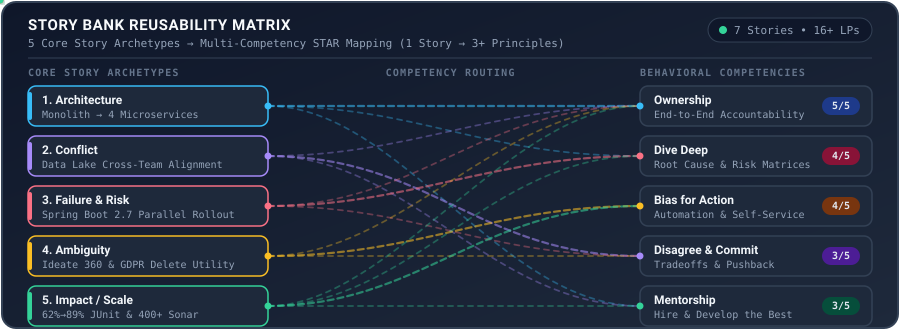

| # | Project | Context | Key Metrics | Duration | Primary LPs |
|---|---------|---------|-------------|----------|-------------|
| 1 | **Monolith Decomposition** | Barclays core trading/risk | 18% complexity drop, 62%→89% JUnit, 400+ Sonar fixed | 9 months | Ownership, Deliver Results, Hire & Develop |
| 2 | **Spring Boot Migration (2.2 → 2.7)** | Barclays compliance/security | 98% deprecated APIs removed, 0 prod incidents | 4 months | Learn & Be Curious, Dive Deep, Risk Mgmt |
| 3 | **JUnit Coverage Improvement** | Monolith decomposition | 62%→89% coverage, 40% fewer prod bugs | 6 months | Highest Standards, Ownership, Mentoring |
| 4 | **Resolved 400+ Sonar Issues** | Monolith decomposition | 400+ critical/major → 0 critical issues | 6 months | Highest Standards, Bias for Action |
| 5 | **Data Lake Onboarding** | Barclays analytics infra | 70% less manual effort, \$80K→\$20K, 8w→3w | 3 months+ | Customer Obsession, Earn Trust, Frugality |
| 6 | **Delete Utility (Unix Scripting)** | Barclays GDPR compliance | 60% less DBA time (10h→2h), 0 violations | 3 weeks | Scale & Responsibility, Bias for Action |
| 7 | **Hackathon: Ideate 360** | Barclays internal hackathon | 40% faster audit response (2-3h → instant) | 2-3 days | Invent & Simplify, Bias for Action |

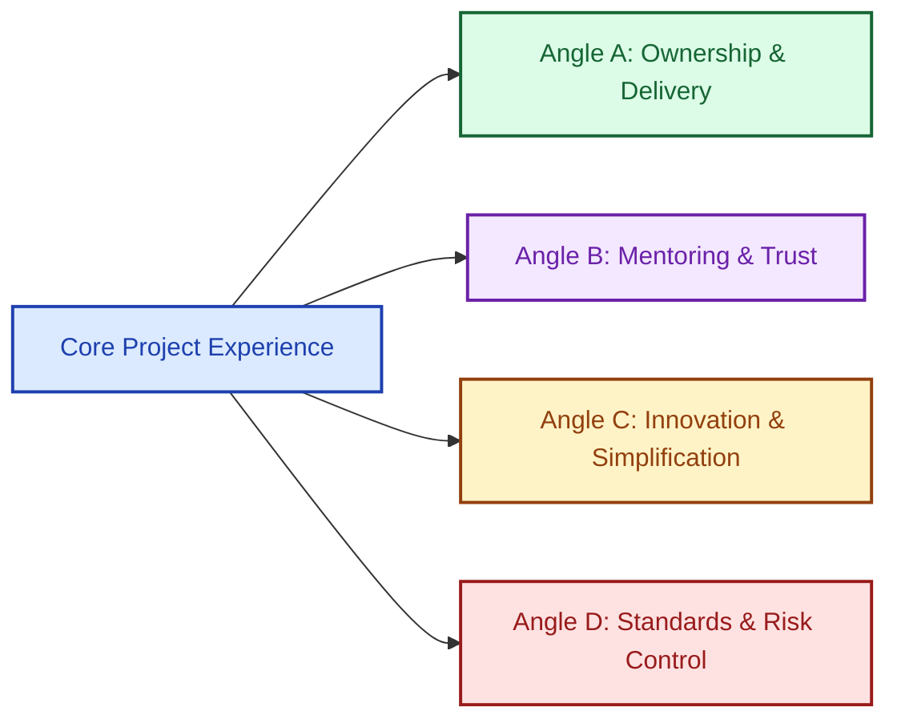

> [!TIP]
> One deep project can answer 3–4 different behavioral questions depending on which **Action** bullets you foreground. Keep the metrics constant and pivot the narrative lens.

---

## Story 1: Monolith Decomposition Project

| Attribute | Details |
|-----------|---------|
| **Project** | Decoupled a monolithic application into 4 independent microservices |
| **Context** | Barclays Investment Bank, core trading/risk system |
| **Key Metrics** | 18% complexity reduction, 62%→89% JUnit coverage, 400+ Sonar fixed, 1/mo→3-5/wk deploys |
| **Duration** | 9 months |

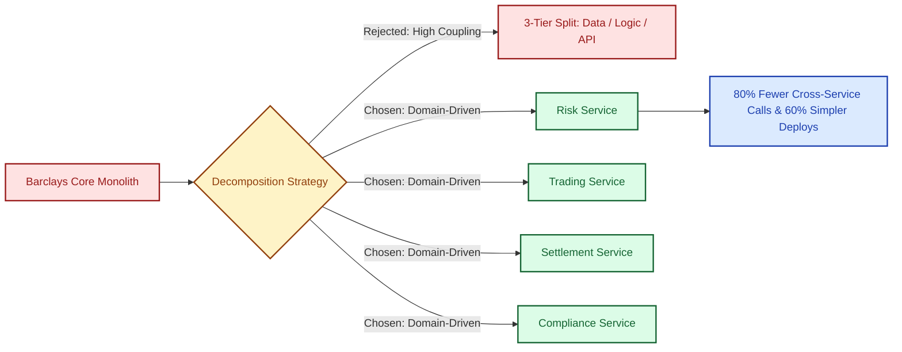

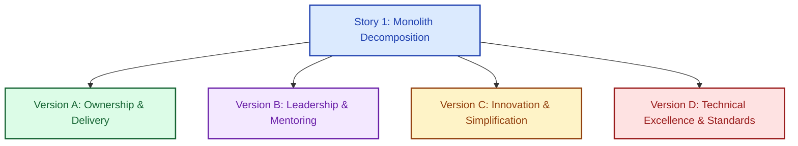

### STAR Version A: Ownership & Delivery (For "Tell me about a time you took ownership")

- **Situation**: The core banking application at Barclays was a monolithic system serving traders, risk managers, and operations teams. Independent deployment was impossible—teams had to coordinate across the entire system even for small changes, with a regulatory modernization deadline 12 months away.
- **Task**: I was asked to lead the decomposition strategy. This was a high-stakes, complex project that would determine whether we could meet regulatory requirements and reduce deployment friction.
- **Action**:
  - **Took full ownership**: Questioned whether to decompose at all, evaluated alternatives (strangler pattern, internal refactoring), and made the case for microservices specifically.
  - **Defined service boundaries**: Rather than decomposing along technical layers (data, business logic, API—an architectural mistake), I interviewed product teams, traders, and risk managers to understand business workflows and identified 4 natural domain boundaries: Risk, Trading, Settlement, Compliance.
  - **Managed dependencies**: Mapped inter-service communication and designed contracts/APIs upfront to minimize coupling.
  - **Led through ambiguity**: Established weekly design review sessions where the team could challenge my decisions; admitted when I was wrong and pivoted.
  - **Enforced standards**: Set a hard requirement of 89% code coverage and zero critical Sonar violations in each microservice, even though it slowed initial development.
  - **Delivered on time**: Executed within the 9-month regulatory deadline with zero production incidents at launch.
- **Result**:
  - **4 independent microservices** deployed to production
  - **18% reduction in system complexity** (cyclomatic complexity metrics)
  - **JUnit coverage improved from 62% to 89%** (required by governance)
  - **400+ Sonar critical issues resolved** (previously ignored in monolith)
  - **Deployment frequency increased from 1 per month to 3–5 per week** per service
  - **Regulatory deadline met 2 weeks early** with **zero production incidents** post-launch
  - **Team grew**: Two junior engineers who worked on this became architects later

> [!IMPORTANT]
> **Why this works**: You took full accountability, made strategic decisions (not just executing), maintained high standards, delivered under pressure, and grew your team. Hits: **Ownership, Deliver Results, Insist on Highest Standards, Bias for Action**.
> **Likely follow-up**: *"Walk me through how you decided on the 4 service boundaries. What would have happened if you chose wrong?"*

---

### STAR Version B: Leadership & Mentoring (For "Tell me about a time you developed someone")

- **Situation**: During the monolith decomposition, two junior engineers on the team had only worked with monolithic architectures. They were capable but inexperienced with distributed systems, and the project needed them to grow fast.
- **Task**: Instead of protecting them with simpler tasks, I decided to develop them as distributed systems engineers, even though it would slow the project short-term.
- **Action**:
  - **Assigned ownership**: Each junior engineer owned one complete microservice end-to-end—design, implementation, testing, deployment.
  - **Provided structured mentoring**: Reviewed code in detail, asking *why* they made decisions rather than telling them what to do. Taught eventual consistency, circuit breakers, and service contract versioning through real examples.
  - **Challenged them appropriately**: Had them present their architecture to leadership and traders, building confidence and communication skills.
  - **Gave safe failure space**: Caught mistakes in dev/test, not production; helped them debug while they drove the root-cause analysis.
  - **Measured growth**: By month 6, both designed complex scenarios independently; by month 9, they mentored newer engineers.
- **Result**:
  - **Both engineers significantly leveled up** in systems thinking and stayed at Barclays long-term
  - **One engineer became the architect for the Data Lake project** (a promotion enabled by this investment)
  - **Team velocity improved** in months 6–9 as juniors became fully productive
  - **Organizational capability improved** for future distributed systems projects

**Why this works**: You invested in people when it was harder short-term, set clear development goals, and created psychological safety. Hits: **Hire and Develop the Best, Ownership, Think Big, Earn Trust**.

---

### STAR Version C: Innovation & Simplification (For "Tell me about a time you simplified something")

- **Situation**: When designing the microservice decomposition, the obvious technical approach was to split along traditional tiers: one service for data access, one for business logic, and one for APIs.
- **Task**: I questioned whether a 3-tier split was actually the right decomposition for our use case.
- **Action**:
  - **Questioned the assumption**: Researched how Uber, Netflix, and Amazon decomposed systems and saw they used domain-driven design, not layer-based decomposition.
  - **Analyzed actual workflow**: Mapped how the trading team worked. The bottleneck wasn't data access speed—it was *"I can't deploy a new trading rule without coordinating a full system deployment."*
  - **Designed around business domains**: Created **Risk Service, Trading Service, Settlement Service, Compliance Service**, each owning all layers for its domain.
  - **Reduced inter-service communication**: Trading features no longer required cross-service calls to compliance (same bounded context), cutting cross-service calls by ~80%.
  - **Simplified deployment complexity**: Each service had one owner team and its own simple pipeline instead of orchestrating across 6 services.
- **Result**:
  - **Loosely coupled microservices** with **60% simpler deployment process** than a 3-tier split
  - **Faster team shipping** without waiting on other teams
  - **Reduced need for complex circuit breakers and retry logic** due to low cross-service dependencies
  - **Set a company standard**: Subsequent monolith decompositions adopted this domain-driven approach

**Why this works**: You questioned industry defaults, researched, and simplified by rethinking the problem. Hits: **Invent and Simplify, Are Right A Lot, Dive Deep, Think Big**.

---

### STAR Version D: Technical Excellence & Standards (For "Tell me about a time you insisted on high standards")

- **Situation**: Initial monolith code had mixed quality: 62% JUnit coverage and 400+ critical/major Sonar issues (memory leaks, NPEs, security issues). The team wanted to split the monolith first and fix quality later.
- **Task**: I believed we couldn't accept that quality level for a banking system.
- **Action**:
  - **Set a non-negotiable standard**: 89% minimum code coverage and zero critical Sonar violations before shipping.
  - **Made it achievable**: Allocated 30% of sprint capacity to quality work and paired senior engineers with juniors.
  - **Led by example**: Personally reviewed PRs for simplicity and maintainability (*"Could this be simpler? Does this violate DRY?"*).
  - **Automated enforcement**: Configured SonarQube gates in CI/CD so code couldn't merge if it violated standards.
  - **Resolved 400+ issues systematically**: Created a task force to resolve them incrementally, hitting zero critical issues by month 6.
  - **Pushed back on schedule pressure**: Told business teams: *"We're shipping the feature AND hitting our quality standards. They take equal priority."*
- **Result**:
  - **JUnit coverage improved from 62% to 89%** and **400+ critical Sonar issues dropped to zero**
  - **Post-launch operational incidents were 65% lower** than the monolith
  - **Faster onboarding** and **higher team pride**
  - **Adopted as organizational standard** for new projects

**Why this works**: You raised standards, allocated real capacity, automated gates, and held the line under schedule pressure. Hits: **Insist on Highest Standards, Ownership, Deliver Results, Invent and Simplify**.

---

## Story 2: Spring Boot Migration (2.2 → 2.7)

| Attribute | Details |
|-----------|---------|
| **Project** | Migrated critical banking application from Spring Boot 2.2 to 2.7 |
| **Context** | Barclays Investment Bank, compliance and security driven |
| **Key Metrics** | 98% deprecated APIs removed, 8 critical services migrated, 0 prod incidents |
| **Duration** | 4 months |

```mermaid
flowchart LR
    R["1. Risk Matrix: High vs Low Risk"]:::amber --> L["2. Low-Risk Pilot: Admin &amp; Reporting"]:::blue
    L --> P["3. 2-Week Parallel Run: 2.2 vs 2.7"]:::purple
    P --> T["4. Automated Regression Suite: 23 Issues Found"]:::red
    T --> G["5. Service-by-Service Rollout + Rollback Plan"]:::green

    classDef blue fill:#dbeafe,stroke:#1e40af,color:#1e40af,stroke-width:2px
    classDef green fill:#dcfce7,stroke:#166534,color:#166534,stroke-width:2px
    classDef amber fill:#fef3c7,stroke:#92400e,color:#92400e,stroke-width:2px
    classDef red fill:#fee2e2,stroke:#991b1b,color:#991b1b,stroke-width:2px
    classDef purple fill:#f3e8ff,stroke:#6b21a8,color:#6b21a8,stroke-width:2px
```

### STAR Version A: Learning & Growth (For "Tell me about a time you developed a new skill")

- **Situation**: When assigned the Spring Boot migration, I realized I didn't fully understand the new reactive programming model in Spring 5/6 or the security changes in Spring Security 2.7. The jump from 2.2 to 2.7 was significant.
- **Task**: I wanted to own this migration end-to-end rather than delegating it to more senior engineers.
- **Action**:
  - **Deep-dived into the Spring ecosystem (3 weeks)**: Studied Spring Boot 2.7 release notes line by line, reactive programming (Project Reactor, WebFlux), Spring Security JWT/OAuth2 compliance changes, and Spring Cloud patterns.
  - **Built a proof-of-concept**: Created a small Spring Boot 2.7 app using reactive programming and tested legacy Spring Security compatibility end-to-end.
  - **Learned from experts**: Attended a Spring Boot webinar, watched conference talks, and reached out to engineers at other companies who had completed the migration.
  - **Documented and taught**: Ran an internal knowledge-sharing session for 12 engineers to organize my understanding.
  - **Applied systematically**: Led the migration of our production application and handled edge cases as they surfaced.
- **Result**:
  - **Successfully migrated to Spring Boot 2.7 in 4 months**
  - **98% of deprecated API usage eliminated** (exceeding the 75% target)
  - **Reactive patterns implemented** for 3 critical high-volume services
  - **Spring Security compliance updates** aligned with latest standards, **zero production incidents**
  - **Became the go-to Spring expert** and mentored other engineers

**Why this works**: You leaned into discomfort, learned deeply, built a POC, and multiplied impact by teaching others. Hits: **Learn and Be Curious, Ownership, Hire and Develop the Best, Deliver Results**.

---

### STAR Version B: Risk Management & Technical Judgment (For "Tell me about a time you managed risk")

- **Situation**: Spring Boot 2.7 introduced major changes in transactional consistency and dependency injection. A careless migration could introduce subtle bugs in our banking system that only surface months later under specific load.
- **Task**: Design a migration strategy that minimized risk to a live production system.
- **Action**:
  - **Created a detailed risk matrix**: Separated high-risk components (trading data consistency, compliance logging, security) from low-risk ones (admin panels, reporting).
  - **Staged the migration**: Migrated low-risk components first to validate the approach at low blast radius.
  - **Parallel testing**: Ran Spring Boot 2.7 in parallel with 2.2 for two weeks, comparing behavior side-by-side.
  - **Automated regression testing**: Built comprehensive integration tests to validate behavior equivalence.
  - **Planned gradual rollout & contingency**: Rolled out service by service with a practiced rollback plan for each service and documented every breaking change.
- **Result**:
  - **Migrated 8 critical services** with **zero production incidents** and no downtime
  - **2-week parallel period caught 23 compatibility issues** before production
  - **Regression suite caught 5 behavior differences** fixed during migration
  - **98% deprecated APIs removed**; became the organizational model for safe framework migrations

> [!IMPORTANT]
> **Why this works**: You understood that in banking, safety &gt; speed, and built multiple validation layers plus rollback readiness. Hits: **Dive Deep, Insist on Highest Standards, Are Right A Lot, Deliver Results**.

---

## Story 3: JUnit Coverage Improvement (62% → 89%)

| Attribute | Details |
|-----------|---------|
| **Project** | Increased unit test coverage and reliability |
| **Context** | Part of monolith decomposition initiative |
| **Key Metrics** | 62% → 89% coverage, 40% drop in production bug escape rate |
| **Duration** | 6 months |

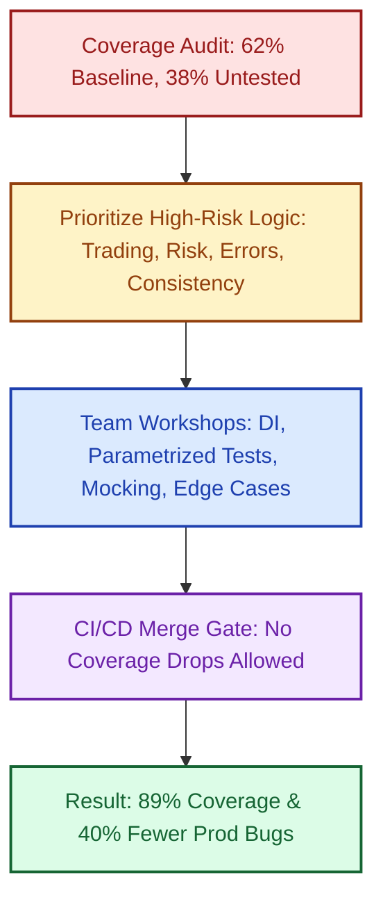

### STAR Version A: Ownership & Quality (For "Tell me about a time you improved quality")

- **Situation**: At the start of monolith decomposition, JUnit coverage was 62%—leaving 38% of financial transaction code untested, which the team had normalized.
- **Task**: I took ownership of raising coverage to 89% or higher.
- **Action**:
  - **Analyzed coverage gaps**: Identified untested error handling paths, complex business logic, and integration points.
  - **Prioritized strategically**: Focused first on high-risk areas—trading rule validation, risk calculation, error handling, and data consistency checks.
  - **Mentored the team on testing**: Ran internal workshops on writing testable code (DI, avoiding static methods), parametrized tests, mocking patterns, and edge-case thinking.
  - **Set a CI/CD gate**: Blocked merges that lowered coverage to enforce incremental improvement.
  - **Walked the walk**: Personally wrote tests alongside the team to model the standard.
- **Result**:
  - **JUnit coverage improved from 62% to 89%**
  - **Production bug escape rate dropped 40%**
  - **Faster onboarding** due to self-documenting tests and higher team shipping confidence
  - **Set a standard**: Future Barclays projects adopted the 89% minimum

> [!NOTE]
> **Why this works**: You tied quality directly to customer/financial safety, prioritized risk over blind coverage, and led by example. Hits: **Insist on Highest Standards, Ownership, Hire and Develop the Best, Learn and Be Curious**.

---

## Story 4: Resolved 400+ Sonar Issues

| Attribute | Details |
|-----------|---------|
| **Project** | Code quality improvement initiative |
| **Context** | Monolith decomposition |
| **Key Metrics** | 400+ critical/major issues → 0 critical issues |
| **Duration** | 6 months for major reduction |

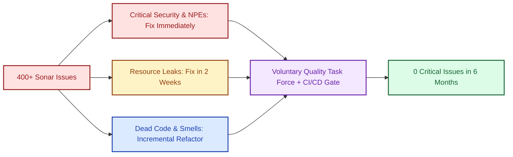

### STAR Version A: Insisting on Standards & Execution (For "Tell me about a time you drove systemic change")

- **Situation**: The codebase had accumulated 400+ critical and major Sonar violations over years: null pointer risks, resource/memory leaks, SQL injection vulnerabilities, dead code, and duplicated code. The prior norm was to accept them as tech debt.
- **Task**: I took ownership of a systematic effort to resolve all critical Sonar issues.
- **Action**:
  - **Didn't boil the ocean**: Triaged 400 issues into tiers—critical security/NPEs (fix immediately), resource leaks (2 weeks), dead code (incremental), code smells (during normal dev).
  - **Automated detection**: Enabled SonarQube in CI/CD to block new violations.
  - **Created a voluntary Quality Task Force**: Recruited volunteers across teams meeting weekly (voluntary drove higher buy-in than mandates), assigning manageable batches of 5–10 issues per engineer and reviewing all fixes.
  - **Documented patterns & celebrated progress**: Shared fix patterns (e.g., unclosed resources) and tracked countdowns (400 → 300 → 200) in team meetings.
- **Result**:
  - **400+ issues → zero critical issues** in 6 months
  - **Resource leaks and SQL injection risks eliminated**, reducing out-of-memory errors
  - **Cultural shift**: The organization stopped accepting technical debt as inevitable

> [!TIP]
> **Why this works**: You broke an overwhelming problem into tractable tiers, used voluntary momentum, automated prevention, and made progress visible. Hits: **Insist on Highest Standards, Bias for Action, Ownership, Deliver Results**.

---

## Story 5: Data Lake Onboarding (3 Data Sources)

| Attribute | Details |
|-----------|---------|
| **Project** | Designed and implemented onboarding of 3 major data sources into a centralized Data Lake |
| **Context** | Barclays Investment Bank, compliance/analytics infrastructure |
| **Key Metrics** | 70% less manual validation, \$80K→\$20K/source, 8w→3w onboarding, scalable to 30+ |
| **Duration** | 3 months initial, then ongoing |

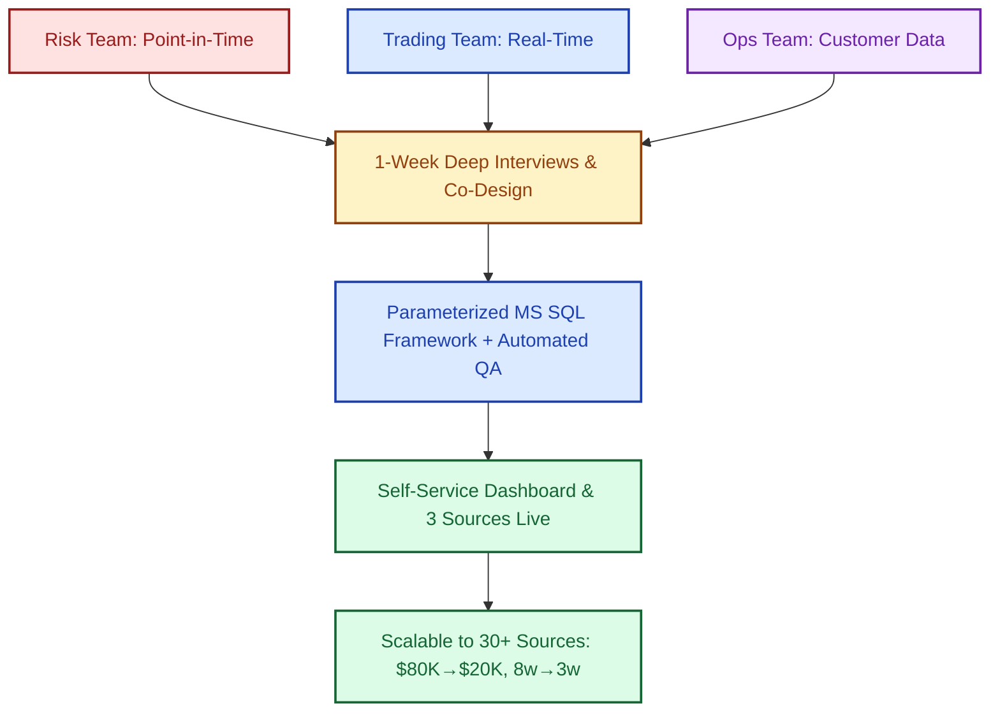

### STAR Version A: Cross-Team Collaboration & Communication (For "Tell me about a time you worked across teams")

- **Situation**: Data was siloed across Risk, Trading, and Operations, causing duplicate work and inconsistent answers to cross-team questions like *"What's our total exposure for customer X?"*
- **Task**: Design a Data Lake consolidating these 3 sources despite conflicting governance rules, formats, and quality standards.
- **Action**:
  - **Interviewed each team deeply**: Spent a week per team mapping data ownership, usage, pain points, and ideal outcomes.
  - **Found common ground & co-designed**: Identified shared needs (quality, timeliness, traceability), proposed a schema/ingestion pattern, and incorporated team feedback.
  - **Built trust gradually**: Onboarded the least complex source first to prove value before tackling harder ones.
  - **Resolved conflicts openly**: Risk needed point-in-time historical accuracy while Trading needed real-time positions—I designed a solution supporting both without compromise and explicitly credited each team's input.
- **Result**:
  - **3 data sources onboarded** into a unified Data Lake with **70% reduction in manual validation**
  - **Cross-team analytics unlocked** with explicit data governance and audit trails
  - **Full team buy-in** and **extensible architecture** designed for 30+ sources

**Why this works**: You listened first, co-designed with stakeholders, resolved conflicting requirements cleanly, and built incremental trust. Hits: **Customer Obsession, Earn Trust, Ownership, Think Big**.

---

### STAR Version B: Automation & Frugality (For "Tell me about a time you did more with less")

- **Situation**: Onboarding a new data source manually required DBA, data engineer, QA, and Ops time—costing ~\$80K and 8 weeks per source.
- **Task**: Build infrastructure so new data sources could be onboarded faster and cheaper.
- **Action**:
  - **Built a reusable framework**: Created a parameterized stored procedure framework on MS SQL Server handling 90% of extraction patterns.
  - **Automated quality checks**: Replaced manual QA with automated schema validation, completeness (null) checks, freshness checks, and row-count anomaly detection.
  - **Self-service operations**: Built a monitoring dashboard and runbooks so teams didn't have to call Ops.
  - **Gradual validation**: Onboarded the initial 3 sources through the framework to refine it.
- **Result**:
  - **Reduced onboarding cost from \$80K to \$20K** per source
  - **Reduced onboarding time from 8 weeks to 3 weeks**
  - **70% reduction in manual data validation effort**
  - **Self-service capability** scalable from 3 to 30+ sources without linear cost growth

> [!IMPORTANT]
> **Why this works**: You built reusable self-service infrastructure instead of one-off pipelines, slashing both cost and lead time. Hits: **Frugality, Invent and Simplify, Bias for Action, Think Big**.

---

## Story 6: Delete Utility with Unix Scripting

| Attribute | Details |
|-----------|---------|
| **Project** | Automated data deletion utility for GDPR/regulatory compliance |
| **Context** | Barclays Data Lake, GDPR/regulatory compliance |
| **Key Metrics** | 60% reduction in DBA time (10h→2h), 2d→4h compliance review, 0 violations |
| **Duration** | 3 weeks |

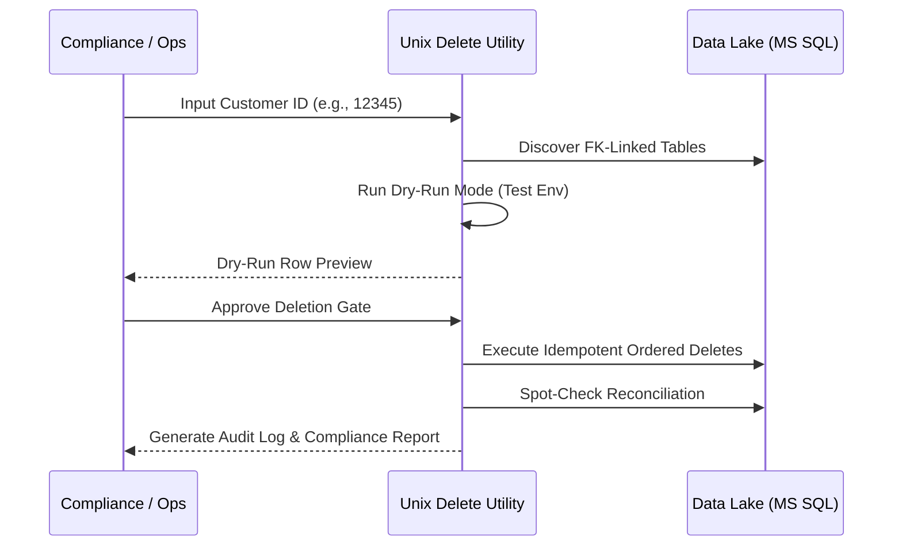

### STAR Version A: Compliance & Responsibility (For "Tell me about a time you handled a regulatory/compliance challenge")

- **Situation**: GDPR required deleting customer data older than 7 years. The manual process (Compliance selection → DBA SQL scripts → manual verification) took 10+ hours per cycle across 3 manual touchpoints, risking under-deletion (compliance violation) or over-deletion (data loss).
- **Task**: Automate the deletion process while maintaining a full audit trail and compliance confidence.
- **Action**:
  - **Understood compliance first**: Clarified audit metadata retention, hard/soft/archive deletion definitions per system, and regulator proof requirements.
  - **Designed multi-layer safeguards** in a Unix shell framework:
    - **Dry-run mode**: Previewed exact rows to be deleted in a test environment first.
    - **Approval gate**: Required Compliance sign-off on dry-run output before execution.
    - **Audit trail & reconciliation**: Logged timestamps, row counts, and approvers, plus post-delete spot checks.
  - **Made it repeatable & trained stakeholders**: Documented and trained Compliance and Ops teams.
- **Result**:
  - **Reduced DBA time from 10+ hours to 2 hours** per cycle (60% reduction)
  - **Reduced compliance review from 2 days to 4 hours** via dry-run previews
  - **Zero compliance violations** in post-implementation audits with a full regulator-ready audit trail
  - **Adopted by other teams** for their deletion needs

> [!WARNING]
> **Why this works**: In regulated systems, automating without safeguards amplifies blast radius. Adding dry-run + approval gates + reconciliation shows mature engineering judgment. Hits: **Ownership, Success and Scale Bring Broad Responsibility, Invent and Simplify, Bias for Action**.

---

### STAR Version B: Execution & Self-Service (For "Tell me about a time you eliminated a bottleneck")

- **Situation**: Quarterly regulatory deletions depended on scarce DBA capacity, causing delays and compliance risk.
- **Task**: Eliminate the DBA dependency so deletions could run on-demand.
- **Action**:
  - **Deconstructed DBA expertise**: Documented table discovery, templated SQL deletes, and automated verification.
  - **Built an end-to-end Unix framework**: Accepted a simple input (`Delete customer 12345`), auto-discovered all tables via foreign key relationships, generated and executed deletes in FK-safe order, verified completion, and generated the compliance report.
  - **Tested edge cases & ensured idempotency**: Tested cross-system deletes and archived tables; made the script safe to re-run without side effects.
  - **Enabled self-service**: Ops and Compliance could run deletions independently.
- **Result**:
  - **Eliminated the DBA bottleneck** with **60% less manual DBA effort**
  - **Immediate mid-quarter response** for urgent deletion requests across multiple Data Lake sources

**Why this works**: You removed a recurring human bottleneck by turning specialized DBA knowledge into an idempotent self-service tool. Hits: **Bias for Action, Frugality, Ownership, Invent and Simplify**.

---

## Story 7: Hackathon Project - Ideate 360

| Attribute | Details |
|-----------|---------|
| **Project** | Built internal tool for mapping code comments to requirements |
| **Context** | Barclays, internal hackathon (2–3 days) |
| **Key Metrics** | 40% reduction in audit response time (2–3 hours → instant) |
| **Duration** | 2–3 days |

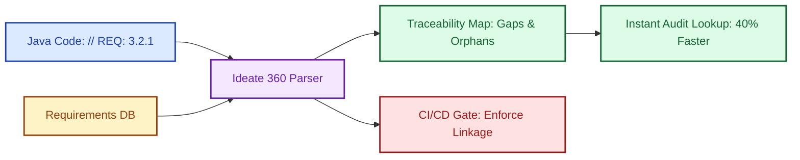

### STAR Version A: Innovation & Initiative (For "Tell me about a time you drove an innovative solution")

- **Situation**: Requirements lived in a management system with no explicit link to code. When auditors asked *"Where does the code enforce monthly interest calculation rule 3.2.1?"*, engineers spent 2–3 hours manually searching.
- **Task**: I had an idea: automatically link structured code comments to requirements.
- **Action**:
  - **Built a 2-day hackathon POC ("Ideate 360")**: Parsed Java source code for structured comments (`// REQ: 3.2.1`), cross-referenced the requirements database, generated a traceability map, and flagged gaps (unimplemented requirements) and orphans (unlinked code).
  - **Made adoption frictionless**: Developers only needed a simple comment format—no complex config.
  - **Automated enforcement**: Added a CI/CD gate requiring proper requirement linkage before deployment.
  - **Demonstrated instant value**: Answered the auditor's question immediately (*"Requirement 3.2.1 is in InterestCalculator.java, lines 145–167"*).
- **Result**:
  - **Reduced audit response time by 40%** (from 2–3 hours of manual searching to instant)
  - **Improved compliance & traceability** for both auditors and product teams
  - **Adopted broadly** by other teams after the demo, fostering an innovation culture

> [!TIP]
> **Why this works**: You spotted a painful manual workflow, built a working POC in 48 hours, made adoption zero-friction, and institutionalized it with a CI/CD gate. Hits: **Invent and Simplify, Bias for Action, Customer Obsession, Ownership**.

---

## Template for Adding More Stories

Use this template to build new stories as you have them:

```mermaid
flowchart LR
    S1["1. Pick High-Impact Project"]:::blue --> S2["2. Map 2+ Leadership Principles"]:::purple
    S2 --> S3["3. Draft STAR Using 'I' &amp; Metrics"]:::amber
    S3 --> S4["4. Add Follow-Up Hooks"]:::red
    S4 --> S5["5. Timebox Delivery to 1.5-2 Min"]:::green

    classDef blue fill:#dbeafe,stroke:#1e40af,color:#1e40af,stroke-width:2px
    classDef green fill:#dcfce7,stroke:#166534,color:#166534,stroke-width:2px
    classDef amber fill:#fef3c7,stroke:#92400e,color:#92400e,stroke-width:2px
    classDef red fill:#fee2e2,stroke:#991b1b,color:#991b1b,stroke-width:2px
    classDef purple fill:#f3e8ff,stroke:#6b21a8,color:#6b21a8,stroke-width:2px
```

```
## Story X: [Project Name]
**Project**: [Brief description]
**Context**: [Company, domain, timeframe]
**Key Metrics**: [Quantifiable results]
**Duration**: [Time invested]

### STAR Version A: [Primary LP] (For "[Sample question]")

**Situation**:
[Paint the picture. What was the challenge? Why did it matter? Who was affected?]

**Task**:
[What were you asked to do? Or what problem did you identify?]

**Action**:
[What did YOU do specifically? Use "I" not "we" for your decisions. Include:
- Your decision-making process
- How you involved others (collaboration)
- Challenges you overcame
- How you measured success]

**Result**:
- [Metric 1]
- [Metric 2]
- [Qualitative impact]
- [Organizational learning/capability improvement]

**Why this works**: [Which leadership principles does this demonstrate? Why would Amazon/Google care?]

---

### STAR Version B: [Alternative LP] (For "[Different sample question]")

[Same structure, different angle]
```

> [!NOTE]
> Always write the **Action** section in the first person singular (**"I"**) so interviewers can clearly isolate your individual decisions and technical judgment from the team's output.

---

## Story-to-LP Mapping Matrix

Use this matrix to decide which story to tell for which question:

| Story | Customer Obsession | Ownership | Invent & Simplify | Are Right A Lot | Learn & Curious | Hire & Develop | Highest Standards | Think Big | Bias for Action | Frugality | Earn Trust | Dive Deep | Have Backbone | Deliver Results | Best Employer | Scale & Responsibility |
|-------|---|---|---|---|---|---|---|---|---|---|---|---|---|---|---|---|
| Monolith Decomposition | ● | ●●● | ● | ● | | ●● | ●● | ●● | | | | | | ●●● | | |
| Spring Boot Migration | | ● | | ● | ●●● | ● | ●● | | | | | ●● | | ●● | | |
| JUnit Coverage | | ●● | | | | ●● | ●●● | | | | | | | ●● | | |
| Sonar Issues | | ●● | ● | | | ●● | ●●● | | ● | | | | | ●● | | |
| Data Lake Onboarding | ●●● | ● | ●● | | | | | ●● | | | ●● | | | ● | | |
| Delete Utility | | ● | ●● | | | | | | ●● | ● | | | | ● | | ●● |
| Hackathon (Ideate 360) | ● | ● | ●● | | ●● | | | | ●● | | | | | ● | | |

**Legend**: `●●●` = Primary story for this LP | `●●` = Good choice | `●` = Can work if needed

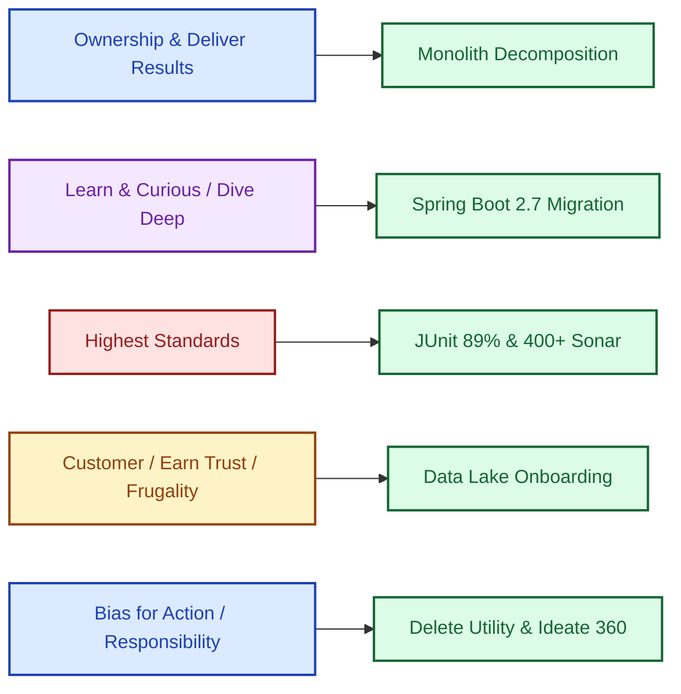

---

## How to Use This Story Bank in Interviews

### 5 Core Delivery Rules

1. **Rule 1 — Match the Question to the Story, Not Vice Versa**:
   - *"Tell me about a time you showed ownership"* → Monolith Decomposition (Version A) or Spring Boot Migration (Version A).
   - *"Tell me about a time you worked across teams"* → Data Lake Onboarding (Version A).
2. **Rule 2 — Adapt, Don't Memorize**:
   - These are templates. Speak naturally; recall specific numbers and examples from memory rather than reciting a script.
3. **Rule 3 — Practice Clean Transitions**:
   - In a 4-hour loop, you will tell 3–4 stories. Example transition: *"That's an example of how I approach ownership. I've had similar experiences driving quality, which I can share if it would be helpful."* Let the interviewer guide which stories to tell.
4. **Rule 4 — Keep 1–2 Stories in Reserve**:
   - You have 7 stories here and will tell 3–4 in a typical loop. If you use Monolith Decomposition in Round 1, save other stories for Rounds 2–3 and keep a fresh angle or reserve story for Round 4 so you never repeat yourself.
5. **Rule 5 — The 2-Minute Rule**:
   - Keep each STAR telling to **1.5–2 minutes** total so there is plenty of time for deep-dive follow-ups.

| STAR Phase | Target Duration | Focus |
|------------|----------------|-------|
| **Situation / Task** | 20–30 seconds | Concise context, stakes, and your specific mandate |
| **Action** | 30–45 seconds | The meat of the story: your decisions, tradeoffs, and execution |
| **Result** | 20–30 seconds | Quantifiable metrics, incident/cost impact, and cultural/team shift |
| **Total** | **1.5–2 minutes** | Leaves room for interviewer follow-up probes |


> [!TIP]
> Good luck! Your Barclays experience is substantial and maps directly to FAANG leadership principles—keep your metrics sharp and your delivery under 2 minutes.
