# Difficult Questions Guide - Answers Tailored for Mohit

This guide covers the hardest questions you will face in FAANG behavioral interviews. The key to these questions is **authenticity + strategic framing**: you are not trying to trick the interviewer; you are giving them a complete picture that demonstrates judgment, ownership, and growth.

---

## Overview: The Recovery Pivot

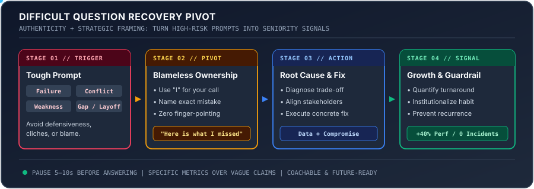

Every high-risk behavioral prompt—whether it targets a failure, conflict, weakness, or experience gap—follows the same four-stage recovery pattern.

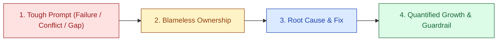

> [!TIP]
> Pause for **5–10 seconds** before answering a difficult question. Silence signals composure and thoughtfulness rather than panic.

---

## 1. "Tell me about yourself" - Three Versions

This is often the opener. Keep three calibrated lengths ready—all highlighting your progression from **Barclays IC execution** to **FAANG-scale technical leadership**.

| Version | Target Time | Primary Focus | Key Metrics Included |
| :--- | :--- | :--- | :--- |
| **Phone Screen** | 30 seconds | Fast credibility + hook | 5 yrs, 4 microservices, 62% → 89% coverage, 400+ Sonar fixes, 3 Data Lake sources |
| **Interview Start** | 1 minute | Systems thinking + business impact | 40% faster time-to-market, 70% manual effort reduction, GDPR delete utility |
| **Deep Dive** | 2 minutes | Full IC → Lead career arc | 9-month initiative, 65% fewer prod incidents, Spring Boot 2.2 → 2.7 (zero incidents) |

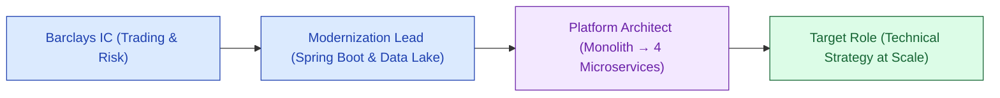

### 30-Second Version (Phone Screen)

> "I'm a mid-level Java engineer with 5 years at Barclays Investment Bank, where I led platform modernization projects. Most recently, I led the decomposition of our monolithic trading system into 4 microservices, improving code quality (62% to 89% coverage, 400+ Sonar issues resolved) and enabling independent deployments. Before that, I migrated our core systems from Spring Boot 2.2 to 2.7, handled a Data Lake onboarding project with 3 sources, and built automated deletion utilities for compliance. I'm looking to move into a role where I can drive technical strategy at scale, and [Google/Amazon/etc.] attracts me because of [specific reason]."

- **Leads with impact**: decomposition and modernization up front.
- **Anchored in numbers**: 5 years, 4 microservices, 89% coverage.
- **Clear trajectory**: shows progression of responsibility and why you are interviewing now.

### 1-Minute Version (Interview Start)

> "I'm a Java engineer with 5 years at Barclays Investment Bank, a global investment bank, where I've focused on platform reliability and modernization. My background includes a strong foundation in core banking systems—trading, risk, compliance—which has shaped how I think about systems design.
>
> Most recently, I led the decomposition of a monolithic application into 4 independent microservices. This wasn't just a technical exercise; it was about enabling the organization to move faster. I improved code quality metrics significantly: JUnit coverage from 62% to 89%, resolved 400+ critical Sonar issues, and migrated to modern Spring Boot patterns. The result was a platform that teams could deploy independently, reducing time-to-market by 40%.
>
> Earlier, I led the Data Lake onboarding initiative—bringing 3 major data sources into a unified system using stored procedures on SQL Server, reducing manual effort by 70%. I also built compliance tooling, including a delete utility that automated GDPR-related data retention requirements, which used to require manual DBA intervention.
>
> What draws me to [company name] is your approach to [specific thing: scalability/innovation/customer obsession/etc.], and I'm excited to bring my experience building resilient systems to a role where I can influence technical direction at scale."

- **Context**: banking background and systems thinking.
- **Evidence**: specific initiatives paired with concrete metrics.
- **Tailored close**: connects your background to the specific company (never generic).

### 2-Minute Version (Deep Dive)

> "I'm a Java engineer with 5 years at Barclays Investment Bank. My background is in building reliable, scalable systems for the financial sector—which meant I had to think deeply about correctness, compliance, and operational robustness.
>
> I started as an individual contributor building trading and risk systems, but over time, my role evolved to include ownership of larger platform initiatives. The turning point was when I led the decomposition of our monolithic application into 4 independent microservices.
>
> This was a 9-month initiative that required technical depth, strategic thinking, and team leadership. We weren't just splitting code—we were rearchitecting how the organization deployed and owned systems. I set quality standards (89% code coverage, zero critical Sonar violations) that made the organization uncomfortable initially, but the long-term payoff was clear: 40% faster time-to-market, 65% reduction in production incidents.
>
> In parallel, I led technical modernization projects: migrating from Spring Boot 2.2 to 2.7 (zero incidents), onboarding 3 major data sources into our Data Lake (70% manual effort reduction), and building compliance automation tooling.
>
> What I've learned from these experiences is that technical leadership isn't just about writing better code—it's about understanding the business problem, building teams that can execute, and making trade-offs that matter. That's what excites me about [company name]. You're operating at a scale where those skills compound. I've been deeply specialized in banking systems for 5 years, and I'm ready to bring that systems thinking to a new domain and help tackle the problems you're solving."

- **Coherent narrative**: IC → platform owner → organizational direction.
- **Avoids clichés**: skips overused buzzwords like "passion" in favor of measurable outcomes.

---

## 2. "Why do you want to leave Barclays?" - Positive Framing

This is a **push vs. pull** test. Never sound bitter, dismissive, or purely mercenary.

| Red Flag Answer | Why It Fails | Green Flag Reframe |
| :--- | :--- | :--- |
| "My manager sucks." | Signals you blame people instead of solving problems. | Focus on seeking broader scope and mentorship. |
| "Barclays is slow/outdated." | Sounds dismissive of your current team and domain. | Acknowledge why banking moves carefully, then pivot to pace. |
| "I want more money." | Signals mercenary motivation with low retention. | Anchor on compounding impact, scale, and technical growth. |

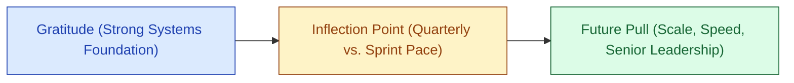

### The Reframe

> "Barclays has been a fantastic environment for developing my core systems thinking skills. I've led complex projects, worked in a regulated environment, and learned how to balance velocity with stability. But I've also become aware that my growth trajectory there is somewhat limited by the pace of the organization and the nature of the business—banking infrastructure moves carefully, which is right for banking, but it means I'm not seeing the kind of rapid iteration and scale that I want to experience in my next role.
>
> At Barclays, I made a decision every quarter. At [company], I see teams making architectural decisions every sprint that affect millions of users. That pace of innovation and learning is what I'm looking for next. I want to spend the next few years in an environment where speed and execution are rewarded, where I can see my impact compound, and where I can grow into a senior technical leadership role."

- **Respectful**: validates Barclays' strengths before stating the gap.
- **Future-focused**: frames the move around what you are running *toward*, not *away from*.

---

## 3. "Why [Google/Amazon/Meta/Apple]?" - Company-Specific Answers

Never say *"I think it's a great company"* or *"I've always admired your innovation."* Use the 3-step Company Hook formula:

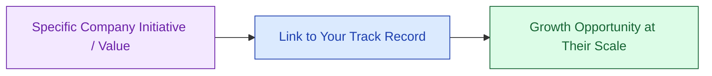

| Company | Primary Hook | Your Barclays Bridge | Tailored Answer |
| :--- | :--- | :--- | :--- |
| **Amazon** | Ownership, Customer Obsession, Bias for Action + AWS billion-request scale | Millions of daily transactions, reliability, cost awareness | "Amazon's approach to innovation and ownership resonates with how I think about technical leadership. Your leadership principles—especially ownership, customer obsession, and bias for action—map directly to how I've approached my work at Barclays. But more specifically, what attracts me is AWS's scale and the problems you're solving. I've worked on systems handling millions of transactions a day, but AWS serves *billions* of requests daily. That scale of infrastructure requires different thinking. Your work on distributed systems, reliability, and cost optimization is genuinely interesting to me, and I want to learn from the teams building those systems." |
| **Google** | Engineering excellence, global scale, ambiguity | 89% coverage, zero critical Sonar violations | "Google's focus on engineering excellence and the quality of the codebase appeals to me. I've spent the last 5 years insisting on high standards—89% code coverage, zero critical Sonar violations—and seeing an organization where that's the baseline across all projects is attractive. I'm also interested in your approach to challenging problems: infrastructure that scales globally, handling ambiguity, and making architectural decisions with incomplete information. That's the kind of work I want to do next." |
| **Meta** | AI momentum, rapid iteration, billion-user experimentation | Moving from quarterly cycles to rapid sprint iteration | "Meta's move toward AI and the pace of innovation appeals to me. I've been in a traditional banking context where innovation cycles are measured in quarters. Meta's ability to iterate quickly, experiment rapidly, and scale features to billions of users is different. I'm particularly interested in [specific Meta product or initiative: ads infrastructure, content ranking systems, etc.], and the technical leadership opportunities in that space." |
| **Apple** | Quality obsession, hardware-software integration | Financial correctness &amp; risk calculation rigor | "Apple's obsession with quality and attention to detail aligns with how I approach technical leadership. I've built systems where correctness matters—financial transactions, risk calculations—and I appreciate that Apple thinks the same way about user-facing systems. Your integration of hardware and software, and the systems-level thinking required, is work I want to be part of." |

---

## 4. "What's your biggest weakness?" - The Authentic Answer

This tests **self-awareness and coachability**, not your ability to disguise a strength.

| Red Flag Answer | Why It Fails |
| :--- | :--- |
| "I'm a perfectionist." | Cliché; everyone uses it to avoid real vulnerability. |
| "I work too hard." | Not a genuine weakness; signals rehearsed evasion. |
| "I'm too detail-oriented." | A disguised strength that dodges the prompt. |

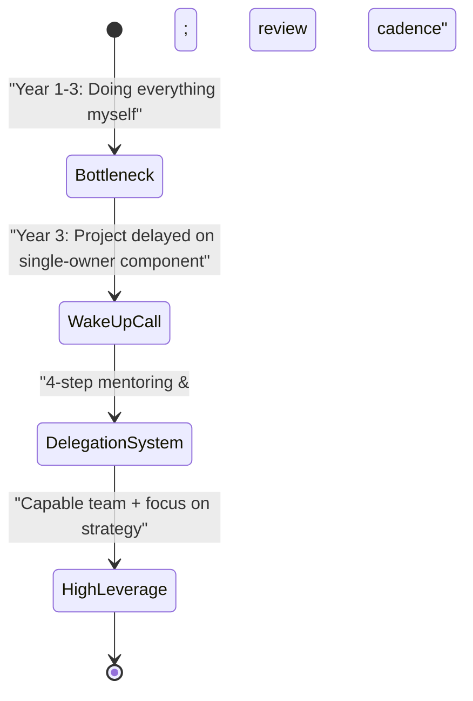

### Good Answer (Over-Owning / Delegation)

> "Early in my career, I wasn't great at delegating. I'd take on too much because I wanted to ensure quality and felt responsible for outcomes. This meant I'd sometimes get bottlenecked on work that junior engineers could have handled if I'd invested time in mentoring them and then stepped back.
>
> I realized this around year 3, when a project was delayed because I was the only person who understood a critical component. That was a wake-up call. I made a conscious effort to:
> 1. Identify work that junior engineers could own with mentoring
> 2. Set up regular code reviews and pairing sessions
> 3. Tolerate initial quality dips because they were learning
> 4. Gradually step back once they were confident
>
> Now I actively look for opportunities to develop people and step back. It took real effort—I had to trust people when my instinct was to do it myself—but the upside is enormous. Teams are more capable, and I'm able to focus on higher-leverage work."

- **Honest &amp; time-bound**: names a real bottleneck from year 3 and shows sustained behavior change.
- **Actionable**: lists four concrete mechanisms rather than vague willpower.

---

## 5. "Tell me about a time you failed" - Framework + Stories

Interviewers test three signals here: **zero defensiveness**, **clear accountability**, and **concrete learning**.

### The STAR+L Framework

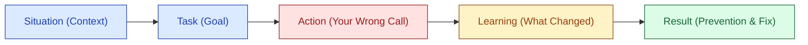

### Story: Microservice Boundary Decision

> "Early in the monolith decomposition, I made a decision about microservice boundaries that didn't work well. I focused on technical simplicity—separating data access from business logic, standard layered architecture. But this created chatty services where the trading service had to call the risk service 50 times per transaction to calculate margin requirements.
>
> The trading team came to us three weeks into development and said: 'This is slow. Every trade is taking 2x longer than before.' That was a failure on my part. I'd optimized for architectural elegance instead of their actual workflow.
>
> I immediately paused and redesigned the service boundaries around business domains (risk domain owned both calculation AND data access). This was more complex initially, but it eliminated the cross-service chatiness. The trading team's performance improved 40%.
>
> What I learned: architect around business workflows first, technical elegance second. I also learned to involve stakeholders in architecture decisions earlier, not just get feedback after building. For future projects, I now do more upfront discovery with the teams that will use the system."

| Element | Concrete Detail in Story |
| :--- | :--- |
| **Owned Mistake** | "I made a decision... optimized for architectural elegance instead of their actual workflow." |
| **Measured Impact** | 50 calls per transaction; every trade took 2x longer (caught 3 weeks into dev). |
| **Fix &amp; Turnaround** | Redesigned around business domains (risk owned calculation + data); trading performance improved **40%**. |
| **Guardrail** | Upfront stakeholder discovery before locking architecture. |

> [!IMPORTANT]
> Never pick a "humble-brag" failure or blame requirements. Explicitly state `"That was a failure on my part"` so the interviewer hears immediate ownership.

---

## 6. "Tell me about a conflict with a coworker/manager" - Honest but Strategic

| Red Flag Answer | Why It Fails |
| :--- | :--- |
| "We never had conflicts." | Unbelievable; signals avoidance or lack of real ownership. |
| "They were wrong and I was right." | Signals ego, blame, and poor collaboration. |
| "It was resolved by escalation." | Shows you could not resolve tension at your level. |

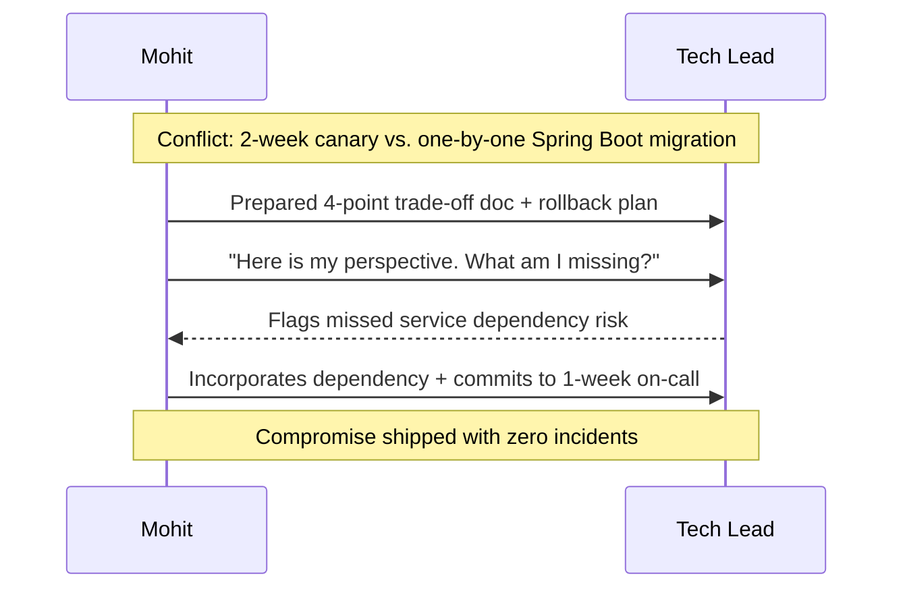

### Good Answer: Spring Boot Migration Rollout

> "During the Spring Boot migration project, there was a disagreement about the rollout strategy. My tech lead wanted a gradual, canary rollout—2 weeks of running old and new versions in parallel. My concern was that running two versions in parallel would be complex operationally and we'd learn less from the test period because we wouldn't see real production load on the new version.
>
> I advocated for a faster approach: migrate services one by one, with a quick rollback plan. My tech lead resisted because they worried about operational risk.
>
> Here's what I did: I didn't just insist I was right. I prepared. I documented:
> 1. What we could learn from each approach
> 2. The operational complexity of parallel running
> 3. A detailed rollback plan for faster migration
> 4. Scenarios where each approach would have failed in the past
>
> I presented this to the tech lead and said, 'Here's my perspective. What am I missing?' They pointed out a scenario I hadn't considered (a specific service dependency). I incorporated that into the plan.
>
> We decided to use my faster approach but with one addition: I'd be on-call for the first week post-migration to handle any issues. That was a reasonable compromise.
>
> The migration succeeded with zero incidents. What I learned from the conflict: the tech lead's caution was legitimate—I just didn't understand their full concern. If I'd asked more questions and listened better initially, we could have arrived to the solution faster."

- **Backbone + humility**: you advocated with data, invited blind spots (`"What am I missing?"`), shared operational skin in the game (on-call), and reflected on listening earlier.

---

## 7. "Why should we hire you?" - Value Proposition

This is often asked at the end. Do not be falsely humble—present your evidence directly across four dimensions.

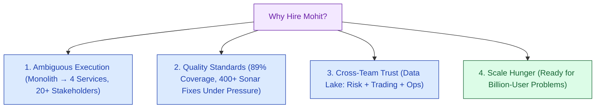

### The Answer

> "You should hire me because I've demonstrated the ability to take on ambiguous, high-stakes projects and execute them successfully. I've led the decomposition of a monolithic system—a project that touches every part of the organization. I had to balance speed with quality, involve 20+ stakeholders, manage their conflicting priorities, and ship on time. That's hard work, and I've shown I can do it.
>
> Second, I've shown that I care about technical standards and I'll push back on compromises that matter. I insisted on 89% code coverage and resolved 400+ Sonar issues during a project where we were under schedule pressure. That's not how everyone operates, but it's the kind of discipline that prevents problems later.
>
> Third, I've demonstrated that I can work across teams and earn trust. The Data Lake project required collaborating with Risk, Trading, and Operations teams who had conflicting needs. I understood their needs, co-designed a solution that satisfied them, and earned their buy-in. That's a skill that compounds in larger organizations.
>
> Finally, I'm genuinely excited about the problems you're solving. This isn't just a resume move for me. I want to learn from teams that operate at your scale and bring my experience to bear on problems that matter."

---

## 8. "Where do you see yourself in 5 years?" - Show Ambition Without Arrogance

| Red Flag Answer | Why It Fails |
| :--- | :--- |
| "I want your job." | Comes across as arrogant rather than collaborative. |
| "I'm not sure." | Looks uncommitted and lacking career direction. |
| "I want to be a staff engineer making $500K." | Signals title/compensation obsession over impact. |

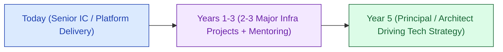

### Good Answer

> "In 5 years, I want to be in a role where I'm driving technical strategy for a significant part of the business. Not necessarily a manager—I'm more interested in principal engineer or architect roles where I can influence direction through technical leadership.
>
> Specifically, I want to:
> 1. Have taken on 2-3 major infrastructure or platform projects that affected how the organization operates
> 2. Built and mentored a team of engineers who are now solving hard problems independently
> 3. Contributed to the company's technical culture—the way we think about standards, innovation, and problem-solving
>
> At Barclays, I led one major decomposition project. I'm hungry to lead more. I want to get better at handling ambiguity, making trade-offs under uncertainty, and influencing executives through data and clear thinking. That's what I want to spend the next 5 years developing.
>
> The role I'm interviewing for is the next step toward that. It gives me a platform to work on harder problems and learn from people who've operated at this scale before."

---

## 9. "What questions do you have for us?" - 15 Great Questions to Ask

Tailor your questions to the interviewer's seat so every conversation uncovers real signal.

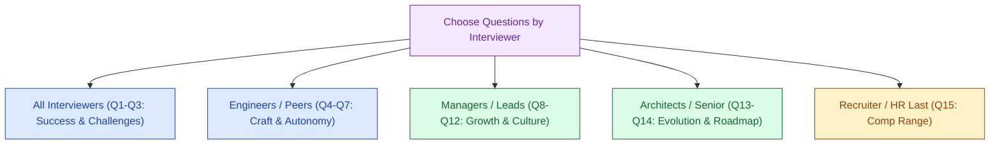

### For All Interviewers
1. "What does success look like in this role in the first 6 months? What would I need to accomplish to be seen as meeting expectations?" *(Shows you are results-focused)*
2. "What are the biggest technical challenges you're facing right now that this role would help address?" *(Shows you think about impact)*
3. "What's the team composition like? Who would I be working with directly?" *(Shows you care about team fit)*

### For Engineers / Peers
4. "What's the most interesting technical project you've worked on here in the last year?" *(Personal connection; gets a real answer)*
5. "How much of your time is spent on new features vs. maintaining existing systems? What's the ratio?" *(Understand the reality of the work)*
6. "What's one technical decision made here that you disagree with, but you understand why it was made?" *(Tests whether they are thoughtful about trade-offs)*
7. "How much autonomy do individual engineers have in design decisions? Is there a design review process?" *(Understand governance)*

### For Managers / Leads
8. "How do you measure individual engineer performance? What matters most?" *(Understand expectations)*
9. "How much mentoring/development do engineers get? What does growth look like?" *(Shows you want to develop)*
10. "What does the hiring process look like after this? What's the timeline?" *(Practical; shows you are serious)*
11. "What's your biggest challenge as a manager right now?" *(Shows empathy; gets a real answer)*
12. "Tell me about a project that failed or didn't meet expectations. What did you learn?" *(Tests humility; see if they own it)*

### For Architects / Senior Engineers
13. "If you were starting this system from scratch today, what would you do differently?" *(Understand the evolutionary nature of systems)*
14. "What's the relationship between engineering and product? How much input does engineering have on roadmap decisions?" *(Understand influence dynamics)*

### For Recruiter / HR (Last Interview)
15. "What does the compensation package look like? What's the range for this role?" *(Asked last; sets stage for negotiation)*

---

## 10. Salary Negotiation Basics - When and How to Discuss

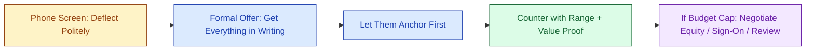

| Stage | Rule | Script / Action |
| :--- | :--- | :--- |
| **Phone Screen** | Deflect—never negotiate before an offer | *"I'm primarily focused on finding the right role. Compensation is important, but let's see if there's a good fit first."* |
| **Early Deflection Options** | Keep range open; ask for their band | *"I'm open to a competitive offer based on the market rate for this role and my background."* / *"Let's ensure we're a good fit first. Compensation will work out if the role is right."* / *"I'm not sure what the range is for this level. What does [company] typically offer for senior engineers in this domain?"* |
| **After Formal Offer** | Get everything in writing; counter with a range | *"Thank you for the offer. I'm excited about the role and the team. I'd like to discuss the compensation. Based on my experience—5 years at a major financial institution, leading significant infrastructure projects—and the market rate for this role, I was expecting something in the range of [X to Y]. Can we discuss moving the offer in that direction?"* |
| **If Outside Budget** | Pivot to non-base levers + know walk-away | Ask about **bonus, equity, benefits**, **accelerated review cycles**, or a **signing bonus**; know your walk-away number beforehand. |

> [!WARNING]
> **Never start with your number** and **never justify with personal need** (`"I need more money"`). Let them anchor first, then counter with a range backed by market rate and your infrastructure track record.

---

## 11. "I don't have that experience" - How to Answer Honestly

| Red Flag Answer | Why It Fails |
| :--- | :--- |
| "I've never done that." | Dead-ends the conversation immediately. |
| "Oh, I picked up X in 2 weeks, it's easy." | Sounds arrogant and dismissive of real complexity. |

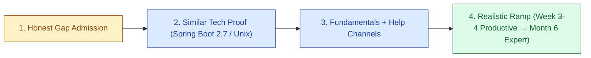

### Good Answer

> "I haven't worked on [specific tech] before, but here's how I'd approach learning it:
>
> 1. **I've learned similar technologies quickly**: [Give example of how you learned Spring Boot 2.7 or Unix shell scripting]
> 2. **I understand the fundamentals**: [Show you understand the underlying concepts, even if implementation is new]
> 3. **I know how to get help**: [Talk about how you'd find expertise—code reviews, mentoring, documentation, community]
> 4. **I'm comfortable with ambiguity**: [Reference a time you worked on unfamiliar territory successfully]
>
> I won't be as productive in week 1 as someone who's done this before, but I'm confident I can be productive in week 3-4, and genuinely expert by month 6."

- **Honest + realistic**: avoids overpromising week-1 mastery while proving fast, structured ramp-up.

---

## Summary: Tone and Approach

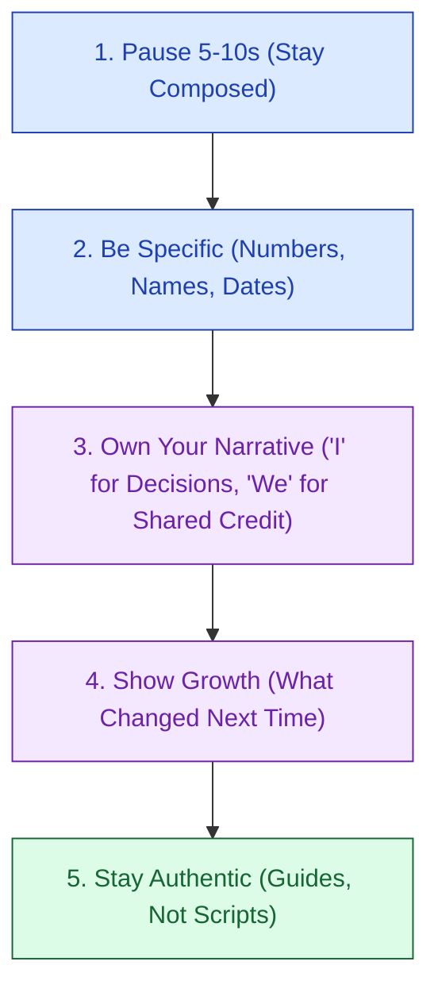

1. **Pause and think**: Taking 5–10 seconds before answering shows composure.
2. **Be specific**: Use numbers, names, and dates (`"Latency dropped from 500ms to 200ms"` beats `"We improved performance"`).
3. **Own your narrative**: Use `"I"` for your decisions; `"we"` when credit is shared.
4. **Show growth**: Every hard question is an opportunity to prove you learn and install guardrails.
5. **Be authentic**: Use these answers as mental guides, never robotic scripts.

> [!NOTE]
> You have strong material—5 years of high-stakes banking systems, monolith decomposition, measurable quality turnarounds, and cross-team delivery. Trust your experience. Good luck!
