# Behavioral Interview Cheatsheet - Quick Reference for Mohit

Print this page. Review it the night before. Glance at it 10 minutes before your interview starts.

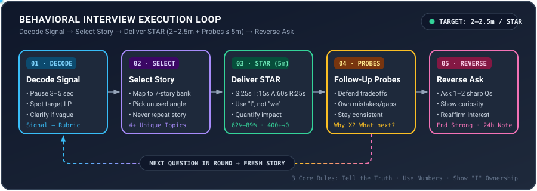

---

## The STAR Method (Reminder)

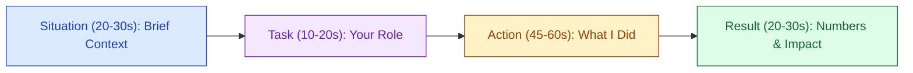

| Phase | Target Time | Focus |
|-------|-------------|-------|
| **S: Situation** | 20–30 sec | Set the scene. Context matters, but be brief. |
| **T: Task** | 10–20 sec | What was your role? What were you asked to do? |
| **A: Action** | 45–60 sec | What did **YOU** do? (Use "I", not "we") |
| **R: Result** | 20–30 sec | Numbers. Impact. What changed? |

> [!TIP]
> **Total: 2–2.5 minutes per story.** Keep Situation and Task tight so over half your time goes to your specific Actions and quantified Results.

---

## Your Stories at a Glance

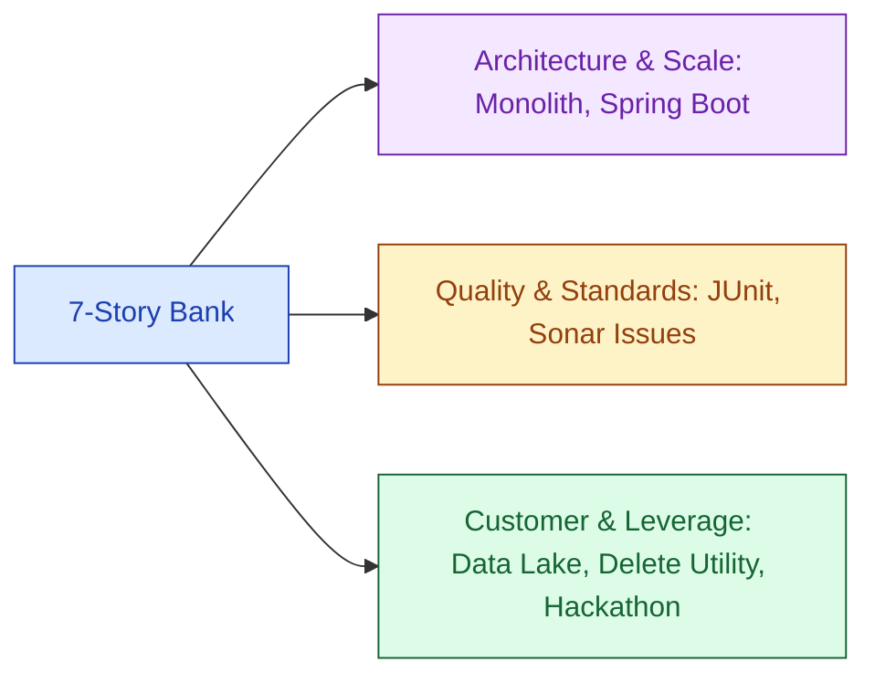

| Story | Primary LP | Secondary LP | Key Numbers | Key Phrase |
|-------|-----------|-------------|------------|-----------|
| **Monolith Decomposition** | Ownership | Deliver Results, Insist on Highest Standards | 4 services, 62%→89% coverage, 400+ issues resolved, 18% complexity reduction | "I led the decomposition..." |
| **Spring Boot Migration** | Learn and Be Curious | Delivery Results, Are Right A Lot | Spring 2.2→2.7, 98% deprecated APIs removed, 0 incidents | "I deep-dived into Spring patterns..." |
| **JUnit Coverage** | Insist on Highest Standards | Ownership, Hire and Develop | 62%→89%, 40% fewer bugs in prod | "I set a non-negotiable standard..." |
| **Sonar Issues** | Insist on Highest Standards | Bias for Action, Invent and Simplify | 400+→0 critical issues, 6 months, task force | "I didn't try to boil the ocean..." |
| **Data Lake Onboarding** | Customer Obsession | Earn Trust, Think Big | 3 sources, 70% manual effort reduction | "I interviewed teams first..." |
| **Delete Utility** | Ownership | Success and Scale Bring Responsibility, Frugality | 60% DBA time reduction, automated compliance | "I eliminated the DBA bottleneck..." |
| **Hackathon (Ideate 360)** | Invent and Simplify | Bias for Action | 40% audit time reduction, auto-traced requirements | "I built a POC in 2 days..." |

> [!NOTE]
> Anchor each story to its **Key Numbers** and **Key Phrase** rather than memorizing a word-for-word script.

---

## Story-to-Question Mapping (Quick Reference)

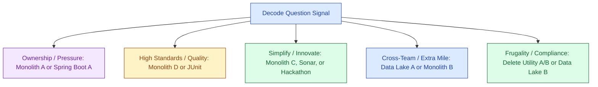

When asked this... | Tell this story
---|---
"Tell me about a time you took ownership" | Monolith (Version A) or Spring Boot (Version A)
"Tell me about a time you developed someone" | Monolith (Version B)
"Tell me about a time you simplified something" | Monolith (Version C) or Sonar Issues
"Tell me about a time you insisted on high standards" | Monolith (Version D) or JUnit Coverage
"Tell me about a time you learned something difficult" | Spring Boot (Version A)
"Tell me about a time you managed risk" | Spring Boot (Version B)
"Tell me about a time you worked across teams" | Data Lake (Version A)
"Tell me about a time you did more with less" | Data Lake (Version B) or Delete Utility
"Tell me about a time you were innovative" | Hackathon or Monolith (Version C)
"Tell me about a time you went the extra mile" | Data Lake (Version A) or Monolith (Version D)
"Tell me about a time you delivered under pressure" | Monolith (timeline) or Spring Boot (migration)
"Tell me about compliance/regulatory challenge" | Delete Utility (Version A)
"Tell me about a time you improved efficiency" | Delete Utility (Version B)
"Tell me about a time you built a team" | Monolith (Version B)
"Why should we hire you?" | Monolith (biggest project) + Data Lake (cross-team) + Spring Boot (learning)

---

## Top 20 Most Common Behavioral Questions

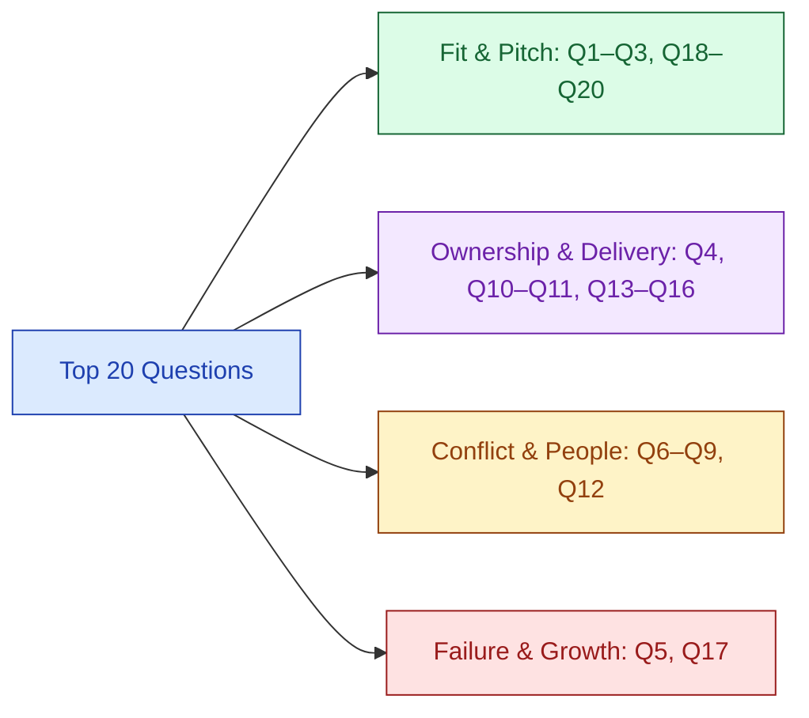

1. Tell me about yourself.
2. Why are you leaving [current company]?
3. Why [Google/Amazon/Meta/Apple]?
4. Tell me about a time you showed ownership.
5. Tell me about a time you failed.
6. Tell me about a time you disagreed with someone.
7. Tell me about a time you had a conflict with a coworker.
8. Tell me about a time you had a conflict with your manager.
9. Tell me about a time you worked across teams.
10. Tell me about a time you delivered under pressure.
11. Tell me about a time you took on something outside your job description.
12. Tell me about a time you developed someone on your team.
13. Tell me about a time you improved efficiency.
14. Tell me about a time you improved quality.
15. Tell me about a time you were innovative/simplified something.
16. Tell me about a time you dealt with ambiguity.
17. What's your biggest weakness?
18. Where do you see yourself in 5 years?
19. Why should we hire you?
20. What questions do you have for us?

---

## Do's and Don'ts for Behavioral Rounds

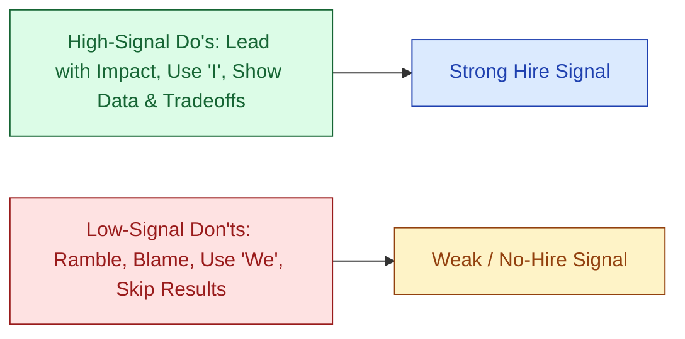

### Do's ✓

- **Lead with impact**: "I improved coverage from 62% to 89%" is stronger than "I wrote a lot of tests"
- **Use "I" for decisions**: "I decided to pivot the service boundaries" (not "we realized")
- **Show evidence**: "I gathered data from 3 teams" (not "I knew intuitively")
- **Mention obstacles**: The story is better when you overcame challenges
- **Explain reasoning**: "I chose domain-driven design because X" (not just "I chose domain-driven design")
- **Connect to business**: "This reduced time-to-market by 40%" (not just "It was better architecture")
- **Pause and think**: Taking 5 seconds before answering shows thoughtfulness
- **Use specific numbers**: 62%, 89%, 4 services, 70% reduction (not "a lot", "much", "significantly")
- **Show you learned**: "I would do this differently next time because..."
- **Practice transitions**: "That's an example of [LP]. Would another angle be helpful?"

### Don'ts ✗

- **Don't ramble**: 2 minutes per story, max. Interviewer will interrupt if they want more.
- **Don't blame others**: "My manager was bad" is a red flag
- **Don't oversell**: "I'm the best engineer at Barclays" sounds arrogant
- **Don't downplay**: "It was kind of a small project" undercuts your impact
- **Don't use "we" for your decisions**: "We decided" when you decided makes you sound passive
- **Don't talk too fast**: Slow down. Articulate. Breathe.
- **Don't forget the result**: "I worked really hard" without impact is weak
- **Don't mention money/compensation**: In behavioral interviews, this is inappropriate
- **Don't make up stories**: Stick to what actually happened. Interviewers can tell.
- **Don't apologize excessively**: "I'm sorry, I'm not great at speaking" undermines confidence
- **Don't use filler words**: Um, like, you know, basically—minimize these
- **Don't speak about things you don't understand**: If asked about something, own that you don't know it

> [!IMPORTANT]
> Always use **"I"** for decisions you owned and attach **specific numbers** (62%→89%, 400+→0, 70% effort reduction) to every result.

---

## Body Language and Communication (Video & In-Person)

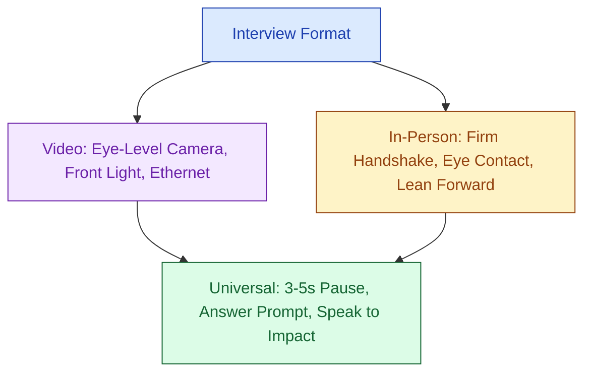

### Video Interviews

- **Camera at eye level**: Laptop on books so camera isn't looking up your nose
- **Good lighting**: Light source in front of you (natural light is best)
- **Clean background**: Blank wall or home office, no clutter
- **Sit upright**: Good posture projects confidence
- **Look at camera when speaking**: Not at yourself or the interviewer video window
- **Minimize fidgeting**: Hands still or resting on table
- **Stable internet**: Use ethernet if possible, not WiFi
- **Professional dress**: You should look ready for work
- **Smile occasionally**: But don't smile the whole time (looks unnatural)

### In-Person Interviews

- **Firm handshake**: Not crushing, not limp
- **Make eye contact**: But not staring intensely
- **Sit upright**: Good posture, lean slightly forward (shows engagement)
- **Nod occasionally**: Shows you're listening and engaged
- **Speak clearly**: Articulate. Don't mumble.
- **Pace your speech**: Don't rush. Give yourself time to think.
- **Use hand gestures**: Natural gestures emphasize points (not flailing)
- **Smile warmly**: You're excited to be there
- **Minimize fidgeting**: Don't tap fingers, bounce legs, or touch your face repeatedly

### Universal

- **Pause before answering**: 3-5 seconds is okay. Shows you're thinking.
- **Answer the question asked**: Don't go off on tangents
- **Speak to impact**: Not just "what I did" but "why it mattered"
- **Be authentic**: The best interviews feel like conversations, not interrogations
- **Ask follow-up clarifications**: "Can you clarify what you're asking?" shows you listen

---

## Red Flags Interviewers Watch For

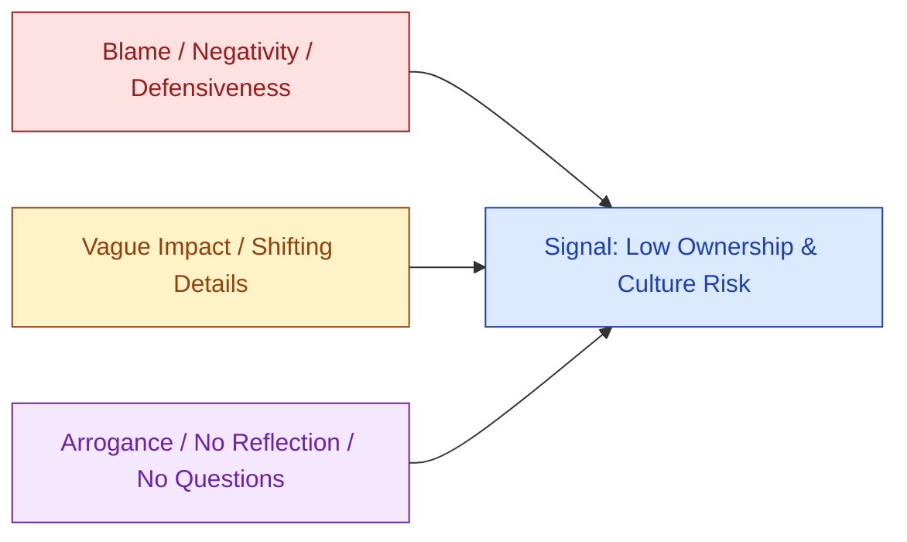

- ❌ **You blame others**: "My team wasn't good" / "My manager was ineffective"
- ❌ **Lack of ownership**: Using "we" when you mean "I" on key decisions
- ❌ **Vague impact**: "I improved things" without numbers or context
- ❌ **Avoiding difficult topics**: When pressed on conflicts, you deflect or minimize
- ❌ **Inconsistent stories**: Your story changes when asked follow-up questions
- ❌ **Arrogance**: "I'm the only one who could have done this"
- ❌ **Defensiveness**: "That's how we did it at Barclays" instead of explaining reasoning
- ❌ **Inability to learn**: "I would do the exact same thing again" with no reflection
- ❌ **Lack of curiosity**: You don't ask questions back or show interest in learning
- ❌ **Risk-seeking without caution**: "We tried something crazy and it worked" (lucky, not wise)
- ❌ **Inability to handle ambiguity**: "I needed all the information before I could move"
- ❌ **Speaking negatively about past company**: "Barclays is outdated" sounds bitter

> [!WARNING]
> Never speak negatively about past teammates, managers, or Barclays. Explain constraints and your reasoning objectively.

---

## Time Management in Behavioral Rounds

```mermaid
flowchart LR
    M0["0-2m: Intro"] --> M2["2-5m: Q1"]
    M2 --> M5["5-7m: Story 1 + Q&A"]
    M5 --> M7["7-12m: Q2 + Story 2"]
    M7 --> M12["12-17m: Q3 + Story 3"]
    M12 --> M17["17-20m: Why Company / 5y"]
    M17 --> M20["20-45m: Reverse Qs & Wrap"]

    classDef blue fill:#dbeafe,stroke:#1e40af,color:#1e40af
    classDef green fill:#dcfce7,stroke:#166534,color:#166534
    classDef amber fill:#fef3c7,stroke:#92400e,color:#92400e
    classDef red fill:#fee2e2,stroke:#991b1b,color:#991b1b
    classDef purple fill:#f3e8ff,stroke:#6b21a8,color:#6b21a8

    class M0 blue
    class M2 purple
    class M5 green
    class M7 green
    class M12 green
    class M17 amber
    class M20 blue
```

### Standard 45-Minute Interview

- **Minutes 0-2**: Small talk, settling in
- **Minutes 2-5**: Interviewer asks first behavioral question
- **Minutes 5-7**: You tell story (2 minutes) + brief Q&A
- **Minutes 7-12**: Interviewer asks second behavioral question + story
- **Minutes 12-17**: Interviewer asks third behavioral question + story
- **Minutes 17-20**: "Why [company]?" / "Where do you see yourself?" type questions
- **Minutes 20-45**: Questions for the interviewer, wrap-up

**Rule**: Each story should be 1.5-2 minutes max. Interviewer will ask follow-ups if they want more.

### Full Interview Loop (4-5 rounds, 3.5-4 hours total)

```mermaid
flowchart LR
    R1["Round 1 (45m): Behavioral + Tech Screen"] --> R2["Round 2 (60m): System Design + 1-2 Behavioral"]
    R2 --> R3["Round 3 (60m): Deep Tech + Behavioral"]
    R3 --> R4["Round 4 (45m): Leadership / Culture Fit"]
    R4 --> R5["Round 5 (45m Opt): Senior / Director Strategy"]

    classDef blue fill:#dbeafe,stroke:#1e40af,color:#1e40af
    classDef green fill:#dcfce7,stroke:#166534,color:#166534
    classDef amber fill:#fef3c7,stroke:#92400e,color:#92400e
    classDef red fill:#fee2e2,stroke:#991b1b,color:#991b1b
    classDef purple fill:#f3e8ff,stroke:#6b21a8,color:#6b21a8

    class R1 blue
    class R2 purple
    class R3 amber
    class R4 green
    class R5 blue
```

- **Round 1** (45 min): Behavioral + technical (phone screen often combines these)
- **Round 2** (60 min): System design + 1-2 behavioral questions
- **Round 3** (60 min): Deep technical (coding or architecture deep dive) + behavioral
- **Round 4** (45 min): Leadership/culture fit behavioral interview + manager questions
- **Round 5** (45 min, optional): Senior engineer or director + strategic thinking questions

**Strategy**: You have ~4 different behavioral topics across rounds. Don't repeat the same story twice.

---

## The Night Before: Checklist

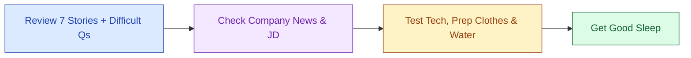

- [ ] Review your 7 stories once. Don't memorize them, but know the flow.
- [ ] Reread the first page of each story in 04-Your-Story-Bank.md
- [ ] Review the difficult questions (tell me about yourself, why are you leaving, biggest weakness)
- [ ] Check the company's recent news (Google I/O, AWS announcements, Meta earnings, etc.)
- [ ] Review the job description. Know which 3-4 skills they care about most.
- [ ] Prepare 3-4 thoughtful questions to ask back
- [ ] Get good sleep (better than last-minute studying)
- [ ] Lay out professional clothing
- [ ] Test your laptop/camera/internet (for video interviews)
- [ ] Have water nearby for the interview

---

## The 1 Hour Before: Prep

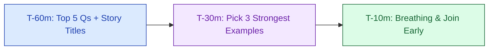

- [ ] Review top 5 most likely questions for THIS role
- [ ] Skim your story bank (just the story titles, not details)
- [ ] Review the difficult questions guide—just the introductions
- [ ] Take 10 minutes to think: "What are my 3 strongest examples I want to make sure I mention?"
- [ ] Do some breathing exercises (calm yourself down)
- [ ] Be early (don't arrive late—adds stress)

---

## During the Interview: Key Mindset Shifts

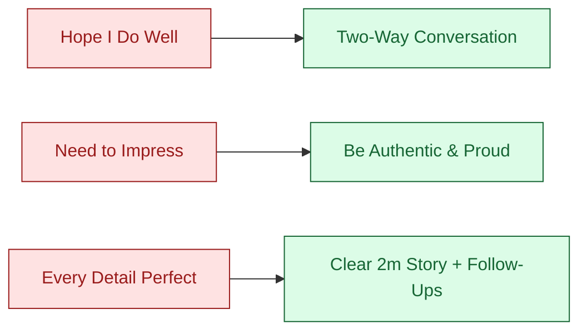

1. **Shift from "I hope I do well" to "This is a conversation where I show them what I've done"**
   - You have earned the right to be there
   - Your work at Barclays is substantial
   - You're not hoping they'll like you; you're evaluating if THEY'RE the right fit

2. **Shift from "I need to impress them" to "I need to be authentic"**
   - Interviewers can tell when you're being fake
   - Your real accomplishments are impressive enough
   - Be proud of your work

3. **Shift from "I must get every detail perfect" to "Tell a clear story and they'll ask for details if they want"**
   - 2-minute story with impact is better than 8-minute rambling story
   - Interviewer will follow up: "Tell me more about how you decided on the service boundaries"
   - Your job is to be clear and concise, not comprehensive

---

## If You Get Stuck

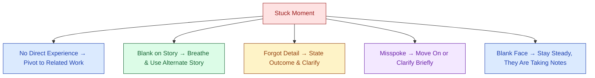

- **Interviewer asks about something you don't have experience with:**
  - "I haven't done that specifically, but I've done similar work in [related area]. Can you tell me more about what you're looking for?"
- **You blank on a story during the interview:**
  - Take a breath. Say: "Let me think of a good example here..."
  - Tell a different story. It's okay if it's not the 'perfect' one you practiced.
- **Interviewer asks for more detail and you can't remember:**
  - "That's a great question. The specific detail escapes me, but the outcome was [X]."
  - It's fine to not remember every number. Accuracy matters more than perfection.
- **You say something you regret:**
  - Move on. Don't apologize profusely or try to "fix" it mid-interview.
  - If it's critical, you can circle back: "To clarify what I said earlier..."
- **Interviewer seems unimpressed:**
  - Keep going. You don't know what they're thinking.
  - They might be taking notes and not reacting, which is normal.
  - Different interviewers have different styles.

---

## The Final 5 Minutes: End Strong

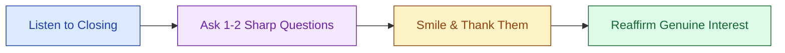

- Listen to the closing from the interviewer
- Ask 1-2 questions back (not 5+)
- Smile and thank them
- Reaffirm your interest (genuinely): "I'm genuinely excited about this opportunity. Thank you for the conversation."

---

## After the Interview

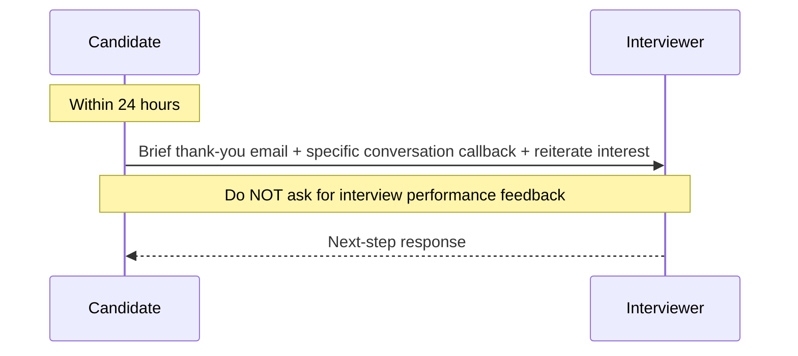

- Send a thank-you email within 24 hours (brief, not groveling)
- Mention something specific from the conversation to show you listened
- Reiterate your interest
- Don't ask for feedback on your interview performance
- Wait for their response

---

## Your Competitive Advantages for Behavioral Interviews

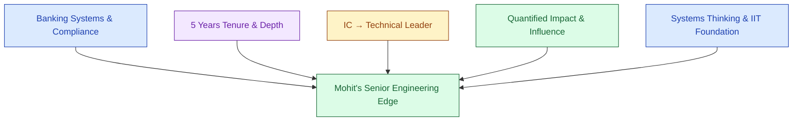

- ✓ **Banking systems background**: You understand regulated, high-stakes environments
- ✓ **5 years at one company**: Shows stability and depth (you learned the business)
- ✓ **Clear progression**: IC → technical leader (shows growth trajectory)
- ✓ **Quantified impact**: Your numbers are real and substantial
- ✓ **Leadership through influence**: You've mentored people, driven cross-team projects
- ✓ **Systems thinking**: Banking taught you to think about reliability, compliance, scale
- ✓ **IIT education**: Strong technical foundation (mention if relevant, but don't lean on it)

**Your story is strong. You've got this.**

---

## The Three Most Important Things to Remember

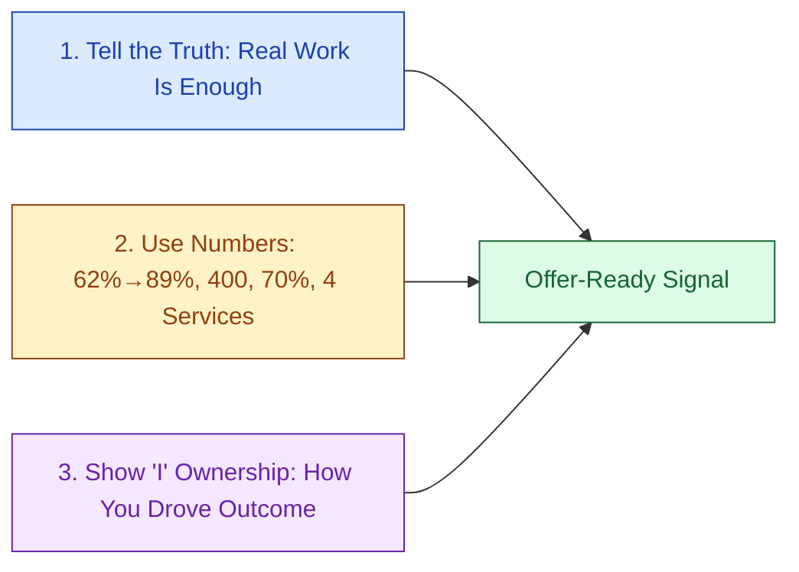

1. **Tell the truth**: Your real accomplishments are good enough. Don't exaggerate.
2. **Use numbers**: 62%→89%, 400 issues, 70% reduction, 4 services. Numbers stick.
3. **Show how you influenced the outcome**: Not "the project succeeded" but "I drove the decomposition strategy, which enabled independent deployments."

> [!NOTE]
> Good luck. You're ready.
