# Spring Core and IoC Container - Deep Dive

## Table of Contents
1. [BeanFactory vs ApplicationContext](#beanfactory-vs-applicationcontext)
2. [Dependency Injection Strategies](#dependency-injection-strategies)
3. [Bean Lifecycle](#bean-lifecycle)
4. [Bean Scopes](#bean-scopes)
5. [Stereotype Annotations](#stereotype-annotations)
6. [@Configuration and @Bean](#configuration-and-bean)
7. [Profiles and Conditional Beans](#profiles-and-conditional-beans)
8. [Spring AOP Deep Dive](#spring-aop-deep-dive)
9. [SpEL Basics](#spel-basics)
10. [Interview Questions](#interview-questions)

---

## BeanFactory vs ApplicationContext

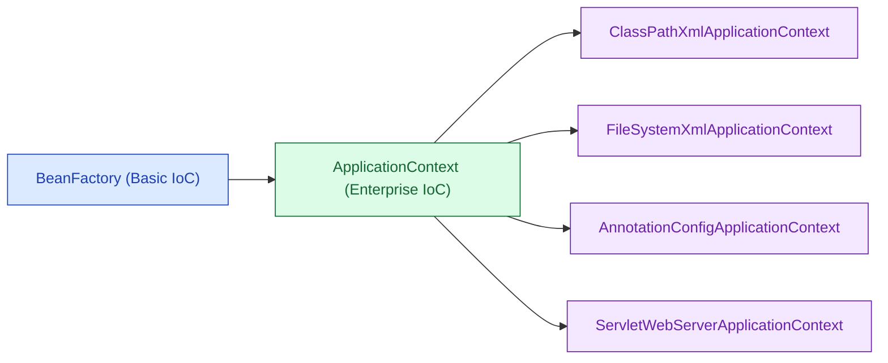

### BeanFactory: The Basic Container

`BeanFactory` is the lowest-level interface for accessing Spring beans, responsible for instantiating, configuring, and managing them.

- **Lazy initialization:** Beans are created on demand when `getBean()` is called.
- **Minimal overhead:** Lightweight footprint suited for resource-constrained environments.

```java
// Basic BeanFactory usage
BeanFactory factory = new XmlBeanFactory(new ClassPathResource("beans.xml"));
MyBean bean = factory.getBean("myBean", MyBean.class);
```

### ApplicationContext: The Advanced Container

`ApplicationContext` extends `BeanFactory` and adds enterprise-grade container features:

- **Eager initialization:** Singleton beans are instantiated at container startup.
- **Enterprise services:** Built-in i18n (`MessageSource`), event publishing (`ApplicationEventPublisher`), hierarchical contexts, and `ResourceLoader` support.
- **Automatic post-processing:** Automatically detects and registers `BeanPostProcessor` and `BeanFactoryPostProcessor` beans.

```java
// ClassPathXmlApplicationContext: loads XML from classpath
ApplicationContext context = new ClassPathXmlApplicationContext("beans.xml");

// FileSystemXmlApplicationContext: loads XML from filesystem
ApplicationContext context = new FileSystemXmlApplicationContext("/etc/config/beans.xml");

// AnnotationConfigApplicationContext: loads from @Configuration classes
ApplicationContext context = new AnnotationConfigApplicationContext(MyConfiguration.class);

// ServletWebServerApplicationContext: web-specific context (Spring Boot)
// Automatically used in Spring Boot applications
```

### Comparison Table

| Feature | BeanFactory | ApplicationContext |
|---------|-------------|-------------------|
| Bean Initialization | Lazy | Eager |
| Memory Usage | Lower | Higher |
| Startup Speed | Faster | Slower |
| i18n Support | No | Yes |
| Event Publishing | No | Yes |
| ResourceLoader | No | Yes |
| Hierarchical Contexts | No | Yes |
| AOP | Manual Setup | Automatic |

> [!NOTE]
> Spring Boot always uses an `ApplicationContext` (such as `ServletWebServerApplicationContext` for web apps), so i18n, event publishing, and auto-registered AOP proxies are available immediately after `SpringApplication.run(...)`.

```java
// Spring Boot always uses ApplicationContext
@SpringBootApplication
public class Application {
    public static void main(String[] args) {
        ApplicationContext context = SpringApplication.run(Application.class, args);

        // ApplicationContext features available immediately
        String message = context.getMessage("welcome.message", null, Locale.getDefault());
        context.publishEvent(new MyEvent("data"));
    }
}
```

---

## Dependency Injection Strategies

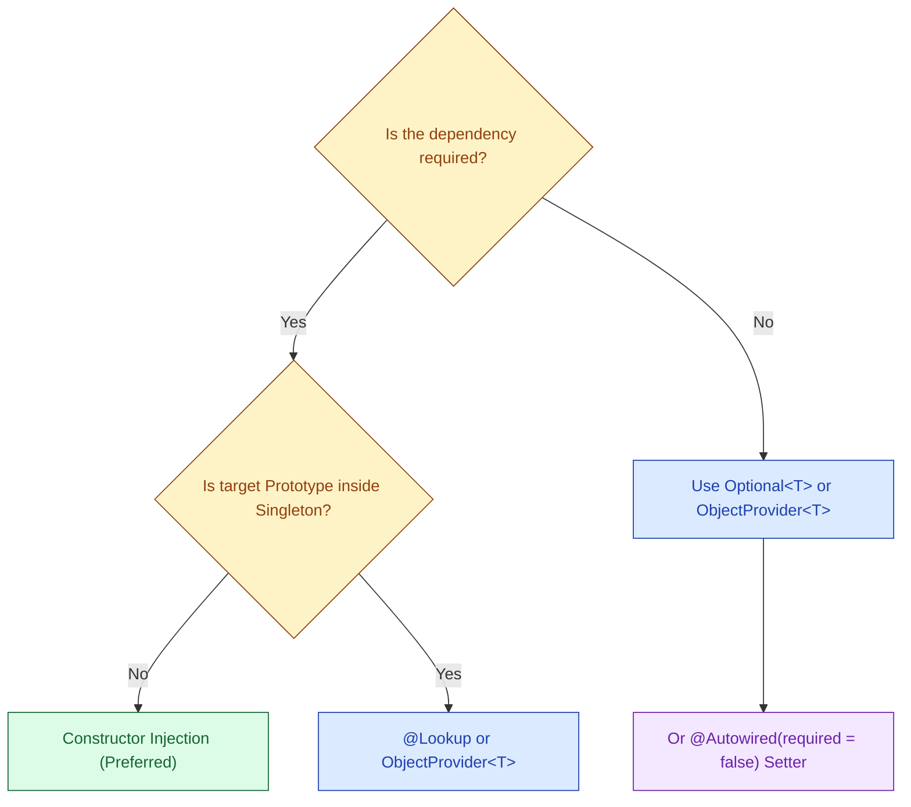

### Strategy Comparison

| Strategy | Mutability | Null-Safety | Testability | Circular Dependency | Recommendation |
|----------|-----------|-------------|-------------|---------------------|----------------|
| Constructor | Immutable (`final`) | Fails fast at startup | High (plain `new`) | Fails fast (good) | Preferred |
| Setter | Mutable | Requires null checks | Medium | Allowed | Optional / runtime changes |
| Field (`@Autowired`) | Mutable | NPE risk outside Spring | Low (needs reflection/context) | Hidden | Avoid in production |
| `@Lookup` | Dynamic | Safe per invocation | Medium | N/A | Prototype in Singleton |

### 1. Constructor Injection (PREFERRED)

- **Immutability:** Dependencies can be declared `final`.
- **Null-safety:** Missing dependencies are detected at construction time.
- **Testability:** Easy to instantiate with mocks without starting a Spring context.
- **Explicit dependencies & thread-safety:** All collaborators are visible in the constructor signature and require no synchronization.

```java
@Component
public class UserService {
    private final UserRepository userRepository;
    private final PasswordEncoder passwordEncoder;
    private final EmailService emailService;

    // Spring automatically resolves dependencies
    public UserService(UserRepository userRepository,
                       PasswordEncoder passwordEncoder,
                       EmailService emailService) {
        this.userRepository = userRepository;
        this.passwordEncoder = passwordEncoder;
        this.emailService = emailService;
    }

    public void registerUser(String email, String password) {
        User user = new User();
        user.setEmail(email);
        user.setPassword(passwordEncoder.encode(password));
        userRepository.save(user);
        emailService.sendConfirmation(email);
    }
}

// Testing is straightforward
@Test
public void testRegisterUser() {
    UserRepository mockRepo = mock(UserRepository.class);
    PasswordEncoder mockEncoder = mock(PasswordEncoder.class);
    EmailService mockEmail = mock(EmailService.class);

    UserService service = new UserService(mockRepo, mockEncoder, mockEmail);
    // Test without Spring context
}
```

> [!TIP]
> If a bean has only **one constructor**, Spring automatically uses it for dependency injection—no `@Autowired` annotation is required.

```java
@Component
public class PaymentService {
    private final PaymentGateway gateway;

    // No @Autowired needed - Spring auto-detects the single constructor
    public PaymentService(PaymentGateway gateway) {
        this.gateway = gateway;
    }
}
```

### 2. Setter Injection

- **Advantages:** Supports optional dependencies, allows runtime reconfiguration, and remains backward compatible with legacy JavaBeans.
- **Disadvantages:** Introduces mutable state, does not enforce required dependencies, and is harder to test cleanly.

```java
@Component
public class ReportService {
    private ReportGenerator generator;
    private ReportStorage storage;
    private NotificationService notifier; // Optional

    @Autowired
    public void setGenerator(ReportGenerator generator) {
        this.generator = generator;
    }

    @Autowired
    public void setStorage(ReportStorage storage) {
        this.storage = storage;
    }

    @Autowired(required = false)
    public void setNotifier(NotificationService notifier) {
        this.notifier = notifier;
    }

    public void generateReport() {
        // Null check needed for optional dependencies
        if (notifier != null) {
            notifier.notify("Report generation started");
        }
    }
}
```

### 3. Field Injection (NOT RECOMMENDED)

- **Disadvantages:** Hides dependencies, forces mutable state, complicates unit testing without Spring, risks `NullPointerException`, and masks circular dependencies.

```java
@Component
public class OrderService {
    @Autowired
    private OrderRepository orderRepository; // Mutable field injection

    @Autowired
    private InventoryService inventoryService;

    // Hard to test without Spring context
    public void createOrder(Order order) {
        // Risk: fields could be null if injection failed
        orderRepository.save(order);
    }
}

// Testing requires Spring context setup
@SpringBootTest
public class OrderServiceTest {
    @Autowired
    private OrderService orderService; // Need full Spring context

    @Test
    public void testCreateOrder() {
        // Harder to isolate and mock
    }
}
```

### 4. Optional Dependency Pattern

For truly optional dependencies, inject `Optional<T>` via the constructor or use `@Autowired(required = false)`.

```java
@Component
public class NotificationService {
    private final EmailSender emailSender;
    private final Optional<SmsSender> smsSender;
    private final Optional<PushNotificationSender> pushSender;

    public NotificationService(EmailSender emailSender,
                              Optional<SmsSender> smsSender,
                              Optional<PushNotificationSender> pushSender) {
        this.emailSender = emailSender;
        this.smsSender = smsSender;
        this.pushSender = pushSender;
    }

    public void notifyUser(String userId, String message) {
        emailSender.sendEmail(userId, message);
        smsSender.ifPresent(sender -> sender.sendSms(userId, message));
        pushSender.ifPresent(sender -> sender.sendPush(userId, message));
    }
}

@Configuration
public class NotificationConfig {
    @Bean
    public EmailSender emailSender() {
        return new SimpleEmailSender();
    }

    // SmsSender is optional - bean might not exist
    @Bean
    @ConditionalOnProperty(name = "notifications.sms.enabled")
    public SmsSender smsSender() {
        return new AwsSmsSender();
    }
}
```

### 5. Lookup Method Injection (Rare, but Useful)

Use `@Lookup` when a singleton bean needs a fresh `prototype`-scoped bean instance on every method call.

```java
@Component
public class TaskProcessor {

    // Spring will override this method to return a new TaskWorker each time
    @Lookup
    protected TaskWorker createWorker() {
        return null; // Implementation replaced by Spring
    }

    public void processTasks(List<Task> tasks) {
        for (Task task : tasks) {
            TaskWorker worker = createWorker(); // New instance each time
            worker.process(task);
        }
    }
}

@Component
@Scope("prototype") // New instance each time
public class TaskWorker {
    public void process(Task task) {
        // Task processing logic
    }
}
```

### Dependency Injection Best Practices

```java
// GOOD: Constructor injection with final fields
@Component
public class PaymentProcessor {
    private final PaymentGateway gateway;
    private final TransactionLog transactionLog;
    private final AuditService auditService;

    public PaymentProcessor(PaymentGateway gateway,
                           TransactionLog transactionLog,
                           AuditService auditService) {
        this.gateway = gateway;
        this.transactionLog = transactionLog;
        this.auditService = auditService;
    }

    public void processPayment(Payment payment) throws PaymentException {
        // All dependencies available, immutable, thread-safe
    }
}

// BAD: Field injection with mutable state
@Component
public class PaymentProcessor {
    @Autowired
    private PaymentGateway gateway;

    @Autowired
    private TransactionLog transactionLog;

    public void processPayment(Payment payment) throws PaymentException {
        // Fields could be null, hard to test, not thread-safe
    }
}
```

---

## Bean Lifecycle

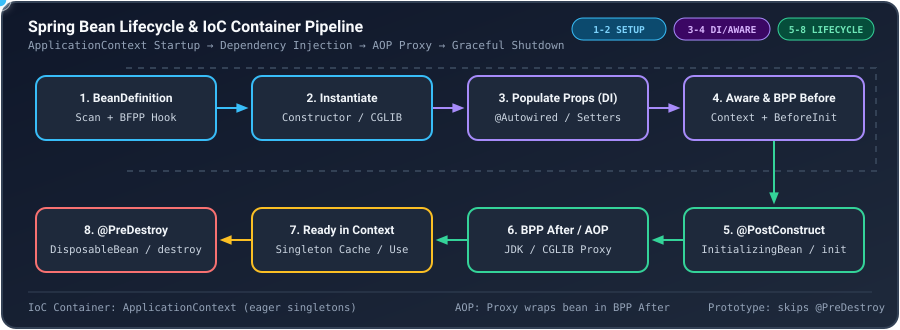

### Complete 16-Stage Sequence

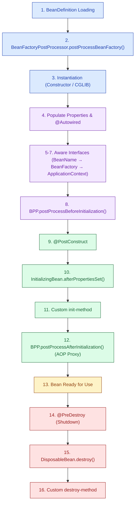

> [!IMPORTANT]
> AOP proxies are typically created during `BeanPostProcessor.postProcessAfterInitialization()` (step 12). Destruction callbacks (`@PreDestroy`, `DisposableBean.destroy()`, `destroy-method`) are **not** invoked for `prototype`-scoped beans.

### Practical Lifecycle Implementation

```java
@Component
public class DatabaseConnection implements
    InitializingBean, DisposableBean, BeanNameAware, ApplicationContextAware {

    private String beanName;
    private ApplicationContext applicationContext;
    private Connection connection;
    private static final Logger logger = LoggerFactory.getLogger(DatabaseConnection.class);

    // Constructor
    public DatabaseConnection() {
        logger.info("1. DatabaseConnection constructor called");
    }

    // BeanNameAware - Spring calls this automatically
    @Override
    public void setBeanName(String name) {
        logger.info("2. setBeanName called with: {}", name);
        this.beanName = name;
    }

    // ApplicationContextAware - Spring calls this automatically
    @Override
    public void setApplicationContext(ApplicationContext applicationContext) {
        logger.info("3. setApplicationContext called");
        this.applicationContext = applicationContext;
    }

    // BeanPostProcessor.postProcessBeforeInitialization is called here
    // (handled by Spring infrastructure)

    // @PostConstruct - Spring calls this after properties set
    @PostConstruct
    public void init() {
        logger.info("4. @PostConstruct init() called");
        try {
            this.connection = DriverManager.getConnection(
                "jdbc:mysql://localhost/testdb",
                "root",
                "password"
            );
            logger.info("4. Database connection established");
        } catch (SQLException e) {
            throw new RuntimeException("Failed to establish connection", e);
        }
    }

    // InitializingBean.afterPropertiesSet() - called if @PostConstruct not present
    @Override
    public void afterPropertiesSet() throws Exception {
        logger.info("5. InitializingBean.afterPropertiesSet() called");
        // Additional initialization if needed
    }

    // Custom init method (if specified in @Bean)
    // public void customInit() { }

    // BeanPostProcessor.postProcessAfterInitialization is called here

    // Now the bean is ready for use...

    public void executeQuery(String sql) {
        if (connection == null) {
            throw new IllegalStateException("Connection not initialized");
        }
        // Execute query
    }

    // Destruction phase

    @PreDestroy
    public void cleanup() {
        logger.info("6. @PreDestroy cleanup() called");
        closeConnection();
    }

    @Override
    public void destroy() throws Exception {
        logger.info("7. DisposableBean.destroy() called");
        closeConnection();
    }

    private void closeConnection() {
        if (connection != null) {
            try {
                connection.close();
                logger.info("Database connection closed");
            } catch (SQLException e) {
                logger.error("Error closing connection", e);
            }
        }
    }
}
```

### BeanPostProcessor: Advanced Lifecycle Hook

`BeanPostProcessor` lets you inspect, wrap, or replace bean instances before and after initialization callbacks.

```java
@Component
public class LoggingBeanPostProcessor implements BeanPostProcessor {
    private static final Logger logger = LoggerFactory.getLogger(LoggingBeanPostProcessor.class);

    @Override
    public Object postProcessBeforeInitialization(Object bean, String beanName) {
        logger.debug("Before initialization: {}", beanName);

        // Can return a different object (e.g., a proxy)
        if (bean instanceof Service) {
            return new ServiceProxy((Service) bean);
        }
        return bean;
    }

    @Override
    public Object postProcessAfterInitialization(Object bean, String beanName) {
        logger.debug("After initialization: {}", beanName);
        return bean;
    }
}

// Practical example: Auto-registering repositories
@Component
public class RepositoryRegistrationPostProcessor implements BeanPostProcessor {

    private static final Logger logger = LoggerFactory.getLogger(RepositoryRegistrationPostProcessor.class);

    @Override
    public Object postProcessAfterInitialization(Object bean, String beanName) {
        // Register all repositories in a registry
        if (bean instanceof BaseRepository) {
            RepositoryRegistry.register(beanName, (BaseRepository<?>) bean);
            logger.info("Registered repository: {}", beanName);
        }
        return bean;
    }
}

public class RepositoryRegistry {
    private static final Map<String, BaseRepository<?>> repositories = new ConcurrentHashMap<>();

    public static void register(String name, BaseRepository<?> repository) {
        repositories.put(name, repository);
    }

    public static BaseRepository<?> getRepository(String name) {
        return repositories.get(name);
    }
}
```

### Configuration-based Lifecycle

```java
@Configuration
public class LifecycleConfiguration {

    @Bean(initMethod = "customInit", destroyMethod = "customDestroy")
    public DataSourceManager dataSourceManager() {
        return new DataSourceManager();
    }
}

public class DataSourceManager {
    private DataSource dataSource;

    public void customInit() {
        // Initialize data source
        this.dataSource = createDataSource();
    }

    public void customDestroy() {
        // Close data source
        if (dataSource != null) {
            try {
                dataSource.getConnection().close();
            } catch (SQLException e) {
                // Handle error
            }
        }
    }

    private DataSource createDataSource() {
        // Create datasource
        return null;
    }
}
```

---

## Bean Scopes

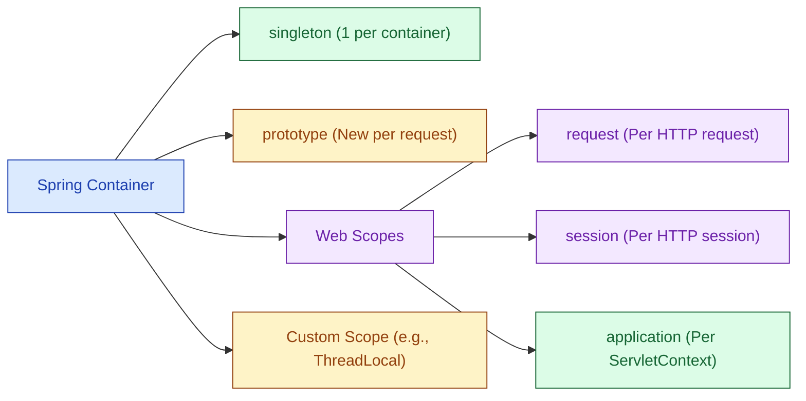

### Scope Comparison

| Scope | Instance Lifetime | Cleanup Hooks | Best For |
|-------|------------------|---------------|----------|
| `singleton` (Default) | 1 per `ApplicationContext` | Yes (`@PreDestroy`) | Stateless services, DAOs, config beans |
| `prototype` | New per `getBean()` / `ObjectProvider` | No | Stateful objects, per-invocation tasks |
| `request` | 1 per HTTP request | Yes | Correlation IDs, request timing |
| `session` | 1 per HTTP session | Yes | User session state, shopping carts |
| `application` | 1 per `ServletContext` | Yes | App-wide counters, shared caches |
| Custom (`Scope`) | Defined by `Scope` impl | Optional | Thread-local caches, tenant contexts |

### 1. Singleton Scope (Default)

One instance per Spring container—ideal for stateless services and repositories.

```java
@Component
// @Scope("singleton") // Default, explicit
public class UserRepository {
    private final JdbcTemplate jdbcTemplate;

    public UserRepository(JdbcTemplate jdbcTemplate) {
        this.jdbcTemplate = jdbcTemplate;
    }

    public User findById(Long id) {
        return jdbcTemplate.queryForObject(
            "SELECT * FROM users WHERE id = ?",
            (rs, rowNum) -> new User(rs.getLong("id"), rs.getString("name")),
            id
        );
    }
}

@SpringBootTest
public class SingletonScopeTest {
    @Autowired
    private UserRepository repo1;

    @Autowired
    private UserRepository repo2;

    @Test
    public void singletonScope() {
        assertSame(repo1, repo2); // Same instance
    }
}
```

### 2. Prototype Scope

Creates a new instance every time the bean is requested; Spring does **not** invoke `@PreDestroy` or `DisposableBean.destroy()`.

```java
@Component
@Scope("prototype")
public class RequestContext {
    private String requestId;
    private long createdAt;

    public RequestContext() {
        this.requestId = UUID.randomUUID().toString();
        this.createdAt = System.currentTimeMillis();
    }

    public String getRequestId() {
        return requestId;
    }

    public long getCreatedAt() {
        return createdAt;
    }
}

@Component
public class RequestProcessor {
    private final ObjectProvider<RequestContext> contextProvider;

    public RequestProcessor(ObjectProvider<RequestContext> contextProvider) {
        this.contextProvider = contextProvider;
    }

    public void processRequest() {
        RequestContext context = contextProvider.getObject(); // New instance
        String requestId = context.getRequestId();
        // Process with unique context
    }
}

@SpringBootTest
public class PrototypeScopeTest {
    @Autowired
    private ObjectProvider<RequestContext> contextProvider;

    @Test
    public void prototypeScope() {
        RequestContext ctx1 = contextProvider.getObject();
        RequestContext ctx2 = contextProvider.getObject();

        assertNotSame(ctx1, ctx2); // Different instances
        assertNotEquals(ctx1.getRequestId(), ctx2.getRequestId());
    }
}
```

### 3. Web Scopes (Request, Session, Application)

Available only in a web-aware `ApplicationContext`.

```java
// REQUEST SCOPE: New bean per HTTP request
@Component
@Scope("request")
public class HttpRequestData {
    private String correlationId;
    private long startTime;

    @PostConstruct
    public void init() {
        this.correlationId = UUID.randomUUID().toString();
        this.startTime = System.currentTimeMillis();
    }

    public String getCorrelationId() {
        return correlationId;
    }

    public long getElapsedTime() {
        return System.currentTimeMillis() - startTime;
    }
}

// SESSION SCOPE: One bean per HTTP session
@Component
@Scope("session")
public class UserSession {
    private String userId;
    private List<String> visitedPages = new ArrayList<>();

    public void setUserId(String userId) {
        this.userId = userId;
    }

    public String getUserId() {
        return userId;
    }

    public void recordPageVisit(String page) {
        visitedPages.add(page);
    }

    public List<String> getVisitedPages() {
        return new ArrayList<>(visitedPages);
    }
}

// APPLICATION SCOPE: One bean per ServletContext
@Component
@Scope("application")
public class ApplicationStatistics {
    private AtomicLong totalRequests = new AtomicLong(0);
    private AtomicLong totalErrors = new AtomicLong(0);

    public void recordRequest() {
        totalRequests.incrementAndGet();
    }

    public void recordError() {
        totalErrors.incrementAndGet();
    }

    public long getTotalRequests() {
        return totalRequests.get();
    }

    public long getTotalErrors() {
        return totalErrors.get();
    }
}

@RestController
@RequestMapping("/api")
public class OrderController {
    private final HttpRequestData requestData;
    private final UserSession userSession;
    private final ApplicationStatistics stats;

    public OrderController(HttpRequestData requestData,
                          UserSession userSession,
                          ApplicationStatistics stats) {
        this.requestData = requestData;
        this.userSession = userSession;
        this.stats = stats;
    }

    @GetMapping("/orders")
    public ResponseEntity<?> getOrders() {
        stats.recordRequest();
        userSession.recordPageVisit("/orders");

        return ResponseEntity.ok(Map.of(
            "correlationId", requestData.getCorrelationId(),
            "elapsedTime", requestData.getElapsedTime(),
            "userId", userSession.getUserId()
        ));
    }
}
```

### 4. Custom Scope

Implement Spring's `Scope` interface and register it via `CustomScopeConfigurer`:

```java
// Custom scope: Thread-scoped beans
@Component
public class ThreadScope implements Scope {
    private static final ThreadLocal<Map<String, Object>> THREAD_LOCAL_BEANS =
        ThreadLocal.withInitial(ConcurrentHashMap::new);

    @Override
    public Object get(String name, ObjectFactory<?> objectFactory) {
        Map<String, Object> map = THREAD_LOCAL_BEANS.get();
        Object object = map.get(name);
        if (object == null) {
            object = objectFactory.getObject();
            map.put(name, object);
        }
        return object;
    }

    @Override
    public void registerDestructionCallback(String name, Runnable callback) {
        // Register cleanup callbacks if needed
    }

    @Override
    public Object resolveContextualObject(String key) {
        return null;
    }

    @Override
    public String getConversationId() {
        return Thread.currentThread().getName();
    }
}

// Register custom scope
@Configuration
public class ScopeConfiguration {
    @Bean
    public static CustomScopeConfigurer customScopeConfigurer() {
        CustomScopeConfigurer configurer = new CustomScopeConfigurer();
        configurer.addScope("thread", new ThreadScope());
        return configurer;
    }
}

@Component
@Scope("thread")
public class ThreadLocalCache {
    private Map<String, Object> cache = new ConcurrentHashMap<>();

    public void put(String key, Object value) {
        cache.put(key, value);
    }

    public Object get(String key) {
        return cache.get(key);
    }
}
```

---

## Stereotype Annotations

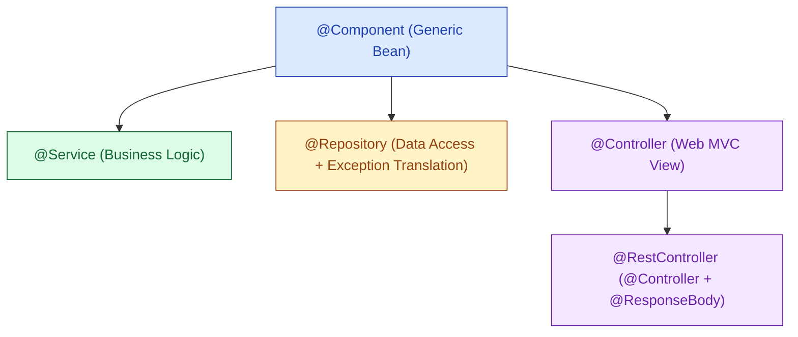

### Key Differences

| Annotation | Purpose | Exception Translation | AOP |
|-----------|---------|---------------------|-----|
| `@Component` | Generic bean | No | Yes |
| `@Service` | Business logic | No | Yes |
| `@Repository` | Data access | Yes (`DataAccessException`) | Yes |
| `@Controller` | Web requests (view) | No | Yes |
| `@RestController` | Web requests (JSON) | No | Yes |

### @Component

Generic stereotype for any Spring-managed component.

```java
@Component
public class UtilityService {
    public String formatDate(LocalDate date) {
        return date.format(DateTimeFormatter.ISO_DATE);
    }
}
```

### @Service

Semantic specialization of `@Component` indicating business logic.

```java
@Service
public class OrderService {
    private final OrderRepository orderRepository;
    private final PaymentService paymentService;

    public OrderService(OrderRepository orderRepository,
                       PaymentService paymentService) {
        this.orderRepository = orderRepository;
        this.paymentService = paymentService;
    }

    @Transactional
    public Order createOrder(OrderRequest request) {
        Order order = new Order();
        order.setItems(request.getItems());
        order.setTotal(request.getTotal());

        paymentService.process(order);
        return orderRepository.save(order);
    }
}
```

### @Repository

Indicates data access and enables automatic translation of persistence exceptions (e.g., `SQLException`) into Spring's unchecked `DataAccessException` hierarchy.

```java
@Repository
public class UserRepository extends JpaRepository<User, Long> {
    // Spring Data JPA handles queries
    List<User> findByEmail(String email);
}

// Without Spring Data JPA
@Repository
public class LegacyUserRepository {
    private final JdbcTemplate jdbcTemplate;

    public LegacyUserRepository(JdbcTemplate jdbcTemplate) {
        this.jdbcTemplate = jdbcTemplate;
    }

    public User findById(Long id) {
        try {
            return jdbcTemplate.queryForObject(
                "SELECT * FROM users WHERE id = ?",
                (rs, rowNum) -> new User(rs.getLong("id"), rs.getString("email")),
                id
            );
        } catch (EmptyResultDataAccessException e) {
            // Exception translated from SQLException
            return null;
        }
    }
}
```

### @Controller & @RestController

- `@Controller` handles web requests and resolves view names.
- `@RestController` combines `@Controller` + `@ResponseBody` to serialize return values directly as JSON/XML.

```java
@Controller
public class ProductController {
    private final ProductService productService;

    public ProductController(ProductService productService) {
        this.productService = productService;
    }

    @GetMapping("/products")
    public String listProducts(Model model) {
        model.addAttribute("products", productService.findAll());
        return "products/list"; // View name
    }
}
```

```java
@RestController
@RequestMapping("/api/products")
public class ProductRestController {
    private final ProductService productService;

    public ProductRestController(ProductService productService) {
        this.productService = productService;
    }

    @GetMapping("/{id}")
    public ResponseEntity<Product> getProduct(@PathVariable Long id) {
        return productService.findById(id)
            .map(ResponseEntity::ok)
            .orElse(ResponseEntity.notFound().build());
    }

    @PostMapping
    public ResponseEntity<Product> createProduct(@RequestBody ProductRequest request) {
        Product created = productService.create(request);
        return ResponseEntity.created(
            URI.create("/api/products/" + created.getId())
        ).body(created);
    }
}
```

---

## @Configuration and @Bean

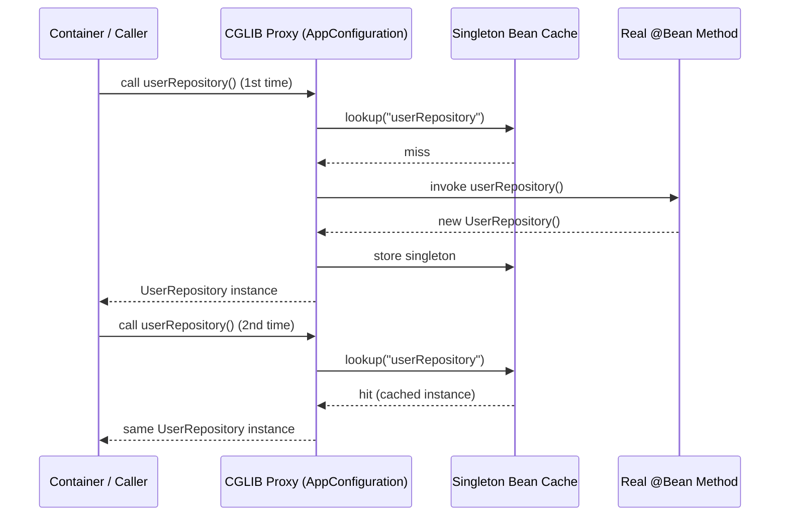

### How @Configuration Works with CGLIB Proxying

`ConfigurationClassPostProcessor` (a `BeanFactoryPostProcessor`) enhances `@Configuration` classes with a runtime CGLIB subclass:

1. Calling a `@Bean` method directly or injecting it as a parameter is intercepted by the CGLIB proxy.
2. On the first call, the proxy creates the bean and caches it in the singleton registry.
3. Subsequent calls return the **same cached singleton instance** (`repo1 == repo2`).

```java
@Configuration
public class AppConfiguration {

    @Bean
    public UserRepository userRepository() {
        return new UserRepository();
    }

    @Bean
    public PasswordEncoder passwordEncoder() {
        return new BCryptPasswordEncoder();
    }

    @Bean
    public UserService userService(UserRepository userRepository,
                                   PasswordEncoder passwordEncoder) {
        return new UserService(userRepository, passwordEncoder);
    }
}
```

### Full CGLIB Proxy Example

```java
@Configuration
public class DataSourceConfiguration {

    @Bean
    public DataSource dataSource() {
        // This method gets intercepted by CGLIB proxy
        // First call: Creates and caches the DataSource
        // Subsequent calls: Returns cached instance
        HikariConfig config = new HikariConfig();
        config.setJdbcUrl("jdbc:mysql://localhost/testdb");
        config.setUsername("root");
        config.setPassword("password");
        config.setMaximumPoolSize(20);
        return new HikariDataSource(config);
    }

    @Bean
    public JdbcTemplate jdbcTemplate(DataSource dataSource) {
        // dataSource parameter is injected (same cached instance from above)
        return new JdbcTemplate(dataSource);
    }

    @Bean
    public TransactionManager transactionManager(DataSource dataSource) {
        // dataSource parameter is the SAME instance
        return new DataSourceTransactionManager(dataSource);
    }
}

// Usage
@Component
public class UserRepository {
    private final JdbcTemplate jdbcTemplate;
    private final DataSource dataSource;

    public UserRepository(JdbcTemplate jdbcTemplate, DataSource dataSource) {
        this.jdbcTemplate = jdbcTemplate; // From @Bean method
        this.dataSource = dataSource;     // Same instance from all @Bean methods
    }
}
```

### @Bean Method Parameters & Scope Configuration

Spring automatically resolves and injects `@Bean` method parameters, supports custom bean names, and honors `@Scope` (including `ScopedProxyMode`).

```java
@Configuration
public class ServiceConfiguration {

    // Spring automatically finds and injects beans
    @Bean
    public UserService userService(UserRepository userRepository,
                                   PasswordEncoder passwordEncoder,
                                   AuditService auditService) {
        return new UserService(userRepository, passwordEncoder, auditService);
    }

    // Named beans
    @Bean(name = "primaryUserRepository")
    public UserRepository userRepository() {
        return new UserRepository();
    }

    // Conditional bean creation
    @Bean
    @ConditionalOnMissingBean
    public PasswordEncoder passwordEncoder() {
        return new BCryptPasswordEncoder();
    }
}
```

```java
@Configuration
public class PrototypeConfiguration {

    @Bean
    @Scope("prototype")
    public RequestContext requestContext() {
        return new RequestContext();
    }

    @Bean
    @Scope(value = "session", proxyMode = ScopedProxyMode.TARGET_CLASS)
    public UserSession userSession() {
        return new UserSession();
    }
}
```

### Comparison: @Configuration vs @Component (Lite Mode)

| Mode | CGLIB Proxying | Direct Inter-Bean Method Calls (`service()`) | Use Case |
|------|---------------|---------------------------------------------|----------|
| `@Configuration` (Full) | Yes | Returns cached singleton instance | Standard configuration classes |
| `@Component` + `@Bean` (Lite) | No | Creates a new instance on every direct call | Simple standalone factory methods |

```java
// @Configuration: Full-featured config class with CGLIB proxying
@Configuration
public class FullConfiguration {
    @Bean
    public Service service() {
        return new Service();
    }

    @Bean
    public Repository repository() {
        return new Repository(service()); // Calls service() only once (cached)
    }
}

// Lite @Bean mode: @Component with @Bean methods (no proxying)
@Component
public class LiteConfiguration {
    @Bean
    public Service service() {
        return new Service();
    }

    @Bean
    public Repository repository() {
        return new Repository(service()); // Calls service() multiple times
    }
}
```

---

## Profiles and Conditional Beans

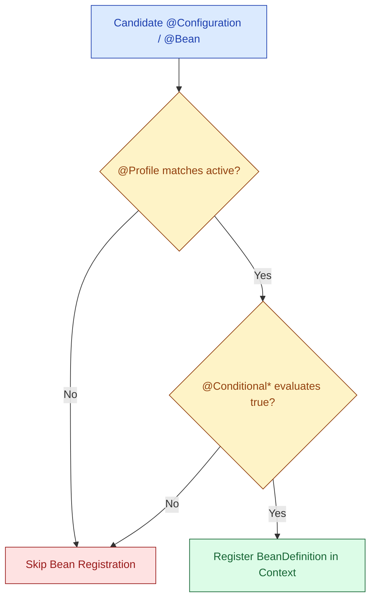

### Conditional Annotations Quick Reference

| Annotation | Evaluates True When |
|------------|---------------------|
| `@Profile("prod")` | `spring.profiles.active` includes `prod` |
| `@Conditional(MyCondition.class)` | Custom `Condition.matches(...)` returns `true` |
| `@ConditionalOnProperty` | Configured property matches `havingValue` (or `matchIfMissing = true`) |
| `@ConditionalOnClass` | Specified class is present on the classpath |
| `@ConditionalOnMissingClass` | Specified class is absent from the classpath |
| `@ConditionalOnBean` | Specified bean type or name exists in the context |
| `@ConditionalOnMissingBean` | No matching bean is already registered |

### @Profile: Environment-Specific Configuration

Activate profiles via `spring.profiles.active=prod`, `SPRING_PROFILES_ACTIVE=prod`, or `application-prod.properties`.

```java
// Development configuration
@Configuration
@Profile("dev")
public class DevConfiguration {

    @Bean
    public DataSource dataSource() {
        // H2 in-memory database for development
        return DataSourceBuilder.create()
            .driverClassName("org.h2.Driver")
            .url("jdbc:h2:mem:testdb")
            .username("sa")
            .password("")
            .build();
    }

    @Bean
    public Logger logger() {
        Logger logger = LoggerFactory.getLogger("dev");
        return logger;
    }
}

// Production configuration
@Configuration
@Profile("prod")
public class ProdConfiguration {

    @Bean
    public DataSource dataSource(
        @Value("${db.url}") String url,
        @Value("${db.username}") String username,
        @Value("${db.password}") String password) {

        HikariConfig config = new HikariConfig();
        config.setJdbcUrl(url);
        config.setUsername(username);
        config.setPassword(password);
        config.setMaximumPoolSize(30);
        config.setConnectionTimeout(10000);
        return new HikariDataSource(config);
    }
}
```

### @Conditional: Programmatic Bean Conditions

```java
// Custom condition
public class OnAwsCondition implements Condition {
    @Override
    public boolean matches(ConditionContext context, AnnotatedTypeMetadata metadata) {
        Environment env = context.getEnvironment();
        return "aws".equals(env.getProperty("cloud.provider"));
    }
}

// Custom condition for property existence
public class OnPropertyCondition implements Condition {
    @Override
    public boolean matches(ConditionContext context, AnnotatedTypeMetadata metadata) {
        Environment env = context.getEnvironment();
        String property = env.getProperty("feature.advanced.enabled");
        return "true".equalsIgnoreCase(property);
    }
}

@Configuration
public class ConditionalBeanConfiguration {

    @Bean
    @Conditional(OnAwsCondition.class)
    public StorageService awsStorageService() {
        return new S3StorageService();
    }

    @Bean
    @Conditional(OnPropertyCondition.class)
    public AdvancedFeature advancedFeature() {
        return new AdvancedFeatureImpl();
    }
}
```

### @ConditionalOnProperty & Classpath/Bean Conditions

```java
@Configuration
public class FeatureToggleConfiguration {

    @Bean
    @ConditionalOnProperty(
        name = "feature.email-notifications.enabled",
        havingValue = "true"
    )
    public EmailNotificationService emailNotificationService() {
        return new EmailNotificationService();
    }

    @Bean
    @ConditionalOnProperty(
        name = "feature.sms-notifications.enabled",
        havingValue = "true",
        matchIfMissing = false
    )
    public SmsNotificationService smsNotificationService() {
        return new SmsNotificationService();
    }

    @Bean
    @ConditionalOnProperty(
        prefix = "cache",
        name = "type",
        havingValue = "redis"
    )
    public CacheManager redisCacheManager() {
        return new RedisCacheManager();
    }
}
```

```yaml
# application.yml
feature:
  email-notifications:
    enabled: true
  sms-notifications:
    enabled: false

cache:
  type: redis
```

```java
@Configuration
public class SmartConditionalConfiguration {

    // Bean exists only if class is on classpath
    @Bean
    @ConditionalOnClass(name = "com.amazonaws.services.s3.AmazonS3")
    public AwsS3Client awsS3Client() {
        return new AwsS3Client();
    }

    // Bean exists only if class is NOT on classpath
    @Bean
    @ConditionalOnMissingClass("com.amazonaws.services.s3.AmazonS3")
    public LocalStorageService localStorageService() {
        return new LocalStorageService();
    }

    // Bean created only if another bean is missing
    @Bean
    @ConditionalOnMissingBean
    public CacheManager cacheManager() {
        return new NoOpCacheManager();
    }

    // Bean created only if bean with specific name exists
    @Bean
    @ConditionalOnBean(name = "dataSource")
    public TransactionManager transactionManager(DataSource dataSource) {
        return new DataSourceTransactionManager(dataSource);
    }
}
```

---

## Spring AOP Deep Dive

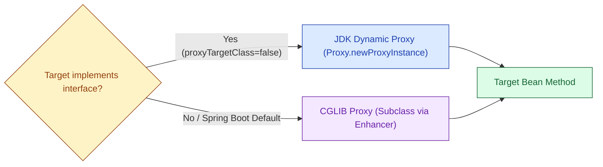

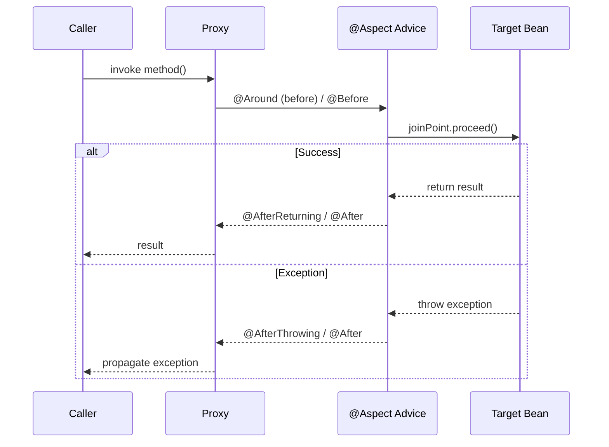

### Advice Types

| Advice | Execution Timing | Use Case |
|--------|-----------------|----------|
| `@Before` | Before target method | Validation, auth checks, entry logging |
| `@After` | Always after target (`finally`) | Resource cleanup, audit completion |
| `@AfterReturning` | After normal return | Inspect/log return value |
| `@AfterThrowing` | After exception thrown | Error logging, alerting |
| `@Around` | Wraps target (`proceed()`) | Timing, caching, retries, transactions |

### @Aspect: Complete Example

```java
@Aspect
@Component
public class PerformanceAspect {
    private static final Logger logger = LoggerFactory.getLogger(PerformanceAspect.class);

    // Pointcut: applies to all methods in service classes
    @Pointcut("execution(* com.example.service.*.*(..)) && @annotation(PerformanceLogging)")
    public void serviceMethodsWithPerformanceLogging() {
    }

    // @Before: executes before method call
    @Before("serviceMethodsWithPerformanceLogging()")
    public void logBefore(JoinPoint joinPoint) {
        String methodName = joinPoint.getSignature().getName();
        logger.info("Starting method: {}", methodName);
    }

    // @After: executes after method returns (regardless of success/exception)
    @After("serviceMethodsWithPerformanceLogging()")
    public void logAfter(JoinPoint joinPoint) {
        String methodName = joinPoint.getSignature().getName();
        logger.info("Method finished: {}", methodName);
    }

    // @AfterReturning: executes after successful return
    @AfterReturning(
        pointcut = "serviceMethodsWithPerformanceLogging()",
        returning = "result"
    )
    public void logAfterReturning(JoinPoint joinPoint, Object result) {
        String methodName = joinPoint.getSignature().getName();
        logger.info("Method {} returned: {}", methodName, result);
    }

    // @AfterThrowing: executes after exception
    @AfterThrowing(
        pointcut = "serviceMethodsWithPerformanceLogging()",
        throwing = "exception"
    )
    public void logAfterThrowing(JoinPoint joinPoint, Throwable exception) {
        String methodName = joinPoint.getSignature().getName();
        logger.error("Method {} threw exception: {}", methodName, exception.getMessage());
    }

    // @Around: full control before and after
    @Around("serviceMethodsWithPerformanceLogging()")
    public Object measureExecutionTime(ProceedingJoinPoint joinPoint) throws Throwable {
        String methodName = joinPoint.getSignature().getName();
        long startTime = System.currentTimeMillis();

        try {
            logger.info(">>> Executing: {}", methodName);
            Object result = joinPoint.proceed(); // Call actual method
            return result;
        } finally {
            long duration = System.currentTimeMillis() - startTime;
            if (duration > 1000) {
                logger.warn("!!! Method {} took {}ms (SLOW)", methodName, duration);
            } else {
                logger.info("<<< Completed in {}ms", duration);
            }
        }
    }
}

// Marker annotation
@Target(ElementType.METHOD)
@Retention(RetentionPolicy.RUNTIME)
public @interface PerformanceLogging {
}

// Usage
@Service
public class OrderService {

    @PerformanceLogging
    public Order createOrder(OrderRequest request) {
        // Method execution is intercepted by AOP
        return new Order(request.getItems());
    }
}
```

### Pointcut Expressions

```java
@Aspect
@Component
public class PointcutExamples {

    // 1. Method signature pointcut
    @Pointcut("execution(* com.example.service.UserService.save(..))")
    public void userServiceSaveMethod() {}

    // 2. Any method in service classes
    @Pointcut("execution(* com.example.service.*.*(..))")
    public void anyServiceMethod() {}

    // 3. Methods with specific parameter types
    @Pointcut("execution(* com.example.service.*.*(java.lang.String, int))")
    public void methodWithStringAndInt() {}

    // 4. Classes with specific annotation
    @Pointcut("@target(org.springframework.stereotype.Service)")
    public void classesAnnotatedWithService() {}

    // 5. Methods with specific annotation
    @Pointcut("@annotation(com.example.annotation.Cacheable)")
    public void methodsAnnotatedWithCacheable() {}

    // 6. Methods in classes in specific package
    @Pointcut("within(com.example.service.*)")
    public void classesInServicePackage() {}

    // 7. Complex pointcut with logical operators
    @Pointcut("(execution(* com.example.service.*.*(..)) || " +
              "execution(* com.example.repository.*.*(..))) && " +
              "!execution(* *.toString())")
    public void serviceOrRepositoryButNotToString() {}

    @Before("serviceOrRepositoryButNotToString()")
    public void logComplexPointcut(JoinPoint jp) {
        // Applies to service and repository methods, excluding toString
    }
}
```

### JDK Dynamic Proxy vs CGLIB

> [!WARNING]
> Because Spring AOP is proxy-based, **self-invocation** (calling `this.anotherMethod()` inside the same bean) bypasses the proxy—annotations like `@Transactional` or `@PerformanceLogging` will not trigger on self-invoked methods.

```java
// Interface-based: Uses JDK Dynamic Proxy
public interface OrderService {
    void createOrder(Order order);
}

@Service
public class OrderServiceImpl implements OrderService {
    @Override
    public void createOrder(Order order) {
        // Actual implementation
    }
}

// Concrete class without interface: Uses CGLIB (by default in Spring Boot)
@Service
public class PaymentService {
    public void processPayment(Payment payment) {
        // Actual implementation
    }
}

// Force specific proxy type in configuration
@Configuration
@EnableAspectJAutoProxy(proxyTargetClass = true) // Force CGLIB
public class AopConfiguration {
    // CGLIB will be used for all proxies
}
```

### Creating Custom Advice (`MethodInterceptor`)

```java
@Component
public class AuthenticationAdvice implements MethodInterceptor {
    private static final Logger logger = LoggerFactory.getLogger(AuthenticationAdvice.class);

    @Override
    public Object invoke(MethodInvocation invocation) throws Throwable {
        Method method = invocation.getMethod();

        // Check if method requires authentication
        if (method.isAnnotationPresent(RequiresAuthentication.class)) {
            if (!isUserAuthenticated()) {
                throw new UnauthorizedException("User not authenticated");
            }
            logger.info("User authenticated, proceeding with: {}", method.getName());
        }

        return invocation.proceed();
    }

    private boolean isUserAuthenticated() {
        SecurityContext context = SecurityContextHolder.getContext();
        return context.getAuthentication() != null &&
               context.getAuthentication().isAuthenticated();
    }
}

@Target(ElementType.METHOD)
@Retention(RetentionPolicy.RUNTIME)
public @interface RequiresAuthentication {
}
```

---

## SpEL Basics

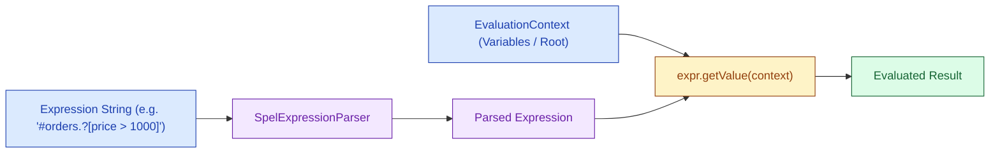

### SpEL Syntax Quick Reference

| Syntax | Meaning | Example |
|--------|---------|---------|
| `#{...}` | SpEL evaluation block | `#{1 + 2}` |
| `${...}` | Property placeholder | `${app.debug-mode:false}` |
| `T(Type)` | Static type / constant access | `#{T(java.lang.Math).PI}` |
| `#var` | EvaluationContext variable | `#orders` |
| `.?[cond]` | Collection selection (filter) | `#orders.?[price > 1000]` |
| `.![prop]` | Collection projection (map) | `#orders.![price]` |
| `.^[cond]` | First matching element | `#orders.![price].^[#this]` |

Spring Expression Language (SpEL) enables dynamic expression evaluation in `@Value` annotations and at runtime via `SpelExpressionParser`:

```java
@Component
public class SpElExamples {

    @Value("#{systemProperties['user.home']}")
    private String userHome;

    @Value("#{systemEnvironment['JAVA_HOME']}")
    private String javaHome;

    @Value("#{1 + 2}")
    private int arithmeticResult; // 3

    @Value("#{'Hello' + ' ' + 'World'}")
    private String concatenated; // "Hello World"

    @Value("#{T(java.lang.Math).PI}")
    private double mathPI; // 3.14159...

    @Value("#{systemProperties['os.name'].toLowerCase()}")
    private String osNameLowercase;

    // Conditional expression
    @Value("#{${app.debug-mode:false} ? 'DEBUG' : 'PRODUCTION'}")
    private String environment;
}

@Configuration
public class SpElConfiguration {

    @Bean
    public ExpressionParser expressionParser() {
        return new SpelExpressionParser();
    }

    @Bean
    public EvaluationContext evaluationContext() {
        return new StandardEvaluationContext();
    }
}

@Component
public class DynamicExpressionEvaluator {
    private final ExpressionParser expressionParser;
    private final EvaluationContext context;

    public DynamicExpressionEvaluator(ExpressionParser expressionParser,
                                     EvaluationContext context) {
        this.expressionParser = expressionParser;
        this.context = context;
    }

    public Object evaluateExpression(String expression) {
        Expression expr = expressionParser.parseExpression(expression);
        return expr.getValue(context);
    }

    public void setVariable(String name, Object value) {
        context.setVariable(name, value);
    }
}

// Usage
@Service
public class OrderService {
    private final DynamicExpressionEvaluator evaluator;

    public OrderService(DynamicExpressionEvaluator evaluator) {
        this.evaluator = evaluator;
    }

    public void processOrders(List<Order> orders) {
        evaluator.setVariable("orders", orders);

        // Dynamic evaluation
        Integer totalAmount = (Integer) evaluator.evaluateExpression(
            "#orders.![price].^[#this]"
        );

        Boolean hasExpensiveOrders = (Boolean) evaluator.evaluateExpression(
            "#orders.?[price > 1000].size() > 0"
        );
    }
}
```

---

## Interview Questions

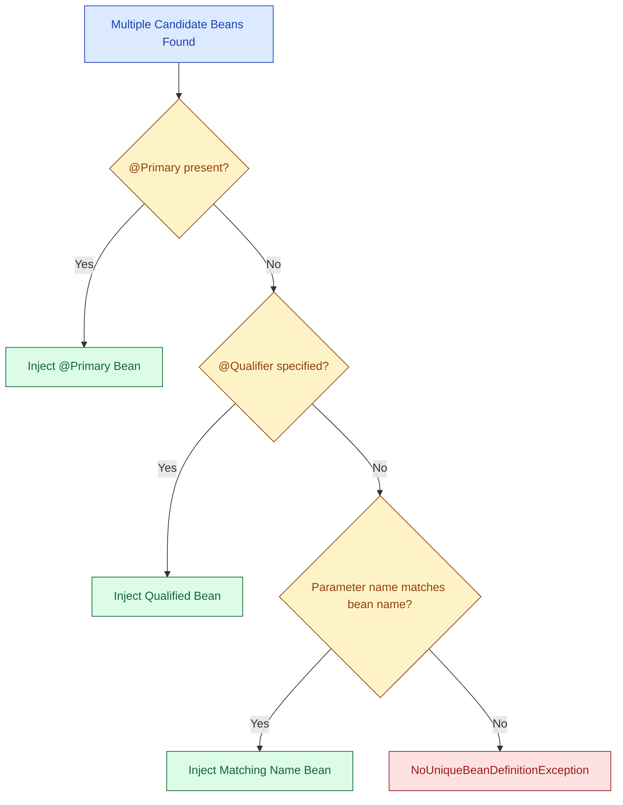

### Q1: Explain the complete bean lifecycle with all hooks.

1. **Bean definition loading** from XML/annotations.
2. **BeanFactoryPostProcessor** modifies bean definitions.
3. **Instantiation** via constructor reflection.
4. **Property population** (setter injection, `@Autowired`).
5. **Aware interfaces:** `BeanNameAware` → `BeanFactoryAware` → `ApplicationContextAware`.
6. **`BeanPostProcessor.postProcessBeforeInitialization()`** before initialization.
7. **`@PostConstruct`** method (JSR-250).
8. **`InitializingBean.afterPropertiesSet()`** interface method.
9. **Custom `init-method`** from `@Bean(initMethod = "...")`.
10. **`BeanPostProcessor.postProcessAfterInitialization()`** after initialization.
11. **Bean ready for use** (singleton cached or prototype returned).
12. On shutdown: **`@PreDestroy`** method → **`DisposableBean.destroy()`** → **custom `destroy-method`**.

> [!TIP]
> Constructor injection happens during instantiation; setter injection happens during property population. Use `@PostConstruct` for initialization logic that depends on all dependencies being set.

### Q2: Why is constructor injection preferred over field injection?

- **Immutability:** Fields can be `final`, preventing accidental modification.
- **Null-safety:** Missing dependencies are detected at construction time, not at method call time.
- **Testability:** Beans can be instantiated directly without a Spring context for unit tests.
- **Explicit dependencies:** All dependencies are visible in the constructor signature.
- **Thread-safety:** No synchronization needed for immutable state.
- **Circular dependency detection:** Constructor injection fails fast on circular dependencies, whereas field injection can hide them.

### Q3: What's the difference between `@Component` and `@Service`?

- Semantically, `@Service` indicates business logic while `@Component` is generic; both create singleton beans by default and enable component scanning.
- `@Repository` adds automatic exception translation (`SQLException` → `DataAccessException`).
- `@Service` and `@Controller` do not add special runtime behavior beyond semantics, though using them improves readability and allows future aspect targeting.

### Q4: How does `@Configuration` with `@Bean` achieve singleton behavior?

- `@Configuration` classes are enhanced with **CGLIB proxies** at runtime.
- When a `@Bean` method is called, the proxy intercepts it: the first call creates and caches the instance, and subsequent calls return the cached instance.
- Without proxying (e.g., lite mode with `@Component`), each direct method call would create a new instance.

### Q5: Explain AOP proxies: JDK Dynamic Proxy vs CGLIB.

- **JDK Dynamic Proxy:** Used for interface-based implementations; creates a proxy implementing the same interface and can only proxy interface methods (faster creation).
- **CGLIB:** Used for concrete classes without interfaces; creates a subclass overriding public methods (faster at runtime).
- Spring Boot uses **CGLIB by default** (since Spring 5.1, controlled by `spring.aop.proxy-target-class`).

### Q6: What's the difference between `@Bean` scope configurations?

- **Singleton (default):** One instance per `ApplicationContext`, shared across the application (use for stateless services).
- **Prototype:** New instance every time requested; no destruction hooks called (use for stateful objects).
- **Request / Session / Application:** Web-only scopes tied to an HTTP request, HTTP session, or `ServletContext`.

### Q7: How do you handle optional dependencies in Spring?

```java
// Option 1: Optional<T>
public MyService(Optional<OptionalDependency> dependency) {
    this.dependency = dependency;
}

// Option 2: @Autowired(required = false)
@Autowired(required = false)
private OptionalDependency dependency;

// Option 3: ObjectProvider<T>
public MyService(ObjectProvider<OptionalDependency> provider) {
    this.dependency = provider.getIfAvailable();
}

// Option 4: @ConditionalOnMissingBean
@Bean
@ConditionalOnMissingBean
public OptionalDependency optionalDependency() {
    return new DefaultOptionalDependency();
}
```

`ObjectProvider<T>` is preferred because it supports lazy initialization and expresses clear intent.

### Q8: Explain `@ConditionalOnProperty` with an example.

```java
@Bean
@ConditionalOnProperty(
    name = "feature.caching.enabled",
    havingValue = "true",
    matchIfMissing = false
)
public CacheManager cacheManager() {
    return new RedisCacheManager();
}
```

The bean is created only if `application.properties` has `feature.caching.enabled=true`. If the property is missing and `matchIfMissing = false`, the bean is skipped—ideal for feature flags and environment toggles.

### Q9: How does Spring resolve constructor injection with multiple candidates?

Spring evaluates candidates in this order:
1. **`@Primary`:** Marks the preferred bean when multiple candidates exist.
2. **`@Qualifier`:** Explicitly names which bean to inject.
3. **Parameter name matching:** Matches the constructor parameter name to the bean name.
4. **Type matching:** Succeeds only if a single bean of that type exists.

```java
@Bean
@Primary
public DataSource primaryDataSource() { }

@Bean
public DataSource secondaryDataSource() { }

@Component
public class MyService {
    private final DataSource dataSource; // Gets primaryDataSource

    public MyService(DataSource dataSource) {
        this.dataSource = dataSource;
    }
}

@Component
public class OtherService {
    private final DataSource dataSource; // Needs @Qualifier

    public OtherService(@Qualifier("secondaryDataSource") DataSource dataSource) {
        this.dataSource = dataSource;
    }
}
```
