# Spring Boot Auto-Configuration - Deep Dive

## Table of Contents
1. [How Auto-Configuration Works](#how-auto-configuration-works)
2. [@SpringBootApplication Unpacked](#springbootapplication-unpacked)
3. [Starter Dependencies](#starter-dependencies)
4. [Configuration Properties](#configuration-properties)
5. [Profiles and Multi-Document YAML](#profiles-and-multi-document-yaml)
6. [Spring Boot Actuator](#spring-boot-actuator)
7. [DevTools and Development Features](#devtools-and-development-features)
8. [Spring Boot 2.x vs 3.x Migration](#spring-boot-2x-vs-3x-migration)
9. [Embedded Server Configuration](#embedded-server-configuration)
10. [Graceful Shutdown](#graceful-shutdown)
11. [Interview Questions](#interview-questions)

---

## How Auto-Configuration Works

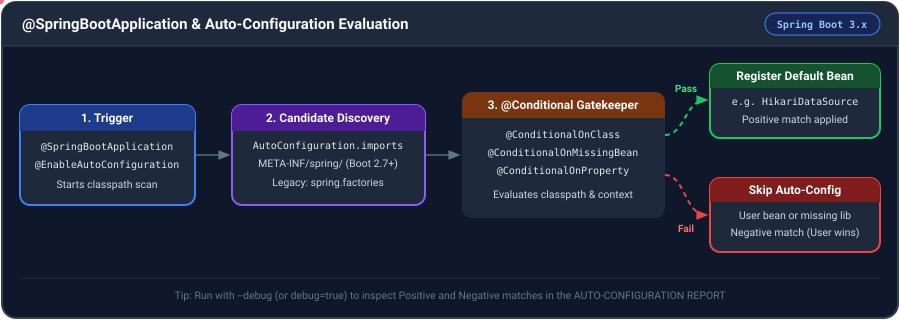

Spring Boot auto-configuration inspects your **classpath**, **existing beans**, and **environment properties** at startup to register sensible defaults without manual boilerplate.

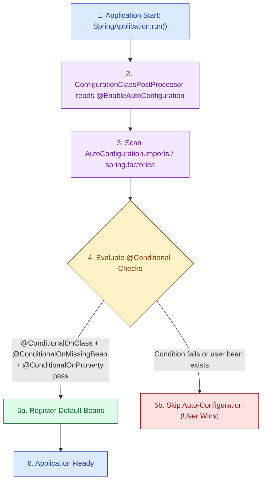

### Auto-Configuration Metadata Locations

| Spring Boot Version | Metadata File Path |
|---|---|
| **Spring Boot 2.7+** | `META-INF/spring/org.springframework.boot.autoconfigure.AutoConfiguration.imports` |
| **Spring Boot 2.6 & earlier** | `META-INF/spring.factories` |

### Key `@Conditional` Annotations

- `@ConditionalOnClass`: Activates only if the specified class is present on the classpath.
- `@ConditionalOnMissingBean`: Activates only if the user has **not** defined their own bean of that type (user-defined beans always take precedence).
- `@ConditionalOnProperty`: Activates only when a property matches an expected value.

### Example: `DataSourceAutoConfiguration`

```java
// This is simplified - real implementation is more complex
@AutoConfiguration(after = SqlInitializationConfiguration.class)
@ConditionalOnClass(DataSource.class)
@ConditionalOnMissingBean(DataSource.class)
@EnableConfigurationProperties(DataSourceProperties.class)
public class DataSourceAutoConfiguration {

    @Bean
    public DataSource dataSource(DataSourceProperties properties) {
        // Create datasource only if:
        // 1. DataSource class exists on classpath (JDBC driver added)
        // 2. User hasn't defined their own DataSource bean
        // 3. Properties are provided in application.yml/properties

        HikariConfig config = new HikariConfig();
        config.setJdbcUrl(properties.getUrl());
        config.setUsername(properties.getUsername());
        config.setPassword(properties.getPassword());
        config.setMaximumPoolSize(10);
        return new HikariDataSource(config);
    }
}
```

### Viewing Auto-Configuration in Action

```java
@SpringBootApplication
public class Application {
    public static void main(String[] args) {
        SpringApplication app = new SpringApplication(Application.class);
        app.setLogStartupInfo(true); // Shows startup logs

        // Enable debug logging to see auto-configuration
        app.setAdditionalProperties(
            Collections.singletonMap("debug", "true")
        );

        app.run(args);
    }
}

// OR in application.properties
// debug=true

// OR run with: java -jar app.jar --debug
```

> [!TIP]
> Run your app with `--debug` (or `debug=true` in `application.properties`) to print the **AUTO-CONFIGURATION REPORT**, which lists **Positive matches** (configs that ran) and **Negative matches** (configs skipped, with exact reasons).

### Understanding the Order of Auto-Configuration

```java
// Control order with @AutoConfiguration
@AutoConfiguration(before = SomeConfiguration.class)
public class MyAutoConfiguration {
    // This runs before SomeConfiguration
}

@AutoConfiguration(after = DatabaseConfiguration.class)
public class CacheAutoConfiguration {
    // This runs after DatabaseConfiguration
}

// Check ordering
// Run with: --debug
// Look for "AUTO-CONFIGURATION REPORT" showing:
// - Positive matches (configs that ran)
// - Negative matches (configs that didn't run, with reasons)
```

### Custom Auto-Configuration

```java
// Step 1: Create auto-configuration class
@Configuration
@ConditionalOnClass(name = "com.mycompany.FeatureApi")
@EnableConfigurationProperties(MyFeatureProperties.class)
public class MyFeatureAutoConfiguration {

    @Bean
    @ConditionalOnMissingBean
    public FeatureService featureService(MyFeatureProperties properties) {
        return new FeatureService(properties.isEnabled(), properties.getMode());
    }
}

// Step 2: Register in spring.factories or .imports
// META-INF/spring.factories:
// org.springframework.boot.autoconfigure.EnableAutoConfiguration=\
//   com.mycompany.MyFeatureAutoConfiguration

// OR META-INF/spring/org.springframework.boot.autoconfigure.AutoConfiguration.imports:
// com.mycompany.MyFeatureAutoConfiguration

// Step 3: User can disable with
// spring.boot.autoconfigure.exclude=com.mycompany.MyFeatureAutoConfiguration
```

---

## @SpringBootApplication Unpacked

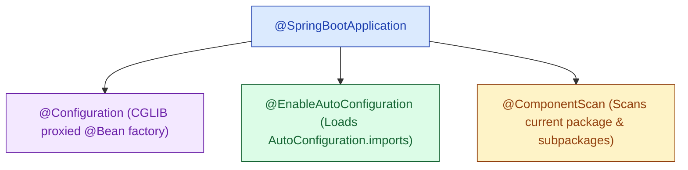

### What `@SpringBootApplication` Actually Does

```java
@SpringBootApplication
public class Application {
    public static void main(String[] args) {
        SpringApplication.run(Application.class, args);
    }
}

// Is equivalent to:

@Configuration  // Make it a configuration class
@EnableAutoConfiguration  // Enable auto-configuration
@ComponentScan  // Scan for components in this package and subpackages
public class Application {
    public static void main(String[] args) {
        SpringApplication.run(Application.class, args);
    }
}
```

### Breakdown of Composed Annotations

| Annotation | Role | Key Behavior |
|---|---|---|
| **`@Configuration`** | Declares a Spring config class | `@Bean` methods define beans; uses CGLIB proxying for singleton bean management |
| **`@EnableAutoConfiguration`** | Activates auto-configuration | Loads classes from `AutoConfiguration.imports` / `spring.factories` and applies `@Conditional` checks |
| **`@ComponentScan`** | Discovers stereotype beans | Scans `@Component`, `@Service`, `@Repository`, `@Controller` in current package and subpackages |

> [!IMPORTANT]
> `@ComponentScan` does **not** scan packages outside the main application class's package hierarchy unless you explicitly configure `scanBasePackages`.

### Customizing `@SpringBootApplication`

```java
@SpringBootApplication(
    scanBasePackages = {"com.example.app", "com.example.shared"}
)
public class Application {
    public static void main(String[] args) {
        SpringApplication.run(Application.class, args);
    }
}

// Exclude specific auto-configurations
@SpringBootApplication(
    exclude = DataSourceAutoConfiguration.class
)
public class Application {
    public static void main(String[] args) {
        SpringApplication.run(Application.class, args);
    }
}
```

### `SpringApplication` Customization

```java
@SpringBootApplication
public class Application {
    public static void main(String[] args) {
        SpringApplication app = new SpringApplication(Application.class);

        // Configure startup
        app.setWebApplicationType(WebApplicationType.SERVLET);
        app.setAdditionalProperties(
            Map.of(
                "server.port", "8080",
                "logging.level.root", "INFO"
            )
        );

        // Add listeners
        app.addListeners(new ApplicationStartedListener());

        // Run application
        ApplicationContext context = app.run(args);
    }
}

public class ApplicationStartedListener implements ApplicationListener<ApplicationStartedEvent> {
    @Override
    public void onApplicationEvent(ApplicationStartedEvent event) {
        System.out.println("Application started!");
    }
}
```

---

## Starter Dependencies

Starters are curated dependency descriptors that bundle compatible libraries and transitive dependencies under a single Maven/Gradle coordinate.

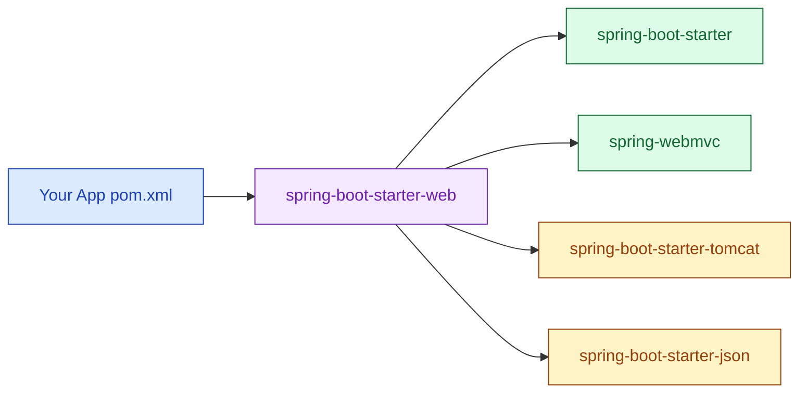

### Common Starters

| Starter | Key Transitive Dependencies Included |
|---|---|
| `spring-boot-starter-web` | `spring-boot-starter`, `spring-webmvc`, `spring-boot-starter-tomcat`, `spring-boot-starter-json` |
| `spring-boot-starter-data-jpa` | `spring-data-jpa`, `spring-orm`, `spring-core`, Hibernate |
| `spring-boot-starter-security` | Spring Security core, web, and config |
| `spring-boot-starter-actuator` | Production monitoring, health, and metrics endpoints |
| `spring-boot-starter-test` | JUnit 5, Mockito, AssertJ, Spring Test (`test` scope) |

```xml
<!-- Spring Boot Web -->
<dependency>
    <groupId>org.springframework.boot</groupId>
    <artifactId>spring-boot-starter-web</artifactId>
</dependency>
<!-- Includes: spring-boot-starter, spring-webmvc, spring-boot-starter-tomcat, etc. -->

<!-- Spring Boot Data JPA -->
<dependency>
    <groupId>org.springframework.boot</groupId>
    <artifactId>spring-boot-starter-data-jpa</artifactId>
</dependency>
<!-- Includes: spring-data-jpa, spring-orm, spring-core, etc. -->

<!-- Spring Boot Security -->
<dependency>
    <groupId>org.springframework.boot</groupId>
    <artifactId>spring-boot-starter-security</artifactId>
</dependency>

<!-- Spring Boot Actuator -->
<dependency>
    <groupId>org.springframework.boot</groupId>
    <artifactId>spring-boot-starter-actuator</artifactId>
</dependency>

<!-- Spring Boot Testing -->
<dependency>
    <groupId>org.springframework.boot</groupId>
    <artifactId>spring-boot-starter-test</artifactId>
    <scope>test</scope>
</dependency>
```

### How Starters Work

```xml
<!-- spring-boot-starter-web pom.xml -->
<project>
    <dependencies>
        <!-- Spring Core -->
        <dependency>
            <groupId>org.springframework.boot</groupId>
            <artifactId>spring-boot-starter</artifactId>
        </dependency>

        <!-- Spring Web -->
        <dependency>
            <groupId>org.springframework</groupId>
            <artifactId>spring-webmvc</artifactId>
        </dependency>

        <!-- Tomcat -->
        <dependency>
            <groupId>org.springframework.boot</groupId>
            <artifactId>spring-boot-starter-tomcat</artifactId>
        </dependency>

        <!-- JSON support -->
        <dependency>
            <groupId>org.springframework.boot</groupId>
            <artifactId>spring-boot-starter-json</artifactId>
        </dependency>

        <!-- Others -->
        <dependency>
            <groupId>org.springframework</groupId>
            <artifactId>spring-webmvc</artifactId>
        </dependency>
    </dependencies>
</project>

<!-- When you add spring-boot-starter-web, all these are automatically included -->
```

### Creating Custom Starters

For sharing configurations across projects:

```xml
<!-- my-feature-spring-boot-starter/pom.xml -->
<project>
    <artifactId>my-feature-spring-boot-starter</artifactId>

    <dependencies>
        <!-- Spring Boot -->
        <dependency>
            <groupId>org.springframework.boot</groupId>
            <artifactId>spring-boot-starter</artifactId>
        </dependency>

        <!-- My feature implementation -->
        <dependency>
            <groupId>com.mycompany</groupId>
            <artifactId>my-feature</artifactId>
            <version>1.0.0</version>
        </dependency>
    </dependencies>
</project>
```

```java
// src/main/java/com/mycompany/feature/MyFeatureAutoConfiguration.java
@Configuration
@EnableConfigurationProperties(MyFeatureProperties.class)
@ConditionalOnClass(MyFeatureApi.class)
public class MyFeatureAutoConfiguration {

    @Bean
    @ConditionalOnMissingBean
    public MyFeatureService myFeatureService(MyFeatureProperties properties) {
        return new MyFeatureService(properties);
    }
}

// src/main/resources/META-INF/spring/org.springframework.boot.autoconfigure.AutoConfiguration.imports
com.mycompany.feature.MyFeatureAutoConfiguration
```

```java
// @ConfigurationProperties class
@Configuration
@ConfigurationProperties(prefix = "myfeature")
public class MyFeatureProperties {
    private boolean enabled = true;
    private String mode = "basic";
    private int timeout = 5000;

    // Getters and setters
    public boolean isEnabled() { return enabled; }
    public void setEnabled(boolean enabled) { this.enabled = enabled; }

    public String getMode() { return mode; }
    public void setMode(String mode) { this.mode = mode; }

    public int getTimeout() { return timeout; }
    public void setTimeout(int timeout) { this.timeout = timeout; }
}
```

User can now use:
```xml
<dependency>
    <groupId>com.mycompany</groupId>
    <artifactId>my-feature-spring-boot-starter</artifactId>
    <version>1.0.0</version>
</dependency>
```

---

## Configuration Properties

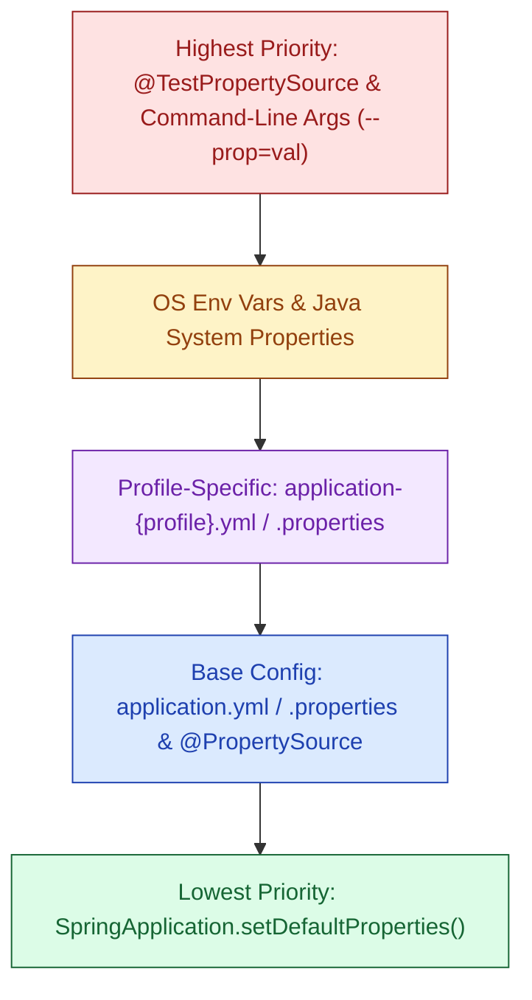

### 17 Levels of Property Resolution (Priority Order)

Higher numbers override lower numbers (command-line arguments override everything except `@TestPropertySource`):

| Level | Property Source |
|---|---|
| **1–3** | `ServletConfig` init params → `ServletContext` init params → JNDI (`java:comp/env/`) |
| **4–6** | System properties (`System.getProperties()`) → OS env vars (`System.getenv()`) → `RandomValuePropertySource` (`random.*`) |
| **7–10** | `application-{profile}.properties` → `application.properties` → `@PropertySource` → `SpringApplication.setDefaultProperties()` |
| **11–12** | `application-{profile}.yml` → `application.yml` |
| **13–14** | Command-line arguments (`--property=value`) → `.env` environment variables |
| **15–17** | `application-test.properties` → `test/@PropertySource` → `@TestPropertySource` (Highest) |

### `@ConfigurationProperties` vs `@Value`

| Feature | `@ConfigurationProperties` | `@Value` |
|---|---|---|
| **Use Case** | Binding entire hierarchical configuration objects | Injecting single, isolated property values |
| **Type Safety & Conversion** | Strong type safety (`Duration`, `DataSize`, `List`, `Map`, `URL`) | Basic conversion only |
| **Validation** | Supports `@Validated` + JSR-303 (`@NotBlank`, `@Min`, etc.) | Not supported natively |
| **SpEL Support** | No | Yes (`#{...}`) |
| **IDE Autocomplete** | Yes (via `spring-boot-configuration-processor`) | Limited |

```java
// @ConfigurationProperties: Mapping entire configuration objects
@Component
@ConfigurationProperties(prefix = "app")
public class AppProperties {
    private String name;
    private int port;
    private Database database;

    public static class Database {
        private String url;
        private String username;
        private String password;
        // Getters and setters
    }
    // Getters and setters
}

// application.yml
/*
app:
  name: MyApp
  port: 8080
  database:
    url: jdbc:mysql://localhost/db
    username: root
    password: secret
*/

// @Value: Single property injection
@Component
public class MyComponent {
    @Value("${app.name}")
    private String appName;

    @Value("${app.port:8080}")  // Default value
    private int port;

    @Value("#{systemProperties['java.version']}")  // SpEL
    private String javaVersion;
}
```

### Externalized Configuration in Application

```java
@Configuration
@EnableConfigurationProperties(AppProperties.class)
public class AppConfiguration {

    @Bean
    public AppService appService(AppProperties properties) {
        return new AppService(properties.getName(), properties.getPort());
    }
}

@Service
public class AppService {
    private final String name;
    private final int port;

    public AppService(String name, int port) {
        this.name = name;
        this.port = port;
    }

    public void startServer() {
        System.out.println("Starting " + name + " on port " + port);
    }
}
```

### Property Binding with Type Conversion

```java
@Component
@ConfigurationProperties(prefix = "app")
public class ComplexProperties {
    // Automatic conversion
    private Duration timeout;      // "PT5S" → Duration.ofSeconds(5)
    private DataSize maxUpload;    // "10MB" → 10 * 1024 * 1024
    private List<String> profiles; // List from YAML array
    private Map<String, String> metadata; // Map from YAML object
    private URL homepage;          // String → URL

    // Getters and setters
}

// application.yml
/*
app:
  timeout: PT5S
  max-upload: 10MB
  profiles:
    - dev
    - test
  metadata:
    author: John Doe
    version: 1.0
  homepage: https://example.com
*/
```

### Validation with `@ConfigurationProperties`

```java
@Component
@ConfigurationProperties(prefix = "database")
@Validated
public class DatabaseProperties {
    @NotBlank
    private String url;

    @NotBlank
    @Email
    private String adminEmail;

    @Positive
    private int maxConnections = 10;

    @Min(1000)
    @Max(30000)
    private int port;

    // Getters and setters
}

// Validation error on startup if properties invalid
// org.springframework.boot.context.properties.bind.validation.BindValidationException:
// Property validation failed
```

> [!NOTE]
> Adding `@Validated` to a `@ConfigurationProperties` class causes Spring Boot to fail fast at startup with `BindValidationException` if any constraint is violated.

---

## Profiles and Multi-Document YAML

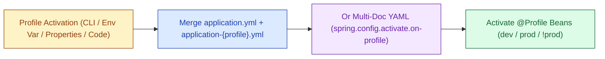

### Profile-Specific Properties

- `application.yml` — Default base configuration
- `application-dev.yml`, `application-test.yml`, `application-prod.yml` — Single active profile overrides
- `application-prod-db-cluster.yml` — Multiple active profiles

```yaml
# application.yml (default)
spring:
  application:
    name: MyApp
  jpa:
    show-sql: false
    properties:
      hibernate:
        format_sql: false

# application-dev.yml (overrides for dev)
spring:
  datasource:
    url: jdbc:mysql://localhost:3306/myapp_dev
    username: root
    password: password
  jpa:
    show-sql: true
    properties:
      hibernate:
        format_sql: true
  h2:
    console:
      enabled: true

# application-prod.yml (overrides for prod)
spring:
  datasource:
    url: jdbc:mysql://prod-db-host:3306/myapp
    username: prod_user
    password: ${DB_PASSWORD}  # From environment
  jpa:
    show-sql: false
    hibernate:
      ddl-auto: validate  # Never auto-create in prod

server:
  port: 8443
  ssl:
    enabled: true
    key-store: /etc/ssl/myapp.jks
    key-store-password: ${SSL_PASSWORD}
```

> [!WARNING]
> Always set `spring.jpa.hibernate.ddl-auto: validate` (or `none`) in `application-prod.yml` so Hibernate never alters or drops production tables automatically.

### Activating Profiles

| Method | Example |
|---|---|
| **Programmatic** | `app.setAdditionalProfiles("dev", "mysql");` |
| **Properties** | `spring.profiles.active=dev,mysql` |
| **Environment Variable** | `SPRING_PROFILES_ACTIVE=dev,mysql` |
| **Command Line** | `java -jar app.jar --spring.profiles.active=prod` |
| **Maven** | `mvn spring-boot:run -Dspring-boot.run.arguments="--spring.profiles.active=dev"` |
| **IDE (IntelliJ)** | VM options `-Dspring.profiles.active=dev` or env var `SPRING_PROFILES_ACTIVE=dev` |

```java
// Programmatically
SpringApplication app = new SpringApplication(Application.class);
app.setAdditionalProfiles("dev", "mysql");
app.run(args);

// Via application.properties
// spring.profiles.active=dev,mysql

// Via environment variable
// SPRING_PROFILES_ACTIVE=dev,mysql

// Via command line
// java -jar app.jar --spring.profiles.active=prod

// Via Maven
// mvn spring-boot:run -Dspring-boot.run.arguments="--spring.profiles.active=dev"

// Via IDE (IntelliJ IDEA)
// Run → Edit Configurations → VM options: -Dspring.profiles.active=dev
// OR Environment variables: SPRING_PROFILES_ACTIVE=dev
```

### Multi-Document YAML

Single YAML file with multiple documents (Spring Boot 2.4+):

```yaml
# application.yml

# Default profile
spring:
  config:
    activate:
      on-profile: ""
  datasource:
    url: jdbc:mysql://localhost/myapp
    username: root
    password: password
  jpa:
    show-sql: false

---

# Dev profile
spring:
  config:
    activate:
      on-profile: "dev"
  datasource:
    url: jdbc:mysql://localhost/myapp_dev
    username: root
    password: password
  jpa:
    show-sql: true

---

# Prod profile
spring:
  config:
    activate:
      on-profile: "prod"
  datasource:
    url: jdbc:mysql://prod-db/myapp
    username: produser
    password: ${DB_PASSWORD}
  jpa:
    show-sql: false
    hibernate:
      ddl-auto: validate
```

### Profile-Specific Components

```java
@Component
@Profile("dev")
public class DevDataInitializer {
    @PostConstruct
    public void initDevData() {
        System.out.println("Initializing dev data...");
        // Load sample data for development
    }
}

@Component
@Profile("prod")
public class ProdSecurityConfig {
    // Strict security for production
}

@Bean
@Profile("!prod")  // NOT prod profile
public ConsoleAppender consoleAppender() {
    return new ConsoleAppender();
}
```

---

## Spring Boot Actuator

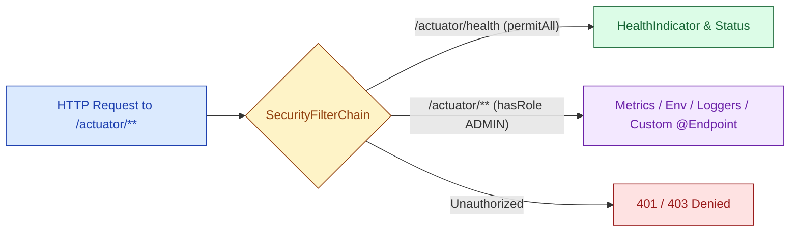

### Actuator Endpoints Overview

```yaml
# application.yml
management:
  endpoints:
    web:
      exposure:
        include: health,info,metrics,env,loggers,threaddump
        exclude: shutdown
      base-path: /actuator
      path-mapping:
        health: health-check
  endpoint:
    health:
      show-details: when-authorized  # Always, when-authorized, never
    env:
      enabled: true
  metrics:
    export:
      prometheus:
        enabled: true
```

### Common Endpoints

| Method & Path | Purpose |
|---|---|
| `GET /actuator/health` | Overall application health status |
| `GET /actuator/info` | Application metadata and build info |
| `GET /actuator/metrics` | List of available metrics |
| `GET /actuator/metrics/{metric}` | Specific metric values |
| `GET /actuator/env` | Active properties and environment sources |
| `GET /actuator/loggers` | Current logger levels |
| `POST /actuator/loggers/{name}` | Dynamically change log level at runtime |
| `GET /actuator/threaddump` | JVM thread dump |
| `GET /actuator/heapdump` | JVM heap dump download |
| `GET /actuator/flyway` | Database migration history |

### Health Endpoint Example

```java
@Configuration
public class HealthConfiguration {

    @Bean
    public HealthIndicator customHealthIndicator(
        OrderService orderService,
        DatabaseConnection dbConnection) {

        return new HealthIndicator() {
            @Override
            public Health health() {
                try {
                    // Check if critical services are working
                    long pendingOrders = orderService.getPendingOrderCount();
                    boolean dbConnected = dbConnection.isConnected();

                    if (!dbConnected) {
                        return Health.down()
                            .withDetail("database", "Connection lost")
                            .build();
                    }

                    if (pendingOrders > 1000) {
                        return Health.outOfService()
                            .withDetail("pending_orders", pendingOrders)
                            .withDetail("status", "Too many pending orders")
                            .build();
                    }

                    return Health.up()
                        .withDetail("pending_orders", pendingOrders)
                        .withDetail("database", "Connected")
                        .build();

                } catch (Exception e) {
                    return Health.down()
                        .withDetail("error", e.getMessage())
                        .build();
                }
            }
        };
    }
}

// GET /actuator/health response:
/*
{
  "status": "UP",
  "components": {
    "custom": {
      "status": "UP",
      "details": {
        "pending_orders": 42,
        "database": "Connected"
      }
    },
    "db": {
      "status": "UP",
      "details": {
        "database": "MySQL",
        "hello": 1
      }
    }
  }
}
*/
```

### Custom Actuator Endpoints

```java
@Component
@Endpoint(id = "orders")  // GET /actuator/orders
public class OrdersActuatorEndpoint {

    private final OrderService orderService;

    public OrdersActuatorEndpoint(OrderService orderService) {
        this.orderService = orderService;
    }

    @ReadOperation  // GET
    public Map<String, Object> getOrderStats() {
        return Map.of(
            "total", orderService.getTotalOrderCount(),
            "pending", orderService.getPendingOrderCount(),
            "completed", orderService.getCompletedOrderCount()
        );
    }

    @ReadOperation
    public Order getOrder(@Selector String orderId) {
        return orderService.findById(orderId);
    }

    @WriteOperation  // POST
    public void cancelOrder(@Selector String orderId) {
        orderService.cancelOrder(orderId);
    }
}

// Endpoints:
// GET /actuator/orders
// GET /actuator/orders/{orderId}
// POST /actuator/orders/{orderId}
```

### Securing Actuator

```java
@Configuration
@EnableWebSecurity
public class ActuatorSecurityConfiguration {

    @Bean
    public SecurityFilterChain filterChain(HttpSecurity http) throws Exception {
        http
            .authorizeHttpRequests(authz -> authz
                .requestMatchers("/actuator/health").permitAll()
                .requestMatchers("/actuator/**").hasRole("ADMIN")
                .anyRequest().authenticated()
            )
            .httpBasic(Customizer.withDefaults());
        return http.build();
    }
}

// Only /actuator/health is public; others require ADMIN role
```

> [!CAUTION]
> Sensitive endpoints like `/actuator/env` and `/actuator/heapdump` can expose secrets or memory contents. By default, only `/actuator/health` is exposed—always restrict additional endpoints with Spring Security (`hasRole("ADMIN")`).

---

## DevTools and Development Features

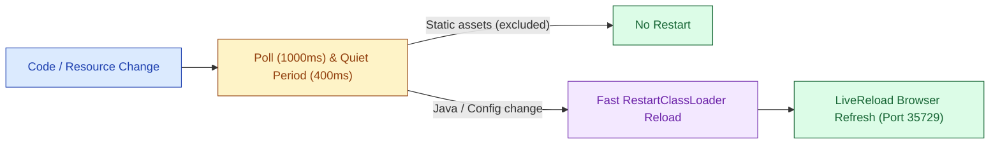

### Enabling DevTools

```xml
<dependency>
    <groupId>org.springframework.boot</groupId>
    <artifactId>spring-boot-devtools</artifactId>
    <scope>runtime</scope>
    <optional>true</optional>
</dependency>
```

> [!NOTE]
> `spring-boot-devtools` automatically disables itself when running a fully packaged production JAR (`java -jar`).

### Auto-Restart

```yaml
spring:
  devtools:
    restart:
      enabled: true
      exclude: "static/**,public/**"  # Don't restart for these changes
      additional-exclude: "uploads/**"
      poll-interval: 1000  # Poll every 1 second
      quiet-period: 400    # Wait 400ms after last change
```

### LiveReload

Browser automatically refreshes when files change (install the LiveReload browser extension and enable it):

```yaml
spring:
  devtools:
    livereload:
      enabled: true
      port: 35729
```

### Remote Debugging

```yaml
spring:
  devtools:
    remote:
      secret: my-secret-key
      restart:
        enabled: true
```

```bash
# Connect from IDE
# VM options: -Dspring.devtools.remote.secret=my-secret-key
```

---

## Spring Boot 2.x vs 3.x Migration

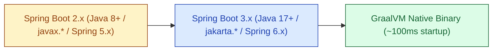

### Key Differences

| Feature | Spring Boot 2.x | Spring Boot 3.x |
|---|---|---|
| Java Version | 8+ | 17+ |
| Jakarta EE | `javax.*` | `jakarta.*` |
| Spring Version | 5.x | 6.x |
| Native Compilation | Not supported | Supported (GraalVM) |
| Observability | Micrometer | Built-in |
| Servlet Support | Supported | Still supported |
| Kotlin Version | 1.5+ | 1.7+ |

> [!IMPORTANT]
> Migrating to Spring Boot 3.x requires updating all Java EE imports from `javax.*` (`javax.servlet`, `javax.persistence`, `javax.validation`) to `jakarta.*`.

### Jakarta Namespace Migration

```java
// Spring Boot 2.x (javax.*)
import javax.servlet.http.HttpServletRequest;
import javax.persistence.Entity;
import javax.validation.Valid;

@Entity
@Table(name = "users")
public class User {
    @Id
    @GeneratedValue
    private Long id;

    @Column(name = "email")
    @NotNull
    private String email;
}

// Spring Boot 3.x (jakarta.*)
import jakarta.servlet.http.HttpServletRequest;
import jakarta.persistence.Entity;
import jakarta.validation.Valid;

@Entity
@Table(name = "users")
public class User {
    @Id
    @GeneratedValue
    private Long id;

    @Column(name = "email")
    @NotNull
    private String email;
}
```

### Maven Migration

```xml
<!-- Spring Boot 2.7 -->
<parent>
    <groupId>org.springframework.boot</groupId>
    <artifactId>spring-boot-starter-parent</artifactId>
    <version>2.7.17</version>
</parent>

<dependencies>
    <dependency>
        <groupId>org.springframework.boot</groupId>
        <artifactId>spring-boot-starter-web</artifactId>
    </dependency>
    <dependency>
        <groupId>org.springframework.boot</groupId>
        <artifactId>spring-boot-starter-data-jpa</artifactId>
    </dependency>
</dependencies>

<!-- Spring Boot 3.2 -->
<parent>
    <groupId>org.springframework.boot</groupId>
    <artifactId>spring-boot-starter-parent</artifactId>
    <version>3.2.0</version>
</parent>

<dependencies>
    <!-- Same artifact IDs, but new Jakarta namespaces -->
    <dependency>
        <groupId>org.springframework.boot</groupId>
        <artifactId>spring-boot-starter-web</artifactId>
        <!-- Automatically uses jakarta.* imports -->
    </dependency>
    <dependency>
        <groupId>org.springframework.boot</groupId>
        <artifactId>spring-boot-starter-data-jpa</artifactId>
    </dependency>
</dependencies>
```

### GraalVM Native Compilation

Spring Boot 3.x supports native executable compilation:

```bash
# Compile to native binary
mvn -Pnative native:compile

# Run native binary
./target/myapp
# Starts in ~100ms instead of ~2000ms
```

```properties
# application.properties for native
spring.native.remove-unused-config=true
spring.native.verbose=false
```

---

## Embedded Server Configuration

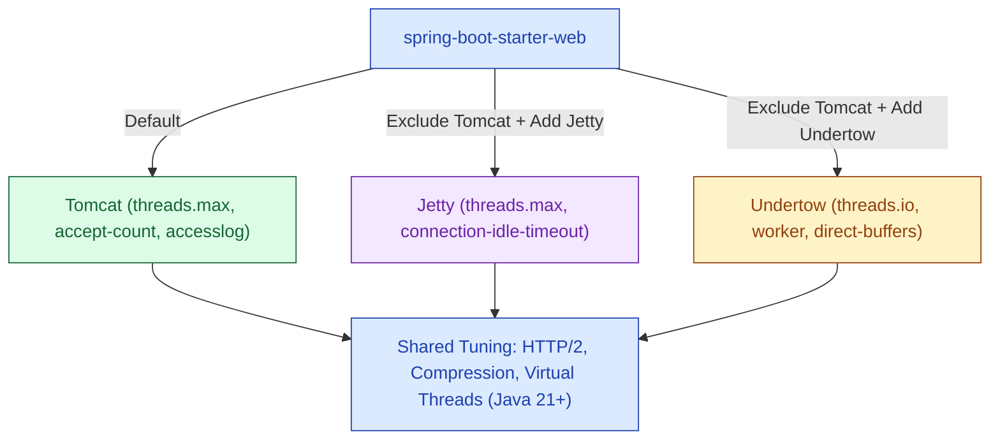

### Tomcat (Default)

```yaml
server:
  servlet:
    context-path: /api
    session:
      persistent: false
      timeout: 30m
  tomcat:
    threads:
      max: 200
      min-spare: 10
    accept-count: 100
    max-connections: 10000
    connection-timeout: 20000ms
    keep-alive-timeout: 60000ms
    threads:
      max-http-post-size: 2MB
    accesslog:
      enabled: true
      directory: logs
      pattern: "%h %l %u %t \"%r\" %s %b"
```

### Jetty

```xml
<dependency>
    <groupId>org.springframework.boot</groupId>
    <artifactId>spring-boot-starter-web</artifactId>
    <exclusions>
        <exclusion>
            <groupId>org.springframework.boot</groupId>
            <artifactId>spring-boot-starter-tomcat</artifactId>
        </exclusion>
    </exclusions>
</dependency>

<dependency>
    <groupId>org.springframework.boot</groupId>
    <artifactId>spring-boot-starter-jetty</artifactId>
</dependency>
```

```yaml
server:
  jetty:
    threads:
      max: 200
      min-spare: 10
    connection-idle-timeout: 60000ms
```

### Undertow

```xml
<dependency>
    <groupId>org.springframework.boot</groupId>
    <artifactId>spring-boot-starter-web</artifactId>
    <exclusions>
        <exclusion>
            <groupId>org.springframework.boot</groupId>
            <artifactId>spring-boot-starter-tomcat</artifactId>
        </exclusion>
    </exclusions>
</dependency>

<dependency>
    <groupId>org.springframework.boot</groupId>
    <artifactId>spring-boot-starter-undertow</artifactId>
</dependency>
```

```yaml
server:
  undertow:
    threads:
      io: 4
      worker: 20
    buffer-size: 1024
    direct-buffers: true
```

### Server Performance Tuning

```yaml
server:
  port: 8080
  compression:
    enabled: true
    min-response-size: 1024
    mime-types: text/html,text/xml,text/plain,text/css,application/json
  http2:
    enabled: true
  error:
    include-message: when-param
    include-binding-errors: when-param

spring:
  threads:
    virtual:
      enabled: true  # Use virtual threads (Java 21+)
```

---

## Graceful Shutdown

```mermaid
sequenceDiagram
    participant K8s as "Kubernetes / Docker (SIGTERM)"
    participant Server as "Embedded Server (Tomcat)"
    participant App as "Spring Context &amp; Beans"

    K8s->>Server: Send SIGTERM
    Server->>Server: Stop accepting new requests
    Note over Server: Drain in-flight requests (up to timeout-per-shutdown-phase: 30s)
    Server->>App: Publish ContextClosedEvent
    App->>App: Invoke @PreDestroy &amp; close beans
    App-->>K8s: Process exits cleanly
```

### Configuration

```yaml
server:
  shutdown: graceful  # Enable graceful shutdown (default: immediate)

spring:
  lifecycle:
    timeout-per-shutdown-phase: 30s  # 30 seconds to shutdown gracefully
```

> [!TIP]
> In Kubernetes, ensure `terminationGracePeriodSeconds` on your Pod is greater than `spring.lifecycle.timeout-per-shutdown-phase` (e.g., `45s` vs `30s`) so the container isn't force-killed with `SIGKILL` mid-drain.

### Graceful Shutdown Implementation

```java
@Component
public class GracefulShutdownListener {
    private static final Logger logger = LoggerFactory.getLogger(GracefulShutdownListener.class);

    @EventListener(ContextClosedEvent.class)
    public void onContextClosed(ContextClosedEvent event) {
        logger.info("Application shutting down gracefully");
        // Wait for pending requests to complete
        // Stop accepting new requests
    }
}

@Configuration
public class GracefulShutdownConfiguration {

    @Bean
    public TomcatServletWebServerFactory servletWebServerFactory() {
        TomcatServletWebServerFactory factory = new TomcatServletWebServerFactory();

        factory.addConnectorCustomizers(connector -> {
            connector.setAsyncTimeout(60000);
        });

        return factory;
    }
}

@RestController
@RequestMapping("/api")
public class OrderController {
    private final OrderService orderService;

    public OrderController(OrderService orderService) {
        this.orderService = orderService;
    }

    @PostMapping("/orders")
    public ResponseEntity<Order> createOrder(@RequestBody OrderRequest request) {
        // This request will complete even if shutdown is initiated
        Order order = orderService.createOrder(request);
        return ResponseEntity.status(HttpStatus.CREATED).body(order);
    }
}

// Graceful shutdown flow:
// 1. SIGTERM received (Kubernetes, Docker, etc.)
// 2. Spring stops accepting new requests
// 3. Waits for ongoing requests to complete (up to timeout-per-shutdown-phase)
// 4. Calls @PreDestroy methods
// 5. Closes all beans
// 6. Process exits
```

---

## Interview Questions

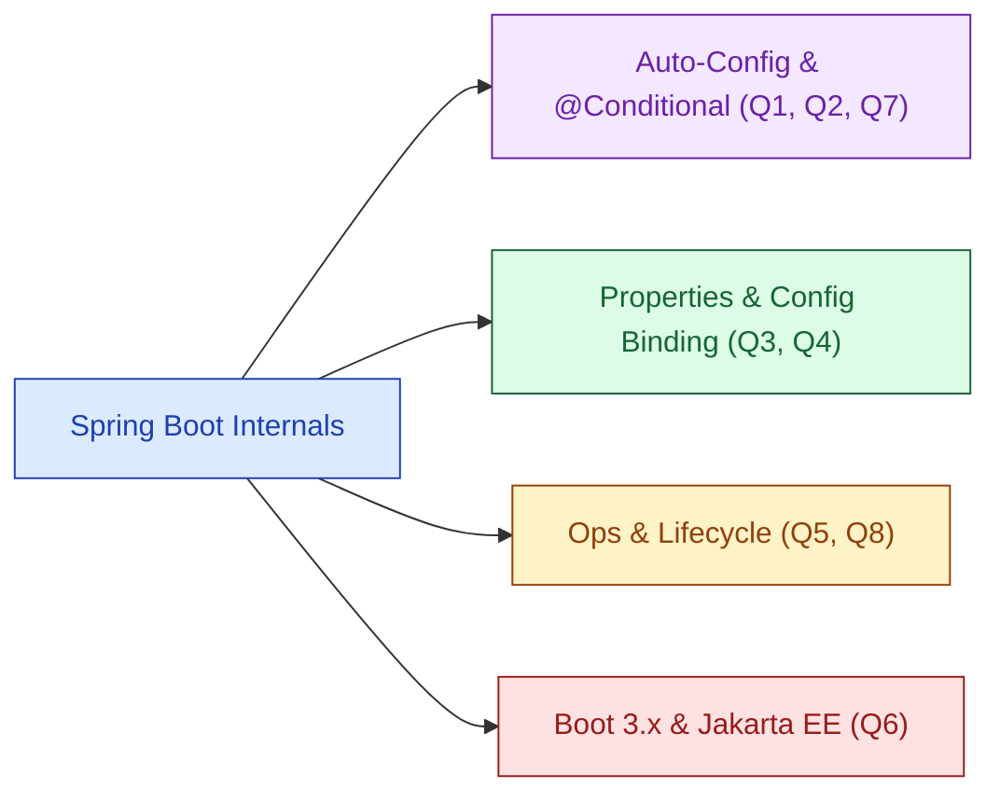

### Q1: Explain how Spring Boot auto-configuration works.

**Answer:**
1. `@SpringBootApplication` includes `@EnableAutoConfiguration`.
2. Spring loads candidate classes from `META-INF/spring/AutoConfiguration.imports` (or `spring.factories` in older versions).
3. For each auto-configuration class, Spring evaluates `@Conditional` annotations (`@ConditionalOnClass`, `@ConditionalOnMissingBean`, `@ConditionalOnProperty`, etc.).
4. Only configurations that pass all conditions are registered.
5. User-defined beans take precedence and prevent auto-configuration.

This allows Spring Boot to intelligently provide sensible defaults based on the classpath and properties, which users can override.

### Q2: What's the difference between `@SpringBootApplication` and `@Configuration`?

**Answer:**
- `@SpringBootApplication` = `@Configuration` + `@EnableAutoConfiguration` + `@ComponentScan`.
- `@Configuration` alone doesn't enable auto-configuration or component scanning.
- Use `@SpringBootApplication` for the main application class; use `@Configuration` for additional configuration classes.

### Q3: How do property sources work in Spring Boot?

**Answer:**
Spring resolves properties using a strict priority order (17 levels). Higher-priority sources override lower-priority ones:
1. Command-line arguments override everything (except test sources)
2. Environment variables
3. `application-{profile}.yml` / `.properties`
4. `application.yml` / `.properties`
5. System properties
6. `@PropertySource` annotations
7. Default values

Within the same source, profile-specific files (`application-prod.yml`) override the base file (`application.yml`).

### Q4: When should you use `@ConfigurationProperties` vs `@Value`?

**Answer:**
- **`@ConfigurationProperties`**: For mapping entire configuration objects with hierarchical structure. Provides type safety, validation support, and IDE hints.
- **`@Value`**: For injecting individual properties. Simple, but lacks type safety and validation.

Prefer `@ConfigurationProperties` for application configuration; use `@Value` for occasional property injection.

### Q5: How does graceful shutdown work in Spring Boot?

**Answer:**
With `server.shutdown=graceful`:
1. Tomcat/servlet container stops accepting new requests.
2. Existing requests are allowed to complete (up to `timeout-per-shutdown-phase`, default `30s`).
3. After timeout or once all requests complete, beans are destroyed.
4. Application exits.

This prevents data loss or corrupt requests when the application is stopped (e.g., during deployment).

### Q6: What are the main differences between Spring Boot 2.x and 3.x?

**Answer:**
- **Java 17+** required (was Java 8+)
- **Jakarta EE** (`jakarta.*`) instead of Java EE (`javax.*`)
- **Spring 6.x** (was 5.x)
- **Native compilation** support with GraalVM
- **Observability** improvements with Micrometer
- All `javax.*` imports must be changed to `jakarta.*`

Migration requires updating imports and dependencies, while core functionality remains similar.

### Q7: How do you create a custom Spring Boot starter?

**Answer:**
1. Create a separate Maven project with an auto-configuration class.
2. Register it in `META-INF/spring/AutoConfiguration.imports`.
3. Add a `@ConfigurationProperties` class for configuration.
4. Create a starter parent POM that includes the implementation and auto-configuration.
5. Users add one dependency and auto-configuration runs automatically.

This allows sharing configuration and beans across multiple projects.

### Q8: Explain Spring Boot Actuator endpoints and their security.

**Answer:**
Actuator provides production-ready endpoints (`health`, `metrics`, `loggers`, etc.) for monitoring:
- By default, only `/actuator/health` is exposed.
- Other endpoints are disabled/unexposed by default; enable with `management.endpoints.web.exposure.include`.
- Secure with Spring Security (`@Configuration` + `SecurityFilterChain`).
- Implement custom `HealthIndicator` for domain-specific health checks, and custom endpoints with `@Endpoint` annotations.
