# Spring Web and REST API Development - Deep Dive

## Table of Contents
1. [DispatcherServlet Architecture](#dispatcherservlet-architecture)
2. [@RestController vs @Controller](#restcontroller-vs-controller)
3. [Request Mapping and Binding](#request-mapping-and-binding)
4. [Content Negotiation](#content-negotiation)
5. [Exception Handling](#exception-handling)
6. [Validation](#validation)
7. [Pagination and Sorting](#pagination-and-sorting)
8. [HATEOAS Basics](#hateoas-basics)
9. [File Upload/Download](#file-uploaddownload)
10. [WebClient vs RestTemplate](#webclient-vs-resttemplate)
11. [Filters vs Interceptors vs AOP](#filters-vs-interceptors-vs-aop)
12. [CORS Configuration](#cors-configuration)
13. [API Versioning](#api-versioning)
14. [Rate Limiting](#rate-limiting)
15. [Interview Questions](#interview-questions)

---

## DispatcherServlet Architecture

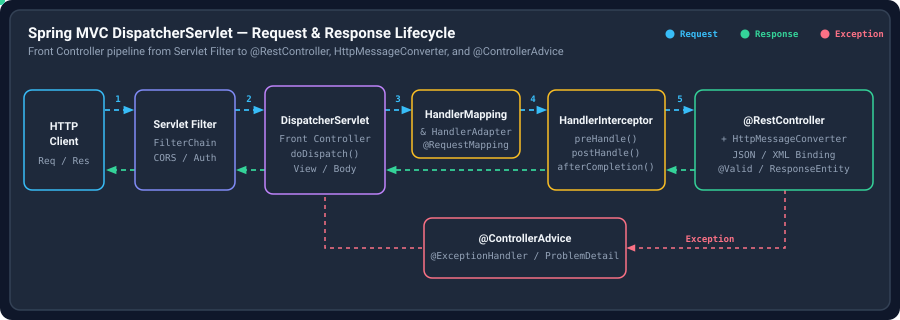

`DispatcherServlet` implements the **Front Controller** pattern, acting as the single entry point that coordinates routing, parameter binding, interception, execution, and response rendering in Spring MVC.

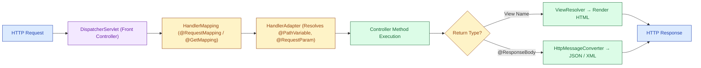

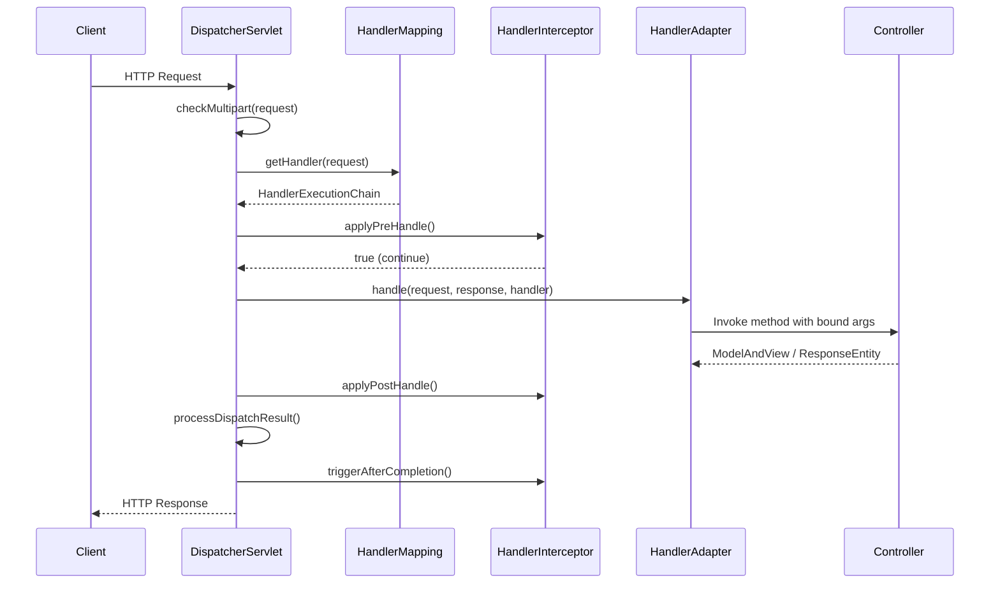

| Step | Component | Responsibility |
| :--- | :--- | :--- |
| **1** | `checkMultipart()` | Wraps multipart form-data requests for file uploads |
| **2** | `HandlerMapping` | Matches URL + HTTP method to a `HandlerExecutionChain` |
| **3** | `HandlerAdapter` | Resolves method arguments (`@PathVariable`, `@RequestParam`, `@RequestBody`) |
| **4** | `HandlerInterceptor` | Runs `preHandle()`, `postHandle()`, and `afterCompletion()` hooks |
| **5** | `ViewResolver` / `HttpMessageConverter` | Renders HTML templates or serializes objects to JSON/XML |

> [!NOTE]
> If `preHandle()` returns `false`, `DispatcherServlet` short-circuits immediately without invoking the controller or `postHandle()`.

### Complete DispatcherServlet Flow

```java
// DispatcherServlet processes request
public class DispatcherServlet extends FrameworkServlet {

    protected void doDispatch(HttpServletRequest request, HttpServletResponse response) {
        // 1. Check for multipart form data
        HttpServletRequest processedRequest = checkMultipart(request);

        // 2. Determine handler for this request
        HandlerExecutionChain mappedHandler = getHandler(processedRequest);

        // 3. Get adapter for handler
        HandlerAdapter ha = getHandlerAdapter(mappedHandler.getHandler());

        // 4. Handle OPTIONS request
        if (HttpMethod.OPTIONS.matches(request.getMethod())) {
            handleOptionsRequest(response);
            return;
        }

        // 5. Apply interceptor preHandle
        if (!mappedHandler.applyPreHandle(processedRequest, response)) {
            return;
        }

        // 6. Execute handler (controller method)
        ModelAndView mv = ha.handle(processedRequest, response, mappedHandler.getHandler());

        // 7. Apply interceptor postHandle
        mappedHandler.applyPostHandle(processedRequest, response, mv);

        // 8. Process view or response
        processDispatchResult(processedRequest, response, mappedHandler, mv, null);
    }

    private void processDispatchResult(HttpServletRequest request,
                                      HttpServletResponse response,
                                      HandlerExecutionChain mappedHandler,
                                      ModelAndView mv,
                                      Exception exception) {

        boolean errorView = false;
        if (exception != null) {
            // Handle exceptions
        }

        if (mv != null && !mv.wasCleared()) {
            // Resolve and render view
            render(mv.getModelMap(), request, response);
        }

        if (mappedHandler != null) {
            mappedHandler.triggerAfterCompletion(request, response, null);
        }
    }
}
```

### Practical Example: Request Processing

```java
@RestController
@RequestMapping("/api/users")
public class UserController {
    private final UserService userService;

    public UserController(UserService userService) {
        this.userService = userService;
    }

    @GetMapping("/{id}")
    public ResponseEntity<UserDTO> getUser(@PathVariable Long id) {
        // DispatcherServlet flow:
        // 1. Maps /api/users/123 → this method
        // 2. Resolves @PathVariable id=123
        // 3. Calls userService.findById(123)
        // 4. Returns UserDTO
        // 5. Converts to JSON (because @RestController + ResponseEntity)
        // 6. Sends HTTP 200 with JSON body

        User user = userService.findById(id)
            .orElseThrow(() -> new UserNotFoundException("User not found"));
        return ResponseEntity.ok(new UserDTO(user));
    }
}

// Request: GET /api/users/123
// Response: HTTP 200
// Body: {"id": 123, "name": "John", "email": "john@example.com"}
```

---

## @RestController vs @Controller

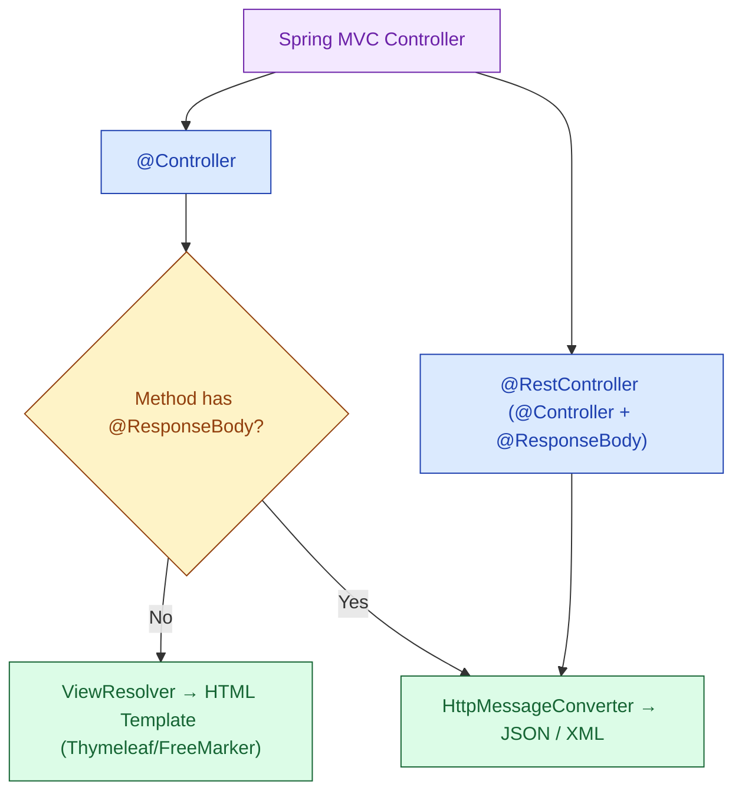

| Feature | `@Controller` | `@RestController` |
| :--- | :--- | :--- |
| **Composition** | Standard Spring MVC stereotype | `@Controller` + `@ResponseBody` |
| **Default Return** | View name (`String` resolved by `ViewResolver`) | Serialized data (JSON/XML via `HttpMessageConverter`) |
| **Template Engine** | Required (Thymeleaf, FreeMarker, JSP) | Not required |
| **Hybrid Usage** | Add `@ResponseBody` on specific methods for JSON | All methods automatically serialize return values |

> [!TIP]
> Use `ResponseEntity.created(URI).body(...)` for `POST` endpoints (`201 Created`) and `ResponseEntity.noContent().build()` for `DELETE` endpoints (`204 No Content`).

### @RestController

Combination of `@Controller` + `@ResponseBody`. All methods return data (JSON/XML), not views.

```java
@RestController  // @Controller + @ResponseBody
@RequestMapping("/api/products")
public class ProductRestController {
    private final ProductService productService;

    public ProductRestController(ProductService productService) {
        this.productService = productService;
    }

    // Returns JSON directly
    @GetMapping("/{id}")
    public Product getProduct(@PathVariable Long id) {
        // Automatically converted to JSON response
        return productService.findById(id)
            .orElseThrow(() -> new ProductNotFoundException());
    }

    @PostMapping
    public ResponseEntity<Product> createProduct(@RequestBody ProductRequest request) {
        Product created = productService.create(request);
        return ResponseEntity
            .created(URI.create("/api/products/" + created.getId()))
            .body(created);
    }

    @PutMapping("/{id}")
    public ResponseEntity<Product> updateProduct(
        @PathVariable Long id,
        @RequestBody ProductRequest request) {
        Product updated = productService.update(id, request);
        return ResponseEntity.ok(updated);
    }

    @DeleteMapping("/{id}")
    public ResponseEntity<Void> deleteProduct(@PathVariable Long id) {
        productService.delete(id);
        return ResponseEntity.noContent().build();
    }
}

// HTTP Responses:
// GET /api/products/1 → 200 OK, JSON body
// POST /api/products → 201 Created, JSON body
// PUT /api/products/1 → 200 OK, JSON body
// DELETE /api/products/1 → 204 No Content
```

### @Controller

Returns view names (templates), not data. Requires template engine (Thymeleaf, FreeMarker).

```java
@Controller  // NOT @RestController
@RequestMapping("/products")
public class ProductViewController {
    private final ProductService productService;

    public ProductViewController(ProductService productService) {
        this.productService = productService;
    }

    @GetMapping
    public String listProducts(Model model) {
        // Returns view name, not data
        model.addAttribute("products", productService.findAll());
        return "products/list";  // Resolves to products/list.html (Thymeleaf)
    }

    @GetMapping("/{id}")
    public String getProduct(@PathVariable Long id, Model model) {
        model.addAttribute("product", productService.findById(id)
            .orElseThrow(() -> new ProductNotFoundException()));
        return "products/detail";  // Resolves to products/detail.html
    }

    @PostMapping
    public String createProduct(@ModelAttribute ProductRequest request, RedirectAttributes redirectAttrs) {
        Product created = productService.create(request);
        redirectAttrs.addFlashAttribute("message", "Product created successfully");
        return "redirect:/products/" + created.getId();  // Redirect to detail view
    }
}

// If you need to return JSON from @Controller, use @ResponseBody on method
@Controller
public class HybridController {
    @GetMapping("/api/data")
    @ResponseBody  // This method returns JSON
    public Data getData() {
        return new Data();
    }

    @GetMapping("/view")
    public String getView() {  // No @ResponseBody, returns view
        return "view-name";
    }
}
```

---

## Request Mapping and Binding

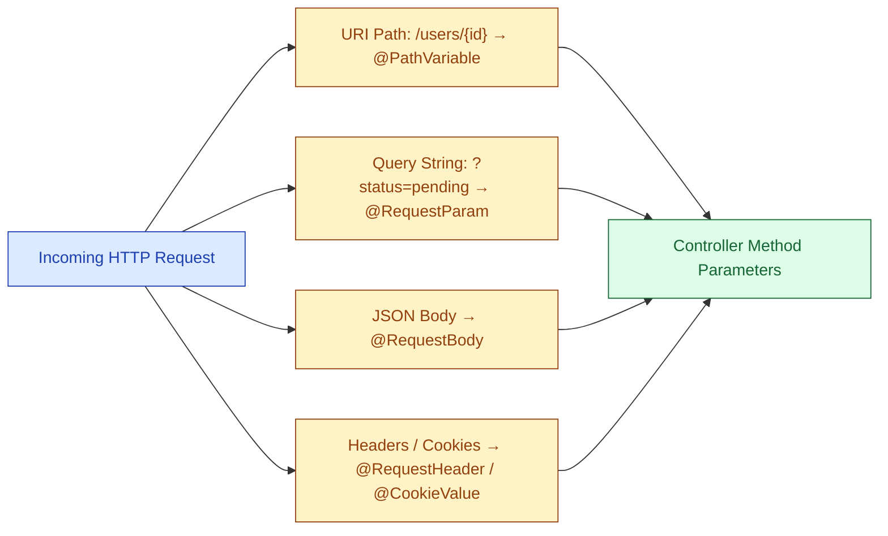

| Annotation | Source | Typical Use Case |
| :--- | :--- | :--- |
| `@PathVariable` | URI template (`/users/{id}`) | Identifying specific resources or hierarchy |
| `@RequestParam` | Query string (`?page=0&size=20`) | Filtering, searching, pagination with `defaultValue` |
| `@RequestBody` | HTTP body (JSON/XML) | Creating (`POST`) or updating (`PUT`/`PATCH`) payloads |
| `@RequestHeader` | HTTP headers (`Authorization`) | Auth tokens, correlation IDs, API versions |
| `@CookieValue` | HTTP `Cookie` header | Session IDs or client preferences |

> [!NOTE]
> Use `@PathVariable` for hierarchical resource identity (`/api/users/123/orders/456`) and `@RequestParam` for optional filters, sorting, and pagination.

### @GetMapping / @PostMapping / @PutMapping / @DeleteMapping

```java
@RestController
@RequestMapping("/api/orders")
public class OrderController {
    private final OrderService orderService;

    public OrderController(OrderService orderService) {
        this.orderService = orderService;
    }

    // GET /api/orders?status=pending&limit=10
    @GetMapping
    public ResponseEntity<Page<Order>> listOrders(
        @RequestParam(defaultValue = "0") int page,
        @RequestParam(defaultValue = "20") int size,
        @RequestParam(required = false) String status) {

        Pageable pageable = PageRequest.of(page, size);
        Page<Order> orders = orderService.findOrders(status, pageable);
        return ResponseEntity.ok(orders);
    }

    // GET /api/orders/123
    @GetMapping("/{orderId}")
    public ResponseEntity<Order> getOrder(@PathVariable Long orderId) {
        Order order = orderService.findById(orderId)
            .orElseThrow(() -> new OrderNotFoundException());
        return ResponseEntity.ok(order);
    }

    // POST /api/orders
    @PostMapping
    public ResponseEntity<Order> createOrder(@RequestBody OrderRequest request) {
        Order created = orderService.create(request);
        return ResponseEntity
            .created(URI.create("/api/orders/" + created.getId()))
            .body(created);
    }

    // PUT /api/orders/123
    @PutMapping("/{orderId}")
    public ResponseEntity<Order> updateOrder(
        @PathVariable Long orderId,
        @RequestBody OrderRequest request) {
        Order updated = orderService.update(orderId, request);
        return ResponseEntity.ok(updated);
    }

    // PATCH /api/orders/123/cancel
    @PatchMapping("/{orderId}/cancel")
    public ResponseEntity<Order> cancelOrder(@PathVariable Long orderId) {
        Order cancelled = orderService.cancel(orderId);
        return ResponseEntity.ok(cancelled);
    }

    // DELETE /api/orders/123
    @DeleteMapping("/{orderId}")
    public ResponseEntity<Void> deleteOrder(@PathVariable Long orderId) {
        orderService.delete(orderId);
        return ResponseEntity.noContent().build();
    }
}
```

### Path Variables vs Query Parameters

```java
@RestController
@RequestMapping("/api")
public class SearchController {

    // PATH VARIABLE: Part of URI path, required
    // GET /api/users/123
    @GetMapping("/users/{userId}")
    public ResponseEntity<User> getUser(@PathVariable Long userId) {
        // userId = 123 (from path)
        return ResponseEntity.ok(userService.findById(userId));
    }

    // QUERY PARAMETER: Part of query string, optional with defaults
    // GET /api/search?query=spring&limit=10&offset=0
    @GetMapping("/search")
    public ResponseEntity<SearchResults> search(
        @RequestParam String query,
        @RequestParam(defaultValue = "10") int limit,
        @RequestParam(defaultValue = "0") int offset) {

        SearchResults results = searchService.search(query, limit, offset);
        return ResponseEntity.ok(results);
    }

    // PATH VARIABLE vs QUERY for resource hierarchy
    // Path: GET /api/users/123/orders/456   (User 123, Order 456)
    // Query: GET /api/orders?userId=123&id=456 (less clear relationship)

    @GetMapping("/users/{userId}/orders/{orderId}")
    public ResponseEntity<Order> getUserOrder(
        @PathVariable Long userId,
        @PathVariable Long orderId) {
        // Clear hierarchical relationship
        Order order = orderService.findByUserAndId(userId, orderId);
        return ResponseEntity.ok(order);
    }
}
```

### Request Headers and Cookies

```java
@RestController
@RequestMapping("/api")
public class HeaderController {

    @GetMapping("/data")
    public ResponseEntity<Data> getData(
        @RequestHeader("Authorization") String authToken,
        @RequestHeader(value = "X-Custom-Header", required = false) String customHeader,
        @CookieValue(value = "sessionId", required = false) String sessionId) {

        // Use headers and cookies
        validateAuth(authToken);

        Data data = new Data();
        return ResponseEntity.ok(data);
    }

    // Get all headers
    @GetMapping("/headers")
    public ResponseEntity<Map<String, String>> getHeaders(HttpServletRequest request) {
        Map<String, String> headers = new HashMap<>();

        Enumeration<String> headerNames = request.getHeaderNames();
        while (headerNames.hasMoreElements()) {
            String name = headerNames.nextElement();
            headers.put(name, request.getHeader(name));
        }

        return ResponseEntity.ok(headers);
    }

    // Set response headers and cookies
    @GetMapping("/with-cookie")
    public ResponseEntity<String> withCookie() {
        HttpHeaders headers = new HttpHeaders();
        headers.add("Set-Cookie", "sessionId=abc123; Path=/; HttpOnly");
        headers.add("X-Custom-Response", "custom-value");

        return new ResponseEntity<>("Success", headers, HttpStatus.OK);
    }
}
```

---

## Content Negotiation

Spring MVC determines the response representation format (JSON, XML, etc.) at runtime using `Accept` headers, URL suffixes, or configured defaults.

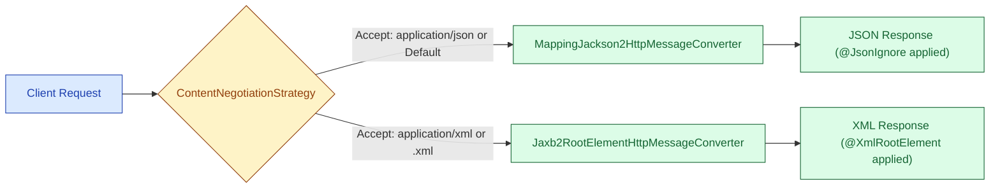

| Strategy | Example | Notes |
| :--- | :--- | :--- |
| **`Accept` Header** | `Accept: application/xml` | Standard REST approach; preferred in modern APIs |
| **URL Suffix** | `/api/products/1.xml` | Configured via `ContentNegotiationConfigurer.mediaType(...)` |
| **Default Media Type** | No `Accept` header | Falls back to `MediaType.APPLICATION_JSON` |

> [!TIP]
> `@JsonIgnore` excludes a field from JSON serialization while still allowing `@XmlElement` to include it in XML output.

### JSON vs XML Response

```java
@RestController
@RequestMapping("/api/products")
public class ProductNegotiationController {
    private final ProductService productService;

    public ProductNegotiationController(ProductService productService) {
        this.productService = productService;
    }

    // Returns JSON by default, XML if Accept: application/xml
    @GetMapping("/{id}")
    public ResponseEntity<Product> getProduct(@PathVariable Long id) {
        Product product = productService.findById(id);
        return ResponseEntity.ok(product);
    }
}

@Data
@AllArgsConstructor
@NoArgsConstructor
@XmlRootElement(name = "product")
public class Product {
    @XmlElement
    private Long id;

    @XmlElement
    private String name;

    @XmlElement
    private BigDecimal price;

    @JsonIgnore  // Ignored in JSON, but included in XML
    private String internalNotes;
}

// Configuration
@Configuration
public class ContentNegotiationConfig {
    @Bean
    public ContentNegotiationConfigurer contentNegotiationConfigurer() {
        return configurer -> configurer
            .defaultContentType(MediaType.APPLICATION_JSON)
            .mediaType("json", MediaType.APPLICATION_JSON)
            .mediaType("xml", MediaType.APPLICATION_XML);
    }
}

// Usage:
// GET /api/products/1 (no Accept header) → JSON
// GET /api/products/1 with Accept: application/json → JSON
// GET /api/products/1 with Accept: application/xml → XML
// GET /api/products/1.json → JSON (URL suffix)
// GET /api/products/1.xml → XML (URL suffix)
```

---

## Exception Handling

Centralized exception handling with `@ControllerAdvice` and `@ExceptionHandler` keeps controllers clean and guarantees consistent error payloads across the API.

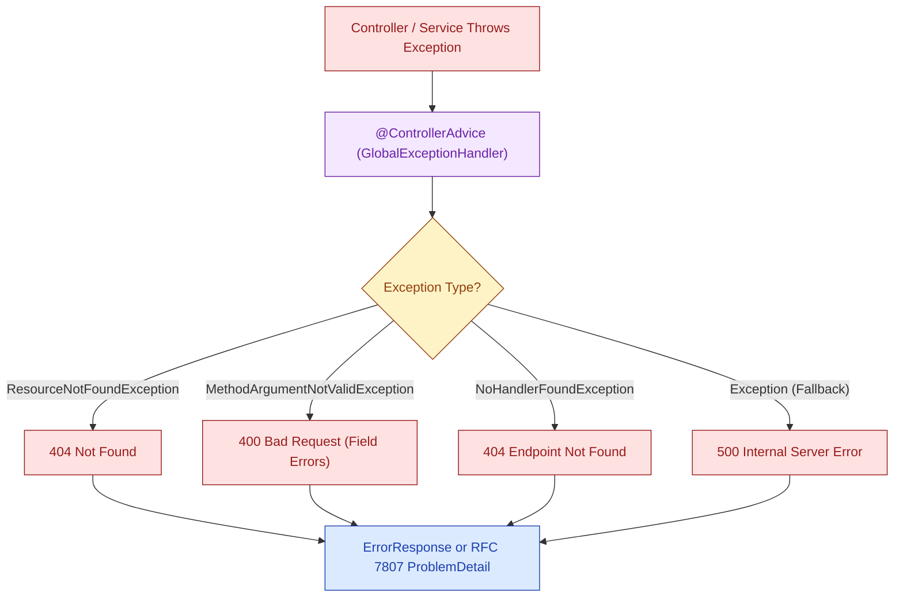

| Approach | Standard | Key Fields |
| :--- | :--- | :--- |
| **Custom `ErrorResponse`** | Custom DTO | `status`, `message`, `timestamp`, `path`, optional `errors` map |
| **`ProblemDetail`** | RFC 7807 (Spring Boot 3.x) | `type`, `title`, `status`, `detail`, `instance`, custom properties via `setProperty()` |

> [!IMPORTANT]
> Extending `ResponseEntityExceptionHandler` gives you built-in hooks like `handleMethodArgumentNotValid` and `handleNoHandlerFoundException` so Spring MVC exceptions follow your global error format.

### @ExceptionHandler and @ControllerAdvice

```java
@Data
@AllArgsConstructor
public class ErrorResponse {
    private int status;
    private String message;
    private String timestamp;
    private String path;
}

@ControllerAdvice  // Global exception handler
public class GlobalExceptionHandler extends ResponseEntityExceptionHandler {
    private static final Logger logger = LoggerFactory.getLogger(GlobalExceptionHandler.class);

    // Handle custom exceptions
    @ExceptionHandler(ResourceNotFoundException.class)
    public ResponseEntity<ErrorResponse> handleResourceNotFound(
        ResourceNotFoundException ex,
        HttpServletRequest request) {

        ErrorResponse error = new ErrorResponse(
            HttpStatus.NOT_FOUND.value(),
            ex.getMessage(),
            LocalDateTime.now().toString(),
            request.getRequestURI()
        );

        return ResponseEntity.status(HttpStatus.NOT_FOUND).body(error);
    }

    // Handle validation errors
    @Override
    protected ResponseEntity<Object> handleMethodArgumentNotValid(
        MethodArgumentNotValidException ex,
        HttpHeaders headers,
        HttpStatusCode status,
        WebRequest request) {

        Map<String, Object> body = new HashMap<>();
        body.put("status", status.value());
        body.put("message", "Validation error");
        body.put("timestamp", LocalDateTime.now());

        Map<String, String> errors = new HashMap<>();
        ex.getBindingResult().getAllErrors().forEach((error) -> {
            String fieldName = ((FieldError) error).getField();
            String errorMessage = error.getDefaultMessage();
            errors.put(fieldName, errorMessage);
        });
        body.put("errors", errors);

        return new ResponseEntity<>(body, HttpStatus.BAD_REQUEST);
    }

    // Handle general exceptions
    @ExceptionHandler(Exception.class)
    public ResponseEntity<ErrorResponse> handleGenericException(
        Exception ex,
        HttpServletRequest request) {

        logger.error("Unhandled exception", ex);

        ErrorResponse error = new ErrorResponse(
            HttpStatus.INTERNAL_SERVER_ERROR.value(),
            "Internal server error",
            LocalDateTime.now().toString(),
            request.getRequestURI()
        );

        return ResponseEntity.status(HttpStatus.INTERNAL_SERVER_ERROR).body(error);
    }

    // Handle HTTP 404 Not Found
    @Override
    protected ResponseEntity<Object> handleNoHandlerFoundException(
        NoHandlerFoundException ex,
        HttpHeaders headers,
        HttpStatusCode status,
        WebRequest request) {

        Map<String, Object> body = new HashMap<>();
        body.put("status", 404);
        body.put("message", "Endpoint not found");
        body.put("path", ex.getRequestURL());

        return new ResponseEntity<>(body, HttpStatus.NOT_FOUND);
    }
}

// Custom exceptions
public class ResourceNotFoundException extends RuntimeException {
    public ResourceNotFoundException(String message) {
        super(message);
    }
}

public class ValidationException extends RuntimeException {
    public ValidationException(String message) {
        super(message);
    }
}
```

### ProblemDetail (RFC 7807)

Spring Boot 3.x supports RFC 7807 Problem Details:

```java
@ControllerAdvice
public class ProblemDetailExceptionHandler {

    @ExceptionHandler(ResourceNotFoundException.class)
    public ResponseEntity<ProblemDetail> handleResourceNotFound(
        ResourceNotFoundException ex) {

        ProblemDetail problemDetail = ProblemDetail.forStatusAndDetail(
            HttpStatus.NOT_FOUND,
            ex.getMessage()
        );

        problemDetail.setType(URI.create("https://api.example.com/errors/resource-not-found"));
        problemDetail.setTitle("Resource Not Found");
        problemDetail.setProperty("errorCode", "ERR_001");

        return ResponseEntity.status(HttpStatus.NOT_FOUND).body(problemDetail);
    }

    @ExceptionHandler(IllegalArgumentException.class)
    public ResponseEntity<ProblemDetail> handleIllegalArgument(
        IllegalArgumentException ex) {

        ProblemDetail problemDetail = ProblemDetail.forStatusAndDetail(
            HttpStatus.BAD_REQUEST,
            ex.getMessage()
        );

        return ResponseEntity.status(HttpStatus.BAD_REQUEST).body(problemDetail);
    }
}

// Response:
/*
{
  "type": "https://api.example.com/errors/resource-not-found",
  "title": "Resource Not Found",
  "status": 404,
  "detail": "User with id 123 not found",
  "instance": "/api/users/123",
  "errorCode": "ERR_001"
}
*/
```

---

## Validation

Bean Validation (`jakarta.validation`) enforces structural, custom, and group-based constraints before business logic executes.

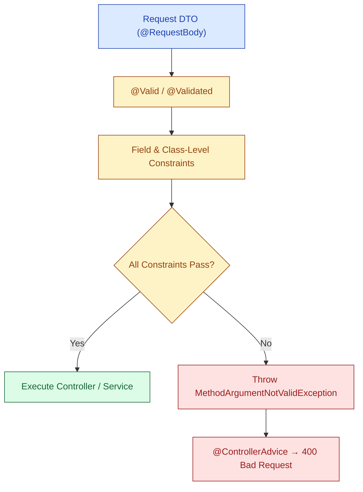

| Mechanism | Target | Purpose |
| :--- | :--- | :--- |
| **Built-in Annotations** | Fields (`@NotBlank`, `@Positive`, `@Email`, `@Pattern`, `@Future`) | Standard single-field constraints |
| **Custom Field Validator** | `@Constraint` + `ConstraintValidator&lt;A, T&gt;` | Domain-specific rules (e.g., `@ValidPhoneNumber`) |
| **Cross-Field Validator** | `ElementType.TYPE` + `ConstraintValidator&lt;A, Object&gt;` | Comparing multiple fields (e.g., `@PasswordMatch`) |
| **Validation Groups** | `@Validated(CreateUserGroup.class)` | Applying different rules for create vs update |

> [!WARNING]
> Standard `@Valid` does not support validation groups—use Spring's `@Validated(GroupClass.class)` on the class or method when you need group-specific validation.

### @Valid and @Validated

```java
@Data
@NoArgsConstructor
@AllArgsConstructor
public class OrderRequest {
    @NotBlank(message = "Order ID is required")
    private String orderId;

    @NotEmpty(message = "Items list cannot be empty")
    private List<OrderItem> items;

    @Positive(message = "Total must be greater than 0")
    private BigDecimal total;

    @Email(message = "Email must be valid")
    private String customerEmail;

    @Min(value = 18, message = "Customer age must be at least 18")
    @Max(value = 120, message = "Customer age must be at most 120")
    private int customerAge;

    @Pattern(regexp = "^[A-Z]{2}\\d{9}$", message = "Invalid passport format")
    private String passport;

    @Future(message = "Delivery date must be in the future")
    private LocalDate deliveryDate;

    @NotNull(message = "Payment method is required")
    private PaymentMethod paymentMethod;
}

@RestController
@RequestMapping("/api/orders")
public class OrderController {
    private final OrderService orderService;

    public OrderController(OrderService orderService) {
        this.orderService = orderService;
    }

    // @Valid triggers validation
    @PostMapping
    public ResponseEntity<Order> createOrder(@Valid @RequestBody OrderRequest request) {
        // If validation fails, MethodArgumentNotValidException is thrown
        Order order = orderService.create(request);
        return ResponseEntity.status(HttpStatus.CREATED).body(order);
    }
}

// Request with validation error:
/*
POST /api/orders
{
  "orderId": "",
  "items": [],
  "total": -100,
  "customerEmail": "invalid-email"
}

Response: 400 Bad Request
{
  "status": 400,
  "message": "Validation error",
  "errors": {
    "orderId": "Order ID is required",
    "items": "Items list cannot be empty",
    "total": "Total must be greater than 0",
    "customerEmail": "Email must be valid"
  }
}
*/
```

### Custom Validators

```java
@Target(ElementType.FIELD)
@Retention(RetentionPolicy.RUNTIME)
@Constraint(validatedBy = PhoneNumberValidator.class)
public @interface ValidPhoneNumber {
    String message() default "Invalid phone number";

    Class<?>[] groups() default {};

    Class<? extends Payload>[] payload() default {};
}

public class PhoneNumberValidator implements ConstraintValidator<ValidPhoneNumber, String> {
    @Override
    public boolean isValid(String value, ConstraintValidatorContext context) {
        if (value == null) {
            return true;  // @NotNull handles null
        }
        // US phone number format
        return value.matches("^\\+1?\\d{10}$");
    }
}

// Usage
@Data
public class UserRequest {
    @ValidPhoneNumber
    private String phoneNumber;
}

// Cross-field validation
@Target(ElementType.TYPE)
@Retention(RetentionPolicy.RUNTIME)
@Constraint(validatedBy = PasswordMatchValidator.class)
public @interface PasswordMatch {
    String message() default "Passwords do not match";

    Class<?>[] groups() default {};

    Class<? extends Payload>[] payload() default {};
}

public class PasswordMatchValidator implements ConstraintValidator<PasswordMatch, Object> {
    @Override
    public boolean isValid(Object obj, ConstraintValidatorContext context) {
        if (!(obj instanceof UserRegistration)) {
            return true;
        }

        UserRegistration user = (UserRegistration) obj;
        boolean valid = user.getPassword().equals(user.getConfirmPassword());

        if (!valid) {
            context.disableDefaultConstraintViolation();
            context.buildConstraintViolationWithTemplate("Passwords do not match")
                .addPropertyNode("confirmPassword")
                .addConstraintViolation();
        }

        return valid;
    }
}

@PasswordMatch
@Data
public class UserRegistration {
    @NotBlank
    private String username;

    @NotBlank
    @Size(min = 8)
    private String password;

    @NotBlank
    private String confirmPassword;
}
```

### Group Validation

```java
public interface CreateUserGroup {}
public interface UpdateUserGroup {}

@Data
public class UserRequest {
    @NotNull(groups = UpdateUserGroup.class, message = "ID required for update")
    private Long id;

    @NotBlank(groups = {CreateUserGroup.class, UpdateUserGroup.class})
    private String email;

    @NotBlank(groups = CreateUserGroup.class, message = "Password required for creation")
    @Null(groups = UpdateUserGroup.class, message = "Password cannot be changed here")
    private String password;
}

@Service
@Validated
public class UserService {
    // Validates with CreateUserGroup constraints
    @Validated(CreateUserGroup.class)
    public User createUser(@Valid UserRequest request) {
        return new User(request.getEmail());
    }

    // Validates with UpdateUserGroup constraints
    @Validated(UpdateUserGroup.class)
    public User updateUser(@Valid UserRequest request) {
        return new User(request.getEmail());
    }
}
```

---

## Pagination and Sorting

Spring Data's `Pageable` abstraction binds `page`, `size`, and `sort` query parameters directly into database queries and returns `Page<T>` with pagination metadata.

```mermaid
flowchart LR
    A["GET ?page=0&amp;size=20&amp;sort=price,desc"] --> B["Pageable / PageRequest"]
    B --> C["JpaRepository.findAll(pageable)"]
    C --> D["Page&lt;Product&gt;"]
    D --> E["products.map(ProductDTO::from)"]
    E --> F["JSON: content + totalPages + totalElements"]

    classDef blue fill:#dbeafe,stroke:#1e40af,color:#1e40af;
    classDef green fill:#dcfce7,stroke:#166534,color:#166534;
    classDef amber fill:#fef3c7,stroke:#92400e,color:#92400e;

    class A blue;
    class B,C amber;
    class D,E,F green;
```

| `Page<T>` Field | Meaning |
| :--- | :--- |
| `content` | List of items on the current page |
| `totalPages` | Total available pages based on `size` |
| `totalElements` | Total matching records in the database |
| `first` / `last` | Booleans indicating boundary pages |
| `numberOfElements` | Actual count of items in `content` |

> [!TIP]
> Use `page.map(ProductDTO::from)` to convert entities to DTOs while preserving all pagination metadata (`totalPages`, `totalElements`, `pageable`).

### Spring Data Pageable

```java
@RestController
@RequestMapping("/api/products")
public class ProductController {
    private final ProductService productService;

    public ProductController(ProductService productService) {
        this.productService = productService;
    }

    // GET /api/products?page=0&size=20&sort=price,desc&sort=name,asc
    @GetMapping
    public ResponseEntity<Page<ProductDTO>> listProducts(
        @ParameterObject Pageable pageable) {  // @ParameterObject from springdoc-openapi

        Page<Product> products = productService.findAll(pageable);
        Page<ProductDTO> dtos = products.map(ProductDTO::from);

        return ResponseEntity.ok(dtos);
    }

    // Custom sorting
    @GetMapping("/featured")
    public ResponseEntity<Page<ProductDTO>> listFeaturedProducts(
        @RequestParam(defaultValue = "0") int page,
        @RequestParam(defaultValue = "20") int size) {

        Sort sort = Sort.by(
            Sort.Order.desc("rating"),
            Sort.Order.asc("price")
        );
        Pageable pageable = PageRequest.of(page, size, sort);

        Page<Product> products = productService.findFeatured(pageable);
        Page<ProductDTO> dtos = products.map(ProductDTO::from);

        return ResponseEntity.ok(dtos);
    }
}

// Database query
@Repository
public interface ProductRepository extends JpaRepository<Product, Long> {
    Page<Product> findAll(Pageable pageable);

    // Pageable allows dynamic sorting and pagination
    Page<Product> findByCategory(String category, Pageable pageable);
}

// Request:
// GET /api/products?page=0&size=20&sort=price,desc
//
// Response:
/*
{
  "content": [
    {"id": 1, "name": "Product 1", "price": 99.99},
    {"id": 2, "name": "Product 2", "price": 89.99}
  ],
  "pageable": {
    "pageNumber": 0,
    "pageSize": 20,
    "sort": {
      "sorted": true,
      "unsorted": false
    }
  },
  "totalPages": 5,
  "totalElements": 100,
  "first": true,
  "last": false,
  "numberOfElements": 20
}
*/
```

---

## HATEOAS Basics

HATEOAS (Hypermedia as the Engine of Application State) enriches REST responses with `_links` so clients can discover valid state transitions dynamically.

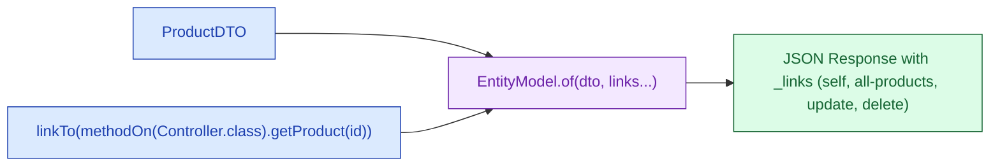

- **`EntityModel<T>`**: Wraps a single resource DTO with hypermedia links.
- **`CollectionModel<T>`**: Wraps a list of resources with collection-level links (e.g., `self`).
- **`linkTo(methodOn(...))`**: Generates type-safe URIs from controller methods, avoiding hardcoded URL strings.

> [!NOTE]
> `methodOn(...)` creates a dynamic proxy of the controller class—the method is not actually invoked; Spring HATEOAS inspects its `@RequestMapping` metadata to build the URL.

### Building Links

```java
@RestController
@RequestMapping("/api/products")
public class ProductHateoasController {
    private final ProductService productService;

    public ProductHateoasController(ProductService productService) {
        this.productService = productService;
    }

    @GetMapping("/{id}")
    public EntityModel<ProductDTO> getProduct(@PathVariable Long id) {
        Product product = productService.findById(id)
            .orElseThrow(() -> new ProductNotFoundException());

        ProductDTO dto = ProductDTO.from(product);

        // Add links
        EntityModel<ProductDTO> resource = EntityModel.of(dto,
            linkTo(methodOn(ProductHateoasController.class).getProduct(id))
                .withSelfRel(),
            linkTo(methodOn(ProductHateoasController.class).listProducts(null))
                .withRel("all-products"),
            linkTo(methodOn(ProductHateoasController.class).updateProduct(id, null))
                .withRel("update"),
            linkTo(methodOn(ProductHateoasController.class).deleteProduct(id))
                .withRel("delete")
        );

        return resource;
    }

    @GetMapping
    public CollectionModel<EntityModel<ProductDTO>> listProducts(Pageable pageable) {
        List<Product> products = productService.findAll(pageable).getContent();

        List<EntityModel<ProductDTO>> resources = products.stream()
            .map(product -> EntityModel.of(
                ProductDTO.from(product),
                linkTo(methodOn(ProductHateoasController.class)
                    .getProduct(product.getId()))
                    .withSelfRel()
            ))
            .collect(Collectors.toList());

        return CollectionModel.of(resources,
            linkTo(methodOn(ProductHateoasController.class).listProducts(pageable))
                .withSelfRel()
        );
    }

    @PutMapping("/{id}")
    public EntityModel<ProductDTO> updateProduct(
        @PathVariable Long id,
        @RequestBody ProductRequest request) {
        Product updated = productService.update(id, request);
        ProductDTO dto = ProductDTO.from(updated);

        return EntityModel.of(dto,
            linkTo(methodOn(ProductHateoasController.class).getProduct(id))
                .withSelfRel()
        );
    }

    @DeleteMapping("/{id}")
    public ResponseEntity<Void> deleteProduct(@PathVariable Long id) {
        productService.delete(id);
        return ResponseEntity.noContent().build();
    }
}

// Response:
/*
{
  "id": 1,
  "name": "Product 1",
  "price": 99.99,
  "_links": {
    "self": {
      "href": "http://localhost:8080/api/products/1"
    },
    "all-products": {
      "href": "http://localhost:8080/api/products"
    },
    "update": {
      "href": "http://localhost:8080/api/products/1"
    },
    "delete": {
      "href": "http://localhost:8080/api/products/1"
    }
  }
}
*/
```

---

## File Upload/Download

Spring MVC handles multipart uploads via `MultipartFile` and file downloads via `ByteArrayResource` (small files) or `InputStreamResource` (streaming large files).

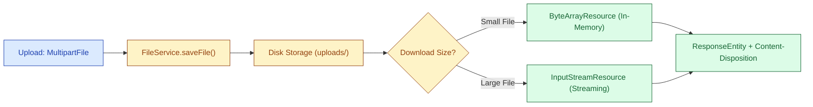

| Resource Type | Memory Profile | Best For |
| :--- | :--- | :--- |
| `ByteArrayResource` | Loads entire `byte[]` into heap | Small files (icons, config, short PDFs) |
| `InputStreamResource` | Streams chunks without buffering full file | Large files (videos, archives, backups) |

> [!WARNING]
> Always sanitize or UUID-prefix `file.getOriginalFilename()` and validate resolved paths against `uploadDir` to prevent path traversal attacks, and prefer `InputStreamResource` for large downloads to avoid `OutOfMemoryError`.

### File Upload

```java
@RestController
@RequestMapping("/api/files")
public class FileUploadController {
    private final FileService fileService;

    public FileUploadController(FileService fileService) {
        this.fileService = fileService;
    }

    @PostMapping("/upload")
    public ResponseEntity<FileDTO> uploadFile(@RequestParam("file") MultipartFile file) {
        if (file.isEmpty()) {
            return ResponseEntity.badRequest().build();
        }

        try {
            String fileName = fileService.saveFile(file);
            FileDTO dto = new FileDTO(fileName, file.getSize(), file.getContentType());
            return ResponseEntity.status(HttpStatus.CREATED).body(dto);
        } catch (IOException e) {
            return ResponseEntity.status(HttpStatus.INTERNAL_SERVER_ERROR).build();
        }
    }

    @PostMapping("/upload-multiple")
    public ResponseEntity<List<FileDTO>> uploadMultipleFiles(
        @RequestParam("files") MultipartFile[] files) {

        List<FileDTO> uploaded = new ArrayList<>();

        for (MultipartFile file : files) {
            try {
                String fileName = fileService.saveFile(file);
                uploaded.add(new FileDTO(fileName, file.getSize(), file.getContentType()));
            } catch (IOException e) {
                // Log and continue with other files
            }
        }

        return ResponseEntity.status(HttpStatus.CREATED).body(uploaded);
    }
}

@Service
public class FileService {
    private final Path uploadDir = Paths.get("uploads");

    @PostConstruct
    public void init() throws IOException {
        Files.createDirectories(uploadDir);
    }

    public String saveFile(MultipartFile file) throws IOException {
        String fileName = generateFileName(file.getOriginalFilename());
        Path filePath = uploadDir.resolve(fileName);

        Files.copy(file.getInputStream(), filePath, StandardCopyOption.REPLACE_EXISTING);

        return fileName;
    }

    private String generateFileName(String originalFileName) {
        return UUID.randomUUID().toString() + "-" + originalFileName;
    }
}
```

### File Download

```java
@RestController
@RequestMapping("/api/files")
public class FileDownloadController {
    private final FileService fileService;

    public FileDownloadController(FileService fileService) {
        this.fileService = fileService;
    }

    @GetMapping("/download/{fileName}")
    public ResponseEntity<ByteArrayResource> downloadFile(@PathVariable String fileName) {
        try {
            byte[] fileContent = fileService.getFile(fileName);

            ByteArrayResource resource = new ByteArrayResource(fileContent);

            return ResponseEntity.ok()
                .contentType(MediaType.APPLICATION_OCTET_STREAM)
                .header(HttpHeaders.CONTENT_DISPOSITION,
                    "attachment; filename=\"" + fileName + "\"")
                .body(resource);

        } catch (IOException e) {
            return ResponseEntity.notFound().build();
        }
    }

    @GetMapping("/download-large/{fileName}")
    public ResponseEntity<InputStreamResource> downloadLargeFile(
        @PathVariable String fileName) throws IOException {

        InputStreamResource resource = new InputStreamResource(
            fileService.getFileInputStream(fileName)
        );

        return ResponseEntity.ok()
            .contentType(MediaType.APPLICATION_OCTET_STREAM)
            .contentLength(fileService.getFileSize(fileName))
            .header(HttpHeaders.CONTENT_DISPOSITION,
                "attachment; filename=\"" + fileName + "\"")
            .body(resource);
    }
}

@Service
public class FileService {
    private final Path uploadDir = Paths.get("uploads");

    public byte[] getFile(String fileName) throws IOException {
        Path filePath = uploadDir.resolve(fileName);
        return Files.readAllBytes(filePath);
    }

    public InputStream getFileInputStream(String fileName) throws IOException {
        Path filePath = uploadDir.resolve(fileName);
        return new FileInputStream(filePath.toFile());
    }

    public long getFileSize(String fileName) throws IOException {
        Path filePath = uploadDir.resolve(fileName);
        return Files.size(filePath);
    }
}
```

---

## WebClient vs RestTemplate

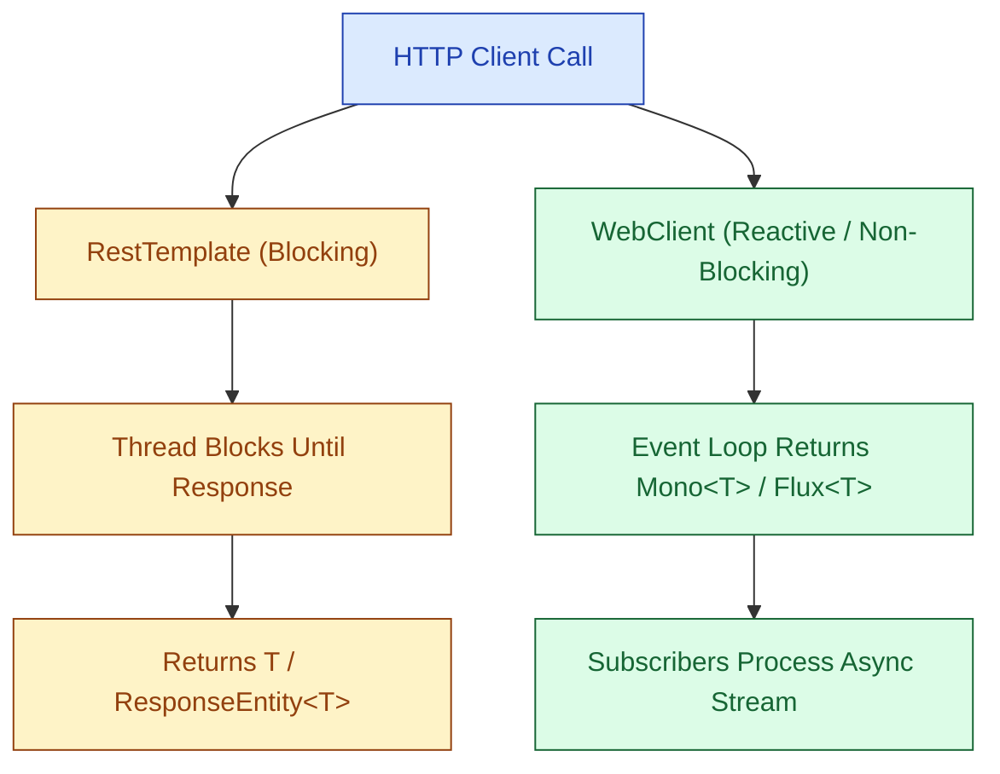

| Feature | `RestTemplate` | `WebClient` |
| :--- | :--- | :--- |
| **Execution Model** | Synchronous, blocking (one thread per request) | Asynchronous, non-blocking (reactive event loop) |
| **Return Types** | `T`, `ResponseEntity&lt;T&gt;` | `Mono&lt;T&gt;` (0..1), `Flux&lt;T&gt;` (0..N) |
| **Error Handling** | `RestClientException` / `@Retryable` | `.onStatus(...)`, `.onErrorResume(...)`, `.doOnError(...)` |
| **Status in Spring** | Maintenance mode | Recommended for new reactive &amp; non-blocking apps |

> [!IMPORTANT]
> `WebClient` is lazy—nothing is sent over the network until the returned `Mono` or `Flux` is subscribed to (e.g., returned from a Spring WebFlux/MVC controller or `.block()`ed).

### RestTemplate (Blocking)

```java
@Component
public class RestTemplateExample {
    private final RestTemplate restTemplate;

    public RestTemplateExample() {
        this.restTemplate = new RestTemplate();
    }

    public UserDTO getUser(Long userId) {
        String url = "https://api.example.com/users/{id}";

        // Blocking call - thread waits for response
        ResponseEntity<UserDTO> response = restTemplate.exchange(
            url,
            HttpMethod.GET,
            null,
            UserDTO.class,
            userId
        );

        return response.getBody();
    }

    public void postUser(UserDTO user) {
        String url = "https://api.example.com/users";

        restTemplate.postForLocation(url, user);
    }

    // Retry with backoff
    @Retryable(
        value = {RestClientException.class},
        maxAttempts = 3,
        backoff = @Backoff(delay = 1000)
    )
    public UserDTO getUserWithRetry(Long userId) {
        return getUser(userId);
    }
}
```

### WebClient (Reactive)

```java
@Configuration
public class WebClientConfig {
    @Bean
    public WebClient webClient() {
        return WebClient.builder()
            .baseUrl("https://api.example.com")
            .defaultHeader(HttpHeaders.CONTENT_TYPE, MediaType.APPLICATION_JSON_VALUE)
            .defaultHeader(HttpHeaders.USER_AGENT, "MyApp/1.0")
            .build();
    }
}

@Component
public class WebClientExample {
    private final WebClient webClient;

    public WebClientExample(WebClient webClient) {
        this.webClient = webClient;
    }

    // Non-blocking - returns Mono
    public Mono<UserDTO> getUser(Long userId) {
        return webClient
            .get()
            .uri("/users/{id}", userId)
            .retrieve()
            .bodyToMono(UserDTO.class);
    }

    // Non-blocking - returns Flux for multiple items
    public Flux<UserDTO> listUsers() {
        return webClient
            .get()
            .uri("/users")
            .retrieve()
            .bodyToFlux(UserDTO.class);
    }

    // POST with request body
    public Mono<UserDTO> createUser(UserRequest request) {
        return webClient
            .post()
            .uri("/users")
            .bodyValue(request)
            .retrieve()
            .bodyToMono(UserDTO.class);
    }

    // With error handling
    public Mono<UserDTO> getUserWithErrorHandling(Long userId) {
        return webClient
            .get()
            .uri("/users/{id}", userId)
            .retrieve()
            .onStatus(HttpStatus::is4xxClientError, response ->
                Mono.error(new ClientException("Client error"))
            )
            .onStatus(HttpStatus::is5xxServerError, response ->
                Mono.error(new ServerException("Server error"))
            )
            .bodyToMono(UserDTO.class)
            .doOnError(error -> System.err.println("Error: " + error.getMessage()));
    }
}

// Usage in controller
@RestController
@RequestMapping("/api")
public class UserController {
    private final WebClientExample webClientExample;

    public UserController(WebClientExample webClientExample) {
        this.webClientExample = webClientExample;
    }

    @GetMapping("/users/{id}")
    public Mono<ResponseEntity<UserDTO>> getUser(@PathVariable Long id) {
        return webClientExample.getUser(id)
            .map(ResponseEntity::ok)
            .onErrorResume(error -> Mono.just(ResponseEntity.notFound().build()));
    }
}
```

---

## Filters vs Interceptors vs AOP

```mermaid
flowchart LR
    A["HTTP Request"] --> B["Servlet Filter (Servlet Container)"]
    B --> C["DispatcherServlet"]
    C --> D["HandlerInterceptor (Spring MVC)"]
    D --> E["AOP @Around (Spring Bean Proxy)"]
    E --> F["Controller / Service Method"]

    classDef blue fill:#dbeafe,stroke:#1e40af,color:#1e40af;
    classDef green fill:#dcfce7,stroke:#166534,color:#166534;
    classDef amber fill:#fef3c7,stroke:#92400e,color:#92400e;
    classDef purple fill:#f3e8ff,stroke:#6b21a8,color:#6b21a8;

    class A blue;
    class B,D,E amber;
    class C purple;
    class F green;
```

### When to Use Each

| Layer | Scope | Use Case | Examples |
| :--- | :--- | :--- | :--- |
| **Filter** | Servlet-level (outside Spring MVC) | Raw HTTP processing, before Spring | CORS, Security headers, compression |
| **Interceptor** | Spring MVC-level (inside `DispatcherServlet`) | Spring MVC-specific logic with `handler` access | Request/response logging, authentication |
| **AOP** | Spring Bean method-level | Business logic cross-cutting concerns | Performance monitoring, caching, transactions |

> [!TIP]
> Choose the outermost layer that has the context you need: **Filters** for raw `ServletRequest`/`ServletResponse`, **Interceptors** when you need the mapped `HandlerMethod`, and **AOP** for service-layer method arguments and return values.

### Filters (Servlet-level)

Execute outside Spring context, closest to network layer:

```java
@Component
public class LoggingFilter implements Filter {
    private static final Logger logger = LoggerFactory.getLogger(LoggingFilter.class);

    @Override
    public void doFilter(ServletRequest request, ServletResponse response,
                         FilterChain chain) throws IOException, ServletException {

        HttpServletRequest httpRequest = (HttpServletRequest) request;
        HttpServletResponse httpResponse = (HttpServletResponse) response;

        long startTime = System.currentTimeMillis();

        logger.info("Filter: {} {}", httpRequest.getMethod(), httpRequest.getRequestURI());

        try {
            chain.doFilter(request, response);  // Continue filter chain
        } finally {
            long duration = System.currentTimeMillis() - startTime;
            logger.info("Response status: {}, Duration: {}ms",
                httpResponse.getStatus(), duration);
        }
    }
}

// OR Register as bean
@Configuration
public class FilterConfiguration {
    @Bean
    public FilterRegistrationBean<LoggingFilter> loggingFilter() {
        FilterRegistrationBean<LoggingFilter> registration = new FilterRegistrationBean<>();
        registration.setFilter(new LoggingFilter());
        registration.addUrlPatterns("/*");
        registration.setOrder(1);  // Filter order
        return registration;
    }
}
```

### Interceptors (Spring MVC-level)

Execute within Spring context:

```java
@Component
public class RequestResponseInterceptor implements HandlerInterceptor {
    private static final Logger logger = LoggerFactory.getLogger(RequestResponseInterceptor.class);

    @Override
    public boolean preHandle(HttpServletRequest request, HttpServletResponse response,
                            Object handler) throws Exception {
        logger.info("Interceptor preHandle: {}", request.getRequestURI());

        // Can return false to block request
        return true;
    }

    @Override
    public void postHandle(HttpServletRequest request, HttpServletResponse response,
                          Object handler, ModelAndView modelAndView) throws Exception {
        logger.info("Interceptor postHandle");
    }

    @Override
    public void afterCompletion(HttpServletRequest request, HttpServletResponse response,
                               Object handler, Exception ex) throws Exception {
        logger.info("Interceptor afterCompletion, Response status: {}", response.getStatus());
    }
}

@Configuration
public class InterceptorConfiguration implements WebMvcConfigurer {
    private final RequestResponseInterceptor interceptor;

    public InterceptorConfiguration(RequestResponseInterceptor interceptor) {
        this.interceptor = interceptor;
    }

    @Override
    public void addInterceptors(InterceptorRegistry registry) {
        registry.addInterceptor(interceptor)
            .addPathPatterns("/api/**")
            .excludePathPatterns("/api/public/**");
    }
}
```

### AOP (Method-level)

Execute at Spring bean method level:

```java
@Aspect
@Component
public class PerformanceAspect {
    private static final Logger logger = LoggerFactory.getLogger(PerformanceAspect.class);

    @Around("execution(* com.example.service..*(..))")
    public Object measurePerformance(ProceedingJoinPoint joinPoint) throws Throwable {
        String methodName = joinPoint.getSignature().getName();
        long startTime = System.currentTimeMillis();

        try {
            return joinPoint.proceed();  // Call actual method
        } finally {
            long duration = System.currentTimeMillis() - startTime;
            logger.info("Method {} executed in {}ms", methodName, duration);
        }
    }
}
```

---

## CORS Configuration

Cross-Origin Resource Sharing (CORS) allows browsers on one origin (`https://app.example.com`) to call APIs hosted on another origin, governed by preflight `OPTIONS` checks.

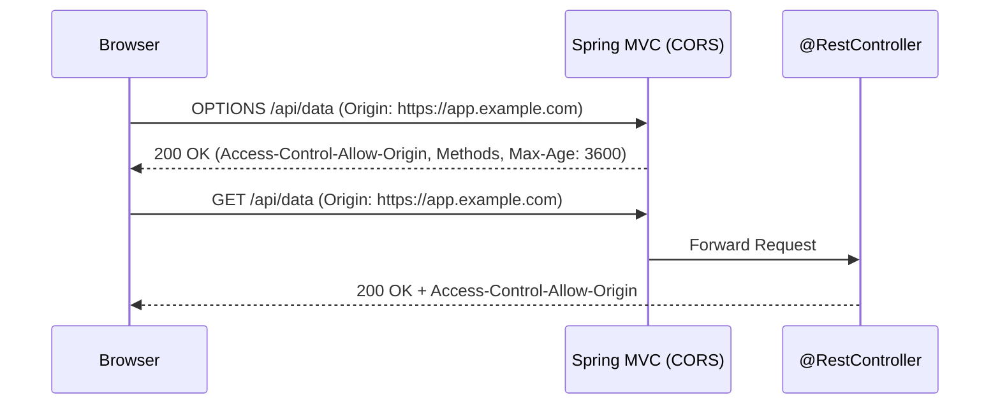

> [!WARNING]
> When `allowCredentials(true)` is set, `allowedOrigins` must list explicit origins (e.g., `https://example.com`) rather than a wildcard `*`.

```java
@Configuration
public class CorsConfiguration {

    @Bean
    public WebMvcConfigurer corsConfigurer() {
        return new WebMvcConfigurer() {
            @Override
            public void addCorsMappings(CorsRegistry registry) {
                registry.addMapping("/api/**")
                    .allowedOrigins("https://example.com", "https://app.example.com")
                    .allowedMethods("GET", "POST", "PUT", "DELETE", "OPTIONS")
                    .allowedHeaders("*")
                    .allowCredentials(true)
                    .maxAge(3600);  // Cache for 1 hour
            }
        };
    }
}

// OR per-controller
@RestController
@RequestMapping("/api/public")
@CrossOrigin(origins = "https://example.com", maxAge = 3600)
public class PublicController {
    @GetMapping("/data")
    public ResponseEntity<Data> getData() {
        return ResponseEntity.ok(new Data());
    }
}
```

---

## API Versioning

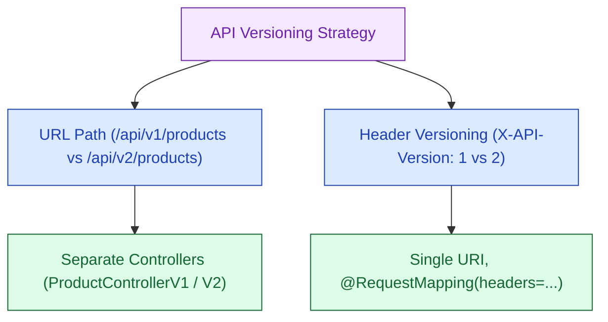

| Strategy | Pros | Cons |
| :--- | :--- | :--- |
| **URL Path Versioning** | Explicit, easy to cache and test in browsers | Pollutes URIs when resources evolve |
| **Header Versioning** | Clean, stable resource URIs | Harder to test in browsers; requires custom headers |

> [!NOTE]
> Both strategies can coexist in Spring MVC, but pick one convention per API surface to keep client integration predictable.

### URL Path Versioning

```java
@RestController
@RequestMapping("/api/v1/products")
public class ProductControllerV1 {
    // Version 1 endpoints
}

@RestController
@RequestMapping("/api/v2/products")
public class ProductControllerV2 {
    // Version 2 endpoints with different response structure
}
```

### Header Versioning

```java
@RestController
@RequestMapping("/api/products")
public class ProductController {

    @GetMapping
    @RequestMapping(headers = "X-API-Version=1")
    public ResponseEntity<ProductDTOV1> listV1() {
        return ResponseEntity.ok(new ProductDTOV1());
    }

    @GetMapping
    @RequestMapping(headers = "X-API-Version=2")
    public ResponseEntity<ProductDTOV2> listV2() {
        return ResponseEntity.ok(new ProductDTOV2());
    }
}

// Request: GET /api/products, Header: X-API-Version: 2
```

---

## Rate Limiting

Token-bucket rate limiting with **Bucket4j** inside a `HandlerInterceptor` protects API endpoints from burst traffic and abuse.

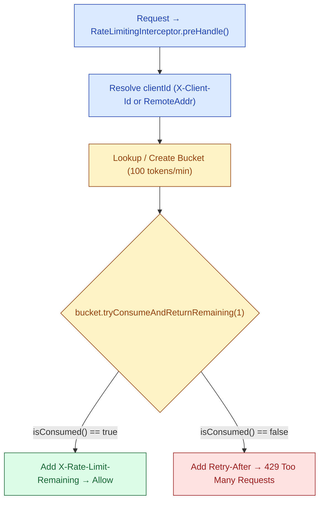

> [!TIP]
> A `ConcurrentHashMap<String, Bucket>` works for a single instance; for horizontally scaled microservices, back Bucket4j with a distributed store such as Redis.

### Bucket4j Implementation

```xml
<dependency>
    <groupId>com.github.vladimir-bukhtoyarov</groupId>
    <artifactId>bucket4j-core</artifactId>
    <version>7.6.0</version>
</dependency>
```

```java
@Component
public class RateLimitingInterceptor implements HandlerInterceptor {
    private final Map<String, Bucket> cache = new ConcurrentHashMap<>();

    @Override
    public boolean preHandle(HttpServletRequest request, HttpServletResponse response,
                            Object handler) throws Exception {

        String clientId = request.getHeader("X-Client-Id");
        if (clientId == null) {
            clientId = request.getRemoteAddr();
        }

        Bucket bucket = cache.computeIfAbsent(clientId, k -> createNewBucket());

        ConsumptionProbe probe = bucket.tryConsumeAndReturnRemaining(1);

        if (probe.isConsumed()) {
            response.addHeader("X-Rate-Limit-Remaining", String.valueOf(probe.getRemainingTokens()));
            return true;
        } else {
            long waitForRefill = TimeUnit.NANOSECONDS.toSeconds(probe.getRoundedSecondsToWait());
            response.addHeader("X-Rate-Limit-Retry-After-Seconds", String.valueOf(waitForRefill));
            response.sendError(HttpStatus.TOO_MANY_REQUESTS.value(), "Rate limit exceeded");
            return false;
        }
    }

    private Bucket createNewBucket() {
        Bandwidth limit = Bandwidth.classic(100, Refill.intervally(100, Duration.ofMinutes(1)));
        return Bucket4j.builder()
            .addLimit(limit)
            .build();
    }
}

@Configuration
public class RateLimitingConfiguration implements WebMvcConfigurer {
    private final RateLimitingInterceptor rateLimitingInterceptor;

    public RateLimitingConfiguration(RateLimitingInterceptor rateLimitingInterceptor) {
        this.rateLimitingInterceptor = rateLimitingInterceptor;
    }

    @Override
    public void addInterceptors(InterceptorRegistry registry) {
        registry.addInterceptor(rateLimitingInterceptor)
            .addPathPatterns("/api/**");
    }
}
```

---

## Interview Questions

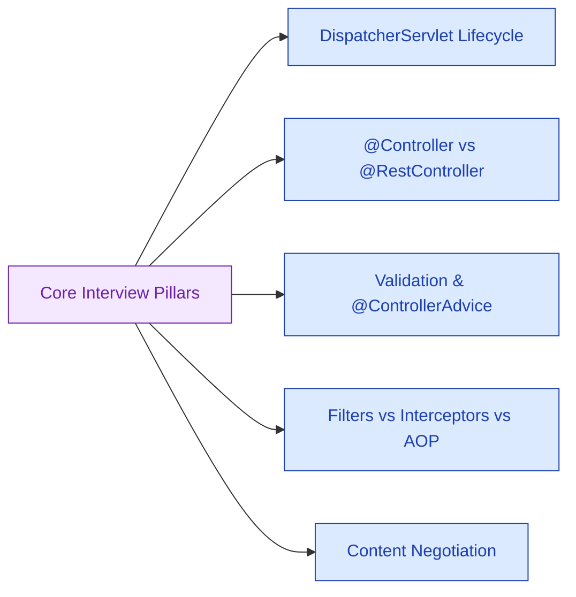

### Q1: Explain the complete flow of an HTTP request through DispatcherServlet.

**Answer:**
1. Client sends HTTP request
2. `DispatcherServlet` (front controller) receives it
3. `HandlerMapping` identifies matching controller method
4. `HandlerAdapter` resolves method parameters (`@PathVariable`, `@RequestParam`, etc.)
5. Controller method executes
6. Return value converted to response (JSON/XML/View)
7. Response sent to client

`DispatcherServlet` acts as central hub coordinating all components.

### Q2: When would you use @Controller vs @RestController?

**Answer:**
- `@Controller`: Returns view names (HTML templates). Use for traditional web applications
- `@RestController`: Returns data (JSON/XML). Use for REST APIs

They're identical to Spring except `@RestController` is `@Controller` + `@ResponseBody` on all methods.

### Q3: Explain validation in Spring MVC.

**Answer:**
- `@Valid` triggers validation on `@RequestBody`
- Validation errors raise `MethodArgumentNotValidException`
- Use `@ControllerAdvice` to handle exceptions globally
- Custom validators implement `ConstraintValidator`
- Group validation allows different validation rules for create vs update

### Q4: Difference between Filters, Interceptors, and AOP.

**Answer:**
- **Filters**: Servlet-level, outside Spring context, execute before/after `DispatcherServlet`
- **Interceptors**: Spring MVC-level, within Spring context, execute before/after controller
- **AOP**: Bean method-level, cross-cutting concerns like logging and transactions

Filters are closest to network; AOP is closest to business logic.

### Q5: How does content negotiation work in Spring?

**Answer:**
Spring can return different response formats (JSON, XML) based on:
- `Accept` HTTP header
- File extension (`.json`, `.xml`)
- `@RequestMapping(produces=...)`
- `ContentNegotiationConfigurer` configuration

Most commonly uses `Accept` header and `HttpMessageConverter` to convert response to appropriate format.

> [!TIP]
> When answering lifecycle questions, trace the exact order (`Filter` → `DispatcherServlet` → `HandlerMapping` → `HandlerInterceptor.preHandle` → `HandlerAdapter` → Controller → `HttpMessageConverter` / `@ControllerAdvice`) to demonstrate deep architectural clarity.
