# Spring Data and JPA - Deep Dive

## Table of Contents
1. [Spring Data Repository Hierarchy](#spring-data-repository-hierarchy)
2. [Entity Mapping](#entity-mapping)
3. [Relationships and Fetch Strategies](#relationships-and-fetch-strategies)
4. [N+1 Problem and Solutions](#n1-problem-and-solutions)
5. [JPQL and Native Queries](#jpql-and-native-queries)
6. [Specification and Criteria API](#specification-and-criteria-api)
7. [Auditing](#auditing)
8. [Transaction Management Deep Dive](#transaction-management-deep-dive)
9. [Connection Pooling](#connection-pooling)
10. [Database Migrations](#database-migrations)
11. [Multi-Datasource Configuration](#multi-datasource-configuration)
12. [Spring Data MongoDB](#spring-data-mongodb)
13. [Interview Questions](#interview-questions)

---

## Spring Data Repository Hierarchy

### Repository Interfaces

Spring Data provides a layered hierarchy of repository interfaces. Each layer adds more capabilities, from a marker interface up to full JPA batching and flushing.

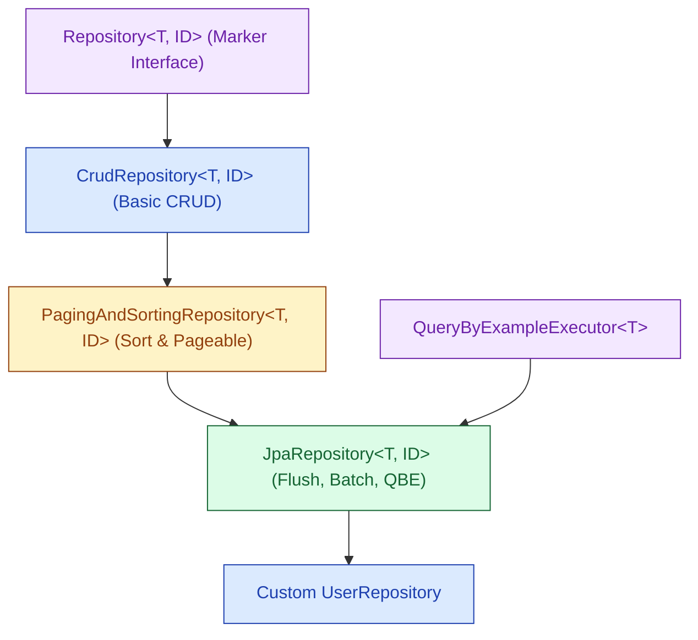

| Interface | Primary Responsibility | Return Types | Typical Use Case |
| :--- | :--- | :--- | :--- |
| `Repository<T, ID>` | Marker interface for Spring Data proxy generation | Custom | Expose only explicitly declared query methods |
| `CrudRepository<T, ID>` | Basic CRUD (`save`, `findById`, `delete`, `count`) | `Iterable<T>`, `Optional<T>` | Simple persistence without pagination or JPA specifics |
| `PagingAndSortingRepository<T, ID>` | Adds `Sort` and `Pageable` support | `Iterable<T>`, `Page<T>` | Paginated APIs and sorted queries |
| `JpaRepository<T, ID>` | Extends `PagingAndSorting` + `QueryByExampleExecutor` | `List<T>`, `Page<T>` | Standard JPA apps needing `flush()`, `saveAndFlush()`, batch deletes |

> [!TIP]
> Prefer `JpaRepository<T, ID>` for standard JPA applications because it returns `List<T>` instead of `Iterable<T>` and exposes `flush()`, `saveAndFlush()`, and batch deletion methods.

### CrudRepository: Basic CRUD Operations

```java
public interface CrudRepository<T, ID> extends Repository<T, ID> {
    <S extends T> S save(S entity);
    <S extends T> Iterable<S> saveAll(Iterable<S> entities);
    Optional<T> findById(ID id);
    boolean existsById(ID id);
    Iterable<T> findAll();
    Iterable<T> findAllById(Iterable<ID> ids);
    long count();
    void deleteById(ID id);
    void delete(T entity);
    void deleteAllById(Iterable<? extends ID> ids);
    void deleteAll(Iterable<? extends T> entities);
    void deleteAll();
}
```

### PagingAndSortingRepository: Pagination and Sorting

```java
public interface PagingAndSortingRepository<T, ID> extends CrudRepository<T, ID> {
    Iterable<T> findAll(Sort sort);
    Page<T> findAll(Pageable pageable);
}

// Usage
@Repository
public interface UserRepository extends PagingAndSortingRepository<User, Long> {
}

@Service
public class UserService {
    private final UserRepository userRepository;

    public UserService(UserRepository userRepository) {
        this.userRepository = userRepository;
    }

    public Page<User> getUsersPage(int page, int size, String sortBy) {
        // Create sort specification
        Sort sort = Sort.by(sortBy).descending();

        // Create pageable with page, size, and sort
        Pageable pageable = PageRequest.of(page, size, sort);

        // Returns Page with totalPages, totalElements, etc.
        return userRepository.findAll(pageable);
    }
}
```

### JpaRepository: JPA-Specific Features

```java
public interface JpaRepository<T, ID> extends PagingAndSortingRepository<T, ID>, QueryByExampleExecutor<T> {
    List<T> findAll();  // All results as list
    List<T> findAll(Sort sort);
    List<T> findAllById(Iterable<ID> ids);
    <S extends T> List<S> saveAll(Iterable<S> entities);
    void flush();  // Force write to database
    <S extends T> S saveAndFlush(S entity);
    <S extends T> List<S> saveAllAndFlush(Iterable<S> entities);
    void deleteInBatch(Iterable<T> entities);
    void deleteAllInBatch(Iterable<T> entities);
    void deleteAllByIdInBatch(Iterable<ID> ids);
    void deleteAllInBatch();
    T getById(ID id);  // Lazy load
    <S extends T> List<S> findAll(Example<S> example);
}

@Repository
public interface UserRepository extends JpaRepository<User, Long> {
    // Automatically provides all CRUD + pagination + flush operations
}
```

### Query Methods: Method Name Conventions

Spring Data parses method names at startup into JPQL queries using keywords such as `findBy`, `countBy`, `existsBy`, `deleteBy`, `And`, `Or`, `IgnoreCase`, `GreaterThan`, `Between`, `Before`, `Containing`, `StartingWith`, and `EndingWith`.

```java
@Repository
public interface UserRepository extends JpaRepository<User, Long> {

    // Derived query methods from method name
    List<User> findByEmail(String email);
    List<User> findByFirstName(String firstName);
    User findFirstByOrderByCreatedAtDesc();
    long countByEmailLike(String emailPattern);
    boolean existsByEmail(String email);
    void deleteByEmail(String email);

    // Complex queries
    List<User> findByFirstNameAndLastName(String firstName, String lastName);
    List<User> findByEmailOrPhoneNumber(String email, String phoneNumber);
    List<User> findByFirstNameIgnoreCase(String firstName);
    List<User> findByAgeGreaterThan(int age);
    List<User> findByAgeBetween(int minAge, int maxAge);
    List<User> findByCreatedAtBefore(LocalDateTime date);
    List<User> findByEmailContaining(String emailPart);
    List<User> findByEmailStartingWith(String prefix);
    List<User> findByEmailEndingWith(String suffix);

    // Pagination and sorting
    Page<User> findByEmailLike(String emailPattern, Pageable pageable);
    List<User> findByFirstName(String firstName, Sort sort);

    // Exists
    boolean existsByEmailAndFirstName(String email, String firstName);
}
```

---

## Entity Mapping

### Persistence Context & Entity Lifecycle

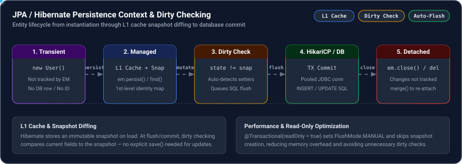

Hibernate's Persistence Context acts as the **L1 Cache** (identity map) for a single `EntityManager` / transaction. It tracks managed entities against load-time snapshots and automatically emits SQL during flush/commit via **dirty checking**.

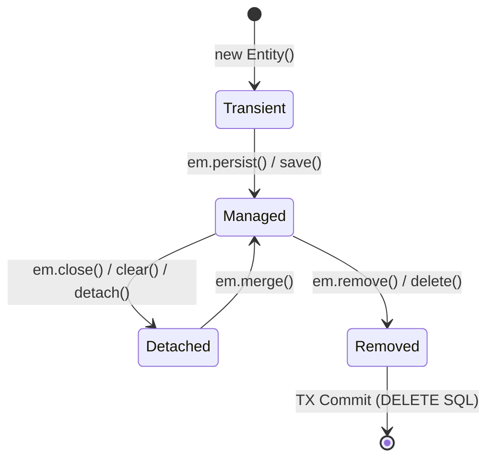

### Basic Entity Definition

- **`@Entity` & `@Table`**: Maps the class to a database table and defines indexes (`@Index`) for query performance.
- **`@Version`**: Enables optimistic locking by incrementing a version column on each update.
- **`@PrePersist` / `@PreUpdate`**: JPA lifecycle callbacks executed before `INSERT` and `UPDATE`.

```java
@Entity
@Table(name = "users", indexes = {
    @Index(columnList = "email", unique = true),
    @Index(columnList = "created_at")
})
public class User {
    @Id
    @GeneratedValue(strategy = GenerationType.IDENTITY)
    private Long id;

    @Column(name = "email", unique = true, nullable = false, length = 100)
    private String email;

    @Column(nullable = false)
    private String firstName;

    @Column(nullable = false)
    private String lastName;

    @Column(name = "age", nullable = true)
    private Integer age;

    @Column(name = "created_at", nullable = false, updatable = false)
    private LocalDateTime createdAt;

    @Column(name = "updated_at")
    private LocalDateTime updatedAt;

    @Column(columnDefinition = "VARCHAR(500)")
    private String bio;

    @Version  // Optimistic locking
    private Long version;

    @PrePersist
    protected void onCreate() {
        createdAt = LocalDateTime.now();
        updatedAt = LocalDateTime.now();
    }

    @PreUpdate
    protected void onUpdate() {
        updatedAt = LocalDateTime.now();
    }

    // Getters and setters
}
```

### ID Generation Strategies

| Strategy | Mechanism | JDBC Batching Friendly? | Best For |
| :--- | :--- | :--- | :--- |
| `IDENTITY` | DB `AUTO_INCREMENT` / `SERIAL` | No (disables Hibernate insert batching) | MySQL simple inserts |
| `SEQUENCE` | DB sequence (`@SequenceGenerator`) | Yes (supports `allocationSize` pre-allocation) | PostgreSQL, Oracle high-throughput writes |
| `TABLE` | Dedicated ID table (`@TableGenerator`) | Moderate (row-locking overhead) | Legacy DBs without sequences |
| `UUID` | Programmatic `UUID.randomUUID()` | Yes (ID known before insert) | Distributed systems, microservices |
| `AUTO` | Provider selects based on dialect | Depends on dialect | Portable prototypes |

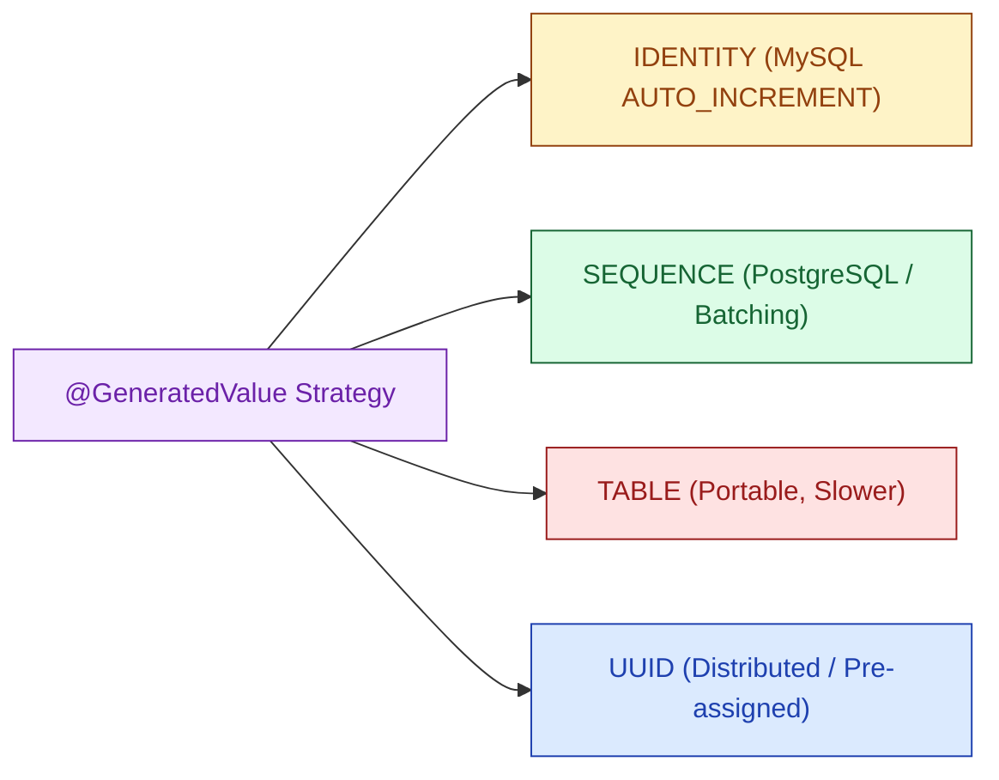

> [!IMPORTANT]
> `GenerationType.IDENTITY` disables Hibernate JDBC insert batching because Hibernate needs the generated primary key immediately upon `persist()`. Use `SEQUENCE` with `allocationSize` when bulk-inserting records.

```java
// 1. IDENTITY: Database auto-increment
@Entity
public class Product {
    @Id
    @GeneratedValue(strategy = GenerationType.IDENTITY)
    private Long id;  // MySQL: AUTO_INCREMENT
}

// 2. SEQUENCE: Database sequence (Oracle, PostgreSQL)
@Entity
@SequenceGenerator(
    name = "order_sequence",
    sequenceName = "orders_seq",
    allocationSize = 1
)
public class Order {
    @Id
    @GeneratedValue(strategy = GenerationType.SEQUENCE, generator = "order_sequence")
    private Long id;
}

// 3. TABLE: Dedicated table for IDs (works everywhere, slower)
@Entity
@TableGenerator(
    name = "id_generator",
    table = "id_table",
    pkColumnName = "gen_name",
    valueColumnName = "gen_value",
    allocationSize = 50
)
public class Invoice {
    @Id
    @GeneratedValue(strategy = GenerationType.TABLE, generator = "id_generator")
    private Long id;
}

// 4. UUID: Programmatic generation
@Entity
public class Token {
    @Id
    @GeneratedValue
    private UUID id = UUID.randomUUID();
}

// 5. AUTO: Let Hibernate choose
@Entity
public class Document {
    @Id
    @GeneratedValue(strategy = GenerationType.AUTO)
    private Long id;
}
```

### Embeddable Objects

Use `@Embeddable` and `@Embedded` to group value-object columns into reusable Java types without creating a separate table. Use `@AttributeOverrides` when embedding the same type multiple times in one entity.

```java
@Embeddable
public class Address {
    @Column(nullable = false)
    private String street;

    @Column(nullable = false)
    private String city;

    @Column(nullable = false)
    private String state;

    @Column(nullable = false)
    private String zipCode;

    // Getters and setters
}

@Entity
public class User {
    @Id
    @GeneratedValue(strategy = GenerationType.IDENTITY)
    private Long id;

    private String email;

    @Embedded
    private Address address;

    @Embedded
    @AttributeOverrides({
        @AttributeOverride(name = "street", column = @Column(name = "billing_street")),
        @AttributeOverride(name = "city", column = @Column(name = "billing_city"))
    })
    private Address billingAddress;
}

// Database table structure:
// users (id, email, street, city, state, zip_code, billing_street, billing_city, ...)
```

---

## Relationships and Fetch Strategies

### Entity Relationship Overview

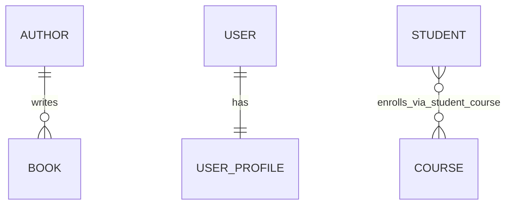

| Annotation | Default FetchType | Owning Side | Recommended FetchType |
| :--- | :--- | :--- | :--- |
| `@OneToMany` | `LAZY` | Child (`@ManyToOne` with `@JoinColumn`) | `LAZY` |
| `@ManyToOne` | `EAGER` | This side (`@JoinColumn`) | Override to `LAZY` |
| `@ManyToMany` | `LAZY` | Side with `@JoinTable` | `LAZY` |
| `@OneToOne` | `EAGER` | Side with `@JoinColumn` | Override to `LAZY` |

> [!WARNING]
> `@ManyToOne` and `@OneToOne` default to `FetchType.EAGER` in JPA! Always explicitly set `fetch = FetchType.LAZY` on them to avoid loading entire object graphs unnecessarily.

### One-to-Many

```java
@Entity
public class Author {
    @Id
    @GeneratedValue(strategy = GenerationType.IDENTITY)
    private Long id;

    private String name;

    @OneToMany(
        mappedBy = "author",  // Owner is on the other side
        fetch = FetchType.LAZY,
        cascade = CascadeType.ALL,
        orphanRemoval = true
    )
    private List<Book> books = new ArrayList<>();

    public void addBook(Book book) {
        books.add(book);
        book.setAuthor(this);
    }

    public void removeBook(Book book) {
        books.remove(book);
        book.setAuthor(null);
    }
}

@Entity
public class Book {
    @Id
    @GeneratedValue(strategy = GenerationType.IDENTITY)
    private Long id;

    private String title;

    @ManyToOne(fetch = FetchType.LAZY)
    @JoinColumn(name = "author_id", nullable = false)
    private Author author;
}
```

### Many-to-One

```java
@Entity
public class Book {
    @Id
    @GeneratedValue(strategy = GenerationType.IDENTITY)
    private Long id;

    private String title;

    @ManyToOne(fetch = FetchType.LAZY)
    @JoinColumn(name = "author_id", nullable = false)
    private Author author;

    // Getters and setters
}

// Database structure:
// books (id, title, author_id)
// author_id is foreign key to authors.id
```

### Many-to-Many

```java
@Entity
public class Student {
    @Id
    @GeneratedValue(strategy = GenerationType.IDENTITY)
    private Long id;

    private String name;

    @ManyToMany(
        fetch = FetchType.LAZY,
        cascade = {CascadeType.PERSIST, CascadeType.MERGE}
    )
    @JoinTable(
        name = "student_course",
        joinColumns = @JoinColumn(name = "student_id"),
        inverseJoinColumns = @JoinColumn(name = "course_id")
    )
    private Set<Course> courses = new HashSet<>();

    public void enrollCourse(Course course) {
        courses.add(course);
        course.getStudents().add(this);
    }

    public void dropCourse(Course course) {
        courses.remove(course);
        course.getStudents().remove(this);
    }
}

@Entity
public class Course {
    @Id
    @GeneratedValue(strategy = GenerationType.IDENTITY)
    private Long id;

    private String name;

    @ManyToMany(mappedBy = "courses", fetch = FetchType.LAZY)
    private Set<Student> students = new HashSet<>();
}

// Database structure:
// students (id, name)
// courses (id, name)
// student_course (student_id, course_id) - JOIN TABLE
```

### One-to-One

```java
@Entity
public class User {
    @Id
    @GeneratedValue(strategy = GenerationType.IDENTITY)
    private Long id;

    private String email;

    @OneToOne(
        mappedBy = "user",
        cascade = CascadeType.ALL,
        fetch = FetchType.LAZY,
        orphanRemoval = true
    )
    private UserProfile profile;
}

@Entity
public class UserProfile {
    @Id
    @GeneratedValue(strategy = GenerationType.IDENTITY)
    private Long id;

    private String bio;

    @OneToOne(fetch = FetchType.LAZY)
    @JoinColumn(name = "user_id", nullable = false)
    private User user;
}
```

### Cascade Types

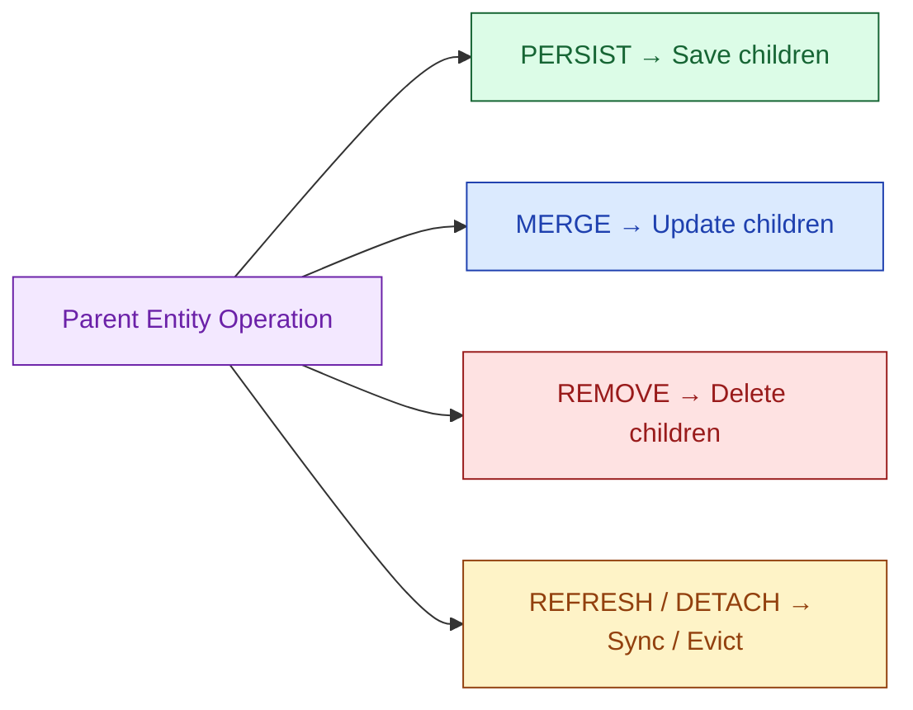

```java
// cascade = CascadeType.ALL means ALL cascade operations
// Individual options:
@OneToMany(cascade = CascadeType.PERSIST)  // Cascade persist only
@OneToMany(cascade = CascadeType.REMOVE)   // Cascade delete only
@OneToMany(cascade = {CascadeType.PERSIST, CascadeType.MERGE})

// CascadeType.PERSIST: If parent saved, children saved
// CascadeType.MERGE: If parent merged, children merged
// CascadeType.REMOVE: If parent deleted, children deleted
// CascadeType.REFRESH: If parent refreshed, children refreshed
// CascadeType.DETACH: If parent detached, children detached
// CascadeType.ALL: All of above
```

---

## N+1 Problem and Solutions

### The Problem

When you fetch `N` parent entities in 1 query and then access a lazy collection on each parent, Hibernate fires `N` additional `SELECT` queries—totaling **1 + N queries**.

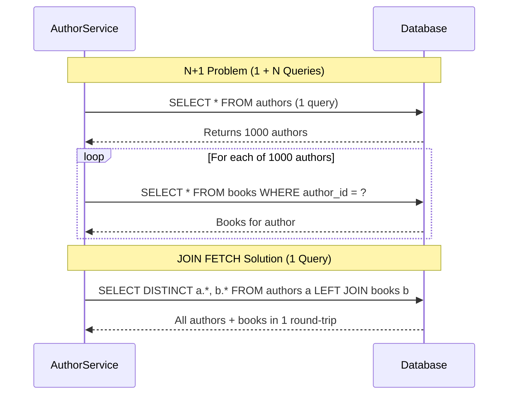

```java
@Service
public class AuthorService {
    private final AuthorRepository authorRepository;

    public AuthorService(AuthorRepository authorRepository) {
        this.authorRepository = authorRepository;
    }

    public List<AuthorDTO> getAllAuthorsWithBooks() {
        // QUERY 1: SELECT * FROM authors
        List<Author> authors = authorRepository.findAll();

        // For each author:
        // QUERY 2, 3, 4... SELECT * FROM books WHERE author_id = ?
        // N more queries (N = number of authors)
        // Total: 1 + N queries!

        return authors.stream()
            .map(author -> new AuthorDTO(
                author.getId(),
                author.getName(),
                author.getBooks()  // Triggers lazy load for each author
            ))
            .collect(Collectors.toList());
    }
}

// Problem: If there are 1000 authors, you make 1001 database queries
```

### N+1 Solutions Comparison

| Solution | Queries Fired | Pagination Safe? | Best Use Case |
| :--- | :--- | :--- | :--- |
| `JOIN FETCH` | `1` | No (in-memory pagination warning with collections) | Need parent + collection together without pagination |
| `@EntityGraph` | `1` | Same as `JOIN FETCH` | Declarative eager loading on repository methods |
| `@BatchSize(size = N)` | `1 + ceil(total / N)` | Yes | Paginated lists or global lazy-loading optimization |
| Projection (DTO/Interface) | `1` | Yes | Read-only views needing only selected columns |
| Query-Specific Loading | `1` (tailored) | Depends on query | Separate endpoints with/without child associations |

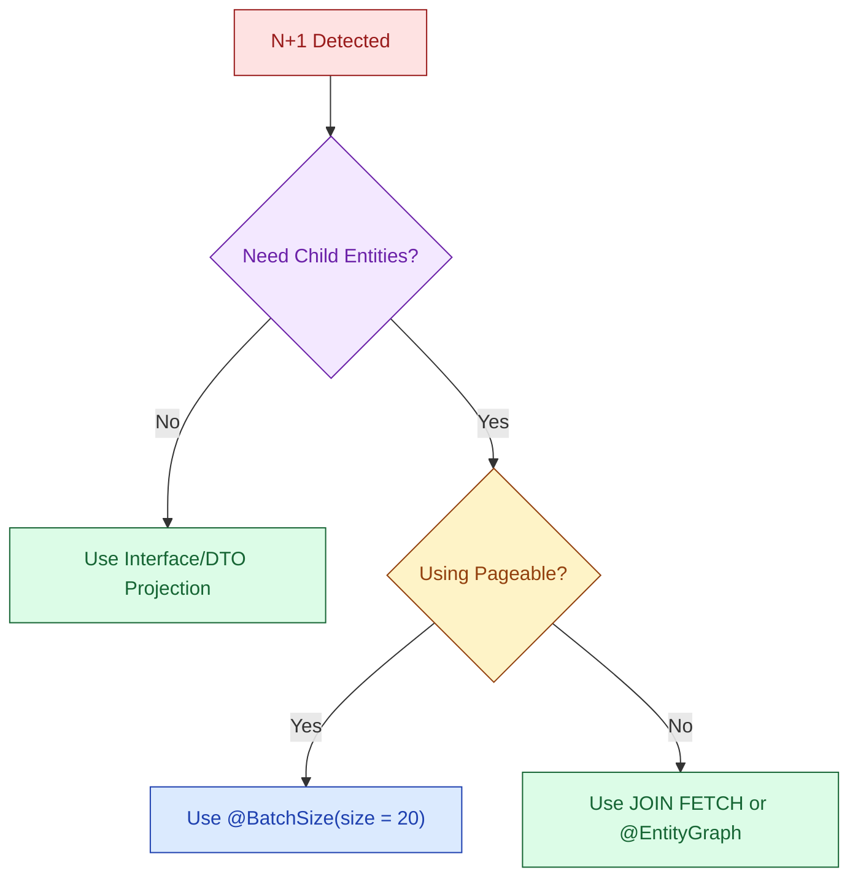

> [!WARNING]
> Combining `JOIN FETCH` on a collection (`@OneToMany`) with `Pageable` forces Hibernate to fetch all rows and paginate in memory (`HHH90003004`). Use `@BatchSize` or two-step ID pagination when paginating parent entities.

### Solution 1: JOIN FETCH

```java
@Repository
public interface AuthorRepository extends JpaRepository<Author, Long> {
    // JOIN FETCH in query (eager load books)
    @Query("SELECT DISTINCT a FROM Author a LEFT JOIN FETCH a.books")
    List<Author> findAllWithBooks();
}

@Service
public class AuthorService {
    private final AuthorRepository authorRepository;

    public AuthorService(AuthorRepository authorRepository) {
        this.authorRepository = authorRepository;
    }

    public List<AuthorDTO> getAllAuthorsWithBooks() {
        // Only 1 query with JOIN FETCH
        List<Author> authors = authorRepository.findAllWithBooks();

        return authors.stream()
            .map(author -> new AuthorDTO(
                author.getId(),
                author.getName(),
                author.getBooks()  // Already loaded, no extra query
            ))
            .collect(Collectors.toList());
    }
}

// Generated SQL:
// SELECT DISTINCT a.* FROM authors a
// LEFT JOIN books b ON a.id = b.author_id
```

### Solution 2: @EntityGraph

```java
@Repository
public interface AuthorRepository extends JpaRepository<Author, Long> {
    // Define which associations to eagerly fetch
    @EntityGraph(attributePaths = {"books"})
    List<Author> findAll();

    @EntityGraph(attributePaths = {"books", "awards"})
    Author findById(Long id);
}

// OR inline
@EntityGraph(
    type = EntityGraphType.LOAD,
    attributePaths = {"books", "reviews"}
)
@Query("SELECT a FROM Author a")
List<Author> getAllAuthorsWithDetails();
```

### Solution 3: @BatchSize

```java
@Entity
public class Author {
    @Id
    @GeneratedValue(strategy = GenerationType.IDENTITY)
    private Long id;

    private String name;

    @OneToMany(mappedBy = "author", fetch = FetchType.LAZY)
    @BatchSize(size = 20)  // Load 20 authors' books in single query
    private List<Book> books = new ArrayList<>();
}

// If you fetch 100 authors, instead of 101 queries:
// Query 1: SELECT * FROM authors LIMIT 100
// Query 2: SELECT * FROM books WHERE author_id IN (1, 2, ..., 20)
// Query 3: SELECT * FROM books WHERE author_id IN (21, 22, ..., 40)
// Query 4: SELECT * FROM books WHERE author_id IN (41, 42, ..., 60)
// ... etc
// Total: 1 + 5 queries (instead of 101)
```

### Solution 4: Projection

```java
public interface AuthorDTO {
    Long getId();
    String getName();
}

@Repository
public interface AuthorRepository extends JpaRepository<Author, Long> {
    // Only select what you need
    List<AuthorDTO> findBy();
}

// Generates: SELECT a.id, a.name FROM authors a
// No books loaded at all (you didn't request them)
```

### Solution 5: Query-Specific Loading

```java
@Repository
public interface AuthorRepository extends JpaRepository<Author, Long> {
    @Query("SELECT a FROM Author a WHERE a.active = true")
    List<Author> findActiveAuthors();

    // Only use JOIN FETCH when you need relationships
    @Query("SELECT DISTINCT a FROM Author a LEFT JOIN FETCH a.books WHERE a.active = true")
    List<Author> findActiveAuthorsWithBooks();
}

// Use findActiveAuthors() when you don't need books
// Use findActiveAuthorsWithBooks() when you do
```

---

## JPQL and Native Queries

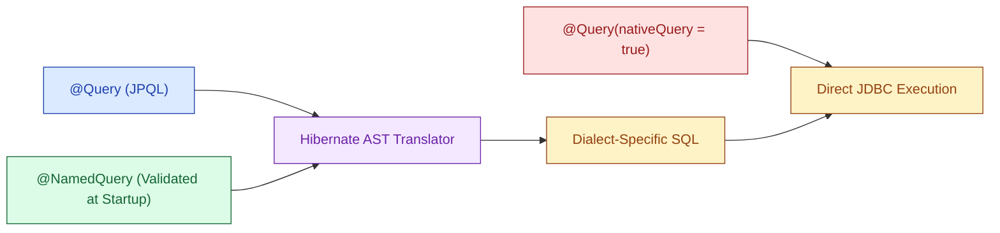

| Query Type | Targets | DB Portable? | Validated at Startup? | Best For |
| :--- | :--- | :--- | :--- | :--- |
| **JPQL** | Entity classes & fields | Yes | Yes | Standard queries, joins, aggregations |
| **Native SQL** | Database tables & columns | No | No (runtime) | DB-specific features (CTEs, window functions, JSON) |
| **Named Queries** | Entity classes & fields | Yes | Yes (fail-fast) | Reusable static queries defined on `@Entity` |

> [!TIP]
> Always prefer named parameters (`:email`) over positional parameters (`?1`) in both JPQL and native queries for readability and refactoring safety.

### JPQL (Java Persistence Query Language)

```java
@Repository
public interface UserRepository extends JpaRepository<User, Long> {
    // Simple JPQL query
    @Query("SELECT u FROM User u WHERE u.email = :email")
    Optional<User> findByEmailJpql(@Param("email") String email);

    // Complex JPQL query
    @Query("""
        SELECT u FROM User u
        WHERE u.age > :minAge AND u.email LIKE :emailPattern
        AND u.createdAt >= :fromDate
        ORDER BY u.age DESC
        """)
    List<User> findActiveUsers(
        @Param("minAge") int minAge,
        @Param("emailPattern") String emailPattern,
        @Param("fromDate") LocalDateTime fromDate
    );

    // JPQL with JOIN
    @Query("""
        SELECT u FROM User u
        LEFT JOIN FETCH u.orders o
        WHERE u.id = :userId
        """)
    Optional<User> findUserWithOrders(@Param("userId") Long userId);

    // JPQL with aggregation
    @Query("SELECT COUNT(u) FROM User u WHERE u.age >= 18")
    long countAdults();

    @Query("""
        SELECT new map(u.firstName as firstName, COUNT(o) as orderCount)
        FROM User u
        LEFT JOIN u.orders o
        GROUP BY u.id, u.firstName
        """)
    List<Map<String, Object>> getUserOrderCounts();
}
```

### Native SQL Queries

```java
@Repository
public interface UserRepository extends JpaRepository<User, Long> {
    // Native SQL
    @Query(
        value = "SELECT * FROM users WHERE email = :email",
        nativeQuery = true
    )
    Optional<User> findByEmailNative(@Param("email") String email);

    // Native query with named parameters
    @Query(
        value = """
            SELECT * FROM users
            WHERE age > :minAge
            AND created_at >= :fromDate
            ORDER BY age DESC
            """,
        nativeQuery = true
    )
    List<User> findUsersNative(
        @Param("minAge") int minAge,
        @Param("fromDate") LocalDateTime fromDate
    );

    // Native query with custom result mapping
    @Query(
        value = """
            SELECT u.id, u.email, COUNT(o.id) as order_count
            FROM users u
            LEFT JOIN orders o ON u.id = o.user_id
            GROUP BY u.id, u.email
            """,
        nativeQuery = true
    )
    List<Object[]> getUserOrderStats();
}
```

### Named Queries

```java
@Entity
@NamedQueries({
    @NamedQuery(
        name = "User.findByEmail",
        query = "SELECT u FROM User u WHERE u.email = :email"
    ),
    @NamedQuery(
        name = "User.findAdults",
        query = "SELECT u FROM User u WHERE u.age >= 18"
    )
})
public class User {
    @Id
    @GeneratedValue(strategy = GenerationType.IDENTITY)
    private Long id;

    private String email;
    private Integer age;
}

@Repository
public interface UserRepository extends JpaRepository<User, Long> {
    // Use named query
    List<User> findAdults();

    @Query(name = "User.findByEmail")
    Optional<User> findByEmail(@Param("email") String email);
}
```

---

## Specification and Criteria API

### Specification for Dynamic Queries

`JpaSpecificationExecutor<T>` lets you compose type-safe `Specification<T>` predicates dynamically at runtime—ideal for multi-filter search endpoints.

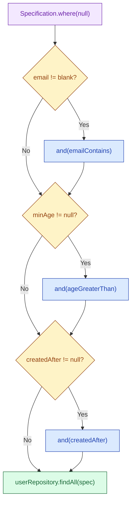

> [!NOTE]
> `Specification` wraps JPA's `CriteriaBuilder`, `Root<T>`, and `CriteriaQuery<?>` so you can combine reusable predicates with `.and()` and `.or()` without string concatenation.

```java
public class UserSpecification {
    public static Specification<User> hasEmail(String email) {
        return (root, query, criteriaBuilder) ->
            criteriaBuilder.equal(root.get("email"), email);
    }

    public static Specification<User> ageGreaterThan(int age) {
        return (root, query, criteriaBuilder) ->
            criteriaBuilder.greaterThan(root.get("age"), age);
    }

    public static Specification<User> emailContains(String emailPart) {
        return (root, query, criteriaBuilder) ->
            criteriaBuilder.like(
                criteriaBuilder.lower(root.get("email")),
                "%" + emailPart.toLowerCase() + "%"
            );
    }

    public static Specification<User> createdAfter(LocalDateTime date) {
        return (root, query, criteriaBuilder) ->
            criteriaBuilder.greaterThanOrEqualTo(root.get("createdAt"), date);
    }
}

@Repository
public interface UserRepository extends JpaRepository<User, Long>,
                                       SpecificationExecutor<User> {
}

@Service
public class UserSearchService {
    private final UserRepository userRepository;

    public UserSearchService(UserRepository userRepository) {
        this.userRepository = userRepository;
    }

    public List<User> searchUsers(String email, Integer minAge, LocalDateTime createdAfter) {
        Specification<User> spec = Specification.where(null);

        if (email != null && !email.isBlank()) {
            spec = spec.and(UserSpecification.emailContains(email));
        }

        if (minAge != null) {
            spec = spec.and(UserSpecification.ageGreaterThan(minAge));
        }

        if (createdAfter != null) {
            spec = spec.and(UserSpecification.createdAfter(createdAfter));
        }

        return userRepository.findAll(spec);
    }
}

// Generated query depends on which specifications are combined
// Flexible and type-safe!
```

---

## Auditing

### @CreatedDate, @LastModifiedDate, @CreatedBy

Spring Data JPA Auditing automatically populates creation and modification metadata via `AuditingEntityListener` and `AuditorAware<T>`.

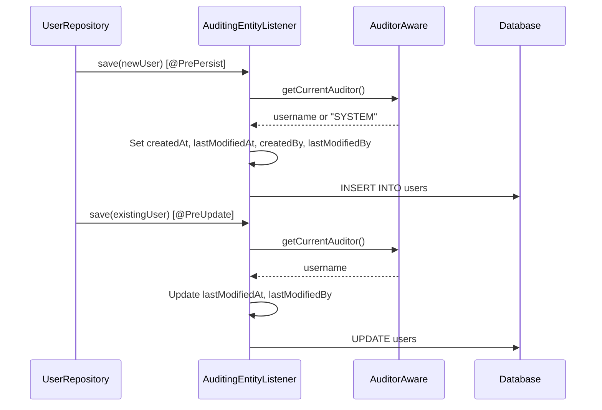

> [!IMPORTANT]
> Two annotations are required for auditing to work: `@EnableJpaAuditing` on a `@Configuration` class and `@EntityListeners(AuditingEntityListener.class)` on the entity (or mapped superclass).

```java
@Configuration
@EnableJpaAuditing(auditorAwareRef = "auditorAware")
public class AuditingConfiguration {

    @Bean
    public AuditorAware<String> auditorAware() {
        return () -> Optional.ofNullable(SecurityContextHolder.getContext())
            .map(SecurityContext::getAuthentication)
            .filter(Authentication::isAuthenticated)
            .map(Authentication::getName)
            .or(() -> Optional.of("SYSTEM"));
    }
}

@Entity
@EntityListeners(AuditingEntityListener.class)
public class User {
    @Id
    @GeneratedValue(strategy = GenerationType.IDENTITY)
    private Long id;

    private String email;

    @CreatedDate
    @Column(nullable = false, updatable = false)
    private LocalDateTime createdAt;

    @LastModifiedDate
    @Column(nullable = false)
    private LocalDateTime lastModifiedAt;

    @CreatedBy
    @Column(nullable = false, updatable = false)
    private String createdBy;

    @LastModifiedBy
    @Column(nullable = false)
    private String lastModifiedBy;

    // Getters and setters
}

// When user is created:
// createdAt = now()
// lastModifiedAt = now()
// createdBy = authenticated username
// lastModifiedBy = authenticated username

// When user is updated:
// lastModifiedAt = now()
// lastModifiedBy = authenticated username
```

---

## Transaction Management Deep Dive

### @Transactional Fundamentals

`@Transactional` wraps service methods in a database transaction boundary so that all repository calls succeed together or roll back atomically.

```java
@Service
public class OrderService {
    private final OrderRepository orderRepository;
    private final PaymentService paymentService;

    public OrderService(OrderRepository orderRepository,
                       PaymentService paymentService) {
        this.orderRepository = orderRepository;
        this.paymentService = paymentService;
    }

    @Transactional
    public Order createOrder(OrderRequest request) {
        // Everything happens in single transaction
        // If any exception occurs, entire transaction rolls back

        Order order = new Order();
        order.setItems(request.getItems());
        order.setTotal(request.getTotal());

        Order savedOrder = orderRepository.save(order);

        try {
            paymentService.processPayment(savedOrder);
        } catch (PaymentException e) {
            // Exception causes rollback
            // Order saved to DB is rolled back
            throw e;
        }

        return savedOrder;  // Transaction commits here
    }
}
```

### Propagation Levels

| Propagation | Active TX Exists | No Active TX | Common Use Case |
| :--- | :--- | :--- | :--- |
| `REQUIRED` (default) | Joins existing TX | Creates new TX | Standard service methods |
| `REQUIRES_NEW` | Suspends existing, starts new TX | Creates new TX | Independent audit logging |
| `SUPPORTS` | Joins existing TX | Runs non-transactionally | Optional-TX read queries |
| `NOT_SUPPORTED` | Suspends existing, runs without TX | Runs non-transactionally | External API calls / non-TX work |
| `MANDATORY` | Joins existing TX | Throws exception | Internal helper requiring caller TX |
| `NEVER` | Throws exception | Runs non-transactionally | Enforcing non-transactional execution |
| `NESTED` | Creates DB savepoint | Creates new TX | Partial rollback within parent TX |

```java
// 1. REQUIRED (default)
// Uses existing transaction if available, creates new if not
@Transactional(propagation = Propagation.REQUIRED)
public void methodA() {
    // Uses existing transaction from caller
    // Or creates new transaction
}

// 2. REQUIRES_NEW
// Always creates new transaction, suspends current if exists
@Transactional(propagation = Propagation.REQUIRES_NEW)
public void methodB() {
    // Always new transaction
    // Parent's transaction suspended until this completes
}

@Service
public class OrderService {
    private final OrderRepository orderRepository;
    private final AuditService auditService;

    @Transactional
    public Order createOrder(OrderRequest request) {
        Order order = orderRepository.save(new Order());

        // Even if audit fails, order is committed
        try {
            auditService.logOrderCreation(order);
        } catch (Exception e) {
            // Audit failed but order still saved
        }

        return order;
    }
}

@Service
public class AuditService {
    private final AuditRepository auditRepository;

    // Independent transaction for audit logging
    @Transactional(propagation = Propagation.REQUIRES_NEW)
    public void logOrderCreation(Order order) {
        AuditLog log = new AuditLog();
        log.setEntity("Order");
        log.setEntityId(order.getId());
        log.setAction("CREATE");
        auditRepository.save(log);
    }
}

// 3. SUPPORTS
// Uses existing transaction if available
@Transactional(propagation = Propagation.SUPPORTS)
public void readOnlyMethod() {
    // Doesn't need transaction but uses one if available
}

// 4. NOT_SUPPORTED
// Executes outside transaction
@Transactional(propagation = Propagation.NOT_SUPPORTED)
public void nonTransactionalMethod() {
    // Executes without transaction
}

// 5. MANDATORY
// Must be called within existing transaction
@Transactional(propagation = Propagation.MANDATORY)
public void mustBeTransactional() {
    // Throws exception if not called from transaction
}

// 6. NEVER
// Must NOT be called within transaction
@Transactional(propagation = Propagation.NEVER)
public void mustNotBeTransactional() {
    // Throws exception if called from transaction
}

// 7. NESTED
// Creates savepoint within transaction
@Transactional(propagation = Propagation.NESTED)
public void nestedTransaction() {
    // If this fails, can rollback to savepoint
    // Parent transaction continues
}
```

### Isolation Levels

| Isolation Level | Dirty Read | Non-Repeatable Read | Phantom Read | Performance |
| :--- | :--- | :--- | :--- | :--- |
| `READ_UNCOMMITTED` | Possible | Possible | Possible | Fastest |
| `READ_COMMITTED` | Prevented | Possible | Possible | High (DB default) |
| `REPEATABLE_READ` | Prevented | Prevented | Possible | Medium |
| `SERIALIZABLE` | Prevented | Prevented | Prevented | Slowest |

```java
@Service
public class OrderService {
    private final OrderRepository orderRepository;

    // READ_UNCOMMITTED: Dirty reads possible
    @Transactional(isolation = Isolation.READ_UNCOMMITTED)
    public void readUncommitted() {
        // Can read uncommitted data from other transactions
        // Fastest, least safe
    }

    // READ_COMMITTED: Dirty reads prevented (default for most databases)
    @Transactional(isolation = Isolation.READ_COMMITTED)
    public void readCommitted() {
        // Can only read committed data
        // Can have non-repeatable reads
    }

    // REPEATABLE_READ: Non-repeatable reads prevented
    @Transactional(isolation = Isolation.REPEATABLE_READ)
    public void repeatableRead() {
        // Read same data multiple times, get same result
        // Can have phantom reads
    }

    // SERIALIZABLE: Phantom reads prevented
    @Transactional(isolation = Isolation.SERIALIZABLE)
    public void serializable() {
        // Transactions execute serially
        // Slowest, safest
    }
}

// Isolation Problem Examples:
// Dirty Read: Read uncommitted data that gets rolled back
// Non-repeatable Read: Read same row, get different value
// Phantom Read: Query range, new row inserted mid-transaction
```

### Rollback Rules

> [!WARNING]
> By default, Spring `@Transactional` rolls back **only on unchecked exceptions** (`RuntimeException` and `Error`), **not** on checked exceptions (`Exception`). Use `rollbackFor = Exception.class` when checked exceptions must trigger a rollback.

```java
@Service
public class OrderService {
    private final OrderRepository orderRepository;

    // Default: rollback only on RuntimeException (and subclasses)
    @Transactional
    public void createOrder(OrderRequest request) throws Exception {
        Order order = new Order();
        orderRepository.save(order);
        // If RuntimeException thrown: ROLLBACK
        // If checked Exception thrown: COMMIT (not rolled back by default)
    }

    // Rollback for any exception
    @Transactional(rollbackFor = Exception.class)
    public void createOrderWithRollback(OrderRequest request) throws Exception {
        Order order = new Order();
        orderRepository.save(order);
        // Both RuntimeException and checked Exception cause ROLLBACK
    }

    // No rollback for specific exceptions
    @Transactional(noRollbackFor = DuplicateEmailException.class)
    public void createOrderNoRollback(OrderRequest request) {
        Order order = new Order();
        orderRepository.save(order);
        // If DuplicateEmailException: COMMIT (no rollback)
        // If other RuntimeException: ROLLBACK
    }

    // Read-only optimization (no need to track changes)
    @Transactional(readOnly = true)
    public Order getOrder(Long id) {
        return orderRepository.findById(id).orElse(null);
    }

    // Transaction timeout (10 seconds)
    @Transactional(timeout = 10)
    public void longRunningOperation() {
        // If operation takes > 10 seconds, transaction rolled back
    }
}
```

### How @Transactional Works Internally

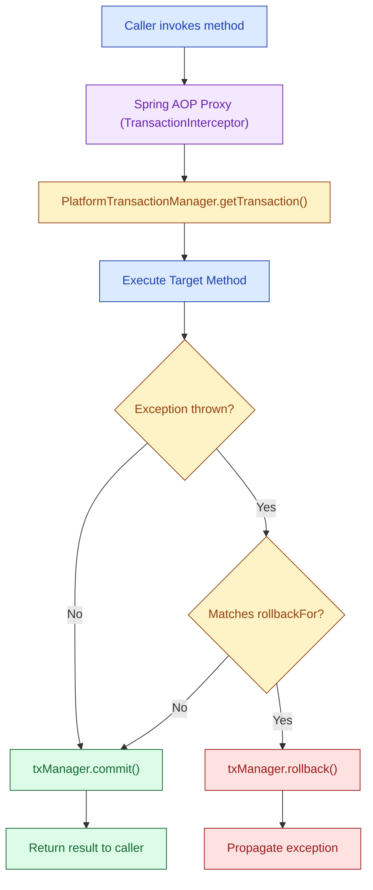

> [!NOTE]
> Because `@Transactional` relies on Spring AOP proxies, **self-invocation** (calling a `@Transactional` method from another method inside the same class) bypasses the proxy and does not start a new transaction.

---

## Connection Pooling

### HikariCP Configuration (Default in Spring Boot)

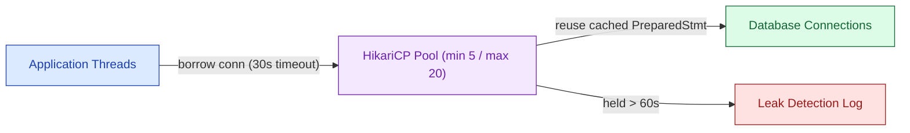

| Property | Example Value | Purpose |
| :--- | :--- | :--- |
| `maximum-pool-size` | `20` | Max active + idle connections in the pool |
| `minimum-idle` | `5` | Minimum idle connections HikariCP tries to maintain |
| `connection-timeout` | `30000` (30s) | Max wait time for a connection before throwing `SQLException` |
| `idle-timeout` | `600000` (10m) | Max time a connection can sit idle before eviction |
| `max-lifetime` | `1800000` (30m) | Max lifetime of a connection (should be shorter than DB wait_timeout) |
| `leak-detection-threshold` | `60000` (1m) | Logs a warning if a connection is not returned within threshold |

> [!TIP]
> Follow the HikariCP pool sizing guideline: `connections = ((core_count * 2) + effective_spindle_count)`. For a 4-core CPU with 1 SSD/disk, `9` connections often outperforms a huge pool by avoiding context-switching and lock contention.

```yaml
# application.yml
spring:
  datasource:
    hikari:
      maximum-pool-size: 20          # Max connections in pool
      minimum-idle: 5                # Min idle connections
      connection-timeout: 30000      # 30 seconds to get connection
      idle-timeout: 600000           # 10 minutes before closing idle conn
      max-lifetime: 1800000          # 30 minutes max lifetime
      auto-commit: true
      connection-test-query: SELECT 1  # Test query
      leak-detection-threshold: 60000  # 1 minute to detect leaks
      cache-prep-stmts: true
      prep-stmt-cache-size: 250
      prep-stmt-cache-sql-limit: 2048

logging:
  level:
    com.zaxxer.hikari: DEBUG  # See pool statistics
```

### HikariCP Tuning

```java
@Configuration
public class DataSourceConfiguration {

    @Bean
    public DataSource dataSource() {
        HikariConfig config = new HikariConfig();
        config.setJdbcUrl("jdbc:mysql://localhost:3306/myapp");
        config.setUsername("root");
        config.setPassword("password");

        // Pool sizing
        config.setMaximumPoolSize(20);  // Max 20 connections
        config.setMinimumIdle(5);       // Keep 5 idle connections

        // Timeouts
        config.setConnectionTimeout(30000);  // 30s to get connection
        config.setIdleTimeout(600000);       // Close idle after 10m
        config.setMaxLifetime(1800000);      // Connection max age 30m

        // Performance
        config.setCachePreparedStatements(true);
        config.setPreparedStatementCacheSize(250);
        config.setPreparedStatementCacheSqlLimit(2048);

        // Monitoring
        config.setLeakDetectionThreshold(60000);  // Log connections held > 1m

        return new HikariDataSource(config);
    }
}

// Pool sizing guideline:
// connections = ((core_count * 2) + effective_spindle_count)
// For 4-core CPU: (4 * 2) + 1 = 9
// For 16-core CPU: (16 * 2) + 1 = 33
```

---

## Database Migrations

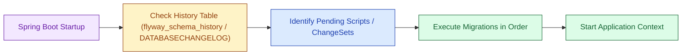

| Feature | Flyway | Liquibase |
| :--- | :--- | :--- |
| **Primary Format** | Versioned SQL (`V1__Initial.sql`) | YAML, XML, JSON, or SQL (`changeSet`) |
| **DB Portability** | SQL-first (dialect-specific) | Abstracted changesets (DB-agnostic) |
| **Rollback Support** | Undo scripts (Teams/Enterprise) | Built-in rollback tags in OSS |
| **Learning Curve** | Minimal (plain SQL) | Moderate (changelog DSL) |

> [!IMPORTANT]
> Never modify an already-applied migration script in production—checksum validation will fail on startup. Always create a new versioned migration (`V4__...` or a new `changeSet`) instead.

### Flyway

```xml
<dependency>
    <groupId>org.flywaydb</groupId>
    <artifactId>flyway-core</artifactId>
</dependency>
```

```yaml
# application.yml
spring:
  flyway:
    enabled: true
    locations: classpath:db/migration
    baseline-on-migrate: true
    out-of-order: false
```

```sql
-- src/main/resources/db/migration/V1__Initial_schema.sql
CREATE TABLE users (
    id BIGINT AUTO_INCREMENT PRIMARY KEY,
    email VARCHAR(100) UNIQUE NOT NULL,
    first_name VARCHAR(50) NOT NULL,
    last_name VARCHAR(50) NOT NULL,
    created_at TIMESTAMP DEFAULT CURRENT_TIMESTAMP,
    INDEX idx_email (email)
);

CREATE TABLE orders (
    id BIGINT AUTO_INCREMENT PRIMARY KEY,
    user_id BIGINT NOT NULL,
    order_date TIMESTAMP DEFAULT CURRENT_TIMESTAMP,
    total DECIMAL(10, 2),
    FOREIGN KEY (user_id) REFERENCES users(id),
    INDEX idx_user_id (user_id)
);

-- src/main/resources/db/migration/V2__Add_user_age.sql
ALTER TABLE users ADD COLUMN age INT;

-- src/main/resources/db/migration/V3__Add_order_status.sql
ALTER TABLE orders ADD COLUMN status VARCHAR(20) DEFAULT 'PENDING';
```

### Liquibase

```xml
<dependency>
    <groupId>org.liquibase</groupId>
    <artifactId>liquibase-core</artifactId>
</dependency>
```

```yaml
# application.yml
spring:
  liquibase:
    change-log: classpath:db/changelog/db.changelog-master.yaml
    enabled: true
```

```yaml
# src/main/resources/db/changelog/db.changelog-master.yaml
databaseChangeLog:
  - include:
      file: db/changelog/v1.0/v1.0-initial.yaml
  - include:
      file: db/changelog/v1.1/v1.1-updates.yaml

# src/main/resources/db/changelog/v1.0/v1.0-initial.yaml
databaseChangeLog:
  - changeSet:
      id: 1
      author: john
      changes:
        - createTable:
            tableName: users
            columns:
              - column:
                  name: id
                  type: BIGINT
                  autoIncrement: true
                  constraints:
                    primaryKey: true
              - column:
                  name: email
                  type: VARCHAR(100)
                  constraints:
                    nullable: false
                    unique: true
              - column:
                  name: created_at
                  type: TIMESTAMP
```

---

## Multi-Datasource Configuration

When an application connects to multiple databases, you must isolate each datasource's `DataSource`, `LocalContainerEntityManagerFactoryBean` (with separate `packagesToScan`), and `PlatformTransactionManager`, marking one set as `@Primary`.

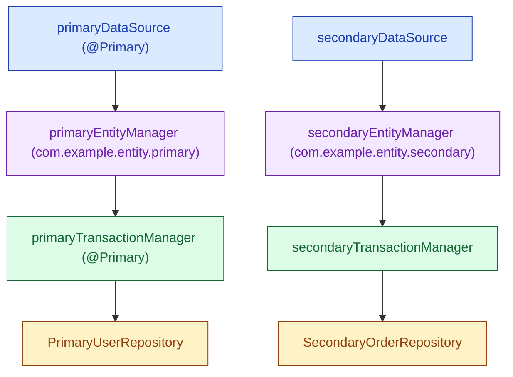

> [!NOTE]
> Use `@Qualifier` when wiring the `DataSource` into each `EntityManagerFactory` and each `EntityManagerFactory` into its `PlatformTransactionManager` so Spring resolves the exact bean.

```java
@Configuration
public class DataSourceConfiguration {

    // Primary datasource
    @Bean
    @Primary
    public DataSource primaryDataSource() {
        HikariConfig config = new HikariConfig();
        config.setJdbcUrl("jdbc:mysql://db1.example.com/appdb");
        config.setUsername("user1");
        config.setPassword("pass1");
        config.setMaximumPoolSize(20);
        return new HikariDataSource(config);
    }

    // Secondary datasource
    @Bean
    public DataSource secondaryDataSource() {
        HikariConfig config = new HikariConfig();
        config.setJdbcUrl("jdbc:mysql://db2.example.com/appdb");
        config.setUsername("user2");
        config.setPassword("pass2");
        config.setMaximumPoolSize(10);
        return new HikariDataSource(config);
    }

    // Primary JPA configuration
    @Bean
    @Primary
    public LocalContainerEntityManagerFactoryBean primaryEntityManager(
        @Qualifier("primaryDataSource") DataSource dataSource) {

        LocalContainerEntityManagerFactoryBean em = new LocalContainerEntityManagerFactoryBean();
        em.setDataSource(dataSource);
        em.setPackagesToScan("com.example.entity.primary");
        em.setJpaVendorAdapter(new HibernateJpaVendorAdapter());
        return em;
    }

    // Secondary JPA configuration
    @Bean
    public LocalContainerEntityManagerFactoryBean secondaryEntityManager(
        @Qualifier("secondaryDataSource") DataSource dataSource) {

        LocalContainerEntityManagerFactoryBean em = new LocalContainerEntityManagerFactoryBean();
        em.setDataSource(dataSource);
        em.setPackagesToScan("com.example.entity.secondary");
        em.setJpaVendorAdapter(new HibernateJpaVendorAdapter());
        return em;
    }

    // Transaction managers
    @Bean
    @Primary
    public PlatformTransactionManager primaryTransactionManager(
        @Qualifier("primaryEntityManager") EntityManagerFactory emf) {
        return new JpaTransactionManager(emf);
    }

    @Bean
    public PlatformTransactionManager secondaryTransactionManager(
        @Qualifier("secondaryEntityManager") EntityManagerFactory emf) {
        return new JpaTransactionManager(emf);
    }
}

// Usage
@Repository
@Transactional(transactionManager = "primaryTransactionManager")
public interface PrimaryUserRepository extends JpaRepository<User, Long> {
}

@Repository
@Transactional(transactionManager = "secondaryTransactionManager")
public interface SecondaryOrderRepository extends JpaRepository<Order, Long> {
}
```

---

## Spring Data MongoDB

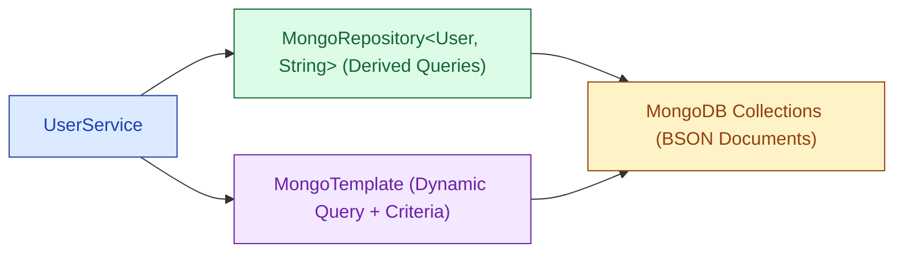

| JPA Annotation | MongoDB Equivalent | Purpose |
| :--- | :--- | :--- |
| `@Entity` / `@Table` | `@Document(collection = "...")` | Maps class to a MongoDB collection |
| `@Id` | `@Id` | Maps to MongoDB `_id` field (`String` / `ObjectId`) |
| `@Column(name = "...")` | `@Field("...")` | Customizes document field name |
| `@Transient` | `@Transient` | Excludes field from persistence |

> [!TIP]
> Use `MongoRepository` for standard CRUD and derived queries, and inject `MongoTemplate` with `Query` + `Criteria` when building dynamic multi-field filters.

### Basic Configuration

```xml
<dependency>
    <groupId>org.springframework.boot</groupId>
    <artifactId>spring-boot-starter-data-mongodb</artifactId>
</dependency>
```

```yaml
# application.yml
spring:
  data:
    mongodb:
      uri: mongodb://localhost:27017/myapp
      # OR
      host: localhost
      port: 27017
      database: myapp
      username: user
      password: password
```

### MongoDB Entity Mapping

```java
@Document(collection = "users")
public class User {
    @Id
    private String id;  // MongoDB uses _id field

    private String email;
    private String firstName;
    private String lastName;

    @Field("created_at")
    private LocalDateTime createdAt;

    @Field("orders")
    private List<Order> orders = new ArrayList<>();

    @Transient  // Not persisted
    private String tempField;
}

@Document(collection = "orders")
public class Order {
    @Id
    private String id;

    private String userId;
    private BigDecimal total;
    private LocalDateTime createdAt;
}
```

### MongoDB Repositories

```java
@Repository
public interface UserRepository extends MongoRepository<User, String> {
    Optional<User> findByEmail(String email);
    List<User> findByFirstName(String firstName);
    List<User> findByCreatedAtAfter(LocalDateTime date);
}

@Service
public class UserService {
    private final UserRepository userRepository;

    public UserService(UserRepository userRepository) {
        this.userRepository = userRepository;
    }

    public Optional<User> getUserByEmail(String email) {
        return userRepository.findByEmail(email);
    }

    public List<User> searchUsers(String firstName, LocalDateTime createdAfter) {
        Query query = new Query();

        if (firstName != null) {
            query.addCriteria(Criteria.where("firstName").regex(firstName, "i"));
        }

        if (createdAfter != null) {
            query.addCriteria(Criteria.where("created_at").gte(createdAfter));
        }

        return mongoTemplate.find(query, User.class);
    }
}
```

---

## Interview Questions

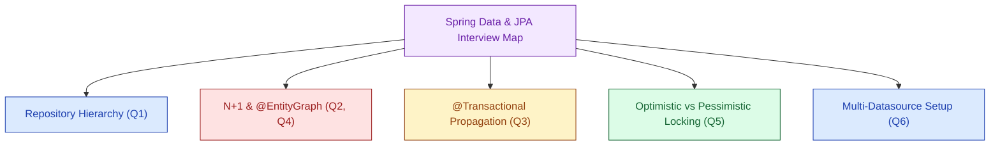

> [!TIP]
> In system design and backend interviews, pair N+1 answers with **pagination trade-offs** (`JOIN FETCH` vs `@BatchSize`) and `@Transactional` answers with **proxy self-invocation** and **checked-exception rollback** caveats.

### Q1: Explain the Spring Data repository hierarchy.

**Answer:**
`Repository` is the root marker interface. `CrudRepository` extends it with CRUD operations (`save`, `delete`, `findById`). `PagingAndSortingRepository` adds pagination and sorting. `JpaRepository` extends both and adds JPA-specific methods (`flush`, `saveAndFlush`, `deleteInBatch`).

Use `JpaRepository` for JPA applications as it has all features needed.

### Q2: What's the N+1 problem and how do you solve it?

**Answer:**
N+1 problem: You fetch N parent entities, then for each parent, you fetch related children. Results in 1 + N database queries.

Solutions:
1. **JOIN FETCH**: Eagerly fetch in single query with `JOIN`
2. **@EntityGraph**: Declare which associations to fetch
3. **@BatchSize**: Fetch related entities in batches (e.g., 50 authors' books in 1 query instead of 50)
4. **Projection**: Only select fields you need
5. **Query-specific methods**: Create different query methods for different use cases

### Q3: Difference between @Transactional with different propagation levels.

**Answer:**
- `REQUIRED` (default): Uses existing transaction or creates new
- `REQUIRES_NEW`: Always creates new transaction, suspends parent
- `SUPPORTS`: Uses existing transaction if available, not required
- `NOT_SUPPORTED`: Executes without transaction
- `MANDATORY`: Must execute within transaction, throws error if not
- `NEVER`: Must not execute within transaction
- `NESTED`: Creates savepoint, can rollback to savepoint on error

Choose based on whether operation depends on parent transaction.

### Q4: How do you handle the N+1 problem with @EntityGraph?

**Answer:**
```java
@EntityGraph(attributePaths = {"books", "awards"})
@Query("SELECT a FROM Author a")
List<Author> findAllWithDetails();
```

`@EntityGraph` defines which related entities to eagerly fetch. Spring generates single query with JOINs. More declarative than `JOIN FETCH`, less boilerplate.

### Q5: Explain optimistic vs pessimistic locking.

**Answer:**
- **Optimistic locking**: Assumes no conflicts, use `@Version` field. If version changed, throws exception on update. Good for low-conflict scenarios.
- **Pessimistic locking**: Lock row in database, `@Lock(LockModeType.PESSIMISTIC_WRITE)`. No one else can modify until released. Good for high-conflict scenarios.

Optimistic is faster but requires handling version conflicts; pessimistic is safer but slower.

### Q6: How do you configure multiple datasources?

**Answer:**
Define multiple `DataSource` beans with `@Primary` for default. For each datasource, create separate `EntityManagerFactory` and `PlatformTransactionManager`. Use `@Qualifier("dataSourceName")` to inject specific datasource. Repositories use `@Transactional(transactionManager = "txManagerName")`.
