# Spring Security - Deep Dive

## Table of Contents
1. [Spring Security Architecture](#spring-security-architecture)
2. [Authentication](#authentication)
3. [Password Encoding](#password-encoding)
4. [Authorization](#authorization)
5. [JWT Implementation](#jwt-implementation)
6. [OAuth 2.0](#oauth-20)
7. [CORS and CSRF](#cors-and-csrf)
8. [Security Headers](#security-headers)
9. [Role vs Permission-Based Access](#role-vs-permission-based-access)
10. [Common Vulnerabilities](#common-vulnerabilities)
11. [Testing Security](#testing-security)
12. [Interview Questions](#interview-questions)

---

## Spring Security Architecture

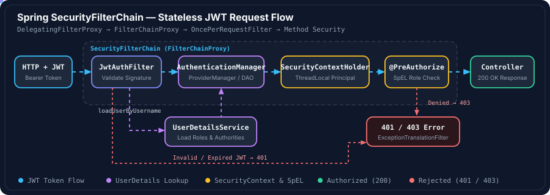

Spring Security intercepts incoming HTTP requests at the Servlet Filter layer before they ever reach `DispatcherServlet` or your controllers.

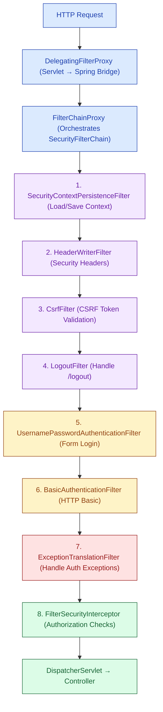

### Key Filters in Order

| Order | Filter | Responsibility |
| :--- | :--- | :--- |
| **Bridge** | `DelegatingFilterProxy` | Servlet container filter that delegates to a Spring-managed bean |
| **Orchestrator** | `FilterChainProxy` | Routes requests through the matching `SecurityFilterChain` |
| **1** | `SecurityContextPersistenceFilter` | Loads and saves `SecurityContext` from the HTTP session |
| **2** | `HeaderWriterFilter` | Adds security headers (`CSP`, `X-Frame-Options`, `HSTS`, etc.) |
| **3** | `CsrfFilter` | Validates CSRF tokens on state-changing requests |
| **4** | `LogoutFilter` | Processes logout URLs, clears auth, invalidates session |
| **5** | `UsernamePasswordAuthenticationFilter` | Extracts username/password from form login requests |
| **6** | `BasicAuthenticationFilter` | Parses `Authorization: Basic ...` headers |
| **7** | `ExceptionTranslationFilter` | Translates `AuthenticationException` / `AccessDeniedException` to HTTP 401/403 |
| **8** | `FilterSecurityInterceptor` | Enforces final URL and method authorization rules |

> [!NOTE]
> Filters execute sequentially. If any filter rejects the request or throws an exception, `ExceptionTranslationFilter` intercepts it and returns `401 Unauthorized` or `403 Forbidden` before `DispatcherServlet` is invoked.

### SecurityFilterChain Configuration

```java
@Configuration
@EnableWebSecurity
public class SecurityConfiguration {

    @Bean
    public SecurityFilterChain filterChain(HttpSecurity http) throws Exception {
        http
            // CSRF protection
            .csrf(csrf -> csrf
                .csrfTokenRepository(CookieCsrfTokenRepository.withHttpOnlyFalse())
                .ignoringRequestMatchers("/api/**")
            )

            // Authorization
            .authorizeHttpRequests(authz -> authz
                .requestMatchers("/public/**").permitAll()
                .requestMatchers("/admin/**").hasRole("ADMIN")
                .requestMatchers("/api/**").authenticated()
                .anyRequest().authenticated()
            )

            // Authentication
            .formLogin(form -> form
                .loginPage("/login")
                .loginProcessingUrl("/login")
                .defaultSuccessUrl("/dashboard", true)
                .permitAll()
            )

            // HTTP Basic for API
            .httpBasic(Customizer.withDefaults())

            // Session management
            .sessionManagement(session -> session
                .sessionFixationProtection(SessionFixationProtectionStrategy.MIGRATE_SESSION)
                .sessionConcurrency(concurrency -> concurrency
                    .maximumSessions(1)
                    .expiredUrl("/login?expired")
                )
            )

            // Headers
            .headers(headers -> headers
                .contentSecurityPolicy(csp -> csp
                    .policyDirectives("default-src 'self'")
                )
                .frameOptions(frameOptions -> frameOptions.sameOrigin())
            )

            // Logout
            .logout(logout -> logout
                .logoutUrl("/logout")
                .logoutSuccessUrl("/login?logout")
                .invalidateHttpSession(true)
                .clearAuthentication(true)
                .deleteCookies("JSESSIONID")
            );

        return http.build();
    }
}
```

---

## Authentication

Spring Security separates **who you are** (`AuthenticationManager` + `UserDetailsService`) from **where your identity lives** (`SecurityContextHolder`).

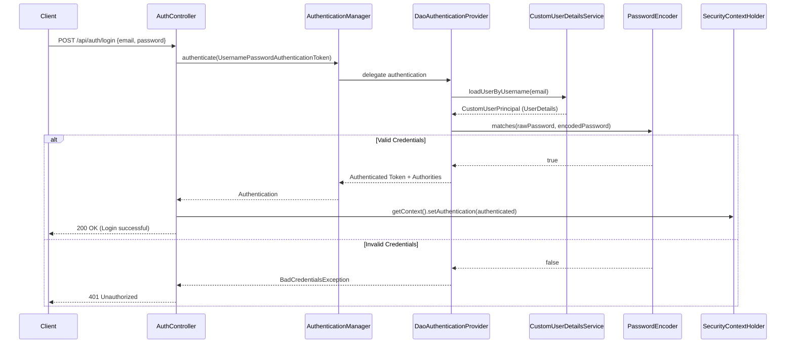

- **`UserDetailsService`**: Loads user-specific data (`loadUserByUsername`) from your database or directory.
- **`UserDetails`**: Wraps your domain `User` entity, exposing `getAuthorities()`, `getPassword()`, `getUsername()`, and account status flags (`isAccountNonLocked()`, `isEnabled()`).
- **`AuthenticationManager` (`ProviderManager`)**: Delegates credentials to one or more `AuthenticationProvider`s such as `DaoAuthenticationProvider`.
- **`SecurityContextHolder`**: Stores the authenticated `Authentication` object in a `ThreadLocal` for the duration of the request.

### UserDetailsService

```java
@Service
public class CustomUserDetailsService implements UserDetailsService {
    private final UserRepository userRepository;

    public CustomUserDetailsService(UserRepository userRepository) {
        this.userRepository = userRepository;
    }

    @Override
    public UserDetails loadUserByUsername(String username) throws UsernameNotFoundException {
        User user = userRepository.findByEmail(username)
            .orElseThrow(() -> new UsernameNotFoundException("User not found: " + username));

        return new CustomUserPrincipal(user);
    }
}

public class CustomUserPrincipal implements UserDetails {
    private final User user;

    public CustomUserPrincipal(User user) {
        this.user = user;
    }

    @Override
    public Collection<? extends GrantedAuthority> getAuthorities() {
        return user.getRoles().stream()
            .map(role -> new SimpleGrantedAuthority("ROLE_" + role.getName()))
            .collect(Collectors.toList());
    }

    @Override
    public String getPassword() {
        return user.getPassword();
    }

    @Override
    public String getUsername() {
        return user.getEmail();
    }

    @Override
    public boolean isAccountNonExpired() {
        return true;
    }

    @Override
    public boolean isAccountNonLocked() {
        return !user.isLocked();
    }

    @Override
    public boolean isCredentialsNonExpired() {
        return true;
    }

    @Override
    public boolean isEnabled() {
        return user.isEnabled();
    }

    public User getUser() {
        return user;
    }
}
```

### AuthenticationManager

```java
@Configuration
public class AuthenticationConfiguration {

    @Bean
    public AuthenticationManager authenticationManager(
        UserDetailsService userDetailsService,
        PasswordEncoder passwordEncoder) {

        DaoAuthenticationProvider authProvider = new DaoAuthenticationProvider();
        authProvider.setUserDetailsService(userDetailsService);
        authProvider.setPasswordEncoder(passwordEncoder);

        return new ProviderManager(authProvider);
    }

    @Bean
    public PasswordEncoder passwordEncoder() {
        return new BCryptPasswordEncoder(12);  // strength = 12
    }
}

// Usage: programmatic authentication
@RestController
@RequestMapping("/api/auth")
public class AuthController {
    private final AuthenticationManager authenticationManager;

    public AuthController(AuthenticationManager authenticationManager) {
        this.authenticationManager = authenticationManager;
    }

    @PostMapping("/login")
    public ResponseEntity<LoginResponse> login(@RequestBody LoginRequest request) {
        try {
            // Create authentication token with credentials
            UsernamePasswordAuthenticationToken token =
                new UsernamePasswordAuthenticationToken(
                    request.getEmail(),
                    request.getPassword()
                );

            // Authenticate using manager
            Authentication authenticated = authenticationManager.authenticate(token);

            // Store in SecurityContext
            SecurityContextHolder.getContext().setAuthentication(authenticated);

            return ResponseEntity.ok(new LoginResponse("Login successful"));

        } catch (BadCredentialsException e) {
            return ResponseEntity.status(HttpStatus.UNAUTHORIZED)
                .body(new LoginResponse("Invalid credentials"));
        }
    }
}
```

> [!TIP]
> Prefix role names with `"ROLE_"` when building `SimpleGrantedAuthority` in `UserDetails.getAuthorities()` so `hasRole("ADMIN")` matches `"ROLE_ADMIN"` seamlessly.

---

## Password Encoding

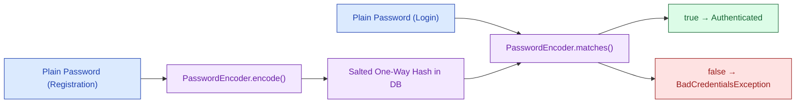

| Encoder | Algorithm | GPU / ASIC Resistance | Key Tuning Parameters |
| :--- | :--- | :--- | :--- |
| `BCryptPasswordEncoder` | Blowfish-based adaptive hash | Moderate (CPU-hard) | `strength` 4–31 (default `10`, recommended `12`) |
| `Argon2PasswordEncoder` | Argon2id (memory-hard) | High (memory + CPU-hard) | `saltLength=16`, `hashLength=32`, `parallelism=1`, `memory=60000` KB, `iterations=2` |

> [!WARNING]
> Never store plaintext passwords or use fast general-purpose hashes (`MD5`, `SHA-256`). Always use an adaptive, salted `PasswordEncoder` like `BCryptPasswordEncoder` or `Argon2PasswordEncoder`.

### BCryptPasswordEncoder

```java
@Configuration
public class PasswordEncoderConfiguration {

    @Bean
    public PasswordEncoder passwordEncoder() {
        // Strength between 4 and 31 (default 10)
        // Higher = more secure but slower
        return new BCryptPasswordEncoder(12);
    }
}

@Service
public class UserService {
    private final UserRepository userRepository;
    private final PasswordEncoder passwordEncoder;

    public UserService(UserRepository userRepository, PasswordEncoder passwordEncoder) {
        this.userRepository = userRepository;
        this.passwordEncoder = passwordEncoder;
    }

    public void registerUser(String email, String plainPassword) {
        // Encode password
        String encodedPassword = passwordEncoder.encode(plainPassword);

        User user = new User();
        user.setEmail(email);
        user.setPassword(encodedPassword);  // Store encoded password
        userRepository.save(user);
    }

    public boolean verifyPassword(String plainPassword, String encodedPassword) {
        // Check if plain password matches encoded password
        return passwordEncoder.matches(plainPassword, encodedPassword);
    }
}
```

### Argon2PasswordEncoder

```xml
<dependency>
    <groupId>org.springframework.security</groupId>
    <artifactId>spring-security-crypto</artifactId>
</dependency>
```

```java
@Configuration
public class PasswordEncoderConfiguration {

    @Bean
    public PasswordEncoder passwordEncoder() {
        // Argon2: More secure than BCrypt, resistant to GPU attacks
        return new Argon2PasswordEncoder(
            16,      // salt length
            32,      // hash length
            1,       // parallelism
            60000,   // memory in KB
            2        // iterations
        );
    }
}
```

---

## Authorization

Enable method-level security with `@EnableMethodSecurity` to enforce fine-grained access control directly on service or controller methods.

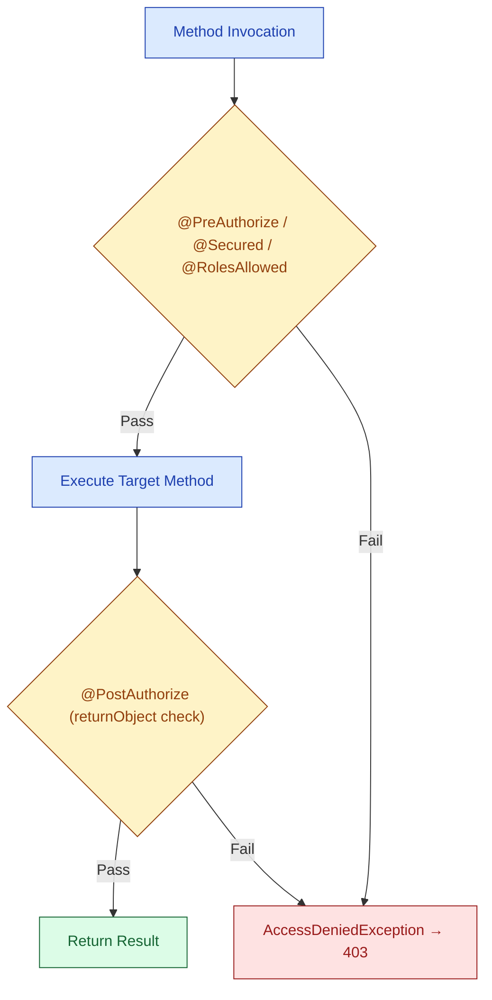

| Annotation | SpEL Support | Evaluation Timing | Typical Use Case |
| :--- | :--- | :--- | :--- |
| `@PreAuthorize` | Yes | Before method execution | Role checks, permission checks, ownership via `#arg` and `@bean` |
| `@PostAuthorize` | Yes | After method execution | Validating `returnObject` belongs to `authentication.principal` |
| `@Secured` | No | Before method execution | Simple `ROLE_*` checks (`@Secured("ROLE_ADMIN")`) |
| `@RolesAllowed` | No (JSR-250) | Before method execution | Standard Java EE/Jakarta role annotation |

> [!IMPORTANT]
> `hasRole('ADMIN')` automatically prepends `ROLE_` (checking `ROLE_ADMIN`), whereas `hasAuthority('ORDER_DELETE')` checks the exact authority string without adding a prefix.

### @PreAuthorize and @PostAuthorize

```java
@Configuration
@EnableMethodSecurity(
    prePostEnabled = true,  // Enable @PreAuthorize/@PostAuthorize
    securedEnabled = true,  // Enable @Secured
    jsr250Enabled = true    // Enable @RolesAllowed
)
public class MethodSecurityConfiguration {
}

@Service
public class OrderService {
    private final OrderRepository orderRepository;

    public OrderService(OrderRepository orderRepository) {
        this.orderRepository = orderRepository;
    }

    // Check role before method execution
    @PreAuthorize("hasRole('ADMIN')")
    public void deleteOrder(Long orderId) {
        orderRepository.deleteById(orderId);
    }

    // Check permission using custom expression
    @PreAuthorize("hasAuthority('ORDER_DELETE')")
    public void cancelOrder(Long orderId) {
        Order order = orderRepository.findById(orderId)
            .orElseThrow(() -> new OrderNotFoundException());
        order.setStatus(OrderStatus.CANCELLED);
        orderRepository.save(order);
    }

    // Check if user owns the order (using authentication principal)
    @PreAuthorize("@authorizationService.isOrderOwner(#orderId, authentication)")
    public Order getOrder(@PathVariable Long orderId) {
        return orderRepository.findById(orderId)
            .orElseThrow(() -> new OrderNotFoundException());
    }

    // Check return value before returning
    @PostAuthorize("returnObject.userId == authentication.principal.userId")
    public Order getOrderForCurrentUser(Long orderId) {
        return orderRepository.findById(orderId)
            .orElseThrow(() -> new OrderNotFoundException());
    }

    // Complex expression
    @PreAuthorize("""
        hasRole('ADMIN') or
        (hasRole('USER') and @authorizationService.isOrderOwner(#orderId, authentication))
        """)
    public void updateOrder(Long orderId, OrderRequest request) {
        Order order = orderRepository.findById(orderId)
            .orElseThrow(() -> new OrderNotFoundException());
        order.setTotal(request.getTotal());
        orderRepository.save(order);
    }
}

@Component
public class AuthorizationService {
    private final OrderRepository orderRepository;

    public AuthorizationService(OrderRepository orderRepository) {
        this.orderRepository = orderRepository;
    }

    public boolean isOrderOwner(Long orderId, Authentication authentication) {
        Order order = orderRepository.findById(orderId)
            .orElseThrow(() -> new OrderNotFoundException());

        CustomUserPrincipal principal = (CustomUserPrincipal) authentication.getPrincipal();
        return order.getUserId().equals(principal.getUser().getId());
    }
}
```

### @Secured and @RolesAllowed

```java
@Service
public class AdminService {

    @Secured("ROLE_ADMIN")  // SpEL not supported
    public void deleteUser(Long userId) {
        // Only ADMIN role can call
    }

    @Secured({"ROLE_ADMIN", "ROLE_SUPER_ADMIN"})  // Multiple roles
    public void viewAuditLogs() {
        // ADMIN or SUPER_ADMIN can call
    }

    @RolesAllowed("ROLE_ADMIN")  // JSR-250 annotation
    public void disableUser(Long userId) {
        // Only ADMIN role can call
    }
}
```

---

## JWT Implementation

Stateless JWT authentication removes server-side HTTP sessions. Every API request carries a signed `Bearer` token validated by `JwtAuthenticationFilter` before `UsernamePasswordAuthenticationFilter`.

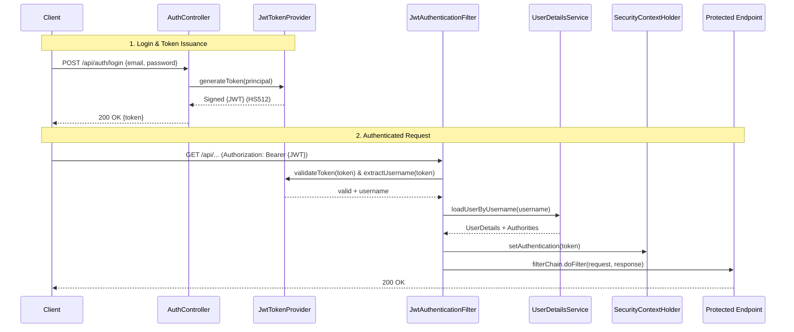

- **`JwtTokenProvider`**: Signs JWTs with `HS512`, embeds `subject`, `userId`, `email`, `roles`, and validates expiration/signatures.
- **`JwtAuthenticationFilter`**: Extends `OncePerRequestFilter`, extracts the `Bearer ` token, validates it, loads `UserDetails`, and populates `SecurityContextHolder`.
- **`JwtSecurityConfiguration`**: Sets `SessionCreationPolicy.STATELESS`, disables CSRF/HTTP Basic, and registers `JwtAuthenticationFilter` before `UsernamePasswordAuthenticationFilter`.
- **`AuthController`**: Exposes `/api/auth/login`, `/api/auth/register`, and `/api/auth/refresh`.

> [!TIP]
> Always configure `SessionCreationPolicy.STATELESS` and register `JwtAuthenticationFilter` with `addFilterBefore(jwtAuthenticationFilter, UsernamePasswordAuthenticationFilter.class)` so Spring Security never creates an `HttpSession`.

### JWT Token Generation and Validation

```xml
<dependency>
    <groupId>io.jsonwebtoken</groupId>
    <artifactId>jjwt-api</artifactId>
    <version>0.12.5</version>
</dependency>
<dependency>
    <groupId>io.jsonwebtoken</groupId>
    <artifactId>jjwt-impl</artifactId>
    <version>0.12.5</version>
    <scope>runtime</scope>
</dependency>
<dependency>
    <groupId>io.jsonwebtoken</groupId>
    <artifactId>jjwt-jackson</artifactId>
    <version>0.12.5</version>
    <scope>runtime</scope>
</dependency>
```

```java
@Component
public class JwtTokenProvider {
    private static final Logger logger = LoggerFactory.getLogger(JwtTokenProvider.class);

    @Value("${app.jwt.secret:your-secret-key-min-256-bits-long}")
    private String jwtSecret;

    @Value("${app.jwt.expiration:3600000}")  // 1 hour in milliseconds
    private long jwtExpirationMs;

    public String generateToken(CustomUserPrincipal principal) {
        Instant now = Instant.now();
        Instant expiresAt = now.plusMillis(jwtExpirationMs);

        return Jwts.builder()
            .subject(principal.getUsername())
            .issuedAt(Date.from(now))
            .expiration(Date.from(expiresAt))
            .claim("userId", principal.getUser().getId())
            .claim("email", principal.getUser().getEmail())
            .claim("roles", principal.getAuthorities().stream()
                .map(GrantedAuthority::getAuthority)
                .collect(Collectors.toList()))
            .signWith(getSigningKey(), SignatureAlgorithm.HS512)
            .compact();
    }

    public String extractUsername(String token) {
        try {
            return getAllClaims(token).getSubject();
        } catch (ExpiredJwtException | UnsupportedJwtException | MalformedJwtException | IllegalArgumentException e) {
            logger.error("Error extracting username from token", e);
            return null;
        }
    }

    public Long extractUserId(String token) {
        try {
            return getAllClaims(token).get("userId", Long.class);
        } catch (ExpiredJwtException | UnsupportedJwtException | MalformedJwtException e) {
            logger.error("Error extracting userId from token", e);
            return null;
        }
    }

    public boolean validateToken(String token) {
        try {
            Jwts.parserBuilder()
                .setSigningKey(getSigningKey())
                .build()
                .parseClaimsJws(token);
            return true;
        } catch (ExpiredJwtException e) {
            logger.error("Expired JWT token", e);
        } catch (UnsupportedJwtException e) {
            logger.error("Unsupported JWT token", e);
        } catch (MalformedJwtException e) {
            logger.error("Invalid JWT token", e);
        } catch (IllegalArgumentException e) {
            logger.error("JWT claims string is empty", e);
        }
        return false;
    }

    private Claims getAllClaims(String token) {
        return Jwts.parserBuilder()
            .setSigningKey(getSigningKey())
            .build()
            .parseClaimsJws(token)
            .getBody();
    }

    private Key getSigningKey() {
        byte[] keyBytes = Decoders.BASE64.decode(jwtSecret);
        return Keys.hmacShaKeyFor(keyBytes);
    }
}
```

### JWT Filter

```java
@Component
public class JwtAuthenticationFilter extends OncePerRequestFilter {
    private static final Logger logger = LoggerFactory.getLogger(JwtAuthenticationFilter.class);
    private static final String BEARER_PREFIX = "Bearer ";

    private final JwtTokenProvider jwtTokenProvider;
    private final UserDetailsService userDetailsService;

    public JwtAuthenticationFilter(JwtTokenProvider jwtTokenProvider,
                                  UserDetailsService userDetailsService) {
        this.jwtTokenProvider = jwtTokenProvider;
        this.userDetailsService = userDetailsService;
    }

    @Override
    protected void doFilterInternal(HttpServletRequest request,
                                   HttpServletResponse response,
                                   FilterChain filterChain) throws ServletException, IOException {

        try {
            // Extract JWT from Authorization header
            String token = extractTokenFromRequest(request);

            if (token != null && jwtTokenProvider.validateToken(token)) {
                // Extract username and load user details
                String username = jwtTokenProvider.extractUsername(token);
                UserDetails userDetails = userDetailsService.loadUserByUsername(username);

                // Create authentication token
                UsernamePasswordAuthenticationToken authentication =
                    new UsernamePasswordAuthenticationToken(
                        userDetails,
                        null,
                        userDetails.getAuthorities()
                    );

                // Set authentication in SecurityContext
                SecurityContextHolder.getContext().setAuthentication(authentication);

                logger.debug("User authenticated: {}", username);
            }

        } catch (Exception e) {
            logger.error("Could not set user authentication", e);
        }

        // Continue filter chain
        filterChain.doFilter(request, response);
    }

    private String extractTokenFromRequest(HttpServletRequest request) {
        String authHeader = request.getHeader("Authorization");

        if (authHeader != null && authHeader.startsWith(BEARER_PREFIX)) {
            return authHeader.substring(BEARER_PREFIX.length());
        }

        return null;
    }
}
```

### JWT Configuration

```java
@Configuration
@EnableWebSecurity
public class JwtSecurityConfiguration {

    private final JwtAuthenticationFilter jwtAuthenticationFilter;

    public JwtSecurityConfiguration(JwtAuthenticationFilter jwtAuthenticationFilter) {
        this.jwtAuthenticationFilter = jwtAuthenticationFilter;
    }

    @Bean
    public SecurityFilterChain filterChain(HttpSecurity http) throws Exception {
        http
            .csrf(csrf -> csrf.disable())  // Disable CSRF for API
            .authorizeHttpRequests(authz -> authz
                .requestMatchers("/api/auth/**").permitAll()
                .requestMatchers("/api/admin/**").hasRole("ADMIN")
                .requestMatchers("/api/**").authenticated()
                .anyRequest().authenticated()
            )
            .httpBasic(basic -> basic.disable())  // Disable HTTP Basic
            .sessionManagement(session -> session
                .sessionCreationPolicy(SessionCreationPolicy.STATELESS)  // No session
            )
            .addFilterBefore(jwtAuthenticationFilter, UsernamePasswordAuthenticationFilter.class);

        return http.build();
    }

    @Bean
    public PasswordEncoder passwordEncoder() {
        return new BCryptPasswordEncoder(12);
    }

    @Bean
    public AuthenticationManager authenticationManager(
        UserDetailsService userDetailsService,
        PasswordEncoder passwordEncoder) {

        DaoAuthenticationProvider authProvider = new DaoAuthenticationProvider();
        authProvider.setUserDetailsService(userDetailsService);
        authProvider.setPasswordEncoder(passwordEncoder);

        return new ProviderManager(authProvider);
    }
}
```

### JWT Login Controller

```java
@RestController
@RequestMapping("/api/auth")
public class AuthController {
    private final AuthenticationManager authenticationManager;
    private final JwtTokenProvider jwtTokenProvider;
    private final UserRepository userRepository;

    public AuthController(AuthenticationManager authenticationManager,
                        JwtTokenProvider jwtTokenProvider,
                        UserRepository userRepository) {
        this.authenticationManager = authenticationManager;
        this.jwtTokenProvider = jwtTokenProvider;
        this.userRepository = userRepository;
    }

    @PostMapping("/login")
    public ResponseEntity<AuthResponse> login(@RequestBody LoginRequest request) {
        try {
            // Authenticate user
            Authentication authentication = authenticationManager.authenticate(
                new UsernamePasswordAuthenticationToken(
                    request.getEmail(),
                    request.getPassword()
                )
            );

            // Get authenticated user
            CustomUserPrincipal principal = (CustomUserPrincipal) authentication.getPrincipal();

            // Generate JWT token
            String jwtToken = jwtTokenProvider.generateToken(principal);

            return ResponseEntity.ok(new AuthResponse(jwtToken));

        } catch (BadCredentialsException e) {
            return ResponseEntity.status(HttpStatus.UNAUTHORIZED)
                .body(new AuthResponse("Invalid email or password"));
        }
    }

    @PostMapping("/register")
    public ResponseEntity<AuthResponse> register(@RequestBody RegisterRequest request) {
        if (userRepository.existsByEmail(request.getEmail())) {
            return ResponseEntity.badRequest()
                .body(new AuthResponse("Email already registered"));
        }

        User user = new User();
        user.setEmail(request.getEmail());
        user.setPassword(new BCryptPasswordEncoder(12).encode(request.getPassword()));
        user.setFirstName(request.getFirstName());
        user.setLastName(request.getLastName());
        user.setEnabled(true);
        user.setLocked(false);

        User savedUser = userRepository.save(user);

        // Auto-login after registration
        CustomUserPrincipal principal = new CustomUserPrincipal(savedUser);
        String jwtToken = jwtTokenProvider.generateToken(principal);

        return ResponseEntity.status(HttpStatus.CREATED)
            .body(new AuthResponse(jwtToken));
    }

    @PostMapping("/refresh")
    public ResponseEntity<AuthResponse> refresh(HttpServletRequest request) {
        String token = extractTokenFromRequest(request);

        if (token == null || !jwtTokenProvider.validateToken(token)) {
            return ResponseEntity.status(HttpStatus.UNAUTHORIZED).build();
        }

        String username = jwtTokenProvider.extractUsername(token);
        UserDetails userDetails = loadUserByUsername(username);

        String newToken = jwtTokenProvider.generateToken((CustomUserPrincipal) userDetails);

        return ResponseEntity.ok(new AuthResponse(newToken));
    }

    private String extractTokenFromRequest(HttpServletRequest request) {
        String authHeader = request.getHeader("Authorization");
        if (authHeader != null && authHeader.startsWith("Bearer ")) {
            return authHeader.substring(7);
        }
        return null;
    }
}
```

---

## OAuth 2.0

Spring Boot provides distinct starters for validating incoming OAuth 2.0 tokens (**Resource Server**) vs delegating user login to external providers like Google or GitHub (**OAuth 2.0 Client**).

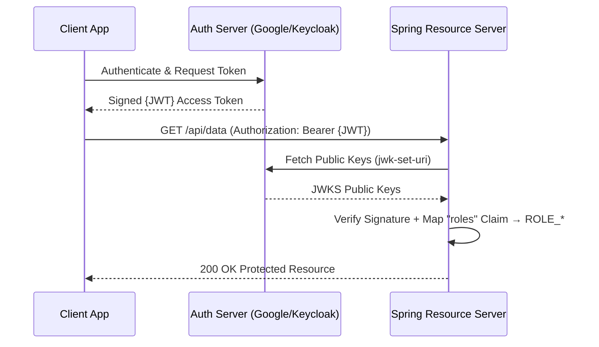

| Role | Starter Dependency | Key Configuration | Purpose |
| :--- | :--- | :--- | :--- |
| **Resource Server** | `spring-boot-starter-oauth2-resource-server` | `issuer-uri`, `jwk-set-uri`, `JwtAuthenticationConverter` | Validates Bearer JWTs issued by an external Authorization Server |
| **OAuth 2.0 Client** | `spring-boot-starter-oauth2-client` | `client-id`, `client-secret`, `scope`, `provider.issuer-uri` | Logs users in via third-party OAuth2/OIDC providers (Google, GitHub) |

> [!NOTE]
> Use `JwtGrantedAuthoritiesConverter` to map custom JWT claim names (like `"roles"`) and prefixes (`"ROLE_"`) so `@PreAuthorize("hasRole('ADMIN')")` works out of the box with OAuth 2.0 tokens.

### OAuth 2.0 Resource Server

```xml
<dependency>
    <groupId>org.springframework.boot</groupId>
    <artifactId>spring-boot-starter-oauth2-resource-server</artifactId>
</dependency>
```

```yaml
# application.yml
spring:
  security:
    oauth2:
      resourceserver:
        jwt:
          issuer-uri: https://auth.example.com
          jwk-set-uri: https://auth.example.com/.well-known/jwks.json
```

```java
@Configuration
@EnableWebSecurity
public class OAuth2ResourceServerConfiguration {

    @Bean
    public SecurityFilterChain filterChain(HttpSecurity http) throws Exception {
        http
            .authorizeHttpRequests(authz -> authz
                .requestMatchers("/public/**").permitAll()
                .requestMatchers("/api/**").authenticated()
                .anyRequest().authenticated()
            )
            .oauth2ResourceServer(oauth2 -> oauth2
                .jwt(jwt -> jwt
                    .jwtAuthenticationConverter(jwtAuthenticationConverter())
                )
            );

        return http.build();
    }

    @Bean
    public JwtAuthenticationConverter jwtAuthenticationConverter() {
        JwtGrantedAuthoritiesConverter authoritiesConverter = new JwtGrantedAuthoritiesConverter();
        authoritiesConverter.setAuthoritiesClaimName("roles");
        authoritiesConverter.setAuthorityPrefix("ROLE_");

        JwtAuthenticationConverter converter = new JwtAuthenticationConverter();
        converter.setJwtGrantedAuthoritiesConverter(authoritiesConverter);

        return converter;
    }
}
```

### OAuth 2.0 Authorization Server Client

```xml
<dependency>
    <groupId>org.springframework.boot</groupId>
    <artifactId>spring-boot-starter-oauth2-client</artifactId>
</dependency>
```

```yaml
# application.yml
spring:
  security:
    oauth2:
      client:
        registration:
          google:
            client-id: your-client-id
            client-secret: your-client-secret
            scope: openid,profile,email
          github:
            client-id: your-client-id
            client-secret: your-client-secret
            scope: read:user
        provider:
          google:
            issuer-uri: https://accounts.google.com
          github:
            issuer-uri: https://github.com
```

---

## CORS and CSRF

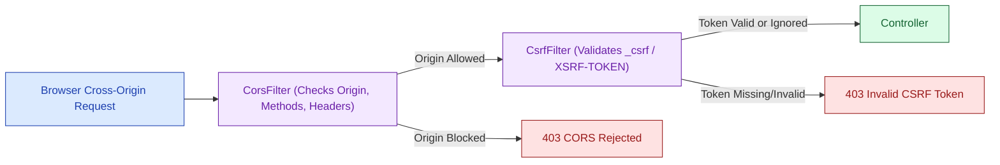

| Mechanism | Protects Against | How It Works | When to Enable / Disable |
| :--- | :--- | :--- | :--- |
| **CORS** | Unauthorized cross-origin browser reads/calls | Browser sends preflight `OPTIONS`; server returns `Access-Control-Allow-*` | Configure `CorsConfigurationSource` inside `SecurityFilterChain` for SPAs |
| **CSRF** | Forged state-changing requests via ambient cookies | Synchronizer token pattern (`CookieCsrfTokenRepository` / hidden `_csrf` field) | **Enable** for session/cookie apps; **disable** only for stateless `Bearer` JWT APIs |

> [!WARNING]
> Only disable CSRF (`csrf.disable()`) for stateless APIs using `Authorization: Bearer` headers. If your application relies on cookies for authentication, keep CSRF protection enabled.

### CORS Configuration

```java
@Configuration
public class CorsConfiguration {

    @Bean
    public WebMvcConfigurer corsConfigurer() {
        return new WebMvcConfigurer() {
            @Override
            public void addCorsMappings(CorsRegistry registry) {
                registry.addMapping("/api/**")
                    .allowedOrigins("https://example.com")
                    .allowedMethods("GET", "POST", "PUT", "DELETE")
                    .allowedHeaders("*")
                    .allowCredentials(true)
                    .maxAge(3600);
            }
        };
    }
}

// OR via SecurityFilterChain
@Configuration
@EnableWebSecurity
public class SecurityConfiguration {

    @Bean
    public SecurityFilterChain filterChain(HttpSecurity http) throws Exception {
        http
            .cors(cors -> cors.configurationSource(corsConfigurationSource()))
            .csrf(csrf -> csrf.disable());

        return http.build();
    }

    @Bean
    public CorsConfigurationSource corsConfigurationSource() {
        CorsConfiguration configuration = new CorsConfiguration();
        configuration.setAllowedOrigins(List.of("https://example.com"));
        configuration.setAllowedMethods(List.of("GET", "POST", "PUT", "DELETE"));
        configuration.setAllowedHeaders(List.of("*"));
        configuration.setAllowCredentials(true);

        UrlBasedCorsConfigurationSource source = new UrlBasedCorsConfigurationSource();
        source.registerCorsConfiguration("/api/**", configuration);
        return source;
    }
}
```

### CSRF Protection

```java
@Configuration
@EnableWebSecurity
public class SecurityConfiguration {

    @Bean
    public SecurityFilterChain filterChain(HttpSecurity http) throws Exception {
        http
            .csrf(csrf -> csrf
                .csrfTokenRepository(CookieCsrfTokenRepository.withHttpOnlyFalse())
                .ignoringRequestMatchers("/api/**", "/h2-console/**")
            );

        return http.build();
    }
}

// Client-side: Include CSRF token in POST/PUT/DELETE requests
@RestController
public class FormController {
    @GetMapping("/form")
    public String getForm(Model model, CsrfToken csrfToken) {
        model.addAttribute("_csrf", csrfToken);
        return "form";
    }
}
```

---

## Security Headers

`HeaderWriterFilter` attaches browser-enforced defense-in-depth headers to every HTTP response.

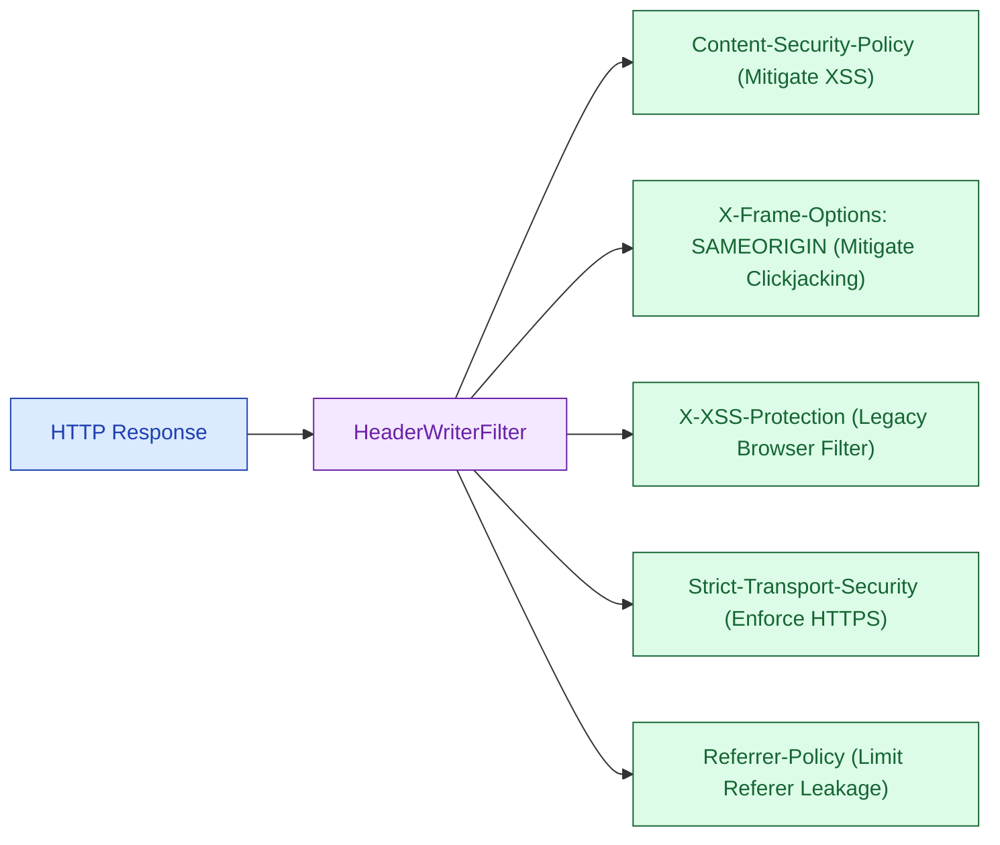

| Header | Configured Value | Security Benefit |
| :--- | :--- | :--- |
| `Content-Security-Policy` | `default-src 'self'; script-src 'self' 'unsafe-inline'` | Restricts where scripts and resources can load from |
| `X-Frame-Options` | `SAMEORIGIN` | Prevents clickjacking by blocking cross-origin `<iframe>` embedding |
| `X-XSS-Protection` | `1` (`HeaderValue.ENABLED`) | Enables legacy browser XSS filter |
| `Strict-Transport-Security` | `max-age=31536000; includeSubDomains` | Forces HTTPS connections for 1 year across subdomains |
| `Referrer-Policy` | `strict-origin-when-cross-origin` | Limits `Referer` header leakage on cross-origin navigation |

> [!TIP]
> Avoid `'unsafe-inline'` in `Content-Security-Policy` in production whenever possible; prefer script nonces or hashes for strict XSS defense.

```java
@Configuration
@EnableWebSecurity
public class SecurityConfiguration {

    @Bean
    public SecurityFilterChain filterChain(HttpSecurity http) throws Exception {
        http
            .headers(headers -> headers
                // Content Security Policy
                .contentSecurityPolicy(csp -> csp
                    .policyDirectives("default-src 'self'; script-src 'self' 'unsafe-inline'")
                )
                // X-Frame-Options
                .frameOptions(frameOptions -> frameOptions.sameOrigin())
                // X-Content-Type-Options
                .xssProtection(xss -> xss.headerValue(XXssProtectionHeaderWriter.HeaderValue.ENABLED))
                // Strict-Transport-Security
                .httpStrictTransportSecurity(hsts -> hsts
                    .includeSubDomains(true)
                    .maxAgeInSeconds(31536000)
                )
                // Referrer-Policy
                .referrerPolicy(referrer -> referrer
                    .policy(ReferrerPolicyHeaderWriter.ReferrerPolicy.STRICT_ORIGIN_WHEN_CROSS_ORIGIN)
                )
            );

        return http.build();
    }
}
```

---

## Role vs Permission-Based Access

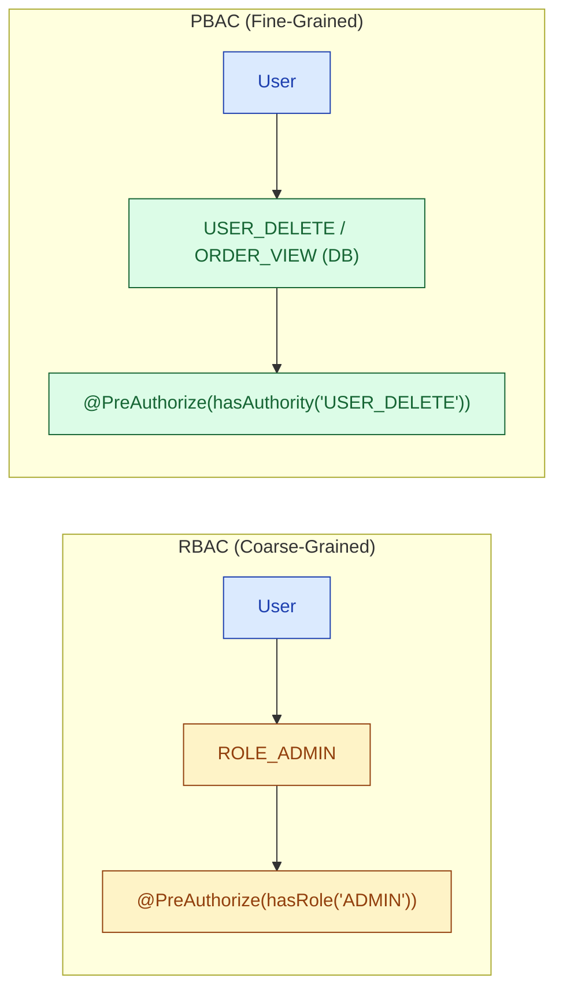

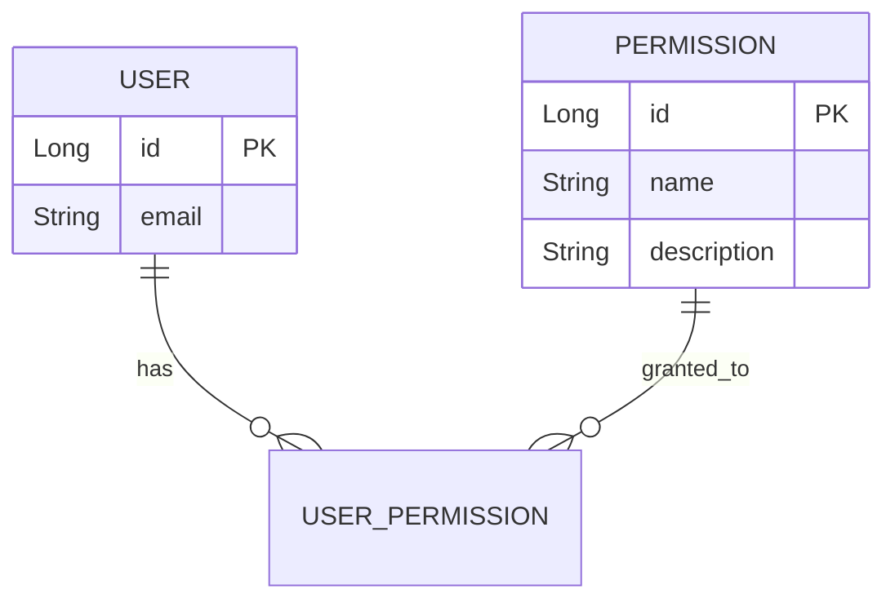

| Aspect | Role-Based (RBAC) | Permission-Based (PBAC) |
| :--- | :--- | :--- |
| **Granularity** | Coarse (`ADMIN`, `USER`) | Fine-grained (`USER_DELETE`, `ORDER_VIEW`) |
| **Flexibility** | Brittle; changing privileges requires code changes | Dynamic; permissions updated in database without redeploying |
| **Spring Expression** | `hasRole('ADMIN')` | `hasAuthority('USER_DELETE')` |

> [!NOTE]
> You can combine both patterns: group permissions into roles in the database, then flatten all `Permission` names into `GrantedAuthority` instances inside `UserDetailsService`.

### Role-Based Access Control (RBAC)

```java
// User has roles: ADMIN, USER
// Check if user has role

@PreAuthorize("hasRole('ADMIN')")
public void deleteUser(Long userId) { }

// Problem: Brittle, can't change permissions without code change
```

### Permission-Based Access Control (PBAC)

```java
// User has permissions: USER_DELETE, USER_CREATE, ORDER_VIEW
// More granular and flexible
@PreAuthorize("hasAuthority('USER_DELETE')")
public void deleteUser(Long userId) { }

@PreAuthorize("hasAuthority('ORDER_VIEW')")
public void viewOrder(Long orderId) { }

// User granted permissions dynamically from database
// Can change permissions without code change
```

### Implementation

```java
@Entity
public class User {
    @Id
    @GeneratedValue(strategy = GenerationType.IDENTITY)
    private Long id;

    private String email;

    @ManyToMany(fetch = FetchType.EAGER)
    @JoinTable(
        name = "user_permission",
        joinColumns = @JoinColumn(name = "user_id"),
        inverseJoinColumns = @JoinColumn(name = "permission_id")
    )
    private Set<Permission> permissions = new HashSet<>();
}

@Entity
public class Permission {
    @Id
    @GeneratedValue(strategy = GenerationType.IDENTITY)
    private Long id;

    private String name;  // e.g., "USER_DELETE", "ORDER_CREATE"

    private String description;
}

@Service
public class CustomUserDetailsService implements UserDetailsService {
    private final UserRepository userRepository;

    @Override
    public UserDetails loadUserByUsername(String username) throws UsernameNotFoundException {
        User user = userRepository.findByEmail(username)
            .orElseThrow(() -> new UsernameNotFoundException("User not found"));

        // Convert permissions to authorities
        List<GrantedAuthority> authorities = user.getPermissions().stream()
            .map(permission -> new SimpleGrantedAuthority(permission.getName()))
            .collect(Collectors.toList());

        return new org.springframework.security.core.userdetails.User(
            user.getEmail(),
            user.getPassword(),
            authorities
        );
    }
}

// Usage
@PreAuthorize("hasAuthority('USER_DELETE')")  // Check specific permission
public void deleteUser(Long userId) { }
```

---

## Common Vulnerabilities

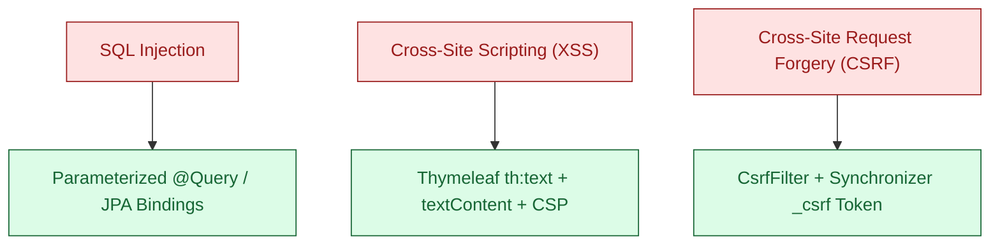

| Vulnerability | Vulnerable Pattern | Safe Spring Pattern |
| :--- | :--- | :--- |
| **SQL Injection** | String concatenation (`"... WHERE email = '" + email + "'"`) | Parameterized JPQL/SQL (`@Query("... WHERE u.email = :email")`) |
| **XSS** | `th:utext="${user.name}"` or `element.innerHTML` | `th:text="${user.name}"`, `element.textContent`, strict `CSP` |
| **CSRF** | Missing CSRF validation on cookie-authenticated POST forms | `CookieCsrfTokenRepository` + hidden `_csrf` input |

> [!CAUTION]
> Never use `th:utext` or `innerHTML` with untrusted user input, and never concatenate raw parameters into SQL or JPQL strings.

### SQL Injection Prevention

```java
// VULNERABLE: String concatenation
String sql = "SELECT * FROM users WHERE email = '" + email + "'";

// SAFE: Parameterized queries (Spring Data does this automatically)
@Query("SELECT u FROM User u WHERE u.email = :email")
Optional<User> findByEmail(@Param("email") String email);

// Spring uses parameterized queries automatically
// Never concatenate user input into SQL
```

### Cross-Site Scripting (XSS) Prevention

```java
// Server-side: Always encode output
// Spring templates (Thymeleaf) encode by default
<h1 th:text="${user.name}"></h1>  <!-- Safe -->
<h1 th:utext="${user.name}"></h1> <!-- Dangerous, unescaped -->

// JavaScript: Use textContent instead of innerHTML
document.getElementById("name").textContent = userData.name;  // Safe
document.getElementById("name").innerHTML = userData.name;    // Dangerous

// Content-Security-Policy header prevents inline scripts
.contentSecurityPolicy(csp -> csp
    .policyDirectives("default-src 'self'; script-src 'self'")
)
```

### CSRF Prevention

```java
// Spring Security handles CSRF automatically
// Requires CSRF token in POST/PUT/DELETE requests

@Configuration
@EnableWebSecurity
public class SecurityConfiguration {
    @Bean
    public SecurityFilterChain filterChain(HttpSecurity http) throws Exception {
        http.csrf(csrf -> csrf.csrfTokenRepository(CookieCsrfTokenRepository.withHttpOnlyFalse()));
        return http.build();
    }
}

// Client includes token in forms
<form method="POST">
    <input type="hidden" name="_csrf" value="${_csrf.token}">
    <!-- Form fields -->
</form>
```

---

## Testing Security

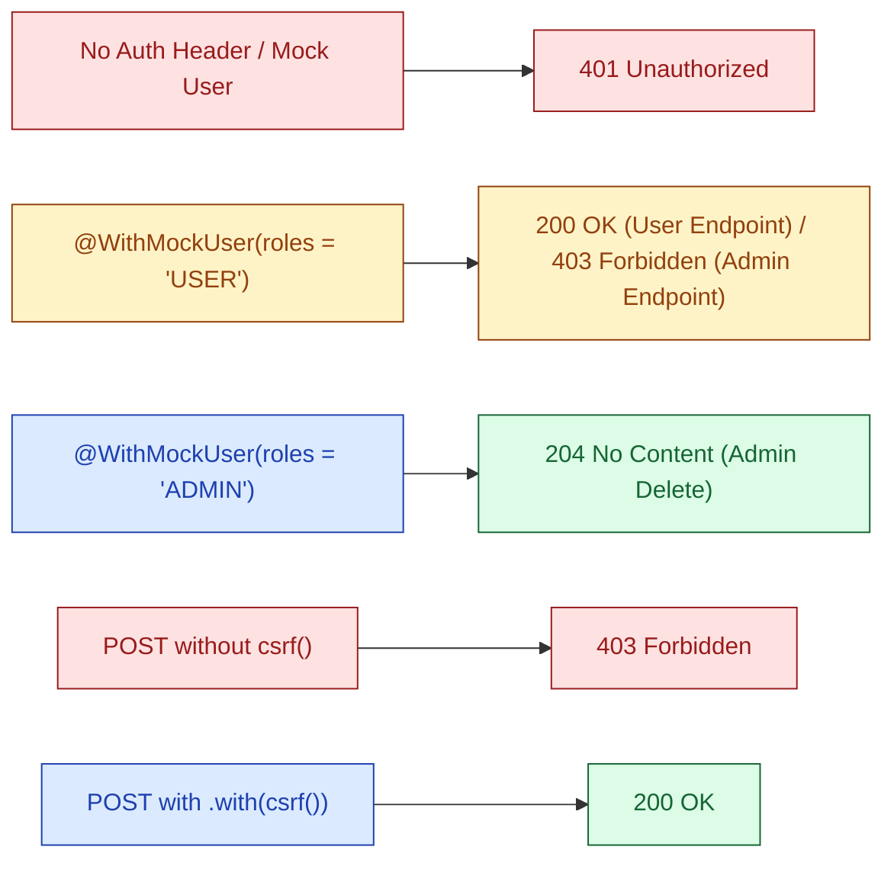

| Test Utility | Purpose | Expected Outcome |
| :--- | :--- | :--- |
| No authentication | Verify protected endpoints reject anonymous users | `status().isUnauthorized()` (`401`) |
| `@WithMockUser(username, roles)` | Simulate authenticated principal with specific roles | `200`/`204` if authorized, `403` if role lacks permission |
| `SecurityMockMvcRequestPostProcessors.csrf()` | Attach valid CSRF token to `MockMvc` `POST`/`PUT`/`DELETE` | Prevents `403 Forbidden` when CSRF is enabled |

> [!TIP]
> Always test all three security states for sensitive endpoints: unauthenticated (`401`), authenticated without required role (`403`), and authenticated with required role (`200`/`204`).

### @WithMockUser

```java
@SpringBootTest
public class OrderControllerSecurityTest {
    @Autowired
    private MockMvc mockMvc;

    // Unauthenticated request
    @Test
    public void testGetOrderUnauthenticated() throws Exception {
        mockMvc.perform(get("/api/orders/1"))
            .andExpect(status().isUnauthorized());
    }

    // Authenticated as user
    @Test
    @WithMockUser(username = "user@example.com", roles = "USER")
    public void testGetOrderAuthenticated() throws Exception {
        mockMvc.perform(get("/api/orders/1"))
            .andExpect(status().isOk());
    }

    // Authenticated as admin
    @Test
    @WithMockUser(roles = "ADMIN")
    public void testDeleteOrderAsAdmin() throws Exception {
        mockMvc.perform(delete("/api/orders/1"))
            .andExpect(status().isNoContent());
    }

    // User without permission
    @Test
    @WithMockUser(roles = "USER")
    public void testDeleteOrderAsUser() throws Exception {
        mockMvc.perform(delete("/api/orders/1"))
            .andExpect(status().isForbidden());
    }
}
```

### Using SecurityMockMvcRequestPostProcessors

```java
@SpringBootTest
public class AuthControllerTest {
    @Autowired
    private MockMvc mockMvc;

    @Test
    public void testLoginWithValidCredentials() throws Exception {
        mockMvc.perform(
            post("/api/auth/login")
                .contentType(MediaType.APPLICATION_JSON)
                .content("{\"email\":\"user@example.com\",\"password\":\"password\"}")
        )
            .andExpect(status().isOk())
            .andExpect(jsonPath("$.token").exists());
    }

    @Test
    public void testCsrfProtection() throws Exception {
        mockMvc.perform(
            post("/api/data")
                .contentType(MediaType.APPLICATION_JSON)
                .content("{}")
        )
            .andExpect(status().isForbidden());  // CSRF token missing
    }

    @Test
    public void testWithCsrfToken() throws Exception {
        mockMvc.perform(
            post("/api/data")
                .contentType(MediaType.APPLICATION_JSON)
                .content("{}")
                .with(csrf())  // SecurityMockMvcRequestPostProcessors.csrf()
        )
            .andExpect(status().isOk());
    }
}
```

---

## Interview Questions

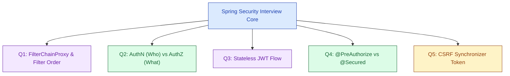

### Q1: Explain the Spring Security filter chain.

**Answer:**
Spring Security uses a `FilterChainProxy` that orchestrates multiple security filters in order, allowing the request to pass through to `DispatcherServlet` only if all succeed:
1. `SecurityContextPersistenceFilter`: Loads/saves `SecurityContext`
2. `UsernamePasswordAuthenticationFilter`: Handles form login
3. `BasicAuthenticationFilter`: Handles HTTP Basic auth
4. `ExceptionTranslationFilter`: Handles authentication/authorization exceptions
5. `FilterSecurityInterceptor`: Performs authorization checks

### Q2: What's the difference between authentication and authorization?

**Answer:**
- **Authentication**: Verifying who you are (login with credentials), handled via `UserDetailsService` and `AuthenticationManager`.
- **Authorization**: Verifying what you're allowed to do (access control), handled via URL rules and `@PreAuthorize`/`@PostAuthorize`.

### Q3: How do you implement JWT authentication in Spring?

**Answer:**
1. Create `JwtTokenProvider` to generate/validate JWT tokens (containing user info and roles).
2. Create `JwtAuthenticationFilter` (`OncePerRequestFilter`) to extract the token from the request and populate `SecurityContextHolder`.
3. Register the filter in `SecurityFilterChain` before `UsernamePasswordAuthenticationFilter`.
4. Disable session management (`SessionCreationPolicy.STATELESS`).
5. Provide a login endpoint that authenticates credentials and returns the JWT token.

### Q4: Explain @PreAuthorize vs @Secured.

**Answer:**
- **`@PreAuthorize`**: Supports Spring EL (SpEL) expressions, making it more powerful and preferred for custom expressions like `@PreAuthorize("@authService.canAccess(#id)")`.
- **`@Secured`**: Simple role checking only, with no SpEL support.

### Q5: How does Spring prevent CSRF attacks?

**Answer:**
Spring uses the **synchronizer token pattern**: `CsrfFilter` (when enabled in `SecurityFilterChain`) generates a unique, random CSRF token per request stored in the session or cookie, includes it in a hidden form field, and validates it on state-changing `POST`/`PUT`/`DELETE` requests — rejecting any request with a missing or mismatched token.
