# Spring Boot Testing and Performance Optimization - Deep Dive

## Table of Contents
1. [Testing Pyramid](#testing-pyramid)
2. [Unit Testing](#unit-testing)
3. [Integration Testing](#integration-testing)
4. [Slice Tests](#slice-tests)
5. [MockMvc and Controllers](#mockmvc-and-controllers)
6. [Testcontainers](#testcontainers)
7. [Test Profiles and Configuration](#test-profiles-and-configuration)
8. [Performance Tuning](#performance-tuning)
9. [Caching](#caching)
10. [Async Processing](#async-processing)
11. [Scheduling](#scheduling)
12. [Logging](#logging)
13. [Monitoring with Micrometer](#monitoring-with-micrometer)
14. [Interview Questions](#interview-questions)

---

## Testing Pyramid

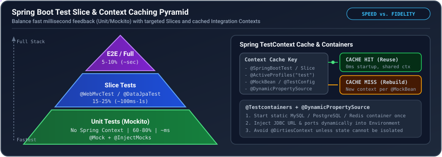

| Layer | Share | Spring Context | Dependencies | Speed | Primary Focus |
| :--- | :--- | :--- | :--- | :--- | :--- |
| **Unit Tests** | 60–80% | None | Mocked (`@Mock`) | Milliseconds | Single component logic, happy paths, edge cases |
| **Integration / Slice Tests** | 15–25% | Partial or Full | Real DB / Testcontainers / `@MockBean` | Seconds | Component wiring, web layer, JPA queries, migrations |
| **E2E Tests** | 5–10% | Full Stack | Real DB & external services | Minutes | Critical end-to-end user flows |

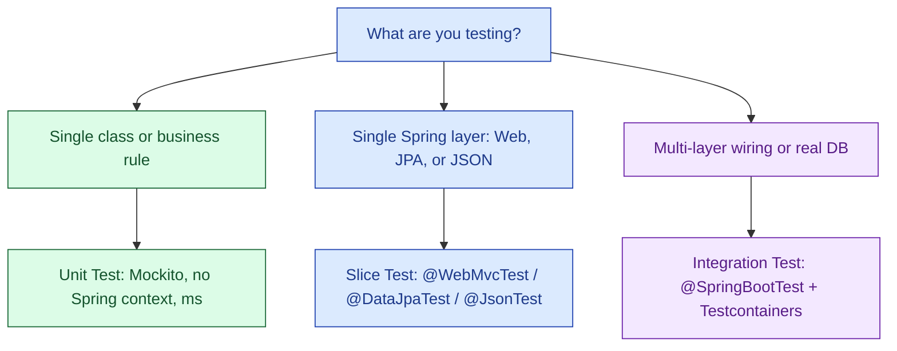

> [!TIP]
> Keep 60–80% of your suite as context-free unit tests for sub-second feedback, use slice tests for framework wiring, and reserve `@SpringBootTest` + Testcontainers for critical integration paths.

---

## Unit Testing

Unit tests isolate a single class without starting a Spring `ApplicationContext`, using Mockito to stub collaborators and verify interactions.

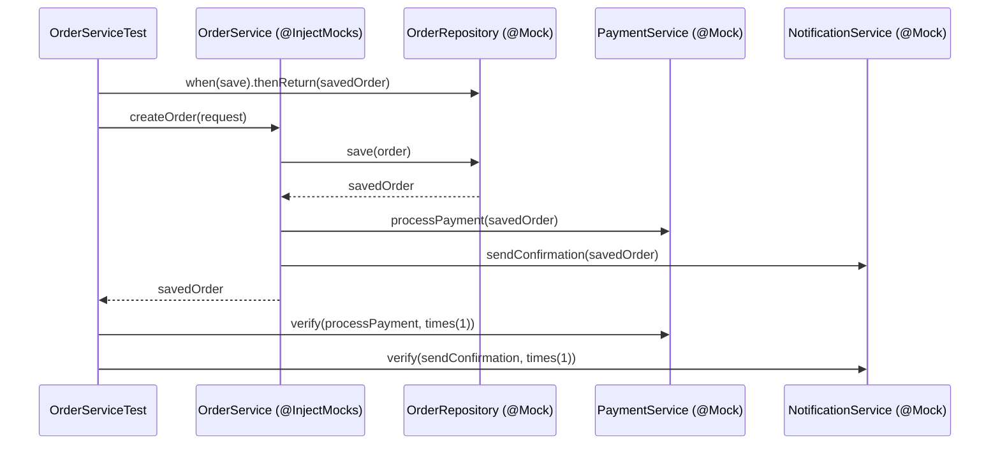

> [!NOTE]
> Use `@Mock` for pure stubbed collaborators, `@Spy` to wrap a real instance while still verifying calls, and `@InjectMocks` to inject those mocks into the class under test.

### Unit Test with Mockito

```java
@Service
public class OrderService {
    private final OrderRepository orderRepository;
    private final PaymentService paymentService;
    private final NotificationService notificationService;

    public OrderService(OrderRepository orderRepository,
                       PaymentService paymentService,
                       NotificationService notificationService) {
        this.orderRepository = orderRepository;
        this.paymentService = paymentService;
        this.notificationService = notificationService;
    }

    public Order createOrder(OrderRequest request) {
        Order order = new Order();
        order.setItems(request.getItems());
        order.setTotal(request.getTotal());

        Order savedOrder = orderRepository.save(order);

        paymentService.processPayment(savedOrder);

        notificationService.sendConfirmation(savedOrder);

        return savedOrder;
    }
}

@Test  // No @SpringBootTest - unit test without context
public class OrderServiceTest {
    @Mock
    private OrderRepository orderRepository;

    @Mock
    private PaymentService paymentService;

    @Mock
    private NotificationService notificationService;

    @InjectMocks
    private OrderService orderService;

    @BeforeEach
    public void setup() {
        MockitoAnnotations.openMocks(this);
    }

    @Test
    public void testCreateOrder_Success() {
        // Arrange
        OrderRequest request = new OrderRequest();
        request.setItems(List.of(new OrderItem()));
        request.setTotal(new BigDecimal("100.00"));

        Order savedOrder = new Order();
        savedOrder.setId(1L);
        savedOrder.setItems(request.getItems());
        savedOrder.setTotal(request.getTotal());

        // Mock repository to return saved order
        when(orderRepository.save(any(Order.class)))
            .thenReturn(savedOrder);

        // Act
        Order result = orderService.createOrder(request);

        // Assert
        assertNotNull(result);
        assertEquals(1L, result.getId());
        assertEquals(new BigDecimal("100.00"), result.getTotal());

        // Verify interactions
        verify(orderRepository, times(1)).save(any(Order.class));
        verify(paymentService, times(1)).processPayment(savedOrder);
        verify(notificationService, times(1)).sendConfirmation(savedOrder);
    }

    @Test
    public void testCreateOrder_PaymentFailure() {
        // Arrange
        OrderRequest request = new OrderRequest();
        request.setItems(List.of(new OrderItem()));
        request.setTotal(new BigDecimal("100.00"));

        Order savedOrder = new Order();
        savedOrder.setId(1L);

        when(orderRepository.save(any(Order.class)))
            .thenReturn(savedOrder);

        // Mock payment service to throw exception
        doThrow(new PaymentException("Payment failed"))
            .when(paymentService)
            .processPayment(any(Order.class));

        // Act & Assert
        assertThrows(PaymentException.class, () -> {
            orderService.createOrder(request);
        });

        // Verify notification NOT sent on payment failure
        verify(notificationService, never()).sendConfirmation(any(Order.class));
    }

    @Test
    public void testCreateOrder_SpyOnRealObject() {
        // Spy: tracks calls but uses real implementation
        OrderRepository spyRepository = spy(new OrderRepository());

        OrderService service = new OrderService(spyRepository, paymentService, notificationService);

        // Real repository call happens, but we can verify it
        Order result = service.createOrder(new OrderRequest());

        verify(spyRepository, times(1)).save(any(Order.class));
    }
}
```

---

## Integration Testing

`@SpringBootTest` boots the full Spring `ApplicationContext` so you can verify HTTP routing, serialization, services, and persistence together.

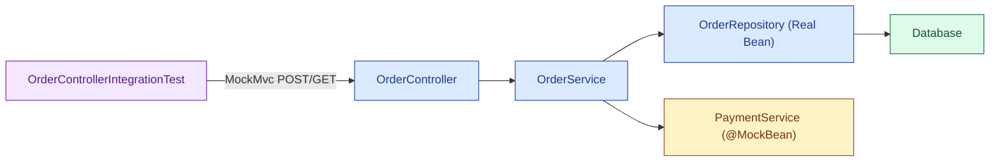

> [!IMPORTANT]
> `@MockBean` replaces a bean inside the Spring `ApplicationContext` (unlike Mockito's `@Mock`). Each unique combination of `@MockBean` definitions creates a separate context cache key, which can slow down large test suites.

### @SpringBootTest Integration Test

```java
@SpringBootTest
public class OrderControllerIntegrationTest {
    @Autowired
    private OrderRepository orderRepository;

    @Autowired
    private MockMvc mockMvc;

    @Autowired
    private ObjectMapper objectMapper;

    @MockBean  // Spring bean mock, not Mockito mock
    private PaymentService paymentService;

    @BeforeEach
    public void setup() {
        orderRepository.deleteAll();
    }

    @Test
    public void testCreateOrder_Integration() throws Exception {
        // Arrange
        OrderRequest request = new OrderRequest();
        request.setItems(List.of(new OrderItem()));
        request.setTotal(new BigDecimal("100.00"));

        Order savedOrder = new Order();
        savedOrder.setId(1L);
        when(paymentService.processPayment(any())).thenReturn(true);

        // Act & Assert
        mockMvc.perform(
            post("/api/orders")
                .contentType(MediaType.APPLICATION_JSON)
                .content(objectMapper.writeValueAsString(request))
        )
            .andExpect(status().isCreated())
            .andExpect(jsonPath("$.id").isNumber())
            .andExpect(jsonPath("$.total").value(100.00));

        // Verify order was actually saved
        List<Order> orders = orderRepository.findAll();
        assertEquals(1, orders.size());
    }

    @Test
    public void testGetOrder_Integration() throws Exception {
        // Arrange
        Order order = new Order();
        order.setItems(List.of(new OrderItem()));
        order.setTotal(new BigDecimal("50.00"));
        Order savedOrder = orderRepository.save(order);

        // Act & Assert
        mockMvc.perform(get("/api/orders/" + savedOrder.getId()))
            .andExpect(status().isOk())
            .andExpect(jsonPath("$.id").value(savedOrder.getId()))
            .andExpect(jsonPath("$.total").value(50.00));
    }
}
```

---

## Slice Tests

Slice tests load only the auto-configuration and beans relevant to a single architectural layer, keeping startup fast while still testing real Spring behavior.

| Slice Annotation | Loaded Beans / Tools | Mocked / Excluded | Typical Use Case |
| :--- | :--- | :--- | :--- |
| **`@WebMvcTest`** | Controllers, `MockMvc`, `ObjectMapper`, filters, `@ControllerAdvice` | `@Service`, `@Repository` (use `@MockBean`) | Request mapping, validation, status codes, JSON responses |
| **`@DataJpaTest`** | `@Entity`, `Spring Data JPA` repositories, `TestEntityManager` | `@Controller`, `@Service`, web layer | Custom queries, entity mappings, transactions |
| **`@JsonTest`** | `ObjectMapper`, `JacksonTester&lt;T&gt;`, custom serializers | Web, service, and repository layers | JSON serialization/deserialization formats |

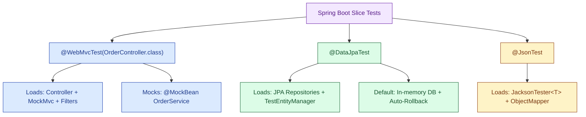

> [!TIP]
> `@DataJpaTest` is `@Transactional` by default and rolls back after each test. Use `TestEntityManager.persistAndFlush(...)` to ensure SQL `INSERT` statements actually execute and hit the persistence context before querying.

### @WebMvcTest: Test Controllers Only

```java
@WebMvcTest(OrderController.class)  // Load only controller and MVC layer
public class OrderControllerTest {
    @Autowired
    private MockMvc mockMvc;

    @Autowired
    private ObjectMapper objectMapper;

    @MockBean  // Service is mocked
    private OrderService orderService;

    @Test
    public void testGetOrder() throws Exception {
        // Arrange
        Order order = new Order();
        order.setId(1L);
        order.setTotal(new BigDecimal("100.00"));

        when(orderService.getOrder(1L))
            .thenReturn(order);

        // Act & Assert
        mockMvc.perform(get("/api/orders/1"))
            .andExpect(status().isOk())
            .andExpect(jsonPath("$.id").value(1))
            .andExpect(jsonPath("$.total").value(100.00));

        // Verify service was called
        verify(orderService, times(1)).getOrder(1L);
    }

    @Test
    public void testGetOrder_NotFound() throws Exception {
        // Arrange
        when(orderService.getOrder(999L))
            .thenThrow(new OrderNotFoundException("Order not found"));

        // Act & Assert
        mockMvc.perform(get("/api/orders/999"))
            .andExpect(status().isNotFound());
    }
}
```

### @DataJpaTest: Test Repositories Only

```java
@DataJpaTest  // Load only JPA layer
public class OrderRepositoryTest {
    @Autowired
    private OrderRepository orderRepository;

    @Autowired
    private TestEntityManager entityManager;

    @Test
    public void testFindByUserId() {
        // Arrange
        User user = new User();
        user.setEmail("user@example.com");
        entityManager.persistAndFlush(user);

        Order order = new Order();
        order.setUser(user);
        order.setTotal(new BigDecimal("100.00"));
        entityManager.persistAndFlush(order);

        // Act
        List<Order> orders = orderRepository.findByUserId(user.getId());

        // Assert
        assertEquals(1, orders.size());
        assertEquals(new BigDecimal("100.00"), orders.get(0).getTotal());
    }
}
```

### @JsonTest: Test JSON Serialization

```java
@JsonTest  // Load only JSON serialization
public class OrderJsonTest {
    @Autowired
    private JacksonTester<Order> json;

    @Test
    public void testSerialize() throws IOException {
        Order order = new Order();
        order.setId(1L);
        order.setTotal(new BigDecimal("100.00"));
        order.setCreatedAt(LocalDateTime.of(2023, 1, 1, 12, 0, 0));

        assertThat(json.write(order))
            .hasJsonPathNumberValue("$.id", 1)
            .hasJsonPathNumberValue("$.total", 100.00)
            .hasJsonPathValue("$.createdAt", "2023-01-01T12:00:00");
    }

    @Test
    public void testDeserialize() throws IOException {
        String jsonContent = """
            {"id":1,"total":100.00,"createdAt":"2023-01-01T12:00:00"}
            """;

        assertThat(json.parse(jsonContent))
            .isEqualTo(new Order(1L, new BigDecimal("100.00"), ...));
    }
}
```

---

## MockMvc and Controllers

`MockMvc` exercises Spring MVC's `DispatcherServlet`, request mapping, headers, form params, and `@ControllerAdvice` exception handlers without starting a real HTTP server.

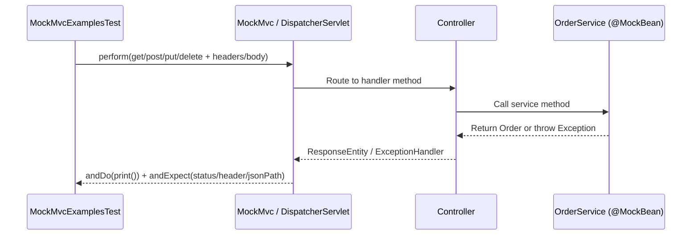

> [!NOTE]
> Use `MockMvc` for fast in-process MVC testing; switch to `TestRestTemplate` or `WebTestClient` with `SpringBootTest.WebEnvironment.RANDOM_PORT` when you need a real embedded servlet container.

### Complete MockMvc Examples

```java
@SpringBootTest
public class MockMvcExamplesTest {
    @Autowired
    private MockMvc mockMvc;

    @MockBean
    private OrderService orderService;

    // GET request
    @Test
    public void testGetRequest() throws Exception {
        Order order = new Order(1L, new BigDecimal("100.00"));
        when(orderService.getOrder(1L)).thenReturn(order);

        mockMvc.perform(
            get("/api/orders/1")
                .header("Authorization", "Bearer token123")
        )
            .andDo(print())  // Print request/response
            .andExpect(status().isOk())
            .andExpect(content().contentType(MediaType.APPLICATION_JSON))
            .andExpect(jsonPath("$.id").value(1))
            .andExpect(jsonPath("$.total").value(100.00));
    }

    // POST request with JSON body
    @Test
    public void testPostRequest() throws Exception {
        OrderRequest request = new OrderRequest(
            List.of(new OrderItem()),
            new BigDecimal("100.00")
        );

        Order createdOrder = new Order(1L, new BigDecimal("100.00"));
        when(orderService.createOrder(any())).thenReturn(createdOrder);

        mockMvc.perform(
            post("/api/orders")
                .contentType(MediaType.APPLICATION_JSON)
                .content("{\"items\":[],\"total\":100.00}")
        )
            .andExpect(status().isCreated())
            .andExpect(header().exists("Location"));
    }

    // PUT request
    @Test
    public void testPutRequest() throws Exception {
        Order updatedOrder = new Order(1L, new BigDecimal("150.00"));
        when(orderService.updateOrder(eq(1L), any())).thenReturn(updatedOrder);

        mockMvc.perform(
            put("/api/orders/1")
                .contentType(MediaType.APPLICATION_JSON)
                .content("{\"total\":150.00}")
        )
            .andExpect(status().isOk())
            .andExpect(jsonPath("$.total").value(150.00));
    }

    // DELETE request
    @Test
    public void testDeleteRequest() throws Exception {
        doNothing().when(orderService).deleteOrder(1L);

        mockMvc.perform(delete("/api/orders/1"))
            .andExpect(status().isNoContent());

        verify(orderService, times(1)).deleteOrder(1L);
    }

    // Test exception handling
    @Test
    public void testExceptionHandling() throws Exception {
        when(orderService.getOrder(999L))
            .thenThrow(new OrderNotFoundException("Order not found"));

        mockMvc.perform(get("/api/orders/999"))
            .andExpect(status().isNotFound())
            .andExpect(jsonPath("$.message").value("Order not found"));
    }

    // Test form data
    @Test
    public void testFormData() throws Exception {
        mockMvc.perform(
            post("/form")
                .param("email", "user@example.com")
                .param("password", "secret")
        )
            .andExpect(status().isOk());
    }
}
```

---

## Testcontainers

Testcontainers spins up ephemeral Docker containers (MySQL, PostgreSQL, Redis) for integration tests so queries, dialects, and migrations run against real production engines instead of H2.

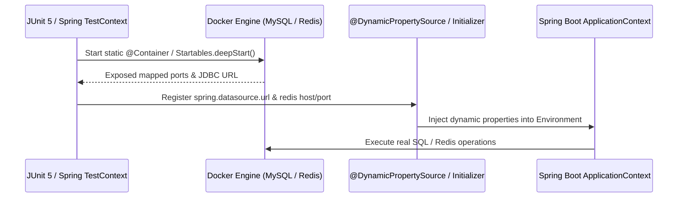

> [!WARNING]
> Declare `@Container` fields as `static` (or use `Startables.deepStart` in an `ApplicationContextInitializer`) so containers start once per test class instead of restarting for every test method. A running Docker daemon is required.

### Docker-based Integration Tests

```xml
<dependency>
    <groupId>org.testcontainers</groupId>
    <artifactId>testcontainers</artifactId>
    <scope>test</scope>
</dependency>
<dependency>
    <groupId>org.testcontainers</groupId>
    <artifactId>mysql</artifactId>
    <scope>test</scope>
</dependency>
<dependency>
    <groupId>org.testcontainers</groupId>
    <artifactId>postgresql</artifactId>
    <scope>test</scope>
</dependency>
```

```java
@SpringBootTest
public class OrderRepositoryTestcontainersTest {
    @Container
    static MySQLContainer<?> mysql = new MySQLContainer<>(DockerImageName.parse("mysql:8.0"))
        .withDatabaseName("testdb")
        .withUsername("test")
        .withPassword("test");

    @DynamicPropertySource
    static void properties(DynamicPropertyRegistry registry) {
        registry.add("spring.datasource.url", mysql::getJdbcUrl);
        registry.add("spring.datasource.username", mysql::getUsername);
        registry.add("spring.datasource.password", mysql::getPassword);
    }

    @Autowired
    private OrderRepository orderRepository;

    @Test
    public void testCreateAndFindOrder() {
        // Real database operations against MySQL running in Docker
        Order order = new Order();
        order.setTotal(new BigDecimal("100.00"));

        Order saved = orderRepository.save(order);

        Order found = orderRepository.findById(saved.getId()).orElseThrow();
        assertEquals(new BigDecimal("100.00"), found.getTotal());
    }
}

// Composite test with multiple containers
@SpringBootTest
public class MultipleContainersTest {
    static class Initializer implements ApplicationContextInitializer<ConfigurableApplicationContext> {
        static GenericContainer<?> mysql = new GenericContainer<>(DockerImageName.parse("mysql:8.0"))
            .withExposedPorts(3306)
            .withEnvironment("MYSQL_ROOT_PASSWORD", "password")
            .withEnvironment("MYSQL_DATABASE", "testdb");

        static GenericContainer<?> redis = new GenericContainer<>(DockerImageName.parse("redis:7"))
            .withExposedPorts(6379);

        @Override
        public void initialize(ConfigurableApplicationContext applicationContext) {
            Startables.deepStart(Stream.of(mysql, redis)).join();

            TestPropertyValues.of(
                "spring.datasource.url=jdbc:mysql://localhost:" + mysql.getMappedPort(3306) + "/testdb",
                "spring.redis.host=localhost",
                "spring.redis.port=" + redis.getMappedPort(6379)
            ).applyTo(applicationContext.getEnvironment());
        }
    }

    @SpringBootTest(initializers = Initializer.class)
    public static class IntegrationTest {
        // Tests using both MySQL and Redis containers
    }
}
```

---

## Test Profiles and Configuration

Customize test beans and properties cleanly using `@TestConfiguration`, `@Profile("test")`, `application-test.properties`, and inline `@SpringBootTest(properties = ...)`.

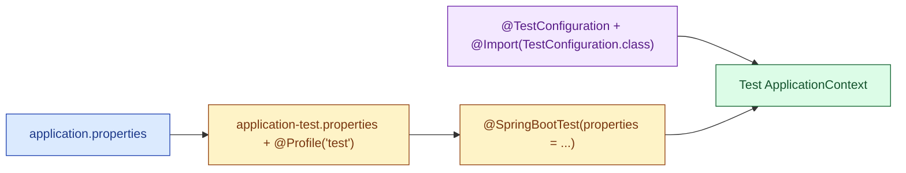

> [!IMPORTANT]
> Top-level `@TestConfiguration` classes are excluded from component scanning by default, so they only apply when explicitly imported via `@Import(TestConfiguration.class)` (or declared as a static inner class).

### Test Configuration

```java
@TestConfiguration  // Only loaded in tests
public class TestConfiguration {
    @Bean
    public PaymentService paymentService() {
        return new MockPaymentService();  // Use mock in tests
    }

    @Bean
    public NotificationService notificationService() {
        return new NoOpNotificationService();  // No-op in tests
    }
}

@SpringBootTest
@Import(TestConfiguration.class)  // Load test config
public class OrderServiceTest {
    @Autowired
    private OrderService orderService;

    @Test
    public void testWithTestConfiguration() {
        // Uses mock payment service and no-op notification service
    }
}

// OR use test profile
@Configuration
@Profile("test")
public class TestDatabaseConfiguration {
    @Bean
    public DataSource dataSource() {
        // H2 in-memory database for tests
        return DataSourceBuilder.create()
            .driverClassName("org.h2.Driver")
            .url("jdbc:h2:mem:testdb")
            .username("sa")
            .password("")
            .build();
    }
}

// application-test.properties
/*
spring.profiles.active=test
spring.jpa.hibernate.ddl-auto=create-drop
spring.jpa.show-sql=false
logging.level.root=WARN
*/

@SpringBootTest(properties = {
    "spring.profiles.active=test",
    "app.feature.enabled=true"
})
public class CustomPropertiesTest {
}
```

---

## Performance Tuning

Optimizing Spring Boot throughput and latency relies on three core levers: JVM garbage collection & heap sizing, HikariCP database connection pooling, and bounded thread pools.

| Layer | Key Settings | Sizing / Tuning Rule |
| :--- | :--- | :--- |
| **JVM** | `-XX:+UseG1GC`, `-XX:MaxGCPauseMillis=200`, `-XX:InitialHeapSize`, `-XX:MaxHeapSize`, `-Xloggc:gc.log` | Bound pause times with G1GC and size heap to workload |
| **HikariCP** | `maximum-pool-size: 20`, `minimum-idle: 5`, `connection-timeout: 30000`, `idle-timeout: 600000`, `max-lifetime: 1800000` | `(core_count * 2) + disk_spindles` |
| **ThreadPoolTaskExecutor** | `corePoolSize: 10`, `maxPoolSize: 100`, `queueCapacity: 500`, `waitForTasksToCompleteOnShutdown: true` | `core = cores`, `max = cores * 2`, `queue = core * throughput / avgTime` |


> [!TIP]
> Avoid oversized database connection pools—excessive connections cause context-switching and lock contention. Enable `com.zaxxer.hikari: DEBUG` temporarily when diagnosing pool starvation.

### JVM Tuning

```bash
# Run application with tuned JVM settings
java -XX:+UseG1GC \
     -XX:MaxGCPauseMillis=200 \
     -XX:InitialHeapSize=512m \
     -XX:MaxHeapSize=2g \
     -XX:+PrintGCDetails \
     -XX:+PrintGCDateStamps \
     -Xloggc:gc.log \
     -jar app.jar
```

### Connection Pool Tuning

```yaml
spring:
  datasource:
    hikari:
      maximum-pool-size: 20     # (core_count * 2) + disk_spindles
      minimum-idle: 5            # Keep 5 ready
      connection-timeout: 30000  # Wait max 30s
      idle-timeout: 600000       # Close after 10m idle
      max-lifetime: 1800000      # Close after 30m

# Monitor pool
logging:
  level:
    com.zaxxer.hikari: DEBUG
```

### Thread Pool Tuning

```java
@Configuration
public class ThreadPoolConfiguration {

    @Bean
    public Executor taskExecutor() {
        ThreadPoolTaskExecutor executor = new ThreadPoolTaskExecutor();
        executor.setCorePoolSize(10);        // Min threads
        executor.setMaxPoolSize(100);        // Max threads
        executor.setQueueCapacity(500);      // Queue size
        executor.setThreadNamePrefix("app-"); // Thread name
        executor.setWaitForTasksToCompleteOnShutdown(true);
        executor.setAwaitTerminationSeconds(60);
        return executor;
    }

    // Sizing: corePoolSize = number_of_cores
    // maxPoolSize = number_of_cores * 2
    // queueCapacity = corePoolSize * expectedThroughput / averageTime
}
```

---

## Caching

Spring's `@EnableCaching` abstraction intercepts annotated methods via proxies, supporting in-memory (`ConcurrentMapCacheManager`) or distributed stores (Redis, Caffeine, Ehcache, Hazelcast).

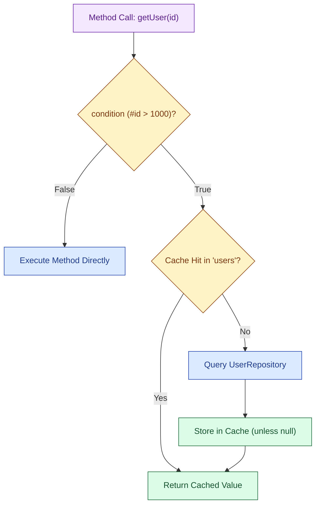

> [!WARNING]
> Because Spring caching uses AOP proxies, calling a `@Cacheable` method from another method inside the same bean (`this.getUser(id)`) bypasses the proxy and skips the cache.

### @Cacheable, @CacheEvict, @CachePut

```java
@Configuration
@EnableCaching  // Enable caching
public class CacheConfiguration {
    @Bean
    public CacheManager cacheManager() {
        return new ConcurrentMapCacheManager("orders", "users", "products");
    }

    // OR Redis
    @Bean
    @ConditionalOnMissingBean
    public CacheManager redisCacheManager(LettuceConnectionFactory connectionFactory) {
        return RedisCacheManager.create(connectionFactory);
    }
}

@Service
public class UserService {
    private final UserRepository userRepository;

    public UserService(UserRepository userRepository) {
        this.userRepository = userRepository;
    }

    // Cache result based on id
    @Cacheable(cacheNames = "users", key = "#id")
    public User getUser(Long id) {
        return userRepository.findById(id)
            .orElseThrow(() -> new UserNotFoundException());
    }

    // Cache with condition
    @Cacheable(
        cacheNames = "users",
        key = "#id",
        condition = "#id > 1000"  // Only cache if id > 1000
    )
    public User getUserConditional(Long id) {
        return userRepository.findById(id).orElse(null);
    }

    // Remove from cache on update
    @CacheEvict(cacheNames = "users", key = "#id")
    public void updateUser(Long id, UserRequest request) {
        User user = userRepository.findById(id).orElseThrow();
        user.setEmail(request.getEmail());
        userRepository.save(user);
    }

    // Clear entire cache
    @CacheEvict(cacheNames = "users", allEntries = true)
    public void clearAllUsers() {
    }

    // Update cache without calling method
    @CachePut(cacheNames = "users", key = "#result.id")
    public User createUser(UserRequest request) {
        User user = new User();
        user.setEmail(request.getEmail());
        return userRepository.save(user);
    }
}

// Configuration
spring:
  cache:
    type: redis  # caffeine, ehcache, hazelcast
    redis:
      time-to-live: 600000  # 10 minutes
      cache-null-values: true

  # OR in-memory cache
  cache:
    type: simple  # ConcurrentMapCacheManager
    cache-names: users,orders,products
```

---

## Async Processing

`@EnableAsync` and `@Async` offload slow I/O (emails, notifications, reports) onto a `ThreadPoolTaskExecutor`, freeing HTTP request threads immediately and optionally returning a `CompletableFuture`.

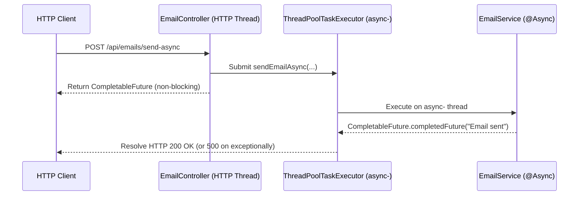

> [!IMPORTANT]
> Always define a bounded `ThreadPoolTaskExecutor` bean when using `@EnableAsync`; otherwise Spring falls back to `SimpleAsyncTaskExecutor`, which creates a new unbounded thread per invocation.

### @Async and CompletableFuture

```java
@Configuration
@EnableAsync
public class AsyncConfiguration {
    @Bean(name = "taskExecutor")
    public Executor taskExecutor() {
        ThreadPoolTaskExecutor executor = new ThreadPoolTaskExecutor();
        executor.setCorePoolSize(5);
        executor.setMaxPoolSize(10);
        executor.setQueueCapacity(100);
        executor.setThreadNamePrefix("async-");
        executor.initialize();
        return executor;
    }
}

@Service
public class EmailService {
    private static final Logger logger = LoggerFactory.getLogger(EmailService.class);

    // Fire and forget
    @Async
    public void sendEmail(String to, String subject, String body) {
        logger.info("Sending email to: {}", to);
        // Email sending happens in separate thread
        // Method returns immediately
    }

    // Return CompletableFuture for result
    @Async
    public CompletableFuture<String> sendEmailAsync(String to, String subject, String body) {
        try {
            logger.info("Sending async email to: {}", to);
            // Simulate email sending
            Thread.sleep(2000);
            return CompletableFuture.completedFuture("Email sent");
        } catch (InterruptedException e) {
            return CompletableFuture.failedFuture(e);
        }
    }

    // Multiple async operations
    @Async
    public void sendBulkEmails(List<String> recipients) {
        recipients.stream()
            .parallel()
            .forEach(recipient -> sendEmail(recipient, "Welcome", "Welcome email"));
    }
}

@RestController
@RequestMapping("/api/emails")
public class EmailController {
    private final EmailService emailService;

    public EmailController(EmailService emailService) {
        this.emailService = emailService;
    }

    @PostMapping("/send")
    public ResponseEntity<String> sendEmail(@RequestBody EmailRequest request) {
        // Non-blocking call
        emailService.sendEmail(request.getTo(), request.getSubject(), request.getBody());
        return ResponseEntity.accepted().body("Email queued");
    }

    @PostMapping("/send-async")
    public CompletableFuture<ResponseEntity<String>> sendEmailAsync(@RequestBody EmailRequest request) {
        // Returns immediately with CompletableFuture
        return emailService.sendEmailAsync(request.getTo(), request.getSubject(), request.getBody())
            .thenApply(result -> ResponseEntity.ok(result))
            .exceptionally(ex -> ResponseEntity.status(500).body("Failed: " + ex.getMessage()));
    }

    @PostMapping("/send-multiple")
    public CompletableFuture<ResponseEntity<String>> sendMultipleEmails(@RequestBody BulkEmailRequest request) {
        return CompletableFuture.runAsync(() -> {
            emailService.sendBulkEmails(request.getRecipients());
        }).thenApply(v -> ResponseEntity.accepted().body("Bulk emails queued"))
          .exceptionally(ex -> ResponseEntity.status(500).body("Error: " + ex.getMessage()));
    }
}
```

---

## Scheduling

`@EnableScheduling` paired with `ThreadPoolTaskScheduler` runs periodic background jobs using `fixedDelay`, `fixedRate`, `initialDelay`, or 6-field Spring cron expressions.

| Trigger Mode | Behavior |
| :--- | :--- |
| **`fixedDelay = 60000`** | Waits 60s **after** the previous execution finishes before starting the next |
| **`fixedRate = 60000`** | Triggers every 60s from the **start** of the previous execution |
| **`initialDelay = 10000`** | Waits 10s after application startup before the first run |
| **`cron = "0 0 0 * * *"`** | Runs on calendar schedule (`second minute hour day month day-of-week`), optionally with `zone` |

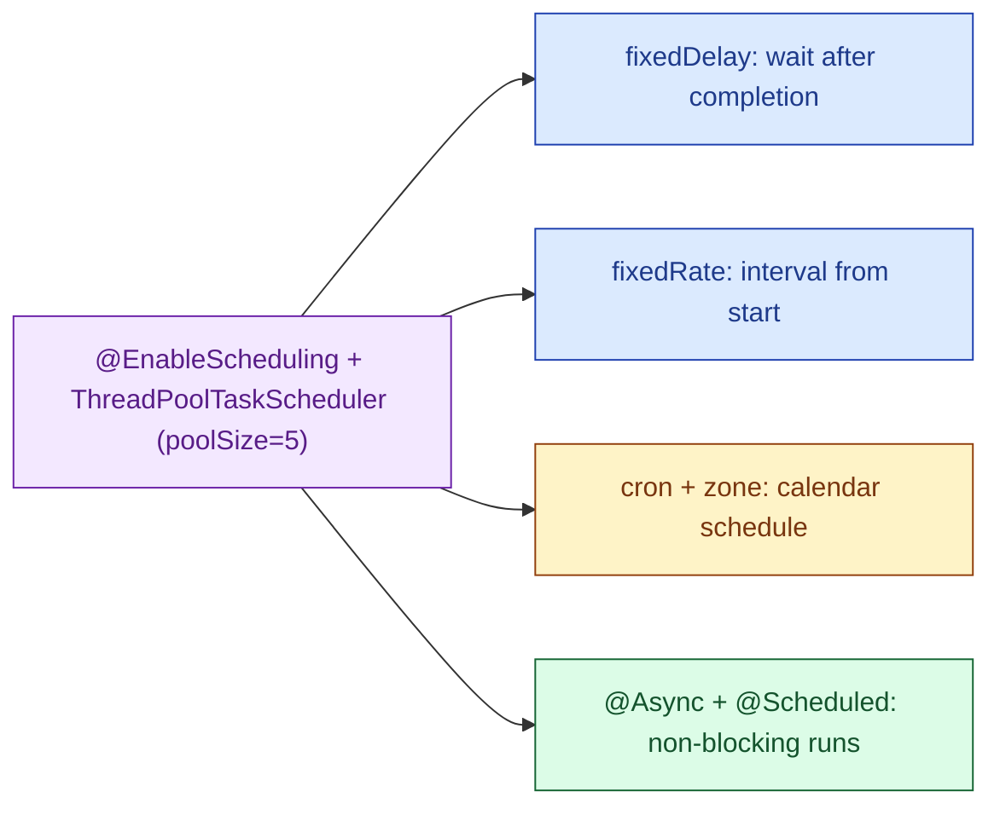

> [!NOTE]
> Without a custom `TaskScheduler` bean, Spring executes all `@Scheduled` tasks on a single thread, so one slow job can delay every other scheduled task.

### @Scheduled Tasks

```java
@Configuration
@EnableScheduling
public class SchedulingConfiguration {
    @Bean
    public TaskScheduler taskScheduler() {
        ThreadPoolTaskScheduler scheduler = new ThreadPoolTaskScheduler();
        scheduler.setPoolSize(5);
        scheduler.setThreadNamePrefix("scheduled-");
        scheduler.initialize();
        return scheduler;
    }
}

@Service
public class ReportService {
    private static final Logger logger = LoggerFactory.getLogger(ReportService.class);

    // Run every 60 seconds
    @Scheduled(fixedDelay = 60000)
    public void generateDailyReport() {
        logger.info("Generating daily report...");
        // Report generation logic
    }

    // Run every 24 hours at midnight
    @Scheduled(cron = "0 0 0 * * *")
    public void generateDailyReportCron() {
        logger.info("Cron: Generating daily report at midnight");
    }

    // Run with initial delay
    @Scheduled(initialDelay = 10000, fixedRate = 60000)
    public void checkSystemHealth() {
        logger.info("Checking system health");
    }

    // Timezone-aware cron
    @Scheduled(cron = "0 0 10 * * *", zone = "America/New_York")
    public void sendDailyNotifications() {
        logger.info("Sending notifications at 10 AM ET");
    }

    // Run async scheduled task
    @Async
    @Scheduled(fixedDelay = 60000)
    public void asyncScheduledTask() {
        logger.info("Running async scheduled task");
    }
}

// Cron expression: "second minute hour day month day-of-week"
// Examples:
// "0 0 * * * *"     - Every hour
// "0 0 0 * * *"     - Every day at midnight
// "0 0 0 1 * *"     - Every month on 1st day
// "0 0 10 * * MON"  - Every Monday at 10 AM
// "0 */5 * * * *"   - Every 5 minutes
```

---

## Logging

Spring Boot uses SLF4J + Logback by default. Use `logback-spring.xml` for `<springProfile>`-specific appenders and MDC (`Mapped Diagnostic Context`) to attach `requestId` and `userId` to every log line.

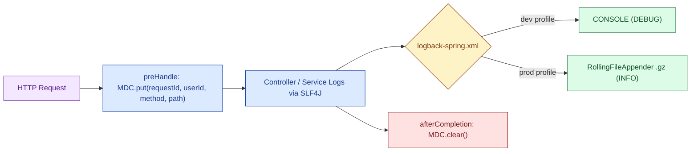

> [!WARNING]
> Always call `MDC.clear()` in `afterCompletion` (or a `finally` block). Because servlet containers reuse worker threads, stale MDC values will leak into subsequent requests if not cleared.

### SLF4J + Logback Configuration

```xml
<!-- logback-spring.xml -->
<?xml version="1.0" encoding="UTF-8"?>
<configuration>
    <property name="LOG_FILE" value="${LOG_FILE:-${LOG_PATH:-${LOG_TEMP:-${java.io.tmpdir:-/tmp}}/}spring.log}"/>

    <!-- Development profile -->
    <springProfile name="dev">
        <appender name="CONSOLE" class="ch.qos.logback.core.ConsoleAppender">
            <encoder>
                <pattern>%d{HH:mm:ss.SSS} [%thread] %-5level %logger{36} - %msg%n</pattern>
            </encoder>
        </appender>

        <root level="DEBUG">
            <appender-ref ref="CONSOLE"/>
        </root>
    </springProfile>

    <!-- Production profile -->
    <springProfile name="prod">
        <appender name="FILE" class="ch.qos.logback.core.rolling.RollingFileAppender">
            <file>${LOG_FILE}</file>
            <rollingPolicy class="ch.qos.logback.core.rolling.SizeAndTimeBasedRollingPolicy">
                <fileNamePattern>${LOG_FILE}.%d{yyyy-MM-dd}.%i.gz</fileNamePattern>
                <maxFileSize>10MB</maxFileSize>
                <maxHistory>30</maxHistory>
            </rollingPolicy>
            <encoder>
                <pattern>%d{yyyy-MM-dd HH:mm:ss.SSS} [%thread] %-5level %logger{36} - %msg%n</pattern>
            </encoder>
        </appender>

        <root level="INFO">
            <appender-ref ref="FILE"/>
        </root>
    </springProfile>

    <!-- Logger levels -->
    <logger name="com.example" level="DEBUG"/>
    <logger name="org.springframework.web" level="DEBUG"/>
    <logger name="org.springframework.security" level="DEBUG"/>
    <logger name="org.springframework.data" level="DEBUG"/>
</configuration>
```

### Structured Logging with MDC

```java
@Component
public class RequestLoggingInterceptor implements HandlerInterceptor {
    private static final Logger logger = LoggerFactory.getLogger(RequestLoggingInterceptor.class);

    @Override
    public boolean preHandle(HttpServletRequest request, HttpServletResponse response,
                            Object handler) throws Exception {
        String requestId = UUID.randomUUID().toString();

        // Set MDC values (printed in every log)
        MDC.put("requestId", requestId);
        MDC.put("userId", extractUserId(request));
        MDC.put("method", request.getMethod());
        MDC.put("path", request.getRequestURI());

        logger.info("Request started");

        return true;
    }

    @Override
    public void afterCompletion(HttpServletRequest request, HttpServletResponse response,
                               Object handler, Exception ex) throws Exception {
        logger.info("Request completed with status: {}", response.getStatus());

        // Clear MDC
        MDC.clear();
    }

    private String extractUserId(HttpServletRequest request) {
        return SecurityContextHolder.getContext()
            .getAuthentication()
            .getName();
    }
}

// application.yml
logging:
  pattern:
    console: "%d{yyyy-MM-dd HH:mm:ss} - %msg - [%X{requestId}] [%X{userId}]%n"
    file: "%d{yyyy-MM-dd HH:mm:ss} - %msg - [%X{requestId}] [%X{userId}]%n"
```

---

## Monitoring with Micrometer

Spring Boot Actuator + `micrometer-registry-prometheus` exposes JVM, HTTP, HikariCP, and custom business metrics (`Counter`, `Gauge`, `Timer`) at `/actuator/prometheus`.

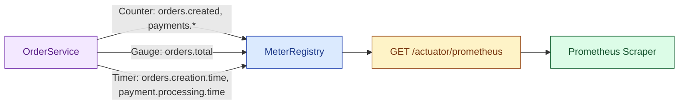

> [!TIP]
> Use **Counter** for monotonically increasing totals (`orders.created`), **Gauge** for current point-in-time values (`orders.total`), and **Timer** to measure both duration and call count (`orders.creation.time`).

### Adding Prometheus Metrics

```xml
<dependency>
    <groupId>org.springframework.boot</groupId>
    <artifactId>spring-boot-starter-actuator</artifactId>
</dependency>
<dependency>
    <groupId>io.micrometer</groupId>
    <artifactId>micrometer-registry-prometheus</artifactId>
</dependency>
```

```yaml
# application.yml
management:
  endpoints:
    web:
      exposure:
        include: health,info,metrics,prometheus
  metrics:
    export:
      prometheus:
        enabled: true
```

### Custom Metrics

```java
@Service
public class OrderService {
    private final MeterRegistry meterRegistry;
    private final OrderRepository orderRepository;

    public OrderService(MeterRegistry meterRegistry, OrderRepository orderRepository) {
        this.meterRegistry = meterRegistry;
        this.orderRepository = orderRepository;

        // Gauge: current orders count
        Gauge.builder("orders.total", orderRepository, repo -> repo.count())
            .description("Total number of orders")
            .register(meterRegistry);
    }

    public Order createOrder(OrderRequest request) {
        // Counter: increment on each order creation
        meterRegistry.counter("orders.created").increment();

        Order order = new Order();
        order.setItems(request.getItems());
        order.setTotal(request.getTotal());

        // Timer: measure order creation time
        return meterRegistry.timer("orders.creation.time").recordCallable(() -> {
            return orderRepository.save(order);
        });
    }

    public void processPayment(Order order) {
        try {
            meterRegistry.timer("payment.processing.time").record(() -> {
                // Payment processing
            });

            meterRegistry.counter("payments.success").increment();

        } catch (Exception e) {
            meterRegistry.counter("payments.failed").increment();
            throw e;
        }
    }
}

// Metrics available at /actuator/prometheus
// GET /actuator/prometheus returns metrics in Prometheus format
// orders_created_total{application="myapp"} 42.0
// orders_total{application="myapp"} 100.0
// payment_processing_time_seconds{application="myapp"} 0.5
```

---

## Interview Questions

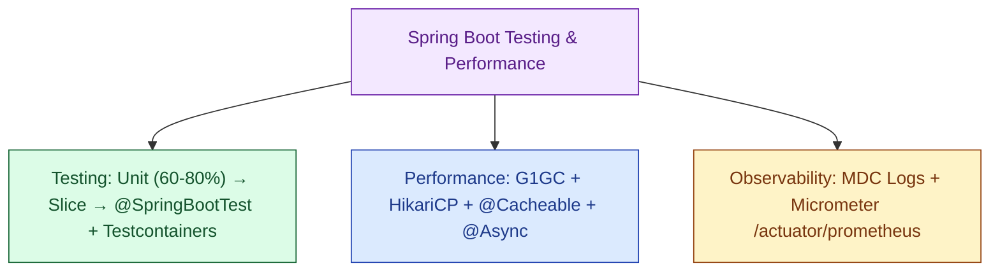

### Q1: Explain the testing pyramid and how it applies to Spring Boot.

**Answer:**
The testing pyramid has three levels:
1. **Unit tests (60–80%)**: Fast, test a single component in isolation, no Spring context, use Mockito.
2. **Integration tests (15–25%)**: Medium speed, test interactions, load Spring context (or slice), use `@SpringBootTest` / `@WebMvcTest` / `@DataJpaTest`.
3. **E2E tests (5–10%)**: Slow, test complete flow with real backend and frontend.

Write many unit tests (fast, cheap), fewer integration tests, and very few E2E tests for good coverage with fast feedback.

### Q2: Difference between `@WebMvcTest` and `@SpringBootTest`.

**Answer:**
- **`@WebMvcTest`**: Loads only the web layer (Controller, `MockMvc`). Services and repositories are mocked with `@MockBean`. Fast, focused testing.
- **`@SpringBootTest`**: Loads the entire application context with real beans unless explicitly mocked. Slower, but more realistic.

Use `@WebMvcTest` for controller testing and `@SpringBootTest` for full integration testing.

### Q3: What's the advantage of using Testcontainers?

**Answer:**
Testcontainers runs real Docker containers (database, Redis, etc.) during tests. This eliminates behavioral differences between test and production environments (e.g., H2 vs. MySQL/PostgreSQL), ensures schema migrations run against the real engine, and provides higher confidence at the cost of slower startup than in-memory databases.

### Q4: How do you optimize Spring Boot application performance?

**Answer:**
1. **JVM tuning**: Use G1GC, tune heap size (`InitialHeapSize`, `MaxHeapSize`).
2. **Connection pooling**: Configure HikariCP with an appropriate `maximum-pool-size`.
3. **Caching**: Use `@Cacheable` for expensive or repetitive operations.
4. **Async processing**: Use `@Async` with a bounded `ThreadPoolTaskExecutor` for non-blocking operations.
5. **Database optimization**: Add proper indexes, avoid N+1 queries, and use pagination.
6. **Monitoring**: Use Micrometer + Prometheus to identify bottlenecks.

### Q5: Explain `@Cacheable` with conditions.

**Answer:**
```java
@Cacheable(
    cacheNames = "users",
    key = "#id",
    condition = "#id > 1000",  // Only cache if condition true
    unless = "#result == null"   // Don't cache if result null
)
public User getUser(Long id) { }
```

`condition` controls whether caching is evaluated before method execution; `unless` controls whether the returned result is stored in the cache—useful for avoiding cache pollution (such as `null` results).

### Q6: How does async processing with `@Async` improve performance?

**Answer:**
`@Async` executes the method in a separate thread from a configured `ThreadPoolTaskExecutor` and returns immediately so the calling (HTTP) thread continues without waiting. It is ideal for non-blocking operations (emails, notifications, reports) and can return a `CompletableFuture` for result or error handling.

> [!TIP]
> In system-design or Spring Boot interviews, always connect `@Async` and `@Cacheable` back to **thread-pool sizing**, **proxy self-invocation**, and **Micrometer metrics** to show production depth.
