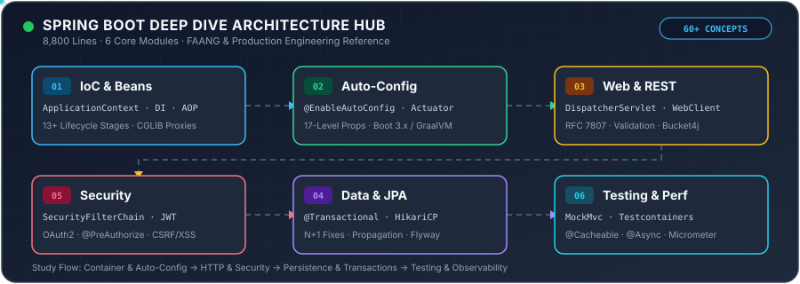
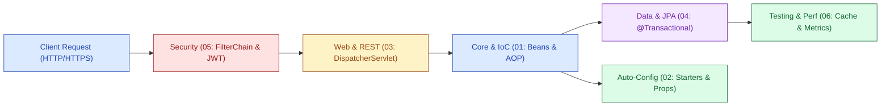
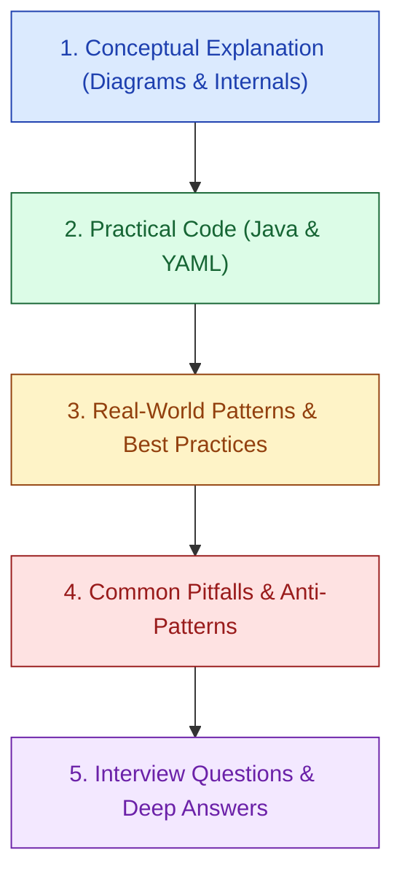
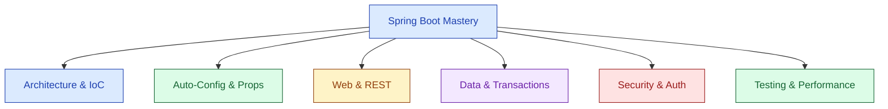
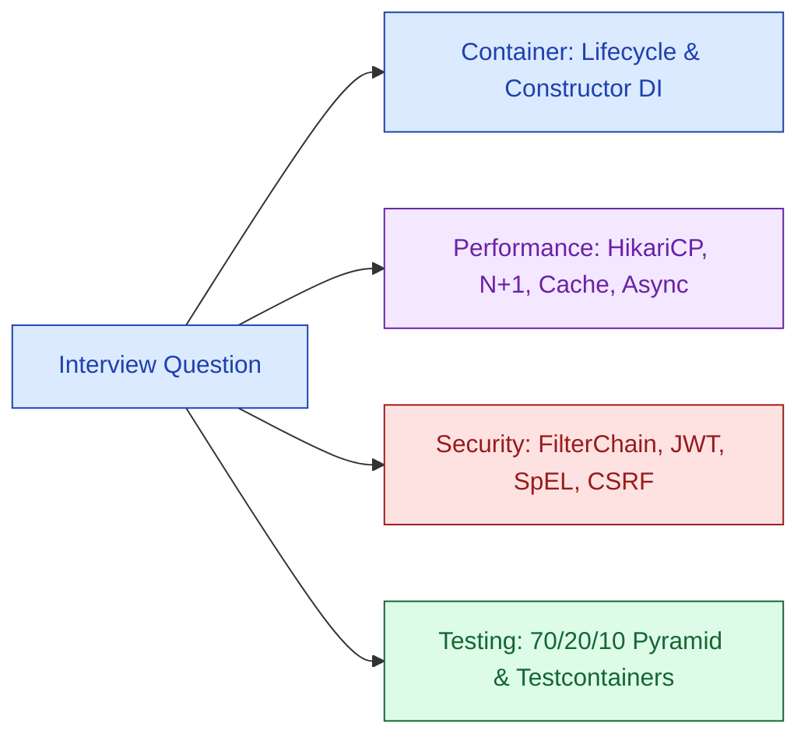
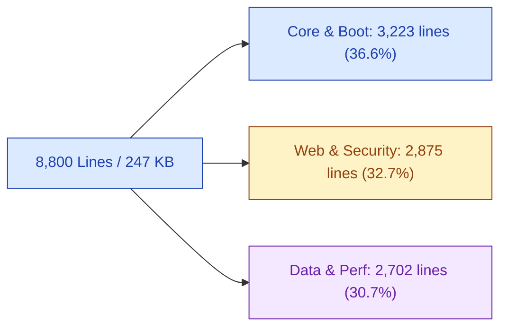
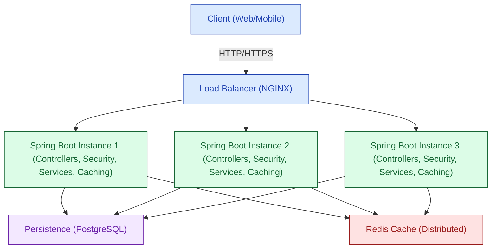
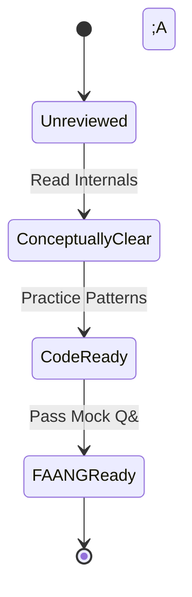

# Spring Boot Deep Dive - Complete Interview Preparation Guide

## Overview



This guide is designed for mid-to-senior Java engineers (**5+ years experience**) preparing for FAANG and Tier-1 backend interviews. It pairs Spring Boot internals with production-grade code patterns, trade-off analysis, and deep-dive Q&A.

**Target Audience:**
- **Production Experience:** Engineers who have migrated Spring Boot versions, built microservices, or decoupled monoliths.
- **Core Stack:** Strong Java fundamentals with hands-on experience in Spring Data JPA, Spring Security, Spring MVC, and REST APIs.

> [!NOTE]
> **Guide Scope:** **8,800 lines (247 KB)** across 6 deep-dive modules covering **60+ concepts**, **200+ code examples**, and **50+ interview questions**.



---

## File Structure

```mermaid
flowchart LR
    M1["01: Core &amp; IoC (1,862 lines)"] --> M2["02: Auto-Config (1,361 lines)"]
    M2 --> M3["03: Web &amp; REST (1,613 lines)"]
    M3 --> M5["05: Security (1,262 lines)"]
    M5 --> M4["04: Data &amp; JPA (1,535 lines)"]
    M4 --> M6["06: Testing &amp; Perf (1,167 lines)"]

    classDef blue fill:#dbeafe,stroke:#1e40af,color:#1e40af
    classDef green fill:#dcfce7,stroke:#166534,color:#166534
    classDef amber fill:#fef3c7,stroke:#92400e,color:#92400e
    classDef red fill:#fee2e2,stroke:#991b1b,color:#991b1b
    classDef purple fill:#f3e8ff,stroke:#6b21a8,color:#6b21a8

    class M1 blue
    class M2,M6 green
    class M3 amber
    class M5 red
    class M4 purple
```



### 1. [01-Spring-Core-and-IoC.md](./01-Spring-Core-and-IoC.md) (1,862 lines, 52 KB)
Deep dive into Spring's core container and dependency injection (**9 comprehensive Q&A**).

- **Container & DI:** `BeanFactory` vs `ApplicationContext`; constructor (preferred), setter, and field injection.
- **Lifecycle & Scopes:** 13+ bean lifecycle stages; `singleton`, `prototype`, `request`, `session`, `application`, and custom scopes.
- **Configuration & AOP:** Stereotypes (`@Component`, `@Service`, `@Repository`, `@Controller`, `@RestController`), `@Configuration` CGLIB proxying, `@Profile`/`@Conditional*`, JDK Dynamic Proxy vs CGLIB, `@Aspect`, pointcuts, and SpEL basics.

```java
// Constructor injection (PREFERRED)
@Component
public class UserService {
    private final UserRepository userRepository;

    public UserService(UserRepository userRepository) {
        this.userRepository = userRepository;
    }
}

// Bean lifecycle hooks
@PostConstruct    // After dependencies injected
@PreDestroy       // On shutdown
InitializingBean.afterPropertiesSet()
DisposableBean.destroy()
```

### 2. [02-Spring-Boot-Auto-Configuration.md](./02-Spring-Boot-Auto-Configuration.md) (1,361 lines, 35 KB)
Master Spring Boot's intelligent auto-configuration mechanism (**8 comprehensive Q&A**).

- **Auto-Config Internals:** `@SpringBootApplication` (`@Configuration` + `@EnableAutoConfiguration` + `@ComponentScan`), `spring.factories` / `AutoConfiguration.imports`, conditional annotations, and custom starters.
- **Properties & Profiles:** `@ConfigurationProperties`, `@Value`, 17-level property resolution hierarchy, multi-document YAML (Boot 2.4+).
- **Operations & Upgrades:** Spring Boot Actuator (health, metrics, custom endpoints, security), DevTools, Boot 2.x → 3.x migration (Jakarta namespace, GraalVM native), embedded server tuning (Tomcat/Jetty/Undertow), and graceful shutdown.

```yaml
# 17 levels of property resolution
spring.datasource.url=jdbc:mysql://localhost/db  # Highest priority
SPRING_DATASOURCE_URL=jdbc:mysql://localhost/db  # Environment var
application-prod.yml  # Profile-specific
application.yml       # Default

# Conditional bean creation
@Bean
@ConditionalOnProperty(name = "feature.enabled", havingValue = "true")
public FeatureService featureService() { }
```

### 3. [03-Spring-Web-and-REST.md](./03-Spring-Web-and-REST.md) (1,613 lines, 46 KB)
REST API development with Spring MVC and WebFlux (**5 comprehensive Q&A**).

- **MVC Pipeline:** `DispatcherServlet` architecture, `@RestController` vs `@Controller`, request mapping, content negotiation (JSON/XML), and `Filters` vs `Interceptors` vs `AOP`.
- **Contracts & Resilience:** `@ExceptionHandler`, `@ControllerAdvice`, `ResponseEntityExceptionHandler`, `ProblemDetail` (RFC 7807), `@Valid`/`@Validated` group validation, `Pageable`, HATEOAS (`EntityModel`, `CollectionModel`), and `MultipartFile`.
- **Clients & Edge:** `WebClient` vs `RestTemplate`, CORS, API versioning (URL, header, custom), and rate limiting with Bucket4j.

```java
// Request flow through DispatcherServlet
@RestController
@GetMapping("/{id}")
public Order getOrder(@PathVariable Long id) {
    // DispatcherServlet: HandlerMapping -> HandlerAdapter -> resolve @PathVariable
    // -> call method -> convert response to JSON -> return
}

// Content negotiation
// GET /api/products with Accept: application/json -> JSON
// GET /api/products with Accept: application/xml -> XML

// Rate limiting with Bucket4j
@InterceptorRegistry
public void addInterceptors(InterceptorRegistry registry) {
    registry.addInterceptor(new RateLimitingInterceptor())
        .addPathPatterns("/api/**");
}
```

### 4. [04-Spring-Data-and-JPA.md](./04-Spring-Data-and-JPA.md) (1,535 lines, 41 KB)
Data access layer with Spring Data JPA and advanced ORM concepts (**6 comprehensive Q&A**).

- **Repositories & Mapping:** `CrudRepository` → `PagingAndSortingRepository` → `JpaRepository`; `@Entity`, `@Id` generation (`IDENTITY`, `SEQUENCE`, `TABLE`, `UUID`), relationships, fetch types, and cascade rules.
- **N+1 Problem & Queries:** 5 N+1 solutions (`JOIN FETCH`, `@EntityGraph`, `@BatchSize`, Projections, query-specific methods), JPQL/native `@Query`, Specification & Criteria API, and JPA auditing.
- **Transactions & Infra:** Propagation (`REQUIRED`, `REQUIRES_NEW`, `SUPPORTS`, `NESTED`), isolation levels, rollback rules, HikariCP tuning, Flyway vs Liquibase, multi-datasource, and Spring Data MongoDB basics.

```java
// N+1 Problem: 1 query for authors + N queries for each author's books = 1+N queries
List<Author> authors = authorRepository.findAll();
// For each: author.getBooks() triggers new query!

// Solution 1: JOIN FETCH
@Query("SELECT a FROM Author a LEFT JOIN FETCH a.books")
List<Author> findAllWithBooks();

// Solution 2: @EntityGraph
@EntityGraph(attributePaths = {"books"})
List<Author> findAll();

// Solution 3: @BatchSize
@OneToMany(mappedBy = "author")
@BatchSize(size = 20)  // Load 20 authors' books in single query
List<Book> books;

// Transactional with propagation
@Transactional(propagation = Propagation.REQUIRES_NEW)  // New transaction
public void auditLog(String message) { }
```

### 5. [05-Spring-Security.md](./05-Spring-Security.md) (1,262 lines, 39 KB)
Authentication, authorization, and security best practices (**5 comprehensive Q&A**).

- **Architecture & AuthN:** `SecurityFilterChain` filter order, `UserDetailsService`, `AuthenticationManager`, `AuthenticationProvider`, `BCryptPasswordEncoder` / `Argon2PasswordEncoder`.
- **AuthZ & Tokens:** `@EnableMethodSecurity`, `@PreAuthorize`/`@PostAuthorize` (SpEL), `@Secured`/`@RolesAllowed`, RBAC vs PBAC, JWT (`JwtTokenProvider`, `JwtAuthenticationFilter`, login/register/refresh), and OAuth 2.0 (Resource Server & Auth Code flow).
- **Hardening & Testing:** CORS/CSRF, security headers (CSP, `X-Frame-Options`, HSTS, `Referrer-Policy`), SQLi/XSS/CSRF mitigation, `@WithMockUser`, and `SecurityMockMvcRequestPostProcessors`.

```java
// JWT authentication flow
@RestController
@PostMapping("/login")
public ResponseEntity<AuthResponse> login(@RequestBody LoginRequest request) {
    Authentication auth = authenticationManager.authenticate(
        new UsernamePasswordAuthenticationToken(request.getEmail(), request.getPassword())
    );
    String token = jwtTokenProvider.generateToken((CustomUserPrincipal) auth.getPrincipal());
    return ResponseEntity.ok(new AuthResponse(token));
}

// Authorization with SpEL
@PreAuthorize("hasRole('ADMIN') or @authService.isOwner(#id, authentication)")
public Order getOrder(Long id) { }

// CSRF protection
http.csrf(csrf -> csrf
    .csrfTokenRepository(CookieCsrfTokenRepository.withHttpOnlyFalse())
    .ignoringRequestMatchers("/api/**")
);
```

### 6. [06-Spring-Boot-Testing-and-Performance.md](./06-Spring-Boot-Testing-and-Performance.md) (1,167 lines, 34 KB)
Comprehensive testing strategies and performance optimization (**6 comprehensive Q&A**).

- **Testing Strategy:** Pyramid (60–80% unit, 15–25% integration, 5–10% E2E), Mockito (`@Mock`, `@InjectMocks`, `spy`), `@SpringBootTest`, `@MockBean`, slice tests (`@WebMvcTest`, `@DataJpaTest`, `@JsonTest`), `MockMvc`, Testcontainers (MySQL/PostgreSQL/Redis), and test profiles.
- **Performance & Concurrency:** JVM tuning (G1GC, heap), HikariCP sizing, thread pool sizing, `@Cacheable`/`@CacheEvict`/`@CachePut`, `@Async` + `CompletableFuture`, and `@Scheduled` (cron + timezone).
- **Observability:** SLF4J + Logback structured logging with MDC; Micrometer + Prometheus + custom `MeterRegistry` metrics.

```java
// Unit test without Spring
@Test
public void testOrderService() {
    OrderRepository mockRepo = mock(OrderRepository.class);
    when(mockRepo.save(any())).thenReturn(new Order(1L));

    OrderService service = new OrderService(mockRepo);
    service.createOrder(request);

    verify(mockRepo, times(1)).save(any());
}

// Integration test with full context
@SpringBootTest
public class OrderServiceIntegrationTest {
    @Autowired private OrderRepository orderRepository;
    // Real database operations
}

// Caching
@Cacheable(cacheNames = "users", key = "#id", condition = "#id > 1000")
public User getUser(Long id) { }

// Performance monitoring
meterRegistry.timer("payment.processing").record(() -> {
    // Measure payment processing time
});
```

---

## How to Use This Guide

### Recommended Study Order

```mermaid
flowchart LR
    S1["1. Core &amp; IoC (01)"] --> S2["2. Auto-Config (02)"]
    S2 --> S3["3. Web &amp; REST (03)"]
    S3 --> S4["4. Data &amp; JPA (04)"]
    S4 --> S5["5. Security (05)"]
    S5 --> S6["6. Testing &amp; Perf (06)"]

    classDef blue fill:#dbeafe,stroke:#1e40af,color:#1e40af
    classDef green fill:#dcfce7,stroke:#166534,color:#166534
    classDef amber fill:#fef3c7,stroke:#92400e,color:#92400e
    classDef red fill:#fee2e2,stroke:#991b1b,color:#991b1b
    classDef purple fill:#f3e8ff,stroke:#6b21a8,color:#6b21a8

    class S1 blue
    class S2,S6 green
    class S3 amber
    class S4 purple
    class S5 red
```



### Per-File Reading Strategy



| Step | Action | Goal |
|------|--------|------|
| **1. Concept First** | Read the conceptual explanation before code | Understand *why* Spring works that way internally |
| **2. Trace Examples** | Review Java & YAML snippets | Connect annotations to runtime proxy/filter behavior |
| **3. Recall & Write** | Memorize key patterns and write from memory | Build whiteboard fluency for system & coding rounds |

> [!TIP]
> Don't just memorize annotations—practice explaining **what happens at startup** (auto-config, bean post-processors) and **what happens per request** (filter chain, `DispatcherServlet`, proxies, transactions).

---

## Key Concepts to Master

| Domain | Core Internals & Patterns to Master |
|--------|--------------------------------------|
| **Architecture & Design** | Spring IoC Container & bean lifecycle; DI patterns; Spring AOP & proxies; Factory, Observer, Strategy patterns |
| **Configuration & Boot** | Auto-configuration mechanism; 17-level property resolution hierarchy; profile management; custom starters |
| **Web & REST** | `DispatcherServlet` HTTP request pipeline; content negotiation; exception handling; HATEOAS, versioning, pagination |
| **Data Access** | ORM mapping & relationships; N+1 problem & 5 solutions; transaction management & propagation; HikariCP tuning |
| **Security** | Authentication vs authorization; JWT token lifecycle; CSRF & XSS prevention; RBAC vs PBAC |
| **Testing & Performance** | Testing pyramid & layer boundaries; mocks vs real deps; Testcontainers; JVM/pool tuning, caching, `@Async` |



---

## Interview Tips

| Interview Prompt | High-Signal Points to Cover |
|------------------|-----------------------------|
| **Spring Container** | `ApplicationContext` extends `BeanFactory`; beans registered via `@Component`, `@Bean`, XML; lifecycle (`instantiation → populate → aware → init → ready → destroy`); constructor injection prevents NPEs |
| **Performance** | HikariCP sizing; N+1 detection + `JOIN FETCH` / `@EntityGraph`; `@Cacheable` for hot reads; `@Async` for non-blocking I/O; DB indexes & query tuning |
| **Security** | `UserDetailsService` authN; `@PreAuthorize` with SpEL; stateless JWT; CSRF token validation; SQLi & XSS prevention |
| **Testing** | Unit tests (Mockito) for fast feedback; `@SpringBootTest` for integration; `@WebMvcTest` / `@DataJpaTest` slices; Testcontainers for real DBs; **70% unit / 20% integration / 10% E2E** |



> [!IMPORTANT]
> Always anchor your answers in **production trade-offs** (e.g., why `OPEN_SESSION_IN_VIEW` can mask N+1 queries, or why `REQUIRES_NEW` requires a separate DB connection from HikariCP).

---

## File Statistics

| File | Lines | Size | Topics |
|------|-------|------|--------|
| [01-Spring-Core-and-IoC.md](./01-Spring-Core-and-IoC.md) | 1,862 | 52 KB | BeanFactory, DI, Lifecycle, Scopes, AOP |
| [02-Spring-Boot-Auto-Configuration.md](./02-Spring-Boot-Auto-Configuration.md) | 1,361 | 35 KB | Auto-config, Starters, Properties, Actuator |
| [03-Spring-Web-and-REST.md](./03-Spring-Web-and-REST.md) | 1,613 | 46 KB | DispatcherServlet, REST, Validation, Versioning |
| [04-Spring-Data-and-JPA.md](./04-Spring-Data-and-JPA.md) | 1,535 | 41 KB | Repositories, N+1, Transactions, Migrations |
| [05-Spring-Security.md](./05-Spring-Security.md) | 1,262 | 39 KB | Authentication, JWT, Authorization, Vulnerabilities |
| [06-Spring-Boot-Testing-and-Performance.md](./06-Spring-Boot-Testing-and-Performance.md) | 1,167 | 34 KB | Testing Pyramid, Caching, Async, Monitoring |
| **TOTAL** | **8,800** | **247 KB** | **Complete Spring Boot Deep Dive** |



---

## Production Application Architecture Example



```mermaid
sequenceDiagram
    participant C as Client
    participant LB as NGINX
    participant SEC as SecurityFilterChain
    participant MVC as DispatcherServlet
    participant SVC as Service (@Transactional)
    participant R as Redis Cache
    participant DB as PostgreSQL

    C->>LB: HTTPS Request + JWT
    LB->>SEC: Forward Request
    SEC->>MVC: Validate JWT &amp; @PreAuthorize
    MVC->>SVC: Route to @RestController
    SVC->>R: Check @Cacheable
    alt Cache Miss
        SVC->>DB: Query via HikariCP
        DB-->>SVC: Result Set
        SVC-->>R: Populate Cache
    end
    SVC-->>C: JSON Response + Micrometer Metrics
```

| Production Component | Guide Module | Key Concepts Applied |
|----------------------|--------------|----------------------|
| **Auto-Config** | [02-Spring-Boot-Auto-Configuration.md](./02-Spring-Boot-Auto-Configuration.md) | Spring Boot starters & externalized properties |
| **Controllers** | [03-Spring-Web-and-REST.md](./03-Spring-Web-and-REST.md) | `DispatcherServlet`, `@RestController`, validation |
| **Security** | [05-Spring-Security.md](./05-Spring-Security.md) | JWT authentication, `@PreAuthorize` |
| **Services & DB** | [04-Spring-Data-and-JPA.md](./04-Spring-Data-and-JPA.md) | `@Transactional` propagation, HikariCP, N+1 fixes |
| **Caching, Async & Metrics** | [06-Spring-Boot-Testing-and-Performance.md](./06-Spring-Boot-Testing-and-Performance.md) | `@Cacheable` (Redis), `@Async`, Micrometer/Prometheus |

---

## Quick Reference: Interview Checklist

Before your interview, ensure you can explain:

- [ ] **Spring IoC**: What is IoC? How does Spring container work? Bean lifecycle stages.
- [ ] **Dependency Injection**: Constructor vs setter vs field. Why constructor is preferred.
- [ ] **Bean Scopes**: Singleton vs prototype. When to use each.
- [ ] **Auto-Configuration**: How does it work? `@EnableAutoConfiguration` vs `@Configuration`.
- [ ] **DispatcherServlet**: How does request flow through Spring MVC?
- [ ] **Exception Handling**: `@ControllerAdvice` vs `@ExceptionHandler`. `ProblemDetail` RFC 7807.
- [ ] **N+1 Problem**: What is it? All 5 solutions (`JOIN FETCH`, `@EntityGraph`, etc.).
- [ ] **Transactions**: Propagation levels (`REQUIRED`, `REQUIRES_NEW`). Isolation levels.
- [ ] **Security Filter Chain**: Order of filters. How authentication/authorization works.
- [ ] **JWT**: Token generation, validation, claims. Complete auth flow.
- [ ] **Testing Pyramid**: Ratio of unit/integration/E2E. When to use each.
- [ ] **Performance**: Connection pooling, caching, async processing.



---

## Additional Resources to Study

| Resource | Link / Focus |
|----------|--------------|
| **Official Spring Documentation** | https://spring.io/projects/spring-boot |
| **Spring Security Architecture** | https://spring.io/guides/topicals/spring-security-architecture |
| **Spring Data JPA** | https://spring.io/projects/spring-data-jpa |
| **Spring by Example** | Real-world code patterns |


---

## Feedback & Updates

Use these production-quality materials to:
- Build a deep understanding of Spring Boot internals.
- Prepare for technical interviews at FAANG companies.
- Improve your current Spring Boot applications.
- Mentor junior developers on best practices.


> [!NOTE]
> **Last Updated:** February 2026 | **Version:** 1.0 | **Total Content:** 8,800 lines, 247 KB | **Topics Covered:** 60+ Spring Boot concepts with 200+ code examples and 50+ interview questions. Good luck with your interview preparation!
