# MongoDB Deep Dive: Fundamentals

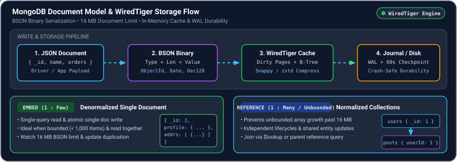

> [!NOTE]
> **Study Guide Overview:** MongoDB is a document-oriented NoSQL database that stores data as BSON (Binary JSON) documents inside collections, trading rigid relational normalization for schema flexibility, horizontal scalability, and single-document atomicity.

## Table of Contents
1. [MongoDB vs Relational Databases](#mongodb-vs-relational-databases)
2. [Core Concepts](#core-concepts)
3. [BSON Data Types](#bson-data-types)
4. [Document Structure Patterns](#document-structure-patterns)
5. [Schema Design Patterns](#schema-design-patterns)
6. [Relationships in MongoDB](#relationships-in-mongodb)
7. [Schema Validation](#schema-validation)
8. [MongoDB vs Other NoSQL](#mongodb-vs-other-nosql)
9. [When MongoDB Is Wrong](#when-mongodb-is-wrong)
10. [Common Interview Questions](#common-interview-questions)

---

## MongoDB vs Relational Databases

### The Fundamental Difference: Documents vs Tables

Relational databases (e.g., SQL Server) normalize data across multiple tables joined at read time. MongoDB stores related entities together as nested documents in a single collection.

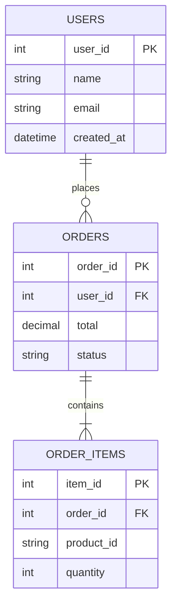

**SQL Server (Relational Model — Normalized Tables):**

| Table | Columns & Sample Data |
|-------|-----------------------|
| **Users** | `user_id: 1`, `name: "John Doe"`, `email: "john@example.com"`, `created_at: 2024-01-15` |
| **Users** | `user_id: 2`, `name: "Jane Smith"`, `email: "jane@example.com"`, `created_at: 2024-01-16` |
| **Orders** | `order_id: 101`, `user_id: 1`, `total: 450.50`, `status: "completed"` |
| **Orders** | `order_id: 102`, `user_id: 2`, `total: 275.00`, `status: "pending"` |
| **Order_Items** | `item_id: 1`, `order_id: 101`, `product_id: "P1"`, `quantity: 2` |
| **Order_Items** | `item_id: 2`, `order_id: 101`, `product_id: "P2"`, `quantity: 1` |

**MongoDB (Document Model — Embedded Hierarchy):**
```json
db.users.find({
  _id: ObjectId("507f1f77bcf86cd799439011"),
  name: "John Doe",
  email: "john@example.com",
  created_at: ISODate("2024-01-15T00:00:00Z"),
  orders: [
    {
      order_id: 101,
      total: 450.50,
      status: "completed",
      items: [
        { product_id: "P1", quantity: 2, price: 225.25 },
        { product_id: "P2", quantity: 1, price: 225.25 }
      ],
      created_at: ISODate("2024-01-15T10:30:00Z")
    },
    {
      order_id: 102,
      total: 275.00,
      status: "pending",
      items: [
        { product_id: "P3", quantity: 1, price: 275.00 }
      ],
      created_at: ISODate("2024-01-16T14:20:00Z")
    }
  ]
})
```

### Key Differences

| Aspect | SQL (Relational) | MongoDB (Document) |
|--------|------------------|-------------------|
| **Data Structure** | Tables with rows/columns | Collections with documents (JSON-like) |
| **Schema** | Fixed schema (strict) | Flexible schema (dynamic) |
| **Relationships** | Foreign keys, JOIN operations | Embedding, References, `$lookup` |
| **Normalization** | Highly normalized (3NF) | Denormalized (when read-heavy) |
| **Transactions** | ACID across all tables | ACID multi-doc (4.0+), single-doc atomicity |
| **Query Language** | SQL | MongoDB Query Language (JSON) |
| **Joins** | Native JOINs (efficient) | `$lookup` (requires care in sharding) |
| **Data Size** | Optimized for small reads | Optimized for large document reads |
| **Flexibility** | Changes require migrations | Add fields without migration |
| **Write Performance** | Can suffer with many indexes | Generally faster writes (fewer indexes) |
| **Read Performance** | Very fast with proper indexes | Fast for document reads, JOINs slower |

### When to Use MongoDB vs SQL

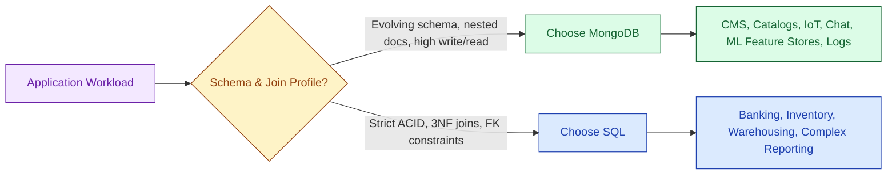

- **Good MongoDB Use Cases:** Content management systems (flexible schema), user profiles with variable attributes, time-series data aggregation, real-time analytics dashboards, e-commerce catalogs (varying product attributes), IoT sensor data, chat/messaging, ML feature stores, logging/event storage, and distributed caching layers.
- **When SQL is Better:** Financial transactions (strict credit/debit precision), highly normalized data with many relationships, complex reporting with multiple JOINs, critical referential integrity (foreign key constraints), budget forecasting/data warehousing, multi-table ACID systems, and stable schemas with minimal changes.

---

## Core Concepts

MongoDB organizes data into a four-tier hierarchy, where every document carries a unique `_id` primary key.

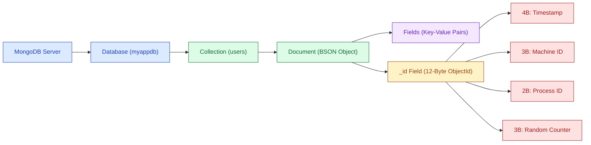

### 1. Database
A MongoDB server hosts multiple isolated databases, each containing its own collections.

```javascript
// Mongo shell commands
show dbs                    // List all databases
use myappdb                 // Switch/create database
db.getName()                // Get current database name
db.dropDatabase()           // Delete current database
```

### 2. Collections
Schemaless containers for documents (analogous to SQL tables), optionally guarded by `$jsonSchema` validators.

```javascript
// Collection operations
show collections                          // List all collections
db.createCollection("users")              // Create collection
db.createCollection("users", {
  validator: {
    $jsonSchema: {
      bsonType: "object",
      required: ["name", "email"],
      properties: {
        _id: { bsonType: "objectId" },
        name: { bsonType: "string" },
        email: { bsonType: "string" }
      }
    }
  }
})                                        // Create with schema validation
db.users.drop()                           // Delete collection
db.users.stats()                          // Get collection statistics
```

### 3. Documents & Fields
Documents are JSON-like BSON objects composed of key-value pairs; nested objects and arrays are queried via dot notation.

```javascript
// Document insertion
db.users.insertOne({
  _id: ObjectId("507f1f77bcf86cd799439011"),
  name: "Alice Johnson",
  email: "alice@example.com",
  age: 28,
  roles: ["admin", "user"],
  address: {
    street: "123 Main St",
    city: "New York",
    zip: "10001"
  },
  created_at: ISODate("2024-01-15T10:30:00Z"),
  metadata: {
    source: "web",
    ip: "192.168.1.1"
  }
})

// Accessing fields
db.users.find({ age: { $gt: 25 } })              // Dot notation for fields
db.users.find({ "address.city": "New York" })    // Nested field access
```

### 4. `_id` Field & ObjectId Structure
Every document requires a unique, immutable `_id` field (defaults to a 12-byte `ObjectId`).

```javascript
// Different _id types
{ _id: ObjectId() }                    // Default: 12-byte ObjectId
{ _id: "custom-string-id" }           // Custom string ID
{ _id: 12345 }                        // Custom numeric ID
{ _id: UUID() }                       // UUID (4.0+)
{ _id: BinData(0, "...") }            // Binary data

// ObjectId structure (12 bytes):
// 4 bytes: timestamp (seconds since epoch)
// 3 bytes: machine ID (identifier of machine)
// 2 bytes: process ID
// 3 bytes: random counter (starting from random value)
// This means ObjectIds are sortable by insertion time!
```

> [!TIP]
> Because the leading 4 bytes of an `ObjectId` encode a Unix timestamp, sorting by `_id` naturally approximates chronological insertion order without an extra `created_at` index.

---

## BSON Data Types

MongoDB stores data in **BSON (Binary JSON)**, extending standard JSON with rich binary, numeric, temporal, and internal types.

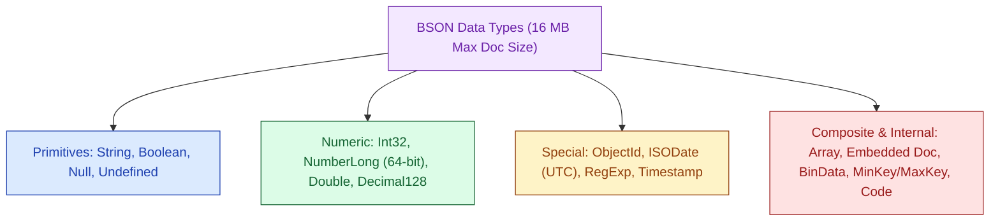

```javascript
db.datatypes.insertOne({
  // Basic types
  stringField: "Hello",                    // String
  numberInt: 42,                          // 32-bit integer
  numberLong: NumberLong("9223372036854775807"), // 64-bit integer
  numberDecimal: Decimal128("19.99"),     // High-precision decimal
  floatValue: 3.14159,                   // Double (floating point)
  boolValue: true,                       // Boolean
  nullValue: null,                       // Null
  undefinedValue: undefined,             // Undefined (stored as null in most cases)

  // Special types
  objectIdField: ObjectId("507f1f77bcf86cd799439011"), // Unique identifier
  dateField: ISODate("2024-01-15T10:30:00Z"),  // DateTime (UTC)
  regularExpression: /pattern/,          // Regular expression

  // Array
  tags: ["mongodb", "database", "nosql"],

  // Embedded document
  address: {
    street: "123 Main St",
    city: "New York",
    coordinates: {
      lat: 40.7128,
      lng: -74.0060
    }
  },

  // Array of objects
  orders: [
    { orderId: 101, amount: 450.50 },
    { orderId: 102, amount: 275.00 }
  ],

  // Binary data
  thumbnail: BinData(0, "base64encodeddata..."),

  // Timestamp (for replication)
  tsField: Timestamp(1704067800, 1),

  // Min/Max keys (internal use)
  minKey: MinKey(),
  maxKey: MaxKey(),

  // JavaScript code (for Map-Reduce)
  jsFunction: Code("function(x) { return x * 2; }")
})
```

### BSON Size Limits

| Constraint | Limit | Practical Implication |
|------------|-------|-----------------------|
| **Document Size** | **16 MB** | Includes all field names, values, and type metadata |
| **Array Length** | No fixed element cap | Bounded indirectly by the 16 MB document limit |
| **String Length** | No fixed char cap | Bounded indirectly by the 16 MB document limit |

```javascript
// Practical example: handling large arrays
db.products.insertOne({
  _id: "PROD-001",
  name: "High-demand product",
  reviews: [
    // Initially: array of review objects
    { author: "User1", rating: 5, text: "..." },
    { author: "User2", rating: 4, text: "..." }
    // For 100K reviews, this becomes problematic!
    // Solution: use bucket pattern (see schema patterns)
  ]
})
```

> [!IMPORTANT]
> Always use `Decimal128` for monetary or high-precision scientific values—standard JSON `Double` introduces binary floating-point rounding errors.

---

## Document Structure Patterns

Choosing between embedding, referencing, or combining both is the core data-modeling decision in MongoDB.

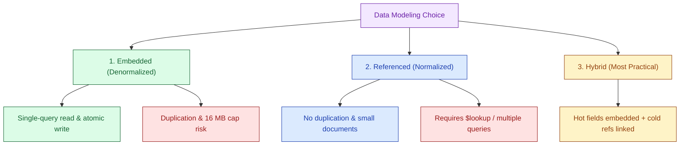

| Pattern | Pros | Cons | Best For |
|---------|------|------|----------|
| **Embedded** | Faster reads (1 fetch), atomic writes, no JOINs | Data duplication, larger docs, harder shared updates | 1:1 and bounded 1:Few data read together |
| **Referenced** | Zero duplication, smaller docs, easy shared updates | Requires `$lookup` or extra queries, cross-shard JOIN limits | 1:Many (unbounded), independent lifecycles |
| **Hybrid** | Fast hot-path reads without bloating documents | Must sync duplicated hot fields on update | Real-world apps (e.g., user summary + full details) |

### Pattern 1: Embedded Documents (Denormalization)
```javascript
// User with embedded profile and settings
db.users.insertOne({
  _id: ObjectId(),
  email: "john@example.com",

  // Embedded profile
  profile: {
    firstName: "John",
    lastName: "Doe",
    bio: "Software engineer",
    avatar: "https://example.com/avatar.jpg",
    followerCount: 1250
  },

  // Embedded settings
  settings: {
    emailNotifications: true,
    darkMode: false,
    language: "en",
    timezone: "EST"
  },

  created_at: ISODate("2024-01-15T10:30:00Z")
})

// Query embedded document
db.users.find({ "profile.firstName": "John" })
db.users.updateOne(
  { _id: ObjectId() },
  { $set: { "settings.darkMode": true } }
)
```

### Pattern 2: References (Normalization)
```javascript
// User references a profile document
db.users.insertOne({
  _id: ObjectId("507f1f77bcf86cd799439011"),
  email: "john@example.com",
  profileId: ObjectId("507f1f77bcf86cd799439012"),
  created_at: ISODate("2024-01-15T10:30:00Z")
})

// Separate profile collection
db.profiles.insertOne({
  _id: ObjectId("507f1f77bcf86cd799439012"),
  firstName: "John",
  lastName: "Doe",
  bio: "Software engineer",
  avatar: "https://example.com/avatar.jpg",
  followerCount: 1250
})

// Query with lookup (like SQL JOIN)
db.users.aggregate([
  { $match: { email: "john@example.com" } },
  {
    $lookup: {
      from: "profiles",
      localField: "profileId",
      foreignField: "_id",
      as: "profile"
    }
  },
  { $unwind: "$profile" }  // Convert array to object
])
```

### Pattern 3: Hybrid Approach (Most Practical)
```javascript
// Store frequently accessed data in document, reference for less frequent data
db.users.insertOne({
  _id: ObjectId("507f1f77bcf86cd799439011"),
  email: "john@example.com",

  // Frequently accessed fields (denormalized)
  firstName: "John",
  lastName: "Doe",
  avatar: "https://example.com/avatar.jpg",

  // Reference to detailed profile
  detailedProfileId: ObjectId("507f1f77bcf86cd799439012"),

  // Reference to preferences (rarely accessed)
  preferencesId: ObjectId("507f1f77bcf86cd799439013"),

  created_at: ISODate("2024-01-15T10:30:00Z")
})
```

---

## Schema Design Patterns

MongoDB provides eight canonical schema patterns to solve scale, indexing, and 16 MB document-size challenges.

```mermaid
flowchart TD
    Patterns["8 MongoDB Schema Patterns"] --> P1["Attribute: Sparse/variable key-value pairs"]
    Patterns --> P2["Bucket: Group time-series into fixed windows"]
    Patterns --> P3["Computed: Pre-calculate stats on write"]
    Patterns --> P4["Versioning: Latest doc + history collection"]
    Patterns --> P5["Extended Reference: Copy hot fields to avoid $lookup"]
    Patterns --> P6["Outlier: Paginate extreme-cardinality docs"]
    Patterns --> P7["Polymorphic: Different shapes in one collection"]
    Patterns --> P8["Subset: Keep top-N hot items in main doc"]

    classDef blue fill:#dbeafe,stroke:#1e40af,color:#1e40af
    classDef green fill:#dcfce7,stroke:#166534,color:#166534
    classDef amber fill:#fef3c7,stroke:#92400e,color:#92400e
    classDef red fill:#fee2e2,stroke:#991b1b,color:#991b1b
    classDef purple fill:#f3e8ff,stroke:#6b21a8,color:#6b21a8

    class Patterns purple
    class P1,P7 blue
    class P2,P6,P8 green
    class P3,P5 amber
    class P4 red
```

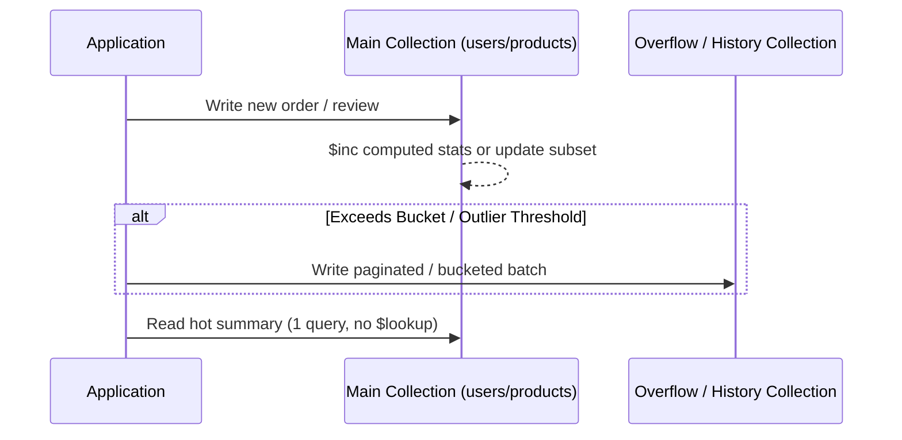

### Pattern 1: Attribute Pattern
Store optional or sparse attributes as `{ name, value }` arrays to index them uniformly without creating separate collections. **Use Case:** Product catalogs where items have different attributes (e.g., clothing size/color vs. electronics specs).

```javascript
// Before (normalized - requires joins)
db.products.insertOne({ _id: 1, name: "T-shirt" })
db.productSizes.insertOne({ productId: 1, sizes: ["S", "M", "L", "XL"] })
db.colors.insertOne({ productId: 1, colors: ["Red", "Blue"] })

// After (attribute pattern)
db.products.insertOne({
  _id: 1,
  name: "T-shirt",
  type: "clothing",
  attributes: [
    { name: "size", value: "S" },
    { name: "size", value: "M" },
    { name: "size", value: "L" },
    { name: "color", value: "Red" },
    { name: "color", value: "Blue" }
  ]
})

// Query for products with red color and size M
db.products.find({
  attributes: {
    $all: [
      { $elemMatch: { name: "color", value: "Red" } },
      { $elemMatch: { name: "size", value: "M" } }
    ]
  }
})
```

### Pattern 2: Bucket Pattern
Group related data into time/count buckets to avoid huge arrays and 16 MB limits. **Use Case:** Time-series data (sensor readings, stock prices, page views).

```javascript
// Without bucket pattern (problematic for 10K readings/day)
db.readings.insertOne({
  sensorId: 123,
  date: ISODate("2024-01-15T00:00:00Z"),
  measurements: [
    { timestamp: "00:00", temperature: 22.5 },
    { timestamp: "00:01", temperature: 22.6 },
    { timestamp: "00:02", temperature: 22.7 },
    // 1440 entries for 24 hours...too large
  ]
})

// With bucket pattern (optimal)
db.sensorReadings.insertOne({
  _id: ObjectId(),
  sensorId: 123,
  date: ISODate("2024-01-15T00:00:00Z"),
  hour: 0,
  measurements: [
    { timestamp: "00:00", temperature: 22.5 },
    { timestamp: "00:01", temperature: 22.6 },
    { timestamp: "00:02", temperature: 22.7 }
    // Only 60 entries for 1 hour - manageable size
  ]
})

// Query last hour's readings for a sensor
db.sensorReadings.find({
  sensorId: 123,
  date: ISODate("2024-01-15T00:00:00Z"),
  hour: 23
})
```

### Pattern 3: Computed Pattern
Pre-calculate and store aggregate values on write instead of computing them on every read. **Use Case:** Frequently accessed aggregations (user stats, product ratings).

```javascript
// Without computed pattern
db.orders.find({
  userId: "USER-123"
})
// Then compute: sum, count, average in application code

// With computed pattern (faster reads)
db.users.insertOne({
  _id: "USER-123",
  name: "John Doe",
  orderStats: {
    totalOrders: 42,
    totalSpent: 15750.50,
    averageOrderValue: 375.01,
    lastOrderDate: ISODate("2024-01-15T10:30:00Z")
  }
})

// Update computed fields with triggers or application logic
db.users.updateOne(
  { _id: "USER-123" },
  {
    $inc: { "orderStats.totalOrders": 1, "orderStats.totalSpent": 450.50 },
    $set: { "orderStats.lastOrderDate": new Date() },
    $avg: { "orderStats.averageOrderValue": ... }
  }
)
```

### Pattern 4: Document Versioning
Keep the latest active state in the main collection while archiving historical snapshots in a separate versions collection.

```javascript
// Main document with latest version
db.products.insertOne({
  _id: "PROD-001",
  name: "Laptop",
  price: 999.99,
  version: 3,
  lastModified: ISODate("2024-01-15T10:30:00Z")
})

// Version history collection
db.productVersions.insertMany([
  {
    productId: "PROD-001",
    version: 1,
    changes: { price: 1199.99 },
    modifiedAt: ISODate("2024-01-10T10:30:00Z"),
    modifiedBy: "admin1"
  },
  {
    productId: "PROD-001",
    version: 2,
    changes: { price: 1099.99 },
    modifiedAt: ISODate("2024-01-12T10:30:00Z"),
    modifiedBy: "admin1"
  },
  {
    productId: "PROD-001",
    version: 3,
    changes: { price: 999.99 },
    modifiedAt: ISODate("2024-01-15T10:30:00Z"),
    modifiedBy: "admin2"
  }
])
```

### Pattern 5: Extended Reference
Copy frequently queried fields from a referenced document into the parent document to eliminate `$lookup` on hot reads.

```javascript
// Without extended reference - must look up full profile
db.posts.insertOne({
  _id: ObjectId(),
  title: "MongoDB Guide",
  authorId: ObjectId("507f1f77bcf86cd799439012"),
  content: "...",
  created_at: ISODate("2024-01-15T10:30:00Z")
})

// With extended reference - author info available immediately
db.posts.insertOne({
  _id: ObjectId(),
  title: "MongoDB Guide",
  authorId: ObjectId("507f1f77bcf86cd799439012"),
  authorName: "John Doe",          // Denormalized
  authorAvatar: "https://...",     // Denormalized
  content: "...",
  created_at: ISODate("2024-01-15T10:30:00Z")
})
```

### Pattern 6: Outlier Pattern
Flag extreme-cardinality documents (`isOutlier: true`) and paginate their overflow data into a secondary collection so normal documents stay fast.

```javascript
// E-commerce: product with millions of reviews
// Naive approach: store all in one document (exceeds 16MB)

// Outlier pattern solution:
db.products.insertOne({
  _id: "PROD-001",
  name: "Popular product",
  reviewCount: 1000000,
  isOutlier: true,  // Flag for special handling
  averageRating: 4.7
})

db.productReviews.insertMany([
  {
    _id: ObjectId(),
    productId: "PROD-001",
    page: 1,  // Paginate the reviews
    reviews: [
      { author: "User1", rating: 5, text: "..." },
      { author: "User2", rating: 4, text: "..." }
      // Batch reviews into pages
    ]
  }
])

// Query reviews by page
db.productReviews.findOne({
  productId: "PROD-001",
  page: 1
})
```

### Pattern 7: Polymorphic Pattern
Store documents with different shapes in the same collection using a discriminator field (`type`) when they are queried together.

```javascript
// Media collection with different types
db.media.insertMany([
  {
    _id: ObjectId(),
    type: "image",
    title: "Mountain vista",
    url: "https://example.com/image.jpg",
    width: 1920,
    height: 1080,
    fileSize: 2500000,
    created_at: ISODate()
  },
  {
    _id: ObjectId(),
    type: "video",
    title: "Tutorial",
    url: "https://example.com/video.mp4",
    duration: 3600,  // seconds
    resolution: "1080p",
    codec: "h264",
    fileSize: 500000000,
    created_at: ISODate()
  },
  {
    _id: ObjectId(),
    type: "document",
    title: "Whitepaper",
    url: "https://example.com/doc.pdf",
    pageCount: 45,
    fileSize: 5000000,
    created_at: ISODate()
  }
])

// Query all media
db.media.find()

// Query only videos with duration > 1 hour
db.media.find({
  type: "video",
  duration: { $gt: 3600 }
})
```

### Pattern 8: Subset Pattern
Keep only the most frequently accessed subset (e.g., last 10 reviews) in the main document, and store the full history in a separate collection.

```javascript
// User document with summary of recent reviews
db.users.insertOne({
  _id: ObjectId(),
  name: "John Doe",
  recentReviews: [
    { productId: "PROD-001", rating: 5, date: ISODate() },
    { productId: "PROD-002", rating: 4, date: ISODate() },
    { productId: "PROD-003", rating: 3, date: ISODate() }
    // Keep only last 10 reviews (subset)
  ],
  totalReviewCount: 127
})

// Detailed reviews in separate collection
db.userReviews.insertMany([
  {
    _id: ObjectId(),
    userId: ObjectId(),
    productId: "PROD-001",
    rating: 5,
    title: "Great product!",
    text: "Very satisfied with this purchase...",
    helpful: 42,
    unhelpful: 2,
    created_at: ISODate()
  }
  // All reviews here, not just recent ones
])
```

---

## Relationships in MongoDB

Cardinality dictates whether to embed, reference from parent, reference from child, or introduce a junction collection.

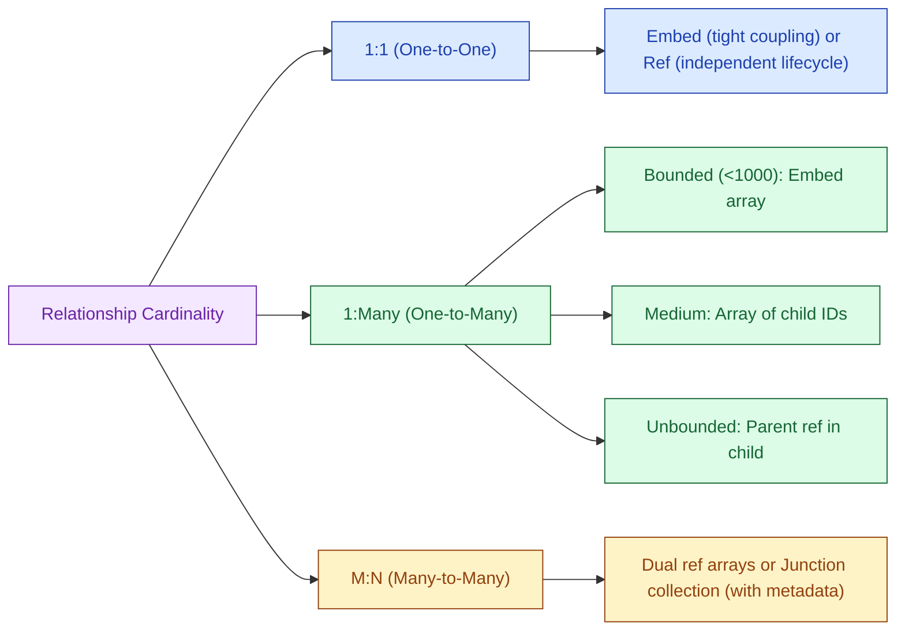

### One-to-One Relationships
```javascript
// Approach 1: Embedded document (preferred for tight coupling)
db.users.insertOne({
  _id: ObjectId(),
  email: "john@example.com",
  profile: {
    bio: "Software engineer",
    avatar: "https://example.com/avatar.jpg"
  }
})

// Approach 2: References (when profile needs independent lifecycle)
db.users.insertOne({
  _id: ObjectId("USER-001"),
  email: "john@example.com",
  profileId: ObjectId("PROFILE-001")
})

db.profiles.insertOne({
  _id: ObjectId("PROFILE-001"),
  bio: "Software engineer",
  avatar: "https://example.com/avatar.jpg"
})
```

### One-to-Many Relationships
```javascript
// Approach 1: Array of embedded documents (< 1000 items)
db.users.insertOne({
  _id: ObjectId(),
  name: "John Doe",
  phone: "555-1234",
  addresses: [
    {
      type: "home",
      street: "123 Main St",
      city: "New York"
    },
    {
      type: "work",
      street: "456 Office Blvd",
      city: "New York"
    }
  ]
})

// Approach 2: Array of references (many items or need updates)
db.users.insertOne({
  _id: ObjectId(),
  name: "John Doe",
  addressIds: [
    ObjectId("ADDR-001"),
    ObjectId("ADDR-002")
  ]
})

db.addresses.insertMany([
  { _id: ObjectId("ADDR-001"), type: "home", street: "123 Main St" },
  { _id: ObjectId("ADDR-002"), type: "work", street: "456 Office Blvd" }
])

// Approach 3: Parent reference in child (for very large arrays)
db.orders.insertMany([
  {
    _id: ObjectId(),
    userId: ObjectId(),  // Reference back to user
    total: 450.50
  },
  {
    _id: ObjectId(),
    userId: ObjectId(),
    total: 275.00
  }
])

// Query: find all orders for user
db.orders.find({ userId: ObjectId() })
```

### Many-to-Many Relationships
```javascript
// Approach 1: Arrays of references (both directions)
db.users.insertOne({
  _id: ObjectId(),
  name: "John Doe",
  skillIds: [
    ObjectId("JAVA"),
    ObjectId("MONGODB"),
    ObjectId("PYTHON")
  ]
})

db.skills.insertMany([
  { _id: ObjectId("JAVA"), name: "Java", category: "Programming" },
  { _id: ObjectId("MONGODB"), name: "MongoDB", category: "Database" },
  { _id: ObjectId("PYTHON"), name: "Python", category: "Programming" }
])

// Query: users with Java skill
db.users.find({
  skillIds: ObjectId("JAVA")
})

// Approach 2: Junction collection (for complex metadata)
db.users.insertOne({
  _id: ObjectId("USER-001"),
  name: "John Doe"
})

db.userSkills.insertMany([
  {
    _id: ObjectId(),
    userId: ObjectId("USER-001"),
    skillId: ObjectId("JAVA"),
    proficiency: "expert",
    yearsOfExperience: 8,
    lastUsed: ISODate("2024-01-15T00:00:00Z")
  }
])
```

---

## Schema Validation

MongoDB enforces structural rules on writes via `$jsonSchema` validators at collection creation or via `collMod`.

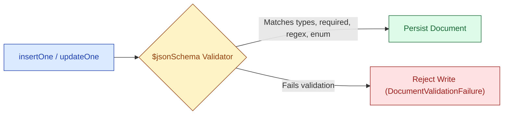

```javascript
// Create collection with schema validation
db.createCollection("users", {
  validator: {
    $jsonSchema: {
      bsonType: "object",
      required: ["name", "email"],
      properties: {
        _id: { bsonType: "objectId" },
        name: {
          bsonType: "string",
          minLength: 1,
          maxLength: 100
        },
        email: {
          bsonType: "string",
          pattern: "^[a-zA-Z0-9._%+-]+@[a-zA-Z0-9.-]+\\.[a-zA-Z]{2,}$"
        },
        age: {
          bsonType: "int",
          minimum: 0,
          maximum: 150
        },
        roles: {
          bsonType: "array",
          items: {
            bsonType: "string",
            enum: ["admin", "moderator", "user"]
          }
        },
        phone: {
          bsonType: ["string", "null"]  // Optional
        },
        address: {
          bsonType: "object",
          required: ["street", "city"],
          properties: {
            street: { bsonType: "string" },
            city: { bsonType: "string" },
            zip: { bsonType: "string" }
          }
        }
      }
    }
  }
})

// Validate existing collection
db.runCommand({
  collMod: "users",
  validator: {
    $jsonSchema: { /* schema */ }
  }
})

// Insert valid document
db.users.insertOne({
  name: "John Doe",
  email: "john@example.com",
  age: 28,
  roles: ["user"],
  address: {
    street: "123 Main St",
    city: "New York",
    zip: "10001"
  }
})

// This will fail (missing required email)
db.users.insertOne({
  name: "Jane Doe",
  age: 25
})
```

---

## MongoDB vs Other NoSQL

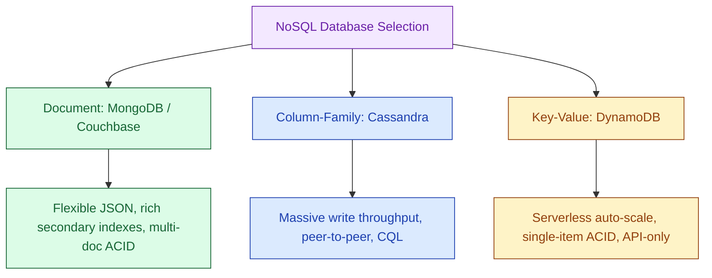

| Feature | MongoDB | Cassandra | DynamoDB | Couchbase |
|---------|---------|-----------|----------|-----------|
| **Data Model** | Document (JSON) | Column-family | Key-value | Document (JSON) |
| **Query Language** | MongoDB Query + Aggregation | CQL (SQL-like) | API calls only | N1QL (SQL-like) |
| **ACID Transactions** | Multi-doc (4.0+) | Limited | Single item | Limited |
| **Consistency** | Strong (configurable) | Eventual | Eventual | Configurable |
| **Indexes** | Multiple indexes | Limited | Limited | Multiple indexes |
| **Schema** | Flexible | Semi-flexible | Flexible | Flexible |
| **Scalability** | Horizontal (sharding) | Excellent horizontal | Excellent (auto) | Good horizontal |
| **Replication** | Replica sets (Raft) | Peer-to-peer | Built-in | Node-based |
| **Use Cases** | General purpose, content, analytics | Time-series, analytics | Real-time apps, gaming | Real-time, content |
| **Learning Curve** | Easiest (JSON) | Moderate | Moderate | Moderate |
| **Operational Complexity** | Moderate | High | Low (serverless) | Moderate |

---

## When MongoDB Is Wrong

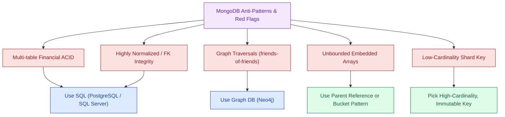

### When to Choose SQL Instead

1. **Complex ACID Transactions**
   ```javascript
   // Problem: Bank transfer across entities
   // Need atomicity: debit account A, credit account B, or rollback both
   // MongoDB ACID multi-doc works but adds complexity
   // SQL with transaction support is simpler
   ```

2. **Highly Normalized Data**
   ```javascript
   // Problem: Many relationships between entities
   // Airline system: flights, airlines, airports, schedules, prices
   // SQL with JOINs is more natural
   // MongoDB requires multiple lookups
   ```

3. **Strong Consistency Requirements**
   ```javascript
   // Problem: Inventory management
   // Must guarantee: if item sold, stock decremented, payment processed
   // MongoDB eventual consistency can cause issues
   // SQL transactions guarantee all or nothing
   ```

4. **Data Integrity with Foreign Keys**
   ```javascript
   // Problem: Referential integrity critical
   // Delete a user shouldn't orphan orders in MongoDB
   // SQL foreign key constraints prevent this automatically
   ```

5. **Complex Reporting & Analytics**
   ```javascript
   // Problem: Monthly sales by region, product category, salesman
   // Multiple GROUP BY, HAVING clauses easier in SQL
   // MongoDB aggregation pipeline more verbose
   ```

### Anti-Patterns in MongoDB

```javascript
// ❌ DON'T: Store every relationship as embedded document
db.users.insertOne({
  _id: 1,
  name: "John",
  posts: [
    // Embedding entire post documents here
    // If user has 10K posts = huge document!
    { _id: 1, title: "Post 1", content: "..." },
    // ...
  ]
})

// ✅ DO: Use references for one-to-many with unbounded arrays
db.posts.find({ userId: 1 })

// ❌ DON'T: Use MongoDB for graph relationships
db.users.insertOne({
  _id: 1,
  friendIds: [2, 3, 4, 5, ...],
  friendOfIds: [6, 7, 8, ...]
})

// ✅ DO: Use specialized graph database (Neo4j) instead

// ❌ DON'T: Ignore shard key selection (we'll cover later)
db.users.insertOne({
  _id: ObjectId(),
  name: "John",
  status: "active"  // Bad shard key: low cardinality, too many updates
})

// ✅ DO: Choose high-cardinality, immutable shard key
```

> [!WARNING]
> Never embed unbounded arrays (like user posts, comments, or logs) inside a single document—crossing the 16 MB BSON limit causes writes to fail abruptly in production.

---

## Common Interview Questions

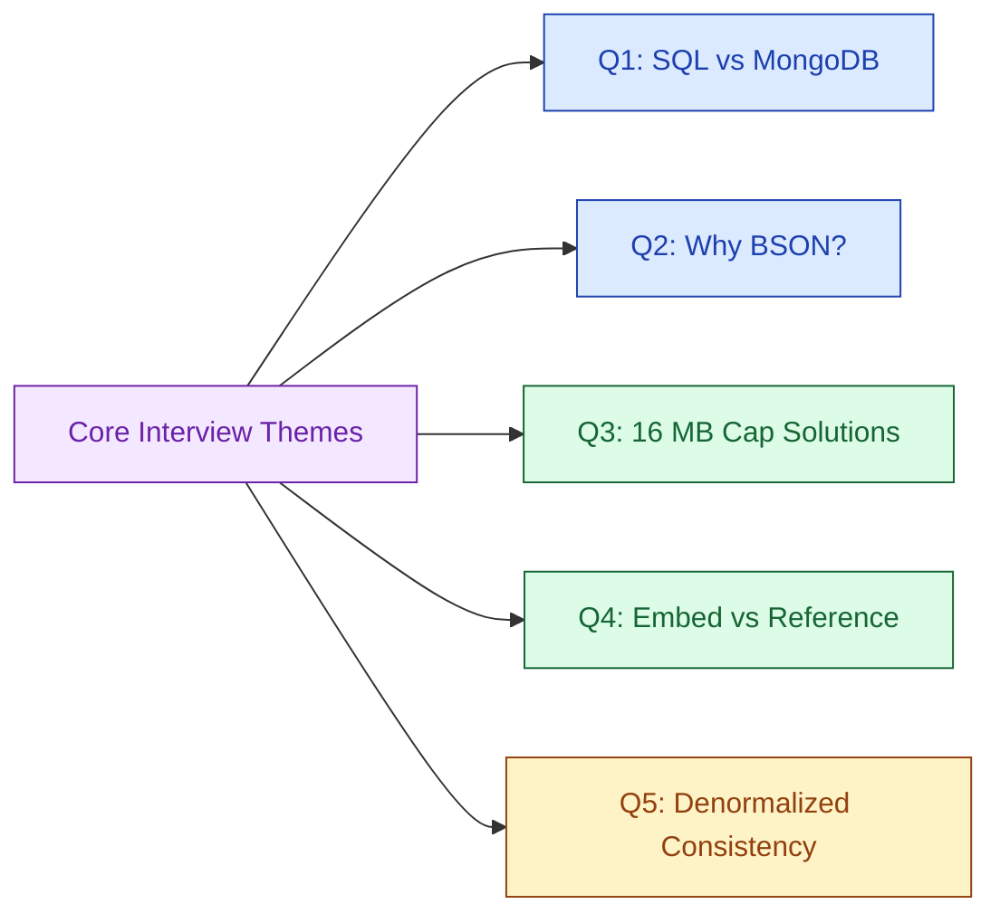

### Q1: What's the difference between MongoDB and SQL Server? When would you use each?

**Answer:**
MongoDB uses a flexible document model (JSON-like) while SQL Server uses structured tables with fixed schemas.

- **MongoDB is better for:** Rapidly evolving schemas, nested/hierarchical data, flexible queries on varying structures, content management/catalogs, and real-time analytics.
- **SQL Server is better for:** Complex financial transactions, highly normalized data with many relationships, strong consistency, data warehousing/complex reporting, and strict referential integrity.

```text
MongoDB: E-commerce product catalog (products have different attributes)
SQL Server: Bank transactions (strict ACID, audit requirements)
```

### Q2: Explain the concept of BSON and why MongoDB uses it.

**Answer:**
BSON (Binary JSON) is MongoDB's binary serialization format. It extends JSON with additional data types like `ObjectId`, `ISODate`, `NumberLong`, and `Decimal128`.

- **Efficient storage and transmission** (binary vs text)
- **Type information preservation** (ambiguous in JSON)
- **Faster indexing** on binary format
- **Direct binary comparison** without parsing

### Q3: Document size limit is 16 MB. How would you handle entities with more data?

**Answer:**
Use the **Bucket Pattern** or **Subset Pattern**:

```javascript
// Bucket Pattern for time-series data
db.readings.insertOne({
  sensorId: 123,
  date: ISODate("2024-01-15"),
  hour: 0,
  measurements: [ /* 60 readings for this hour */ ]
})

// Subset Pattern for large document
db.users.insertOne({
  _id: ObjectId(),
  recentPosts: [ /* last 10 */ ],
  totalPostCount: 1000
})

db.userPosts.find({ userId: ObjectId() })  // All posts here
```

### Q4: Should you embed or reference documents?

**Answer:**
- **Embed when:** One-to-one relationship, one-to-many with bounded array (`< 1000` items), data accessed together frequently, or atomicity across related data is needed.
- **Reference when:** One-to-many with large/unbounded arrays, data accessed independently, updates to referenced data would duplicate changes, or cross-shard joins are needed.

```javascript
// Embed user's profile (accessed together)
db.users.insertOne({
  _id: 1,
  profile: { ... }
})

// Reference user's posts (accessed separately, unbounded)
db.posts.find({ userId: 1 })
```

### Q5: How do you maintain data consistency with denormalization?

**Answer:**
- Update in multiple places atomically with multi-document transactions
- Use application logic to keep data consistent
- Use triggers or background jobs to sync denormalized data
- Accept eventual consistency as a trade-off

```javascript
db.session.startTransaction()
try {
  db.users.updateOne(
    { _id: userId },
    { $inc: { "stats.orderCount": 1 } }
  )
  db.orders.insertOne({ userId, total: 450.50 })
  db.session.commitTransaction()
} catch(e) {
  db.session.abortTransaction()
}
```
