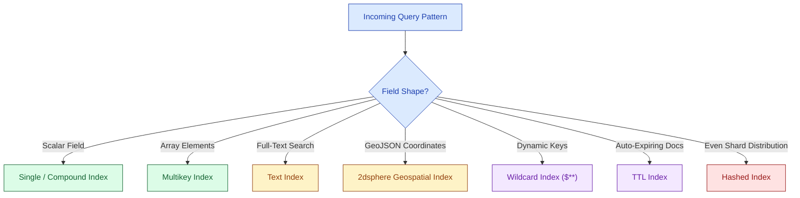
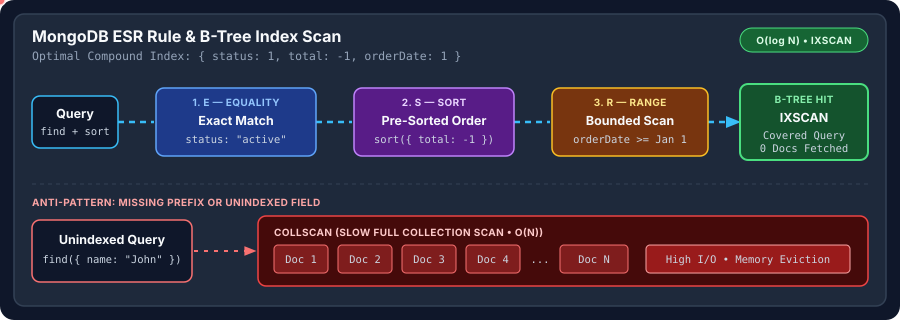
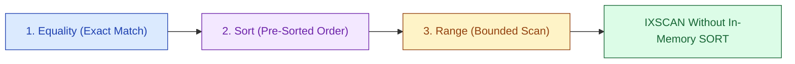
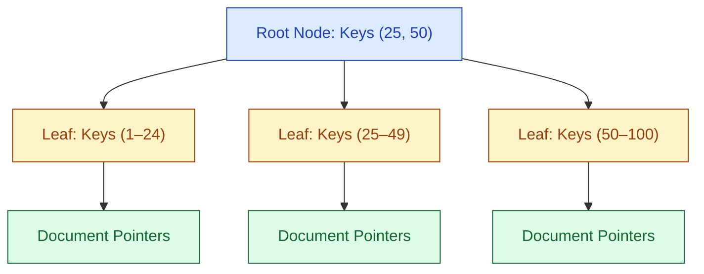
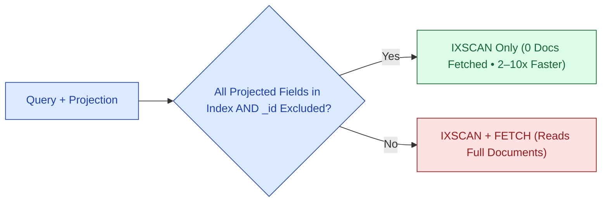
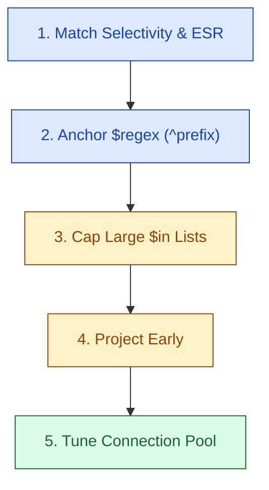
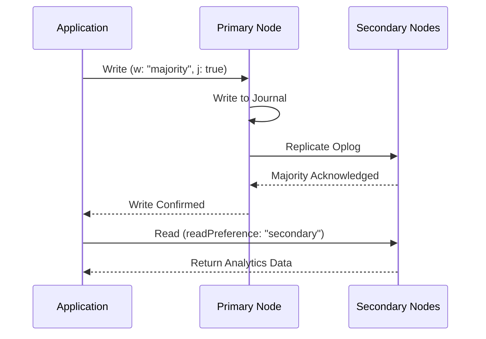
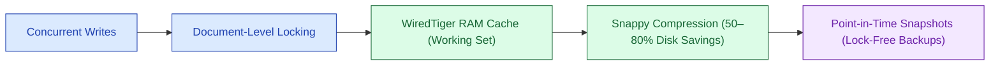
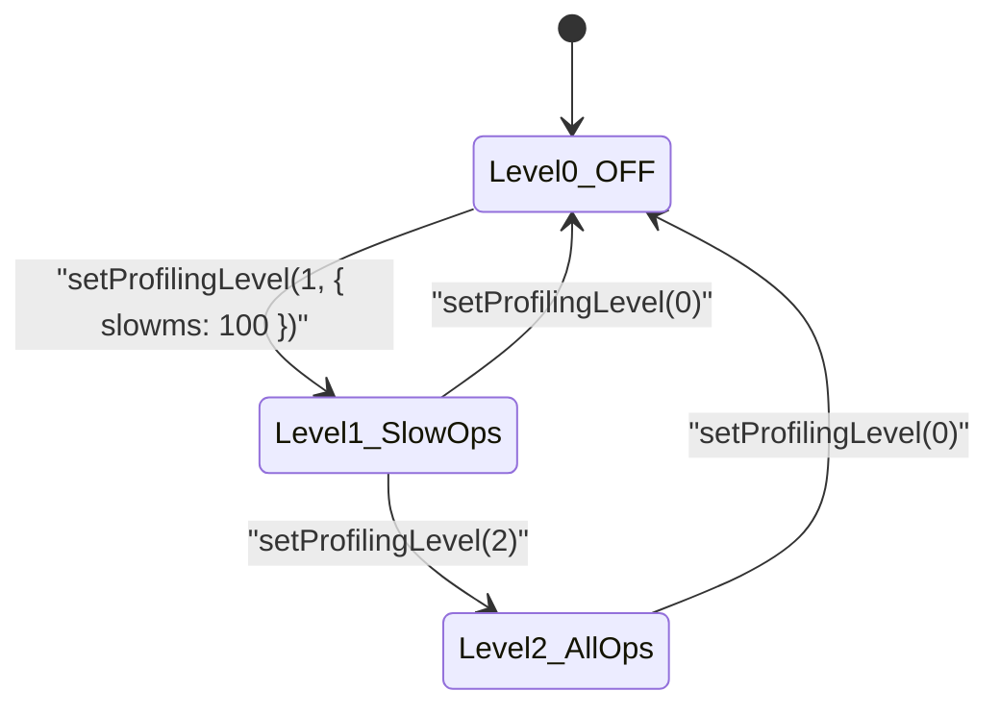
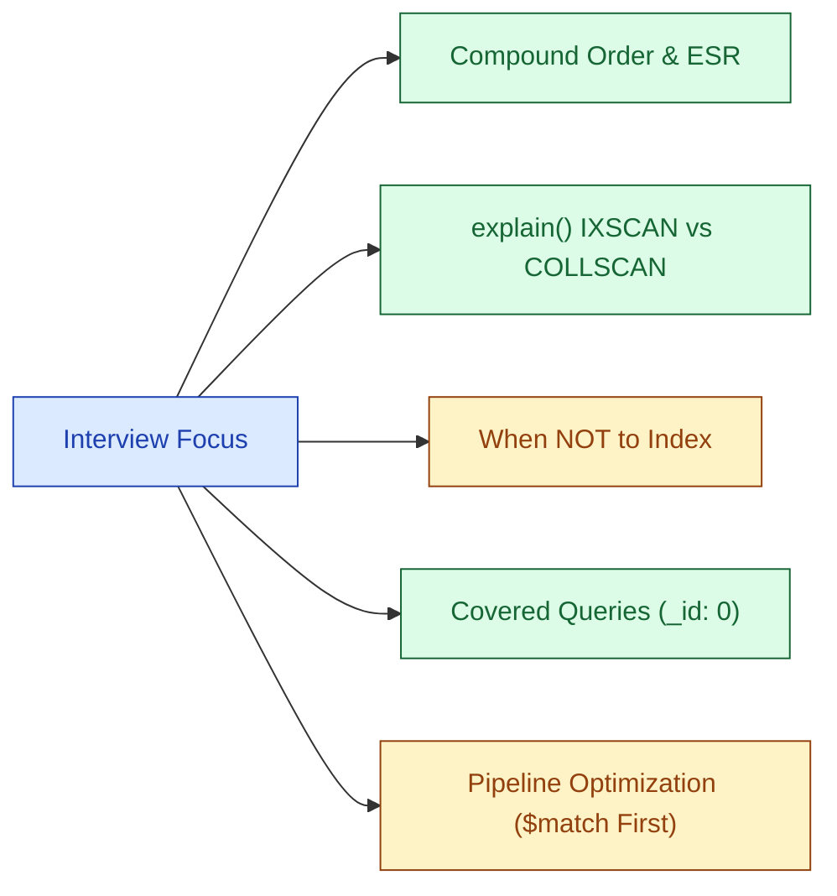

# MongoDB Deep Dive: Indexing and Performance

## Table of Contents
1. [Index Types](#index-types)
2. [Compound Indexes and ESR Rule](#compound-indexes-and-esr-rule)
3. [Index Internals](#index-internals)
4. [Covered Queries](#covered-queries)
5. [explain() Deep Dive](#explain-deep-dive)
6. [Query Optimization](#query-optimization)
7. [Read and Write Concerns](#read-and-write-concerns)
8. [WiredTiger Storage Engine](#wiredtiger-storage-engine)
9. [Profiler](#profiler)
10. [Common Interview Questions](#common-interview-questions)

---

## Index Types

MongoDB provides specialized index types tailored to different data shapes and query patterns.

| Index Type | Target Data / Use Case | Key Constraint / Behavior |
| :--- | :--- | :--- |
| **Single Field** | Scalar fields (`age`, `email`) | Ascending (`1`) or descending (`-1`) |
| **Compound** | Multi-field filters & sorts | Left-prefix rule applies; order matters |
| **Multikey** | Array fields (`tags`) | Indexes each array element separately |
| **Text** | Full-text search (`$text`) | Supports weights & `textScore` sorting |
| **Geospatial** | GeoJSON (`2dsphere`) | Supports `$near`, `$geoWithin` |
| **Hashed** | Shard keys (`"hashed"`) | Even distribution; no range queries or compound use |
| **Wildcard** | Dynamic subdocuments (`$**`) | Flexible schema queries; higher write overhead |
| **TTL** | Time-series / sessions | Auto-deletes docs after `expireAfterSeconds` |



### 1. Single Field Index

```javascript
// Create ascending / descending indexes
db.users.createIndex({ age: 1 })
db.users.createIndex({ email: -1 })

// Drop specific index or all indexes (except _id)
db.users.dropIndex({ age: 1 })
db.users.dropIndexes()
```

**Spring Data MongoDB:**
```java
@Document(collection = "users")
public class User {
    @Id
    private String id;

    @Indexed
    private String email;

    @Indexed(direction = IndexDirection.DESCENDING)
    private Integer age;

    private String name;
}

// Explicit index creation
@Configuration
public class MongoConfig {
    @Bean
    public IndexOperationsSessionCallback indexCreation() {
        return session -> {
            IndexOperations indexOps = session.indexOps(User.class);
            indexOps.ensureIndex(new Index().on("email", Sort.Direction.ASC));
            return null;
        };
    }
}
```

### 2. Compound Index

An index on multiple fields. Queries must include the **leading prefix** to use the index efficiently.

```javascript
// Compound index: age ascending, then name ascending
db.users.createIndex({ age: 1, name: 1 })

// Mixed directions
db.users.createIndex({ age: -1, createdAt: 1 })

// ✅ Uses index:
// - Filter by age
// - Filter by age AND name
// - Filter by age, sort by name
// - Filter by age AND name, sort by createdAt

// ❌ Does NOT use index (missing prefix):
// db.users.find({ name: "John" })
// db.users.find({ createdAt: ... })
```

**Spring Data MongoDB:**
```java
@Document(collection = "orders")
public class Order {
    @Id
    private String id;

    @Indexed(name = "customer_status_idx")
    private String customerId;

    @Indexed(name = "customer_status_idx")
    private String status;

    private BigDecimal total;
    private LocalDateTime createdAt;
}
// Creates compound index on (customerId, status)
```

### 3. Multikey Index (Arrays)

Creates a separate index entry for every element in an array field.

```javascript
db.posts.insertOne({
  _id: 1,
  title: "MongoDB Guide",
  tags: ["mongodb", "database", "nosql"]
})

db.posts.createIndex({ tags: 1 })

db.posts.find({ tags: "mongodb" })                       // Uses index
db.posts.find({ tags: { $in: ["mongodb", "java"] } })    // Uses index
```

### 4. Text Index

```javascript
// Create text index on multiple fields
db.articles.createIndex({ title: "text", body: "text" })

// Basic, phrase, and exclusion searches
db.articles.find({ $text: { $search: "mongodb" } })
db.articles.find({ $text: { $search: "\"mongodb tutorial\"" } })
db.articles.find({ $text: { $search: "mongodb -advanced" } })

// Weighted text index & textScore projection
db.articles.createIndex(
  { title: "text", body: "text" },
  { weights: { title: 10, body: 5 } }
)

db.articles.find(
  { $text: { $search: "mongodb" } },
  { score: { $meta: "textScore" } }
).sort({ score: { $meta: "textScore" } })
```

### 5. Geospatial Index

```javascript
// 2dsphere index for spherical (longitude, latitude) data
db.restaurants.createIndex({ location: "2dsphere" })

db.restaurants.insertOne({
  name: "Pizza Place",
  location: {
    type: "Point",
    coordinates: [-74.0059, 40.7128]  // [longitude, latitude]
  }
})

// Proximity query (within 5km)
db.restaurants.find({
  location: {
    $near: {
      $geometry: { type: "Point", coordinates: [-74.0000, 40.7000] },
      $maxDistance: 5000
    }
  }
})

// Polygon containment query
db.restaurants.find({
  location: {
    $geoWithin: {
      $geometry: {
        type: "Polygon",
        coordinates: [[
          [-74.0100, 40.7100],
          [-74.0000, 40.7100],
          [-74.0000, 40.7000],
          [-74.0100, 40.7000],
          [-74.0100, 40.7100]
        ]]
      }
    }
  }
})
```

### 6. Hashed Index

```javascript
db.users.createIndex({ email: "hashed" })
```

> [!NOTE]
> Hashed indexes distribute shard keys evenly across buckets, but **cannot** support range queries and **cannot** be part of a compound index.

### 7. Wildcard Index

```javascript
// Index all fields inside user_metadata
db.users.createIndex({ "user_metadata.$**": 1 })

db.users.find({ "user_metadata.preferences.theme": "dark" })
db.users.find({ "user_metadata.profile.bio": { $regex: "engineer" } })

// Index ALL fields in collection (use sparingly)
db.users.createIndex({ "$**": 1 })
```

### 8. TTL Index

Automatically purges documents once `ISODate("now") - createdAt > expireAfterSeconds`.

```javascript
// Delete sessions 24 hours (86400s) after createdAt
db.sessions.createIndex(
  { createdAt: 1 },
  { expireAfterSeconds: 86400 }
)

db.sessions.insertOne({
  _id: "session123",
  userId: "USER-001",
  sessionData: { role: "admin" },
  createdAt: ISODate()
})
```

**Spring Data MongoDB:**
```java
@Document(collection = "sessions")
public class UserSession {
    @Id
    private String id;
    private String userId;
    private Map<String, Object> sessionData;

    @Indexed(expireAfterSeconds = 86400)
    private LocalDateTime createdAt;
}
```

---

## Compound Indexes and ESR Rule



**ESR Rule = Equality → Sort → Range.** Ordering compound index fields in this exact sequence minimizes scanned keys and eliminates expensive in-memory `SORT` stages.



```javascript
// Query: Find active users, sort by age, filter by age range
// db.users.find({ status: "active", age: { $gt: 25, $lt: 65 } }).sort({ age: 1 })

// ✅ Optimal index (age serves both Sort and Range):
db.users.createIndex({ status: 1, age: 1 })

// ❌ Wrong order (Range/Sort before Equality):
db.users.createIndex({ age: 1, status: 1 })

// Complex example: Filter by customerId (E), orderDate range (R), sort by total (S)
db.orders.aggregate([
  {
    $match: {
      customerId: "C123",
      orderDate: { $gte: ISODate("2024-01-01"), $lt: ISODate("2024-02-01") }
    }
  },
  { $sort: { total: -1 } }
])

// ✅ Optimal ESR index:
db.orders.createIndex({
  customerId: 1,  // Equality
  total: -1,      // Sort (descending)
  orderDate: 1    // Range
})
```

### Compound Index Prefix Rules

Given index `{ age: 1, name: 1, email: 1 }`:

| Query / Sort | Index Usage | Reason |
| :--- | :--- | :--- |
| `find({ age: 25 })` | ✅ Full prefix | Matches leading field |
| `find({ age: 25, name: "John" })` | ✅ Full prefix | Matches `(age, name)` |
| `find({ age: 25, name: "John", email: "john@example.com" })` | ✅ Full index | Matches all 3 fields |
| `find({ age: 25, email: "john@example.com" })` | ⚠️ Partial `(age)` | Skips `name` in prefix |
| `find({ name: "John" })` | ❌ `COLLSCAN` | Missing leading `age` |
| `find({ age: 25 }).sort({ name: 1 })` | ✅ No `SORT` stage | `name` is already sorted under `age` |
| `find({ age: 25 }).sort({ email: 1 })` | ❌ In-memory `SORT` | Cannot skip `name` to sort by `email` |

> [!TIP]
> Placing a **Range** field before a **Sort** field forces MongoDB to sort results in memory because range matches span multiple index subtrees.

---

## Index Internals

MongoDB stores indexes as **B-Trees (Balanced Trees)** so every leaf sits at the same depth, guaranteeing logarithmic lookup time.



- **Balanced depth**: All leaf nodes sit at equal depth for predictable latency.
- **Lookup complexity**: `O(log N)` vs `O(N)` for `COLLSCAN`; index creation takes `O(N log N)`.
- **Range traversal**: Sequential leaf links allow fast range scans.
- **RAM & Disk footprint**: Rule of thumb is `Index Size ≈ 0.1–0.2 × Indexed Field Size`. Hot indexes should fit in RAM to avoid disk thrashing.

```javascript
// Check index sizes in bytes
db.users.stats()
// Returns: { indexSizes: { _id_: 45000, email_1: 32000 }, totalIndexSize: 77000 }

// Monitor which indexes are actually used
db.users.aggregate([{ $indexStats: {} }])
```

> [!WARNING]
> Every additional index slows down writes (`insert`, `update`, `delete`) and consumes WiredTiger cache RAM. Audit unused indexes with `$indexStats`.

---

## Covered Queries

A **covered query** is satisfied **entirely from the index** without fetching any documents from the collection (`totalDocsExamined: 0`).



```javascript
db.users.createIndex({ email: 1, age: 1 })

// ✅ Covered query: only indexed fields, _id explicitly excluded
db.users.find(
  { email: "john@example.com" },
  { email: 1, age: 1, _id: 0 }
)

// ❌ NOT covered: 'name' is not in the index
db.users.find(
  { email: "john@example.com" },
  { email: 1, age: 1, name: 1 }
)

// ❌ NOT covered: '_id' is included by default
db.users.find(
  { email: "john@example.com" },
  { email: 1, age: 1 }
)

// Real-world lookup: check if customer has pending orders
db.orders.createIndex({ customerId: 1, status: 1 })
db.orders.findOne(
  { customerId: "C123", status: "pending" },
  { customerId: 1, status: 1, _id: 0 }
)
```

> [!IMPORTANT]
> `_id` is returned by default in MongoDB projections. You **must** set `_id: 0` (unless `_id` is part of the index) for a query to be covered.

---

## explain() Deep Dive

Use `.explain("executionStats")` to inspect the winning query plan, execution stages, and document/key scan ratios.


### Key Metrics & Execution Stages

| Metric / Stage | Meaning | Healthy Target |
| :--- | :--- | :--- |
| `stage: "IXSCAN"` | Index B-Tree scan (`O(log N)`) | Desired for selective queries |
| `stage: "COLLSCAN"` | Full collection scan (`O(N)`) | Red flag on large collections |
| `stage: "FETCH"` | Retrieves full doc after `IXSCAN` | `0` docs examined if covered |
| `stage: "SORT"` | In-memory sort stage | Avoid via ESR index ordering |
| `stage: "PROJECT"` | Shapes returned fields | Push early in pipelines |
| `nReturned` | Documents returned to client | Baseline for selectivity |
| `totalKeysExamined` | Index entries scanned | Close to `nReturned` |
| `totalDocsExamined` | Collection documents scanned | `totalDocsExamined / nReturned ≈ 1` (or `0` if covered) |
| `executionTimeMillis` | Total execution time (ms) | Low & stable |

```javascript
// ✅ Efficient indexed query
db.users.find({ email: "john@example.com" }).explain("executionStats")
// nReturned: 1, totalDocsExamined: 1, totalKeysExamined: 1, stage: FETCH → IXSCAN

// ❌ Collection scan (no index on name)
db.users.find({ name: "John" }).explain("executionStats")
// nReturned: 10, totalDocsExamined: 10000, stage: COLLSCAN

// ❌ Inefficient in-memory sort (index on age, sort on name)
db.users.find({ age: { $gt: 25 } }).sort({ name: 1 }).explain("executionStats")
```

**Spring Data MongoDB:**
```java
@Service
public class UserService {
    @Autowired
    private MongoTemplate mongoTemplate;

    public void analyzeQuery() {
        Query query = new Query(Criteria.where("email").is("john@example.com"));
        Document explanation = mongoTemplate.executeCommand(
            new Document("explain", query.getQueryObject())
        );
        System.out.println(explanation);
    }
}
```

---

## Query Optimization

Combine selective indexing, query-shape discipline, and connection pooling to keep latency predictable under load.



### 1. Index Creation Strategy (EES Pattern)

```javascript
// Order search: filter by customerId & status (Equality), sort by orderDate (Sort)
db.orders.createIndex({
  customerId: 1,
  status: 1,
  orderDate: -1
})

db.orders.find({
  customerId: "C123",
  status: "completed",
  orderDate: { $gte: ISODate("2024-01-01"), $lt: ISODate("2024-02-01") }
}).sort({ orderDate: -1 })
```

### 2. Selectivity

- **High selectivity** (`email: "john@example.com"` → `1 / 1 = 1.0`): Ideal for indexing.
- **Medium selectivity** (`age: { $gt: 25 }` → `8000 / 10000 = 0.8`): Acceptable with compound filters.
- **Low selectivity** (`active: true` → `9000 / 10000 = 0.9`): Poor standalone index; pair with a selective field first.

### 3. Avoid Unanchored `$regex`

```javascript
// ❌ SLOW: Scans all index/doc values
db.users.find({ email: { $regex: "gmail" } })

// ✅ FASTER: Left-anchored regex uses B-Tree range
db.users.find({ email: { $regex: "^john" } })

// ✅ BEST: Exact equality / $in
db.users.find({ email: { $in: ["john@gmail.com", "john@yahoo.com"] } })
```

### 4. Avoid Large `$in` Lists

```javascript
// ❌ SLOW: 100+ items cause large index unions
db.users.find({ userId: { $in: [id1, id2, /* ..., */ id1000] } })

// ✅ BETTER: Split into smaller $or batches or use $nin when excluding few IDs
db.users.find({
  $or: [
    { userId: { $in: [id1, /* ..., */ id10] } },
    { userId: { $in: [id11, /* ..., */ id20] } }
  ]
})

db.users.find({ userId: { $nin: [excludedId1, excludedId2] } })
```

### 5. Project Early & Limit Fields

```javascript
// ✅ Fetch only needed fields to cut network & memory overhead
db.users.find({ age: { $gt: 25 } }, { name: 1, email: 1 })
```

### 6. Connection Pooling (Spring Data MongoDB)

```java
@Configuration
public class MongoConfig {
    @Bean
    public MongoClient mongoClient() {
        return MongoClients.create(
            MongoClientSettings.builder()
                .applyConnectionString(new ConnectionString(
                    "mongodb://localhost:27017/" +
                    "?maxPoolSize=50&minPoolSize=10&waitQueueTimeoutMS=5000"
                ))
                .build()
        );
    }
}
```

---

## Read and Write Concerns

Tune durability, consistency, and replica-set routing per operation.



| Setting | Options | Trade-off |
| :--- | :--- | :--- |
| **Write Concern** | `w: 1` (primary only), `w: "majority"`, `j: true` (journal) | `majority` + `j: true` = highest durability, higher latency |
| **Read Concern** | `local` (default), `available`, `majority`, `linearizable` | `majority` avoids dirty reads; `linearizable` is slowest/safest |
| **Read Preference** | `primary`, `primaryPreferred`, `secondary`, `secondaryPreferred`, `nearest` | `secondary` offloads analytics but may see replication lag |

```javascript
// Write concern
db.users.insertOne(
  { name: "John" },
  { writeConcern: { w: "majority", j: true } }
)

// Read concern & Read preference
db.users.find({ age: { $gt: 25 } })
  .readConcern("majority")
  .readPreference("secondary")

// Transaction read concern
db.session.startTransaction({ readConcern: { level: "majority" } })
```

**Spring Data MongoDB:**
```java
@Configuration
public class MongoConfig {
    @Bean
    public MongoClientSettings mongoClientSettings() {
        return MongoClientSettings.builder()
            .writeConcern(WriteConcern.MAJORITY.withJournal(true))
            .build();
    }
}

@Service
public class AnalyticsService {
    @Autowired
    private MongoTemplate mongoTemplate;

    public List<UserStats> generateReport() {
        return mongoTemplate.withReadPreference(ReadPreference.secondary())
            .find(new Query(), UserStats.class);
    }
}
```

---

## WiredTiger Storage Engine

WiredTiger is MongoDB's default storage engine (since 3.2), engineered for high-concurrency workloads.



- **Document-level locking**: Concurrent writes to different documents in the same collection do not block each other.
- **Compression**: Default `snappy` compression reduces disk usage by **50–80%**.
- **Cache management**: Configurable working-set RAM cache (`cache_size`).
- **Point-in-time snapshots**: Enables consistent backups without global locks.

```javascript
// Runtime cache & compression configuration
db.adminCommand({
  setParameter: 1,
  wiredTigerEngineRuntimeConfig: "cache_size=5G"
})

db.adminCommand({
  setParameter: 1,
  wiredTigerCompressionLevel: 9  // 1-9, default 6
})
```

---

## Profiler

The Database Profiler captures slow operations into the capped `system.profile` collection for root-cause analysis.



| Level | Behavior | Production Suitability |
| :--- | :--- | :--- |
| `0` | Profiler **OFF** | Default |
| `1` | Logs operations slower than `slowms` (default `100ms`) | Safe for targeted diagnostics |
| `2` | Logs **all** operations | Debug only (high overhead) |

```javascript
// Enable slow-query logging (> 100ms)
db.setProfilingLevel(1, { slowms: 100 })

// Inspect recent slow queries
db.system.profile.find({ millis: { $gt: 100 } })
  .sort({ ts: -1 })
  .limit(10)

// Aggregate slowest query patterns
db.system.profile.aggregate([
  { $group: {
      _id: "$command",
      count: { $sum: 1 },
      avgTime: { $avg: "$millis" }
  }},
  { $sort: { avgTime: -1 } }
])

// Check & disable
db.getProfilingLevel()
db.setProfilingLevel(0)
```

**Spring Data MongoDB:**
```java
@Component
public class ProfilerConfig {
    @Autowired
    private MongoTemplate mongoTemplate;

    @PostConstruct
    public void enableProfiling() {
        mongoTemplate.executeCommand(
            new Document("setParameter", 1)
                .append("slowms", 100)
                .append("profilingLevel", 1)
        );
    }
}
```

---

## Common Interview Questions



### Q1: Why is index order important in compound indexes?
MongoDB navigates the B-Tree starting from the **leading field**. Queries missing the prefix cannot use the index, and following the **ESR rule (Equality → Sort → Range)** avoids in-memory sorts.

```javascript
// Index: { age: 1, name: 1 }
db.users.find({ age: 25 })                    // ✅ Uses index
db.users.find({ age: 25, name: "John" })      // ✅ Uses index
db.users.find({ name: "John" })               // ❌ Missing prefix

// ESR example:
db.users.find({ status: "active", age: { $gt: 25 } }).sort({ age: 1 })
// Optimal: { status: 1, age: 1 }
```

### Q2: How do you identify if a query is using an index?
Run `.explain("executionStats")`:
- `stage: "IXSCAN"` → using index; `stage: "COLLSCAN"` → full collection scan.
- Compare `totalKeysExamined` and `totalDocsExamined` against `nReturned` (closer to `1:1` is healthier).

### Q3: When should you NOT create an index?
- **Low selectivity / low cardinality** (e.g., `status` with 3 values)
- **Small collections** (&lt; 100 documents)
- **Index exceeds available RAM**
- **Write-heavy workloads** (indexes add overhead to every insert/update/delete)

### Q4: Explain covered queries and when they're useful.
A covered query returns results solely from the index without touching collection documents (`totalDocsExamined: 0`). You must project **only indexed fields** and explicitly set `_id: 0`. Ideal for high-frequency lookups of small fields.

### Q5: How do you optimize aggregation pipelines?
1. Place `$match` **first** to filter early using indexes.
2. Project only needed fields early (`$project`).
3. Avoid `$lookup` before `$match`.
4. Use `$limit` to stop processing early.

```javascript
// ✅ Efficient pipeline
db.orders.aggregate([
  { $match: { status: "completed" } },  // Filter early (uses index)
  { $lookup: { from: "users", localField: "userId", foreignField: "_id", as: "user" } },
  { $sort: { total: -1 } },
  { $limit: 10 }
])
```
