# MongoDB Deep Dive: Replication and Sharding

## Table of Contents
1. [Replica Sets](#replica-sets)
2. [Replication Internals](#replication-internals)
3. [Sharding](#sharding)
4. [Shard Key Selection](#shard-key-selection)
5. [Chunks and Balancing](#chunks-and-balancing)
6. [Targeted vs Scatter-Gather Queries](#targeted-vs-scatter-gather-queries)
7. [Transactions in MongoDB](#transactions-in-mongodb)
8. [Change Streams](#change-streams)
9. [Common Interview Questions](#common-interview-questions)

---

## Replica Sets

A replica set is a group of `mongod` processes that maintain the same data set, providing **high availability** and **redundancy**.

### Architecture & Roles

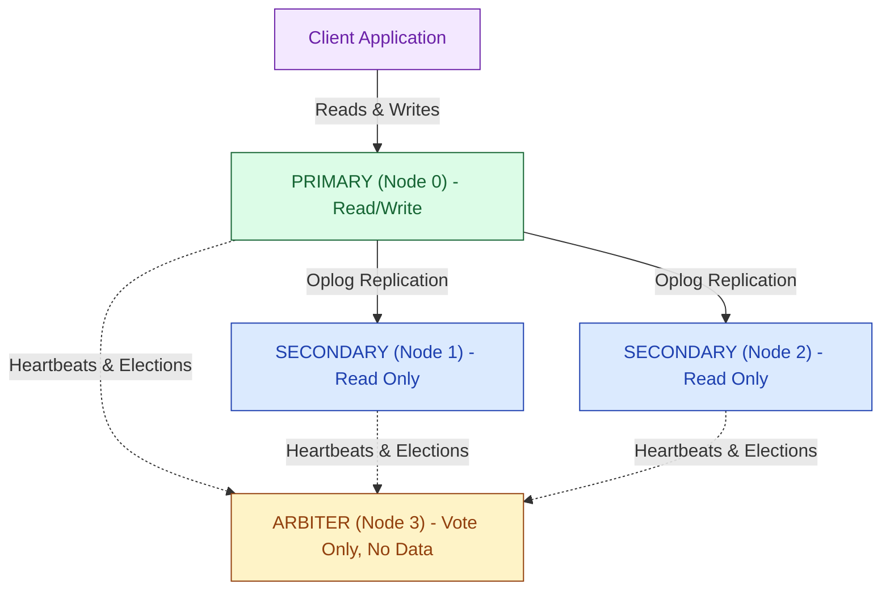

| Role | Data Copy | Accepts Writes | Serves Reads | Election Voting | Can Become Primary |
| :--- | :---: | :---: | :---: | :---: | :---: |
| **Primary** | Yes | Yes (only 1 per set) | Yes (default) | Yes | Already Primary |
| **Secondary** | Yes (via oplog) | No | Yes (with `readPreference`) | Yes | Yes (unless `priority: 0`) |
| **Arbiter** | No | No | No | Yes | No |

> [!TIP]
> Use an **Arbiter** only to break ties for an odd-numbered quorum when you cannot afford a full data-bearing secondary. Arbiters require minimal resources because they store no data.

### Configuration

```javascript
// Initialize replica set
rs.initiate({
  _id: "myReplicaSet",
  members: [
    { _id: 0, host: "mongodb0:27017", priority: 3 },  // Primary
    { _id: 1, host: "mongodb1:27017", priority: 2 },  // Secondary
    { _id: 2, host: "mongodb2:27017", priority: 1 },  // Secondary
    { _id: 3, host: "mongodb3:27017", arbiterOnly: true }  // Arbiter
  ]
})

// Check replica set status & configuration
rs.status()
rs.conf()

// Add or remove member
rs.add("mongodb4:27017")
rs.remove("mongodb4:27017")

// Modify member priority
cfg = rs.conf()
cfg.members[1].priority = 10
rs.reconfig(cfg)
```

---

## Replication Internals

### Oplog (Operations Log)

The oplog (`local.oplog.rs`) is a **capped collection** in the `local` database (not replicated) that records all write operations in **total sequential order** and is **idempotent** (safe to apply multiple times).

- **Default Size**: 5% of free disk space (or configured explicitly via `--oplogSize 1024`).
- **Replication Lag**: How far behind a secondary is from the primary; inspect `seconds_behind_primary` via `rs.status()`.

```javascript
// Oplog is in 'local' database (not replicated)
use local
db.oplog.rs.find().limit(5)

// Oplog entry structure:
{
  _id: Timestamp(1704067800, 1),
  ts: Timestamp(1704067800, 1),
  t: NumberLong(1),              // Term (for Raft)
  op: "i",                       // Operation: i=insert, u=update, d=delete
  ns: "database.collection",     // Namespace
  doc: { ... },                  // Full document (for insert)
  o2: { _id: ObjectId() },       // Original document _id (for update/delete)
  o: { $set: { field: value } }  // Operation details
}
```

### Replication Process

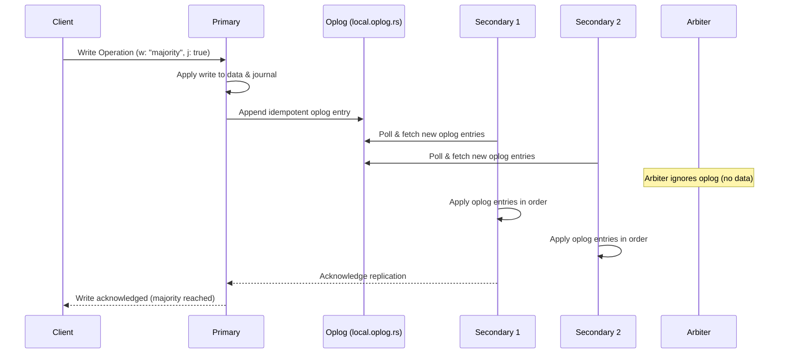

### Election Process (Raft Protocol)

```mermaid
flowchart LR
    F["Primary Failure Detected"] --> E["Secondaries Call Election"]
    E --> V["Members &amp; Arbiters Vote"]
    V --> W["Highest Priority + Most Recent Oplog Wins"]
    W --> NP["Winner Becomes New Primary"]
    NP --> R["Old Primary Cannot Rejoin Without Sync"]

    classDef red fill:#fee2e2,stroke:#991b1b,color:#991b1b
    classDef amber fill:#fef3c7,stroke:#92400e,color:#92400e
    classDef blue fill:#dbeafe,stroke:#1e40af,color:#1e40af
    classDef green fill:#dcfce7,stroke:#166534,color:#166534
    classDef purple fill:#f3e8ff,stroke:#6b21a8,color:#6b21a8

    class F red
    class E,V amber
    class W blue
    class NP green
    class R purple
```

- **Priority-based**: Member with highest `priority` becomes primary; if tied, the member with the **most recent oplog** wins.
- **Arbiters**: Participate in voting only.
- **Hidden / Non-voting**: Setting `priority: 0` prevents a member from becoming primary; `hidden: true` hides it from client drivers.

```javascript
// Set priority to control election
cfg = rs.conf()
cfg.members[0].priority = 10  // Most likely primary
cfg.members[1].priority = 5
cfg.members[2].priority = 1   // Least likely
rs.reconfig(cfg)

// Priority 0 = cannot be primary
cfg.members[3].priority = 0
cfg.members[3].hidden = true  // Not visible to drivers
rs.reconfig(cfg)
```

### Read Preference with Replica Sets

| Read Preference | Target Node | Fallback | Use Case & Trade-off |
| :--- | :--- | :--- | :--- |
| `primary` | Primary only | None | Strongest consistency (default in drivers) |
| `primaryPreferred` | Primary | Secondary | High availability for reads |
| `secondary` | Secondary only | None | Offload analytics; risk of stale data |
| `secondaryPreferred` | Secondary | Primary | Read scaling with primary fallback |
| `nearest` | Lowest network latency | Any member | Geo-distributed clusters; risk of stale data |

> [!WARNING]
> Reading from a secondary introduces **stale data risk**. Combine with `readConcern: "majority"` when consistent reads are required.

```javascript
// primaryPreferred
db.collection.find().readPreference("primaryPreferred")

// secondary (for analytics to not impact primary)
db.collection.find().readPreference("secondary")

// secondaryPreferred
db.collection.find().readPreference("secondaryPreferred")

// nearest (geographically distributed replica sets)
db.collection.find().readPreference("nearest")
```

**Spring Data MongoDB:**
```java
@Service
public class UserService {
    @Autowired
    private MongoTemplate mongoTemplate;

    // Read user (recent data from primary)
    public User getUser(String userId) {
        Query query = new Query(Criteria.where("_id").is(userId));
        return mongoTemplate.findOne(query, User.class);
    }

    // Analytics (ok with stale data from secondary)
    public List<UserStats> generateReport() {
        return mongoTemplate.withReadPreference(
            ReadPreference.secondary()
        ).find(new Query(), UserStats.class);
    }
}
```

### Failover and Durability

| Write Concern | Meaning | Durability / Speed |
| :--- | :--- | :--- |
| `w: 0` | No acknowledgment | Fastest, high data-loss risk |
| `w: 1` | Primary acknowledges (default) | Moderate durability |
| `w: "majority"` | Majority of voting data-bearing nodes acknowledge | Safe against primary failover |
| `j: true` | Wait for on-disk journal commit | Crash-durable on acknowledged nodes |

```javascript
// Automatic failover control
db.adminCommand({
  replSetFreeze: 60  // Freeze member for 60 seconds (won't be elected)
})

// Manual failover
rs.stepDown(60)  // Primary steps down for 60 seconds

// Write concern with replica sets
db.users.insertOne(
  { name: "John" },
  { writeConcern: { w: "majority", j: true } }
)
```

### Delayed Replica Set Members

A delayed member lags behind the primary by a fixed window (`slaveDelay`) to protect against accidental deletions or bad deployments.

```javascript
cfg = rs.conf()
cfg.members[2].hidden = true      // Not visible to drivers
cfg.members[2].priority = 0        // Cannot be primary
cfg.members[2].slaveDelay = 3600   // 1 hour behind primary
rs.reconfig(cfg)

// Recovery workflow if data is accidentally deleted:
// 1. Detect deletion within the delay window (1 hour)
// 2. Stop the delayed member
// 3. Resync primary from the delayed member
// 4. Recover data
```

---

## Sharding

### Cluster Architecture

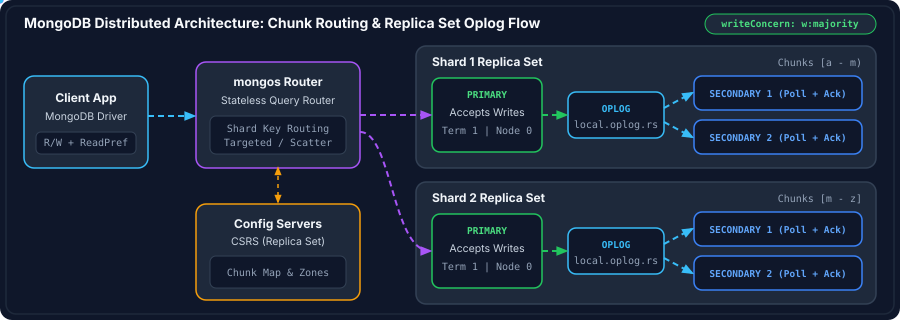

Sharding partitions data across multiple machines when a single server cannot keep up with:
- **Storage**: Data size exceeds available disk.
- **Memory**: Working set exceeds available RAM.
- **Throughput**: Read/write ops exceed single-server capacity.
- **Latency**: Compliance or geography requires local data placement.

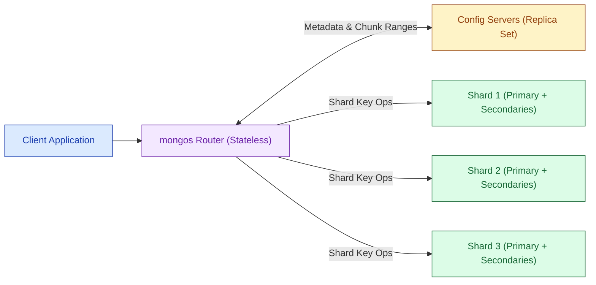

### Cluster Components

| Component | Role | Redundancy |
| :--- | :--- | :--- |
| **`mongos`** | Stateless query router; fetches chunk metadata from config servers and routes operations to shards | Run multiple instances behind a load balancer |
| **Shard Servers** | Store a partitioned subset of data based on the shard key | Each shard is a full **Replica Set** |
| **Config Servers** | Store cluster metadata, shard key ranges, and zone mappings; required for cluster routing | Deployed as a **3-node Replica Set** (`--configsvr`) |

### Setup

```javascript
// Step 1: Create config server replica set
mongod --configsvr --replSet configReplSet --port 27019

// Step 2: Initialize config servers
rs.initiate({
  _id: "configReplSet",
  members: [
    { _id: 0, host: "config-server-0:27019" },
    { _id: 1, host: "config-server-1:27019" },
    { _id: 2, host: "config-server-2:27019" }
  ]
})

// Step 3: Create shard replica sets
mongod --shardsvr --replSet shard1 --port 27018
mongod --shardsvr --replSet shard2 --port 27018

// Step 4: Start mongos
mongos --configdb configReplSet/config-server-0:27019,config-server-1:27019,config-server-2:27019

// Step 5: Connect to mongos and enable sharding
mongo --host localhost --port 27017

// Enable sharding on database & collection
sh.enableSharding("mydb")
sh.shardCollection("mydb.users", { email: 1 })
```

---

## Shard Key Selection

> [!IMPORTANT]
> **Shard key selection is the most critical decision in sharding.** A poor shard key causes hot shards, scatter-gather queries, and cannot be changed without resharding.

An ideal shard key has **4 properties**:
1. **High cardinality** (many distinct values).
2. **Immutable** (or changes infrequently).
3. **Distributed writes** (not monotonically increasing).
4. **Query alignment** (supports targeted queries rather than scatter-gather).

### Shard Key Decision Flow

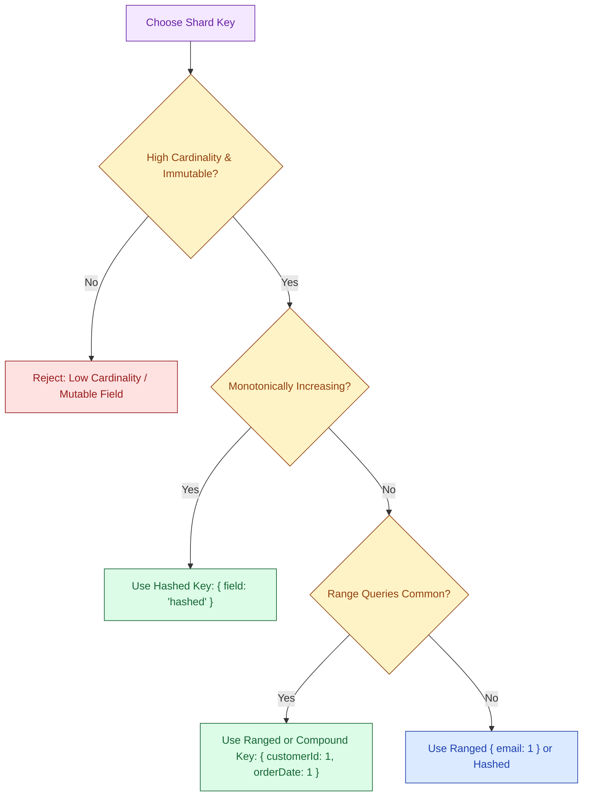

### Good vs Bad Shard Keys

| Pattern | Example | Verdict | Why |
| :--- | :--- | :---: | :--- |
| Unique / Random ID | `{ email: 1 }` or `{ userId: 1 }` | Good | High cardinality, immutable, supports targeted & range queries (avoid sequential IDs for writes) |
| Compound Key | `{ customerId: 1, orderDate: 1 }` | Good | Combines moderate-cardinality filter with high-cardinality temporal range |
| Hashed Key | `{ eventId: "hashed" }` | Good | Distributes monotonic values evenly across shards; trades off range queries |
| Low Cardinality | `{ country: 1 }` | Bad | ~200 values limit max chunks and cause hot/cold shards |
| Monotonic Field | `{ timestamp: 1 }` | Bad | All new writes hit the single shard holding the max range |
| Mutable Field | `{ status: 1 }` | Bad | Frequent updates invalidate chunk ranges and trigger heavy migrations |
| Skewed Distribution | `{ userId: 1 }` (celebrity traffic) | Bad | Disproportionate traffic hits one shard; fix with `{ userId: 1, timestamp: 1 }` |

```javascript
// GOOD: Unique user ID
db.users.createIndex({ userId: 1 })
sh.shardCollection("mydb.users", { userId: 1 })

// GOOD: Email (unique, random)
sh.shardCollection("mydb.users", { email: 1 })

// GOOD: Compound shard key
sh.shardCollection("mydb.orders", { customerId: 1, orderDate: 1 })

// GOOD: Hashed shard key (for monotonic keys)
sh.shardCollection("mydb.events", { "eventId": "hashed" })
```

```javascript
// BAD: Low cardinality
sh.shardCollection("mydb.users", { country: 1 })

// BAD: Monotonically increasing (fix: { timestamp: "hashed" })
sh.shardCollection("mydb.events", { timestamp: 1 })

// BAD: Field that changes frequently
sh.shardCollection("mydb.users", { status: 1 })

// BAD: Skewed distribution (fix: { userId: 1, timestamp: 1 })
sh.shardCollection("mydb.events", { userId: 1 })
```

### Ranged vs Hashed Sharding

| Aspect | Ranged (`{ productId: 1 }`) | Hashed (`{ productId: "hashed" }`) |
| :--- | :--- | :--- |
| **Chunk Layout** | Contiguous ranges (`[0-1000]`, `[1000-2000]`) | Hash ranges (`0x12A3F8` → shard 1, `0x45B6D2` → shard 2) |
| **Range Queries** | Efficient (single shard or subset) | Scatter-gather (hits all shards) |
| **Write Distribution** | Hot shard risk if monotonic | Even distribution across shards |

### Data Distribution & Zones (Tag-Aware Sharding)

```javascript
// Check shard chunk distribution
sh.status()
// Monitor / split manually if skewed:
sh.splitFind("mydb.users", { email: "middle@value" })

// Geo-partitioning with Zones (GDPR / data residency)
sh.addShardToZone("shard1", "us-east")
sh.addShardToZone("shard2", "us-west")
sh.addShardToZone("shard3", "eu")

sh.updateZoneKeyRange(
  "mydb.users",
  { email: "a@example.com" },
  { email: "g@example.com" },
  "us-east"
)

sh.updateZoneKeyRange(
  "mydb.users",
  { email: "g@example.com" },
  { email: "z@example.com" },
  "eu"
)
```

---

## Chunks and Balancing

MongoDB partitions sharded data into **chunks** (contiguous ranges of shard key values, e.g., `email [a-g)`, `[g-m)`, `[m-z]`).

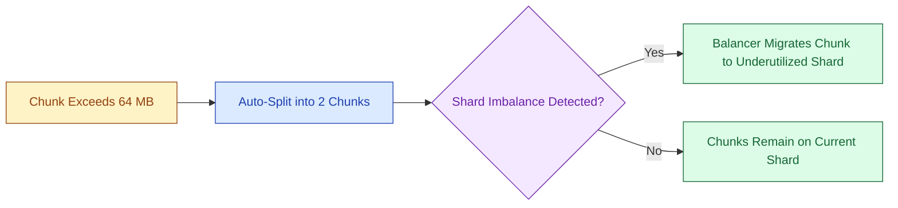

- **Default Chunk Size**: 64 MB (`db.config.settings.findOne()` → `{ _id: "chunksize", value: 64 }`).
- **Balancer**: Background process that automatically migrates chunks between shards to keep distribution even.

```javascript
// Check chunk size & balancer status
db.config.settings.findOne()
db.adminCommand({ balancerStatus: {} })

// Manual chunk management
sh.splitAt("mydb.users", { email: "k@example.com" })
sh.moveChunk("mydb.users", { email: "k@example.com" }, "shard2")
```

---

## Targeted vs Scatter-Gather Queries

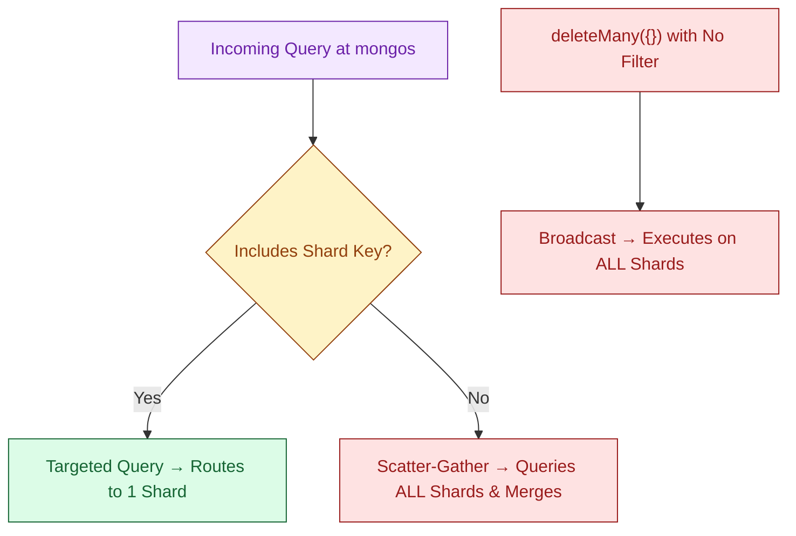

- **Targeted**: Filter includes the shard key (`{ customerId: "C123" }`); `mongos` routes to a single shard.
- **Scatter-Gather**: Filter omits the shard key (`{ total: { $gt: 1000 } }`); `mongos` queries all shards and merges results.
- **Broadcast**: Unfiltered write/delete (`deleteMany({})`); hits all shards.
- **Fix**: Include the shard key in filters (`{ customerId: "C123", total: { $gt: 1000 } }`) or use a compound shard key (`{ customerId: 1, total: 1 }`).

```javascript
// Shard key: { customerId: 1 }

// TARGETED QUERY (single shard)
db.orders.find({ customerId: "C123" })

// SCATTER-GATHER QUERY (all shards)
db.orders.find({ total: { $gt: 1000 } })

// BROADCAST QUERY (all shards)
db.orders.deleteMany({})
```

---

## Transactions in MongoDB

### Single-Document vs Multi-Document Atomicity

- **Single-Document Atomicity (Default)**: Every single-document update is atomic—all fields update together or none do.
- **Multi-Document Transactions (4.0+ / Cross-Shard 4.2+)**: Provide ACID guarantees across multiple documents, collections, and shards.

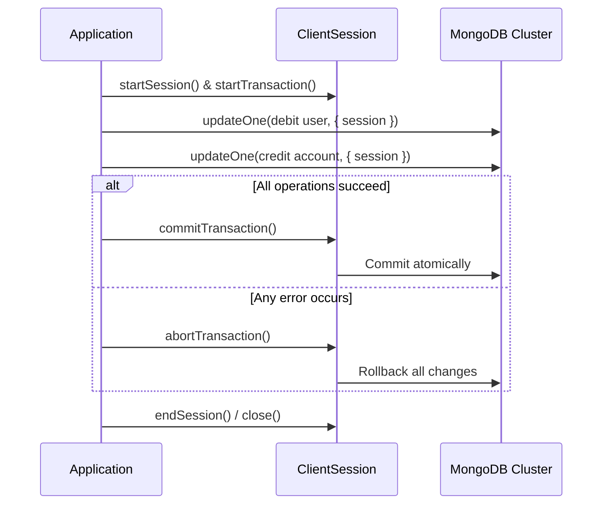

```javascript
// Single-document atomic update (no transaction needed)
db.users.updateOne(
  { _id: ObjectId() },
  { $set: { age: 29, email: "new@example.com" } }
)

// Multi-document transaction
const session = db.getMongo().startSession()

try {
  session.startTransaction()

  db.users.updateOne(
    { _id: userId },
    { $inc: { balance: -100 } },
    { session }
  )

  db.accounts.updateOne(
    { _id: accountId },
    { $inc: { balance: 100 } },
    { session }
  )

  session.commitTransaction()
} catch (error) {
  session.abortTransaction()
  throw error
}
```

**Spring Data MongoDB:**
```java
@Service
public class TransferService {
    @Autowired
    private MongoTemplate mongoTemplate;

    public void transferMoney(String fromUserId, String toUserId, BigDecimal amount) {
        ClientSession session = mongoTemplate.getDb().getClient()
            .startSession();

        try {
            session.startTransaction();

            // Debit from user
            mongoTemplate.withSession(session)
                .updateFirst(
                    new Query(Criteria.where("_id").is(fromUserId)),
                    new Update().inc("balance", amount.negate()),
                    User.class
                );

            // Credit to user
            mongoTemplate.withSession(session)
                .updateFirst(
                    new Query(Criteria.where("_id").is(toUserId)),
                    new Update().inc("balance", amount),
                    User.class
                );

            session.commitTransaction();
        } catch (Exception e) {
            session.abortTransaction();
            throw e;
        } finally {
            session.close();
        }
    }
}
```

### Multi-Document Transaction Limitations

> [!WARNING]
> Multi-document transactions **cannot span multiple databases**, **cannot run DDL operations** (like `createIndex`), and **cross-shard transactions (4.2+) add latency** due to two-phase commit coordination with config servers.

```javascript
// Cannot span multiple databases
session.startTransaction()
db.database1.collection1.updateOne(...)
db.database2.collection2.updateOne(...)  // ERROR
session.commitTransaction()

// Cannot use DDL operations inside transactions
session.startTransaction()
db.collection.createIndex(...)  // ERROR
db.collection.updateOne(...)    // OK
session.commitTransaction()
```

---

## Change Streams

Change Streams provide real-time notifications of data changes by tailing the oplog. Supported operation types: `insert`, `update` (includes `updateDescription`), `replace`, `delete`, and `invalidate`.

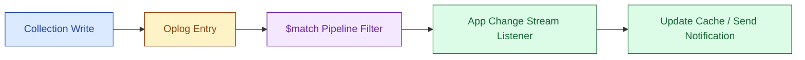

```javascript
// Watch for all changes on collection
const changeStream = db.users.watch()

changeStream.on("change", (change) => {
  console.log(change)
  // {
  //   operationType: "insert",
  //   fullDocument: { _id: 1, name: "John" },
  //   ns: { db: "mydb", coll: "users" }
  // }
})

// Watch with filter
const changeStream = db.users.watch([
  { $match: { operationType: "insert" } }
])

// Watch for specific field changes
const changeStream = db.users.watch([
  {
    $match: {
      "operationType": "update",
      "updateDescription.updatedFields.age": { $exists: true }
    }
  }
])
```

**Spring Data MongoDB:**
```java
@Service
public class UserChangeListener {
    @Autowired
    private MongoTemplate mongoTemplate;

    @PostConstruct
    public void listenToChanges() {
        ChangeStreamOptions options = ChangeStreamOptions.empty();

        mongoTemplate.changeStream(User.class)
            .listen(event -> {
                System.out.println("User changed: " + event.getBody());
                handleUserChange(event.getBody());
            })
            .start();
    }

    private void handleUserChange(ChangeStreamEvent<User> event) {
        // Handle change in real-time: update cache, send notifications, etc.
    }
}

// Or using AbstractMongoEventListener
@Component
public class UserChangeListener extends AbstractMongoEventListener<User> {
    @Override
    public void onAfterSave(AfterSaveEvent<User> event) {
        User user = event.getSource();
        System.out.println("User saved: " + user);
    }

    @Override
    public void onAfterDelete(AfterDeleteEvent<User> event) {
        System.out.println("User deleted");
    }
}
```

---

## Common Interview Questions

### Q1: What's the difference between replica sets and sharding?

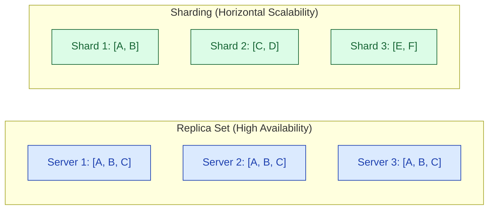

- **Replica Set**: Full copies of the same data on multiple servers for **high availability** and failover.
- **Sharding**: Data partitioned across multiple servers for **horizontal scalability** (storage, RAM, throughput).

### Q2: How are writes replicated from primary to secondary?

1. Primary receives and applies the write to its data.
2. Primary records the operation in the **oplog** (`local.oplog.rs`).
3. Secondaries poll the oplog for new entries.
4. Secondaries apply operations in **total order** (idempotent and crash-durable).

### Q3: What makes a bad shard key?

- **Low cardinality**: Too few distinct values (e.g., `{ country: 1 }`, `{ status: 1 }`).
- **Monotonically increasing**: All new writes hit one shard (e.g., `{ timestamp: 1 }`).
- **Skewed distribution**: Celebrity/hot values overload one shard.
- **Frequently changing**: Constant chunk range invalidation.

```javascript
// Bad shard keys:
// { timestamp: 1 }  // All new writes to current time range
// { status: 1 }     // Only ~10 distinct statuses
// { country: 1 }    // Only ~200 values, some very popular

// Good shard keys:
// { userId: 1 }                // Millions of distinct values
// { email: "hashed" }          // Even distribution, high cardinality
// { userId: 1, timestamp: 1 }  // Compound, supports range per user
```

### Q4: How do you handle a hot shard?

1. **Improve the shard key**: Switch to `{ userId: "hashed" }` or a compound key `{ userId: 1, timestamp: 1 }`.
2. **Isolate with Zones**: Assign the hot key range to a dedicated shard.
3. **Distribute reads**: Route reads to secondaries via `.readPreference("secondary")`.

```javascript
// Isolate hot data with zones
sh.addShardToZone("shard-hot", "hot-data")
sh.updateZoneKeyRange(
  "mydb.events",
  { userId: "celebrity-user" },
  { userId: "celebrity-user\0" },
  "shard-hot"
)

// Distribute reads to secondaries
db.events.find({ userId: "celebrity-user" })
  .readPreference("secondary")
```

### Q5: Explain oplog and why it's important.

The **oplog** is a capped collection recording all write operations:
- **Replication**: Secondaries replay oplog entries to stay in sync.
- **Crash Recovery**: Replayed on restart to recover uncommitted state.
- **Point-in-Time Recovery**: Enables restoring to any timestamp within the oplog retention window.
- **Sizing**: Defaults to 5% of disk (or `--oplogSize 5120` MB); larger oplogs tolerate longer replication lag and support longer point-in-time backups (`rs.status()` shows `seconds_behind_primary`).

### Q6: When would you choose multi-document transactions?

- **Good use cases**: Financial transfers (debit + credit must both succeed) and inventory + order creation.
- **Poor use cases**: Single-document updates (already atomic) and large batch loops (degrade performance).

```javascript
// Good: Financial transfer (debit + credit)
db.accounts.updateOne({ _id: 1 }, { $inc: { balance: -100 } })
db.accounts.updateOne({ _id: 2 }, { $inc: { balance: +100 } })

// Good: Inventory + order creation
db.products.updateOne({ _id: "PROD-001" }, { $inc: { stock: -5 } })
db.orders.insertOne({ customerId: 1, items: [...] })

// Poor: Single-document update (already atomic)
db.users.updateOne({ _id: 1 }, { $set: { age: 29 } })

// Poor: Large batches (kills performance)
for (let i = 0; i < 1000000; i++) {
  // Don't wrap in a single transaction
}
```
