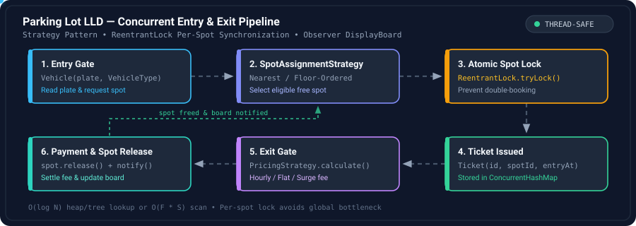
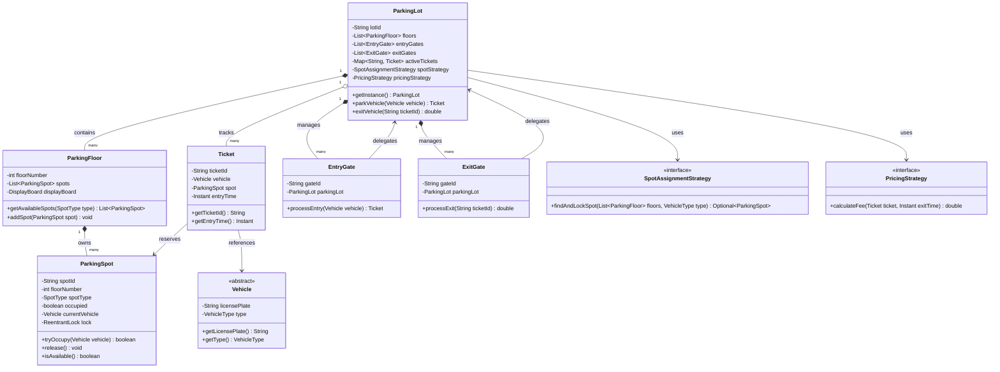
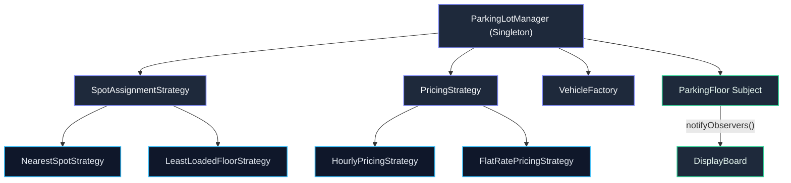
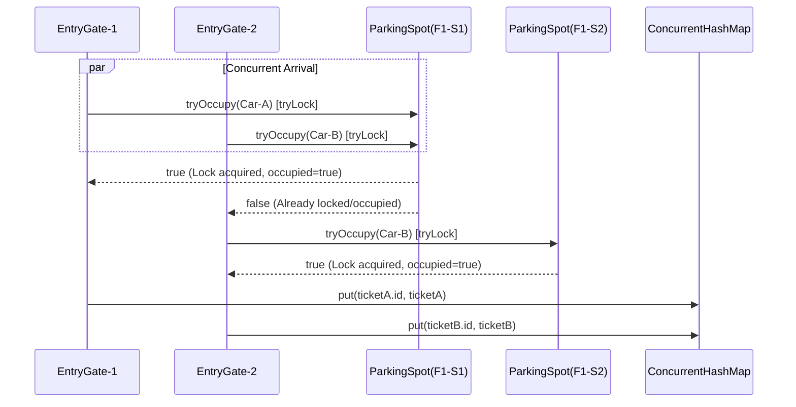
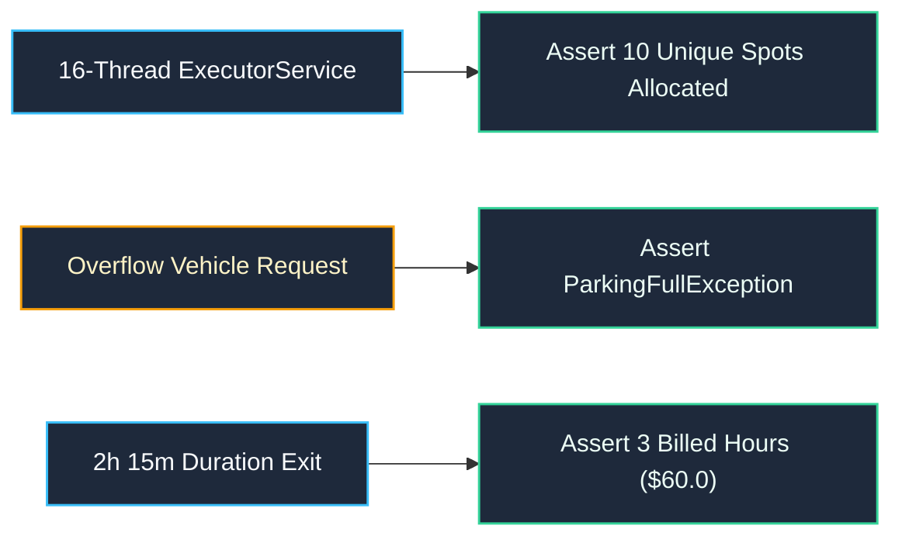
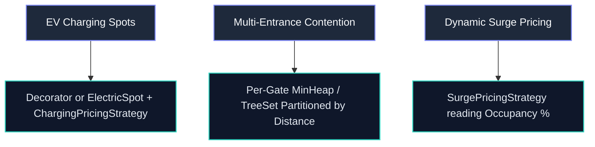

# Parking Lot System — Low-Level Design (LLD)



A production-grade, thread-safe Parking Lot system is one of the most common **SDE-2 / Senior Machine Coding** problems. Interviewers evaluate how cleanly you separate domain models from allocation/pricing policies, handle concurrent arrivals across multiple gates without double-booking spots, and write extensible, testable Java code.

---

## 1. Requirements & Scope

### Functional & Non-Functional Matrix

| Category | Requirement | Design Choice |
| :--- | :--- | :--- |
| **Vehicle Types** | Support `MOTORCYCLE`, `CAR`, `TRUCK` | `VehicleType` enum mapped to compatible `SpotType` |
| **Multi-Floor Layout** | Multiple `ParkingFloor` instances with typed `ParkingSpot`s | Floor-indexed spot collections (`List<ParkingSpot>`) |
| **Multiple Gates** | Concurrent `EntryGate` and `ExitGate` processing | Shared `ParkingLotManager` singleton with fine-grained locks |
| **Spot Allocation** | Pluggable assignment (e.g., nearest to entry, floor-balanced) | `SpotAssignmentStrategy` interface |
| **Pricing & Billing** | Hourly, flat, or vehicle-specific rates at exit | `PricingStrategy` interface |
| **Live Availability** | Real-time free spot counts per floor and spot type | `DisplayBoard` updated via Observer pattern |
| **Concurrency** | Zero double-booking under parallel gate requests | Per-spot `ReentrantLock` + `ConcurrentHashMap` ticket store |
| **Failure Handling** | Graceful rejection when lot is full or ticket is invalid | Domain exceptions (`ParkingFullException`, `InvalidTicketException`) |

### End-to-End Request Flow


---

## 2. Core Entities & Class Diagram

The domain model separates **physical infrastructure** (`ParkingLot`, `ParkingFloor`, `ParkingSpot`, `EntryGate`, `ExitGate`) from **transactional state** (`Vehicle`, `Ticket`) and **pluggable policies** (`SpotAssignmentStrategy`, `PricingStrategy`).



---

## 3. Design Patterns Applied

| Pattern | Where Applied | Why It Matters in LLD |
| :--- | :--- | :--- |
| **Singleton** | `ParkingLotManager` | Single source of truth for floors, active tickets, and gate coordination. |
| **Strategy** | `SpotAssignmentStrategy`, `PricingStrategy` | Swap nearest-spot vs. least-crowded-floor, or hourly vs. surge pricing without touching gate code. |
| **Factory** | `VehicleFactory` / `SpotFactory` | Encapsulates creation of `Car`, `Motorcycle`, `Truck` and compatible `SpotType` mapping. |
| **Observer** | `DisplayBoard` observing `ParkingFloor` | Decouples spot state transitions from real-time floor availability boards. |



> [!TIP]
> **Interview Signal:** Avoid hardcoding `if (vehicle.getType() == CAR)` inside `ParkingLotManager`. Keep compatibility rules inside `SpotType.canFit(VehicleType)` and allocation order inside `SpotAssignmentStrategy` so adding a new vehicle class (e.g., `ELECTRIC_SUV`) requires zero changes to core orchestration.

---

## 4. Thread-Safe Java Implementation

### Concurrent Entry Sequence

When two vehicles arrive simultaneously at `EntryGate-1` and `EntryGate-2`, both gates may inspect the same candidate spot. The **per-spot `ReentrantLock.tryLock()`** guarantees that only one thread transitions `occupied = true`; the losing thread immediately advances to the next free spot without blocking on a global lock.



### Complete Java 17+ Code

```java
package com.lld.parkinglot;

import java.time.Duration;
import java.time.Instant;
import java.util.*;
import java.util.concurrent.ConcurrentHashMap;
import java.util.concurrent.CopyOnWriteArrayList;
import java.util.concurrent.locks.ReentrantLock;

// ==================== ENUMS & EXCEPTIONS ====================

enum VehicleType {
    MOTORCYCLE, CAR, TRUCK
}

enum SpotType {
    MOTORCYCLE, COMPACT, LARGE;

    public boolean canFit(VehicleType vehicleType) {
        return switch (vehicleType) {
            case MOTORCYCLE -> true; // Motorcycle fits in any spot
            case CAR -> this == COMPACT || this == LARGE;
            case TRUCK -> this == LARGE;
        };
    }
}

class ParkingFullException extends RuntimeException {
    public ParkingFullException(String message) { super(message); }
}

class InvalidTicketException extends RuntimeException {
    public InvalidTicketException(String message) { super(message); }
}

// ==================== DOMAIN MODELS ====================

record Vehicle(String licensePlate, VehicleType type) {}

record Ticket(String ticketId, Vehicle vehicle, ParkingSpot spot, Instant entryTime) {}

interface SpotObserver {
    void onSpotStatusChanged(int floorNumber, SpotType spotType, int availableCount);
}

class DisplayBoard implements SpotObserver {
    private final Map<SpotType, Integer> availability = new ConcurrentHashMap<>();

    @Override
    public void onSpotStatusChanged(int floorNumber, SpotType spotType, int availableCount) {
        availability.put(spotType, availableCount);
    }

    public int getAvailableCount(SpotType spotType) {
        return availability.getOrDefault(spotType, 0);
    }
}

class ParkingSpot {
    private final String spotId;
    private final int floorNumber;
    private final SpotType spotType;
    private final ReentrantLock lock = new ReentrantLock();
    private volatile boolean occupied = false;
    private Vehicle currentVehicle;

    public ParkingSpot(String spotId, int floorNumber, SpotType spotType) {
        this.spotId = spotId;
        this.floorNumber = floorNumber;
        this.spotType = spotType;
    }

    public boolean tryOccupy(Vehicle vehicle) {
        if (!spotType.canFit(vehicle.type()) || occupied) {
            return false;
        }
        if (!lock.tryLock()) {
            return false;
        }
        try {
            if (occupied) {
                return false;
            }
            this.occupied = true;
            this.currentVehicle = vehicle;
            return true;
        } finally {
            lock.unlock();
        }
    }

    public void release() {
        lock.lock();
        try {
            this.occupied = false;
            this.currentVehicle = null;
        } finally {
            lock.unlock();
        }
    }

    public String getSpotId() { return spotId; }
    public int getFloorNumber() { return floorNumber; }
    public SpotType getSpotType() { return spotType; }
    public boolean isOccupied() { return occupied; }
}

class ParkingFloor {
    private final int floorNumber;
    private final List<ParkingSpot> spots = new CopyOnWriteArrayList<>();
    private final List<SpotObserver> observers = new CopyOnWriteArrayList<>();

    public ParkingFloor(int floorNumber) {
        this.floorNumber = floorNumber;
    }

    public void addSpot(ParkingSpot spot) {
        spots.add(spot);
        notifyObservers(spot.getSpotType());
    }

    public void addObserver(SpotObserver observer) {
        observers.add(observer);
        for (SpotType type : SpotType.values()) {
            observer.onSpotStatusChanged(floorNumber, type, countAvailable(type));
        }
    }

    public void notifyObservers(SpotType type) {
        int available = countAvailable(type);
        for (SpotObserver observer : observers) {
            observer.onSpotStatusChanged(floorNumber, type, available);
        }
    }

    public int countAvailable(SpotType type) {
        int count = 0;
        for (ParkingSpot spot : spots) {
            if (spot.getSpotType() == type && !spot.isOccupied()) {
                count++;
            }
        }
        return count;
    }

    public int getFloorNumber() { return floorNumber; }
    public List<ParkingSpot> getSpots() { return spots; }
}

// ==================== STRATEGIES ====================

interface SpotAssignmentStrategy {
    Optional<ParkingSpot> findAndLockSpot(List<ParkingFloor> floors, Vehicle vehicle);
}

class NearestSpotStrategy implements SpotAssignmentStrategy {
    @Override
    public Optional<ParkingSpot> findAndLockSpot(List<ParkingFloor> floors, Vehicle vehicle) {
        for (ParkingFloor floor : floors) {
            for (ParkingSpot spot : floor.getSpots()) {
                if (spot.tryOccupy(vehicle)) {
                    floor.notifyObservers(spot.getSpotType());
                    return Optional.of(spot);
                }
            }
        }
        return Optional.empty();
    }
}

interface PricingStrategy {
    double calculateFee(Ticket ticket, Instant exitTime);
}

class HourlyPricingStrategy implements PricingStrategy {
    private final Map<VehicleType, Double> hourlyRates;

    public HourlyPricingStrategy() {
        this.hourlyRates = Map.of(
            VehicleType.MOTORCYCLE, 10.0,
            VehicleType.CAR, 20.0,
            VehicleType.TRUCK, 40.0
        );
    }

    @Override
    public double calculateFee(Ticket ticket, Instant exitTime) {
        long minutes = Math.max(1, Duration.between(ticket.entryTime(), exitTime).toMinutes());
        long billedHours = (long) Math.ceil(minutes / 60.0);
        double rate = hourlyRates.getOrDefault(ticket.vehicle().type(), 20.0);
        return billedHours * rate;
    }
}

// ==================== MANAGER & GATES ====================

class ParkingLotManager {
    private static volatile ParkingLotManager instance;
    private final List<ParkingFloor> floors = new CopyOnWriteArrayList<>();
    private final Map<String, Ticket> activeTickets = new ConcurrentHashMap<>();
    private volatile SpotAssignmentStrategy spotStrategy;
    private volatile PricingStrategy pricingStrategy;

    private ParkingLotManager(SpotAssignmentStrategy spotStrategy, PricingStrategy pricingStrategy) {
        this.spotStrategy = spotStrategy;
        this.pricingStrategy = pricingStrategy;
    }

    public static ParkingLotManager getInstance(SpotAssignmentStrategy spotStrategy, PricingStrategy pricingStrategy) {
        if (instance == null) {
            synchronized (ParkingLotManager.class) {
                if (instance == null) {
                    instance = new ParkingLotManager(spotStrategy, pricingStrategy);
                }
            }
        }
        return instance;
    }

    // Package-private reset for deterministic unit testing
    static void resetForTests() {
        instance = null;
    }

    public void addFloor(ParkingFloor floor) {
        floors.add(floor);
    }

    public void setSpotStrategy(SpotAssignmentStrategy spotStrategy) {
        this.spotStrategy = spotStrategy;
    }

    public void setPricingStrategy(PricingStrategy pricingStrategy) {
        this.pricingStrategy = pricingStrategy;
    }

    public Ticket parkVehicle(Vehicle vehicle) {
        ParkingSpot spot = spotStrategy.findAndLockSpot(floors, vehicle)
            .orElseThrow(() -> new ParkingFullException("No available spot for " + vehicle.type()));

        String ticketId = UUID.randomUUID().toString();
        Ticket ticket = new Ticket(ticketId, vehicle, spot, Instant.now());
        activeTickets.put(ticketId, ticket);
        return ticket;
    }

    public double exitVehicle(String ticketId, Instant exitTime) {
        Ticket ticket = activeTickets.remove(ticketId);
        if (ticket == null) {
            throw new InvalidTicketException("Invalid or already settled ticket: " + ticketId);
        }

        double fee = pricingStrategy.calculateFee(ticket, exitTime);
        ParkingSpot spot = ticket.spot();
        spot.release();

        floors.stream()
            .filter(f -> f.getFloorNumber() == spot.getFloorNumber())
            .findFirst()
            .ifPresent(f -> f.notifyObservers(spot.getSpotType()));

        return fee;
    }
}
```

---

## 5. JUnit 5 Verification & Edge Cases

### Verification Flow



> [!WARNING]
> Always test **concurrent contention** explicitly with `CountDownLatch` and `ExecutorService`. Sequential unit tests pass even when `occupied = true` has a check-then-act race condition!

```java
package com.lld.parkinglot;

import org.junit.jupiter.api.BeforeEach;
import org.junit.jupiter.api.Test;

import java.time.Instant;
import java.time.temporal.ChronoUnit;
import java.util.*;
import java.util.concurrent.*;

import static org.junit.jupiter.api.Assertions.*;

class ParkingLotManagerTest {

    private ParkingLotManager manager;
    private DisplayBoard floor1Board;

    @BeforeEach
    void setUp() {
        ParkingLotManager.resetForTests();
        manager = ParkingLotManager.getInstance(new NearestSpotStrategy(), new HourlyPricingStrategy());

        ParkingFloor floor1 = new ParkingFloor(1);
        floor1Board = new DisplayBoard();
        floor1.addObserver(floor1Board);

        for (int i = 1; i <= 10; i++) {
            floor1.addSpot(new ParkingSpot("F1-C" + i, 1, SpotType.COMPACT));
        }
        manager.addFloor(floor1);
    }

    @Test
    void concurrentEntryAllocatesUniqueSpotsWithoutDoubleBooking() throws InterruptedException {
        int threads = 16;
        ExecutorService pool = Executors.newFixedThreadPool(threads);
        CountDownLatch ready = new CountDownLatch(threads);
        CountDownLatch start = new CountDownLatch(1);

        List<Ticket> issued = Collections.synchronizedList(new ArrayList<>());
        List<Throwable> rejections = Collections.synchronizedList(new ArrayList<>());

        for (int i = 0; i < threads; i++) {
            final int idx = i;
            pool.submit(() -> {
                ready.countDown();
                try {
                    start.await();
                    issued.add(manager.parkVehicle(new Vehicle("KA-01-" + idx, VehicleType.CAR)));
                } catch (ParkingFullException e) {
                    rejections.add(e);
                } catch (InterruptedException e) {
                    Thread.currentThread().interrupt();
                }
            });
        }

        ready.await();
        start.countDown();
        pool.shutdown();
        assertTrue(pool.awaitTermination(5, TimeUnit.SECONDS));

        assertEquals(10, issued.size(), "Exactly 10 compact spots should be filled");
        assertEquals(6, rejections.size(), "Remaining 6 cars should get ParkingFullException");

        Set<String> uniqueSpotIds = new HashSet<>();
        for (Ticket t : issued) {
            assertTrue(uniqueSpotIds.add(t.spot().getSpotId()), "Duplicate spot assigned!");
        }
        assertEquals(0, floor1Board.getAvailableCount(SpotType.COMPACT));
    }

    @Test
    void exitCalculatesCeilHourlyFeeAndReleasesSpot() {
        Ticket ticket = manager.parkVehicle(new Vehicle("MH-12-9999", VehicleType.CAR));
        Instant exitTime = ticket.entryTime().plus(135, ChronoUnit.MINUTES); // 2h 15m -> 3 hours

        double fee = manager.exitVehicle(ticket.ticketId(), exitTime);
        assertEquals(60.0, fee, 0.001);
        assertEquals(10, floor1Board.getAvailableCount(SpotType.COMPACT));
        assertThrows(InvalidTicketException.class, () -> manager.exitVehicle(ticket.ticketId(), exitTime));
    }
}
```

---

## 6. Follow-Up Extensions

Interviewers frequently push past the baseline design with scale and feature follow-ups:



1. **EV Charging Spots:** Add `SpotType.ELECTRIC` (or a `ChargingSpot` decorator) and compose `HourlyPricingStrategy` with a `kWh` energy surcharge inside a `CompositePricingStrategy`.
2. **Multi-Entrance Contention (`O(log N)` Lookup):** Scanning all spots is `O(F * S)`. Maintain a `ConcurrentSkipListSet<ParkingSpot>` or per-gate `PriorityQueue<ParkingSpot>` ordered by Euclidean distance from each `EntryGate`.
3. **Dynamic Surge Pricing:** Inject a `LotMetricsProvider` into `SurgePricingStrategy` so when occupancy exceeds `85%`, the hourly multiplier scales dynamically (e.g., `1.5x`).

> [!NOTE]
> When scaling to **distributed multi-lot deployments** (airport or mall chains), replace in-memory `ReentrantLock` with optimistic locking (`version` column in PostgreSQL) or Redis distributed leases (`SETNX` with TTL) for ticket reservations.
