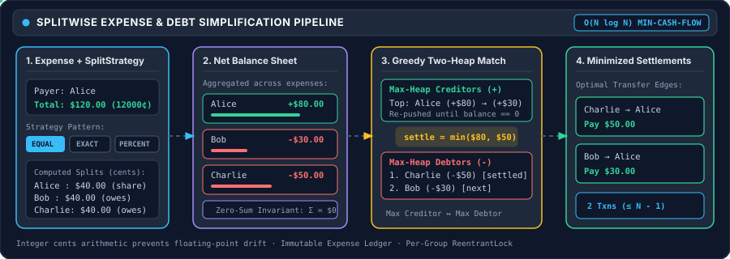
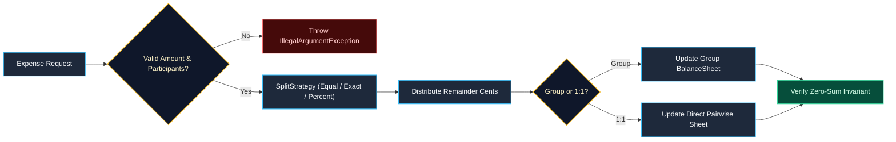
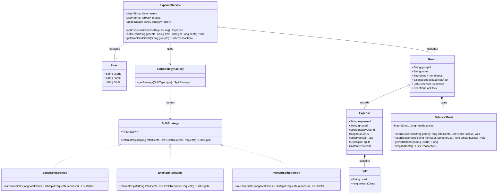
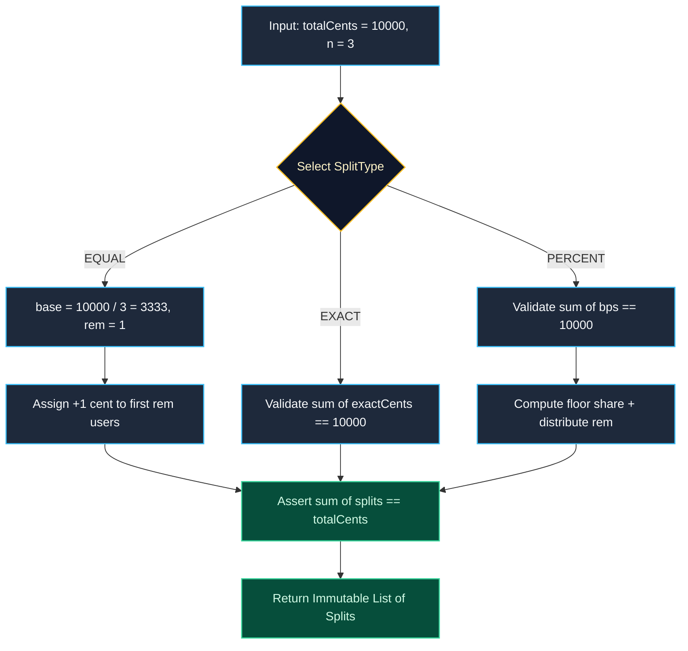
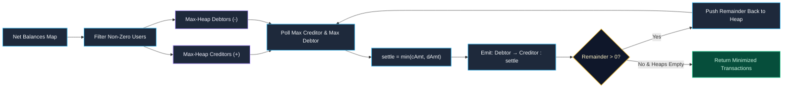
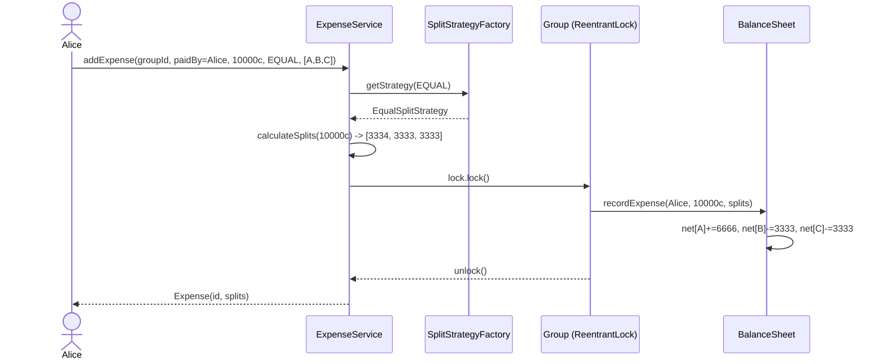
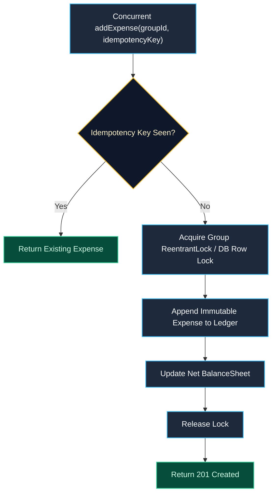

# Splitwise — Expense Sharing & Debt Simplification (Machine Coding & LLD)



Designing an expense-sharing system like **Splitwise** is a classic SDE-2 / Senior Machine Coding interview problem. It tests your ability to model financial invariants cleanly, apply the **Strategy** and **Factory** patterns for extensible split types, prevent floating-point drift using **integer cents (paise)**, and implement an **$O(N \log N)$ Min-Cash-Flow** debt simplification algorithm.

---

## 1. Requirements & Edge Cases

### Functional Requirements

1. **User & Group Management**:
   - Users can exist independently (`1:1` direct expenses) or belong to one or more `Group`s (e.g., *Goa Trip*, *Flatmates*).
   - Group expenses are scoped to that group's ledger; `1:1` expenses can either use a synthetic `direct` group or a pairwise ledger.
2. **Expense Recording (`SplitType`)**:
   - **EQUAL**: Total amount is divided equally among $k$ participants.
   - **EXACT**: Caller specifies exact amounts per participant; sum must equal total amount.
   - **PERCENT**: Caller specifies percentage shares per participant; sum of percentages must equal `100.00%` (or `10000` basis points).
3. **Balance Queries**:
   - View **pairwise net balances** for a user (who owes whom and how much).
   - View **group balances** and **simplified settlements** (minimum number of transactions to settle all debts in a group).
4. **Settlements**:
   - Record a settlement payment from debtor to creditor, reducing the outstanding balance.

### Non-Functional Requirements & Edge Cases

- **Zero-Sum Invariant**: Across any group or global ledger, $\sum_{u} \text{netBalance}(u) = 0$ must hold after every expense and settlement.
- **Rounding Remainder (Penny / Paisa Problem)**: Dividing `$100.00` (`10000` cents) equally among `3` users yields `3333` cents each with `1` cent remainder. Assigning the remainder deterministically (e.g., to the first $r$ participants or the payer/non-payer in canonical order) guarantees exact conservation of money.
- **Self-Payment & Zero-Amount Guards**: Reject `amount <= 0`, empty participant lists, duplicate participants in a single expense, or negative split values.
- **Group vs. 1:1 Isolation**: Simplifying debts inside *Group A* must never mutate or leak balances from *Group B* or `1:1` expenses unless explicitly requested in a global view.



---

## 2. Domain Model & Class Diagram

The design separates **immutable domain records** (`User`, `Expense`, `Split`) from **pluggable split calculation** (`SplitStrategy`, `SplitStrategyFactory`), **ledger state** (`BalanceSheet`), and **orchestration** (`ExpenseService`).

- **`User`**: Identity entity (`userId`, `name`, `email`).
- **`Group`**: Holds member IDs, a dedicated `BalanceSheet`, an append-only list of `Expense` records, and a per-group `ReentrantLock` for concurrency control.
- **`Split`**: Value object representing a participant's owed share in cents (`userId`, `amountCents`, plus optional metadata like `percentBps`).
- **`Expense`**: Immutable audit record (`expenseId`, `groupId`, `paidByUserId`, `totalCents`, `splitType`, `List<Split>`, `createdAt`).
- **`SplitStrategy`**: Interface with `List<Split> calculateSplits(long totalCents, List<SplitRequest> requests)`.
- **`BalanceSheet`**: Maintains `Map<String, Long> netBalances` (positive = owed money / creditor; negative = owes money / debtor) and pairwise edges, plus `simplifyDebts()`.
- **`ExpenseService`**: Facade coordinating validation, strategy resolution, atomic balance updates, and settlement queries.



---

## 3. Split Strategies & Rounding Precision

Using `double` or `float` for money introduces binary floating-point representation errors (e.g., `0.1 + 0.2 != 0.3`), which eventually breaks the zero-sum invariant.

### Integer Cents + Basis Points Approach

- Store all monetary amounts as **`long` integer cents/paise** (e.g., `$120.50` → `12050L`). If converting from user-facing decimal inputs, parse via `BigDecimal` with `RoundingMode.HALF_UP` at the API boundary, then operate exclusively in `long` cents internally.
- Store percentages in **basis points (bps)** where `100.00% = 10_000` bps (`33.33%` → `3333` bps).
- **Remainder Distribution**:
  - For **Equal Split**: `base = totalCents / n`, `remainder = totalCents % n`. Sort participants deterministically (or preserve request order) and add `+1` cent to the first `remainder` participants.
  - For **Percent Split**: Compute `floor((totalCents * bps) / 10_000)` for each participant, then distribute `totalCents - sum(allocated)` leftover cents (`+1` each) to the first `remainder` participants (or those with the largest fractional remainder using Hamilton's / Largest Remainder method).

> [!IMPORTANT]
> Never silently absorb or drop rounding remainders. Every `SplitStrategy` must assert `splits.stream().mapToLong(Split::amountCents).sum() == totalCents` before returning, guaranteeing the ledger's zero-sum invariant.



---

## 4. Debt Simplification Algorithm (Min Cash Flow)

Suppose Alice, Bob, and Charlie have multiple overlapping expenses. Instead of settling every pairwise edge, we collapse all expenses into each user's **net balance**:

$$\text{net}(u) = \text{totalPaid}(u) - \text{totalOwed}(u)$$

- If $\text{net}(u) > 0$: $u$ is a **Creditor** (receives money).
- If $\text{net}(u) < 0$: $u$ is a **Debtor** (pays money).
- If $\text{net}(u) = 0$: $u$ is **Settled** and excluded.

### Greedy Two-Heap Algorithm — $O(N \log N)$

1. Push all creditors (`net > 0`) into a **Max-Heap** (`creditorHeap`) ordered by descending balance.
2. Push all debtors (`net < 0`, stored as `abs(net)`) into a **Max-Heap** (`debtorHeap`) ordered by descending debt magnitude.
3. While both heaps are non-empty:
   - Poll `maxCreditor` `(C, +cAmt)` and `maxDebtor` `(D, dAmt)`.
   - `settleAmt = Math.min(cAmt, dAmt)`.
   - Emit transaction: **`D → C : settleAmt`**.
   - If `cAmt > settleAmt`, re-insert `(C, cAmt - settleAmt)` into `creditorHeap`.
   - If `dAmt > settleAmt`, re-insert `(D, dAmt - settleAmt)` into `debtorHeap`.

### Complexity & Optimality Trade-off

- **Time Complexity**: $O(N \log N)$ where $N$ is the number of non-zero balance users in the group. Each step settles at least one user completely, so at most $N - 1$ transactions are emitted.
- **Space Complexity**: $O(N)$ for the two priority queues.
- **NP-Complete Caveat**: Finding the *absolute theoretical minimum* number of transactions when subsets sum to zero (e.g., `{+5, +5, -4, -6}` vs `{+5, -5}` sub-groups) is **NP-complete** (reducible from Subset Sum, $O(3^N)$ bitmask DP). In production, the $O(N \log N)$ greedy two-heap algorithm is preferred because it is fast, predictable, and guarantees $\le N - 1$ transfers.

> [!TIP]
> If an interviewer asks how to optimize beyond greedy for small groups ($N \le 15$), mention **Backtracking / Bitmask DP** over non-zero net balances to isolate zero-sum subsets first, which reduces transaction count from $N - 1$ to $N - k$ where $k$ is the maximum number of disjoint zero-sum subsets.



---

## 5. Complete Java Implementation & JUnit Tests

Below is a clean, self-contained **Java 17+** implementation using `record`s, `ReentrantLock` per group, `SplitStrategyFactory`, `BalanceSheet#simplifyDebts()`, and **JUnit 5** tests.



### Core Domain, Strategies & Service (`SplitwiseEngine.java`)

```java
package com.splitwise.lld;

import java.time.Instant;
import java.util.*;
import java.util.concurrent.ConcurrentHashMap;
import java.util.concurrent.locks.ReentrantLock;

public final class SplitwiseEngine {

    public enum SplitType {
        EQUAL, EXACT, PERCENT
    }

    public record User(String userId, String name, String email) {
        public User {
            Objects.requireNonNull(userId, "userId must not be null");
            Objects.requireNonNull(name, "name must not be null");
        }
    }

    public record SplitRequest(String userId, long value) {
        // For EQUAL: value ignored; for EXACT: cents; for PERCENT: basis points (100% = 10_000)
        public SplitRequest {
            Objects.requireNonNull(userId, "userId must not be null");
            if (value < 0) {
                throw new IllegalArgumentException("Split value cannot be negative");
            }
        }
    }

    public record Split(String userId, long amountCents) {
        public Split {
            if (amountCents < 0) {
                throw new IllegalArgumentException("Split amount cannot be negative");
            }
        }
    }

    public record Expense(
            String expenseId,
            String groupId,
            String paidByUserId,
            long totalCents,
            SplitType splitType,
            List<Split> splits,
            Instant createdAt
    ) {
        public Expense {
            splits = List.copyOf(splits);
        }
    }

    public record ExpenseRequest(
            String groupId,
            String paidByUserId,
            long totalCents,
            SplitType splitType,
            List<SplitRequest> participants
    ) {}

    public record Transaction(String fromUserId, String toUserId, long amountCents) {}

    // -------------------- Strategy Pattern --------------------

    public interface SplitStrategy {
        List<Split> calculateSplits(long totalCents, List<SplitRequest> requests);
    }

    public static final class EqualSplitStrategy implements SplitStrategy {
        @Override
        public List<Split> calculateSplits(long totalCents, List<SplitRequest> requests) {
            int n = requests.size();
            long base = totalCents / n;
            long remainder = totalCents % n;

            List<Split> result = new ArrayList<>(n);
            for (int i = 0; i < n; i++) {
                long share = base + (i < remainder ? 1L : 0L);
                result.add(new Split(requests.get(i).userId(), share));
            }
            return result;
        }
    }

    public static final class ExactSplitStrategy implements SplitStrategy {
        @Override
        public List<Split> calculateSplits(long totalCents, List<SplitRequest> requests) {
            long sum = 0;
            List<Split> result = new ArrayList<>(requests.size());
            for (SplitRequest req : requests) {
                sum += req.value();
                result.add(new Split(req.userId(), req.value()));
            }
            if (sum != totalCents) {
                throw new IllegalArgumentException(
                        "Exact split sum (" + sum + ") does not match totalCents (" + totalCents + ")");
            }
            return result;
        }
    }

    public static final class PercentSplitStrategy implements SplitStrategy {
        private static final long TOTAL_BPS = 10_000L;

        @Override
        public List<Split> calculateSplits(long totalCents, List<SplitRequest> requests) {
            long totalBps = requests.stream().mapToLong(SplitRequest::value).sum();
            if (totalBps != TOTAL_BPS) {
                throw new IllegalArgumentException(
                        "Percent basis points must sum to 10000, got: " + totalBps);
            }

            long allocated = 0;
            long[] shares = new long[requests.size()];
            for (int i = 0; i < requests.size(); i++) {
                shares[i] = (totalCents * requests.get(i).value()) / TOTAL_BPS;
                allocated += shares[i];
            }

            long remainder = totalCents - allocated;
            for (int i = 0; i < remainder; i++) {
                shares[i]++;
            }

            List<Split> result = new ArrayList<>(requests.size());
            for (int i = 0; i < requests.size(); i++) {
                result.add(new Split(requests.get(i).userId(), shares[i]));
            }
            return result;
        }
    }

    public static final class SplitStrategyFactory {
        private final Map<SplitType, SplitStrategy> strategies = Map.of(
                SplitType.EQUAL, new EqualSplitStrategy(),
                SplitType.EXACT, new ExactSplitStrategy(),
                SplitType.PERCENT, new PercentSplitStrategy()
        );

        public SplitStrategy getStrategy(SplitType type) {
            SplitStrategy strategy = strategies.get(type);
            if (strategy == null) {
                throw new IllegalArgumentException("Unsupported split type: " + type);
            }
            return strategy;
        }
    }

    // -------------------- Balance Sheet & Min-Cash-Flow --------------------

    public static final class BalanceSheet {
        private final Map<String, Long> netBalances = new HashMap<>();

        public void recordExpense(String paidByUserId, long totalCents, List<Split> splits) {
            netBalances.merge(paidByUserId, totalCents, Long::sum);
            for (Split split : splits) {
                netBalances.merge(split.userId(), -split.amountCents(), Long::sum);
            }
        }

        public void recordSettlement(String fromUserId, String toUserId, long amountCents) {
            if (amountCents <= 0) {
                throw new IllegalArgumentException("Settlement amount must be positive");
            }
            if (fromUserId.equals(toUserId)) {
                throw new IllegalArgumentException("Cannot settle with self");
            }
            netBalances.merge(fromUserId, amountCents, Long::sum);
            netBalances.merge(toUserId, -amountCents, Long::sum);
        }

        public long getNetBalance(String userId) {
            return netBalances.getOrDefault(userId, 0L);
        }

        public List<Transaction> simplifyDebts() {
            record Node(String userId, long amount) {}

            PriorityQueue<Node> creditors = new PriorityQueue<>(
                    Comparator.comparingLong(Node::amount).reversed().thenComparing(Node::userId));
            PriorityQueue<Node> debtors = new PriorityQueue<>(
                    Comparator.comparingLong(Node::amount).reversed().thenComparing(Node::userId));

            for (Map.Entry<String, Long> entry : netBalances.entrySet()) {
                long bal = entry.getValue();
                if (bal > 0) {
                    creditors.offer(new Node(entry.getKey(), bal));
                } else if (bal < 0) {
                    debtors.offer(new Node(entry.getKey(), -bal));
                }
            }

            List<Transaction> transactions = new ArrayList<>();
            while (!creditors.isEmpty() && !debtors.isEmpty()) {
                Node creditor = creditors.poll();
                Node debtor = debtors.poll();

                long settled = Math.min(creditor.amount(), debtor.amount());
                transactions.add(new Transaction(debtor.userId(), creditor.userId(), settled));

                if (creditor.amount() > settled) {
                    creditors.offer(new Node(creditor.userId(), creditor.amount() - settled));
                }
                if (debtor.amount() > settled) {
                    debtors.offer(new Node(debtor.userId(), debtor.amount() - settled));
                }
            }
            return transactions;
        }
    }

    // -------------------- Group & Service --------------------

    public static final class Group {
        private final String groupId;
        private final String name;
        private final Set<String> memberIds = new HashSet<>();
        private final BalanceSheet balanceSheet = new BalanceSheet();
        private final List<Expense> expenses = new ArrayList<>();
        private final ReentrantLock lock = new ReentrantLock();

        public Group(String groupId, String name, Collection<String> members) {
            this.groupId = Objects.requireNonNull(groupId);
            this.name = Objects.requireNonNull(name);
            this.memberIds.addAll(members);
        }

        public String getGroupId() { return groupId; }
        public String getName() { return name; }
        public Set<String> getMemberIds() { return Collections.unmodifiableSet(memberIds); }
    }

    public static final class ExpenseService {
        private final Map<String, User> users = new ConcurrentHashMap<>();
        private final Map<String, Group> groups = new ConcurrentHashMap<>();
        private final SplitStrategyFactory strategyFactory = new SplitStrategyFactory();

        public void registerUser(User user) {
            users.put(user.userId(), user);
        }

        public void createGroup(String groupId, String name, Collection<String> memberIds) {
            for (String uid : memberIds) {
                if (!users.containsKey(uid)) {
                    throw new IllegalArgumentException("Unknown user: " + uid);
                }
            }
            groups.put(groupId, new Group(groupId, name, memberIds));
        }

        public Expense addExpense(ExpenseRequest req) {
            if (req.totalCents() <= 0) {
                throw new IllegalArgumentException("Expense total must be positive");
            }
            if (req.participants() == null || req.participants().isEmpty()) {
                throw new IllegalArgumentException("Participants list cannot be empty");
            }

            Group group = requireGroup(req.groupId());
            validateParticipants(group, req);

            SplitStrategy strategy = strategyFactory.getStrategy(req.splitType());
            List<Split> splits = strategy.calculateSplits(req.totalCents(), req.participants());

            Expense expense = new Expense(
                    UUID.randomUUID().toString(),
                    req.groupId(),
                    req.paidByUserId(),
                    req.totalCents(),
                    req.splitType(),
                    splits,
                    Instant.now()
            );

            group.lock.lock();
            try {
                group.expenses.add(expense);
                group.balanceSheet.recordExpense(req.paidByUserId(), req.totalCents(), splits);
            } finally {
                group.lock.unlock();
            }
            return expense;
        }

        public void settleUp(String groupId, String fromUserId, String toUserId, long amountCents) {
            Group group = requireGroup(groupId);
            group.lock.lock();
            try {
                group.balanceSheet.recordSettlement(fromUserId, toUserId, amountCents);
            } finally {
                group.lock.unlock();
            }
        }

        public List<Transaction> getSimplifiedDebts(String groupId) {
            Group group = requireGroup(groupId);
            group.lock.lock();
            try {
                return group.balanceSheet.simplifyDebts();
            } finally {
                group.lock.unlock();
            }
        }

        public long getNetBalance(String groupId, String userId) {
            Group group = requireGroup(groupId);
            group.lock.lock();
            try {
                return group.balanceSheet.getNetBalance(userId);
            } finally {
                group.lock.unlock();
            }
        }

        private Group requireGroup(String groupId) {
            Group group = groups.get(groupId);
            if (group == null) {
                throw new IllegalArgumentException("Unknown group: " + groupId);
            }
            return group;
        }

        private void validateParticipants(Group group, ExpenseRequest req) {
            if (!group.memberIds.contains(req.paidByUserId())) {
                throw new IllegalArgumentException("Payer is not a member of group: " + req.paidByUserId());
            }
            Set<String> seen = new HashSet<>();
            for (SplitRequest sr : req.participants()) {
                if (!group.memberIds.contains(sr.userId())) {
                    throw new IllegalArgumentException("Participant not in group: " + sr.userId());
                }
                if (!seen.add(sr.userId())) {
                    throw new IllegalArgumentException("Duplicate participant: " + sr.userId());
                }
            }
        }
    }
}
```

### JUnit 5 Test Suite (`SplitwiseEngineTest.java`)

```java
package com.splitwise.lld;

import com.splitwise.lld.SplitwiseEngine.*;
import org.junit.jupiter.api.BeforeEach;
import org.junit.jupiter.api.Test;

import java.util.List;

import static org.junit.jupiter.api.Assertions.*;

class SplitwiseEngineTest {

    private ExpenseService service;

    @BeforeEach
    void setUp() {
        service = new ExpenseService();
        service.registerUser(new User("A", "Alice", "alice@example.com"));
        service.registerUser(new User("B", "Bob", "bob@example.com"));
        service.registerUser(new User("C", "Charlie", "charlie@example.com"));
        service.createGroup("g1", "Goa Trip", List.of("A", "B", "C"));
    }

    @Test
    void equalSplitDistributesRemainderCentsDeterministically() {
        Expense exp = service.addExpense(new ExpenseRequest(
                "g1", "A", 10_000L, SplitType.EQUAL,
                List.of(new SplitRequest("A", 0), new SplitRequest("B", 0), new SplitRequest("C", 0))
        ));

        assertEquals(3334L, exp.splits().get(0).amountCents());
        assertEquals(3333L, exp.splits().get(1).amountCents());
        assertEquals(3333L, exp.splits().get(2).amountCents());
        assertEquals(6666L, service.getNetBalance("g1", "A"));
        assertEquals(-3333L, service.getNetBalance("g1", "B"));
        assertEquals(-3333L, service.getNetBalance("g1", "C"));
    }

    @Test
    void debtSimplificationCollapsesMultipleExpenses() {
        // A pays $120 equally -> A: +80, B: -40, C: -40
        service.addExpense(new ExpenseRequest(
                "g1", "A", 12_000L, SplitType.EQUAL,
                List.of(new SplitRequest("A", 0), new SplitRequest("B", 0), new SplitRequest("C", 0))
        ));
        // B pays $30 exact: B=10, C=20 -> B: +20 (net -20), C: -20 (net -60)
        // Net: A = +8000, B = -2000, C = -6000
        service.addExpense(new ExpenseRequest(
                "g1", "B", 3_000L, SplitType.EXACT,
                List.of(new SplitRequest("B", 1_000L), new SplitRequest("C", 2_000L))
        ));

        List<Transaction> txns = service.getSimplifiedDebts("g1");
        assertEquals(2, txns.size());
        assertEquals(new Transaction("C", "A", 6_000L), txns.get(0));
        assertEquals(new Transaction("B", "A", 2_000L), txns.get(1));
    }

    @Test
    void percentSplitRejectsInvalidBasisPoints() {
        assertThrows(IllegalArgumentException.class, () -> service.addExpense(new ExpenseRequest(
                "g1", "A", 10_000L, SplitType.PERCENT,
                List.of(new SplitRequest("A", 5_000L), new SplitRequest("B", 4_000L))
        )));
    }

    @Test
    void settleUpReducesBalancesToZero() {
        service.addExpense(new ExpenseRequest(
                "g1", "A", 6_000L, SplitType.EQUAL,
                List.of(new SplitRequest("A", 0), new SplitRequest("B", 0))
        ));
        service.settleUp("g1", "B", "A", 3_000L);

        assertTrue(service.getSimplifiedDebts("g1").isEmpty());
        assertEquals(0L, service.getNetBalance("g1", "A"));
        assertEquals(0L, service.getNetBalance("g1", "B"));
    }
}
```

---

## 6. Concurrency & Follow-Up Questions

### 1. Concurrent Expense Additions in the Same Group

- **Per-Group `ReentrantLock`**: Locking at the `Group` level rather than a global lock allows independent groups to process expenses in parallel while serializing mutations to a single group's `BalanceSheet` and `expenses` list.
- **Database / Distributed Scale**: In a multi-node backend, replace in-memory `ReentrantLock` with **Optimistic Locking (`@Version` column)** on the `group_balances` row or **`SELECT ... FOR UPDATE`** inside an ACID database transaction, combined with an **idempotency key** (`requestId`) on `addExpense` to prevent duplicate charges on client retries.

### 2. Audit Log Immutability & Expense Edits / Deletes

- Never mutate `BalanceSheet` without recording the corresponding `Expense` or `Settlement` event.
- To **edit or delete** an expense in production, either:
  - Append a **compensating reversal entry** (`-amount`) followed by the new expense (event-sourced ledger), or
  - Reverse the old expense's `splits` on `BalanceSheet` inside the group lock and apply the updated `splits`.

### 3. Multi-Currency Support

- **Approach A (Separate Ledgers per Currency)**: Maintain `Map<Currency, BalanceSheet>` per group so USD and INR debts never mix implicitly.
- **Approach B (FX Conversion at Entry Time)**: Snapshot the exchange rate (`fxRate`, `baseCurrency`) inside the immutable `Expense` record when created, converting to the group's base currency at that moment so historical balances do not drift when exchange rates fluctuate.


