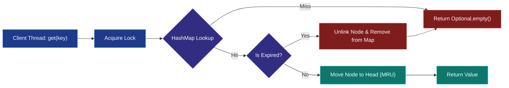
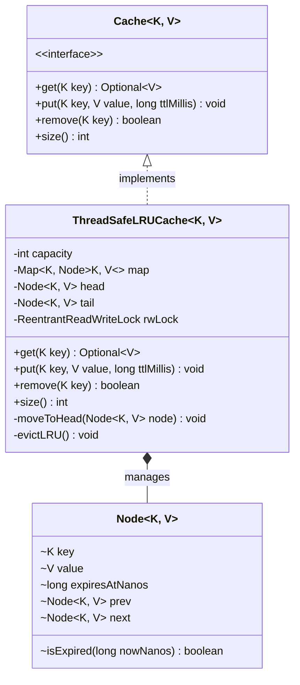
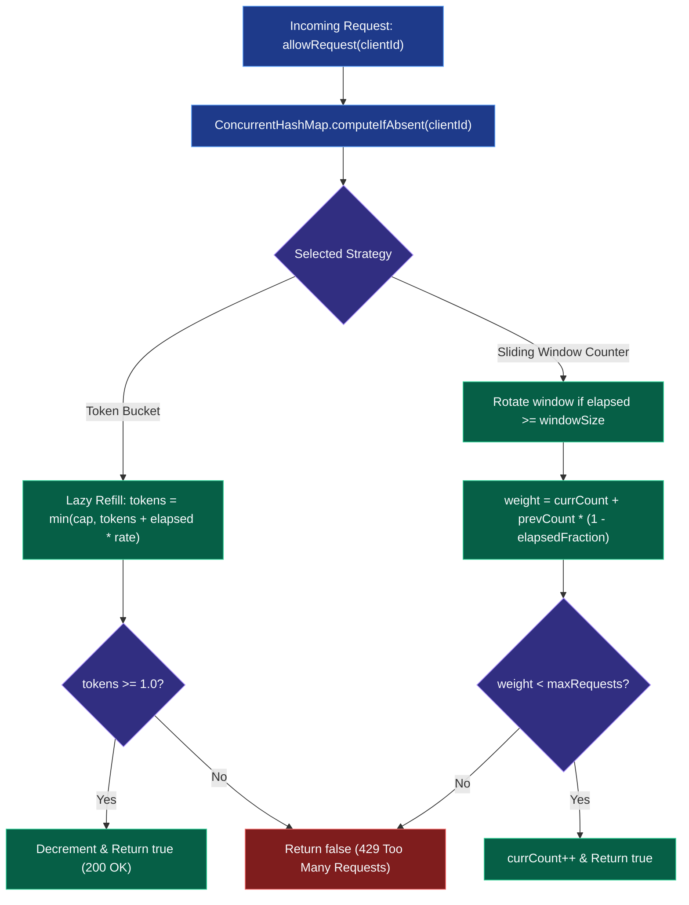
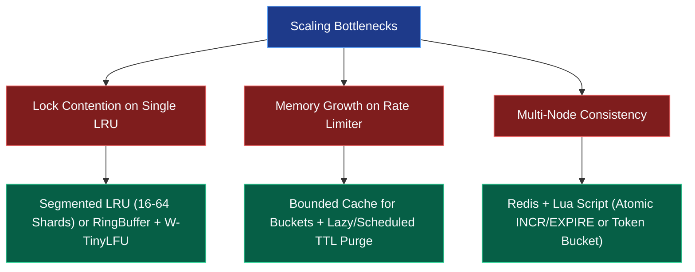

# Rate Limiter & Thread-Safe LRU Cache — Machine Coding & LLD



In-memory caching and rate limiting are the two most frequently asked **SDE-2 / Senior Machine Coding** problems. Both test your ability to combine **O(1) data structures**, **fine-grained concurrency control**, **clean object-oriented interfaces**, and **deterministic multi-threaded unit tests** under a 60–90 minute timebox.

---

## 1. Thread-Safe LRU & LFU Cache Design

An **LRU (Least Recently Used)** cache evicts the entry that has not been accessed for the longest time when capacity is reached. An **LFU (Least Frequently Used)** cache evicts the entry with the lowest access count (breaking ties by LRU).

### Core Data Structure: O(1) HashMap + Doubly Linked List

- **HashMap (`Map<K, Node<K, V>>`)**: Provides **O(1)** average-time key lookup directly to the list node.
- **Doubly Linked List (sentinel `head` and `tail`)**: Enables **O(1)** node removal and **O(1)** insertion at the head (MRU position) without scanning or edge-case null checks.
- **LFU Extension**: Replace the single doubly linked list with a `Map<Integer, DoublyLinkedList<Node>>` (`freqMap`) plus a `minFreq` pointer. Every `get` or `put` increments `node.freq` and moves the node from `freqMap[f]` to `freqMap[f + 1]` in **O(1)**.

### Concurrency Strategy: `ReentrantReadWriteLock` vs. Striped Locks

| Strategy | Read Contention | Write Contention | Why It Matters for LRU |
| :--- | :--- | :--- | :--- |
| **`synchronized` / `ReentrantLock`** | High (serialized reads) | High | Simple, deadlock-free, good baseline for low-to-medium QPS |
| **`ReentrantReadWriteLock`** | Low for **expired/miss** checks | Medium (exclusive on hit promotion) | Note: an LRU `get()` mutates the linked list order, so a true hit still requires a **write lock** (or lock-free/probabilistic promotion) |
| **Lock Striping (Sharded Segments)** | Very Low (`1/N` contention) | Very Low (`1/N` contention) | Partition keys across `N` independent `LRUSegment`s via `hash(key) & (N - 1)`. Each segment has its own `HashMap`, DLL, and `ReentrantLock` |



---

## 2. LRU Cache Class Diagram & Java Implementation

The design separates the `Cache<K, V>` contract from the thread-safe `ThreadSafeLRUCache<K, V>` implementation, using a monotonic clock (`System.nanoTime()`) for **TTL (Time-To-Live)** expiration so wall-clock NTP jumps never corrupt eviction.



### Java 17+ Implementation: `ThreadSafeLRUCache<K, V>`

```java
import java.util.HashMap;
import java.util.Map;
import java.util.Objects;
import java.util.Optional;
import java.util.concurrent.TimeUnit;
import java.util.concurrent.locks.ReentrantReadWriteLock;

public interface Cache<K, V> {
    Optional<V> get(K key);
    void put(K key, V value, long ttlMillis);
    boolean remove(K key);
    int size();
}

public class ThreadSafeLRUCache<K, V> implements Cache<K, V> {

    private static final class Node<K, V> {
        final K key;
        V value;
        long expiresAtNanos;
        Node<K, V> prev;
        Node<K, V> next;

        Node(K key, V value, long expiresAtNanos) {
            this.key = key;
            this.value = value;
            this.expiresAtNanos = expiresAtNanos;
        }

        boolean isExpired(long nowNanos) {
            return expiresAtNanos > 0 && nowNanos >= expiresAtNanos;
        }
    }

    private final int capacity;
    private final Map<K, Node<K, V>> map;
    private final Node<K, V> head; // Sentinel MRU
    private final Node<K, V> tail; // Sentinel LRU
    private final ReentrantReadWriteLock rwLock = new ReentrantReadWriteLock();

    public ThreadSafeLRUCache(int capacity) {
        if (capacity <= 0) {
            throw new IllegalArgumentException("Capacity must be positive");
        }
        this.capacity = capacity;
        this.map = new HashMap<>(capacity);
        this.head = new Node<>(null, null, 0L);
        this.tail = new Node<>(null, null, 0L);
        this.head.next = this.tail;
        this.tail.prev = this.head;
    }

    @Override
    public Optional<V> get(K key) {
        Objects.requireNonNull(key, "Key must not be null");
        // Write lock is required because a cache hit mutates the DLL order (or removes expired node).
        rwLock.writeLock().lock();
        try {
            Node<K, V> node = map.get(key);
            if (node == null) {
                return Optional.empty();
            }
            long now = System.nanoTime();
            if (node.isExpired(now)) {
                unlink(node);
                map.remove(key);
                return Optional.empty();
            }
            moveToHead(node);
            return Optional.of(node.value);
        } finally {
            rwLock.writeLock().unlock();
        }
    }

    @Override
    public void put(K key, V value, long ttlMillis) {
        Objects.requireNonNull(key, "Key must not be null");
        Objects.requireNonNull(value, "Value must not be null");
        long expiresAt = ttlMillis > 0
                ? System.nanoTime() + TimeUnit.MILLISECONDS.toNanos(ttlMillis)
                : 0L;

        rwLock.writeLock().lock();
        try {
            Node<K, V> existing = map.get(key);
            if (existing != null) {
                existing.value = value;
                existing.expiresAtNanos = expiresAt;
                moveToHead(existing);
                return;
            }
            if (map.size() >= capacity) {
                evictLRU();
            }
            Node<K, V> fresh = new Node<>(key, value, expiresAt);
            map.put(key, fresh);
            insertAfterHead(fresh);
        } finally {
            rwLock.writeLock().unlock();
        }
    }

    @Override
    public boolean remove(K key) {
        Objects.requireNonNull(key, "Key must not be null");
        rwLock.writeLock().lock();
        try {
            Node<K, V> node = map.remove(key);
            if (node == null) {
                return false;
            }
            unlink(node);
            return true;
        } finally {
            rwLock.writeLock().unlock();
        }
    }

    @Override
    public int size() {
        rwLock.readLock().lock();
        try {
            return map.size();
        } finally {
            rwLock.readLock().unlock();
        }
    }

    private void moveToHead(Node<K, V> node) {
        unlink(node);
        insertAfterHead(node);
    }

    private void insertAfterHead(Node<K, V> node) {
        Node<K, V> first = head.next;
        node.prev = head;
        node.next = first;
        head.next = node;
        first.prev = node;
    }

    private void unlink(Node<K, V> node) {
        node.prev.next = node.next;
        node.next.prev = node.prev;
    }

    private void evictLRU() {
        Node<K, V> lru = tail.prev;
        if (lru != head) {
            unlink(lru);
            map.remove(lru.key);
        }
    }
}
```

> [!TIP]
> In Java interviews, explicitly call out **why `get()` takes `writeLock()`**: `ReentrantReadWriteLock` does **not** allow upgrading a `readLock` to a `writeLock` (doing so causes an immediate deadlock). Because an LRU hit must move the node to `head`, acquiring `writeLock()` upfront avoids lock-upgrade deadlocks. If you need lock-free reads, use **Segmented LRU** or **Caffeine's RingBuffer + W-TinyLFU** pattern.

---

## 3. In-Memory Rate Limiter Design

An in-memory rate limiter protects downstream services by enforcing `N` requests per window per `clientId` (user ID, API key, or IP).

### Algorithm Comparison

| Algorithm | Memory per Client | Burst Handling | Boundary Spike | Best Use Case |
| :--- | :--- | :--- | :--- | :--- |
| **Token Bucket** | `O(1)` (2 numbers: `tokens`, `lastRefillNanos`) | **Allows controlled bursts** up to `capacity` | Smooth (continuous refill) | Public APIs, gateways (AWS API Gateway, Stripe) |
| **Sliding Window Log** | `O(N)` (Queue of timestamps) | Exact enforcement | **None** | Strict compliance / financial endpoints with low `N` |
| **Sliding Window Counter** | `O(1)` (2 counters: `prevCount`, `currCount`) | Approximated weighted window | **Minimal** (smoothed across boundary) | High-throughput APIs needing `O(1)` memory + accuracy |



---

## 4. Rate Limiter Java Implementation

We define a single `RateLimiter` interface so callers (filters, interceptors, or API gateways) can swap algorithms via dependency injection without changing business logic.

```mermaid
sequenceDiagram
    autonumber
    participant Client as API Caller
    participant RL as TokenBucketRateLimiter
    participant Map as ConcurrentHashMap
    participant Bucket as ClientBucket (synchronized)

    Client->>RL: allowRequest("user-42")
    RL->>Map: computeIfAbsent("user-42", createBucket)
    Map-->>RL: ClientBucket
    RL->>Bucket: tryConsume(1)
    Note over Bucket: Lazy refill using System.nanoTime()
    alt tokens &gt;= 1.0
        Bucket-->>RL: true (tokens -= 1)
        RL-->>Client: true (200 OK)
    else tokens &lt; 1.0
        Bucket-->>RL: false
        RL-->>Client: false (429 Too Many Requests)
    end
```

### Java 17+ Implementation: `RateLimiter`, `TokenBucketRateLimiter` & `SlidingWindowCounterRateLimiter`

```java
import java.util.Objects;
import java.util.concurrent.ConcurrentHashMap;
import java.util.concurrent.TimeUnit;

public interface RateLimiter {
    boolean allowRequest(String clientId);
}

public class TokenBucketRateLimiter implements RateLimiter {

    private static final class Bucket {
        private double tokens;
        private long lastRefillNanos;

        Bucket(double initialTokens, long nowNanos) {
            this.tokens = initialTokens;
            this.lastRefillNanos = nowNanos;
        }

        synchronized boolean tryConsume(double capacity, double refillPerNanos, long nowNanos) {
            long elapsed = Math.max(0L, nowNanos - lastRefillNanos);
            if (elapsed > 0) {
                tokens = Math.min(capacity, tokens + elapsed * refillPerNanos);
                lastRefillNanos = nowNanos;
            }
            if (tokens >= 1.0d) {
                tokens -= 1.0d;
                return true;
            }
            return false;
        }
    }

    private final double capacity;
    private final double refillTokensPerNano;
    private final ConcurrentHashMap<String, Bucket> buckets = new ConcurrentHashMap<>();

    public TokenBucketRateLimiter(int burstCapacity, double refillTokensPerSecond) {
        if (burstCapacity <= 0 || refillTokensPerSecond <= 0) {
            throw new IllegalArgumentException("Capacity and refill rate must be positive");
        }
        this.capacity = burstCapacity;
        this.refillTokensPerNano = refillTokensPerSecond / 1_000_000_000.0d;
    }

    @Override
    public boolean allowRequest(String clientId) {
        Objects.requireNonNull(clientId, "clientId must not be null");
        long now = System.nanoTime();
        Bucket bucket = buckets.computeIfAbsent(clientId, k -> new Bucket(capacity, now));
        return bucket.tryConsume(capacity, refillTokensPerNano, now);
    }
}

public class SlidingWindowCounterRateLimiter implements RateLimiter {

    private static final class WindowState {
        private long currentWindowStartNanos;
        private int currentCount;
        private int previousCount;

        WindowState(long windowStartNanos) {
            this.currentWindowStartNanos = windowStartNanos;
        }

        synchronized boolean tryAcquire(int maxRequests, long windowSizeNanos, long nowNanos) {
            long elapsed = nowNanos - currentWindowStartNanos;
            if (elapsed >= windowSizeNanos) {
                long windowsPassed = elapsed / windowSizeNanos;
                previousCount = (windowsPassed == 1) ? currentCount : 0;
                currentCount = 0;
                currentWindowStartNanos += windowsPassed * windowSizeNanos;
                elapsed = nowNanos - currentWindowStartNanos;
            }

            double overlapWeight = 1.0d - ((double) elapsed / windowSizeNanos);
            double estimatedCount = currentCount + (previousCount * Math.max(0.0d, overlapWeight));

            if (estimatedCount + 1.0d <= maxRequests) {
                currentCount++;
                return true;
            }
            return false;
        }
    }

    private final int maxRequests;
    private final long windowSizeNanos;
    private final ConcurrentHashMap<String, WindowState> windows = new ConcurrentHashMap<>();

    public SlidingWindowCounterRateLimiter(int maxRequests, long windowSize, TimeUnit unit) {
        if (maxRequests <= 0 || windowSize <= 0) {
            throw new IllegalArgumentException("maxRequests and windowSize must be positive");
        }
        this.maxRequests = maxRequests;
        this.windowSizeNanos = unit.toNanos(windowSize);
    }

    @Override
    public boolean allowRequest(String clientId) {
        Objects.requireNonNull(clientId, "clientId must not be null");
        long now = System.nanoTime();
        WindowState state = windows.computeIfAbsent(clientId, k -> new WindowState(now));
        return state.tryAcquire(maxRequests, windowSizeNanos, now);
    }
}
```

> [!WARNING]
> An unbounded `ConcurrentHashMap<String, Bucket>` will leak memory over time in production as unique `clientId`s (e.g., ephemeral IPs or bot traffic) accumulate. Always pair per-client state with a **TTL eviction sweep** or back the map with a bounded `ThreadSafeLRUCache` / Caffeine cache.

---

## 5. JUnit 5 Concurrency Tests

In machine-coding interviews, proving thread-safety means synchronizing worker threads with a **`CountDownLatch`** so they contend on the exact same instant, rather than running sequentially.


### JUnit 5 Test Suite (`ExecutorService` + `CountDownLatch`)

```java
import org.junit.jupiter.api.Test;
import java.util.concurrent.CountDownLatch;
import java.util.concurrent.ExecutorService;
import java.util.concurrent.Executors;
import java.util.concurrent.TimeUnit;
import java.util.concurrent.atomic.AtomicInteger;

import static org.junit.jupiter.api.Assertions.assertEquals;
import static org.junit.jupiter.api.Assertions.assertTrue;

class ConcurrencyPrimitivesTest {

    @Test
    void tokenBucketEnforcesExactBurstLimitUnderContention() throws InterruptedException {
        int burstCapacity = 10;
        // Very slow refill so no tokens regenerate during the burst test
        RateLimiter limiter = new TokenBucketRateLimiter(burstCapacity, 0.001);

        int threads = 32;
        ExecutorService pool = Executors.newFixedThreadPool(threads);
        CountDownLatch ready = new CountDownLatch(threads);
        CountDownLatch start = new CountDownLatch(1);
        CountDownLatch done = new CountDownLatch(threads);

        AtomicInteger allowed = new AtomicInteger(0);
        AtomicInteger rejected = new AtomicInteger(0);

        for (int i = 0; i < threads; i++) {
            pool.submit(() -> {
                ready.countDown();
                try {
                    start.await();
                    if (limiter.allowRequest("tenant-1")) {
                        allowed.incrementAndGet();
                    } else {
                        rejected.incrementAndGet();
                    }
                } catch (InterruptedException e) {
                    Thread.currentThread().interrupt();
                } finally {
                    done.countDown();
                }
            });
        }

        assertTrue(ready.await(2, TimeUnit.SECONDS));
        start.countDown(); // Release all 32 threads simultaneously
        assertTrue(done.await(5, TimeUnit.SECONDS));
        pool.shutdownNow();

        assertEquals(burstCapacity, allowed.get(), "Exactly burstCapacity requests must succeed");
        assertEquals(threads - burstCapacity, rejected.get(), "Remaining requests must be throttled");
    }

    @Test
    void lruCacheMaintainsCapacityBoundUnderConcurrentWrites() throws InterruptedException {
        int capacity = 50;
        Cache<Integer, String> cache = new ThreadSafeLRUCache<>(capacity);

        int threads = 16;
        int opsPerThread = 200;
        ExecutorService pool = Executors.newFixedThreadPool(threads);
        CountDownLatch start = new CountDownLatch(1);
        CountDownLatch done = new CountDownLatch(threads);

        for (int t = 0; t < threads; t++) {
            final int threadId = t;
            pool.submit(() -> {
                try {
                    start.await();
                    for (int i = 0; i < opsPerThread; i++) {
                        int key = (threadId * opsPerThread + i) % 120;
                        cache.put(key, "val-" + key, 5_000);
                        cache.get(key);
                    }
                } catch (InterruptedException e) {
                    Thread.currentThread().interrupt();
                } finally {
                    done.countDown();
                }
            });
        }

        start.countDown();
        assertTrue(done.await(5, TimeUnit.SECONDS));
        pool.shutdownNow();

        assertTrue(cache.size() <= capacity, "Cache size must never exceed configured capacity");
    }
}
```

---

## 6. Interview Follow-Ups

Senior/Staff interviewers will probe how your single-node primitives scale under **high core-count contention**, **memory pressure**, and **distributed deployments**.



### Key Talking Points

1. **Segmented LRU (Lock Striping)**: Partition the cache into `S` independent shards (`shard = hash(key) & (S - 1)`), each with capacity `totalCapacity / S` and its own `ReentrantLock`. Contention drops by a factor of `S` while preserving `O(1)` operations.
2. **Lock-Free CAS for Token Bucket**: Replace `synchronized` inside `Bucket` with an `AtomicReference<BucketState>` holding an immutable `(tokens, lastRefillNanos)` record and a CAS `compareAndSet` loop. This eliminates monitor inflation under extreme contention.
3. **Memory Bounds & Key Eviction**:
   - **LRU Cache**: Add a `weigher` (`(k, v) → bytes`) instead of entry-count capacity when values vary widely in size.
   - **Rate Limiter**: Evict idle client buckets whose `lastRefillNanos` is older than `timeToFullRefill * 2` using a background cleaner or bounded LRU map.
4. **Distributed Rate Limiting**: In-memory limiters enforce per-instance limits (`limit / numPods`). For global limits across pods, move state to **Redis** using an atomic **Lua script** (avoiding read-modify-write race conditions) or use **local sticky-bucket batching** (fetch `k` tokens at a time from Redis to amortize network RTT).

> [!NOTE]
> When asked to choose between **Token Bucket** and **Sliding Window Counter** in a live interview, pick **Token Bucket** when burst tolerance and `O(1)` state are desired, and **Sliding Window Counter** when the requirement is strictly *"no more than N requests in any rolling T-second window"* with `O(1)` memory.
