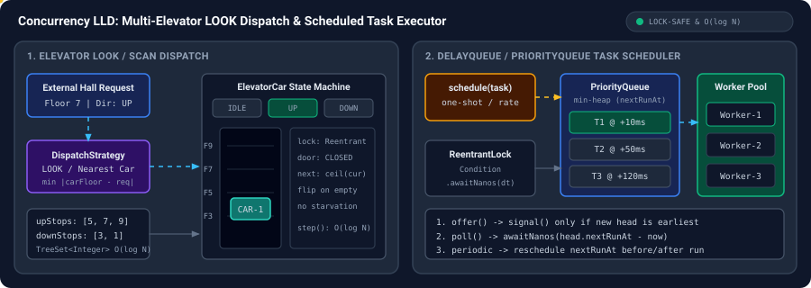
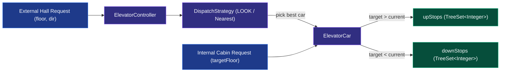
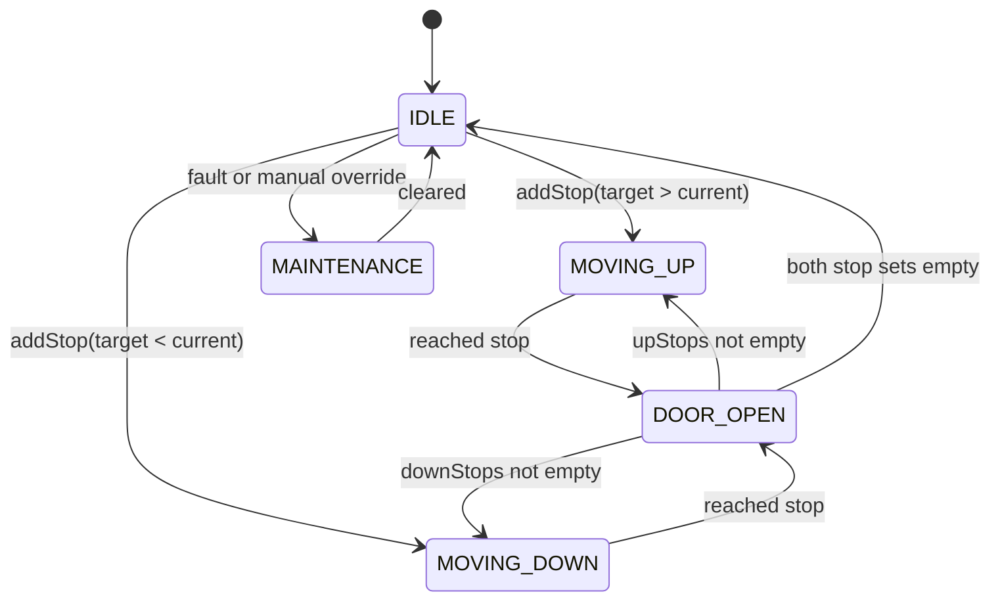
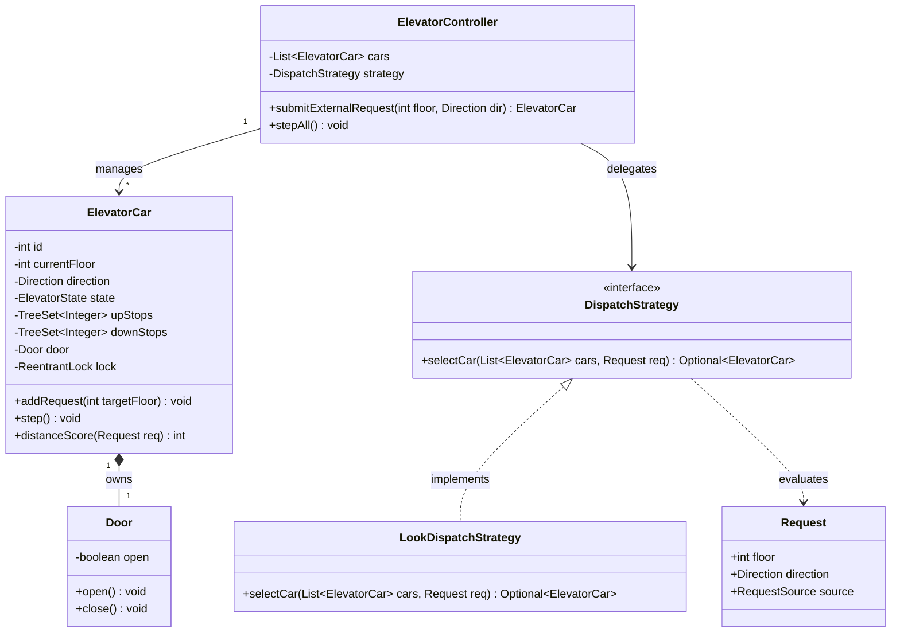
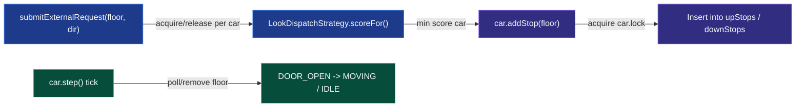
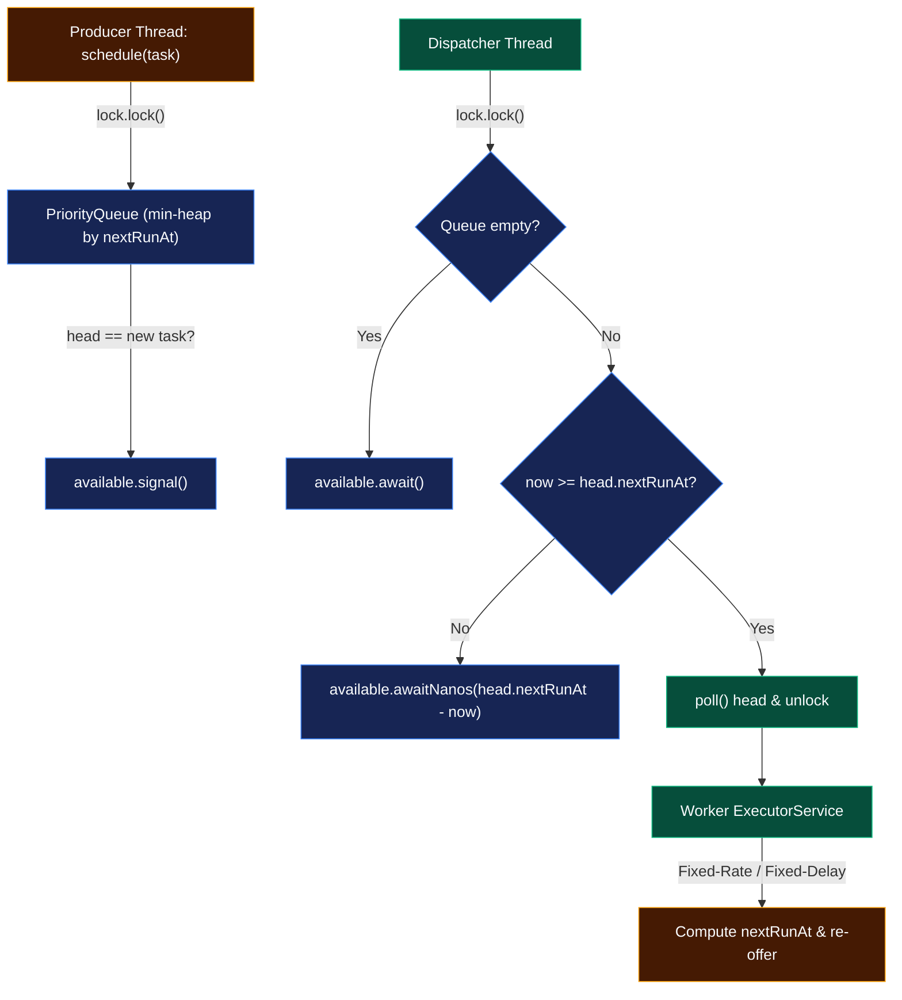
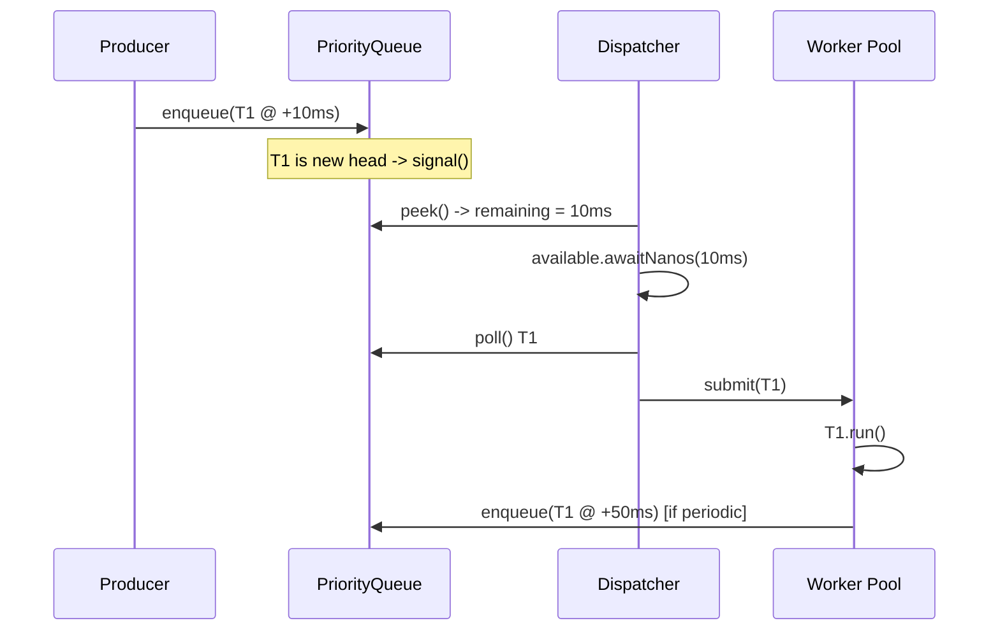
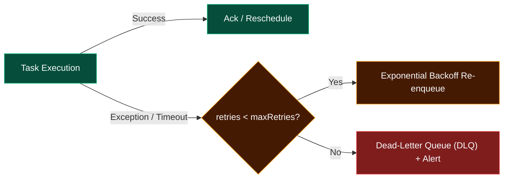

# Multi-Elevator Control System & In-Memory Task Scheduler (LLD)



Both the **Multi-Elevator Control System** and the **In-Memory Task Scheduler** are flagship concurrency-heavy Low-Level Design (LLD) problems. They test your ability to model state machines cleanly, avoid thread starvation and race conditions, and choose data structures (`TreeSet` and `PriorityQueue` + `Condition`) that keep dispatch and wakeups in `O(log N)` time.

---

## 1. Multi-Elevator Control System Requirements

A production-grade elevator controller must coordinate `M` elevator cars across `N` floors while serving two fundamentally different request types:

- **External Hall Request `(floor, direction)`**: Pressed outside the car (`UP` or `DOWN`). The `ElevatorController` must pick the optimal car via a pluggable `DispatchStrategy`.
- **Internal Cabin Request `(targetFloor)`**: Pressed inside a specific `ElevatorCar`. The car already owns this request and routes it directly into its directional stop sets.

| Scheduling Algorithm | How It Works | Worst-Case Wait | Starvation Risk | Best Use Case |
| :--- | :--- | :--- | :--- | :--- |
| **FCFS (First-Come, First-Served)** | Serves requests strictly in arrival order | High (zig-zags across building) | None | Low-traffic single-car prototypes |
| **SSTF (Shortest Seek Time First)** | Always picks closest floor to current position | Unbounded for far floors | **High** (middle floors starve ends) | Never in real buildings |
| **SCAN (Elevator Algorithm)** | Sweeps all the way to floor `N` or `1` before reversing | Bounded (`2 * N` floors) | None | Mechanical simplicity |
| **LOOK (Optimal SCAN)** | Sweeps only to the **furthest pending stop** in current direction, then flips | Bounded (`≤ 2 * span`) | None (with bounded directional queues) | **Standard real-world & interview choice** |



---

## 2. Elevator State Machine & Class Diagram

Each `ElevatorCar` is an independent state machine protected by its own `ReentrantLock` so cars do not block each other while moving or opening doors.



Separating `DispatchStrategy` from `ElevatorController` follows the **Strategy Pattern**, allowing you to swap `LookDispatchStrategy` with `ZoneDispatchStrategy` or `LeastLoadedStrategy` without touching controller or car logic.



> [!TIP]
> **Why `TreeSet<Integer>` instead of `PriorityQueue<Integer>` for stops?**
> A `PriorityQueue` allows duplicate floor entries unless you do an `O(N)` `contains()` scan before inserting. `TreeSet` deduplicates automatically and gives `O(log N)` `ceiling()`, `floor()`, `pollFirst()`, and `pollLast()`—making LOOK reversals trivial.

---

## 3. Elevator Java Implementation

Below is a clean, thread-safe Java 17+ implementation using `TreeSet` for directional stops and a `LookDispatchStrategy` that scores each car based on whether it is already heading toward the hall request.



```java
package com.interview.lld.elevator;

import java.util.*;
import java.util.concurrent.locks.ReentrantLock;

public enum Direction { UP, DOWN, IDLE }

public enum ElevatorState { IDLE, MOVING, DOOR_OPEN, MAINTENANCE }

public record Request(int floor, Direction direction, boolean external) {}

public interface DispatchStrategy {
    Optional<ElevatorCar> selectCar(List<ElevatorCar> cars, Request request);
}

public class LookDispatchStrategy implements DispatchStrategy {
    @Override
    public Optional<ElevatorCar> selectCar(List<ElevatorCar> cars, Request request) {
        return cars.stream()
                .filter(ElevatorCar::isAvailable)
                .min(Comparator.comparingInt(car -> car.scoreFor(request)));
    }
}

public class ElevatorCar {
    private final int id;
    private final ReentrantLock lock = new ReentrantLock();
    private final TreeSet<Integer> upStops = new TreeSet<>();
    private final TreeSet<Integer> downStops = new TreeSet<>();

    private int currentFloor = 1;
    private Direction direction = Direction.IDLE;
    private ElevatorState state = ElevatorState.IDLE;

    public ElevatorCar(int id) {
        this.id = id;
    }

    public boolean isAvailable() {
        lock.lock();
        try {
            return state != ElevatorState.MAINTENANCE;
        } finally {
            lock.unlock();
        }
    }

    /**
     * Lower score = better candidate for LOOK dispatch.
     * Prefer cars already moving toward the request in the same direction,
     * then IDLE cars, and penalize cars moving away.
     */
    public int scoreFor(Request req) {
        lock.lock();
        try {
            int dist = Math.abs(currentFloor - req.floor());
            if (direction == Direction.IDLE) {
                return dist;
            }
            boolean sameDir = direction == req.direction();
            boolean onTheWay = (direction == Direction.UP && req.floor() >= currentFloor)
                    || (direction == Direction.DOWN && req.floor() <= currentFloor);

            if (sameDir && onTheWay) {
                return dist;
            }
            // Car must finish its current sweep before reversing
            return dist + 1000;
        } finally {
            lock.unlock();
        }
    }

    public void addStop(int targetFloor) {
        lock.lock();
        try {
            if (targetFloor == currentFloor) {
                state = ElevatorState.DOOR_OPEN;
                return;
            }
            if (targetFloor > currentFloor) {
                upStops.add(targetFloor);
                if (direction == Direction.IDLE) {
                    direction = Direction.UP;
                    state = ElevatorState.MOVING;
                }
            } else {
                downStops.add(targetFloor);
                if (direction == Direction.IDLE) {
                    direction = Direction.DOWN;
                    state = ElevatorState.MOVING;
                }
            }
        } finally {
            lock.unlock();
        }
    }

    public void step() {
        lock.lock();
        try {
            if (state == ElevatorState.MAINTENANCE) return;

            if (state == ElevatorState.DOOR_OPEN) {
                state = hasPendingStops() ? ElevatorState.MOVING : ElevatorState.IDLE;
                if (state == ElevatorState.IDLE) direction = Direction.IDLE;
                return;
            }

            if (direction == Direction.UP) {
                if (!upStops.isEmpty()) {
                    currentFloor++;
                    if (upStops.remove(currentFloor)) {
                        state = ElevatorState.DOOR_OPEN;
                    }
                } else if (!downStops.isEmpty()) {
                    direction = Direction.DOWN;
                } else {
                    direction = Direction.IDLE;
                    state = ElevatorState.IDLE;
                }
            } else if (direction == Direction.DOWN) {
                if (!downStops.isEmpty()) {
                    currentFloor--;
                    if (downStops.remove(currentFloor)) {
                        state = ElevatorState.DOOR_OPEN;
                    }
                } else if (!upStops.isEmpty()) {
                    direction = Direction.UP;
                } else {
                    direction = Direction.IDLE;
                    state = ElevatorState.IDLE;
                }
            }
        } finally {
            lock.unlock();
        }
    }

    private boolean hasPendingStops() {
        return !upStops.isEmpty() || !downStops.isEmpty();
    }

    public int getId() { return id; }
    public int getCurrentFloor() {
        lock.lock();
        try { return currentFloor; } finally { lock.unlock(); }
    }
    public Direction getDirection() {
        lock.lock();
        try { return direction; } finally { lock.unlock(); }
    }
}
```

```java
public class ElevatorController {
    private final List<ElevatorCar> cars;
    private final DispatchStrategy strategy;

    public ElevatorController(List<ElevatorCar> cars, DispatchStrategy strategy) {
        this.cars = List.copyOf(cars);
        this.strategy = Objects.requireNonNull(strategy);
    }

    public ElevatorCar submitExternalRequest(int floor, Direction direction) {
        Request req = new Request(floor, direction, true);
        ElevatorCar chosen = strategy.selectCar(cars, req)
                .orElseThrow(() -> new IllegalStateException("No available elevator cars"));
        chosen.addStop(floor);
        return chosen;
    }

    public void stepAll() {
        for (ElevatorCar car : cars) {
            car.step();
        }
    }
}
```

> [!IMPORTANT]
> **Avoid Lock Ordering Deadlocks:** Never hold `ElevatorCar A`'s lock while acquiring `ElevatorCar B`'s lock. In `LookDispatchStrategy`, `scoreFor()` acquires and releases each car's lock independently, and `addStop()` is called outside `scoreFor()`.

---

## 4. Distributed-Style In-Memory Task Scheduler

An in-memory `TaskScheduler` (similar to `ScheduledThreadPoolExecutor` or a single-node version of Temporal/Quartz) must support:
1. **One-shot delayed tasks**: `schedule(Runnable, delay)`.
2. **Fixed-rate tasks**: `scheduleAtFixedRate(Runnable, initialDelay, period)` (next run anchored to `scheduledTime + period`).
3. **Fixed-delay tasks**: `scheduleWithFixedDelay(Runnable, initialDelay, delay)` (next run anchored to `completionTime + delay`).
4. **Precise sleep without busy-waiting**: A single `PriorityQueue<ScheduledTask>` ordered by `nextRunAtNanos` guarded by a `ReentrantLock` and `Condition.awaitNanos(remainingNanos)`.



Key design invariant:
- **Use `System.nanoTime()`**, not `System.currentTimeMillis()`, for elapsed intervals and deadlines—wall-clock time can jump backward on NTP sync, causing tasks to stall or fire prematurely.
- **Separate the Dispatcher from the Worker Pool**: The dispatcher thread only pops due tasks and hands them to an `ExecutorService`. If the dispatcher executed tasks inline, one slow task would block every other scheduled task behind it.

---

## 5. Task Scheduler Java Implementation & Tests

```java
package com.interview.lld.scheduler;

import java.util.Comparator;
import java.util.PriorityQueue;
import java.util.concurrent.*;
import java.util.concurrent.atomic.AtomicBoolean;
import java.util.concurrent.locks.Condition;
import java.util.concurrent.locks.ReentrantLock;

public class TaskScheduler implements AutoCloseable {

    private enum ScheduleType { ONE_SHOT, FIXED_RATE, FIXED_DELAY }

    private static final class ScheduledTask implements Comparable<ScheduledTask> {
        final Runnable command;
        final ScheduleType type;
        final long intervalNanos;
        long nextRunAtNanos;
        final AtomicBoolean cancelled = new AtomicBoolean(false);

        ScheduledTask(Runnable command, ScheduleType type, long nextRunAtNanos, long intervalNanos) {
            this.command = command;
            this.type = type;
            this.nextRunAtNanos = nextRunAtNanos;
            this.intervalNanos = intervalNanos;
        }

        @Override
        public int compareTo(ScheduledTask other) {
            return Long.compare(this.nextRunAtNanos, other.nextRunAtNanos);
        }
    }

    private final ReentrantLock lock = new ReentrantLock();
    private final Condition available = lock.newCondition();
    private final PriorityQueue<ScheduledTask> queue = new PriorityQueue<>(Comparator.naturalOrder());
    private final ExecutorService workers;
    private final Thread dispatcher;
    private volatile boolean shutdown = false;

    public TaskScheduler(int workerThreads) {
        this.workers = Executors.newFixedThreadPool(workerThreads);
        this.dispatcher = new Thread(this::dispatchLoop, "scheduler-dispatcher");
        this.dispatcher.start();
    }

    public void schedule(Runnable task, long delay, TimeUnit unit) {
        enqueue(new ScheduledTask(task, ScheduleType.ONE_SHOT,
                System.nanoTime() + unit.toNanos(delay), 0));
    }

    public void scheduleAtFixedRate(Runnable task, long initialDelay, long period, TimeUnit unit) {
        enqueue(new ScheduledTask(task, ScheduleType.FIXED_RATE,
                System.nanoTime() + unit.toNanos(initialDelay), unit.toNanos(period)));
    }

    public void scheduleWithFixedDelay(Runnable task, long initialDelay, long delay, TimeUnit unit) {
        enqueue(new ScheduledTask(task, ScheduleType.FIXED_DELAY,
                System.nanoTime() + unit.toNanos(initialDelay), unit.toNanos(delay)));
    }

    private void enqueue(ScheduledTask task) {
        lock.lock();
        try {
            if (shutdown) throw new RejectedExecutionException("Scheduler is shut down");
            queue.offer(task);
            if (queue.peek() == task) {
                available.signal();
            }
        } finally {
            lock.unlock();
        }
    }

    private void dispatchLoop() {
        while (true) {
            ScheduledTask readyTask = null;
            lock.lock();
            try {
                while (!shutdown && queue.isEmpty()) {
                    available.await();
                }
                if (shutdown && queue.isEmpty()) {
                    return;
                }
                ScheduledTask head = queue.peek();
                long remaining = head.nextRunAtNanos - System.nanoTime();
                if (remaining <= 0) {
                    readyTask = queue.poll();
                } else {
                    available.awaitNanos(remaining);
                }
            } catch (InterruptedException e) {
                if (shutdown) return;
                Thread.currentThread().interrupt();
            } finally {
                lock.unlock();
            }

            if (readyTask != null && !readyTask.cancelled.get()) {
                final ScheduledTask task = readyTask;
                workers.submit(() -> executeAndReschedule(task));
            }
        }
    }

    private void executeAndReschedule(ScheduledTask task) {
        try {
            task.command.run();
        } catch (Throwable t) {
            // Log & isolate failure so periodic scheduler never dies silently
        } finally {
            if (!shutdown && !task.cancelled.get() && task.type != ScheduleType.ONE_SHOT) {
                if (task.type == ScheduleType.FIXED_RATE) {
                    task.nextRunAtNanos += task.intervalNanos;
                } else {
                    task.nextRunAtNanos = System.nanoTime() + task.intervalNanos;
                }
                enqueue(task);
            }
        }
    }

    @Override
    public void close() {
        lock.lock();
        try {
            shutdown = true;
            queue.clear();
            available.signalAll();
        } finally {
            lock.unlock();
        }
        dispatcher.interrupt();
        workers.shutdown();
    }
}
```

### JUnit 5 Verification

```java
import org.junit.jupiter.api.Test;
import java.util.concurrent.*;
import java.util.concurrent.atomic.AtomicInteger;
import static org.junit.jupiter.api.Assertions.*;

class TaskSchedulerTest {
    @Test
    void executesOneShotAndFixedRateAndShutsDownCleanly() throws Exception {
        CountDownLatch oneShotLatch = new CountDownLatch(1);
        AtomicInteger fixedRateCount = new AtomicInteger(0);

        try (TaskScheduler scheduler = new TaskScheduler(2)) {
            scheduler.schedule(oneShotLatch::countDown, 30, TimeUnit.MILLISECONDS);
            scheduler.scheduleAtFixedRate(fixedRateCount::incrementAndGet, 10, 40, TimeUnit.MILLISECONDS);

            assertTrue(oneShotLatch.await(1, TimeUnit.SECONDS), "One-shot task did not fire");
            Thread.sleep(120);
            assertTrue(fixedRateCount.get() >= 2, "Fixed-rate task should run multiple times");
        }
    }
}
```



---

## 6. Concurrency Pitfalls & Follow-Ups

1. **Spurious Wakeups on `Condition.awaitNanos()`**: Always re-check `head.nextRunAtNanos - System.nanoTime() <= 0` inside a `while`/loop after waking up. Never assume `awaitNanos()` returned because the deadline elapsed—another producer may have signaled, or the OS may have woken the thread spuriously.
2. **Starvation Prevention in Elevators**: In high-rise buildings, heavy `UP` traffic can starve `DOWN` requests if new `UP` stops keep extending the sweep. Mitigate this by freezing the current directional set or capping max stops per sweep before serving the opposite direction.
3. **Missed Heartbeats & Dead-Letter Tasks**: If a task throws an unchecked exception or times out, catching `Throwable` in `executeAndReschedule` prevents worker thread death; in distributed schedulers, move repeatedly failing tasks to a **Dead-Letter Queue (DLQ)** after `maxRetries` with exponential backoff.
4. **Distributed Extension**: Replace the in-memory `PriorityQueue` with a partitioned DB/Redis ZSET (`score = nextRunAtEpochMs`), lease tasks using optimistic locking or `SET NX PX` fencing tokens, and use heartbeats to reclaim tasks from crashed workers.



> [!WARNING]
> **Watch Out for Fixed-Rate Drift & Catch-Up Storms:** If a `FIXED_RATE` task takes longer than `period` (or the JVM pauses for GC), `nextRunAtNanos += intervalNanos` will still be in the past, causing back-to-back catch-up executions. In production schedulers, either cap catch-up runs or switch to `FIXED_DELAY` for non-idempotent workloads.
