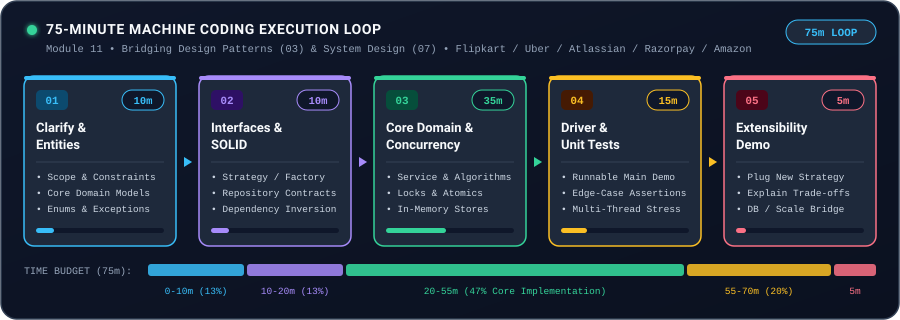
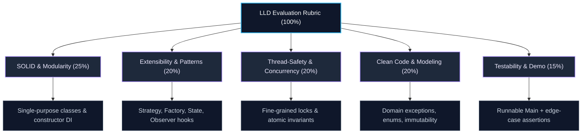
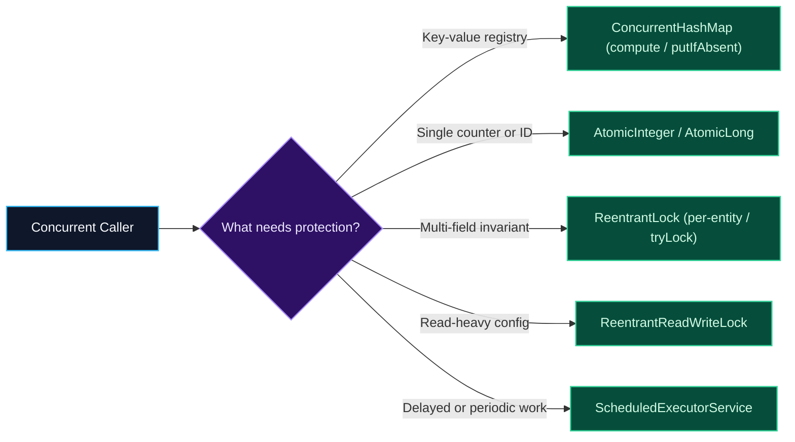
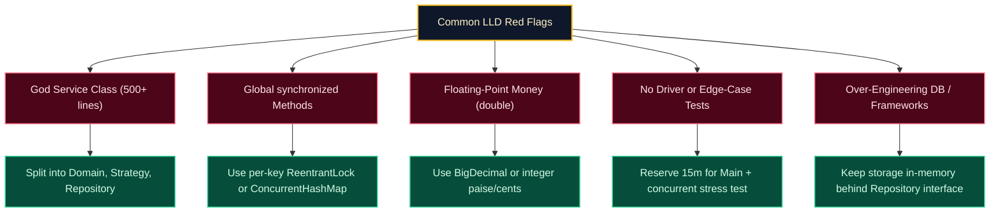

# Module 11: Machine Coding & Low-Level Design (LLD)

> [!NOTE]
> **Module 11 Overview:** This module bridges **Module 03 (Design Patterns)** and **Module 07 (System Design Fundamentals)** for **60–90 minute Machine Coding and Low-Level Design (LLD) rounds** at companies like **Flipkart, Uber, Atlassian, Razorpay, and Amazon**. Every problem in this module is built to compile and run in-memory with clean SOLID boundaries, thread-safe concurrency primitives, and runnable driver tests.

---

## 75-Minute Machine Coding Playbook

In a timed Machine Coding round, interviewers do not expect a distributed database or Spring Boot boilerplate—they expect **working, extensible, thread-safe Java code** with a clear `main()` driver demonstrating both happy paths and edge cases.

| Time Window | Phase | Primary Deliverables | Exit Criteria |
|---|---|---|---|
| **00–10 min** | **01 Clarify & Entities** | Confirm functional scope, concurrency expectations, in-memory storage, and edge cases; define core models, enums, and custom exceptions | Agreed entity list and explicit out-of-scope boundaries |
| **10–20 min** | **02 Interfaces & SOLID** | Define service contracts, Strategy/Factory interfaces, and in-memory Repository abstractions | Compilable package skeleton with zero business logic yet |
| **20–55 min** | **03 Core Domain & Concurrency** | Implement core algorithms, state transitions, validation, and thread-safe locking/atomics | Feature-complete core services passing manual trace |
| **55–70 min** | **04 Driver & Unit Tests** | Write `Main` simulation + deterministic assertions for edge cases and multi-threaded contention | Green execution with clean console output |
| **70–75 min** | **05 Extensibility Demo** | Add a new strategy/rule live (e.g., new pricing rule or eviction policy) and walk through DB/scale migration | Zero modifications to existing core service classes (OCP) |

> [!IMPORTANT]
> **Hard Rule at Minute 55:** Stop adding bonus features by minute 55. An incomplete codebase with 8 half-finished classes fails the round, whereas a **runnable, well-tested core** with 1–2 clean extension points passes consistently.

---

## Core LLD Evaluation Rubric

Interviewers score Machine Coding submissions across five weighted dimensions. Designing for these upfront prevents last-minute rewrites.

| Dimension | What Interviewers Look For | Concrete Implementation Signal |
|---|---|---|
| **SOLID** | Single Responsibility, Open/Closed, Dependency Inversion | Services depend on interfaces (`PaymentStrategy`, `SlotRepository`), injected via constructor |
| **Extensibility** | Adding a new requirement without touching existing core logic | New discount, split type, or rate-limit algorithm plugs in as a new class implementing an existing interface |
| **Thread-Safety** | Race-free state mutations under concurrent requests | Per-entity `ReentrantLock`, `ConcurrentHashMap.compute()`, or `AtomicInteger` instead of coarse global `synchronized` |
| **Clean Code** | Readable naming, guard clauses, domain-specific exceptions | Custom `InsufficientBalanceException` or `ParkingFullException` instead of returning `null` or magic `-1` |
| **Testability** | Deterministic behavior and clear verification | Clock/ID-generator injection + `Main` driver covering happy paths, invalid inputs, and concurrent threads |

> [!TIP]
> **Always Inject `Clock` or `TimeProvider`:** For time-sensitive LLD problems (Rate Limiter, Parking Lot billing, Task Scheduler, LRU TTL), inject a `Supplier&lt;Long&gt;` or `java.time.Clock`. It lets your driver simulate hours or burst windows in milliseconds without `Thread.sleep()`.

---

## Concurrency & Thread-Safety Toolkit in Java

Machine Coding rounds at Uber, Flipkart, and Razorpay routinely test whether your in-memory stores survive concurrent callers without deadlocks or lost updates.

| Java Primitive | Primary Use Case in LLD | Key Advantage | Common Pitfall to Avoid |
|---|---|---|---|
| **`ConcurrentHashMap`** | Thread-safe in-memory repositories (`Map&lt;String, Entity&gt;`) | Bucket-level locking & atomic `compute()` / `computeIfAbsent()` | Compound `get()` then `put()` outside `compute()` creates check-then-act races |
| **`ReentrantLock`** | Multi-step state transitions (booking a spot, settling balances) | Supports `tryLock(timeout)`, fairness, and per-entity lock striping | Forgetting `lock.unlock()` in a `finally` block |
| **`AtomicInteger`** | Sequence IDs, slot counters, token counts, active task gauges | Lock-free CAS (`incrementAndGet`, `compareAndSet`) | Using multiple atomics together when an invariant spans both |
| **`ReadWriteLock`** | Read-heavy lookups with infrequent rule/config updates | Concurrent readers do not block each other | Upgrading a read lock to a write lock (causes deadlock) |
| **`ScheduledExecutorService`** | Task schedulers, TTL cleanup, token bucket refills | Bounded worker pool + `scheduleAtFixedRate` / `schedule` | Uncaught exceptions inside `Runnable` silently kill periodic tasks |

---

## Module 11 Problem Roadmap

Work through these four problems in order—each escalates in state complexity, algorithmic invariants, and concurrency rigor.

| File | Core Problem | Key Patterns & Primitives | Target Companies |
|---|---|---|---|
| **[01-Parking-Lot-System.md](./01-Parking-Lot-System.md)** | Multi-floor parking allocation, ticketing & dynamic pricing | Strategy, Factory, `ReentrantLock` per spot/floor, `AtomicLong` ticket IDs | Amazon, Flipkart, Gojek |
| **[02-Splitwise-Expense-Sharing.md](./02-Splitwise-Expense-Sharing.md)** | Equal/Exact/Percent splits, net balance graph & debt simplification | Strategy, Template/Validator, greedy min-cash-flow simplification, `BigDecimal` | Flipkart, Razorpay, Cred |
| **[03-Rate-Limiter-and-LRU-Cache.md](./03-Rate-Limiter-and-LRU-Cache.md)** | Token Bucket, Sliding Window Log/Counter, O(1) Thread-Safe LRU Cache | Strategy, Doubly-Linked List + `ConcurrentHashMap`, `ReentrantLock`, injected `Clock` | Atlassian, Uber, Razorpay |
| **[04-Elevator-and-Task-Scheduler.md](./04-Elevator-and-Task-Scheduler.md)** | Multi-elevator SCAN/LOOK dispatch & cron/delayed task scheduler | State, Command, `PriorityBlockingQueue`, `ScheduledExecutorService`, `Condition` | Uber, Atlassian, Amazon |

---

## Common Machine Coding Pitfalls & Red Flags

Avoid these high-frequency mistakes that immediately lower interviewer confidence during code walkthroughs.

| Red Flag | Why It Hurts Your Score | Recommended Fix |
|---|---|---|
| **God Service Class** | Violates SRP; impossible to extend without breaking existing flows | Separate entities, validation, pricing/allocation strategies, and repositories |
| **Coarse `synchronized` Everywhere** | Serializes unrelated operations (e.g., Floor 1 blocks Floor 3) | Lock at the narrowest entity/resource boundary (`ReentrantLock` per key or `ConcurrentHashMap.compute()`) |
| **Using `double` for Currency** | Precision drift (`0.1 + 0.2 != 0.3`) breaks Splitwise & billing totals | Use `BigDecimal` with explicit `RoundingMode.HALF_UP` or minor units (`long` cents/paise) |
| **Skipping the Driver / Tests** | Unverified code often hides `NullPointerException` or off-by-one bugs | Budget 15 minutes to run happy paths, invalid inputs, and multi-threaded contention |
| **Premature Infrastructure** | Spending 20 minutes wiring Spring Boot / SQL leaves core logic unfinished | Use clean in-memory repositories; mention how they swap to JPA/Redis in the final 5 minutes |

> [!WARNING]
> **Deadlock Trap:** Whenever a method acquires two locks (such as transferring balances between two users in Splitwise), always acquire locks in a **deterministic global order** (e.g., sorted by `userId`) to eliminate circular-wait deadlocks.
