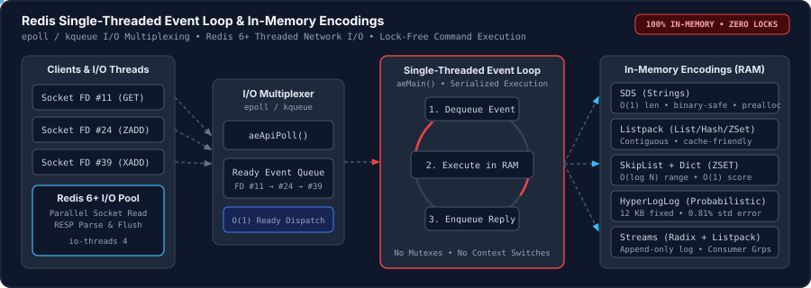
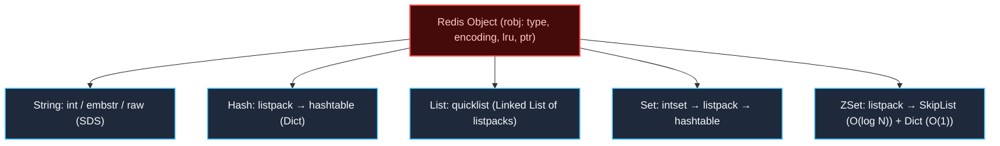
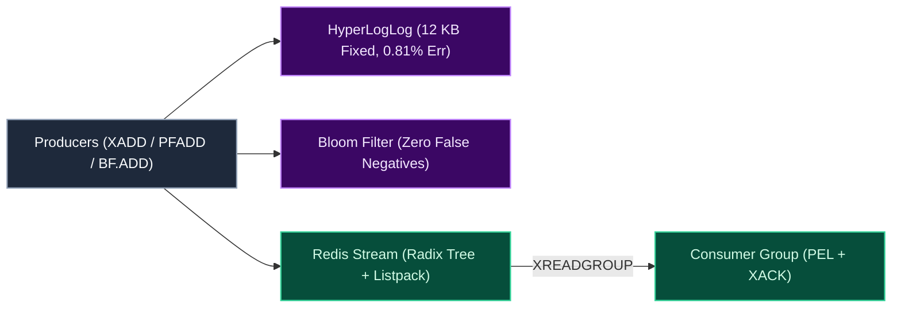
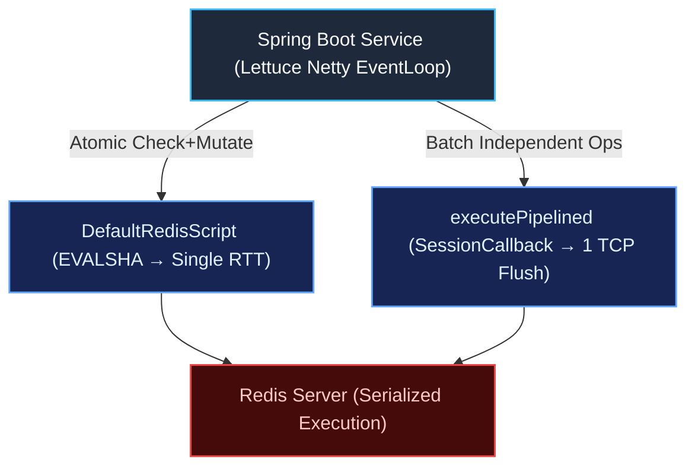
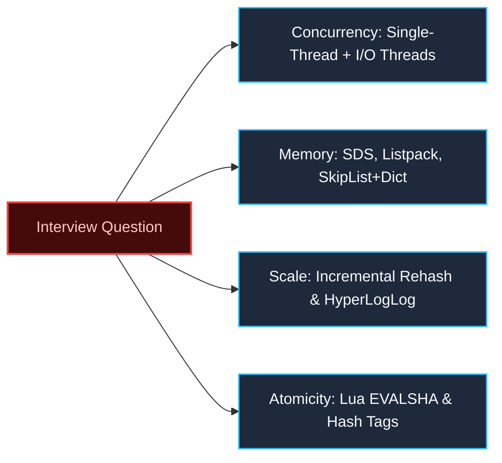

# Redis Internals & Data Structures



> **Executive Summary:** Redis achieves sub-millisecond latency and 100k+ ops/sec per core not despite being single-threaded for command execution, but *because* of it: in-memory RAM access, kernel I/O multiplexing (`epoll`/`kqueue`), zero mutex/lock contention, cache-friendly compact encodings (`SDS`, `Listpack`, `SkipList`), and Redis 6+ threaded network I/O.

---

## 1. Why Single-Threaded Redis Is So Fast

Redis's primary bottleneck is **memory bandwidth and network I/O**, not CPU. Adding threads to command execution would introduce mutexes, spinlocks, cache-line bouncing, and OS context switches that degrade throughput for nanosecond-scale RAM operations.

### Key Architectural Pillars

| Pillar | Mechanism | Why It Matters |
| :--- | :--- | :--- |
| **Pure In-Memory RAM** | All primary data lives in RAM (~100 ns access vs ~100 µs NVMe SSD) | Eliminates disk seek/page-fault latency on the hot path |
| **I/O Multiplexing** | `aeApiPoll()` wraps `epoll` (Linux), `kqueue` (macOS/BSD), `evport` (Solaris) | Single thread monitors 10,000+ concurrent sockets in `O(1)` ready-FD time |
| **Zero Lock Contention** | Single `aeMain` event loop executes commands serially | No mutexes on `Dict`, `SkipList`, or `Listpack`; no thread context switches |
| **Redis 6+ Threaded I/O** | `io-threads N` offloads socket `read()`, RESP parsing, and `write()` | Command *execution* stays single-threaded while network I/O scales across cores |
| **Pipelining** | Client batches `N` commands in one TCP write without waiting for each RTT | Cuts `N` network round-trips down to 1 RTT (10x–50x throughput boost) |


> [!IMPORTANT]
> **The Single-Thread Rule:** Because one thread executes all commands sequentially, **never run `O(N)` blocking commands** like `KEYS *`, `FLUSHALL` (without `ASYNC`), or huge `LRANGE 0 -1` in production. One 200 ms command stalls *every* connected client for 200 ms. Use `SCAN`, `UNLINK`, and `SSCAN`/`HSCAN`/`ZSCAN` instead.

---

## 2. Core Data Structures & Internal Encodings

Redis decouples the **logical data type** (`String`, `List`, `Hash`, `Set`, `ZSet`) from its **physical internal encoding** (`OBJECT ENCODING key`), automatically upgrading encodings as keys grow.

### Internal Encoding Matrix

| Logical Type | Internal Encoding(s) | Threshold / When Used | Time Complexity |
| :--- | :--- | :--- | :--- |
| **String** | `int`, `embstr`, `raw` (`SDS`) | `int` for 64-bit signed ints; `embstr` ≤ 44 bytes (single `malloc`); `raw` &gt; 44 bytes | `GET`/`SET` `O(1)` |
| **Dict (Keyspace / Hash)** | `listpack` → `hashtable` | `listpack` when entries ≤ `hash-max-listpack-entries` (512) &amp; value ≤ 64B | `O(1)` avg lookup; incremental rehash |
| **List** | `listpack` → `quicklist` | `quicklist` = doubly-linked list of `listpack` nodes (balances memory &amp; `O(1)` ends) | `LPUSH`/`RPOP` `O(1)` |
| **Set** | `intset` → `listpack` → `hashtable` | `intset` for sorted 64-bit ints (≤ 512); `hashtable` for large/non-int sets | `SADD`/`SISMEMBER` `O(1)` (`O(log N)` intset) |
| **Sorted Set (ZSet)** | `listpack` → `skiplist` + `dict` | `skiplist` + `dict` when entries &gt; 128 or member &gt; 64B | `ZADD`/`ZRANGE` `O(log N)`; `ZSCORE` `O(1)` |

### Deep Dive into Key Internals

1. **SDS (Simple Dynamic String):** Unlike C null-terminated strings (`\0`), SDS stores `len`, `alloc`, `flags`, and `buf[]`. Benefits: `O(1)` `STRLEN`, binary-safe (can hold `\0` bytes, Protobuf, JPEG), and geometric capacity pre-allocation to avoid frequent `realloc()`.
2. **Dict Incremental Rehashing:** A Redis `dict` holds **two** hash tables (`ht[0]` and `ht[1]`). When load factor ≥ 1 (or ≥ 5 during `BGSAVE`/`BGREWRITEAOF`), Redis allocates `ht[1]` (2× size) and migrates **1 bucket per command** plus background cron ticks—never freezing the event loop for a full-table rehash.
3. **Listpack (Replaced Ziplist in Redis 7):** Contiguous byte-array encoding where each entry stores its own length *before* and *after* the payload, eliminating Ziplist's **cascade update** (`O(N²)`) bug when an entry grows past 254 bytes.
4. **SkipList + Dict (ZSet):** A probabilistic multi-level linked list (`p = 0.25`, max 32 levels) paired with a hash table (`dict`). The `dict` gives `O(1)` `ZSCORE(member)`, while the `skiplist` gives `O(log N)` range queries (`ZRANGEBYSCORE`, `ZRANK`) without red-black tree rotation complexity.
5. **Intset:** A sorted, contiguous array of `int16_t`, `int32_t`, or `int64_t`. Upgrades width automatically only when a larger integer is inserted, using binary search (`O(log N)`) while saving massive pointer overhead.



> [!TIP]
> **Memory Optimization Trick:** Packing small objects into Hashes (`user:1000` with fields instead of 10 separate `user:1000:name` String keys) keeps them in `listpack` encoding, cutting memory usage by **3x–5x** by avoiding per-key `robj` + `dictEntry` pointer overhead (~96 bytes per top-level key).

---

## 3. Probabilistic & Streaming Structures

Beyond the core 5 types, Redis provides specialized structures for massive-scale cardinality, membership testing, and event streaming.

### Probabilistic Structures

- **HyperLogLog (`PFADD`, `PFCOUNT`, `PFMERGE`):** Estimates unique cardinality up to $2^{64}$ using a **fixed 12 KB** (`16,384` 6-bit registers) with a **0.81% standard error**. Ideal for daily unique visitors (DAU) where a `Set` of 100M user IDs would consume gigabytes.
- **Bitmap (`SETBIT`, `GETBIT`, `BITCOUNT`, `BITOP`):** String-backed bit array (max 512 MB = $2^{32}$ bits). Great for dense boolean flags (e.g., 10M users' daily active bitmask takes only ~1.25 MB).
- **Bloom Filter (Redis Stack `BF.ADD`, `BF.EXISTS`):** Space-efficient probabilistic set membership with **zero false negatives** and tunable false-positive rate (e.g., 1% or 0.1%). Protects databases from **cache penetration** (queries for non-existent IDs).

### Redis Streams vs. Apache Kafka

| Dimension | Redis Streams (`XADD` / `XREADGROUP`) | Apache Kafka |
| :--- | :--- | :--- |
| **Storage Medium** | In-memory (Radix Tree + Listpack) + optional AOF/RDB | Disk-first (sequential append-only log + OS page cache) |
| **Latency** | Sub-millisecond (~0.1–0.5 ms) | Low millisecond (~2–10 ms) |
| **Retention &amp; Replay** | Bounded by RAM (`MAXLEN ~` trimming) | Days/months/infinite (tiered storage, cheap NVMe) |
| **Consumer Groups** | Built-in (`XGROUP`, `XACK`, Pending Entries List `PEL`) | Built-in (partitions, consumer rebalance, committed offsets) |
| **Best Fit** | Real-time notifications, ephemeral job queues, IoT fan-out | Durable event backbone, CDC, multi-TB audit/replay logs |



---

## 4. Lua Scripting & Atomic Transactions

Redis offers two concurrency mechanisms: **Transactions (`MULTI`/`EXEC` + `WATCH`)** and **Lua Scripting (`EVAL` / `EVALSHA`)**.

### Comparison: `MULTI/EXEC` + `WATCH` vs. `EVAL` (Lua)

| Feature | `MULTI` / `EXEC` + `WATCH` | `EVAL` / `EVALSHA` (Lua) |
| :--- | :--- | :--- |
| **Concurrency Model** | **Optimistic Locking** (CAS): `EXEC` aborts (`nil`) if watched key changed | **Serialized Atomicity**: Entire script executes as one uninterruptible step |
| **Conditional Logic** | Cannot branch on intermediate `GET` results inside `MULTI` | Full `if/else`, loops, and `redis.call()` branching inside Redis |
| **Network Round-Trips** | Multiple RTTs (`WATCH` → `GET` → `MULTI` → `SET` → `EXEC`) | **1 RTT** (or cached via `EVALSHA` SHA1 digest) |
| **Rollback on Error** | No rollback! Runtime type errors only fail that command; others commit | No rollback either; syntax errors reject script, runtime errors halt at failure |

```mermaid
sequenceDiagram
    participant C1 as Client A
    participant R as Redis Event Loop
    participant C2 as Client B

    Note over C1,R: Optimistic Locking (WATCH + MULTI/EXEC)
    C1->>R: WATCH stock:item1
    C1->>R: GET stock:item1 (returns 1)
    C2->>R: DECR stock:item1 (stock becomes 0)
    C1->>R: MULTI + DECR stock:item1 + EXEC
    R-->>C1: nil (Aborted due to WATCH conflict)

    Note over C1,R: Atomic Lua Script (EVALSHA)
    C1->>R: EVALSHA sha1 1 stock:item1
    R->>R: Atomic GET + check &gt; 0 + DECR
    R-->>C1: 1 (Success, zero interleaving)
```

> [!WARNING]
> **Lua Execution Rules & Cluster Compatibility:**
> 1. Long-running Lua scripts **block the entire Redis event loop** (default `lua-time-limit` 5000 ms). Keep scripts `O(1)` or small `O(K)`.
> 2. In **Redis Cluster**, all keys touched by a Lua script or `MULTI/EXEC` **must map to the same hash slot** (use `{hash_tag}`, e.g., `order:{user123}:cart` and `order:{user123}:stock`), otherwise Redis rejects with `CROSSSLOT Keys in request don't hash to the same slot`.

---

## 5. Production Spring Data Redis Examples

In production Java/Spring Boot services (using Lettuce), use **`SessionCallback` pipelining** for batching independent reads/writes and **`DefaultRedisScript` (`EVALSHA`)** for atomic check-and-mutate operations (rate limiters, inventory decrement, distributed lock release).

### 1. Atomic Inventory Decrement via `DefaultRedisScript`

```java
import org.springframework.data.redis.core.StringRedisTemplate;
import org.springframework.data.redis.core.script.DefaultRedisScript;
import org.springframework.stereotype.Service;

import java.util.Collections;

@Service
public class InventoryCacheService {

    private static final DefaultRedisScript<Long> DECREMENT_IF_AVAILABLE = new DefaultRedisScript<>(
        """
        local current = tonumber(redis.call('GET', KEYS[1]) or '0')
        local qty = tonumber(ARGV[1])
        if current >= qty then
            return redis.call('DECRBY', KEYS[1], qty)
        end
        return -1
        """,
        Long.class
    );

    private final StringRedisTemplate redisTemplate;

    public InventoryCacheService(StringRedisTemplate redisTemplate) {
        this.redisTemplate = redisTemplate;
    }

    public boolean reserveStock(String sku, int quantity) {
        String key = "stock:{" + sku + "}";
        // Spring Data Redis automatically uses EVALSHA and falls back to EVAL on NOSCRIPT
        Long remaining = redisTemplate.execute(
            DECREMENT_IF_AVAILABLE,
            Collections.singletonList(key),
            String.valueOf(quantity)
        );
        return remaining != null && remaining >= 0;
    }
}
```

### 2. High-Throughput Pipelining via `executePipelined`

```java
import org.springframework.dao.DataAccessException;
import org.springframework.data.redis.core.RedisOperations;
import org.springframework.data.redis.core.SessionCallback;
import org.springframework.data.redis.core.StringRedisTemplate;

import java.time.Duration;
import java.util.List;
import java.util.Map;

public class SessionPipelineService {

    private final StringRedisTemplate redisTemplate;

    public SessionPipelineService(StringRedisTemplate redisTemplate) {
        this.redisTemplate = redisTemplate;
    }

    public List<Object> batchUpdateScores(Map<String, Double> userScores) {
        return redisTemplate.executePipelined(new SessionCallback<Object>() {
            @Override
            @SuppressWarnings("unchecked")
            public Object execute(RedisOperations operations) throws DataAccessException {
                RedisOperations<String, String> ops = (RedisOperations<String, String>) operations;
                for (Map.Entry<String, Double> entry : userScores.entrySet()) {
                    ops.opsForZSet().add("leaderboard:global", entry.getKey(), entry.getValue());
                }
                ops.expire("leaderboard:global", Duration.ofHours(24));
                return null; // Must return null; results are collected in the returned List
            }
        });
    }
}
```



---

## 6. Interview Q&A

### Q1: If Redis is single-threaded, how did Redis 6+ improve throughput with multiple threads?
**Answer:** Redis 6+ introduced **Threaded I/O** (`io-threads`), which uses worker threads solely for **reading bytes from sockets, parsing RESP commands, and flushing reply buffers** back to sockets. Command *execution* itself remains strictly single-threaded in `aeMain`, preserving lock-free atomicity with zero mutex overhead.

### Q2: Why does a Redis Sorted Set (`ZSet`) use both a SkipList and a Hash Table (`Dict`)?
**Answer:** A `SkipList` alone gives `O(log N)` range queries (`ZRANGE`, `ZRANK`) but would also take `O(log N)` to look up a member's score. Pairing it with a `Dict` (`member → score`) gives `O(1)` `ZSCORE` lookups while both structures share pointers to the same underlying `sds` member objects to avoid duplicating string memory.

### Q3: How does Redis resize a large Hash Table (`Dict`) without freezing the event loop?
**Answer:** Redis uses **incremental (progressive) rehashing**. Every `dict` has `ht[0]` and `ht[1]`. When resizing triggers, Redis allocates `ht[1]` and migrates **one bucket per client command** (plus background `serverCron` ticks). Reads check `ht[0]` then `ht[1]`; new writes always go to `ht[1]` until `ht[0]` is empty.

### Q4: Why did Redis replace `Ziplist` with `Listpack` in Redis 7?
**Answer:** In a `Ziplist`, each entry stored the byte length of the *previous* entry. Updating one entry's size from `&lt; 254` bytes to `&gt;= 254` bytes could trigger a **cascade update** (`O(N²)`) across subsequent entries. `Listpack` stores each entry's own length *after* its payload (self-contained backward traversal), eliminating cascade updates completely.

### Q5: Does Redis `MULTI`/`EXEC` support rollback like a SQL database?
**Answer:** **No.** Redis validates syntax at queue time, but if a command fails at runtime inside `EXEC` (e.g., `INCR` on a string key), Redis logs the error for that single command and **still executes all other commands** in the transaction. Redis skips rollback logic to keep the engine simple and fast.

### Q6: When would you choose `HyperLogLog` over a `Set`, and what are the trade-offs?
**Answer:** Use `HyperLogLog` when you only need **approximate unique counts** (e.g., daily active users, unique IPs) at massive scale. It uses a **constant 12 KB** regardless of whether you insert 100 or 1 billion items, with a **0.81% standard error**. You cannot retrieve individual members or check membership (`SISMEMBER`)—for that, use a `Set` or `Bloom Filter`.



> [!NOTE]
> **Quick Revision Checklist:** Know `OBJECT ENCODING`, why `Listpack` replaced `Ziplist`, `O(1)` vs `O(log N)` in `ZSet`, incremental rehashing (`ht[0]`/`ht[1]`), `12 KB / 0.81%` for HyperLogLog, and `{hash_tag}` for multi-key Lua scripts in Redis Cluster.
