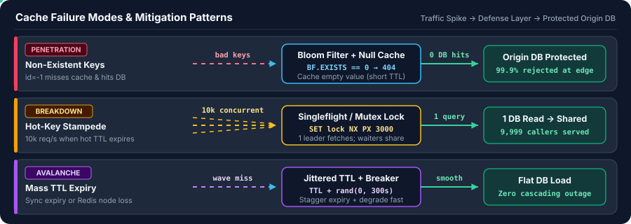
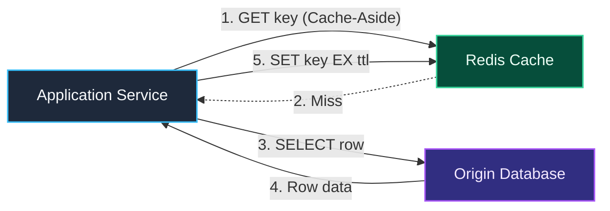
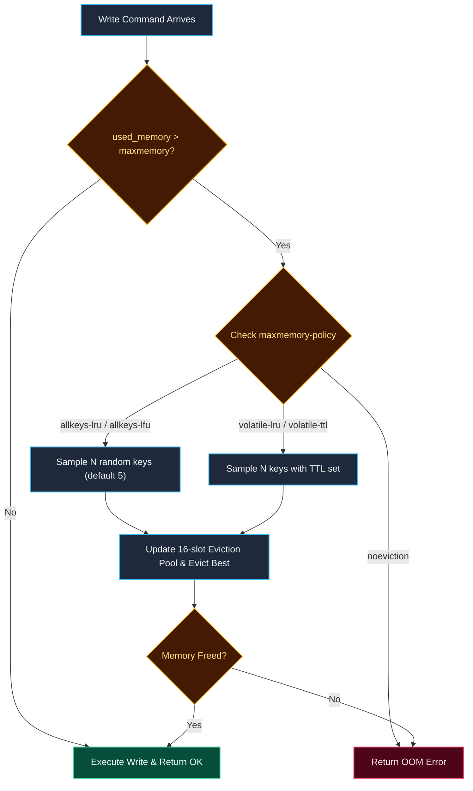
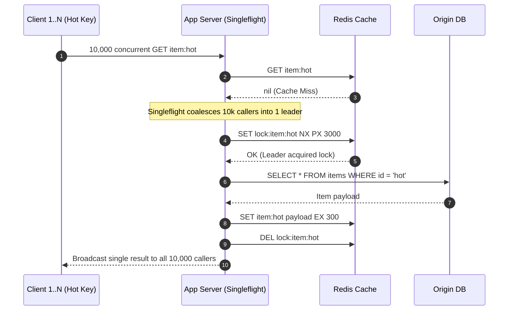
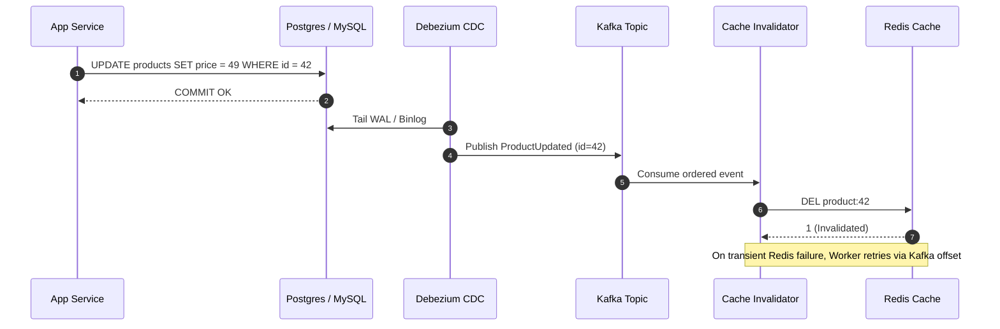
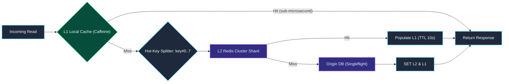
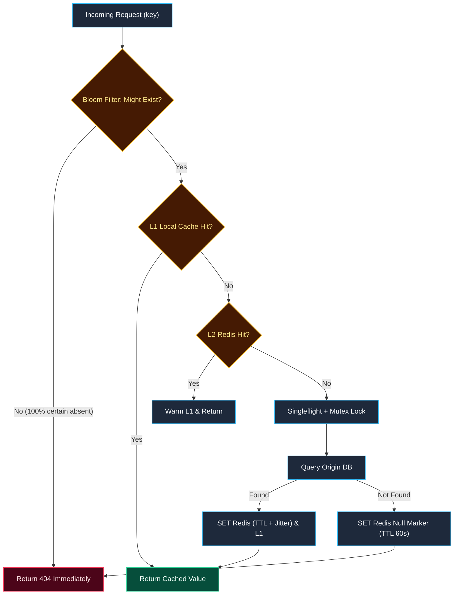

# Caching Patterns & Failure Modes

Distributed caches sit between latency-sensitive application servers and throughput-bound origin databases. While adding Redis cuts p99 read latency from tens of milliseconds to sub-millisecond, improper write ordering, synchronized expirations, or hot-key skew can turn the cache from a shield into an outage amplifier.

---

## 1. Caching Strategies Compared

Choosing a caching topology determines who owns cache population, how writes propagate to the origin database, and what happens during a cache miss.

| Strategy | Read Path | Write Path | Consistency | Best Fit |
| :--- | :--- | :--- | :--- | :--- |
| **Cache-Aside (Lazy Loading)** | App checks cache; on miss, reads DB and populates cache | App writes DB, then deletes (invalidates) cache key | Eventual; brief stale window on concurrent races | General-purpose read-heavy workloads (90%+ of systems) |
| **Read-Through** | App calls cache provider; cache loads from DB on miss | Often paired with Write-Through | Eventual unless paired with Write-Through | Clean separation of storage logic (e.g., Guava/Caffeine, DAX) |
| **Write-Through** | Read from cache (always warm for written keys) | App writes cache; cache synchronously writes DB before returning | Strong (read-your-writes for cached items) | Financial/config metadata where stale reads are unacceptable |
| **Write-Behind (Write-Back)** | Read from cache (holds latest dirty state) | App writes cache (ACK immediately); cache flushes to DB asynchronously in batches | Risk of data loss if cache node crashes before flush | High-throughput counters, telemetry, likes, gaming leaderboards |

> [!TIP]
> In **Cache-Aside**, prefer **deleting** the cache key on writes rather than updating it (`SET`). Updating the cache on concurrent writes introduces a race where an older write overwrites a newer write in Redis while the DB has the newer value. Deletion is idempotent and forces the next read to fetch fresh state.

---

## 2. Eviction Policies & Memory Management

When Redis reaches `maxmemory`, it must decide whether to reject writes or evict existing keys according to `maxmemory-policy`. Choosing the wrong policy either crashes writes (`noeviction`) or thrashes your working set.

### Core Redis Eviction Policies

- **`noeviction` (default)**: Returns `OOM command not allowed when used memory > 'maxmemory'` on writes (`SET`, `LPUSH`), while reads and `DEL` continue working. Use only when Redis acts as a persistent store/queue where silent data loss is worse than write errors.
- **`allkeys-lru`**: Evicts the least recently used keys across the entire keyspace (both keys with and without TTL). Best default for pure caches with Zipfian/recency-skewed traffic.
- **`volatile-lru`**: Evicts LRU keys **only** among keys that have an `EXPIRE` set. Useful when mixing permanent session/config keys with expendable cached objects in the same instance.
- **`allkeys-lfu`** *(Redis 4.0+)*: Evicts keys with the lowest access frequency using a Morris counter (logarithmic probabilistic counter + time decay). Superior to LRU when occasional batch scans would otherwise pollute an LRU cache.
- **`volatile-ttl`**: Evicts keys with the shortest remaining TTL (`TTL` closest to 0) among keys with an expiration set.

### Approximate LRU / LFU Sampling

Redis does **not** maintain a global doubly-linked list across millions of keys (which would consume extra pointers per key and lock/mutate on every read). Instead, it uses **approximated LRU/LFU**:
1. Each `robj` stores a 24-bit `lru` timestamp (for LRU) or a 16-bit last-decrement-time + 8-bit logarithmic counter (for LFU).
2. When `maxmemory` is exceeded, Redis samples `maxmemory-samples` (default `5`) random keys from the dict and evicts the best candidate from that sample (maintaining a small eviction pool of 16 candidates across cycles).
3. Setting `maxmemory-samples 10` closely approximates true LRU at a modest CPU cost.

---

## 3. Cache Failure Modes: Penetration, Breakdown & Avalanche

In production, cache outages rarely happen because Redis is slow—they happen because a traffic pattern bypasses Redis and overwhelms the origin database.

| Failure Mode | Root Cause | Blast Radius | Primary Mitigations |
| :--- | :--- | :--- | :--- |
| **Cache Penetration** | Requests for keys that do **not** exist in cache or DB (e.g., `user_id=-1`, scraped/malicious IDs) | Every request hits the DB directly; DB CPU spikes to 100% | **Bloom Filter** at gateway/app (`BF.EXISTS`) + **Null Object Caching** (`SET key "__NULL__" EX 60`) |
| **Cache Breakdown (Hot-Key Stampede)** | A single ultra-hot key (e.g., flash-sale item) expires or is evicted under 10k+ req/s | Thousands of concurrent threads miss simultaneously and execute the exact same expensive DB query | **Singleflight** (in-process request coalescing) + **Distributed Mutex Lock** (`SET lock NX PX 3000`) + **Logical Expiration** (background refresh) |
| **Cache Avalanche** | Massive batch of keys expire at the exact same second (e.g., midnight cron warm-up with fixed TTL), or a Redis shard crashes | Entire cache hit ratio drops to 0% simultaneously; cascading DB &amp; upstream collapse | **Jittered TTL** (`base_ttl + rand(0, 300)`) + **Redis Cluster HA** (replicas/Sentinel) + **Circuit Breaker &amp; Local L1 Fallback** |

> [!WARNING]
> When using a **Bloom Filter** for Cache Penetration, remember that standard Bloom Filters **do not support deletions**. If a previously non-existent key is created, you must add it to the Bloom Filter (`BF.ADD`). If items are frequently deleted, use a **Counting Bloom Filter** or **Cuckoo Filter**, or rely on short-TTL null caching (`30s–60s`) for deleted entities.

---

## 4. Cache-DB Consistency & Dual-Write Races

Because Redis and an RDBMS (PostgreSQL/MySQL) cannot participate in a single lightweight ACID transaction, concurrent reads and writes can leave stale data in Redis.

### Comparing Consistency Patterns

1. **Update DB, then Delete Cache (Standard Cache-Aside)**
   - *Why not Delete Cache first?* If Thread A deletes the cache, then Thread B reads (cache miss → reads old DB value), then Thread A commits the new DB value, Thread B writes the **stale** value back into Redis where it stays until TTL expires.
   - *Why Update DB first is much safer:* The race only happens if a cache miss occurs *before* the DB write commits, AND the reader is so slow that it writes to Redis *after* the writer finishes both the DB commit and Redis `DEL`. In practice, DB writes are slower than cache writes, making this window tiny.
2. **Delayed Double-Delete**
   - Delete cache → Update DB → `sleep(200ms–500ms)` → Delete cache again.
   - The second asynchronous delete cleans up any stale value written by an in-flight slow reader during the DB write window. Use an async worker/queue rather than blocking the request thread.
3. **CDC (Change Data Capture) / Debezium + Outbox**
   - The application **only** writes to the DB. Debezium tails the DB WAL/binlog, publishes change events to Kafka, and a dedicated cache-updater consumer invalidates or updates Redis with retries and ordering guarantees per primary key.

> [!IMPORTANT]
> Never hold a distributed database transaction open while waiting on a network call to Redis (`SET` or `DEL`). If Redis stalls or times out, it will exhaust your DB connection pool. Keep DB commits decoupled from cache invalidation via post-commit hooks, async queues, or CDC.

---

## 5. Hot-Key & Big-Key Production Playbook

### Solving Hot Keys (Single-Shard CPU Saturation)

Even in a 64-shard Redis Cluster, a single key (`celebrity_post:123`) hashes to **one** shard. At 200k+ req/s, that single shard's single-threaded event loop hits 100% CPU while the other 63 shards sit idle.

- **Two-Tier Caching (L1 Local + L2 Redis)**: Store hot keys in an in-process LRU cache (e.g., Caffeine in Java, `ristretto` in Go) with a short TTL (e.g., `5s–15s`). Most reads never leave the app server's RAM. Use Redis Pub/Sub to broadcast invalidations to L1 caches when urgent updates occur.
- **Hot-Key Splitting (Sharded Copies)**: Replicate the hot key across $N$ logical keys (`hot_key#0` .. `hot_key#7`) so CRC16 slot hashing distributes them across multiple Redis Cluster shards. Readers append a random suffix `rand(0, N-1)`.

### Solving Big Keys (Event-Loop Blocking & Network Saturation)

A **Big Key** is either a large string (`> 1 MB`) or a collection (`HASH`, `LIST`, `ZSET`, `SET`) with tens of thousands of elements.
- **Why it hurts**: Redis executes commands on a single main thread. Running `HGETALL` or `DEL` on a 500k-element hash blocks the entire Redis instance for tens or hundreds of milliseconds, spiking p99 latency for all other clients.
- **Mitigations**:
  1. **Always use `UNLINK` instead of `DEL`** (and `lazyfree-lazy-eviction yes` in `redis.conf`): `UNLINK` unlinks the key from the keyspace dictionary in $O(1)$ and frees memory asynchronously on a background BIO thread.
  2. **Compress & Chunk**: Compress large JSON blobs with Zstd/LZ4 before storing, or split large hashes into fixed-size buckets (`user:prefs:{bucket}`).
  3. **Use `HSCAN` / `SSCAN` / `ZSCAN`** instead of `HGETALL` / `SMEMBERS` / `ZRANGE 0 -1` on unbounded collections.

---

## 6. Interview Q&A

1. **Q: Why does Cache-Aside recommend "Update DB then Delete Cache" instead of "Update DB then Update Cache"?**
   - **A:** Concurrent writers can interleave out of order: Writer A updates DB to `v1`, Writer B updates DB to `v2`, then Writer B updates Redis to `v2`, and finally a delayed Writer A overwrites Redis with `v1`. Deleting the key is idempotent and ensures the next miss loads `v2` from the DB.

2. **Q: How do you handle a cache stampede when a celebrity profile's TTL expires at 100k QPS?**
   - **A:** Combine **in-process Singleflight** (collapses concurrent misses on the same app node into 1 request) with a **distributed mutex** (`SET lock NX PX`) or **logical expiration** (store `expire_at` inside the JSON payload; when expired, return the stale payload immediately while 1 background goroutine/thread refreshes Redis asynchronously).

3. **Q: Your Redis Cluster has 10 shards at 15% CPU, except Shard 4 is at 99% CPU. How do you diagnose and fix it?**
   - **A:** That is classic **hot-key skew** (or a single **big key** causing O(N) blocking). Run `redis-cli --hotkeys` (requires `allkeys-lfu` or `volatile-lfu`) or `MONITOR` briefly on Shard 4 to identify the key. Fix via **L1 local caching** (Caffeine) or **key splitting** (`key#0..N`).

4. **Q: Why can `DEL` on a 50 MB Hash cause a Redis failover?**
   - **A:** `DEL` frees memory synchronously on Redis's single main thread. If freeing millions of dict entries takes longer than `cluster-node-timeout` (or Sentinel's `down-after-milliseconds`), peers mark the node as `PFAIL`/`FAIL` and trigger an unnecessary failover. Use `UNLINK` and enable `lazyfree-lazy-*` options.

5. **Q: When should you choose `allkeys-lfu` over `allkeys-lru`?**
   - **A:** Choose `allkeys-lfu` when your workload has **scan-heavy or bursty one-off reads** (e.g., nightly analytics or crawlers) alongside a stable hot working set. LRU would evict hot items when a crawler scans cold items once, whereas LFU's frequency counter protects genuinely popular keys.

6. **Q: How do you prevent Cache Penetration without storing every possible invalid ID in Redis?**
   - **A:** Place a **Bloom Filter** (e.g., RedisBloom `BF.EXISTS` or an in-memory Guava Bloom Filter synced periodically) in front of the cache lookup. It uses ~10 bits per key for a 1% false-positive rate, rejecting 99% of non-existent IDs in $O(k)$ memory lookups without touching the DB.

> [!NOTE]
> In system design interviews, always state **which failure mode** you are solving when proposing a cache optimization: Bloom Filters solve **Penetration**, Singleflight/Mutex solves **Breakdown**, and Jittered TTL + Circuit Breakers solve **Avalanche**.
