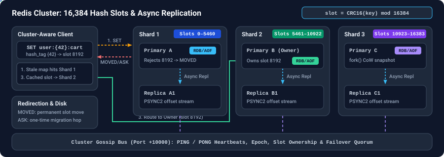
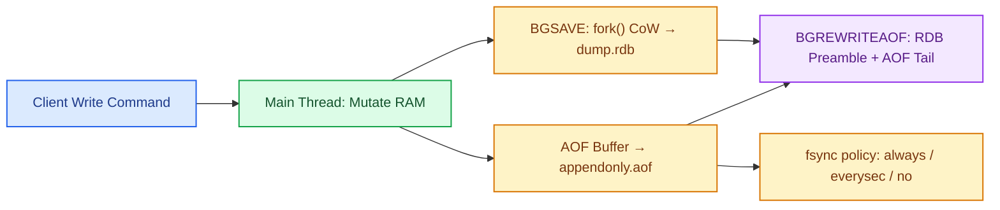
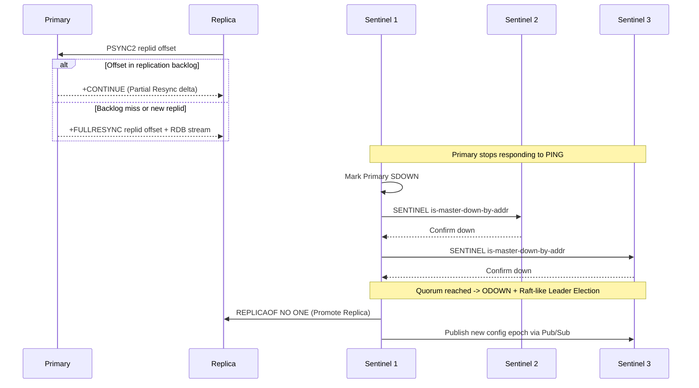
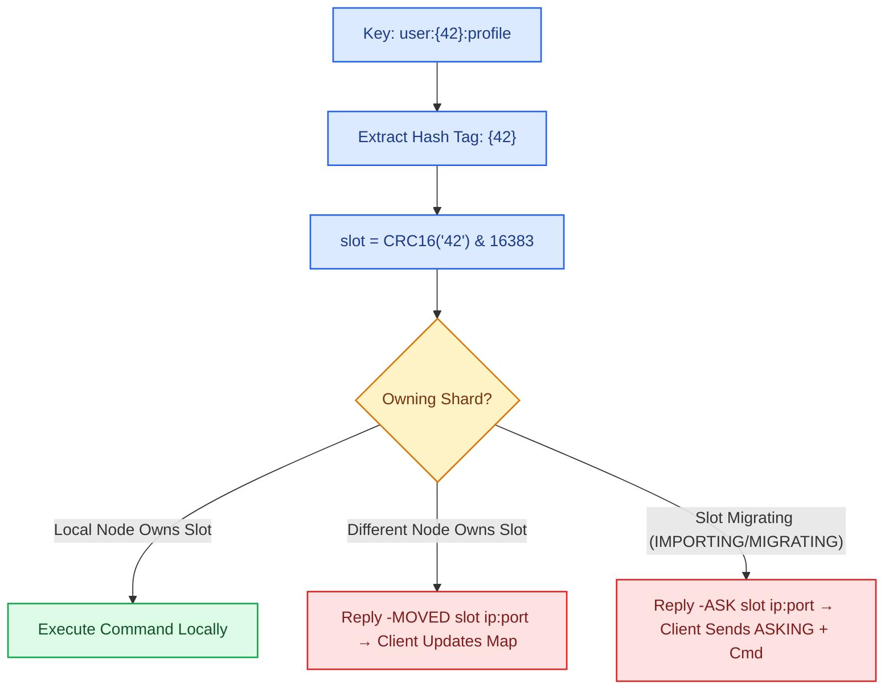
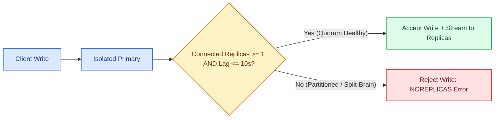
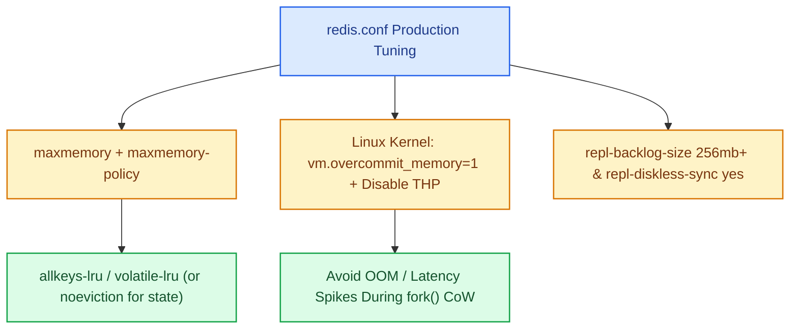
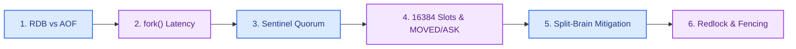

# Redis Cluster, Replication, and Persistence



## Table of Contents
1. [Persistence: RDB Snapshots vs AOF vs Hybrid](#1-persistence-rdb-snapshots-vs-aof-vs-hybrid)
2. [Replication & High Availability with Sentinel](#2-replication--high-availability-with-sentinel)
3. [Redis Cluster & 16,384 Hash Slots](#3-redis-cluster--16384-hash-slots)
4. [Split-Brain & Data Loss Mitigations](#4-split-brain--data-loss-mitigations)
5. [Production Configuration & Sizing](#5-production-configuration--sizing)
6. [Interview Q&A](#6-interview-qa)

---

## 1. Persistence: RDB Snapshots vs AOF vs Hybrid

Redis is an in-memory data store, so durability requires persisting state to disk without blocking the single-threaded command loop. Redis offers three persistence modes: **RDB (Redis Database)** point-in-time snapshots, **AOF (Append-Only File)** write-ahead logs, and **Hybrid (RDB+AOF)** introduced in Redis 4.0+.



### How `fork()` Copy-on-Write (CoW) Works

When `BGSAVE` (RDB) or `BGREWRITEAOF` (AOF compaction) runs:
1. The Redis main process calls `fork()` to spawn a child process.
2. On Linux/POSIX, `fork()` does **not** copy physical memory pages immediately; it copies only the **page table** and marks shared pages read-only.
3. The child process sequentially serializes the frozen memory snapshot to a temporary file and atomically `rename()`s it over `dump.rdb` (or `appendonly.aof`).
4. Whenever the parent process mutates a key during the snapshot, the OS kernel triggers a page fault and copies **only that 4 KB memory page** (Copy-on-Write) before modifying it.

### AOF `appendfsync` Policies

| Policy | Behavior | Max Data Loss | Throughput Impact | Use Case |
| :--- | :--- | :--- | :--- | :--- |
| `always` | `fsync()` on every write command before replying `OK` | 0 commands | Severe (disk I/O bound) | Financial ledgers / strict durability |
| `everysec` | Background thread calls `fsync()` once per second | Up to ~1 second | Minimal (default) | General production workloads |
| `no` | OS decides when to flush page cache (~30s on Linux) | Up to ~30 seconds | Negligible | Ephemeral caches where speed > durability |

### RDB vs AOF vs Redis 4.0+ Hybrid (Mixed Preamble)

| Dimension | RDB (`dump.rdb`) | AOF (`appendonly.aof`) | Hybrid (`aof-use-rdb-preamble yes`) |
| :--- | :--- | :--- | :--- |
| **Format** | Compact binary snapshot | Human-readable RESP command log | RDB binary preamble + AOF delta tail |
| **Recovery Speed** | Fast (direct memory load) | Slow (replays every command) | Fast (loads RDB preamble + replays small tail) |
| **Data Loss Window** | Minutes (between `save` intervals) | ≤ 1 second (`everysec`) | ≤ 1 second (`everysec`) |
| **File Size** | Smallest | Largest (requires `BGREWRITEAOF`) | Compact |
| **Redis 7.0 Note** | Single `dump.rdb` | Multi-Part AOF (base + incr + manifest) | Default enabled (`yes`) |

> [!TIP]
> In production, enable **Hybrid persistence** (`appendonly yes` + `aof-use-rdb-preamble yes` with `appendfsync everysec`). You get sub-second RPO durability from AOF and fast cold-start recovery from the RDB preamble.

---

## 2. Replication & High Availability with Sentinel

Redis replication is **asynchronous by default** (leader-follower): a Primary accepts writes, replies to the client immediately, and streams the command buffer to Replicas in the background.



### Full Sync vs `PSYNC2` Partial Resync

1. **Full Resync (`+FULLRESYNC`)**:
   - Triggered on initial replica connection or when the replica's offset has been overwritten in the Primary's circular `repl-backlog-size` buffer.
   - Primary runs `BGSAVE`, streams the RDB file over the socket (or diskless via `repl-diskless-sync yes`), and buffers concurrent writes in the replication buffer to replay after RDB load.
2. **Partial Resync (`PSYNC2`)**:
   - Every Primary maintains a `replid` (40-char random ID), a `replid2` (previous primary ID for failover continuity), and a monotonic byte `offset`.
   - On brief network blips, the replica sends `PSYNC <replid> <offset>`. If `<offset>` is still inside `repl-backlog-size`, the Primary sends `+CONTINUE` and streams only the missed bytes—avoiding an expensive `fork()` and RDB transfer.

### Redis Sentinel: `SDOWN` vs `ODOWN` and Quorum

- **Sentinel** is an external distributed monitoring process (deploy **odd numbers: 3 or 5** across failure domains) that monitors Primaries and Replicas.
- **`SDOWN` (Subjectively Down)**: A single Sentinel node has not received a valid `PING` reply within `down-after-milliseconds` (e.g., 5,000 ms). Local opinion only—no failover occurs.
- **`ODOWN` (Objectively Down)**: At least `quorum` Sentinels agree the Primary is unreachable (`SENTINEL is-master-down-by-addr`). Applies **only to Primaries**, not Replicas.
- **Quorum vs Majority**:
  - `quorum`: Number of Sentinels needed to agree on `ODOWN`.
  - **Majority (`N/2 + 1`)**: Number of Sentinels needed to **elect a Sentinel leader** and authorize failover. With 3 Sentinels and `quorum 2`, if 2 Sentinels die, `ODOWN` cannot be reached and failover halts safely.

> [!WARNING]
> Because replication is asynchronous, a newly promoted Replica may lack the most recent writes acknowledged by the old Primary before it crashed. Clients must tolerate small RPO loss or use `WAIT` / `min-replicas-to-write` (see Section 4).

---

## 3. Redis Cluster & 16,384 Hash Slots

When a single node's RAM or CPU saturates, **Redis Cluster** provides horizontal sharding without a proxy. The keyspace is partitioned into **16,384 hash slots** (`0` through `16383`).



### Hash Slot Formula & `{hash_tag}`

- **Slot calculation**: `slot = CRC16(key) & 16383` (bitwise AND is equivalent to `mod 16384` since $16384 = 2^{14}$).
- **Why 16,384 slots?** Each node broadcasts its owned slots as a bitmap in every Gossip `PING`/`PONG` heartbeat. A 16,384-bit bitmap is only **2 KB** (`16384 / 8`), keeping Gossip bandwidth low across clusters up to ~1,000 nodes.
- **Hash Tags (`{...}`)**: Multi-key commands (`MGET`, `MSET`, Lua scripts, `MULTI/EXEC`) fail with `CROSSSLOT Keys in request don't hash to the same slot` unless all keys map to the same slot. Wrapping a shared substring in braces—e.g., `user:{42}:cart` and `user:{42}:orders`—hashes **only `42`**, co-locating both keys on the same shard.

### `MOVED` vs `ASK` Redirection

| Redirect | Meaning | Client Action |
| :--- | :--- | :--- |
| **`-MOVED <slot> <ip>:<port>`** | The slot permanently belongs to another node. | Update local slot cache, then retry command on target node. |
| **`-ASK <slot> <ip>:<port>`** | The slot is mid-migration (`MIGRATING` → `IMPORTING`). Key may already be on the target node. | Do **not** update slot cache; send `ASKING` followed by the command to the target node once. |

### Cluster Gossip Bus (`Port + 10000`)

Every Redis Cluster node opens a second TCP port at `client_port + 10000` (e.g., `6379` → `16379`) for binary node-to-node Gossip:
- Exchanges `PING`/`PONG` packets containing node state, `currentEpoch`, `configEpoch`, and the 2 KB slot bitmap.
- Detects failures using `PFAIL` (node-local) → `FAIL` (gossiped majority agreement) and runs built-in Raft-like primary election—no external Sentinel required.

---

## 4. Split-Brain & Data Loss Mitigations

During a network partition, an isolated Primary may continue accepting client writes while the majority side promotes its Replica. When the partition heals, the old Primary is demoted to a Replica and **all writes accepted during isolation are wiped** during resync.



### Bounded Data Loss with `min-replicas-to-write`

Configure both settings together on every Primary:
```conf
min-replicas-to-write 1
min-replicas-max-lag 10
```
- If fewer than `1` replica is connected and has acknowledged a heartbeat within `10` seconds, the Primary **refuses writes** with `-NOREPLICAS Not enough good replicas to write`.
- This caps the split-brain write window to `min-replicas-max-lag` seconds at the cost of write availability when all replicas are down (CAP theorem: trading **AP** for bounded **C**).

### Distributed Locks: Redlock vs ZooKeeper / etcd Fencing Tokens

- **Single-node `SET key value NX PX 30000`**: Fast, but loses mutual exclusion on async failover if the lock key isn't replicated before the Primary crashes.
- **Redlock** (acquiring locks on $N/2 + 1$ of 5 independent Redis Primaries): Vulnerable to **clock drift / NTP jumps** and **GC / process pauses** (Martin Kleppmann's critique: a paused client can wake up with an expired lease and overwrite shared state).
- **Fencing Tokens (ZooKeeper / etcd)**: The lock service issues a monotonically increasing **fencing token** (e.g., `zxid` or `revision`). The downstream storage server rejects any write carrying a token ≤ the highest token it has already seen—guaranteeing safety even under arbitrary process pauses.

> [!IMPORTANT]
> Never rely on Redis (`SET NX` or Redlock) alone for **correctness-critical** mutual exclusion (e.g., preventing double-billing) unless the downstream resource enforces monotonic fencing tokens or idempotency keys.

---

## 5. Production Configuration & Sizing

Misconfigured memory limits, hugepages, or `fork()` overhead are the #1 cause of Redis tail-latency spikes in production.



### Key `redis.conf` & OS Settings

| Setting | Recommended Value | Why It Matters |
| :--- | :--- | :--- |
| `maxmemory` | **65–75% of host RAM** | Leaves headroom for OS page cache and `fork()` Copy-on-Write pages during `BGSAVE` / `BGREWRITEAOF`. |
| `maxmemory-policy` | `allkeys-lru` (cache) / `noeviction` (store) | Prevents OOM crashes by evicting cold keys or returning write errors cleanly. |
| `vm.overcommit_memory` | `1` (in `/etc/sysctl.conf`) | Without this, Linux refuses `fork()` if free RAM &lt; current RSS, even when CoW only needs a fraction. |
| **Transparent Huge Pages (THP)** | `never` (`/sys/kernel/mm/transparent_hugepage/enabled`) | THP turns 4 KB CoW page faults into **2 MB** copies, causing multi-second latency spikes during `BGSAVE`. |
| `repl-backlog-size` | `256mb` – `1gb` | Larger circular buffer allows `PSYNC2` partial resyncs after longer network/deploy blips. |
| `cluster-node-timeout` | `15000` (15s) | Balances fast failover against false positives from brief GC/network pauses. |

### Sizing Rule of Thumb

- Keep individual Redis instances under **20–32 GB** of data so `fork()` page-table copying stays under ~10–20 ms and full RDB resyncs finish quickly. Scale beyond 32 GB by adding **Redis Cluster shards** rather than vertical scaling.

---

## 6. Interview Q&A



**Q1. Why does Redis recommend Hybrid (RDB + AOF) persistence over pure RDB or pure AOF?**
- Pure RDB risks losing minutes of writes between snapshots. Pure AOF grows large and replays slowly on restart. Hybrid (`aof-use-rdb-preamble yes`) writes a compact RDB snapshot as the base of the AOF file during `BGREWRITEAOF` and appends only recent commands after it—combining ≤ 1s RPO (`appendfsync everysec`) with fast binary startup.

**Q2. What causes latency spikes during `BGSAVE`, and how do you fix them?**
- Two causes: (1) `fork()` itself blocks the main thread while copying the process page table (scales with RSS; keep instances ≤ 25–32 GB), and (2) **Copy-on-Write** amplifies memory writes if **Transparent Huge Pages (THP)** are enabled (2 MB page copies instead of 4 KB). Fix by disabling THP, setting `vm.overcommit_memory=1`, and keeping 25–35% RAM headroom.

**Q3. In Redis Sentinel, what is the difference between `SDOWN`, `ODOWN`, and `quorum`?**
- `SDOWN` is a single Sentinel's local timeout (`down-after-milliseconds`). `ODOWN` occurs when `quorum` Sentinels confirm the Primary is down. However, actually executing a failover requires a **majority (`N/2 + 1`)** of Sentinels to elect a Sentinel leader.

**Q4. Why does Redis Cluster have 16,384 hash slots, and how do `MOVED` and `ASK` differ?**
- 16,384 bits = 2 KB per Gossip `PING`/`PONG` packet, keeping cluster heartbeat overhead tiny. `-MOVED` means a slot permanently belongs to another node (client updates its slot cache). `-ASK` means a slot is mid-migration; the client sends `ASKING` + the command to the target node for that single request without updating its slot cache.

**Q5. How do you prevent multi-key `CROSSSLOT` errors in Redis Cluster?**
- Use **hash tags** `{...}` in key names (e.g., `order:{user_99}:items` and `order:{user_99}:total`). Redis hashes only the substring inside `{}` so all related keys land on the exact same hash slot and shard.

**Q6. How do you prevent split-brain data loss, and why isn't Redlock sufficient for strict correctness?**
- Set `min-replicas-to-write 1` and `min-replicas-max-lag 10` so an isolated Primary rejects writes once replicas lag beyond 10s. For distributed locks, Redlock lacks **monotonic fencing tokens**—a paused client can resume after its lease expires and clobber newer writes. Use ZooKeeper or etcd with server-side fencing token validation when strict correctness is required.

> [!NOTE]
> In system design interviews, always clarify whether Redis is used as an **ephemeral cache** (favor `allkeys-lru`, no persistence, lower cost) or a **primary/session store** (enable Hybrid persistence, Sentinel/Cluster HA, and `min-replicas-to-write`).
