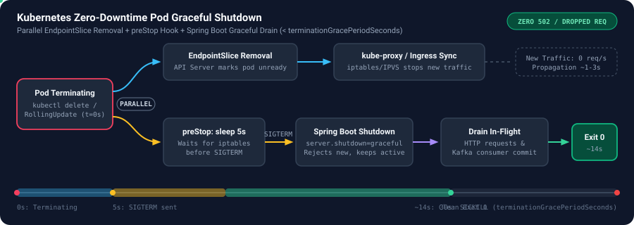
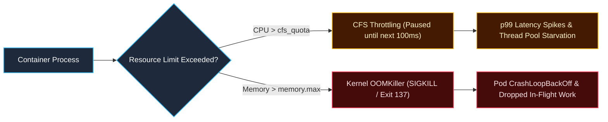
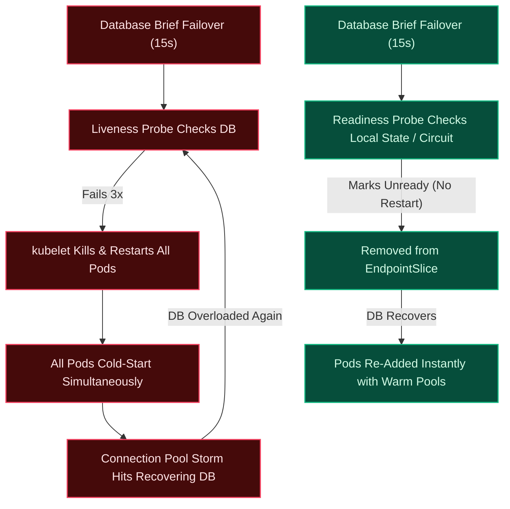
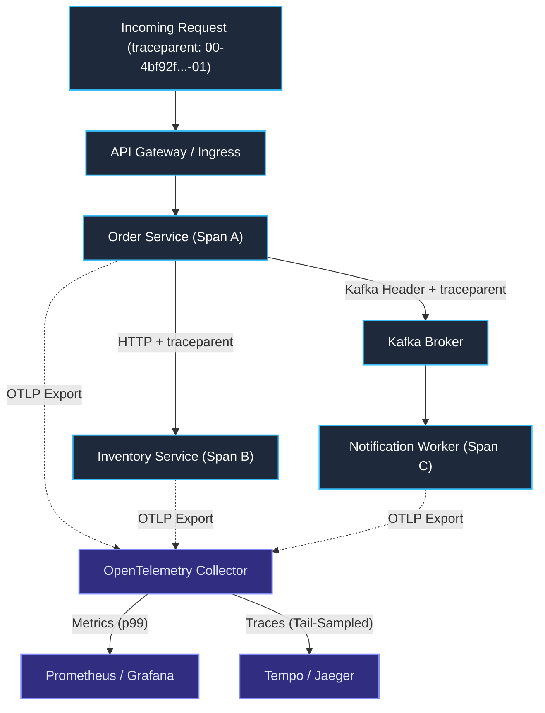

# Kubernetes & Production Operations

> [!NOTE]
> Senior backend & platform engineering interviews test how your JVM, Go, or Python services behave under **Linux kernel constraints (`cgroups`, `OOMKiller`, CFS quotas)**, **asynchronous network control planes (`kube-proxy`, `EndpointSlice`)**, and **cascading failure modes**—not just YAML syntax.



---

## 1. Container & Pod Lifecycle Internals

A container is not a lightweight VM; it is a **standard Linux process** isolated by **namespaces** (PID, network, mount, UTS, IPC, user) and constrained by **cgroups v2** (CPU, memory, PIDs, I/O).

### `cgroups` CPU Throttling vs. `OOMKill`

| Resource | Requests (`requests`) | Limits (`limits`) | Kernel Behavior When Exceeded | Production Symptom |
| :--- | :--- | :--- | :--- | :--- |
| **CPU** | Scheduler guarantee (`cpu.weight`) | Hard CFS quota (`cpu.max` per 100ms period) | **CFS Throttling** — process is paused until next 100ms window | Tail latency (`p99`) spikes even when average CPU is 30% |
| **Memory** | Scheduler reservation | Hard ceiling (`memory.max`) | **`OOMKiller` (`SIGKILL`, Exit Code 137)** — instant termination | Pod restarts with `Last State: Terminated (OOMKilled)` |



### Container Image Layers & Distroless JVM Tuning

1. **Copy-on-Write (OverlayFS) Layers**: Order `Dockerfile` instructions from least-frequently changed (OS/JRE base, dependency jars) to most-frequently changed (application `.jar` / compiled binary) to maximize layer cache hits and reduce node pull latency.
2. **Distroless Images**: Use `gcr.io/distroless/java21-debian12:nonroot` instead of full Debian/Alpine images. Removing `bash`, `curl`, and package managers shrinks attack surface and CVE count. Debug live pods with `kubectl debug -it <pod> --image=busybox --target=<container>` (ephemeral containers).
3. **Container-Aware JVM Flags**: Modern JVMs (Java 11+) read `cgroups` limits automatically, but default `MaxRAMPercentage` is only **25%** of container memory. In a 2 GiB pod, the heap caps at 512 MiB unless tuned:

```dockerfile
FROM gcr.io/distroless/java21-debian12:nonroot
COPY --chown=nonroot:nonroot target/order-service.jar /app/app.jar
ENTRYPOINT ["java", \
  "-XX:+UseContainerSupport", \
  "-XX:MaxRAMPercentage=75.0", \
  "-XX:InitialRAMPercentage=50.0", \
  "-XX:+UseG1GC", \
  "-XX:+ExitOnOutOfMemoryError", \
  "-jar", "/app/app.jar"]
```

> [!IMPORTANT]
> **Leave 25–30% headroom outside the JVM heap** (`MaxRAMPercentage=75.0`) for Metaspace, thread stacks (`-Xss`, e.g., 200 threads × 1 MiB = 200 MiB), Direct ByteBuffers (Netty/Kafka), and native JNI allocations. Setting `MaxRAMPercentage=90.0` almost guarantees `Exit Code 137` under traffic bursts. Additionally, consider **omitting CPU `limits`** (keep CPU `requests` for scheduling) if your cluster supports it, to eliminate artificial CFS throttling on bursty workloads.

---

## 2. Liveness, Readiness & Startup Probes

Kubernetes uses three distinct probes to manage pod health. Confusing **Liveness** with **Readiness** is one of the most common causes of self-inflicted production outages.

| Probe | Question Answered | Failure Action | Ideal Endpoint / Check |
| :--- | :--- | :--- | :--- |
| **Startup** | Has the app finished booting? | Holds Liveness & Readiness; kills pod if `failureThreshold` exceeded | `/actuator/health/liveness` (generous `failureThreshold × periodSeconds`) |
| **Readiness** | Can this pod serve traffic right now? | Removes pod IP from Service `EndpointSlice` (no restart) | `/actuator/health/readiness` (checks thread pools, critical warm caches, or circuit state) |
| **Liveness** | Is the process deadlocked or irreparably stuck? | **Kills and restarts** the container (`SIGTERM` → `SIGKILL`) | `/actuator/health/liveness` (purely local JVM/process health: event loop / ping) |

### The Cascading Restart Anti-Pattern

Never include external dependencies (PostgreSQL, Redis, Kafka, downstream HTTP APIs) in a **Liveness** probe. If the database experiences a 15-second failover or network blip, every pod's Liveness probe fails simultaneously, triggering a cluster-wide restart storm. When the DB recovers, all pods are cold-starting at once and immediately DDoS the recovering DB with connection pool handshakes.



> [!WARNING]
> **Never couple Liveness probes to external dependencies.** Use Spring Boot Actuator's built-in probe groups (`management.endpoint.health.probes.enabled=true`), which expose `/actuator/health/liveness` (`livenessState` only) and `/actuator/health/readiness` (`readinessState` + selective local indicators).

---

## 3. Zero-Downtime Rolling Deployments & SIGTERM Race

When Kubernetes terminates a pod during a `RollingUpdate` or scale-down, **two independent control loops run asynchronously in parallel**:
1. **Network Plane**: The API Server removes the pod's IP from the `EndpointSlice`, and `kube-proxy` (on every worker node) + Ingress controllers asynchronously update `iptables` / `IPVS` rules. This propagation typically takes **1–3 seconds**.
2. **Compute Plane**: `kubelet` on the pod's node immediately executes the `preStop` hook (if configured) and then sends `SIGTERM` to PID 1.

If there is **no `preStop` delay**, the application receives `SIGTERM` and closes its listening socket *before* `kube-proxy` finishes updating `iptables` on all nodes. Result: **502 Bad Gateway / Connection Refused** errors during every deployment.

```mermaid
sequenceDiagram
    autonumber
    participant K8s as API Server / Controller
    participant KP as kube-proxy (All Nodes)
    participant KL as kubelet (Pod Node)
    participant App as Spring Boot App (PID 1)

    K8s->>KP: Remove Pod IP from EndpointSlice (Async)
    K8s->>KL: Mark Pod Terminating (t = 0s)
    KL->>App: Run lifecycle.preStop (sleep 5s)
    Note over KP: iptables / IPVS rules sync (~1-3s)
    Note over App: Still serves residual packets cleanly
    KL->>App: Send SIGTERM (t = 5s)
    App->>App: server.shutdown=graceful (Stop new, drain active)
    App->>App: Drain HTTP & commit Kafka offsets
    App-->>KL: Exit 0 (t ~ 14s &lt; 30s grace period)
```

### Production Pod & Spring Boot Configuration

```yaml
# Kubernetes Deployment PodSpec
spec:
  terminationGracePeriodSeconds: 45
  containers:
    - name: order-service
      lifecycle:
        preStop:
          exec:
            command: ["sh", "-c", "sleep 5"]
```

```yaml
# Spring Boot application.yaml
server:
  shutdown: graceful
spring:
  lifecycle:
    timeout-per-shutdown-phase: 30s
```

Key invariants:
- `terminationGracePeriodSeconds` (`45s`) **must exceed** `preStop` (`5s`) + `timeout-per-shutdown-phase` (`30s`) + buffer (`10s`), otherwise `kubelet` sends `SIGKILL` mid-drain.
- Ensure your container `ENTRYPOINT` runs `java` directly (exec form `["java", ...]`), **not** via a shell wrapper (`sh -c "java ..."` without `exec`), so `java` is PID 1 and actually receives `SIGTERM`.

---

## 4. Autoscaling: HPA, VPA & KEDA

| Autoscaler | Scaling Signal | Direction | Best Use Case | Primary Pitfall |
| :--- | :--- | :--- | :--- | :--- |
| **HPA** | CPU, Memory, Custom Metrics | Horizontal (Replicas) | Stateless HTTP APIs | 15s metrics scrape + JVM warm-up lag causes oscillation |
| **VPA** | Historical CPU/Memory P95 | Vertical (Requests/Limits) | Statefulsets, batch jobs, right-sizing | Requires pod eviction/restart to apply new resources |
| **KEDA** | Event-driven (Kafka lag, SQS, Cron) | Horizontal (0 → N) | Async consumers & queue workers | Must pair with `preStop` + cooperative Kafka rebalance |

### Stabilization Windows & KEDA Consumer Lag Scaling

CPU-based HPA often **flaps** (scales out on a spike, scales in too early, then spikes again) because of `metrics-server` scrape intervals and JVM JIT warm-up. Always configure `behavior.scaleDown.stabilizationWindowSeconds` (e.g., `300s`) so scale-in is gradual while scale-out remains fast.

For **Kafka consumers**, CPU is a terrible scaling signal—a consumer blocked on a slow downstream DB call has **low CPU** even while consumer lag grows to millions of messages. **KEDA** queries Kafka broker offsets directly and scales replicas proportionally to `lagThreshold` (capped at the topic's partition count).


> [!TIP]
> **Never set HPA on CPU/Memory alongside VPA in `Auto` mode on the same metric**, as they fight each other (VPA shrinks pod size → CPU % rises → HPA adds replicas). Use VPA in `Off` mode for right-sizing recommendations, or pair VPA with custom/KEDA queue-depth scaling.

---

## 5. Production Observability & Golden Signals

Monitoring CPU/Memory alone tells you *resource utilization*, not *user experience*. Instrument every service around Google SRE's **Four Golden Signals**:

1. **Latency**: Measure `p50`, `p95`, and **`p99`** (and `p99.9`) separately for **successful** vs. **failed** requests. Fast `500` errors skew averages downward; `avg` hides tail degradation affecting 1 in 100 users (which, on a page making 20 microservice calls, affects ~18% of page loads).
2. **Traffic**: Requests per second (HTTP RPS), messages/sec (Kafka), active connections.
3. **Errors**: Explicit (`5xx`, uncaught exceptions) and implicit (`200 OK` with stale/empty payload or SLA breach).
4. **Saturation**: How "full" the hardest-constrained resource is—HikariCP active connections, Tomcat worker threads, JVM Old Gen occupancy, or disk I/O queue depth—before errors occur.

### OpenTelemetry Distributed Trace Propagation

In microservice architectures, metrics tell you *that* `p99` spiked; **distributed traces** tell you *where*. Use **W3C Trace Context** (`traceparent` header) propagated across HTTP clients (`RestClient` / `WebClient`), async thread pools (`Context.taskWrapping()`), and Kafka message headers (`ProducerInterceptor` / Spring Kafka `observationEnabled=true`).



---

## 6. Senior Ops Interview Q&A


1. **Incident: Every rolling deployment causes a 10-second spike of `502 Bad Gateway` errors, even though `server.shutdown=graceful` is enabled.**
   - **Root Cause**: Missing `lifecycle.preStop` hook (or shell-wrapped PID 1). `kubelet` sends `SIGTERM` at `t=0s` while `kube-proxy` takes 1–3s to remove the pod IP from `iptables`, so nodes keep routing new requests to a closing socket.
   - **Fix**: Add `preStop: sleep 5`, ensure `exec` form in `Dockerfile`, and set `terminationGracePeriodSeconds` &gt; `preStop` + Spring shutdown timeout.

2. **Incident: A Java microservice is `OOMKilled` (Exit Code 137) under load, yet Grafana shows JVM Heap usage was only 60% of the container limit.**
   - **Root Cause**: Non-heap memory (Metaspace, thread stacks, Netty/Kafka Direct ByteBuffers, or native memory leaks) pushed total RSS above `memory.max`.
   - **Fix**: Lower `-XX:MaxRAMPercentage` from 85–90% to `70–75%`, cap `-XX:MaxDirectMemorySize` and `-XX:MaxMetaspaceSize`, and enable `-XX:NativeMemoryTracking=summary` to profile off-heap allocations.

3. **Incident: Average CPU is 25%, yet `p99` API latency jumps from 40ms to 800ms during traffic bursts.**
   - **Root Cause**: Aggressive **CFS CPU throttling** (`limits.cpu: 500m`). The JVM bursts across multiple GC/HTTP threads, burns its 50ms quota in the first 15ms of a 100ms CFS period, and is kernel-paused for the remaining 85ms.
   - **Fix**: Check `container_cpu_cfs_throttled_periods_total`. Raise or remove CPU `limits` (keep CPU `requests` for scheduling) and tune GC/worker thread counts to match core count.

4. **Incident: A brief 10-second primary RDS failover caused a 15-minute complete outage across all 40 pods.**
   - **Root Cause**: The **Liveness** probe checked `/actuator/health` including the DB indicator. All 40 pods failed Liveness simultaneously, entered `CrashLoopBackOff`, and DDoS'd the recovering DB with TLS/connection-pool handshakes.
   - **Fix**: Isolate Liveness to process-only health (`/actuator/health/liveness`) and keep DB checks out of Liveness (or use circuit breakers + Readiness).

5. **Incident: KEDA scaled a Kafka consumer deployment from 10 to 30 pods during a lag spike, but throughput didn't improve and 20 pods sit idle.**
   - **Root Cause**: The Kafka topic only has **10 partitions**. In a single consumer group, at most 10 consumers can be assigned partitions simultaneously; extra pods sit idle while still triggering consumer group rebalances.
   - **Fix**: Set KEDA `maxReplicaCount` ≤ topic partition count (or increase topic partitions / decouple slow I/O into parallel worker pools with pause/resume backpressure).

6. **Incident: A pod stays in `Terminating` state for 5 minutes after `kubectl delete pod`, then disappears.**
   - **Root Cause**: Either `PID 1` is a shell (`sh -c`) that does not forward `SIGTERM` to the child process (so the app never starts draining and waits for `SIGKILL` after `terminationGracePeriodSeconds`), or a Kubernetes **finalizer** / stuck volume unmount is blocking deletion.
   - **Fix**: Use `exec` form in `Dockerfile` (`ENTRYPOINT ["java", ...]`), verify `SIGTERM` handling locally, and inspect `kubectl describe pod` for stuck finalizers or CSI volume detach events.

> [!NOTE]
> **Interview Framing Tip**: When answering production ops scenarios, always structure your response in three beats: **(1) Signal** (what metric/event/exit code you inspect first), **(2) Kernel/Control-Plane Mechanism** (why it happens), and **(3) Concrete Fix + Guardrail** (how you prevent recurrence).
