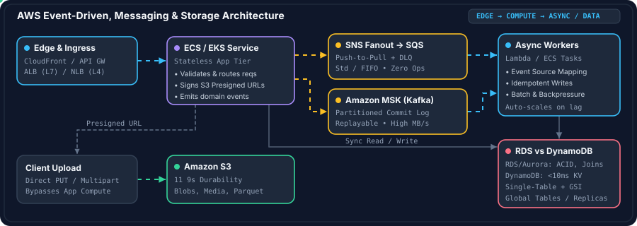
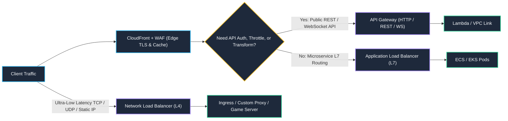
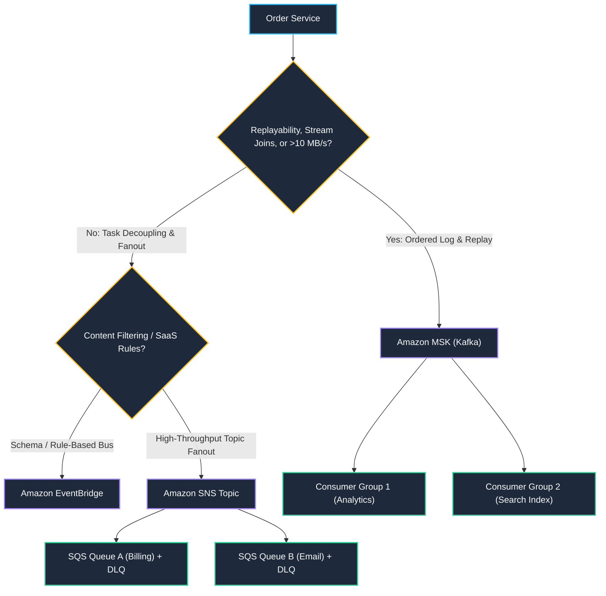
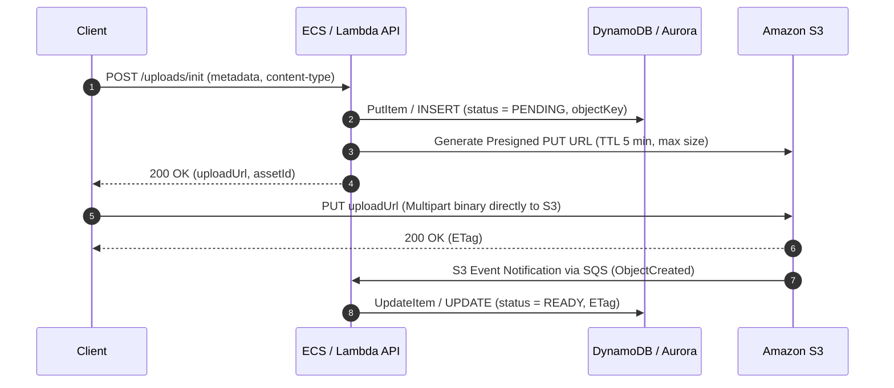
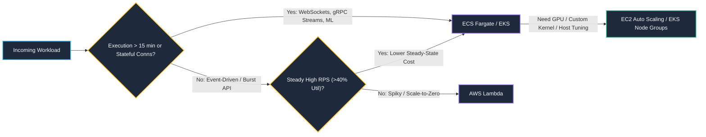
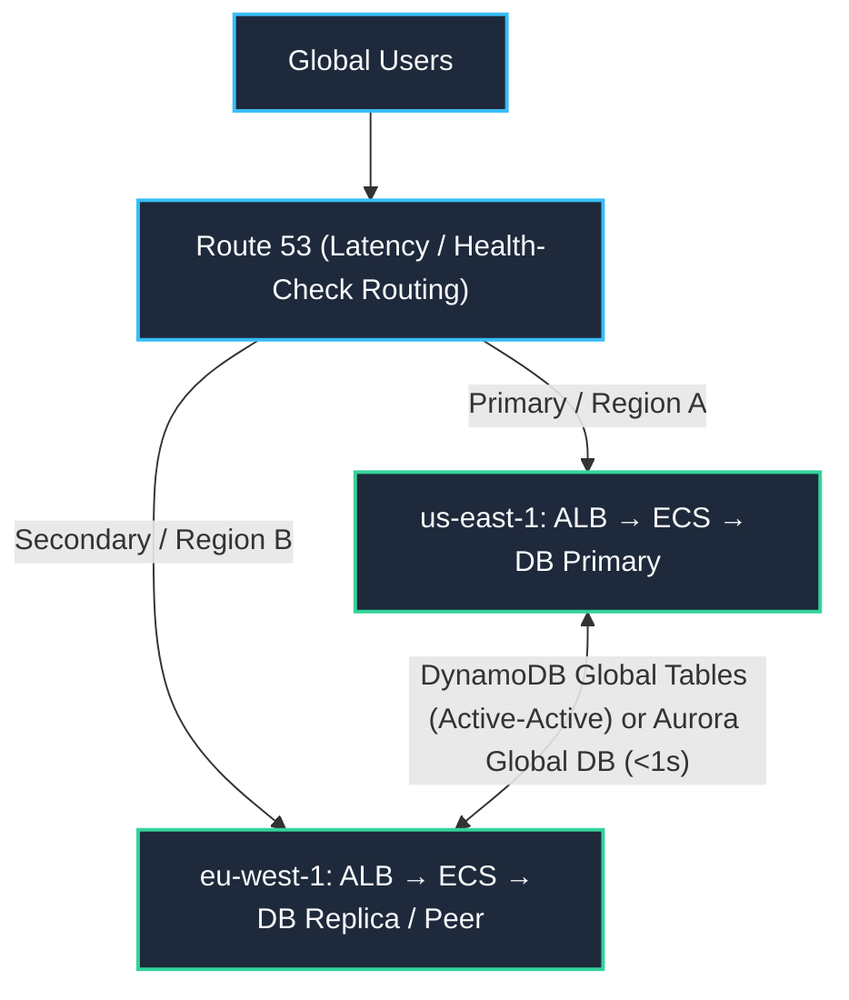
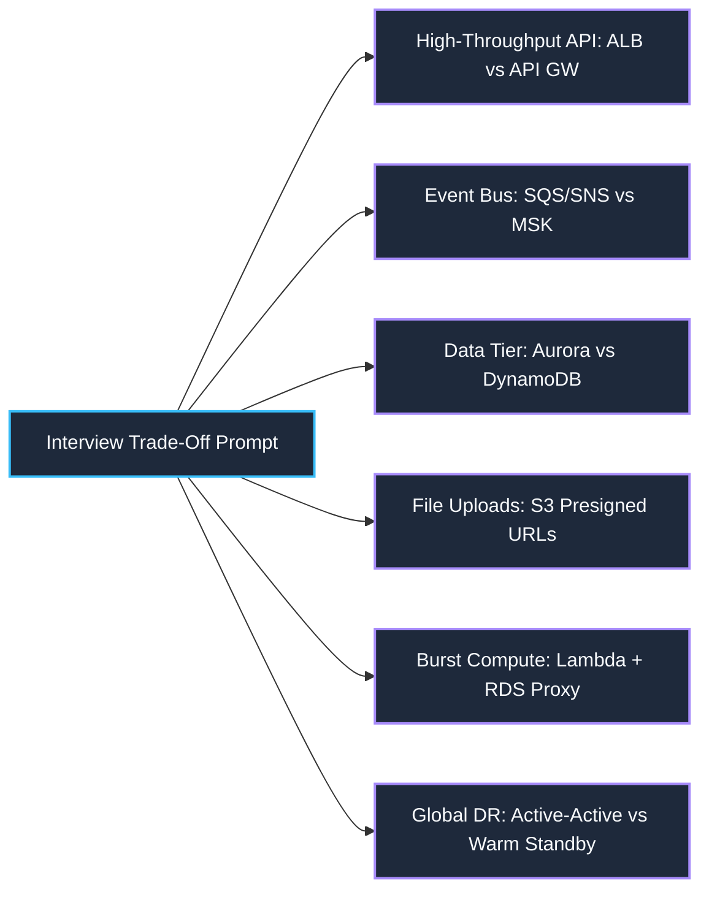

# AWS Managed Services & Architectural Trade-Offs

Choosing the right AWS managed primitive in a system design interview is rarely about knowing every API flag—it is about justifying **latency, durability, operational overhead, and cost** at scale. This guide breaks down the core trade-offs across edge routing, async messaging, storage engines, compute runtimes, and multi-region resilience.

## Table of Contents

- [1. Load Balancers & Edge: ALB vs NLB vs API Gateway](#1-load-balancers--edge-alb-vs-nlb-vs-api-gateway)
- [2. Messaging: SQS / SNS vs Amazon MSK (Kafka) vs EventBridge](#2-messaging-sqs--sns-vs-amazon-msk-kafka-vs-eventbridge)
- [3. Storage: RDS / Aurora vs DynamoDB vs S3](#3-storage-rds--aurora-vs-dynamodb-vs-s3)
- [4. Compute: EC2 vs ECS/EKS vs AWS Lambda](#4-compute-ec2-vs-ecseks-vs-aws-lambda)
- [5. Multi-Region Active-Active vs Active-Passive](#5-multi-region-active-active-vs-active-passive)
- [6. Cloud Architecture Interview Q&A](#6-cloud-architecture-interview-qa)

---

## 1. Load Balancers & Edge: ALB vs NLB vs API Gateway

At the ingress tier, the fundamental split is between **Layer 4 (TCP/UDP)** pass-through, **Layer 7 (HTTP/gRPC)** reverse proxying, and **managed API management**.

### Key Architectural Trade-Offs

| Dimension | Network Load Balancer (NLB) | Application Load Balancer (ALB) | API Gateway (HTTP / REST) |
| :--- | :--- | :--- | :--- |
| **OSI Layer** | Layer 4 (TCP, UDP, TLS) | Layer 7 (HTTP/1.1, HTTP/2, gRPC, WS) | Layer 7 (HTTP/1.1, HTTP/2, WebSocket) |
| **Typical Latency** | Sub-millisecond (~100 µs) | Single-digit ms (1–3 ms) | Higher (5–15+ ms overhead) |
| **Static IP / EIP** | Native per AZ (preserve client IP) | Dynamic IPs (use Global Accelerator or NLB in front) | CloudFront-backed (no static IP) |
| **WebSockets** | Raw TCP pass-through (millions of conns) | Native WS upgrade & sticky routing | Managed WS API with `$connect` / `$disconnect` |
| **mTLS** | Pass-through to backend | Native mTLS (trust store on ALB) | Native mTLS on custom domain |
| **Rate Limiting & Auth** | None (security groups / NACL only) | Cognito / OIDC auth, WAF integration | Built-in token-bucket throttling, Usage Plans, Lambda Authorizers |
| **Cost Profile** | Low LCU cost; best at extreme RPS | Moderate LCU cost; scales cheaply at 10k+ RPS | Expensive at high RPS (per-million requests); HTTP API is ~70% cheaper than REST API |

> [!TIP]
> **Cost Crossover Rule of Thumb:** API Gateway REST API costs roughly \$3.50 per million requests (HTTP API is ~\$1.00/M), whereas an ALB handles tens of thousands of RPS for a fraction of that via LCU pricing. Put **CloudFront + WAF → ALB → ECS/EKS** for high-throughput microservices, and reserve **API Gateway** for public developer APIs needing Usage Plans, per-tenant throttling, or serverless WebSocket connection management.

---

## 2. Messaging: SQS / SNS vs Amazon MSK (Kafka) vs EventBridge

Async decoupling in AWS boils down to **queue-based work distribution** (SQS), **pub/sub fanout** (SNS / EventBridge), and **partitioned, replayable event logs** (MSK / Kinesis).

### Push vs. Pull, Ordering & Replayability

- **SNS + SQS (Push-to-Pull Fanout):**
  - SNS pushes messages to multiple SQS queues (or Lambda/HTTP), giving each downstream service its own independent buffer, backpressure boundary, and Dead-Letter Queue (DLQ).
  - **Ordering:** Standard SQS provides best-effort ordering and at-least-once delivery. **SQS FIFO** guarantees strict per-`MessageGroupId` ordering and exactly-once deduplication (5-minute window), capped at 300 TPS without batching (up to 70,000+ TPS with high-throughput FIFO batching).
  - **Replayability:** **None.** Once a message is acknowledged (`DeleteMessage`), it is gone forever.
- **Amazon MSK (Managed Kafka):**
  - Pull-based partitioned commit log. Consumers track offsets, enabling **time-travel replay** (e.g., rebuild a search index or ML feature store from 7 days ago).
  - **Ordering:** Strict ordering within a partition key (`order_id`, `user_id`), scaling horizontally with partition count.
  - **Trade-off:** You pay for 24/7 broker instances and EBS storage, and you must manage partition skew, consumer lag, and MSK cluster upgrades (unless using MSK Serverless, which still has partition/throughput limits).
- **Amazon EventBridge:**
  - Serverless event bus with **JSON content-based filtering** and schema registry. Ideal for cross-account AWS events, SaaS integrations, and low-to-medium throughput choreography.
  - Supports **Event Archive & Replay**, though at higher per-event cost and latency (~100–500 ms) than SNS/SQS.

> [!IMPORTANT]
> **DLQ & Poison Pill Discipline:** Never attach a single consumer directly to SNS without an SQS buffer for critical workloads. With **SNS → SQS → Worker**, set `maxReceiveCount` (e.g., 3–5 retries with exponential backoff) and route failed messages to an **SQS DLQ** with CloudWatch alarms on `ApproximateNumberOfMessagesVisible &gt; 0`.

---

## 3. Storage: RDS / Aurora vs DynamoDB vs S3

Storage selection depends on **access-pattern predictability, relational integrity, object size, and scaling model**.

### Relational vs. NoSQL vs. Object Storage

1. **Amazon RDS / Aurora (PostgreSQL / MySQL):**
   - **Choose when:** Access patterns are ad-hoc or evolving, you need multi-table ACID transactions, complex `JOIN`s, or strict foreign-key constraints.
   - **Aurora Architecture:** Decouples compute from a shared, 6-way replicated distributed storage volume across 3 AZs. **Aurora Read Replicas** (up to 15) share the same underlying storage, achieving replication lag typically under **10–20 ms** (compared to async binlog/WAL replication on standard RDS).
   - **Bottleneck:** Single-writer ceiling. Scaling writes beyond the largest instance requires application-level sharding or read/write splitting (RDS Proxy helps pool thousands of Lambda connections).
2. **Amazon DynamoDB:**
   - **Choose when:** Access patterns are known upfront, latency must stay predictable at **single-digit milliseconds** at any scale (TB to PB), and traffic is spiky.
   - **Single-Table Design:** Store heterogeneous entities (e.g., `USER#123` and `ORDER#456`) in one table using overloaded `PK` and `SK` attributes so one `Query` fetches an entire entity graph without joins.
   - **LSI vs. GSI:**
     - **LSI (Local Secondary Index):** Same `PK`, alternate `SK`; shares partition throughput and supports **strong consistency**, but must be created at table creation and limits item collection size to **10 GB**.
     - **GSI (Global Secondary Index):** Different `PK`/`SK`; scales independently, **eventually consistent only**, and if the GSI runs out of write capacity (or throttles), it causes backpressure throttling on the base table.
3. **Amazon S3:**
   - **Choose when:** Storing immutable blobs, media, backups, or data-lake Parquet files (11 9s durability).
   - **Presigned URLs & Multipart Upload:** Never proxy large files through ECS/Lambda—issue short-lived **Presigned URLs** so clients upload directly to S3. For files &gt;100 MB, use **S3 Multipart Upload** (parallel part uploads, resumable on network drop, up to 5 TB per object).

---

## 4. Compute: EC2 vs ECS/EKS vs AWS Lambda

Compute choices trade **cold-start latency and connection persistence** against **operational control and idle cost**.

### Runtime Trade-Offs

- **AWS Lambda:**
  - **Pros:** Zero server management, scale-to-zero, native event-source mappings (SQS, DynamoDB Streams, MSK, S3).
  - **Cons:** 15-minute hard timeout, no persistent inbound TCP/WebSocket connections inside the handler, and **cold starts** (100 ms–2+ s depending on runtime, VPC ENI reuse, and package size).
  - **Mitigations:** Use **Provisioned Concurrency** to keep warm execution environments ready for latency-sensitive p99 SLAs, or **Lambda SnapStart** (for Java/.NET/Python) to restore from an encrypted memory snapshot.
- **ECS (Fargate / EC2) vs. EKS (Kubernetes):**
  - **ECS Fargate:** Best default for AWS-native teams—no EC2 node patching, fast task scaling, native IAM task roles, and ALB target-group integration.
  - **EKS:** Choose when you need Kubernetes portability, multi-cloud parity, rich ecosystem tooling (ArgoCD, Istio, Karpenter), or custom bin-packing across heterogeneous EC2/Spot/GPU nodes.
- **Cost Crossover:**
  - Lambda shines for **spiky, low-duty-cycle** workloads (e.g., cron jobs, S3 thumbnails, webhooks).
  - Once a service sustains **steady, predictable traffic** (roughly &gt;30–40% continuous utilization), **ECS Fargate or EC2 with Savings Plans / Spot** becomes **2x–5x cheaper** than paying per-ms GB-seconds on Lambda.

> [!WARNING]
> **Lambda + RDS Connection Exhaustion:** A sudden Lambda burst can spin up 1,000+ concurrent containers, each opening a TCP/TLS connection to PostgreSQL and exhausting `max_connections`. Always place **Amazon RDS Proxy** between Lambda and RDS/Aurora, or switch the write path to **DynamoDB** (stateless HTTP).

---

## 5. Multi-Region Active-Active vs Active-Passive

Multi-region architecture protects against **regional control-plane or data-plane outages** and reduces global tail latency, at the cost of **replication complexity and conflict resolution**.

### Resilience Patterns & RPO/RTO

| Strategy | Architecture | Typical RPO | Typical RTO | Primary Trade-Off |
| :--- | :--- | :--- | :--- | :--- |
| **Backup & Restore** | Cross-region S3 / RDS snapshots | Hours | Hours | Cheapest; unacceptable for tier-1 APIs |
| **Pilot Light (Active-Passive)** | DB replicated cross-region; compute scaled at `0` or minimal | Seconds (&lt;5s) | 10–30 min | Low idle cost; cold-start scale-up delay during failover |
| **Warm Standby (Active-Passive)** | Scaled-down compute running in secondary + **Aurora Global DB** | ~1 sec (async storage replication) | 1–5 min | Route 53 DNS TTL + Aurora cluster promotion time |
| **Multi-Region Active-Active** | Full stack in 2+ regions + **DynamoDB Global Tables** | ~1 sec (async multi-master) | Seconds (DNS / Global Accelerator health check) | **Last-Writer-Wins (LWW)** conflicts; double compute cost; avoid for strict linearizable balances |

- **Route 53 Failover:** Use **Route 53 Health Checks** with low TTLs (e.g., 30–60s) or **AWS Global Accelerator** (anycast static IPs with sub-minute health-check rerouting that avoids client DNS caching).
- **Database Reality Check:** **Aurora Global Database** is **single-writer, multi-reader** (write forwarding exists, but writes still round-trip to the primary region). True **Active-Active** writes require **DynamoDB Global Tables** (which use Last-Writer-Wins per item) or application-level **cell/shard pinning** where each user's home region owns their writes.

---

## 6. Cloud Architecture Interview Q&A

**Q1: We have a public API doing 50,000 RPS with JWT validation. Should we use API Gateway or ALB?**
> Use **CloudFront + WAF → ALB → ECS/EKS** (with JWT validation in the service or an Envoy/API-gateway sidecar). At 50,000 RPS (~130 billion requests/month), API Gateway REST API would cost hundreds of thousands of dollars per month, whereas ALB LCU pricing is an order of magnitude cheaper and adds lower latency.

**Q2: When do you pick Amazon MSK (Kafka) over SNS + SQS?**
> Pick **MSK** when consumers need **replayability** (re-reading historical offsets), **stream processing** (Flink/Kafka Streams windowed joins), or **sustained high-throughput partitioned ordering** (tens of MB/s+). Pick **SNS + SQS** when you want **zero broker ops**, independent per-consumer DLQs, and simple work-queue decoupling.

**Q3: Why can a DynamoDB GSI cause throttling on the base table?**
> Writes to the base table must synchronously replicate to all GSIs asynchronously under the hood via an internal buffer. If a GSI has insufficient provisioned WCU (or a hot partition key on the GSI), its buffer fills up and **DynamoDB throttles writes on the base table** to prevent unbounded replication lag.

**Q4: How do you handle 5 GB video uploads in a serverless architecture without hitting Lambda's 6 MB payload limit?**
> Never send binary payloads through API Gateway (10 MB limit) or Lambda (6 MB sync limit). Instead, the API authenticates the request, records metadata in DynamoDB/RDS, and returns an **S3 Presigned URL** (or initiates an **S3 Multipart Upload**). The client uploads directly to S3, and an **S3 Event Notification → SQS → ECS/Lambda** pipeline triggers async transcoding.

**Q5: How do you avoid Lambda cold starts while keeping costs reasonable?**
> First, minimize bundle size and avoid heavy VPC-attached dependencies where unnecessary. Second, apply **Provisioned Concurrency** only on the latency-critical synchronous API path (sized to baseline p50 traffic), letting burst traffic spill onto on-demand concurrency. For steady high-RPS services, migrate to **ECS Fargate**.

**Q6: Why is Active-Active multi-region dangerous for a financial ledger, and what should you use instead?**
> Multi-region Active-Active databases like DynamoDB Global Tables use **asynchronous replication with Last-Writer-Wins (LWW)** conflict resolution, which can silently overwrite concurrent debits/credits and violate strict serializability. For a ledger, use **Active-Passive (Warm Standby)** with **Aurora Global Database** (or **home-region sharding** where each account's writes are pinned to one region).

> [!NOTE]
> **Interview Closing Move:** Whenever you propose a managed service (e.g., DynamoDB, SQS, Lambda), proactively state its **failure mode and ceiling** (hot partitions, DLQ poison pills, cold starts/connection limits) and name the exact mitigation (write sharding, `maxReceiveCount` + DLQ alarm, RDS Proxy / Provisioned Concurrency).
