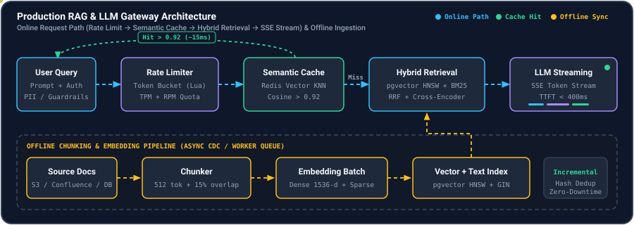
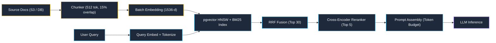
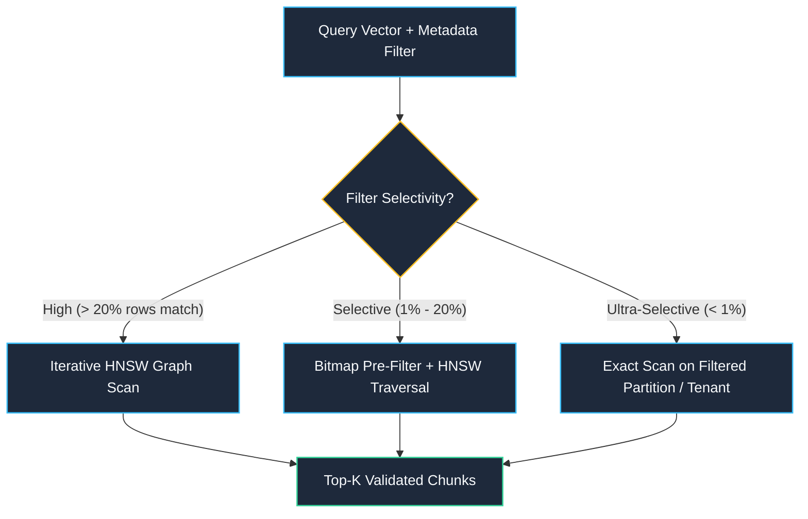
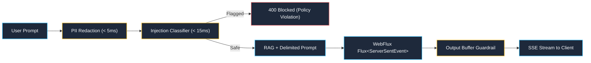
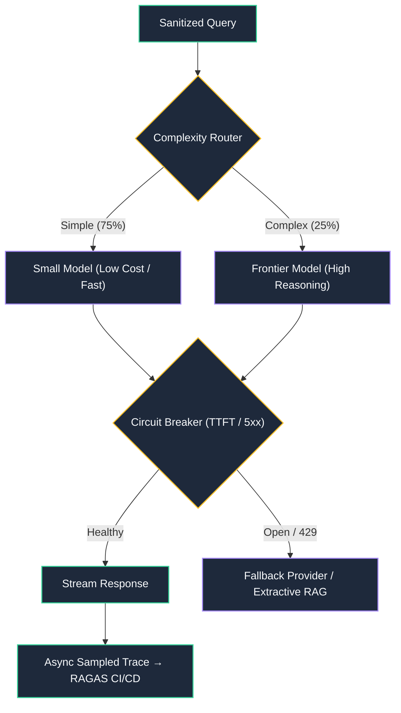
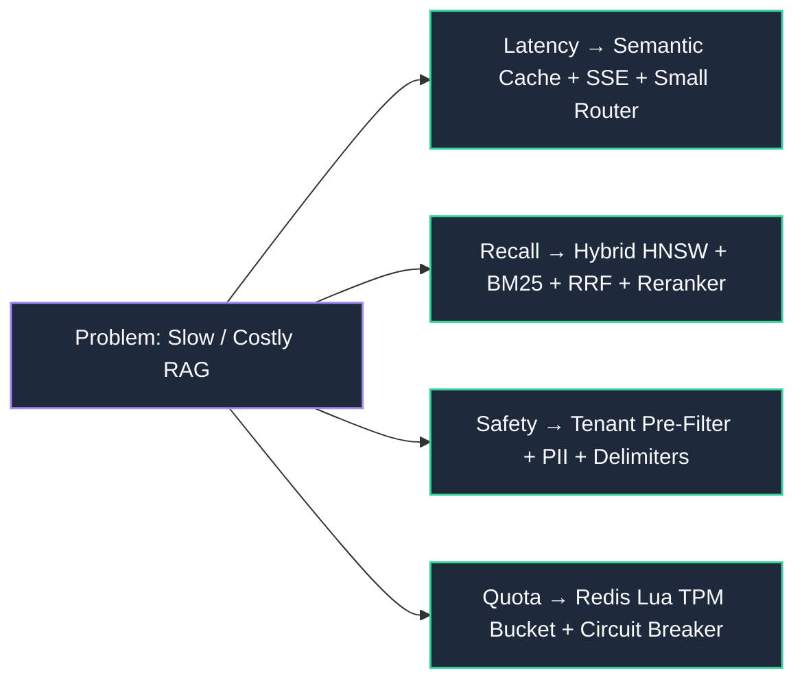

# AI & LLM Backend Architecture



Production AI backends are distributed systems problems wrapped around probabilistic model inference. Unlike traditional CRUD microservices with predictable millisecond latencies and deterministic outputs, LLM-backed services face high per-request compute costs, multi-second generation tails, strict provider token quotas, and non-deterministic failure modes such as hallucination and prompt injection.

This guide covers the end-to-end architecture of a production **Retrieval-Augmented Generation (RAG)** and **LLM Gateway** platform—from offline ingestion and HNSW vector indexing to semantic caching, token-aware rate limiting, Server-Sent Events (SSE) streaming, guardrails, and automated RAGAS evaluation.

---

## Table of Contents

- [1. Production RAG Pipeline Architecture](#1-production-rag-pipeline-architecture)
- [2. Vector Databases & HNSW Indexing](#2-vector-databases--hnsw-indexing)
- [3. Semantic Caching & Token-Based Rate Limiting](#3-semantic-caching--token-based-rate-limiting)
- [4. Streaming Responses (SSE) & Guardrails](#4-streaming-responses-sse--guardrails)
- [5. Evaluation, Cost & Latency Optimization](#5-evaluation-cost--latency-optimization)
- [6. AI Backend Interview Q&A](#6-ai-backend-interview-qa)

---

## 1. Production RAG Pipeline Architecture

A production RAG system splits into two decoupled paths: an **asynchronous offline ingestion pipeline** that keeps the knowledge index fresh without blocking user traffic, and a **low-latency online retrieval-and-generation path**.

### 1.1 Ingestion & Chunking Strategies

Raw enterprise documents (PDFs, Markdown, Confluence pages, SQL rows) must be normalized, deduplicated via content hashes (e.g., SHA-256), and split into retrieval units before embedding:

| Strategy | Mechanism | Best For | Trade-off |
| :--- | :--- | :--- | :--- |
| **Fixed-Size + Overlap** | Split every `N` tokens (e.g., 512) with 10–20% sliding overlap | Homogeneous prose, fast baseline | Can sever sentences or tables mid-thought |
| **Recursive / Structural** | Split along headings (`#`), paragraphs, then sentences | Markdown, code, technical docs | Chunk sizes vary; requires max-token cap |
| **Semantic Chunking** | Embed sentences and split where cosine distance spikes | Multi-topic transcripts, long articles | Higher ingestion compute cost |
| **Parent-Child (Small-to-Big)** | Index small 128-token child chunks; return 1024-token parent | High precision retrieval + rich LLM context | Requires parent-ID join at query time |

### 1.2 Embeddings, Hybrid Search & Reranking

Dense vector search excels at semantic paraphrases (*"reset MFA"* → *"two-factor recovery"*), whereas sparse lexical search (**BM25**) excels at exact identifiers, error codes, SKUs, and acronyms (*"ERR_SSL_PIN_04"*). Production pipelines combine both:

1. **Dual Retrieval**: Execute an HNSW dense vector query (`top_k = 50`) and a BM25 full-text query (`top_k = 50`) in parallel.
2. **Reciprocal Rank Fusion (RRF)**: Merge the two ranked lists without needing score normalization:
   $$\text{RRF}(d) = \sum_{r \in \{\text{dense}, \text{bm25}\}} \frac{1}{k + \text{rank}_r(d)}, \quad k = 60$$
3. **Cross-Encoder Reranking**: Pass the top 20–30 fused candidates through a cross-encoder (e.g., `bge-reranker-v2` or Cohere Rerank) that jointly attends to `(query, chunk)` pairs, keeping the top 5–8 chunks for prompt assembly.

### 1.3 Prompt Assembly & Context Budgeting

Assemble the final prompt with strict token budgeting so context never overflows the model window or starves output generation:
- **System Instructions & Guardrails**: Fixed ~300–500 tokens.
- **Conversation History**: Sliding window or summarized turns (~1,000 tokens).
- **Retrieved Context**: Top-K reranked chunks with `[source_id]` citations (~2,500–4,000 tokens).
- **Lost-in-the-Middle Mitigation**: Place the highest-scoring chunks at the very beginning and very end of the context block, where transformer attention is strongest.



> [!IMPORTANT]
> **Never couple document ingestion to the synchronous request path.** Always run parsing, chunking, and embedding behind a durable queue (Kafka/SQS) with idempotent content-hash keys, and use blue/green index aliases or incremental upserts so schema or embedding-model migrations never cause search downtime.

---

## 2. Vector Databases & HNSW Indexing

### 2.1 Exact k-NN vs. IVF vs. HNSW

| Index Type | Search Complexity | Recall@10 | Memory Footprint | Key Tunables |
| :--- | :--- | :--- | :--- | :--- |
| **Exact k-NN (Flat)** | $O(N \cdot d)$ | 100% | Low (vectors only) | None (brute-force scan) |
| **IVF (Inverted File)** | $O((N / k_{\text{list}}) \cdot n_{\text{probe}} \cdot d)$ | 85–95% | Low–Medium | `nlist` (clusters), `nprobe` (buckets scanned) |
| **HNSW (Hierarchical NSW)** | $O(\log N \cdot M \cdot d)$ | 95–99%+ | High (multi-layer graph edges) | `M` (links/node), `ef_construction`, `ef_search` |

**HNSW** builds a multi-layered proximity graph. Queries enter at the sparse top layer, greedily hop toward the query vector, and descend layer by layer to the dense base layer (`layer 0`) where a beam search of width `ef_search` collects the nearest neighbors. Increasing `ef_search` trades latency for higher recall at query time without rebuilding the index.

### 2.2 `pgvector` vs. Dedicated Vector Stores (Pinecone / Qdrant)

- **`pgvector` (PostgreSQL)**: Best when vector counts are under ~10–50M and you need **ACID transactions**, **relational joins** (e.g., RBAC tenant permissions, billing status), and single-database operational simplicity. Use `halfvec` (float16) or binary quantization to cut HNSW RAM usage by 2–32x.
- **Qdrant / Pinecone / Milvus**: Best at **100M+ vectors**, high-QPS multi-tenant sharding, or when you need native **SIMD-accelerated filtered HNSW**, tiered disk-backed `mmap` segments, and independent compute/storage scaling.

### 2.3 Metadata Pre-Filtering vs. Post-Filtering

Filtering by `tenant_id`, `acl_role`, or `created_at` alongside vector similarity introduces a classic pitfall:
- **Post-Filtering** (run HNSW top-K, then apply `WHERE tenant_id = ?`): Fast, but if a tenant owns only 1% of the corpus, a `top_k = 20` scan may return **0 results** after filtering.
- **Pre-Filtering** (apply `WHERE` bitmap first, then scan): Guarantees exact tenant isolation, but if done naively without graph awareness, it degrades to a slow sequential scan.
- **Single-Stage / Iterative HNSW Scan** (used by Qdrant's filterable HNSW and `pgvector 0.8+` iterative scan): Evaluates the filter predicate *during* graph traversal, automatically expanding the beam until `K` valid filtered neighbors are found.



> [!TIP]
> In multi-tenant `pgvector` deployments, **partition tables by `tenant_id`** (or hash-partition large shared tables) and enable `SET hnsw.iterative_scan = strict_order;` (`pgvector >= 0.8.0`). This keeps each tenant's HNSW graph hot in `shared_buffers` and eliminates empty result sets under strict ACL filters.

---

## 3. Semantic Caching & Token-Based Rate Limiting

### 3.1 Semantic Caching (`Cosine Similarity > 0.92`)

Exact-match string caching fails on natural language because *"How do I rotate my API key?"* and *"Steps to regenerate API credentials"* have different hashes but identical intent. A **Semantic Cache** embeds the incoming query (using a fast, small encoder like `bge-small` or `text-embedding-3-small`) and runs a KNN lookup in **Redis Vector Search** (or Qdrant):

- **Cache Hit (`cosine > 0.92`)**: Return the cached response immediately in **~15–30 ms**, saving 100% of upstream LLM inference cost and avoiding downstream retrieval.
- **Threshold Tuning**: Setting the threshold too low (`< 0.88`) causes false hits (e.g., *"cancel order #123"* matching *"cancel order #456"*). Always scope cache keys by `tenant_id`, `model_id`, and `system_prompt_hash`, and bypass semantic caching for queries containing volatile entities (dates, IDs, user-specific state).

### 3.2 Token Accounting vs. RPM & Redis Lua Token Bucket

Traditional API gateways rate-limit by **Requests Per Minute (RPM)**, which fails for LLMs because one request might consume **50 tokens** while another consumes **32,000 tokens**. Production LLM gateways enforce dual **RPM + TPM (Tokens Per Minute)** quotas using an atomic **Redis Lua Token Bucket**:

1. **Pre-Flight Estimation**: Before calling the LLM, count `input_tokens` locally (using `tiktoken` / `jtokkit`) and add `max_tokens` (or a historical p75 completion estimate) as the **reserved cost**.
2. **Atomic Deduction**: Execute a single Redis Lua script that refills tokens based on elapsed time (`now - last_refill`) and atomically checks/deducts `reserved_tokens`.
3. **Post-Stream Reconciliation**: Once the LLM finishes streaming, refund any unused `reserved_tokens - actual_output_tokens` back to the tenant's bucket.

```mermaid
sequenceDiagram
  autonumber
  participant C as "Client"
  participant GW as "LLM Gateway"
  participant RL as "Redis Lua (Token Bucket)"
  participant SC as "Redis Vector (Semantic Cache)"
  participant LLM as "Upstream LLM"

  C->>GW: "POST /v1/chat (prompt)"
  GW->>RL: "EVALSHA consume_tokens(tenant, est_tokens)"
  alt "Quota Exceeded"
    RL-->>GW: "DENY (retry_after_ms)"
    GW-->>C: "429 Too Many Requests + Retry-After"
  else "Allowed"
    RL-->>GW: "OK (remaining_tokens)"
    GW->>SC: "KNN Search (query_vec, tenant_id)"
    alt "Cosine &gt; 0.92 (Cache Hit)"
      SC-->>GW: "Cached Answer (~15ms)"
      GW-->>C: "200 SSE Stream (Cached)"
    else "Cache Miss"
      SC-->>GW: "MISS"
      GW->>LLM: "Stream Completion"
      LLM-->>GW: "Token Chunks + usage(actual_tokens)"
      GW-->>C: "SSE Token Stream"
      GW->>RL: "Refund (est_tokens - actual_tokens)"
      GW->>SC: "Async Set (query_vec → response, TTL)"
    end
  end
```

> [!WARNING]
> **Never rely on read-then-write Redis `GET`/`SET` for token buckets.** Under concurrent burst traffic, non-atomic checks suffer race conditions that allow tenants to blow past TPM quotas. Always encapsulate refill + deduction in a single Redis Lua script or Redis `EVALSHA` call.

---

## 4. Streaming Responses (SSE) & Guardrails

### 4.1 Time-to-First-Token (TTFT) & Spring WebFlux `Flux<ServerSentEvent>`

Users perceive latency primarily through **Time-to-First-Token (TTFT)** rather than total generation time. Streaming tokens over **Server-Sent Events (SSE)** (`text/event-stream`) keeps TTFT under **300–500 ms** even when full responses take 8 seconds.

In reactive Java/Spring backends (**Spring WebFlux**), avoid blocking servlet threads (`RestTemplate` / Tomcat thread-per-request), which exhausts the thread pool during slow LLM streams. Instead, pipe the upstream `WebClient` stream directly into a `Flux<ServerSentEvent<String>>` with backpressure, heartbeat comments (to prevent ALB/Nginx idle timeouts), and cancellation propagation when the client disconnects:

```java
@GetMapping(value = "/api/v1/chat/stream", produces = MediaType.TEXT_EVENT_STREAM_VALUE)
public Flux<ServerSentEvent<String>> streamChat(@RequestParam String query,
                                                @RequestHeader("X-Tenant-Id") String tenantId) {
    return guardrailService.validateAndRedact(query, tenantId)
        .flatMapMany(cleanPrompt -> llmWebClient.post()
            .uri("/v1/chat/completions")
            .bodyValue(Map.of("model", "gpt-4o-mini", "stream", true, "messages", cleanPrompt))
            .retrieve()
            .bodyToFlux(String.class)
            .map(token -> ServerSentEvent.<String>builder()
                .event("token")
                .data(token)
                .build()))
        .doOnCancel(() -> log.info("Client disconnected; upstream LLM stream cancelled"));
}
```

### 4.2 Input/Output Guardrails: PII Redaction & Prompt Injection Defense

Guardrails run as low-latency middleware stages **before** retrieval/generation and **during/after** streaming:

- **PII Redaction (Presidio / Regex + NER)**: Detect emails, SSNs, credit cards, and API keys on ingress. Replace them with reversible placeholders (`<EMAIL_1>`) stored only in ephemeral request state, and re-hydrate on egress if authorized.
- **Prompt Injection Defense**:
  - **Input Classifier**: Run a lightweight DeBERTa/DistilBERT classifier (< 15 ms) to flag jailbreaks and instruction overrides.
  - **Structural Delimiters**: Wrap untrusted retrieved chunks in explicit XML-style boundaries (`<retrieved_context>...</retrieved_context>`) and instruct the system prompt to treat all text inside as data, never executable instructions.
  - **Output Validation**: Scan streamed output buffers (e.g., sliding 128-char window) for leaked system prompts, toxic content, or malformed JSON schemas before flushing to the client.



---

## 5. Evaluation, Cost & Latency Optimization

### 5.1 Model Routing (Small vs. Frontier) & Batching

Sending every query to a frontier model wastes 70–85% of inference spend. A **Model Router** classifies query complexity in < 10 ms:
- **Tier 1 (Small / Fast Models, e.g., `gpt-4o-mini`, `claude-3-haiku`, `Llama-3-8B`)**: Handles ~75% of traffic—FAQ lookups, summarization, classification, and simple RAG extraction.
- **Tier 2 (Frontier / Reasoning Models, e.g., `gpt-4o`, `claude-3.5-sonnet`)**: Handles multi-hop synthesis, complex code generation, or low-confidence Tier 1 escalations.
- **Continuous Batching & Prompt Caching**: For self-hosted vLLM/TGI clusters, **PagedAttention + continuous batching** eliminates GPU idle bubbles across variable-length streams. For hosted APIs, pin static system prompts and few-shot examples at the prefix to trigger **KV-cache prompt caching** (50–75% input token discount + lower TTFT).

### 5.2 RAGAS Evaluation Metrics

Offline CI/CD gates and sampled production traces should continuously score RAG quality using **RAGAS** (LLM-as-a-Judge) across four core metrics:

| Metric | What It Measures | Failure Signal |
| :--- | :--- | :--- |
| **Context Precision** | Are relevant chunks ranked near the top? | Weak reranker or noisy chunking |
| **Context Recall** | Did retrieval capture all ground-truth facts? | `top_k` too low, missing BM25 hybrid search |
| **Faithfulness** | Are all answer claims grounded in retrieved context? | Hallucination; tighten system prompt / temperature |
| **Answer Relevance** | Does the response directly address the user query? | Over-truncated context or off-topic retrieval |

### 5.3 Circuit Breaking & Provider Fallbacks

Upstream LLM providers experience regional 429s, 503s, and latency spikes. Wrap each provider client in a **Resilience4j Circuit Breaker** (open when failure rate > 50% or TTFT > 5s over a 20-call sliding window) with automatic fallback chains:
`Primary (OpenAI us-east) → Secondary (Azure OpenAI / Anthropic) → Degraded (Cached / Extractive Snippet)`.



---

## 6. AI Backend Interview Q&A

**Q1: Why use Hybrid Search (HNSW + BM25) instead of pure vector search?**
Pure dense embeddings struggle with exact lexical matches—error codes (`ORA-00942`), product SKUs, UUIDs, and domain acronyms—because subword tokenizers compress rare strings into generic semantic neighborhoods. Combining HNSW dense retrieval with BM25 sparse retrieval via **Reciprocal Rank Fusion (RRF)** and a cross-encoder reranker captures both semantic intent and exact keyword precision.

**Q2: How do you prevent multi-tenant data leakage in a shared vector database?**
Enforce tenant isolation at the **storage/query layer**, never in application post-processing. Pass `tenant_id` (and user ACL groups) from verified JWT claims into the vector store's metadata pre-filter or table partition (`pgvector` partitioning / Qdrant payload index), and pair it with iterative HNSW scanning so strict filters never return empty results.

**Q3: Why does standard RPM rate limiting fail for LLM APIs, and how do you fix it?**
A single 32k-token prompt costs 600x more GPU compute and provider quota than a 50-token prompt. Implement **token-based rate limiting (TPM)** alongside RPM using an atomic **Redis Lua token bucket**: estimate `input_tokens + max_tokens` pre-flight, deduct atomically, and reconcile/refund `reserved - actual` tokens after the stream completes.

**Q4: How do you reduce Time-to-First-Token (TTFT) in a RAG pipeline?**
1. Put a **Semantic Cache** (`cosine > 0.92`) in front of retrieval (~15 ms hit).
2. Parallelize query embedding, BM25 tokenization, and guardrail checks.
3. Use a fast bi-encoder + lightweight cross-encoder (`top_k = 20 → 5`) rather than stuffing 50 chunks into the LLM.
4. Enable **KV-cache prompt prefixing** and stream tokens end-to-end via non-blocking **SSE (`Flux<ServerSentEvent>`)**.

**Q5: How do you defend against indirect prompt injection inside retrieved RAG documents?**
Treat retrieved documents as untrusted data: wrap chunks in explicit delimiters (`<context>...</context>`), instruct the model in the system prompt to ignore instructions inside those tags, run an input/chunk injection classifier on ingestion and query time, and enforce **least-privilege tool execution** (e.g., require human confirmation before executing state-changing tool calls triggered by RAG context).

**Q6: When would you choose `pgvector` over a dedicated vector database like Qdrant or Pinecone?**
Choose `pgvector` when your dataset is under ~10–50M vectors, you already run PostgreSQL, and you need **ACID transactional consistency** between document metadata, RBAC permissions, and embeddings without operating a separate distributed cluster. Move to Qdrant/Pinecone when you exceed 100M+ vectors, require high-QPS multi-region sharding, or need disk-backed `mmap` HNSW segments.



> [!NOTE]
> In system design interviews, always anchor your AI architecture numbers to concrete SLAs: **TTFT < 400 ms**, **Semantic Cache Hit ~15–30 ms**, **Hybrid Retrieval + Rerank < 120 ms**, and **RAGAS Faithfulness > 0.85** before promoting prompt or chunking changes to production.
